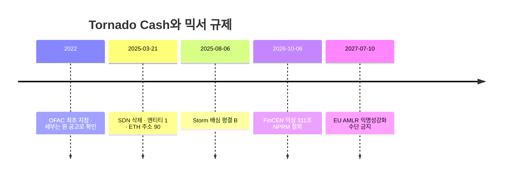
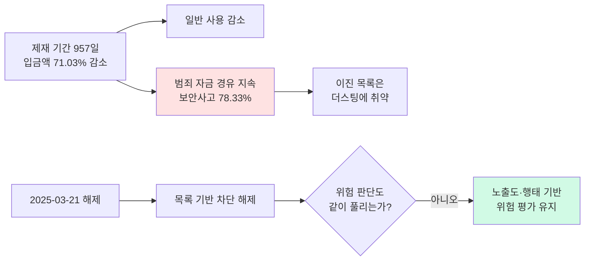
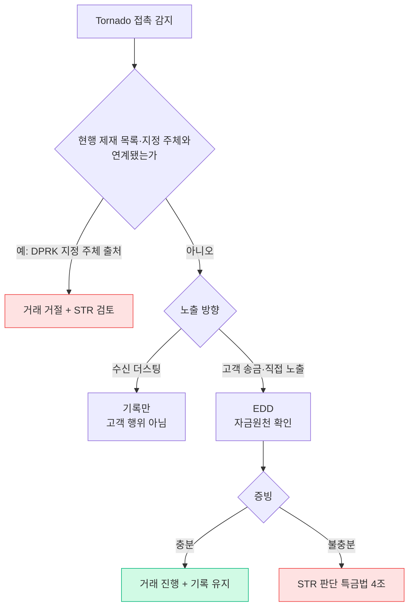

# Day 51 — 케이스: Tornado Cash + DeFi 제재의 한계

> 코드를 제재할 수 있는가, 제재를 풀면 위험도 풀리는가? ⏱️ ~80분. 마지막 업데이트: 2026-10-21.

## 📖 오늘 뭘 배우나

Tornado Cash 사건은 "**코드 자체를 제재할 수 있는가**"와 "**제재를 풀면 위험도 풀리는가**"라는 두 질문을 동시에 던집니다. 2026-10-21 기준 원문으로 확인되는 흐름은 2025-03-21 OFAC 해제(엔티티 1·ETH 주소 90개) → 2025-08-06 Roman Storm 배심 평결(무면허 송금업 공모 유죄, B) → 2026-10-06 미국 믹싱 §311 제안규칙 철회(withdrawn) → 2027-07-10 EU AMLR 익명성강화 수단 취급 금지(enacted-not-in-force)입니다. "코드는 목록에서 빠져도 운영자는 송금업 규제로 유죄가 될 수 있다", 그리고 "해제 후에도 보안사고의 78.33%가 경유"라는 측정이 오늘의 결론입니다.

<!-- MAP-START -->
## 🗺 오늘의 지도


<!-- MAP-END -->

## 🎯 핵심 질문
1. 2025-03-21 해제가 의미하는 것과 의미하지 않는 것?
2. 제재 효과를 잰 학술 측정(WWW '26)은 무엇을 보여 주나?
3. Roman Storm 형사 재판이 제재 해제와 별개인 이유?

## 📖 읽기 (~55분)
- 메인: [`../notes/6-cases/tornado-cash.md`](../notes/6-cases/tornado-cash.md)

## 🌐 외부 자료 (~20분)
- [OFAC 2025-03-21 Recent Actions](https://ofac.treasury.gov/recent-actions/20250321)
- [Liu 외 — Tornado Cash 제재 효과 측정 (arXiv 2507.11721, WWW '26)](https://arxiv.org/abs/2507.11721)
- [Willkie — Storm 평결 요약 (2025-08-08)](https://complianceconcourse.willkie.com/articles/tornado-cash-cofounder-convicted-for-conspiring-to-operate-an-unlicensed-money-transmitting-business/)

## 🛠️ 미니 챌린지 (~5분)
- "Tornado 노출 wallet → 회사 정책" 의사결정 트리 메모 — **제재 출구**(목록 대조)와 **위험 출구**(노출도·행태 평가)를 분리해서
- 더스팅 공격(소액을 Tornado 관련 주소에서 고객 주소로 보냄)이 목록 대조 룰을 어떻게 오작동시키는지 3줄

## ✅ 체크포인트
- [ ] 2025-03-21 해제: 엔티티 1개·ETH 주소 90개(주 1·대체 89), Semenov [DPRK3] 유지
- [ ] 제재 후 957일 입금액 71.03% 감소, 보안사고 78.33% 여전히 경유 (Liu 외)
- [ ] Storm: 무면허 송금업 공모 유죄, 자금세탁·IEEPA 공모 배심 불일치 (2025-08-06, B)
- [ ] 미국 믹싱 §311 NPRM withdrawn(관보 2026-10-06), EU AMLR 제79조 2027-07-10 적용 예정
- [ ] 회사 정책: 제재 해제 ≠ 위험 해제

## 💭 오늘의 한 줄

## 💼 실무 현장 (Industry Reality)

### 한국 VASP에서는

한국 법령에 "믹서 사용 = STR"이라는 규정은 없다. STR 은 **특금법 §4**의 "의심되는 합당한 근거"에 대한 판단이고, 거래모니터링 체계는 FIU 고시 「자금세탁방지 업무규정」 제76~81조(2026-01-22 시행)가 정한다([법제처 DRF](https://www.law.go.kr/DRF/lawService.do?OC=test&target=admrul&ID=2100000267264&type=XML)). 이전 판은 STR 근거를 "특금법 §5의2"로 적었는데 틀렸다 — §5의2 는 고객확인, §5의3 은 트래블룰이다. 해외 제재 목록 변경은 한국 STR 판단을 자동으로 바꾸지 않는다. 이전 판의 "4대 거래소 전원 내부 블랙리스트 유지", "Mixing 노출 >1% EDD·>5% freeze 표준", "DAXA 가이드라인 명시"는 공개 근거가 없어 삭제했다.

### 글로벌에서는

- **해제(2025-03-21)**: 재무부는 "exercised [its] discretion to remove the economic sanctions against Tornado Cash"라고 하면서도 "continue to monitor closely any transactions that may benefit malicious cyber actors or the DPRK"라고 덧붙였다([OFAC 2025-03-21](https://ofac.treasury.gov/recent-actions/20250321)). 해제의 근거가 된 소송·판결 세부(이전 판의 항소심 판결 논리)는 이 저장소 근거 자료에서 원문 확인하지 않았다 — **공개 근거 미확인**.
- **형사 트랙**: Storm 은 무면허 송금업 운영 공모로 유죄 평결을 받았다(B). 선고·재심 일정은 확인되지 않았다.
- **규제 단위 이동**: FinCEN 은 2026-10-05 CVC 믹싱 §311 제안규칙(88 FR 72701)을 철회(관보 2026-10-06)하고, 같은 주 A7 네트워크 특별조치 NPRM(proposed)을 냈다([Federal Register 2026-20429](https://public-inspection.federalregister.gov/2026-20429.pdf); [Federal Register 2026-20371](https://public-inspection.federalregister.gov/2026-20371.pdf)). 유형 규제에서 네트워크 차단으로.

이전 판의 거래소·발행사별 재분류·blacklist 해제 서술은 근거 자료로 확인되지 않아 삭제했다.

### 제재 효과 — 학술 측정 (Liu 외, WWW '26)



한계: Ethereum 단일 체인, "보안사고" 정의는 초록에 없다([arXiv 2507.11721](https://arxiv.org/abs/2507.11721)).

### 회사 정책 의사결정 — 목록 출구와 위험 출구 분리

```python
def mixer_exposure_review(tx):
    # 1) 제재 출구 — 현행 공식 목록만. 해제된 주소는 여기서 빠진다
    if sanctions_list.contains(tx.counterparty):
        return "REJECT_AND_REVIEW_STR"
    # 2) 위험 출구 — 목록과 무관하게 유지. 임계값은 자사 튜닝(공개 기준 없음)
    exp = analytics.exposure(tx, category="mixer")
    if exp.direction == "inbound_dust":
        return "LOG_ONLY"            # 더스팅 의심: 고객 행위 아님
    if exp.direct and exp.amount >= TUNED_THRESHOLD:
        return "EDD"                 # 자금원천 확인
    if exp.indirect:
        return "ANALYST_REVIEW"      # 즉시 거래 너머 추적 (FATF 2021 para 277~278)
    return None
```

이전 판의 "지정 기간 노출 = BLOCK + STR(OFAC 위반 소급)" 분기는 근거가 없어 뺐다. 과거 노출은 위험평가 입력이지 자동 차단 사유가 아니다.



### 법적 근거 (정정)

- **특금법 §4** — 의심거래보고(STR)
- **FIU 고시 자금세탁방지 업무규정 제76~81조** — 거래모니터링체계(2026-01-22 시행)
- **FATF 2021 RBA 가이던스 para 277~278** — 고위험 상황에서 "extend beyond the immediate transaction"
- **EU AMLR(2024/1624) 제79조** — CASP 의 익명성강화 수단 계좌 보유 금지, 2027-07-10 적용 예정

이전 판의 "특금법 §5의2 = 자체 위험평가 권한", "§5의3 = STR", "OFAC 50% Rule 자동 적용", "AMLR Article 8"은 조문을 잘못 짚었거나 근거를 확인하지 못해 고쳤다.

### 규제 당국 질의 대응

FIU 검사 시 "Tornado 해제됐는데 왜 계속 EDD?"라는 질의에 답변:
- "해외 제재 **목록 변경**과 자사 **위험평가**는 별개 — 정책 변경 근거를 정책 문서에 기록"
- "해제 후에도 보안사고 78.33% 경유라는 측정(Liu 외)이 위험평가 근거"
- 문서화: 정책 결정 근거·AMLO 결재·이사회 승인

### 자주 나오는 오해

- **"제재 해제됐으니 지워도 된다"** — 목록에서는 지우고, 위험평가에서는 유지한다. 제재 해제 ≠ AML 위험 해제.
- **"코드는 법적 책임 없다"** — 정부 제재와 개발자 형사 책임은 별개 트랙. Storm 유죄 죄목은 제재가 아니라 무면허 송금업 공모다(B).
- **"미국이 믹서 규칙을 철회했으니 규제 완화"** — 같은 주 특정 네트워크 차단 조치(A7)가 나왔다. 규제의 단위가 바뀐 것이다.
