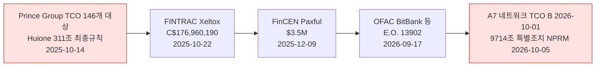
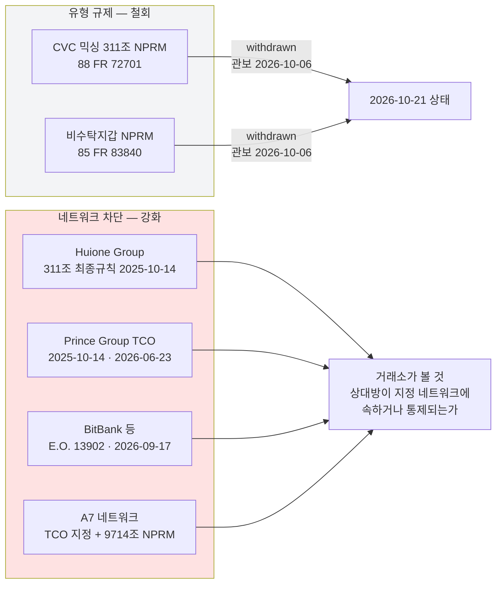

# Day 52 — 케이스: 글로벌 Enforcement — Paxful · Prince/Huione · A7 (Binance·OKX 재검증)

> 거래소 거액 합의에서 네트워크 단위 차단으로. ⏱️ ~80분. 마지막 업데이트: 2026-10-21.

## 📖 오늘 뭘 배우나

2025~2026년 원문으로 확인되는 가상자산 집행은 "개별 거래소에 대한 거액 합의"보다 **특정 조직·네트워크 단위 차단**(Prince Group·Huione·BitBank·A7)으로 옮겨 갔습니다. 개별 사업자 제재(Paxful $3.5M, FINTRAC Xeltox C$176,960,190)의 사유는 등록·AML 프로그램·SAR 같은 **기본 의무**였고, **트래블룰 위반만으로 제재된 사건은 2024-01-01~2026-10-21 어느 관할에서도 확인되지 않습니다.** 이전 판이 다룬 Binance(2023)·OKX(2025)·BitMEX·Bittrex·BitGo 의 금액·형량·모니터십은 이 저장소 근거 자료로 확인되지 않아 수치를 뺐습니다 — 인용하려면 DOJ·FinCEN·OFAC 원 공고를 직접 확인합니다.

<!-- MAP-START -->
## 🗺 오늘의 지도


<!-- MAP-END -->

## 🎯 핵심 질문
1. Paxful(2025-12-09) 제재 사유 3가지는? 트래블룰은 포함됐나?
2. FINTRAC Xeltox 에서 "Travel rule"은 어떤 지위로 등장하나?
3. Prince Group·Huione·BitBank·A7 조치가 보여 주는 "유형 → 네트워크" 이동이란?

## 📖 읽기 (~55분)
- 메인: [`../notes/6-cases/major-enforcement.md`](../notes/6-cases/major-enforcement.md) — 1~2절

## 🌐 외부 자료 (~20분)
- [FinCEN — Paxful $3.5M (2025-12-09)](https://www.fincen.gov/news/news-releases/fincen-assesses-35-million-penalty-against-paxful-facilitating-suspicious)
- [미 재무부 sb0278 — Prince Group·Huione (2025-10-14)](https://home.treasury.gov/news/press-releases/sb0278)
- [FINTRAC — Xeltox(Cryptomus) AMP (2025-10-22)](https://fintrac-canafe.canada.ca/pen/amps/pen-2025-10-22-eng)
- [Federal Register 2026-20371 — A7 특별조치 NPRM](https://public-inspection.federalregister.gov/2026-20371.pdf)

## 🛠️ 미니 챌린지 (~5분)
- 2025-10 ~ 2026-10 집행 사례 5건 (Prince/Huione·Xeltox·Paxful·BitBank·A7) 표로 (일자/기관/근거/사유)
- "주소가 공고에 없는 지정(BitBank)"을 거래소 스크리닝이 어떻게 잡을지 메모

## ✅ 체크포인트
- [ ] Paxful $3.5M — MSB 미등록·AML 프로그램 미비·SAR 미제출, "willfully violated the BSA" 인정, 트래블룰 사유 아님
- [ ] Xeltox C$176,960,190 — "Travel rule"은 정책 결함 목록의 한 항목일 뿐 독립 위반 아님
- [ ] Prince Group TCO(146개 대상)·Huione §311 최종규칙(2025-10-14), 2026-06-23 9명·26개 법인 추가
- [ ] FinCEN 믹싱·비수탁지갑 NPRM withdrawn(관보 2026-10-06), A7 특별조치 NPRM proposed
- [ ] Binance·OKX 수치는 원 공고 확인 전에는 인용하지 않는다

## 💭 오늘의 한 줄

## 💼 실무 현장 (Industry Reality)

### 한국 VASP에서는

한국 FIU 제재 사유도 미국과 같은 축이다 — 고객확인·거래제한·STR·미신고 사업자 거래(두나무 과태료 352억원, 2025-11-06; 트래블룰 사유 아님). 해외 집행에서 한국 실무가 가져올 것은 ① 기본 의무의 **작동 증거** ② 지정 네트워크와의 직·간접 거래 차단이다. 이전 판의 "AMLO 주간 브리핑 필수", "DAXA 차원 해외 거래소 모니터링·KoFIU 제보", "모니터 출신 채용 수요 폭증"은 공개 근거가 없어 삭제했다.

### 글로벌에서는 — 원문으로 확인되는 것

| 일자 | 기관 | 대상 | 근거·사유 |
|---|---|---|---|
| 2025-10-14 | OFAC·영국 FCDO / FinCEN | Prince Group TCO(146개 대상) / Huione Group | E.O. 13581(개정 E.O. 13863) / §311 최종규칙 |
| 2025-10-22 | FINTRAC | Xeltox(Cryptomus) C$176,960,190 | PCMLTFR 156(1)(b) 서면 정책 미비 등 — "Travel rule"은 결함 영역 목록 항목 |
| 2025-12-09 | FinCEN | Paxful $3,500,000 | MSB 미등록·AML 프로그램 미비·SAR 미제출 |
| 2026-06-23 | OFAC | Prince Group 관련 9명·26개 법인 추가 | FinCEN 은 Huione 규칙에 H-Pay 추가 제안 |
| 2026-09-17 | OFAC | 이란 거래소 BitBank 등 | E.O. 13902, 공고에 주소 미기재 |
| 2026-10-01 | OFAC | A7 네트워크 TCO(B) | FinCEN NPRM 각주로 확인 |
| 2026-10-05 | FinCEN | A7 하위대리인 자금이체 금지 NPRM(proposed) | Combating Russian Money Laundering Act §9714 |

출처: [재무부 sb0278](https://home.treasury.gov/news/press-releases/sb0278) · [재무부 sb0538](https://home.treasury.gov/news/press-releases/sb0538) · [FINTRAC](https://fintrac-canafe.canada.ca/pen/amps/pen-2025-10-22-eng) · [FinCEN Paxful](https://www.fincen.gov/news/news-releases/fincen-assesses-35-million-penalty-against-paxful-facilitating-suspicious) · [OFAC 2026-09-17](https://ofac.treasury.gov/recent-actions/20260917) · [Federal Register 2026-20371](https://public-inspection.federalregister.gov/2026-20371.pdf)

이전 판의 Binance 모니터십 구조(모니터 기관명·인원·비용), OKX 모니터십, 벌금 진화표($98K → $4.3B), Paxful "Youssef 5년 보호관찰"은 근거 자료로 확인되지 않아 삭제했다.

### 유형 규제에서 네트워크 차단으로



### 원문 사례에 나온 위반 사유 패턴

```
패턴 1: 등록·신고 없이 영업
  → Paxful(MSB 미등록), 한국 미신고 사업자 27건 접속차단(2026-10-13)

패턴 2: AML 프로그램·서면 정책 미비
  → Paxful, FINTRAC Xeltox(정책 결함 목록에 트래블룰 포함)

패턴 3: 의심거래보고 미제출
  → Paxful(SAR), 두나무(의심거래보고 등)

패턴 4: 지정 조직·네트워크와의 거래 자체
  → Prince/Huione, BitBank, A7
```

이전 판의 "CEO·CCO 개인 형사책임 트리거 패턴"(Binance CZ·BitMEX Hayes·CCO Certification)은 근거 자료로 확인되지 않아 위 사유 패턴으로 대체했다.

### 자주 나오는 오해

- **"우리는 미국 진출 안 하니 상관없다"** — 2026 OFAC 지정은 이란(BitBank)·러시아 연계(A7) 네트워크에 몰렸고, 상대방이 지정 네트워크에 속하는지가 거래소 스크리닝의 질문이 됐다. 역외 효과의 범위는 사안별 법률 검토가 필요하다.
- **"트래블룰 미준수가 가장 큰 제재 리스크"** — 2024-01-01~2026-10-21 트래블룰 위반을 독립 제재 사유로 명시한 사건은 없다. FATF 7차 TU에 따르면 트래블룰 입법 관할의 60%(55/91)는 관련 감독·집행 조치가 한 건도 없었다(para 25). 트래블룰은 제재 리스크보다 **상대방 실사·거래 허용 여부** 문제다.
- **"소형 사업자는 안전"** — Paxful 동의명령은 고의적 BSA 위반("willfully violated the BSA")을 인정했다.
