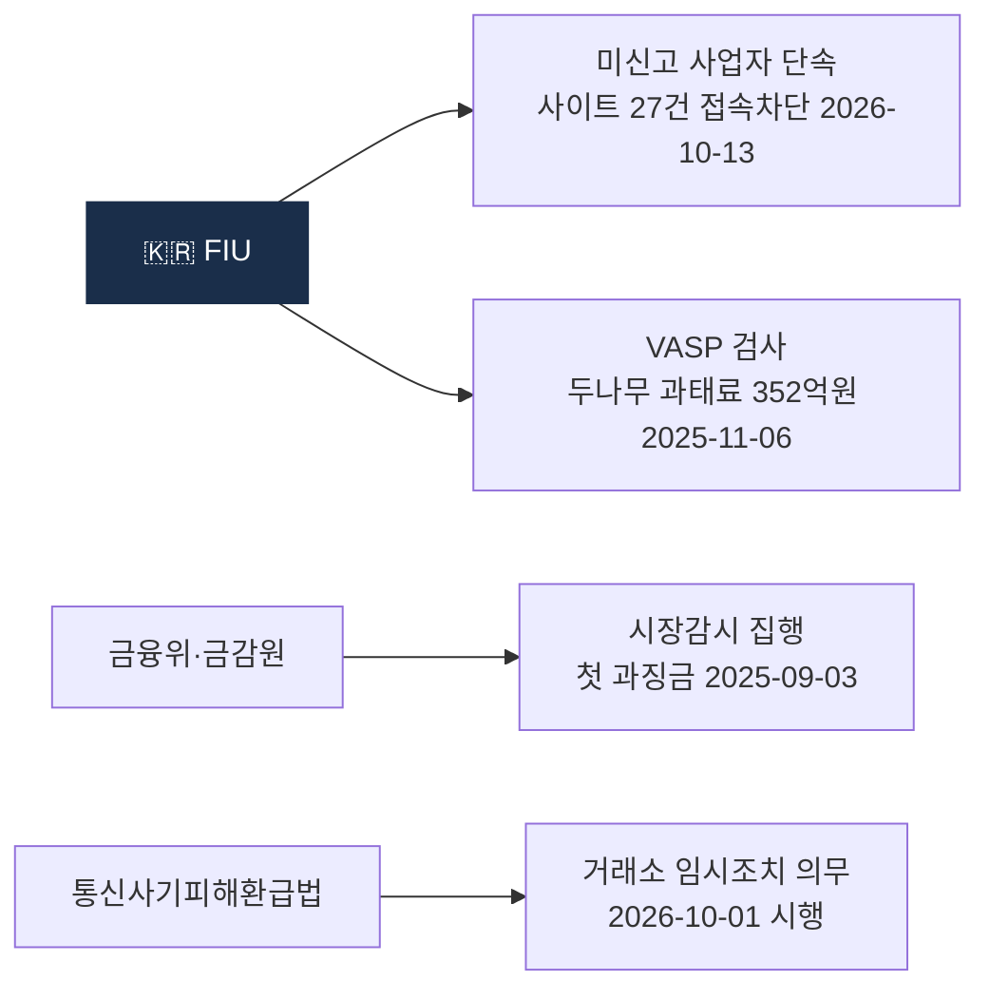
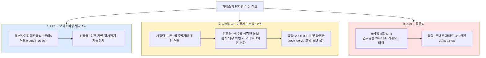
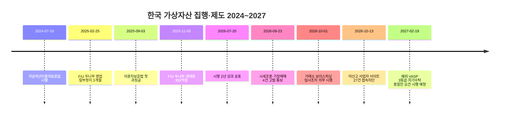

# Day 53 — 케이스: 한국 Enforcement

> 한국 집행은 세 개의 법적 출구로 갈라진다. ⏱️ ~70분. 마지막 업데이트: 2026-10-21.

## 📖 오늘 뭘 배우나

한국은 2025년에 **FIU 과태료 352억원(두나무, 2025-11-06)** 과 **가상자산이용자보호법 첫 과징금(2025-09-03)** 으로 "자율규제·행정지도" 단계를 넘어섰고, 2026-10-01부터는 거래소가 보이스피싱 피해의심 이전을 **법적으로** 지연·정지해야 합니다. 오늘은 한국 집행이 ① FDS·보이스피싱 임시조치(통신사기피해환급법) ② 시장감시(이용자보호법 §12) ③ AML·STR(특금법) 세 출구로 갈라지는 구조와 각 출구의 실제 처분, 그리고 미신고 사업자 단속(2026-10-13 사이트 27건 접속차단)을 정리합니다.

<!-- MAP-START -->
## 🗺 오늘의 지도

<!-- MAP-END -->

## 🎯 핵심 질문
1. 두나무 제재(2025-02-25 영업 일부정지, 2025-11-06 과태료)의 사유는? 트래블룰은 포함됐나?
2. 가상자산이용자보호법 시장감시 집행은 2026-10-21 기준 어디까지 쌓였나?
3. 미신고 사업자는 어떤 수단으로 차단되나?

## 📖 읽기 (~50분)
- 메인: [`../notes/6-cases/korea-enforcement.md`](../notes/6-cases/korea-enforcement.md)
- 보조: [`../notes/6-cases/major-enforcement.md`](../notes/6-cases/major-enforcement.md) — 3절 (한국 요약)
- 보조: [`../notes/2-regulations/korea-user-protection.md`](../notes/2-regulations/korea-user-protection.md) — 8절 (위반 시 처벌)

## 🌐 외부 자료 (~15분)
- [FIU 보도자료 — 두나무 제재 (KDI 경제정보센터 전재)](https://eiec.kdi.re.kr/policy/materialView.do?num=273166)
- [금융위 2026-07-20 — 이용자보호법 시행 2년 성과](https://fsc.go.kr/po010106/87357)
- [금융위 2026-10-13 — 미신고 사업자 사이트 접속차단](https://www.fsc.go.kr/no010101/87916)

## 🛠️ 미니 챌린지 (~5분)
- 같은 "이상 신호" 3개(보이스피싱 피해금 입금, 자전거래 의심, 해외 고위험 주소 출금)를 세 출구 중 어디로 보낼지 분류
- "한국에 진출한 외국 VASP가 가장 위험한 시점" 메모 — 2027-02-19 해외 VASP 3등급 규율 시행을 고려

## ✅ 체크포인트
- [ ] 두나무: 영업 일부정지 3개월(미신고 VASP 거래, 2025-02-25), 과태료 352억원(고객확인·거래제한·의심거래보고 등, 2025-11-06) — 트래블룰(§5의3) 사유 아님
- [ ] 이용자보호법 시세조종 등: 1년 이상 유기징역 또는 이익의 3~5배 벌금(§19①), 과징금 이익의 2배 이하(§17①)
- [ ] 시행 2년(2026-07-20): 조사 완료 40여 건·고발/통보 30여 건·과징금 2건(부당이득의 125~165%)
- [ ] 미신고 사업자: 사이트 27건 접속차단, 수사기관 통보 누적 44개(2026-10-13), 앱마켓 차단 기시행

## 💭 오늘의 한 줄

## 💼 실무 현장 (Industry Reality)

### 한국 VASP에서는

- **AML(FIU)**: 2025-12-09 FIU 제재공시상 두나무 과태료는 35,215,600,000원이고, 제재대상사실은 ①고객확인·거래제한 조치 의무 위반 ②영장 관련 고객 STR 의무 위반 ③**의심거래 감시체계 구축 의무 위반**이다(B)([FIU 보도자료 KDI 미러](https://eiec.kdi.re.kr/policy/materialView.do?num=273166)). 탐지 시스템을 "갖추고 작동시키는 것" 자체가 제재 대상이다. 처분 이후 행정소송 경과, 빗썸·코인원·코빗 제재 세부는 보도 단독(C)이라 다루지 않는다.
- **시장감시**: 2026-09-23 API 초단기 시세조종, 90% 이상 가장매매 등 4건이 고발·통보됐다([금융위 2026-09-23](https://www.fsc.go.kr/no010101/87783)). 2024-08-22 현장점검에서 확인된 거래소 감시시스템은 룰 기반 자체 개발 시스템이었다([금융위·금감원 2024-08-22](https://fsc.go.kr/po010101/82943)).
- **FDS**: 2026-10-01부터 통신사기피해환급법 제2조의5에 따라 거래소도 자체점검을 상시 실시하고 피해의심 시 **가상자산 이전**을 지연·일시정지해야 한다([법제처](https://www.law.go.kr/LSW/lsInfoR.do?lsiSeq=290245&efYd=20261002&ancYnChk=0&chrClsCd=010202&urlMode=lsInfoR)).

이전 판의 "K뱅크 2025 금감원 검사 지적", "Coinone·Korbit EDD·STR 품질 지적", "Bithumb IPO 실사 재조명"은 공개 근거가 없어 삭제했다.

### 한국 enforcement의 실제 3갈래

### 한국 집행 연대기

### 글로벌에서는 한국 시장을

해외 미신고 사업자는 신고 없이 한국 이용자를 상대로 영업하면 단속 대상이다. 2026-10-13 FIU 요청으로 방송미디어통신심의위원회가 사이트 27건을 국내 접속차단했고, 구글·애플 앱마켓의 신규 설치·업데이트 차단은 이미 시행 중이었다([금융위 2026-10-13](https://www.fsc.go.kr/no010101/87916)). 2027-02-19부터는 시행령 제10조의20 제7·8호와 FIU 고시 제2026-2호 제28조의2가 해외 VASP를 세 등급으로 나눠, FATF 고위험국 소재·무인허가 사업자와의 이전을 제한한다(enacted-not-in-force). 이전 판의 "소매 거래량 세계 3~5위", "2025-12 FIU 단속", "카드결제 한국 IP 차단 강화"는 근거가 없어 삭제했다.

### 한국 특유의 enforcement 특성

- **과태료 규모**: 두나무 과태료는 약 860만 건 위반에 대한 총액 352억원이었다. 특금법 과태료의 건당 한도·형량은 [법 원문](https://www.law.go.kr/DRF/lawSearch.do?OC=test&target=law&type=JSON&query=특정금융거래정보의보고및이용등에관한법률)으로 확인한다 — 이전 판의 "건당 1억원"은 근거를 확인하지 못해 삭제했다.
- **영업정지 파급력**: 영업 일부정지(두나무 2025-02-25)처럼 행정처분이 영업 범위 자체를 묶을 수 있다.
- **시장감시 처벌**: 이용자보호법 §10①~④ 위반(미공개중요정보 이용·시세조종·부정거래)은 **1년 이상 유기징역 또는 이익·회피손실의 3~5배 벌금**(§19①), 과징금은 **2배 이하**(산정 곤란 시 40억원 이하, §17①)다([법령 현행본](https://www.law.go.kr/LSW/lsInfoR.do?lsiSeq=290735&efYd=20261002&ancYnChk=0&chrClsCd=010202&urlMode=lsInfoR)). 이전 판의 "최대 무기징역"은 현행 문언과 맞지 않아 고쳤다.

### 자주 나오는 오해

- **"한국은 벌금이 작아서 널널하다"** — 2025-11-06 두나무 과태료 352억원, 2025-02-25 영업 일부정지가 있었다. 이전 판의 "은행 MOU 재체결 거부로 즉시 영업 중단" 서술은 공개 근거가 없어 삭제했다.
- **"트래블룰 위반으로 거래소가 제재받았다"** — 2025~2026 한국 VASP 제재에서 트래블룰(제5조의3) 위반은 사유로 공표되지 않았다.
- **"이상거래는 모두 STR"** — 보이스피싱 피해의심은 임시조치(지연·정지), 불공정거래 우려는 §12 통보, 자금세탁 의심은 STR. 잘못된 출구로 보내는 것이 가장 비싼 실수다.
