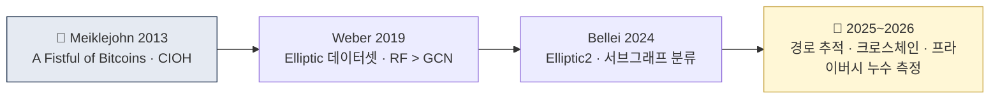
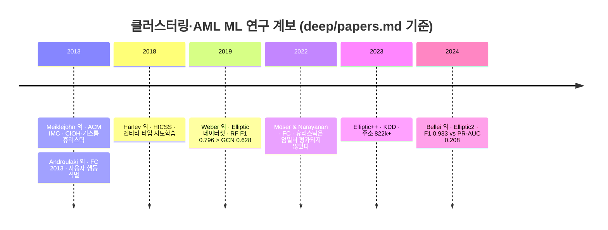

# Day 54 — 학술 논문 — Bitcoin Clustering Heuristics

> AML의 학술적 뿌리. ⏱️ ~90분. 마지막 업데이트: 2026-10-21.

## 📖 오늘 뭘 배우나

블록체인 분석 도구가 쓰는 휴리스틱 상당수는 **2013년 무렵 학계의 Bitcoin 클러스터링 논문**에서 출발했습니다. Meiklejohn 외(ACM IMC 2013) "A Fistful of Bitcoins"가 Common Input Ownership(CIOH)·거스름 휴리스틱을 정리했고, Androulaki 외(FC 2013)가 사용자 행동으로 식별 가능성을 측정했습니다. 이후 Weber 외 2019(Elliptic 데이터셋) → Elliptic++(2023) → Bellei 외 2024(Elliptic2, 서브그래프 분류)로 ML 쪽이 이어졌고, 2025~2026년에는 경로 추적·크로스체인 매칭·프라이버시 누수 측정으로 옮겨 갔습니다. 핵심 교훈 하나: 클러스터링 휴리스틱에는 **표준화된 정확도 수치가 없습니다**(Möser & Narayanan, FC 2022).


<!-- MAP-START -->
## 🗺 오늘의 지도


<!-- MAP-END -->

## 🎯 핵심 질문
1. Common Input Ownership 휴리스틱 첫 제안 논문은?
2. 클러스터링 휴리스틱의 정확도는 왜 단일 수치로 말할 수 없나? (Möser & Narayanan 2022)
3. 최신 ML 기반 클러스터링 방향?

## 📖 읽기 (~70분)
- 메인: [`../deep/papers.md`](../deep/papers.md) — Bitcoin clustering 섹션
- 논문: [Heuristic-Based Address Clustering in Bitcoin (PDF/요약)](https://www.researchgate.net/publication/347083664_Heuristic-Based_Address_Clustering_in_Bitcoin) — 추상 + 결론
- 논문: Meiklejohn et al. "A Fistful of Bitcoins" (ACM IMC 2013) — 추상 검색
- 논문: [Möser & Narayanan 2022 — Resurrecting Address Clustering in Bitcoin (arXiv 2107.05749)](https://arxiv.org/abs/2107.05749) — 초록

## 🛠️ 미니 챌린지 (~15분)
- 논문 1편의 핵심 주장 1줄 + 한계 1줄로 요약
- "이 논문이 지금 KYT 산업에 미친 영향" 3줄

## ✅ 체크포인트
- [ ] 1편 논문 추상 + 결론 읽음
- [ ] 휴리스틱에 표준화된 정확도 수치가 없다는 점과 이유(ground truth 부재·클러스터 붕괴)를 안다
- [ ] ML 기반 보완 방향 안다
- [ ] 학계 ↔ 산업 간격 인지

## 💭 오늘의 한 줄

## 🧭 계보 한눈에 — 휴리스틱에서 서브그래프까지



수치는 [`../deep/papers.md`](../deep/papers.md)에 적힌 값만 옮겼습니다. Weber 2019 수치는 본문 표 기준(B), Elliptic2 수치도 B입니다.

## 💼 실무 현장 (Industry Reality)

### 학계 → 산업 이전 경로

블록체인 분석업체의 클러스터링이 2013년 무렵 학계 휴리스틱(CIOH·거스름 식별)과 같은 원리에 기반한다는 점은 널리 알려져 있지만, 각 회사가 어떤 논문을 어떻게 구현했는지는 **공개 근거가 없습니다**. 이전 판의 창업자 일화(창업 동기·학력)는 이 저장소의 근거 자료로 확인되지 않아 삭제했습니다.

### 기업 데이터 과학 팀

이전 판의 "Chainalysis Research 30~50명", "Coinbase Lynx(2024 GNN 내부 KYT 엔진)·인력 규모", "Elliptic–Imperial College 협업"은 출처가 없어 삭제했습니다(공개 근거 없음). 공개로 확인되는 산학 교류는 **데이터셋 공개**입니다: Elliptic 데이터셋(Weber 외 2019), Elliptic++(Elmougy & Liu, KDD 2023), Elliptic2(Bellei 외, KDD MLF Workshop 2024).

### 학계 → 산업 기술 지도

| 논문·저자 | 연도·학회 | 기여 (공개로 확인되는 것) |
|---|---|---|
| Meiklejohn "A Fistful of Bitcoins" | 2013, ACM IMC | CIOH·거스름 휴리스틱, 거래소 attribution |
| Androulaki et al. | 2013, FC | 사용자 행동 분석으로 식별 가능성 측정 |
| Möser & Narayanan | 2022, FC | 거스름 식별 ground truth, 클러스터 붕괴 탐지·예방 |
| Weber et al. "Elliptic dataset" | 2019, KDD 워크숍 | 거래 203,769 노드·불법 2%, RF가 GCN보다 우수 |
| Bellei et al. "Elliptic2" | 2024, KDD MLF 워크숍 | 라벨 서브그래프 122K, 자금세탁을 서브그래프 분류로 재정의 |

이전 판의 "Coinbase Lynx | 2024 | 온체인 GNN 상용화" 행은 출처가 없어 뺐습니다.

### 학계와 산업의 간격

```
학계 장점: 오픈 benchmark, 재현성, 피어리뷰
학계 한계: 자금세탁 라벨 데이터 부족 — Elliptic·Elliptic2 이후 신규 공개 데이터셋 없음

산업 장점: 자체 귀속 라벨 보유 (규모는 자사 주장, 공개 근거 없음)
산업 한계: 블랙박스, 재현 어려움, 규제상 설명가능성 요구 (FATF 2021 para 276 human/expert analysis)
```

### 자주 나오는 오해

- **"휴리스틱은 옛날 얘기, 이제 AI가 푼다"** — 이전 판의 "현장 KYT의 90% 이상이 룰 기반"은 근거가 없어 삭제했습니다. 공개 근거로 말할 수 있는 것은 두 가지입니다: 2024-08-22 금융당국 점검에서 확인된 거래소 감시시스템은 임계값 룰 기반 자체 개발 시스템이었고([금융위·금감원 2024-08-22](https://fsc.go.kr/po010101/82943)), Weber 2019와 2026 재평가(Akter 외, B)에서 트리 앙상블이 그래프 모델을 앞섰습니다.
- **"학계 정확도가 산업 수준"** — 공개 벤치마크 수치는 그대로 옮기면 안 됩니다. Elliptic 데이터셋에서는 시점 43의 다크마켓 폐쇄 이후 모든 모델 성능이 급락했고(B), Elliptic2의 F1 0.933은 PR-AUC 0.208과 함께 읽어야 합니다([arXiv 2404.19109](https://arxiv.org/abs/2404.19109)). 템플릿 기반 이상 주입 벤치마크는 강건성을 과대평가합니다(TransXion, KDD '26, [arXiv 2604.17420](https://arxiv.org/abs/2604.17420)).
- **"클러스터링 정확도 몇 %"** — Möser & Narayanan(2022) 초록: "current techniques rely on heuristics that have not been rigorously evaluated or optimized"([arXiv 2107.05749](https://arxiv.org/abs/2107.05749)). 벤더에게는 정확도 숫자 대신 ground truth 정의와 클러스터 붕괴 처리 방식을 물으세요.
