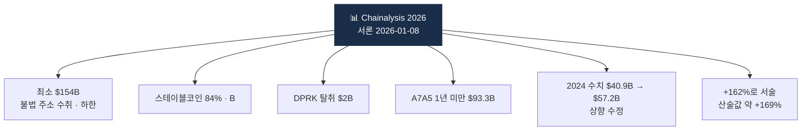
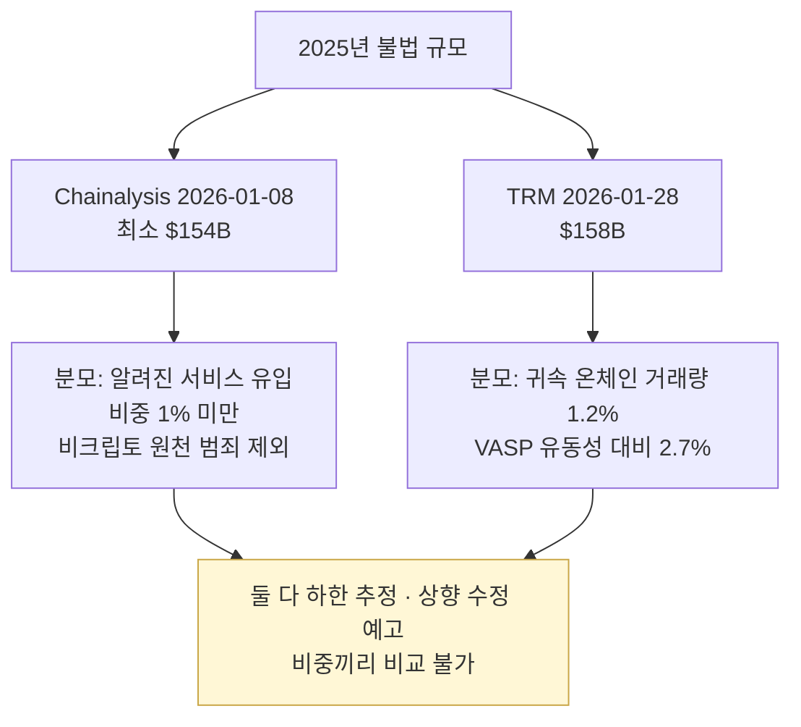

# Day 55 — 산업 리포트 — Chainalysis Crypto Crime 2026

> 가장 많이 인용되는 연간 리포트 정독. ⏱️ ~90분. 마지막 업데이트: 2026-10-21.

## 📖 오늘 뭘 배우나

**Chainalysis Crypto Crime Report**(2026년판 서론 2026-01-08)는 감독기관·언론·VASP가 자주 인용하는 연간 리포트입니다. 서론에서 확인되는 수치는 2025년 불법 주소 수취액 **최소 1,540억 달러**, 스테이블코인 비중 84%(B), DPRK 탈취 20억 달러, 특정 루블 연동 토큰(A7A5) 1년 미만 933억 달러입니다. 오늘의 핵심은 숫자 암기가 아니라 **방법론 문장 읽기**입니다: 이 수치는 하한(lower-bound) 추정이고, 2024년 수치는 409억 → 572억 달러로 이미 상향 수정됐으며, 같은 달 나온 TRM 보고서(1,580억 달러)와는 분모가 달라 비교할 수 없습니다.


<!-- MAP-START -->
## 🗺 오늘의 지도


<!-- MAP-END -->

## 🎯 핵심 질문
1. 2025 불법 주소 수취 총액은? 왜 "하한"인가?
2. Chainalysis와 TRM의 비중(1% 미만 vs 1.2%)을 왜 비교하면 안 되나?
3. 서론이 강조한 트렌드(제재 회피의 온체인화·스테이블코인)는?

## 📖 읽기 (~70분)
- 메인: [`../deep/reports.md`](../deep/reports.md) — Chainalysis 섹션
- 리포트 서론: [Chainalysis 2026 Crypto Crime Report introduction](https://www.chainalysis.com/blog/2026-crypto-crime-report-introduction/) — 수치 + 방법론 문장

## 🌐 보조
- [TRM 2026 Crypto Crime Report](https://www.trmlabs.com/reports-and-whitepapers/2026-crypto-crime-report) (2026-01-28) — 비교용
- [FBI IC3 2025 Annual Report](https://www.ic3.gov/AnnualReport/Reports/2025_IC3Report.pdf) — 신고 기반 공공 통계

## 🛠️ 미니 챌린지 (~15분)
- 서론 수치 4개($154B 하한·84% stablecoin·DPRK $2B·A7A5 $93.3B)와 각 수치의 분모·정의 메모
- Chainalysis vs TRM 비교표 직접 작성 (규모·2024 수치·비중 분모·성격)
- 리포트의 한 트렌드 → 실무 영향 1개 (예: 스테이블코인 비중 → 발행자 동결에 기대지 않는 통제)

## ✅ 체크포인트
- [ ] illicit 최소 $154B가 하한 추정이고 매년 상향 수정된다는 점을 안다
- [ ] 스테이블코인 84%(B) 안다
- [ ] 러시아 A7A5 $93.3B와 2026-10 미국의 A7 네트워크 조치를 연결한다
- [ ] Chainalysis(1% 미만)와 TRM(1.2%) 비중의 분모 차이를 안다

## 💭 오늘의 한 줄

## 💼 실무 현장 (Industry Reality)

### 같은 해, 두 개의 숫자 — 분모부터 읽는다



근거: [Chainalysis 서론](https://www.chainalysis.com/blog/2026-crypto-crime-report-introduction/), [TRM 2026](https://www.trmlabs.com/reports-and-whitepapers/2026-crypto-crime-report)(B), [`../deep/reports.md`](../deep/reports.md) §1·§2.

### 한국 VASP에서는

공개로 확인되는 한국 쪽 연결고리는 하나입니다: FIU는 2026-02-05 업무계획에 "체이널리시스(가상자산 분석도구) 도입"을 넣었습니다([금융위 2026-02-05](https://fsc.go.kr/no010101/86209)). 이전 판의 "4대 거래소 전원 Chainalysis 유료 구독(연 수억~수십억)", "DAXA 공동 스터디·경영진 브리핑 관행", 특정 트래블룰 솔루션의 데이터 출처 서술은 공개 근거가 없어 삭제했습니다.

### 리포트 지도 — 공개로 확인되는 것만

| 발간 주체 | 리포트 (발간일) | 읽을 때 주의 |
|---|---|---|
| **Chainalysis** | 2026 Crypto Crime Report 서론 (2026-01-08) | 하한 추정, 2024 수치 상향 수정, +162%와 산술값(약 +169%) 차이 |
| **TRM Labs** | 2026 Crypto Crime Report (2026-01-28) | 유동성 지표 분모가 보고서 안에서 "VASP outflows"/"incoming VASP flows"로 불일치 |
| **Elliptic** | Typologies Report 2025 (2025-09-30, B) | 유형론 도출 방법(표본·선정 기준) 미기재 |
| **FBI IC3** | 2025 Annual Report | 신고 기반 — 가상자산 피해 113.66억 달러(+22%) |
| **FATF** | 7차 Targeted Update (2026-07-16) | 본문 para 25의 60%(55/91)를 인용, 요약문 "almost half" 아님 |

이전 판의 벤더별 "강점" 열(DPRK 특화·아시아 특화 등)과 Crystal·Merkle Science 리포트명은 근거 자료로 확인되지 않아 뺐습니다. 벤더 간 우열 평가는 하지 않습니다.

### 리포트 활용 실무 플로우

```
1. 발간 직후 서론 + 방법론 문장 선독 (하한인가? 분모는? 전년 수치 수정 폭은?)
2. 내부 요약 작성 — 수치마다 발간일·분모·등급(확인/B) 병기
3. 연례 위험평가(ERA)·이사회 보고 인용 시 "추정치, 상향 수정 가능" 단서 유지
4. 다른 업체 수치와는 비중이 아니라 추세 방향만 비교
5. 룰 튜닝은 리포트 수치가 아니라 자사 알람·STR 데이터로 정당화
```

이전 판의 "2월 발간 → 3월 이사회 → 4~5월 ERA" 월 단위 관행은 근거가 없어 일반 절차로 바꿨습니다.

### 2026 주요 통계 → 실무 질문 연결

- **최소 $154B (하한)**: "작년 숫자가 1년 뒤 왜 커졌나?" — 귀속은 지연된다. 알람 threshold를 리포트 수치로 바꾸지 말 것
- **스테이블코인 84%(B)**: FATF 7차 TU para 35 — 발행자 동결에 기댈 수 없을 수 있다. 학계 측정: USDT 제재 주소의 7.3%, USDC 18.7%가 동결 발효 전 전액 인출([arXiv 2603.27739](https://arxiv.org/abs/2603.27739))
- **DPRK $2B**: 6차 TU의 Bybit USD 14.6억이 대부분 — [Day 50](day_50.md)
- **A7A5 $93.3B**: 미국은 2026-10-01 A7 네트워크를 TCO로 지정(B), 2026-10-05 A7 하위대리인 자금이체 금지 특별조치 NPRM(RIN 1506-AB77, proposed)([Federal Register 2026-20371](https://public-inspection.federalregister.gov/2026-20371.pdf))

이전 판의 "CMLN $16.1B", "Scams $17B", "Money Laundering $82B"는 서론에 없어 삭제했습니다(본문 PDF 미확인).

### 자주 나오는 오해

- **"Chainalysis 숫자는 절대치"** — 본인이 "this figure represents a lower-bound estimate"라고 쓰고, "A year from now, these totals will be higher"라고 예고합니다. 이전 판의 "벤더 간 수치 ±20~30% 차이가 흔함"은 근거가 없어 삭제했습니다 — 2025년 두 수치($154B vs $158B)는 비슷해 보이지만 정의가 달라 차이를 계산하는 것 자체가 의미 없습니다.
- **"한 벤더 리포트만 보면 충분"** — 여러 리포트를 읽는 이유는 "어느 쪽이 더 깊다"가 아니라 **정의와 분모가 다르기 때문**입니다. 신고 기반 공공 통계(FBI IC3)와 FATF 이행 점검을 함께 봐야 합니다. 이전 판의 "대형사는 3사 병행" 서술은 근거가 없어 삭제했습니다.
