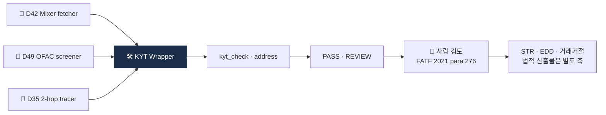
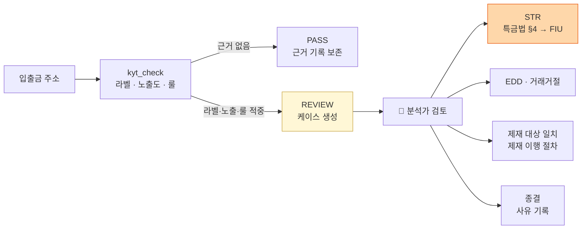

# Day 56 — 🛠️ 미니 프로젝트 5: KYT API 호출 wrapper + 8주 리뷰

> 거래모니터링(KYT) 호출 wrapper 만들기. ⏱️ ~150분. 마지막 업데이트: 2026-10-21.

## 📖 오늘 뭘 배우나

Week 8의 결산이자 Capstone의 마지막 조각. D42(mixer fetcher)·D49(OFAC screener)·D35(2-hop tracer)의 결과물을 하나의 **KYT 호출 wrapper**로 통합. 결과 JSON에 `risk_score`·`risk_categories`·`exposure`·`recommended_action`이 담기면, 이게 그대로 Capstone Risk Engine의 **주요 입력**이 됩니다. 단, wrapper의 `recommended_action`은 **사람 검토로 보낼지 여부**까지만 정합니다. STR·EDD·거래거절이나 임시조치 같은 법적 산출물은 케이스 검토 뒤 별도 축에서 결정합니다([`../notes/4-technology/kyc-kyt.md`](../notes/4-technology/kyc-kyt.md) §6). "KYT"는 업계 용어이고, 감독 문서는 transaction monitoring / 거래모니터링체계라고 씁니다.


<!-- MAP-START -->
## 🗺 오늘의 지도


<!-- MAP-END -->

## 🎯 회고 질문
1. 8주차의 사례에서 가장 충격적이었던 것?
2. 학술 vs 산업 격차?
3. 분석 벤더 PoC에서 무엇을 비교할 것인가? (귀속 일치율·점수 안정성·감사 가능성)

## 🛠️ 미니 프로젝트 5 (~120분)

### 목표
**KYT API 호출 wrapper 작성** (실제 무료 API 또는 Mock)

### 옵션 A: 공개 데이터 API
- 블록 익스플로러 API(Etherscan 등) 거래 조회 + 자체 라벨 매칭
- 상용 분석 API의 무료·체험 티어 존재 여부와 이용약관은 직접 확인 (이 저장소는 검증하지 않음)

### 옵션 B: Mock API (학습용)
- 자기가 만든 OFAC fetcher (D49) + mixer fetcher (D42) 결과를 합쳐 자체 KYT 호출

### 사양
```python
# main.py 의사코드
def kyt_check(address: str) -> dict:
    """
    return {
        "address": "...",
        "risk_score": 0~100,
        "risk_categories": ["mixer", "sanctions", "ransomware", ...],
        "exposure": {
            "direct": [...],
            "indirect_2hop": [...],
        },
        "recommended_action": "PASS" | "REVIEW",  # 법적 산출물 아님
        "evidence": [...],  # 어떤 룰·라벨·노출이 근거인가 (업무규정 제80조 보존 대비)
    }
    """
    ...
```

### 구현 가이드
프로젝트: `aml/projects/05-kyt-wrapper/`

- D42 (mixer fetcher) + D49 (OFAC screener) 결과를 통합
- exposure는 D35 (2-hop tracer)와 결합

### 산출물
- `projects/05-kyt-wrapper/main.py`
- `projects/05-kyt-wrapper/README.md`
- `projects/05-kyt-wrapper/sample_results/` (5개 주소 결과)

→ 가이드: [`../projects/05-kyt-wrapper/README.md`](../projects/05-kyt-wrapper/README.md)

## ✅ 체크포인트
- [ ] Wrapper 작동
- [ ] 5개 주소 sample 결과
- [ ] [`progress.md`](progress.md) Week 8 + W8 미니 프로젝트 체크
- [ ] git commit + push

## 💼 실무 현장 (Industry Reality)

### wrapper 출력은 어디로 가나



FATF 2021 RBA 가이던스 para 276은 자동화를 허용하되 플래그된 거래는 "human/expert analysis"를 거치라고 요구합니다. 그래서 wrapper가 직접 "BLOCK"을 내지 않습니다. 이용자 자산을 묶는 조치(보이스피싱 임시조치, 이용자보호법 §11의 입출금 차단 제한)는 별도 법적 절차를 따릅니다([`../notes/4-technology/kyc-kyt.md`](../notes/4-technology/kyc-kyt.md) §6·§8).

### 한국 VASP에서는

공개 1차 자료로 확인되는 것은 다음뿐입니다.

- FIU 2026년 업무계획: FIU 자체의 "체이널리시스(가상자산 분석도구) 도입", 심사분석 AI 도입([금융위 2026-02-05](https://fsc.go.kr/no010101/86209))
- 한국 거래모니터링의 법적 근거: FIU 고시 「자금세탁방지 업무규정」 제76~81조 "거래모니터링체계"(2026-01-22 시행). 본문에 "가상자산"이라는 단어는 없습니다([법제처 DRF](https://www.law.go.kr/DRF/lawService.do?OC=test&target=admrul&ID=2100000267264&type=XML))
- 2027-02-19부터: 해외 VASP·자기수탁 지갑과의 1천만원 이상 이전에 "자체 의심거래 감시체계 구축·운영"(고시 §28-2③, enacted-not-in-force) — 자동 STR이 아닙니다

이전 판의 "한국 4대 거래소 전원 Chainalysis", 계약 구조·연 금액, 벤더 선정 요인 순위, 특정 거래소의 제품 스택은 1차 출처가 없어 삭제했습니다(공개 근거 없음).

### 글로벌에서는

- FATF 7차 TU(2026-07-16) 권고 6-ii: VASP는 "transactions monitoring and blockchain analytics tools"로 급속 이전을 탐지해야 한다. 권고 6-iv는 브리지·믹서·크로스체인 노출 평가를 요구한다([7차 TU PDF](https://www.fatf-gafi.org/content/dam/fatf-gafi/reports/7th-targeted-update-on-implementation-fatf-standards-vas-vasps-2026.pdf.coredownload.pdf))
- NYDFS 2022-04-28 산업서한: 외주·자체 분석도구를 모두 허용하되, 도구가 실소유자를 "may not be able to identify"라고 한계를 인정([NYDFS](https://www.dfs.ny.gov/industry_guidance/industry_letters/il20220428_guidance_use_blockchain_analytics))

이전 판의 거래소별 벤더 매핑(자체 GNN 시스템명 포함, 합의 후 벤더 이중화·전환), "Enterprise tier 연 $500K~$5M"은 출처가 없어 삭제했습니다.

### KYT wrapper 설계 패턴 (교육용)

```python
# 교육용 패턴: 벤더 fallback + 내부 룰 결합. 실제 벤더 SDK 이름·필드가 아님
def kyt_check(address, chain="ethereum"):
    # 1. 내부 캐시 (TTL은 회사 정책 — 라벨은 사후에 바뀔 수 있음)
    if cached := cache.get(address):
        return cached

    # 2. Primary 분석 API
    try:
        result = primary_vendor.screen(address, chain)
    except VendorTimeout:
        # 3. Fallback — 벤더마다 점수 산정 방식이 비공개라 점수 직접 비교 금지
        result = secondary_vendor.screen(address, chain)

    # 4. 내부 라벨 결합 (OFAC SDN 주소 · mixer 라벨 · STR 이력 주소)
    result = apply_internal_rules(result)

    # 5. 사람 검토로 보낼지 결정 + 근거 기록
    result["recommended_action"] = "REVIEW" if result["hits"] else "PASS"
    result["evidence"] = result["hits"]
    return result
```

### 응답 JSON 스키마 예시 (가상)

아래는 학습용 가상 스키마입니다. 특정 벤더의 실제 API 필드가 아닙니다(이전 판의 "Chainalysis 기준 실제 필드"는 근거가 없어 고쳤습니다).

```json
{
  "address": "0x...",
  "risk_level": "high",
  "reason": "direct exposure to sanctioned entity label",
  "cluster": {"name": "<라벨명>", "category": "sanctions"},
  "exposures": [
    {"category": "mixing", "direction": "sent", "hops": 2},
    {"category": "sanctions", "direction": "received", "hops": 1}
  ],
  "label_source": "internal:ofac_sdn | vendor:<name>",
  "fetched_at": "2026-10-21T00:00:00Z"
}
```

### 자주 나오는 오해

- **"벤더 결과가 곧 진실"** — 라벨 정확도에 대한 공개 벤치마크는 없고, 홉 수·감쇠계수·가중치를 독립 검증 가능하게 공개한 벤더도 없습니다(kyt 도시에). 같은 주소라도 벤더마다 점수가 다를 수 있습니다. 판단 근거는 회사가 기록해야 합니다(업무규정 제79·80조).
- **"무료 API로 충분"** — 학습·PoC는 가능합니다. 프로덕션 선택은 귀속 일치율·커버리지·감사 가능성을 PoC로 비교해 정합니다. 이전 판의 "벤더 attribution DB 수억~수십억 주소"는 자사 주장 수준이라 삭제했습니다.
- **"recommended_action = BLOCK이면 출금을 막는다"** — 차단은 임시조치·제재 이행·거래거절 중 무엇인지에 따라 통지·해제·보고 절차가 다릅니다.

## 💭 8주차 회고 (캡스톤 직전)

전체 8주에서 가장 큰 변화:
가장 약한 영역 (보강 필요):
캡스톤 방향:
