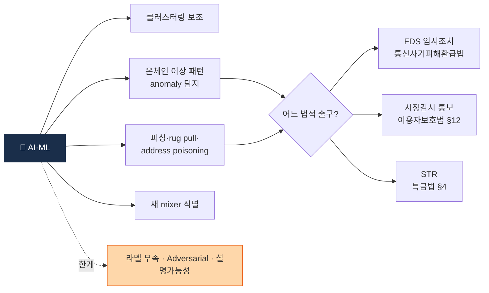
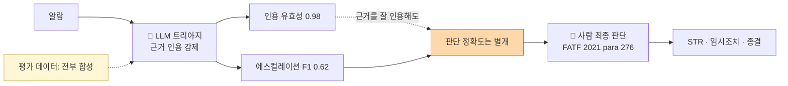

# Day 57 — AI/ML in AML

> 머신러닝 + AI 활용과 한계. ⏱️ ~80분. 마지막 업데이트: 2026-10-21.

## 📖 오늘 뭘 배우나

Capstone 시작 전 마지막 주제 — **AI·ML의 AML 활용**. 먼저 "이상거래 탐지"라는 말을 세 제도로 나눕니다: **사기 탐지(FDS)**, **시장감시(가상자산이용자보호법 §12)**, **의심거래 탐지(특금법 STR)**. 그다음 ML이 쓰이는 영역(클러스터링 보조·온체인 이상 패턴·피싱·rug pull·새 믹서 식별)과 한계 3가지(라벨 부족·adversarial·**설명가능성**)를 공개 연구 수치로 정리하고, 생성 AI(LLM)의 알람 분류·STR 초안 활용이 어디까지 검증됐는지 봅니다.


<!-- MAP-START -->
## 🗺 오늘의 지도


<!-- MAP-END -->

## 🎯 핵심 질문
1. "이상거래 탐지"는 한국 법에서 어떤 세 제도로 갈라지나?
2. AML에서 ML이 쓰이는 영역과, 각 영역의 공개 근거는?
3. ML의 한계 (라벨/adversarial/설명가능성)?
4. LLM이 AML 분석가를 대체할 수 있나? 공개 연구는 무엇을 보여 줬나?

## 📖 읽기 (~50분)
- 메인: [`../notes/4-technology/blockchain-analytics.md`](../notes/4-technology/blockchain-analytics.md) — 8절 (ML/AI)
- 보조: [`../notes/4-technology/kyc-kyt.md`](../notes/4-technology/kyc-kyt.md) — §6 산출물 3축
- 보조: [`../deep/papers.md`](../deep/papers.md) — ML/AI 섹션

## 🌐 외부 자료 (~20분)
- [Akter 외 2026 — Elliptic 시계열 스트레스 테스트](https://publications.eai.eu/index.php/airo/article/download/13658/4313/36724) (트리 앙상블 vs GNN)
- [Torres 외 2026 — Explainable AML Triage with LLMs](https://arxiv.org/abs/2604.19755)
- [Tsuchiya 외 2025 — Blockchain Address Poisoning (USENIX Security '25)](https://arxiv.org/abs/2501.16681)

## 🛠️ 미니 챌린지 (~10분)
- 한 시나리오를 세 제도로 분류하기: "API 키를 빌려준 계정이 고가매수를 반복한 뒤, 매도대금을 신규 등록한 외부지갑으로 즉시 출금" → ① FDS(계정 보안·임시조치) ② 시장감시(§12 통보) ③ STR(출금 흐름) 각각에서 무엇을 산출하나
- ML 활용 영역 표 (클러스터/온체인 이상 패턴/피싱/rug pull/mixer) + 각 영역의 공개 근거 1개씩
- LLM 활용 시나리오 3개 (알람 분류 / STR 초안 / 정책 비교) + 각각의 사람 승인 지점

## ✅ 체크포인트
- [ ] "이상거래"를 FDS·시장감시·의심거래 탐지로 나눌 수 있다
- [ ] ML 적용 영역과 공개 근거를 안다
- [ ] 라벨 데이터 부족·벤치마크 착시 문제를 안다
- [ ] 설명가능성과 "human/expert analysis" 요건을 안다
- [ ] LLM 연구가 전부 합성 데이터라는 한계를 안다

## 💭 오늘의 한 줄

## 💼 실무 현장 (Industry Reality)

### 용어부터 — "이상거래 탐지"는 하나가 아니다

| 구분 | 법적 근거 | 입력 데이터 | 산출물 |
|---|---|---|---|
| 사기 탐지(FDS) | 통신사기피해환급법 §2의5 (거래소 적용 2026-10-01~) | 접속·기기·세션, 입출금 패턴 | 지연·일시정지(임시조치), 지급정지 |
| 시장감시 | 가상자산이용자보호법 §12, 시행령 §18 | 호가·체결 원장, 계정 집중도 | 금융위·금감원 통보 |
| 의심거래 탐지 | 특금법 §4, 업무규정 제76~81조 | 온체인 노출도, KYC | STR |

이전 판의 "ML 활용 5영역 — 이상거래 탐지"는 셋 중 어느 것인지 불분명했습니다. 한국 법에서 "이상거래"는 이용자보호법 §12의 불공정거래 우려 거래이므로, 온체인 분석 맥락에서는 "온체인 이상 패턴(anomaly) 탐지"라고 부릅니다.

### 한국에서 공개로 확인되는 것

- 2024-08-22 금융당국 점검에서 거래소 §12 상시감시 시스템은 가격상승률·거래량증가율 등 **임계값 기반 룰**의 자체 개발 시스템으로 확인됐다([금융위·금감원 2024-08-22](https://fsc.go.kr/po010101/82943)).
- 금융보안원 ASAP(2025-10-29 출범)는 FDS가 탐지한 의심계좌와 수사기관 정보로 **공동 AI 탐지모델**을 만들고, 참여기관은 자체 인프라에서 모델을 실행하거나 API로 고/중/저 위험등급을 받는다. 가상자산거래소는 참여기관으로 명시되지 않았다([금융위 2025-10-29](https://www.fsc.go.kr/no010101/85526)).
- FIU는 2026년 업무계획에 심사분석 시스템 AI 도입을 넣었다([금융위 2026-02-05](https://fsc.go.kr/no010101/86209)).

이전 판의 "한국 4대 거래소 모두 XGBoost 기반 FP 감축 모델을 2023~2025 도입", "Analyst 1인당 처리 Alert 20~30% 감축", 특정 거래소의 GNN POC, LLM 도입 확산은 출처가 없어 삭제했습니다.

### 글로벌에서 공개로 확인되는 것

- FATF 7차 TU(2026-07-16) para 34는 AI를 사기·해킹·세탁 전 주기의 위험요인으로 규정했다: 딥페이크 영상 면접 채용사기로 USD 100만 이상 탈취, AI 코딩 도구·에이전트로 스마트컨트랙트 익스플로잇 생성. 감독당국에는 딥페이크·합성신원 통제와 "AI-native investigative capabilities"를 고려하라고 했다([7차 TU PDF](https://www.fatf-gafi.org/content/dam/fatf-gafi/reports/7th-targeted-update-on-implementation-fatf-standards-vas-vasps-2026.pdf.coredownload.pdf)).
- BIS 연차경제보고서(2026-06-23)는 발행자 동결과 분석업체 지원이 "cannot replace routine, large-scale AML/CFT controls"라고 했다([BIS AER 2026](https://www.bis.org/publ/arpdf/ar2026e3.htm)).

이전 판의 "Coinbase Lynx(2024) GNN, precision 3배", "Binance 2024 Sardine", "Kraken Featurespace 파트너십", KYC 벤더의 deepfake 탐지 강화 서술은 출처가 없어 삭제했습니다.

### ML 활용 영역 — 공개 근거로 다시 매긴 표

| 영역 | 공개 근거 (2026-10-21) | 읽는 법 |
|---|---|---|
| 클러스터링 보조 | Möser & Narayanan(FC 2022): 기존 휴리스틱은 "have not been rigorously evaluated or optimized" | 정확도 단일 수치보다 클러스터 붕괴 위험이 쟁점 |
| 온체인 이상 패턴(AML) | Elliptic 시계열 분할: Extra Trees AUPRC 0.570 > GraphSAGE 0.311(B); Elliptic2 GLASS F1 0.933 vs PR-AUC 0.208(B) | 그래프 모델의 실무 우위는 공개 근거로 미확인. 불균형 데이터에서 F1만 보면 오독 |
| 피싱 탐지(FDS) | PhishEye: 실배포에서 미지의 피싱 주소 1,803개 식별([arXiv 2605.01207](https://arxiv.org/abs/2605.01207)); CtPhishCapture: 사이트 5,138·앱 10,612 중 83%·79%가 신규([NDSS 2026](https://www.ndss-symposium.org/wp-content/uploads/2026-f2854-paper.pdf)) | 실배포 사례가 있다 — 이전 판의 "Scam 사전 탐지 실용도 하~중"은 **"중" 이상으로 재검토**할 근거 |
| Address poisoning(FDS) | Ethereum·BSC 2년간 공격 2.7억 건, 최소 8,380만 달러 손실; 지갑 53종 중 3종만 경고([arXiv 2501.16681](https://arxiv.org/abs/2501.16681); [arXiv 2508.12107](https://arxiv.org/abs/2508.12107)) | 지갑 단 공백 → 거래소 출금 시점 확인이 마지막 방어선 |
| Rug pull | 35개 유형, 13개 도구 커버리지 25.7~62.9%(ISSTA 2025) | 유형 정의가 복수, 데이터 누수 주의 |
| 새 믹서 식별 | 그래프 구조학습·주파수 기반 믹싱 주소 연관 연구가 있음(academic 도시에 P-020~P-022) | 벤치마크 정의가 연구마다 다름 |
| NFT wash trading | 독립 검증된 공개 벤치마크 미확인 | 룰 기반 탐지가 출발점 |

### 설명가능성 요구 (실무 현실)

```
검사 시 질문:
"이 거래가 왜 STR(또는 임시조치)로 분류됐나?"

ML 블랙박스 답변: "모델이 score 0.87로 분류"
→ 근거 설명 불충분

해법:
1. 룰 근거 + 피처 기여도(SHAP 등)를 함께 기록
2. 최종 판단은 사람 — FATF 2021 para 276 "human/expert analysis"
3. 기록 보존: 업무규정 제80조(분석자료 5년 이상),
   이용자보호법 시행령 §13(상시감시·조치 기록, 15년),
   통신사기피해환급법 §2의5④(임시조치 통지·해제·본인확인 내역)
```

기록 요건이 있는 이상, "왜 해제했는가 / 왜 보고했는가"를 남길 수 없는 블랙박스 단독 운영은 어렵습니다. 탐지율·오탐·차단 후 해제율·처리시간은 내부 KPI를 넘어 책임 배분의 증거가 됩니다(fds 도시에 F-074).

### LLM in AML — 공개 연구가 보여 준 것



수치 출처: [arXiv 2604.19755](https://arxiv.org/abs/2604.19755). 실데이터 평가는 2026-10-21 기준 공백입니다.

- **알람 트리아지**: 근거 인용을 강제한 LLM 트리아지 연구는 **인용 유효성 0.98, 에스컬레이션 F1 0.62**를 보고했다. 근거를 잘 인용한다고 판단이 맞는 것은 아니다([arXiv 2604.19755](https://arxiv.org/abs/2604.19755)).
- **데이터 한계**: 이 연구를 포함해 LLM 평가는 **전부 합성 데이터**로 이뤄졌다. 실데이터 평가는 공백이다.
- **STR 초안**: 이전 판의 "STR 초안 30% 시간 단축 보고"는 출처가 없어 삭제했다. 학술 문헌의 자체 보고치도 초록 수준에서 검증되지 않아 싣지 않는다.
- **정책 비교·요약**: 가능하지만 hallucination 리스크 → 법령·STR 등 책임 영역은 사람이 최종 결정.
- **위협 쪽**: LLM 기반 로맨스 베이팅 사기 대화를 상용 안전 필터가 테스트 대화의 0.0%만 적발했다는 보고가 있다(B)([arXiv 2512.16280](https://arxiv.org/abs/2512.16280)).

### 자주 나오는 오해

- **"AI가 AML Analyst를 대체한다"** — FATF 2021 para 276은 플래그된 거래에 사람·전문가 분석을 요구한다. 자동 기각을 어디까지 허용할지는 감독기관 기준이 없다.
- **"GNN이 룰·트리 모델보다 낫다"** — 공개 시계열 평가에서는 트리 앙상블이 앞섰다(B). 템플릿 기반 벤치마크는 강건성을 과대평가한다(TransXion, KDD '26)([arXiv 2604.17420](https://arxiv.org/abs/2604.17420)).
- **"데이터만 많으면 된다"** — 라벨 부족이 최대 병목이다. Elliptic 공개셋은 거래 노드 203,769개·불법 라벨 2% 수준이고, 시점 43의 다크마켓 폐쇄 이후 모든 모델 성능이 급락했다([Weber 외 2019](https://arxiv.org/abs/1908.02591)). Elliptic·Elliptic2 이후 자금세탁 라벨 데이터셋의 신규 공개는 없다.
- **"이상거래 탐지 모델 하나로 FDS·시장감시·STR을 다 한다"** — 입력 데이터와 법적 산출물이 다르다. 공통 피처·라벨은 공유하되 출구는 분리한다.
