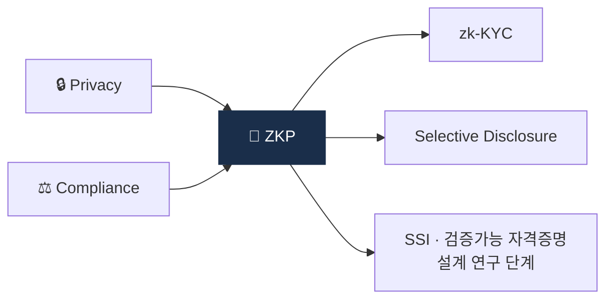
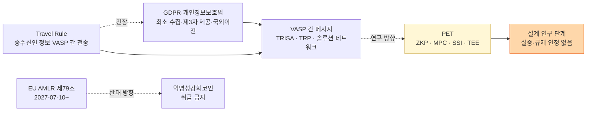

# Day 58 — ZKP + 프라이버시-컴플라이언스 양립의 미래

> Zero-Knowledge Proof로 둘 다 잡을 수 있나? ⏱️ ~80분. 마지막 업데이트: 2026-10-21.

## 📖 오늘 뭘 배우나

Travel Rule은 본질적으로 송수신인 개인정보를 VASP 간에 보냅니다. EU TFR 전문 19항은 이 처리가 GDPR을 "full compliance"로 따라야 한다고 정합니다. 이 긴장을 푸는 수단으로 ZKP(영지식 증명)·SSI(자기주권 신원)·MPC 같은 **프라이버시 강화 기술(PET)**이 연구되고 있습니다. 오늘은 **zk-KYC**와 **Selective Disclosure**의 개념, 2025~2026 공개 문헌이 실제로 보여 준 것(설계 연구까지, 실증은 공백), 그리고 반대 방향의 규제(EU AMLR 제79조 익명성강화코인 취급 금지, 2027-07-10 적용 예정)를 함께 봅니다. Capstone 설계 시 장기 관점.


<!-- MAP-START -->
## 🗺 오늘의 지도


<!-- MAP-END -->

## 🎯 핵심 질문
1. ZKP가 AML/KYC에 적용되는 시나리오 3가지?
2. zk-KYC, Selective Disclosure 의 의미?
3. 한국·EU의 개인정보 규제 vs Travel Rule 긴장 — 무엇이 확인됐고 무엇이 미확인인가?

## 📖 읽기 (~50분)
- 메인: [`../notes/3-crypto-aml/travel-rule.md`](../notes/3-crypto-aml/travel-rule.md) — §8-C 개인정보 보호와의 긴장
- 보조: [`../notes/3-crypto-aml/defi-nft-risks.md`](../notes/3-crypto-aml/defi-nft-risks.md) — §3 Privacy Coin (zk-SNARK, AMLR 제79조, 차폐 풀 정량 측정)
- 보조: [`../deep/papers.md`](../deep/papers.md) — §3 Travel Rule / Compliance Tech (PET 동료심사 문헌)

## 🌐 외부 자료 (~25분)
- [Piper·Wolf·Heiss 2025 — Privacy-Preserving On-chain Permissioning for KYC-Compliant dApps (arXiv 2510.05807)](https://arxiv.org/abs/2510.05807) — SSI + ZKP + 속성기반 접근제어
- [Shevchuk 외 2025 — PETs for FATF crypto Travel Rule](https://research.aston.ac.uk/en/publications/technologie-wspieraj%C4%85ce-prywatno%C5%9B%C4%87-dla-regu%C5%82y-podr%C3%B3%C5%BCy-fatf-w-kryp/) — 토큰화·MPC·동형암호·ZKP·TEE·SSI 평가
- [ECB Occasional Paper 382](https://www.ecb.europa.eu/pub/pdf/scpops/ecb.op382.en.pdf) p.35 — 중앙은행 전문가의 PET 분류(BIS Innovation Hub Mandala 예시)

## 🛠️ 미니 챌린지 (~5분)
- "프라이버시 + 컴플라이언스 양립" 3가지 미래 시나리오 메모
- 자기가 가장 가능성 높다고 보는 1개에 ★

## ✅ 체크포인트
- [ ] ZKP의 AML 응용 가능성 안다
- [ ] zk-KYC 컨셉 안다
- [ ] Selective Disclosure 안다
- [ ] 프라이버시 규제 vs Travel Rule 긴장 인지

## 💭 오늘의 한 줄

## 💼 실무 현장 (Industry Reality)

### 한국 VASP에서는

긴장은 실재하지만, 이를 다룬 한국 당국의 공개 판단은 확인되지 않았습니다.

- 트래블룰 근거: 특금법 **§5의3**, 시행령 §10의10. **2027-02-18까지 100만원 이상**, 2027-02-19부터 다른 VASP로의 이전 **전건**(대통령령 제36592호, enacted-not-in-force). 주민등록번호 등은 요청을 받은 날부터 3영업일 이내 제공([법제처 DRF 시행예정 판본](https://www.law.go.kr/DRF/lawService.do?OC=test&target=eflaw&MST=288765&efYd=20270219&type=XML))
- 한국 개인정보보호위원회의 트래블룰 국외이전 관련 의결·안내는 이 저장소의 근거 자료로 확인되지 않았습니다([`../notes/3-crypto-aml/travel-rule.md`](../notes/3-crypto-aml/travel-rule.md) §8-C)

이전 판의 "특정 솔루션의 E2E 암호화로 타협 중", "zk-KYC가 금융위·FIU 2026 혁신금융 샌드박스 후보"는 출처가 없어 삭제했습니다.

### 글로벌에서는 — 공개 문헌이 보여 준 것

- **동료심사 PET 평가(2025)**: GDPR·MiCA·AMLR·CCPA 하에서 토큰화·MPC·동형암호·ZKP·TEE·SSI를 평가, TRISA·OpenVASP/TRP·TAP 검토. 결론은 중앙집중형 → 연합형·암호학적 검증 가능 모델로의 이동(Shevchuk 외 2025)
- **양자내성 TRISA(IEEE ACIT 2025)**: RSA·ECDSA의 양자 취약성 지적, CRYSTALS-Kyber·Dilithium 이행 경로 제안
- **KYC 게이팅(arXiv 2510.05807)**: SSI + ZKP + 속성기반 접근제어 — 트래블룰 자체가 아니라 dApp 접근 제어
- **중앙은행 전문가 분류(ECB OP 382 수록, 2026-03-23 공개)**: 믹서·CoinJoin·ZK·MPC·FHE·스텔스 주소를 AML/CFT 준수 관점에서 분류, BIS Innovation Hub Mandala(MPC 제어 + ZK) 예시
- **반대 방향 규제**: EU AMLR 제79조 — CASP의 익명성강화코인·익명화 계좌 취급 금지, 2027-07-10 적용 예정(enacted-not-in-force)([EUR-Lex](https://eur-lex.europa.eu/legal-content/EN/TXT/PDF/?uri=OJ:L_202401624))
- **공백**: 이 연구들은 모두 **설계 연구**입니다. 트래블룰·VASP 등록의 인과 효과 실증, 자기수탁 지갑 소유 검증 방식(서명·소액송금)의 학술 평가는 2025~2026년에 확인되지 않았습니다

이전 판의 개별 ZK identity 프로젝트·신생 벤더 서술(서비스 적용 사례, 국가별 규제 충돌)과 "2024 EU AMLR이 ZKP 기반 KYC proof를 명시적으로 고려한 첫 규제 문언"은 근거 자료로 확인되지 않아 삭제했습니다.

### 프라이버시 vs 컴플라이언스 긴장 지도



### zk-KYC 작동 패턴 (개념 pseudocode)

```
사용자가 KYC 완료 → 신뢰 발급자(Issuer)가 Credential 서명

사용자는 VASP에 다음을 증명:
  "나는 >18세이다" (구체 나이 공개 안 함)
  "나는 제재 명단에 없다" (발급자가 스크리닝한 결과에 대한 증명)
  "나는 한국 거주자다" (주소 공개 안 함)

VASP는 proof 검증만 수행
→ 한계: 특금법 고객확인·트래블룰은 성명 등 원정보 제공을 요구하므로
  2026-10-21 기준 법령상 원정보 보관·제공을 대체하지 못함
```

### 한국 규제 vs Travel Rule 긴장

- **개인정보보호법**: 최소 수집·목적 명시, 제3자 제공·국외이전 요건
- **특금법 §5의3 + 시행령 §10의10**: 2027-02-18까지 100만원 이상, 2027-02-19부터 전건 정보 제공 의무
- **충돌 지점**: VASP 간 원정보 전송, 해외 VASP로의 국외이전. 한국 당국의 공식 정리(개인정보보호위원회 안내 등)는 확인되지 않음 — EU는 TFR 전문 19항·GDPR 제5장으로 정리

이전 판의 "특금법 §6: Travel Rule(100만원 이상)"은 조문 번호가 틀려 §5의3으로 고쳤습니다. 개인정보보호법 조문 번호는 이 저장소 근거 자료로 재확인하지 않아 뺐습니다.

### 자주 나오는 오해

- **"ZKP = 익명"** — zk-KYC는 **Issuer가 여전히 신원 확인**. VASP만 모르는 것. 규제 시스템 안의 프라이버시이지 익명성은 아님.
- **"10년 내 ZKP가 KYC 대체"** — 병목은 기술보다 **Issuer·Verifier 생태계와 규제 인정**입니다. 2026-10-21 기준 공개 문헌은 설계 연구까지이고, 규제가 ZK 증명을 원정보 대체로 인정한 사례는 이 저장소에서 확인되지 않았습니다. 이전 판의 "2030년에도 하이브리드 예상"은 근거 없는 전망이라 뺐습니다.
- **"차폐 풀은 추적 불가"** — 2026 연구는 수치로 측정합니다: Railgun 출금의 17.65%가 입금과 연결, 중위 익명성 손실 3.42비트([arXiv 2606.25926](https://arxiv.org/abs/2606.25926)).
