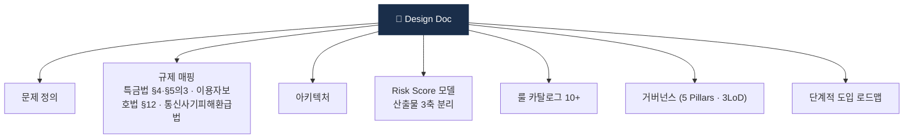
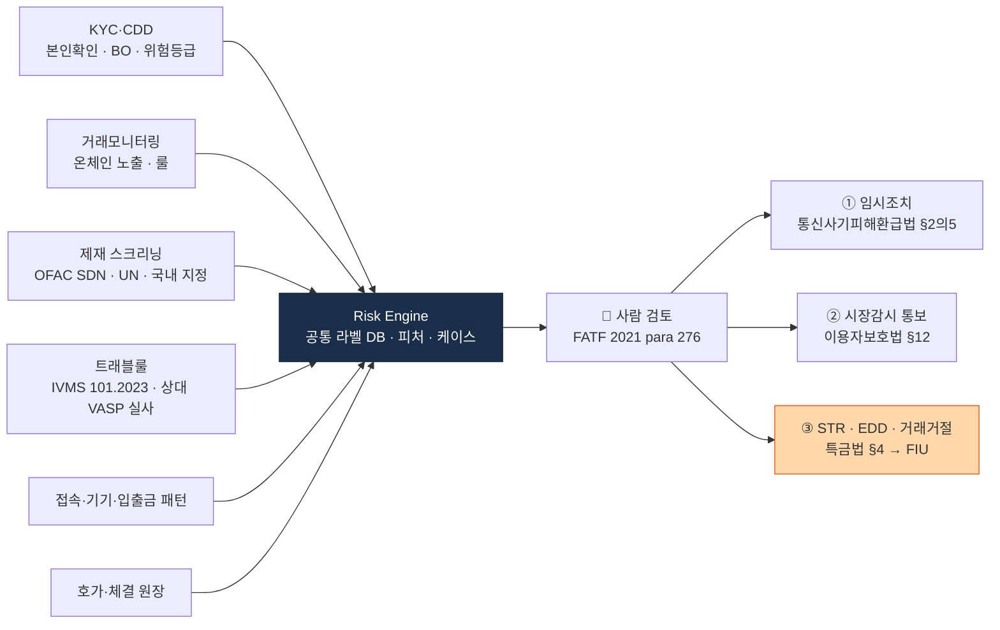

# Day 59 — 🎓 캡스톤: Mini AML Risk Engine 설계서

> 60일 학습을 통합해서 시스템 설계. ⏱️ ~150분 (사전 회고 30분 + 캡스톤 작성 120분). 마지막 업데이트: 2026-10-21.

<!-- MAP-START -->
## 🗺 오늘의 지도


<!-- MAP-END -->

## 🎯 캡스톤 목표

**Mini AML Risk Engine 설계서 작성** — 가상자산 거래소/수탁용 통합 위험엔진의 1차 설계 문서.

## 🛠️ 캡스톤 (~150분)

### 산출물
프로젝트: `aml/projects/06-capstone-risk-engine/DESIGN.md`

### 설계서 목차 (필수)

```markdown
# Mini AML Risk Engine — Design Document

## 1. 문제 정의
- 우리가 풀려는 문제 (시나리오)
- 사업유형 (거래소 / 수탁 / OTC ...)
- 성공 기준

## 2. 적용 규제 매핑 (2026-10-21 기준, 상태 표기 필수)
- 한국 특금법 §4(STR)·§5의3(트래블룰) + 시행령 §10의10
  (~2027-02-18 100만원 이상 / 2027-02-19~ 전건, enacted-not-in-force)
- AML 업무규정 제76~81조 (거래모니터링체계)
- 가상자산이용자보호법 §12 (시장감시) / 통신사기피해환급법 §2의5 (임시조치, 거래소 2026-10-01~)
- (해외 영업 시) FATF R.15·INR.15 §7(b) / 미국 31 CFR 1010.410(f) $3,000 / EU TFR(금액 기준 없이 전건)

## 3. 데이터 소스
- KYC: ___ 벤더 (또는 본인확인기관)
- KYT: ___ 벤더 또는 자체 + 외부 결합
- Sanctions: OFAC + UN + EU + 외교부
- PEP/Adverse Media: ___ 벤더
- Travel Rule: ___ 솔루션

## 4. 시스템 아키텍처
- 컴포넌트 다이어그램 (KYC → Risk Engine → KYT → Sanctions → Travel Rule → STR)
- 데이터 흐름 (실시간 / 배치)
- 인터페이스 (API)

## 5. Risk Score 모델
- 입력 변수 (KYC 위험 + KYT 노출 + 거래 패턴)
- 가중치 (가설값임을 명시 — 공개 표준 없음)
- 등급 매핑 (LOW/MED/HIGH)
- threshold → 사람 검토 → 산출물 3축 (임시조치 / 시장감시 통보 / STR·EDD·거래거절)

## 6. 룰 카탈로그
- 최소 10개 룰 (Smurfing / Pass-through / Mixer 노출 / SDN / ...)

## 7. 운영 플로우
- Onboarding
- 거래 시
- 일일 배치
- STR 생성
- 검사 대응

## 8. 거버넌스
- 5 pillars 어떻게 충족
- 3LoD 매핑
- AMLO 권한
- 교육 + 감사

## 9. 단계적 도입 로드맵
- MVP (3개월)
- v1 (6개월)
- v2 (12개월)

## 10. 리스크와 한계
- False positive / negative 균형
- 비용 (가정치는 가정이라고 표기)
- 인력 (신고매뉴얼: AML 업무 인력 4인 이상)
- 미해결 영역 (DeFi / Privacy coin)

## 11. 참고 (인용)
- 이 60일에 사용한 모든 자료 인용
```

### 작성 팁
- 분량: 4~10 페이지 (마크다운 기준)
- 구체성 우선 (예: "KYT" → "외부 분석 API + 자체 라벨(OFAC SDN·STR 이력) 매칭 + 룰 ID")
- 모든 규제 수치에 상태(in-force / enacted-not-in-force / proposed / withdrawn)와 출처 URL
- 다이어그램 1개 이상 (Mermaid 또는 ASCII)
- 가상의 사업유형 1개 가정 (거래소 / 수탁 / OTC 중)

## ✅ 체크포인트
- [ ] DESIGN.md 11절 모두 작성
- [ ] 다이어그램 1개+
- [ ] 룰 10개+
- [ ] 60일 학습 자료 인용 5개+

## 💭 오늘의 한 줄

## 💼 실무 현장 (Industry Reality)

### 설계는 이런 순서로 시작한다 (일반 절차)

1. **문제 정의·범위**: 사업유형, 상장 자산·체인, 해외 VASP 이전 여부
2. **Gap Analysis**: 현 체계 vs 특금법·업무규정 제76~81조·이용자보호법 §12·통신사기피해환급법·FATF R.15/INR.15 매핑 표
3. **도구 PoC**: 분석 벤더는 귀속 일치율·점수 안정성·커버리지·감사 가능성으로 비교 ([`../notes/4-technology/kyc-kyt.md`](../notes/4-technology/kyc-kyt.md) 💼 PoC 체크리스트)
4. **MVP**: 제재 스크리닝 + 거래모니터링 + STR 워크플로
5. **확장**: 2027-02-19 대비 — 트래블룰 전건화, 해외 VASP 3등급, 자기수탁 동일인 확인, 1천만원 이상 자체 감시체계
6. **검사 대응 문서화** (상시)

이전 판의 단계별 소요 기간(주·개월)과 "3~5개사 벤치마크"는 관찰 근거가 없어 뺐습니다.

### 참조 아키텍처 — 산출물 3축



이전 판의 참조 아키텍처는 각 상자에 특정 KYC·분석·트래블룰·BI 제품명을 넣고 출력을 STR 한 줄로 그렸습니다. 거래소별 도구 사용은 공개 근거가 없고, 한국에서 차단·통보·STR은 근거 법률과 수령기관이 다르므로 3축으로 고쳤습니다([`../notes/4-technology/kyc-kyt.md`](../notes/4-technology/kyc-kyt.md) §6).

### Mini Risk Engine 설계 시 꼭 들어갈 "현실 요소"

- **벤더 fallback**: Primary 장애 시 Secondary 전환. 단 벤더마다 점수 산정 방식이 비공개라 점수 직접 비교 금지
- **휴먼 최종결정**: ML·룰 결과는 recommendation. 최종 판단은 분석가 — FATF 2021 para 276 "human/expert analysis"
- **증거 체인(Audit Trail)**: 모든 결정에 "입력·룰 ID·결정자·시각" 불변 기록
- **처리 기한은 회사 정책으로 명시**: 이전 판의 "1차 리뷰 4h / STR 48h"는 근거가 없어 삭제. 법정 기한이 있는 것만 법령에서 가져올 것(예: 2027-02-19부터 트래블룰 추가정보는 요청일부터 3영업일 이내)
- **개인정보 파이프라인 분리**: PII는 별도 보관소, 분석 파이프라인은 가명처리. 고유식별정보 처리 전산설비는 국내 소재(신고매뉴얼 2026-08-13, 클라우드 국내 리전 인정)([금융위 2026-08-13](https://www.fsc.go.kr/no010101/87521))

### 설계서에 반드시 포함해야 할 것

```
1. 도구 선정 근거 (PoC 비교 항목 — 가격·우열 평가가 아니라 측정 결과)
2. 룰 카탈로그: 각 룰의 근거 (FATF Red Flag 지표 ID 또는 규제 조문) 표기
3. 기록 보존: 업무규정 제80조(분석자료 5년 이상) / 이용자보호법 시행령 §13(상시감시·조치 기록 15년)
   / 통신사기피해환급법 §2의5④(임시조치 통지·해제·본인확인 내역)
4. AMLO 결재 경로 (RACI)
5. 예산·인력: 가정치임을 명시 (공개 벤치마크 없음)
6. 검사 대응 매뉴얼 — FIU / 금감원(§12) / 금융안전과(임시조치) 3분할
```

이전 판의 "연간 OpEx+CapEx 최소 5억~수십억"은 근거가 없어 삭제했습니다.

### 자주 나오는 오해

- **"설계서는 문서일 뿐"** — 검사에서는 문서와 실제 운영의 일치를 봅니다. 판단 근거가 케이스 기록에 남아야 업무규정 제79·80조의 분석·보존 요건을 충족합니다.
- **"MVP는 룰 몇 개면 충분"** — 이전 판의 "필수 8룰이 있어야 FIU 검사 통과"는 근거가 없어 삭제했습니다. 법령은 룰 개수를 정하지 않습니다. 룰 셋은 회사 위험평가로 정하고 FATF 2021 para 278에 따라 정기 재검토합니다. 출발점으로는 FATF Red Flag(2020) 6범주 58개 지표와 7차 TU 권고 5·6(지갑 스크리닝·블랙리스트·동결, 급속 이전·브리지·믹서·크로스체인 노출)이 있습니다.
- **"2027년부터 1천만원 이상은 자동 STR 룰"** — 아닙니다. 고시 §28-2③은 해외 VASP·자기수탁 이전에 대한 "자체 의심거래 감시체계 구축·운영"입니다(enacted-not-in-force).
