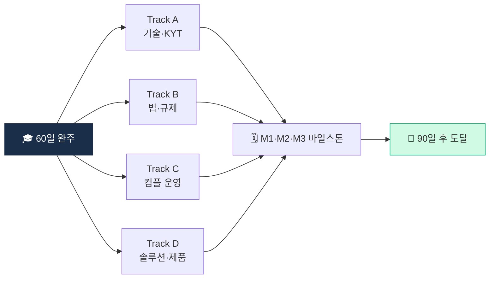
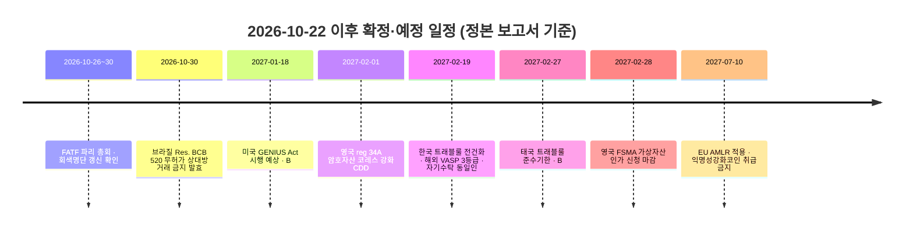

# Day 60 — 🎓 다음 90일 로드맵

> 60일 끝, 90일 시작. ⏱️ ~120분. 마지막 업데이트: 2026-10-21.

## 📖 오늘 뭘 배우나

60일의 마지막 날. 오늘은 **"앞으로 90일"** 의 구체 로드맵을 작성합니다. 4개 전공 트랙(기술·법·컴플라이언스·솔루션) 중 자신의 관심과 경력에 맞는 1개를 선택해 월별 마일스톤을 세우면, 60일 챌린지가 **지속 성장 궤도**로 이어집니다. 2026-10-21에 시작하는 90일은 2027-01-19 무렵에 끝나고, 바로 뒤 **2027-02-19에 한국 트래블룰 기준금액 폐지·해외 VASP/자기수탁 차등 규율이 시행**됩니다. 로드맵에 이미 날짜가 정해진 규제 일정을 넣으세요.


<!-- MAP-START -->
## 🗺 오늘의 지도


<!-- MAP-END -->

## 🎯 회고 질문 (60일 통합)

1. 가장 큰 변화 (Day 1과 Day 60의 나):
2. 가장 의외였던 영역:
3. 가장 약한 영역 (보강 필요):
4. 가장 흥미 있는 전공 영역:

## 🛠️ 90일 로드맵 작성 (~90분)

### 산출물
파일: `aml/curriculum/_artifacts/d60_90_day_roadmap.md`

### 4개 전공 트랙 중 선택

#### 트랙 A — 기술 (KYT/Analytics)
- 자체 attribution DB 구축
- ML 기반 클러스터링 실험
- Cross-chain tracing 깊이
- 산출물: 작동하는 KYT 프로토타입

#### 트랙 B — 법/규제
- 특금법 + 시행령(대통령령 제36592호) + 감독규정 + 이용자보호법 § 단위 마스터
- FATF/EU/US 깊이 비교 — 상태(in-force / enacted-not-in-force / proposed / withdrawn) 구분
- FIU·금융위 공청회·보도자료 추적 + 컨퍼런스 참석
- 산출물: 한국 VASP 컴플라이언스 핸드북

#### 트랙 C — 컴플라이언스 운영
- AMLO 실무 (정책/룰/감사 사이클)
- STR 분석가 트레이닝 자료
- ERA 작성
- 산출물: AMLO 운영 매뉴얼 + 룰 카탈로그

#### 트랙 D — 솔루션/제품
- KYT/Travel Rule 솔루션 기능 비교 (PoC 항목 기준, 우열 평가 아님)
- 신규 제품 아이디어 (한국 2027-02-19 요건 + 글로벌)
- 공백 영역 정리 (자기수탁 소유 검증, sunrise 상대 처리)
- 산출물: 신규 솔루션 1-pager + MVP 사양

### 90일 플랜 템플릿

```markdown
# 90-day Roadmap — Track [A/B/C/D]

## 핵심 목표
- 90일 후 도달 상태 (구체):

## 월별 마일스톤
- M1 (1~30일): _______
- M2 (31~60일): _______
- M3 (61~90일): _______

## 주간 학습 페이스
- 평일: __h
- 주말: __h

## 산출물 (3개)
- 1. _______
- 2. _______
- 3. _______

## 리뷰 시점
- D30: 1차 리뷰
- D60: 2차 리뷰 + 조정
- D90: 최종 평가 + 다음 단계
```

## ✅ 체크포인트
- [ ] 60일 회고 작성
- [ ] 트랙 1개 선택
- [ ] 90일 로드맵 작성
- [ ] [`progress.md`](progress.md) Capstone 4일 모두 체크
- [ ] 60일 챌린지 git tag (예: `v1.0-60day-completed`)

## 💭 60일 마지막 한 줄

> 이 60일이 나에게 가르쳐준 것:
> 다음 90일에 시도할 한 가지:

---

🎉 **60일 챌린지 완주 축하!** 🎉

이제 [`../README.md`](../README.md) 우선순위 Top 5 를 다시 보면 — 시작할 때와 완전히 다른 눈으로 보일 거임.

## 💼 실무 현장 (Industry Reality)

### 다음 90일 + α — 이미 날짜가 정해진 일정 (2026-10-21 기준)



근거: [정본 보고서](../reports/가상자산%20AML%20KYT%20FDS%20트래블룰%20흐름.md) "2026-10-22 이후" 절. 모두 enacted-not-in-force 또는 예정이며, (B) 표시는 2차 출처 기반입니다. 한국 감독규정 §28-2의 정확한 시행일은 고시 기산점에 따라 2027-02-19와 이틀 어긋날 수 있어 확정되지 않았습니다.

트랙별로 이 일정을 이렇게 씁니다.

- **A 기술**: 2027-02-19 전건화 대비 — 100만원 미만 이전까지 IVMS 101.2023 메시지 처리량·자기수탁 동일인 확인 흐름 설계
- **B 법·규제**: FATF 2026-10 총회 결과·R.16 이행 가이던스 최종본 발간 여부(2026-10-21 기준 미발간) 추적
- **C 컴플 운영**: 1천만원 이상 해외 VASP·자기수탁 이전 "자체 의심거래 감시체계"(고시 §28-2③) 룰 초안 — 자동 STR이 아님
- **D 솔루션**: 해외 VASP 3등급(저위험 허용 / 동일인만 허용 / 제한) 판정에 필요한 상대 VASP 실사 데이터 정리

### 한국 AML 커리어 지도

4개 트랙은 업계의 기술·법무·컴플라이언스 운영·제품 직군에 대응합니다. 공개로 확인되는 인력 요건은 하나입니다: 2026-08-13 전면 개정된 신고매뉴얼은 VASP의 AML 업무 인력을 **4인 이상**으로 정했습니다([금융위 2026-08-13](https://www.fsc.go.kr/no010101/87521)).

이전 판의 직군별 "주요 채용사"와 연봉 범위, 해외 허브별 수요·소재 기업 서술, "가장 흔한 국제 이동 경로"는 공개 근거가 없어 삭제했습니다.

### 90일 로드맵 샘플 (트랙 C 예시)

```
M1 (1~30일):
- 특금법 §4 STR 흐름 + AML 업무규정 제76~81조 거래모니터링체계 정독
- FATF Red Flag(2020) 58개 지표 → 자기 룰 카탈로그 초안 매핑
- 공개 제재 사례(두나무 2025-11-06 과태료 352억원 등) 사유 분석

M2 (31~60일):
- 가상 거래소 ERA(연례 위험평가) 문서 작성
- 룰 카탈로그 10개 작성 — 각 룰에 Red Flag ID 또는 조문 근거
- 산출물 3축(임시조치 / 시장감시 통보 / STR) 분류 연습 케이스 10건

M3 (61~90일):
- 2027-02-19 시행 대비 체크리스트 (트래블룰 전건, 해외 VASP 3등급, 자기수탁 동일인, 1천만원 감시체계)
- 검사 Q&A 스크립트 — FIU / 금감원(§12) / 금융안전과(임시조치) 3분할
- 사내 교육 자료 1편
```

이전 판의 특정 벤더 자격 취득, "실제 STR 공개 사례 10건 분석"(STR은 비공개), "회사 ERA 문서 접근"은 실행 가능하지 않거나 근거가 없어 바꿨습니다.

### 자격증·컨퍼런스 지도

[`../deep/conferences.md`](../deep/conferences.md)를 보세요. ACAMS의 CAMS·CCAS 등 자격과 업계·학술 컨퍼런스가 정리돼 있습니다. 응시료·갱신 요건·개최 월은 바뀔 수 있으니 각 기관 공식 페이지에서 확인하세요. 이전 판의 "한국 응시자 증가 추세", 특정 협회 교육 일수, 컨퍼런스별 개최 월은 근거가 없어 삭제했습니다.

### 자주 나오는 오해

- **"AMLO = 법무 출신"** — 이전 판의 "데이터·엔지니어링 배경 AMLO 증가, 특정 거래소 후보군" 서술은 근거가 없어 삭제했습니다. 다만 2026-10-21 기준 규범은 기술 역량을 요구합니다: FATF 7차 TU 권고 6-ii는 "transactions monitoring and blockchain analytics tools"를, 2021 가이던스 para 276은 자동화 + 사람 분석을, 업무규정 제79·80조는 분석 근거 기록을 요구합니다.
- **"자격증이 있어야 채용"** — 자격이 채용에 미치는 영향에 대한 공개 통계는 이 저장소에서 확인하지 못했습니다. 실무 산출물(룰 카탈로그·케이스 기록·설계서)로 역량을 보여 주는 것이 이 60일 커리큘럼의 방향입니다.
- **"60일로 충분"** — 60일은 **입문 완료**입니다. 규제는 계속 바뀝니다 — 2027년 1분기에만 한국·영국·태국·미국의 시행 일정이 겹칩니다.
