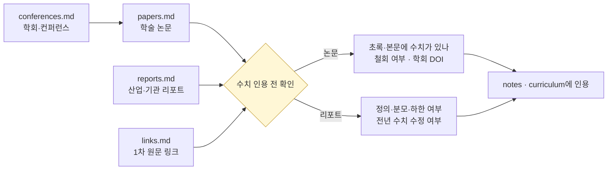

# 🎓 deep — 학술 논문 + 산업 리포트 + 컨퍼런스

> AML·온체인 분석의 **깊이 학습용**. 학술 논문·산업 리포트·컨퍼런스. 이 폴더는 `notes/`·`curriculum/`·`projects/` 이후의 "**한 단계 더**"를 위한 외부 자료 큐레이션입니다.

> **마지막 갱신**: 2026-10-21
> **다음 리뷰**: 2027-01 (분기 리뷰)
> **리뷰 주기**: 분기별 (Q1·Q2·Q3·Q4)

## 이 폴더를 언제 쓰나

`notes/`가 AML의 **뼈대**를 만들어주고 `curriculum/` 60일이 **순차 학습**을 끌고 가지만, 실무 깊이가 쌓이면 반드시 **"원전"**을 마주하는 순간이 옵니다. Meiklejohn 2013 원논문을 읽어야 클러스터링 휴리스틱이 이해되고, 분석업체 연간 리포트의 방법론 절을 봐야 시장 숫자의 **정의와 분모**가 보입니다. 이 폴더는 그런 "원전 접근"의 안내판입니다.

> **2026-10-21 갱신.** `papers.md`에 2025~2026 논문 섹션을 새로 만들고 서지 오류를 고쳤습니다. `reports.md`는 Chainalysis·TRM 2026 리포트를 정의 차이와 함께 병기하고 BIS·ECB·FSB 2026 문서를 추가했습니다. 근거는 `research/2026-10-academic-literature.md`와 정본 보고서 부록 A-40·A-41입니다.

## 영역별 인덱스

- [`papers.md`](papers.md) — **학술 논문 큐레이션** (Bitcoin clustering, ML, 크로스체인, 프라이버시, 2025~2026 신규)
- [`reports.md`](reports.md) — **산업·기관 리포트** (Chainalysis, TRM, Elliptic, FATF, BIS·ECB·FSB)
- [`conferences.md`](conferences.md) — **AML·블록체인 컨퍼런스** + 시청 가치 영상
- [`links.md`](links.md) — **참고 링크 모음** (1차 자료·뉴스·벤더 공식 페이지)

## 활용 가이드

### 60일 커리큘럼과의 관계

- **D54 (논문)** — `papers.md`의 Bitcoin clustering 섹션 1편 정독
- **D55 (리포트)** — `reports.md`의 Chainalysis·TRM 2026 리포트를 나란히 정독(정의·분모부터)
- 그 이후엔 **자유 학습용 깊이 자료**
- 새 논문·리포트 발견 시 여기 추가

### 학습 페이스

월 1편 정독이 현실적인 페이스입니다. 산업 리포트는 연간 리포트가 나오는 1~2월과 FATF Targeted Update가 나오는 7월 전후에 몰아서 읽고, 뉴스레터는 주 1회 훑는 정도가 지속 가능합니다.

## 학습 방법 — 논문 5단계 속독법

학술 논문은 처음부터 끝까지 읽지 않아도 됩니다. 다음 5단계 순서가 효율적입니다:

1. **초록** — 무엇을 주장하는가. 수치가 초록에 있는지 확인
2. **결론** — 무엇을 발견했는가
3. **방법** — 데이터셋·라벨 정의·지표 (수식은 건너뛰어도 됨)
4. **관련연구** — 학계 위치
5. **메모** — 한 줄 요약 + 한계 + 철회·버전 여부

### 왜 이 순서인가

먼저 **초록·결론**으로 "이 논문이 무엇을 보였는지" 뼈대를 잡은 뒤 방법을 보면 훨씬 친숙해집니다. 특히 3단계에서 데이터셋·라벨·지표를 적어 두면, 다른 논문의 수치와 섞어 비교하는 실수를 막을 수 있습니다. 이 저장소가 겪은 인용 오류(CTR:00007)는 클러스터링 논문과 거래 분류 논문의 수치를 한 표에 섞은 데서 시작했습니다.

## 실무자를 위한 팁

- **AMLO·CCO**: 학술 논문보다 **산업 리포트와 규제 가이드라인**이 실무에 더 직접적. `reports.md`와 `links.md`의 FATF 문서가 1순위.
- **기술·엔지니어**: `papers.md`의 Bitcoin clustering·ML·크로스체인·2025~2026 섹션이 핵심.
- **리서처·정책**: 학술 + 리포트 + 1차 원문(`links.md`). 법무법인 해설은 유용하지만 날짜·조문은 1차 원문으로 다시 확인하세요.

## 💼 실무 현장 (Industry Reality)

> 2026-10-21 정리: 이전 판의 특정 거래소·벤더의 내부 리서치 조직 규모, "24시간 내 1차 분석", "주 3~5시간이면 1년 내 업계 상위권" 같은 서술은 공개 출처가 없어 삭제했습니다.

### 이 자료를 실무에서 어떻게 쓰나

deep 자료는 세 경로로 쓰입니다. (1) **정책팀**: FATF 공식 문서·FIU 자료를 정책 개정 근거로 인용. (2) **분석팀**: 분석업체 사건 분석과 연간 리포트를 위험평가·STR 서술의 참고로 사용. (3) **엔지니어팀**: 학술 논문을 휴리스틱 설계·모델 검증에 참고.

### 자주 나오는 오해

- **"학술 논문은 실무와 무관"** — 벤더 PoC 질문(ground truth, 클러스터 붕괴, 브리지별 매칭 결과)과 모델 검증 지표(PR-AUC)는 논문에서 나옵니다.
- **"벤더 리포트 숫자는 표준 통계"** — 각 회사의 귀속 데이터에 기반한 하한 추정이고, 회사마다 분모가 다릅니다(`reports.md` §2).
- **"한국어 자료만 보면 됨"** — 기술·온체인 분석 문헌은 대부분 영어입니다. 한국 기술 논문 사례는 `papers.md` §8을 보세요.

### 실무자가 이 영역을 따라잡는 루틴

- **매주** — FATF·FSC·FIU 발간물 알림, 분석업체 블로그 제목 훑기
- **월 1편** — 학술 논문 정독(5단계 속독법)
- **연 1회(1~2월)** — 분석업체 연간 리포트 2종 나란히 읽기
- **연 1회(7월 전후)** — FATF Targeted Update 정독

## 📅 분기 리뷰 프로세스 — 콘텐츠 최신성 관리

deep 폴더 4개 파일은 **분기별** 리뷰를 통해 최신성 유지:

| 파일 | 리뷰 초점 | 예상 업데이트 빈도 |
|---|---|---|
| papers.md | 신규 AML·온체인 분석 논문 | 분기 1~3건 |
| reports.md | Chainalysis·TRM·Elliptic 연간 리포트 | 분기 1~2건 (Q1 집중) |
| conferences.md | 주요 콘퍼런스·교육 자격 | 분기 0~1건 |
| links.md | 깨진 URL·신규 규제 링크 | 분기 전수 |

### 리뷰 체크리스트

- [ ] 각 파일 마지막 갱신 날짜 3개월 이내인가
- [ ] 기술된 "2025년 리포트" 등 연도 표기 stale한가
- [ ] 외부 URL 동작 (`quality/check_external_urls.py`)
- [ ] 신규 주요 논문·사건 반영됐는가
- [ ] 인용한 arXiv 프리프린트가 철회되지 않았는가
- [ ] 인용 수치가 원 초록·본문에 실제로 있는가

### 리뷰 리듬

- **Q1 (1~3월)**: 분석업체 연간 리포트 발간 집중기(2026년: Chainalysis 01-08, TRM 01-28).
- **Q2 (4~6월)**: 상반기 학회(NDSS·ICSE·WWW·KDD 채택 발표) 논문 반영.
- **Q3 (7~9월)**: FATF Targeted Update(2026년: 07-16) 반영, 전체 URL 전수 검사.
- **Q4 (10~12월)**: 연말 동향 정리. 다음해 커리큘럼 연계 자료 확정.
