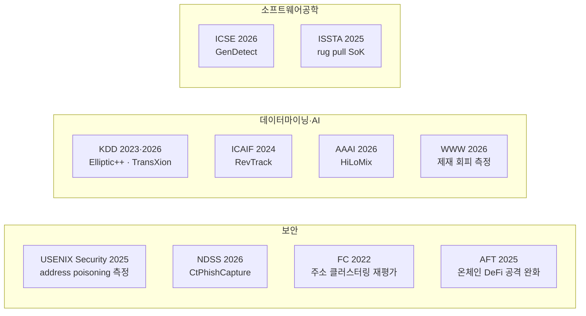

# 컨퍼런스 / 영상 / 팟캐스트

> 학습 가속화 영상 자료. 이 글은 "어떤 컨퍼런스·채널을 언제 보면 좋은가"의 큐레이션입니다.

> **마지막 갱신**: 2026-10-21
> **다음 리뷰**: 2027-01 (분기 리뷰)
> **리뷰 주기**: 분기별 (Q1·Q2·Q3·Q4) — 주요 컨퍼런스·교육 자격 업데이트

## 왜 영상·컨퍼런스까지 챙기나

AML은 규제 변화·사고 분석·신기술이 빠르게 바뀌는 영역입니다. 업계 컨퍼런스는 그해 업계가 무엇을 걱정하는지 보여 주고, 학술 학회는 그 걱정을 **측정한 결과**를 보여 줍니다. 두 종류를 구분해서 보세요. 업계 발표는 벤더 관점이 섞이고, 학회 논문은 데이터셋과 지표가 공개됩니다.

> **2026-10-21 갱신.** 학술 학회 절(§0)을 새로 만들고, 이전 판의 자격증 비용·업계 컨퍼런스 규모·"채용 표준" 같은 출처 없는 서술을 정리했습니다.

---

## 0. 학술 학회 — 가상자산 AML 논문이 실리는 곳 (신설)

`papers.md` §7의 2025~2026 논문이 실제로 실린 학회입니다. 학회명 옆은 그 학회에 실린 이 분야 논문의 예입니다.

- **보안**: USENIX Security, ACM CCS, IEEE S&P, NDSS, Financial Cryptography(FC), AFT, IEEE SaTML(2026년 채택 목록에 블록체인 GNN 사기 탐지의 취약성 논문이 있으나 이 저장소는 초록 미열람)
- **데이터마이닝·AI**: KDD(및 금융 이상탐지·MLF 워크숍 — Elliptic 2019, Elliptic2 2024), ACM ICAIF, AAAI, The Web Conference(WWW)
- **소프트웨어공학**: ICSE, ISSTA
- **블록체인 전문**: IEEE ICBC(Monero 휴리스틱, 2024), IEEE BCCA, ACM CODASPY(Solana rug pull 데이터셋, 2025)
- **중앙은행 측**: ECB 크립토자산 모니터링 전문가그룹(CAMEG) 컨퍼런스 — 2025-10-30~31 초록집이 ECB OP 382(2026-03-23)로 공개([ECB](https://www.ecb.europa.eu/pub/pdf/scpops/ecb.op382.en.pdf))

**왜 중요한가**: 학회 논문은 데이터셋·라벨·지표가 공개돼 있어 수치의 의미를 검증할 수 있습니다. 반대로 같은 학회라도 워크숍 논문·프리프린트는 동료심사 수준이 다르니 출판 형태를 확인하세요.

---

## 1. AML · 컴플라이언스 컨퍼런스

### 글로벌

- **ACAMS** (Association of Certified Anti-Money Laundering Specialists) — 연간 + 지역
- **ACFCS** (Association of Certified Financial Crime Specialists)
- **Money 20/20** (핀테크 + AML)
- **Sibos** (SWIFT 주관)

**왜 중요한가**: ACAMS는 AML 자격증(CAMS·CCAS)의 발급 기관이면서 대표적인 실무자 네트워크입니다.

### 가상자산 특화

- **Chainalysis Links** (연간) — 가상자산 AML 최대
- **TRM Labs FCS Conference**
- **Notabene Travel Rule Summit**
- **Consensus** (CoinDesk) — Compliance 트랙

**왜 중요한가**: 벤더 주최 컨퍼런스는 업계 실무 트렌드를 빠르게 보여 주지만, 주최사의 제품 관점이 섞입니다. 발표에서 나온 수치는 원 리포트·논문으로 다시 확인하세요.

### 한국

- **DAXA 컨퍼런스** (디지털자산거래소공동협의체)
- **금융위·FIU 공청회** (정책 발표)
- **한국블록체인협회 행사**
- **KISA 정보보호 컨퍼런스**

### 실무 포인트

한국 DAXA·FIU 공청회는 **국내 규제 방향의 선행 지표**. 특히 FIU 공청회는 시행령·감독규정 개정 전에 업계 의견을 수렴하는 자리이므로, 여기서 나오는 발언이 수개월 뒤 법 개정으로 이어집니다.

---

## 2. 유튜브 채널

### 영어

- **Chainalysis** — 분석 사례 시연
- **TRM Labs** — 사고 분석
- **Elliptic** — Webinar 다수
- **Coin Center** — 정책·법
- **Bankless** — DeFi 전반

**왜 유용한가**: 분석업체 채널은 실제 사건(Bybit·Ronin 등)의 자금 흐름을 단계별로 보여 줍니다. 초기 분석은 이후 수정될 수 있으니 업로드 날짜를 함께 기록하세요.

### 한국어

- **이더리움재단 한국** — 기술
- **EthCC, Devcon 영상**
- **각 거래소 공식 채널** — 컴플 관련 자료

---

## 3. 팟캐스트

### AML 일반

- **Talking Crime** (ACFCS)
- **AML Talk** (Themis)

### 가상자산

- **Unchained Podcast** (Laura Shin)
- **The Block Podcast**
- **Bankless Podcast**

### 보안

- **Darknet Diaries** — 사이버범죄 서사

**왜 유용한가**: Darknet Diaries는 해킹·다크웹·자금세탁 사건을 내러티브로 풀어 주는 팟캐스트입니다. 사건의 맥락을 잡는 용도로 쓰고, 사실관계는 공소장·제재 공고 같은 1차 자료로 확인하세요.

---

## 4. 온라인 강의

### 무료

- **Coursera — Bitcoin and Cryptocurrency Technologies** (Princeton)
- **edX — Blockchain Fundamentals** (Berkeley)
- **MIT OCW — Cryptocurrency Engineering**

**왜 유용한가**: Princeton의 Coursera 과정은 Bitcoin 원리와 블록체인 구조를 학술적으로 다루는 무료 자원입니다.

### 유료 · 자격증

- **CAMS** (Certified Anti-Money Laundering Specialist) — ACAMS 발급
- **CCAS** (Certified Cryptoasset AML Specialist) — ACAMS 가상자산 특화
- **CFCS** (Certified Financial Crime Specialist) — ACFCS
- **Chainalysis Certification** — Chainalysis 발급
- **TRM Academy** — TRM 발급

### 실무 포인트

**CAMS·CCAS**는 AML 실무자에게 알려진 자격증입니다. 응시료·멤버십 비용과 갱신 요건은 바뀔 수 있으니 ACAMS 공식 페이지에서 확인하세요(이전 판의 "약 $1,500"은 출처가 없어 삭제).

---

## 5. 뉴스레터

- **Chainalysis Insights**
- **TRM Newsletter**
- **Notabene Travel Rule Newsletter**
- **The Block Daily**
- **CoinDesk Newsletter**
- **Latham — Crypto Update**

**왜 유용한가**: 주 1회 정리된 업계 동향을 **수동적으로 받는** 채널. 시간 많지 않은 실무자에게 가장 지속 가능한 정보 흡수 방법.

---

## 6. 트위터·X 추천 (시간 변동 가능)

### 분석가

- @ZachXBT — 독립 온체인 수사관
- @MetaSleuth_
- @0xfoobar
- @adamscochran
- @cryptounfolded

**왜 유용한가**: 독립 온체인 분석가의 공개 스레드는 사건 초기 정보를 빠르게 보여 줍니다. 다만 개인 분석이므로 귀속 판단은 공식 발표·법원 문서로 확인하세요.

### 회사

- @chainalysis
- @TRMLabs
- @elliptic
- @notabeneTR
- @CryptoPolicy

### 보안

- @SlowMist_Team
- @PeckShieldAlert
- @samczsun

---

## 7. 추천 영상 (시청 우선)

1. 분석업체 연간 리포트 발표 영상 (매년 1~2월)
2. Bybit 해킹 분석 (분석업체 블로그·영상)
3. Tornado Cash 사건 분석 — 제재 효과의 양면(입금 71.03% 감소, 보안사고 78.33% 여전히 경유)은 WWW '26 논문([arXiv 2507.11721](https://arxiv.org/abs/2507.11721))과 함께 보기
4. FATF 트래블룰 관련 강연
5. 북한 Lazarus 관련 다큐멘터리

### 실무 포인트

영상은 사건의 흐름을 잡는 용도입니다. 영상에서 들은 수치는 원 리포트·논문으로 확인한 뒤 notes에 옮기세요.

## 💼 실무 현장 (Industry Reality)

> 2026-10-21 정리: 이전 판의 "6개월 먼저 듣는 업계 합의", 벤더 컨퍼런스 예산, 법집행기관 참여 방식, 녹화본 업로드 시기, 자격증의 채용·승진 요구 정도, "3년이면 상위 10% 정보량" 같은 서술은 공개 출처가 없어 삭제했습니다.

### 이 컨퍼런스·영상을 실무에서 어떻게 쓰나

- **업계 컨퍼런스**: 다른 VASP·감독기관이 무엇을 걱정하는지 파악하는 용도. 발표 자료의 수치는 원 출처를 확인한 뒤 인용합니다.
- **학술 학회**: 탐지 기법의 실제 성능과 한계를 확인하는 용도. 벤더 PoC 질문을 만들 때 근거가 됩니다(`papers.md`).
- **국내 공청회**: FIU·금융위 공청회는 시행령·고시 개정 전 의견 수렴 자리입니다. 다만 입법예고안과 공포본이 다를 수 있으니(예: 한국 트래블룰 시행령의 1천만원 이상 거래 — 입법예고 "의심거래로 보아 보고" → 공포본 "자체 의심거래 감시체계"), 최종 공포본으로 확인하세요.

### 자주 나오는 오해

- **"컨퍼런스 발표 = 검증된 사실"** — 업계 발표는 주최사 관점이 섞입니다. 학회 논문도 프리프린트·워크숍이면 동료심사 수준이 다릅니다.
- **"자격증은 형식"** — 자격증은 공통 용어와 기본기를 맞추는 데 쓸모가 있습니다. 다만 가상자산 특화 기술(클러스터링·크로스체인 추적)은 별도로 공부해야 합니다.
- **"한국어 영상이면 충분"** — 온체인 분석·사고 포렌식 자료는 대부분 영어입니다.

### 실무자가 이 영역을 따라잡는 루틴

- **매주** — 분석업체·보안업체 채널의 신규 사건 분석 1편
- **분기 1회** — 주요 학회(USENIX Security·NDSS·KDD·FC 등) 채택 논문 목록에서 가상자산 AML 관련 제목 훑기
- **연 1~2회** — 업계 컨퍼런스 녹화본 중 관심 분과 시청
- **자격증 갱신 시** — 갱신 요건은 발급 기관 공식 페이지로 확인

## 더 읽을거리

- [`papers.md`](papers.md) — 학술 논문
- [`reports.md`](reports.md) — 산업 리포트
- [`links.md`](links.md) — 전체 참고 링크
