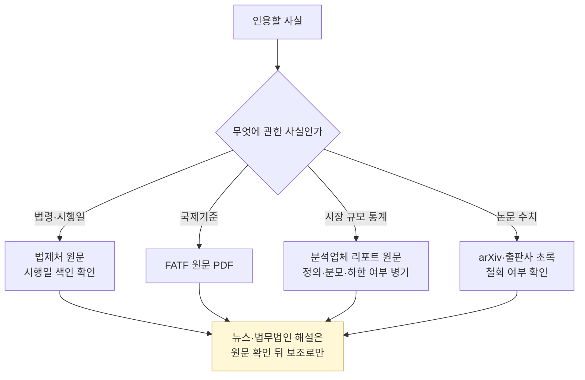

# References — 참고 링크 모음

> 학습·업무에 자주 필요한 **1차·2차 자료**. 이 글은 "어떤 상황에서 어느 링크를 봐야 하나"의 이정표입니다.

> **마지막 갱신**: 2026-10-21
> **다음 리뷰**: 2027-01 (분기 리뷰)
> **리뷰 주기**: 분기별 전수 (깨진 URL·신규 규제 링크 점검)

## 이 페이지를 어떻게 쓰나

AML 실무는 **"정확한 출처"를 인용하는 일**이 잦습니다. 내부 정책 문서·STR 보고서·감독 대응 시 "특금법 §5의2" 같은 조문을 찾거나, "FATF R.16 원문이 어디에 있는지" 빠르게 접근할 수 있어야 합니다. 이 페이지는 **북마크 모음**으로 활용하세요 — 암기는 필요 없지만 **어디에 있는지는** 기억해야 합니다.

---

## 1차 자료 (Primary Sources) — 법령·공식 문서

### 한국 법령

- [국가법령정보센터 — 특금법](https://www.law.go.kr/법령/특정금융거래정보의보고및이용등에관한법률)
- [국가법령정보센터 — 가상자산이용자보호법](https://www.law.go.kr/법령/가상자산이용자보호등에관한법률)
- [금융위원회 (FSC)](https://www.fsc.go.kr/)
- [금융정보분석원 (KoFIU)](https://www.kofiu.go.kr/)
- [금융감독원 (FSS)](https://www.fss.or.kr/)
- [한국인터넷진흥원 (KISA) — ISMS](https://isms.kisa.or.kr/)

### 한국 가이드라인·매뉴얼

- [FSC — 가상자산사업자 신고 매뉴얼 (PDF)](https://www.fsc.go.kr/comm/getFile?srvcId=BBSTY1&upperNo=75409&fileTy=ATTACH&fileNo=6)
- [FSC — 가상자산이용자보호법 시행 보도자료](https://www.fsc.go.kr/po010101/82682)

**왜 중요한가**: 법령은 원칙만 담고 **실무 디테일은 가이드라인·매뉴얼**에 있습니다. 특히 FIU 신고매뉴얼이 VASP 신고 준비의 사실상 바이블. 법령정보센터에서 법 원문을 보면서 함께 참조.

### FATF

- [FATF 공식](https://www.fatf-gafi.org/)
- [FATF — Virtual Assets 페이지](https://www.fatf-gafi.org/en/topics/virtual-assets.html)
- [FATF — 40 Recommendations](https://www.fatf-gafi.org/en/publications/Fatfrecommendations/Fatf-recommendations.html)
- [FATF — 7th Targeted Update on VAs and VASPs, 2026-07-16 (PDF)](https://www.fatf-gafi.org/content/dam/fatf-gafi/reports/7th-targeted-update-on-implementation-fatf-standards-vas-vasps-2026.pdf.coredownload.pdf)
- [FATF — 6th Targeted Update on VAs and VASPs, 2025-06-26 (PDF)](https://www.fatf-gafi.org/content/dam/fatf-gafi/recommendations/2025-Targeted-Upate-VA-VASPs.pdf.coredownload.pdf)
- [FATF — Updated Guidance for a Risk-Based Approach to VAs and VASPs, 2021-10-28 (PDF, 루마니아 FIU 미러)](https://www.onpcsb.ro/2022/01042022/Updated-Guidance-VA-VASP.pdf)
- [FATF — Targeted Report on Stablecoins and Unhosted Wallets, 2026-03-03](https://www.fatf-gafi.org/en/publications/Virtualassets/targeted-report-stablecoins-unhosted-wallets.html)
- [FATF — Understanding and Mitigating the Risks of Offshore VASPs, 2026-03-11](https://www.fatf-gafi.org/en/publications/Virtualassets/Understanding-Mitigating-Risks-Offshore-VASPs.html)
- [FATF — Targeted Report on Regulatory Challenges from DeFi, 2026-07-21](https://www.fatf-gafi.org/en/publications/Virtualassets/targeted-report-decentralised-finance-2026.html)
- [FATF — Updated R.16 Explanatory Note (PDF)](https://www.fatf-gafi.org/content/dam/fatf-gafi/recommendations/Explanatory%20note%20for%20revised%20R.16.pdf.coredownload.pdf)

### 미국

- [FinCEN 공식](https://www.fincen.gov/)
- [NYDFS — 블록체인 분석 사용 가이던스, 2022-04-28](https://www.dfs.ny.gov/industry_guidance/industry_letters/il20220428_guidance_use_blockchain_analytics)
- [FBI IC3 — 2025 Annual Report (PDF)](https://www.ic3.gov/AnnualReport/Reports/2025_IC3Report.pdf)
- [OFAC 공식](https://ofac.treasury.gov/)
- [OFAC SDN List 검색](https://sanctionssearch.ofac.treas.gov/)
- [DOJ Cryptocurrency 페이지](https://www.justice.gov/criminal)

### EU

- [ESMA — MiCA](https://www.esma.europa.eu/esmas-activities/digital-finance-and-innovation/markets-crypto-assets-regulation-mica)
- [European Commission — AML 페이지](https://finance.ec.europa.eu/financial-crime/anti-money-laundering-and-countering-financing-terrorism_en)
- [AMLA (EU AML Authority)](https://anti-money-laundering-authority.europa.eu/index_en)

### 국제기구

- [UN Consolidated Sanctions List](https://www.un.org/securitycouncil/content/un-sc-consolidated-list)
- [UNODC — Money Laundering](https://www.unodc.org/unodc/en/money-laundering/overview.html)
- [Wolfsberg Group](https://www.wolfsberg-group.org/)
- [BIS — Annual Economic Report 2026, Ch. III (2026-06-23)](https://www.bis.org/publ/arpdf/ar2026e3.htm)
- [ECB — Occasional Paper No. 382, CAMEG 2025 초록집 (2026-03-23, PDF)](https://www.ecb.europa.eu/pub/pdf/scpops/ecb.op382.en.pdf)
- [FSB — Global Stablecoin Arrangements: Cross-border vulnerabilities (2026-10-12)](https://www.fsb.org/2026/10/global-stablecoin-arrangements-cross-border-vulnerabilities-and-financial-stability-monitoring/)

### 실무 포인트

1차 자료는 **검사·STR·내부 정책 문서에서 인용할 때** 반드시 활용. 감독 검사관이 "이 정책의 근거가 뭐냐"고 물을 때 법령·가이드라인 원문 URL을 제시하면 신뢰도가 크게 오릅니다.

---

## 2차 자료 (Industry Reports · 분석)

### 산업 리포트

- [Chainalysis — 2026 Crypto Crime Report 서론 (2026-01-08)](https://www.chainalysis.com/blog/2026-crypto-crime-report-introduction/)
- [TRM Labs — 2026 Crypto Crime Report (2026-01-28)](https://www.trmlabs.com/reports-and-whitepapers/2026-crypto-crime-report)
- [Elliptic — Typologies Report 2025 (2025-09-30)](https://www.elliptic.co/insights/elliptics-typologies-report-innovating-to-fight-financial-crime-in-an-age-of-rapid-change/)

> 두 분석업체의 2025년 불법 규모(1,540억 vs 1,580억 달러)는 정의·분모가 달라 비교하면 안 됩니다. 정리는 [`reports.md`](reports.md) §2.
- [Crystal Intelligence — Reports](https://crystalintelligence.com/)
- [38 North — DPRK 관련](https://www.38north.org/)
- [Basel AML Index](https://www.baselgovernance.org/basel-aml-index)

### 한국 분석·뉴스

- [코인데스크 코리아](https://www.coindeskkorea.com/)
- [더블록 (한국어)](https://www.theblockcrypto.com/)
- [블록미디어](https://www.blockmedia.co.kr/)
- [토큰포스트](https://www.tokenpost.kr/)
- [디센터 (서울경제)](https://decenter.kr/)
- [법률신문 (가상자산 칼럼)](https://www.lawtimes.co.kr)

**실무 포인트**: 한국 미디어는 **실시간 빠르지만 때로는 부정확**. FIU 보도자료·법률신문 칼럼이 상대적으로 정확도 높은 편. 중요 사안은 반드시 1차 자료(FSC·FIU 공식)로 cross-check.

### 글로벌 분석·뉴스

- [The Block](https://www.theblockcrypto.com/)
- [CoinDesk](https://www.coindesk.com/)
- [The Hacker News](https://thehackernews.com/) — 보안 사고
- [Krebs on Security](https://krebsonsecurity.com/)

### 법무법인 인사이트

- [김·장 — Insights](https://www.kimchang.com/ko/insights/)
- [Skadden — FinTech](https://www.skadden.com/insights/practices/financial-institutions)
- [Latham & Watkins — Crypto Tracker](https://www.lw.com/en/us-crypto-policy-tracker/regulatory-developments)
- [Steptoe — Blockchain Blog](https://www.steptoe.com/en/news-publications)
- [Akin Gump — FinTech](https://www.akingump.com/en/services/practices/financial-services-fintech)
- [Mayer Brown — FinTech](https://www.mayerbrown.com/en/capabilities/practices/financial-services-regulatory-and-enforcement)

**실무 포인트**: 법무법인 인사이트는 **"판결·규제가 실무에 어떤 영향을 주는지"**를 해설해 줍니다. 다만 입법예고안 기준 요약이 공포본과 다른 경우가 있으므로(예: 한국 트래블룰 시행령 — 공포 2026-08-18, 시행 2027-02-19), 날짜·의무는 법제처 원문으로 다시 확인하세요.

### 컨설팅·Big4 인사이트

- [PwC — Financial Crimes](https://www.pwc.com/us/en/industries/financial-services.html)
- [Deloitte — AML](https://www2.deloitte.com/us/en.html)
- [EY — Financial Crime](https://www.ey.com/en_us)
- [KPMG — AML](https://kpmg.com/xx/en/home.html)

---

## 3. 솔루션 벤더 (공식)

### Blockchain Analytics

- [Chainalysis](https://www.chainalysis.com/)
- [TRM Labs](https://www.trmlabs.com/)
- [Elliptic](https://www.elliptic.co/)
- [Crystal Intelligence](https://crystalintelligence.com/)
- [Merkle Science](https://www.merklescience.com/)
- [Nominis](https://www.nominis.io/)
- [AnChain.AI](https://www.anchain.ai/)

### Travel Rule

- [Notabene](https://notabene.id/)
- [VerifyVASP](https://www.verifyvasp.com/)
- [CodeVASP (CODE)](https://www.codevasp.com/ko)
- [TRISA](https://trisa.io/)
- [21 Analytics (TRP)](https://www.21analytics.co/)
- [Sumsub Travel Rule](https://sumsub.com/travel-rule/)
- [Sygna (CoolBitX)](https://www.sygna.io/)

### KYC

- [Sumsub](https://sumsub.com/)
- [ARGOS Identity](https://argosidentity.com/)
- [Onfido](https://onfido.com/)
- [Veriff](https://www.veriff.com/)
- [Jumio](https://www.jumio.com/)

### Sanctions · PEP · Adverse Media

- [LSEG World-Check](https://www.lseg.com/en/risk-intelligence/screening-solutions)
- [Dow Jones Risk Center](https://www.dowjones.com/professional/risk/)
- [ComplyAdvantage](https://complyadvantage.com/)

### Case Management

- [NICE Actimize](https://www.niceactimize.com/)
- [Hummingbird](https://hummingbird.co/)
- [Unit21](https://www.unit21.ai/)
- [Solidus Labs](https://www.soliduslabs.com/)

**실무 포인트**: 벤더 공식 페이지는 **PoC·RFP 요청할 때** 먼저 접근. 각 벤더의 "Resources" 페이지에 백서·사용 사례·기술 문서가 모여있어, 영업 접촉 전 미리 훑으면 미팅 효율이 높아집니다.

---

## 4. 한국 협회·단체

- [DAXA (디지털자산거래소공동협의체)](https://www.daxa.or.kr/)
- [한국블록체인협회](https://www.kblockchain.org/)
- [한국디지털자산사업자연합회 (KDA)](https://www.kdacca.com/)

---

## 5. 학술·깊은 학습

- [Möser & Narayanan — Resurrecting Address Clustering in Bitcoin (arXiv 2107.05749)](https://arxiv.org/abs/2107.05749)
- [Weber et al. — Elliptic 데이터셋 논문 (arXiv 1908.02591)](https://arxiv.org/abs/1908.02591)
- [Elmougy & Liu — Elliptic++ (arXiv 2306.06108)](https://arxiv.org/abs/2306.06108)
- [Bellei et al. — Elliptic2 (arXiv 2404.19109)](https://arxiv.org/abs/2404.19109)
- [Heuristic-Based Address Clustering in Bitcoin (논문)](https://www.researchgate.net/publication/347083664_Heuristic-Based_Address_Clustering_in_Bitcoin)
- [arXiv cs.CR 최신 목록](https://arxiv.org/list/cs.CR/recent)
- [IMF Working Papers](https://www.imf.org/en/Publications/WP)
- [SSRN](https://www.ssrn.com/)
- 2025~2026 논문 목록은 [`papers.md`](papers.md) §7

---

## 6. 추천 책 (참고)

- *Anti-Money Laundering: A Practical Guide* — Tim Parkman
- *Mastering Bitcoin* — Andreas Antonopoulos
- *Mastering Ethereum* — Antonopoulos & Wood
- *Tracers in the Dark* — Andy Greenberg (블록체인 분석 서사)
- *The Cryptopians* — Laura Shin (이더리움 역사)

### 실무 포인트

**Tracers in the Dark**는 블록체인 분석이 실제 수사로 이어지는 내러티브 논픽션. 기술적 깊이보다 **"온체인 분석이 범죄 수사에 어떻게 쓰이는지"** 를 스토리로 이해하는 데 최적. AMLO·분석가 교육 도서로 추천.

---

## 7. 트위터·X 추천 (참고)

> 시간 변동 있을 수 있음. 검색으로 현행 확인.

- @chainalysis
- @TRMLabs
- @elliptic
- @ZachXBT (독립 온체인 수사관)
- @MetaSleuth_
- @SlowMist_Team (보안)
- @PeckShieldAlert (보안)

---

## 8. 검색 팁

- 한국 규제: "특금법", "가상자산사업자", "FIU 보도자료"
- FATF: "FATF Recommendation 15", "FATF Travel Rule guidance"
- 사례: "OFAC enforcement crypto YYYY", "FinCEN crypto penalty YYYY"
- 데이터: "crypto crime report YYYY" — 결과에서 분석업체 원 리포트의 방법론 절을 찾을 것
- 논문: "arXiv <번호>" — 버전 이력에서 철회(withdrawn) 여부 확인

### 실무 포인트

한국어 검색은 법률신문·블록미디어가 먼저 잡히고, 영어 검색은 The Block·CoinDesk가 먼저. 사건·판결은 **원문(재판 판결문·합의문)** 이 가장 정확하므로 "site:treasury.gov" 같은 도메인 한정 검색이 유용.

## 💼 실무 현장 (Industry Reality)

> 2026-10-21 정리: 이전 판의 특정 거래소의 내부 정책정보 플랫폼, 컨설팅사 보고서 판매 방식, 법집행기관의 벤더 포털 사용, "AMLO가 주 단위로 여는 1차 자료 TOP 10(추정)", "LLM 1차 번역이 업계 표준화" 같은 서술은 공개 출처가 없어 삭제했습니다.

### 이 링크 모음을 실무에서 어떻게 쓰나

- **팀 위키**: 링크를 카테고리별로 유지하고 "마지막 확인일" 필드를 둡니다. FATF 사이트는 접속이 막히는 경우가 있어(2026-10 조사에서 403 다수) 미러·PDF 사본 위치도 함께 적어 두면 좋습니다.
- **STR·정책 문서 템플릿**: 법령 조문·FATF 문단 링크를 템플릿에 미리 넣어 둡니다.
- **감독 검사 대응**: 1차 자료 북마크를 따로 모아 두고, 인용한 수치마다 출처 URL·확인일을 기록합니다.

### 자주 나오는 오해

- **"뉴스 기사만 보면 충분"** — 날짜·금액이 편집 과정에서 바뀌는 경우가 있습니다. 1차 원문(법령·보도자료·공식 PDF)을 직접 확인하세요.
- **"링크 모음 = 외워야 함"** — 외울 필요는 없고 **어디에 있는지**만 알면 됩니다.
- **"분석업체 리포트 링크 하나면 된다"** — 정의가 다른 두 리포트를 함께 보지 않으면 수치의 의미를 오독합니다.

### 실무자가 이 영역을 따라잡는 루틴

- **월 1회** — 링크 전체 훑기, 깨진 링크 수정(`quality/check_external_urls.py`)
- **분기 1회** — FATF 신규 발간물 확인
- **법령 개정 시** — 법제처에서 공포일·시행일을 따로 확인(공포 ≠ 시행)

## 더 읽을거리

- [`../README.md`](../README.md) — 전체 학습 인덱스
- [`../notes/glossary.md`](../notes/glossary.md) — 용어 사전
