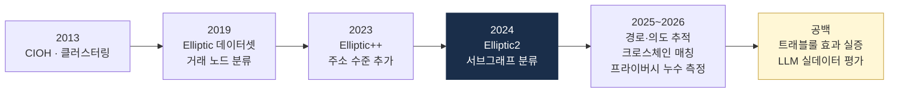

# 학술 논문 큐레이션

> AML·온체인 분석의 **학술 기반**. 이 글은 "어떤 논문을 읽어야 하나"의 큐레이션이며, 각 논문이 무엇을 보였고 무엇을 보이지 않았는지까지 적습니다.

> **마지막 갱신**: 2026-10-21
> **다음 리뷰**: 2027-01 (분기 리뷰)
> **리뷰 주기**: 분기별 (Q1·Q2·Q3·Q4) — 신규 AML·온체인 분석 논문 추가

> **2026-10-21 정정.** 서지 오류를 고쳤습니다. Bellei 2024 제목, Alarab 2020 학회(ICDM → ACM ICMLT 2020), Möser & Böhme 2017 학회(ESORICS → IEEE EuroS&PW 2017), Androulaki 2013 학회(ESORICS → FC 2013), Harlev 2018 학회(HICSS 2018) 추가, Lorenz 2020 정식 제목, BABD의 저널(IEEE TIFS 2024)과 규모, Elliptic++·Elliptic2 규모. 존재가 확인되지 않은 "Sun et al. (2023) Analysis of Cross-Chain Bridges"는 삭제했습니다. 2025~2026 섹션을 새로 만들었습니다. 근거는 `research/2026-10-academic-literature.md` §8과 정본 보고서 부록 A-40입니다.

## 이 큐레이션을 읽기 전에

블록체인 분석 도구가 쓰는 휴리스틱 상당수는 2013년 무렵의 Bitcoin 클러스터링 논문에서 출발했습니다. "왜 이 알고리즘이 이렇게 설계됐나"를 이해하려면 원논문을 읽는 게 지름길입니다.

**수치 인용 규칙.** 이 저장소는 원논문에 없는 정확도 수치를 인용한 적이 있습니다(`kb/facts/contradictions.jsonl` CTR:00007). 그래서 이 페이지에는 **초록·본문에서 확인된 수치만** 적고, 확인하지 못한 것은 "수치 미검증"이라고 씁니다. 2025~2026 항목의 수치는 2026-10-21에 초록 페이지를 직접 열어 확인한 것입니다.

---

## 1. Bitcoin Clustering / De-anonymization (필독)

> §1·§2·§5·§6의 2024년 이전 고전 항목 중 Crossref·arXiv로 재확인한 것은 학회·DOI를 적었습니다. 나머지는 이번 조사에서 서지를 다시 확인하지 않은 **[맥락]** 항목입니다.

### Meiklejohn et al. (2013) — "A Fistful of Bitcoins: Characterizing Payments Among Men with No Names"

- 비트코인 클러스터링의 **고전**. ACM IMC 2013
- Common Input Ownership 휴리스틱과 거스름 휴리스틱, 거래소 attribution

**왜 중요한가**: CIOH를 학계 차원에서 정리한 출발점입니다. 이 논문이 정확도 표(Precision/Recall/F1)를 제시했다는 저장소의 예전 서술은 근거가 없습니다(CTR:00007).

### Reid & Harrigan (2013) — "An Analysis of Anonymity in the Bitcoin System" [맥락]

- 비트코인 익명성의 한계를 다룬 초기 분석

**왜 중요한가**: "pseudonymity는 anonymity가 아니다"라는 전제를 초기에 보여 준 논문입니다.

### Androulaki et al. (2013) — "Evaluating User Privacy in Bitcoin"

- 사용자 행동 분석으로 식별 가능성 측정
- **Financial Cryptography (FC) 2013**, LNCS, DOI 10.1007/978-3-642-39884-1_4 (이전 판의 "ESORICS 2013"은 오기)

### Möser & Narayanan (2022) — "Resurrecting Address Clustering in Bitcoin"

- FC 2022 / [arXiv 2107.05749](https://arxiv.org/abs/2107.05749) (arXiv 게재 2021)
- 초록: "current techniques rely on heuristics that have not been rigorously evaluated or optimized"
- 기여: 거스름 식별의 ground truth 집합 구축, 낮은 오탐률을 목표로 한 예측 모델, **클러스터 붕괴 탐지·예방**

**왜 중요한가**: 클러스터링 휴리스틱에 **표준화된 정확도 수치가 없다**는 것이 이 분야의 실제 입장임을 보여 줍니다. 저장소 `curriculum/day_30.md`의 정정 근거입니다.

### Heuristic-Based Address Clustering in Bitcoin (2020) [맥락]

- 휴리스틱 비교 평가
- [ResearchGate](https://www.researchgate.net/publication/347083664_Heuristic-Based_Address_Clustering_in_Bitcoin)

### Möser et al. — "An Inquiry into Money Laundering Tools in the Bitcoin Ecosystem" [맥락]

- 믹서 측정. eCrime 2013 (APWG)

---

## 2. CoinJoin / Privacy Tools

### Maxwell — "CoinJoin: Bitcoin privacy for the real world" (2013) [맥락]

- CoinJoin **원형 제안** (Bitcointalk 글). 학술 논문은 아니지만 이후 CoinJoin 지갑의 설계 원형입니다.

### Möser & Böhme (2017) — "Anonymous Alone? Measuring Bitcoin's Second-Generation Anonymization Techniques"

- **IEEE EuroS&PW 2017**, DOI 10.1109/eurospw.2017.48 (이전 판의 "ESORICS"는 오기)
- 2세대 익명화 기법(믹서·CoinJoin) 측정
- 이 논문이 CoinJoin 샘플의 Precision/Recall 수치를 보고했다는 저장소의 예전 서술은 근거가 없습니다(CTR:00007).

### Kappos et al. — "An Empirical Analysis of Anonymity in Zcash" (2018) [맥락]

- Zcash shielded transaction 사용 패턴 분석. USENIX Security 2018

### Möser et al. — "An Empirical Analysis of Traceability in the Monero Blockchain" (2018) [맥락]

- Monero 링 서명의 추적 가능성 분석

**Monero에 대한 최신 서술**은 Hammad & Victor(IEEE ICBC 2024, [arXiv 2408.05332](https://arxiv.org/abs/2408.05332))를 보세요. 2019~2023년 지갑 버그·P2Pool·Mordinal 유래 휴리스틱은 **대부분 고정밀**이지만, 해당 버그가 2023년 초 패치돼 이후 신규 거래에는 효과가 없습니다. "완전 추적 불가"도 "다 추적된다"도 틀리고, 시기를 나눠야 합니다.

---

## 3. Travel Rule / Compliance Tech

### 동료심사·기관 문헌 (2025)

- **Shevchuk, Adamyk, Benson, Kovalchuk (2025)** — *Privacy-enhancing technologies for FATF crypto Travel Rule: balancing compliance and data protection*. 편저 단행본 챕터(Sztuczna Inteligencja i Cyberbezpieczeństwo – 2025, pp. 45–56, DOI 10.53052/9788367652520). GDPR·MiCA·AMLR·CCPA 하에서 토큰화·MPC·동형암호·ZKP·TEE·SSI를 평가하고 TRISA·OpenVASP/TRP·TAP을 검토. 결론은 중앙집중형에서 연합형·암호학적 검증 가능 모델로의 이동([Aston](https://research.aston.ac.uk/en/publications/technologie-wspieraj%C4%85ce-prywatno%C5%9B%C4%87-dla-regu%C5%82y-podr%C3%B3%C5%BCy-fatf-w-kryp/)). 이 저장소가 찾은 **첫 트래블룰 동료심사 문헌**입니다.
- **Shevchuk, Adamyk, Benson (2025)** — *Post-Quantum Security Enhancements for the TRISA Framework: A Technical Perspective*. IEEE ACIT 2025, pp. 553–558. RSA·ECDSA의 양자 취약성을 지적하고 CRYSTALS-Kyber·Dilithium 마이그레이션 경로 제안([Aston](https://research.aston.ac.uk/en/publications/post-quantum-security-enhancements-for-the-trisa-framework-a-tech/)).
- **Piper, Wolf, Heiss (2025)** — *Privacy-Preserving On-chain Permissioning for KYC-Compliant Decentralized Applications*. SSI + ZKP + 속성기반 접근제어. 트래블룰 자체가 아니라 KYC 게이팅([arXiv 2510.05807](https://arxiv.org/abs/2510.05807)).
- **Helal 외 (Banque de France·Bank of Greece·Banco de Portugal) (2025)** — *Privacy-enhancing mechanisms*. ECB OP 382 §2.10.2 수록 초록. 믹서·CoinJoin·ZK·MPC·FHE·스텔스 주소를 AML/CFT 준수 관점에서 분류, BIS Innovation Hub Mandala 예시([ECB OP 382](https://www.ecb.europa.eu/pub/pdf/scpops/ecb.op382.en.pdf), p. 35).

**공백**: 트래블룰·VASP 등록 의무가 거래량·불법 비중·sunrise 지연에 미친 **인과 효과를 추정한 2025~2026 동료심사 논문은 확인되지 않았습니다**.

### 업계·표준 문서 [맥락]

- Notabene · 21 Analytics 화이트페이퍼 — IVMS101 표준화 과정
- Wolfsberg Group 가상자산 관련 문서 — 글로벌 은행 모범사례

---

## 4. ML · AI in AML (2019~2024)

### Weber et al. (2019) — "Anti-Money Laundering in Bitcoin: Experimenting with Graph Convolutional Networks for Financial Forensics"

- KDD 2019 Anomaly Detection in Finance Workshop / [arXiv 1908.02591](https://arxiv.org/abs/1908.02591)
- **Elliptic 데이터셋 공개**: 거래 203,769 노드·234,355 엣지·피처 166·시점 49, 불법 4,545(2%)·합법 42,019(21%), 나머지 77% 미라벨
- 결과(본문, B): 불법 클래스 최고는 **랜덤포레스트**(전체 피처+노드 임베딩) precision 0.971 / recall 0.675 / F1 0.796. GCN은 0.812 / 0.512 / 0.628
- 시점 43의 다크마켓 폐쇄 이후 **모든 모델 성능 급락**(B)

**왜 중요한가**: 이후 대부분의 AML ML 논문이 이 데이터셋을 벤치마크로 씁니다. 동시에 이 논문 자체가 "GNN이 최고"가 아니고 "생태계가 바뀌면 모델이 무너진다"를 보여 줍니다.

### Lorenz et al. (2020) — "Machine learning methods to detect money laundering in the Bitcoin blockchain in the presence of label scarcity"

- ACM ICAIF 2020, DOI 10.1145/3383455.3422549
- 핵심은 제목 끝의 **라벨 희소성**입니다(이전 판은 제목 일부가 빠져 있었음).

### Alarab et al. (2020) — "Competence of Graph Convolutional Networks for Anti-Money Laundering in Bitcoin Blockchain"

- **ACM ICMLT 2020**, DOI 10.1145/3409073.3409080 (이전 판의 "ICDM"은 오기)
- 성능 수치는 **미검증**(ACM 초록 미열람). 이전 판의 "F1 0.84→0.90"은 삭제했습니다.

### Harlev et al. (2018) — "Breaking Bad: De-Anonymising Entity Types on the Bitcoin Blockchain Using Supervised Machine Learning"

- **HICSS 2018**, DOI 10.24251/hicss.2018.443
- 엔티티 타입(거래소·mixer·도박 등) 지도학습 분류

### Elmougy & Liu (2023) — "Demystifying Fraudulent Transactions and Illicit Nodes in the Bitcoin Network for Financial Forensics" (Elliptic++)

- KDD 2023, DOI 10.1145/3580305.3599803 / [arXiv 2306.06108](https://arxiv.org/abs/2306.06108)
- 지갑 주소 822k+·주소당 피처 56·시간 상호작용 1.27M, 4종 그래프

### Bellei et al. (2024) — "The Shape of Money Laundering: Subgraph Representation Learning on the Blockchain with the Elliptic2 Dataset"

- KDD MLF Workshop 2024 / [arXiv 2404.19109](https://arxiv.org/abs/2404.19109)
- **라벨 서브그래프 122K**(121,810; 합법 119,047 / 의심 2,763)·노드 클러스터 49M·엣지 거래 196M
- GLASS F1 0.933이지만 PR-AUC 0.208, ROC-AUC 0.889; 혼동행렬 TP 245 / FN 46 / FP 765 / TN 11,125(B)
- **지도학습 서브그래프 분류**입니다. "Shape vs. Structure: Topology-Aware Self-Supervised Learning…"이라는 제목의 논문은 존재하지 않습니다(이전 판 오기). 주소 클러스터링 논문도 아닙니다.

**왜 중요한가**: AML을 "거래 하나"가 아니라 "자금 흐름 서브그래프" 문제로 재정의했습니다. F1과 PR-AUC의 괴리는 이후 벤치마크 회의론의 출발점이 됐습니다.

### Song et al. (2024) — "Identifying Money Laundering Subgraphs on the Blockchain" (RevTrack)

- ICAIF 2024 / [arXiv 2410.08394](https://arxiv.org/abs/2410.08394), 코드 GitHub MITIBMxGraph/RevTrack
- 자금의 **최초 송신자·최종 수신자** 추적. Elliptic2 후속 연구(초록에 수치 없음)

---

## 5. Cross-chain · DeFi

이전 판의 "Sun et al. (2023) — Analysis of Cross-Chain Bridges: Security and Efficiency"는 Crossref에서 일치하는 서지를 찾을 수 없어 **삭제했습니다**. 대신 원문을 확인한 연구를 둡니다. 세 연구는 브리지 집합·정의가 달라 **수치를 서로 비교할 수 없습니다**.

- **Lin et al. (2025)** — *Track and Trace: Automatically Uncovering Cross-chain Transactions in the Multi-blockchain Ecosystems* (ABCTracer). 브리지 12개, 양방향 추적 F1 91.75%([arXiv 2504.01822](https://arxiv.org/abs/2504.01822))
- **Liang et al. (2025)** — *ConneX: Automatically Resolving Transaction Opacity of Cross-Chain Bridges for Security Analysis*. 브리지 5개·약 50만 건, 평균 F1 0.9746, 기준선 대비 최소 20.05%p([arXiv 2511.01393](https://arxiv.org/abs/2511.01393))
- **Yan, Huang, Tessone (2025)** — Ethereum–Polygon 브리지 거래 매칭. 입금 93.04~99.65%, 출금 67.55~92.78%(자산 유형별, B)([arXiv 2504.15449](https://arxiv.org/abs/2504.15449))
- **Kumar & Thing (2025)** — *A Survey of Transaction Tracing Techniques for Blockchain Systems*. 원장 간 자산 이동 추적 기법 분류([arXiv 2510.09624](https://arxiv.org/abs/2510.09624))

### DeFi 일반 [맥락]

- "Decentralized Finance: On Blockchain- and Smart Contract-Based Financial Markets" (St. Louis Fed, 2021)
- "An Empirical Study of DeFi Liquidations" (Qin et al., 2021)

---

## 6. ZKP · Privacy-Preserving Identity [맥락]

- **Goldwasser, Micali, Rackoff** — "The Knowledge Complexity of Interactive Proof Systems" — ZKP 개념의 원전
- **Ben-Sasson et al.** — "Succinct Non-Interactive Zero Knowledge for a von Neumann Architecture" — zk-SNARK
- 2025년 KYC 게이팅형 ZK 설계는 §3의 Piper 외(2025)를 보세요.

---

## 7. 2025~2026 논문 (신설)

> 이 절의 항목은 `research/2026-10-academic-literature.md`에서 **확신도 A**(초록·출판사 페이지 직접 확인)인 것만 골랐습니다. 수치는 초록에 있는 것만 적고, 초록에 수치가 없으면 그렇게 씁니다. 철회 논문 두 편(arXiv 2603.04328, arXiv 2510.09433)은 넣지 않았습니다.

### 7.1 탐지 단위의 이동 — 서브그래프·경로·의도

- **Wu et al. (2026)** — *Tracing the Shadows: Automatic Tracking and Analysis of Crypto Money Laundering via Transaction Semantic Analysis* (AMLGuard). 실제 세탁 사건 82건(불법 자산 10억 달러 초과). 목적지 정밀도 94.4%/87.6%, 주소 recall 98.4%/95.8%, 목적지 recall 94.1%/93.8%(단일/크로스체인)([arXiv 2607.18869](https://arxiv.org/abs/2607.18869)). 알려진 사건만 쓴 선택 편향 주의.
- **Poon et al. (2026)** — *LineMVGNN: Anti-Money Laundering with Line-Graph-Assisted Multi-View Graph Neural Networks*. 저널 AI 2025 게재. 거래를 노드로 보는 라인그래프 뷰. 초록에 수치 없음([arXiv 2603.23584](https://arxiv.org/abs/2603.23584)).
- **Tian et al. (2025)** — *DiT-SGCR* — Ethereum 악성 계정 비지도 탐지, F1 3.62~10.83%p 향상(개선폭만 보고)([arXiv 2506.20123](https://arxiv.org/abs/2506.20123)).
- **Jia et al. (2025)** — *KGBERT4Eth* — 거래 언어모델 + 지식그래프. 피싱 F1 8~16%p, 비익명화 6~26%p 개선(개선폭만)([arXiv 2509.03860](https://arxiv.org/abs/2509.03860)).
- **Haider et al. (2025)** — 양자 대비 GNN 앙상블(GCN·GAT·GIN 소프트 보팅), IEEE BCCA 2025. Elliptic에서 오탐률 1% 미만 보고, recall 절대값은 초록에 없음([arXiv 2509.23101](https://arxiv.org/abs/2509.23101)).
- **D'Amico et al. (2025)** — 양자영감 GNN + 앙상블, F2 74.8%(F2 단독 보고)([arXiv 2508.09237](https://arxiv.org/abs/2508.09237)).
- **Grama (2025)** — 오토인코더 결합 GNN + Shapley 설명. Studia UBB Informatica 70(1-2). 초록에 수치 없음([Studia UBB](https://studia.reviste.ubbcluj.ro/index.php/subbinformatica/article/view/9735)).

### 7.2 프라이버시 프로토콜·믹서

- **Huseynov et al. (2026)** — *A Tattered Cloak of Invisibility: Measuring Anonymity Loss in Railgun on Ethereum*. 출금의 17.65%가 입금과 유일 연결, 중위 익명성 손실 3.42비트([arXiv 2606.25926](https://arxiv.org/abs/2606.25926)).
- **Guo et al. (2026)** — *The Anonymity Gap: Understanding Real Privacy in Shielded UTXO-based Protocols for DeFi*. Railgun·Hinkal, EVM 6체인, unshield 186,356건. 평균 익명성 집합 40.1~59.0% 축소([arXiv 2608.22987](https://arxiv.org/abs/2608.22987)).
- **Wu et al. (2026)** — *Unveiling Ethereum Mixing Services Using Enhanced Graph Structure Learning* (LASC). IEEE TDSC 23(2). 초록에 수치 없음([BIT Pure](https://pure.bit.edu.cn/en/publications/unveiling-ethereum-mixing-services-using-enhanced-graph-structure/)).
- **Tu et al. (2025)** — *HiLoMix*. AAAI 2026. 노이즈·희소 라벨 대응. 초록에 수치 없음([arXiv 2511.07759](https://arxiv.org/abs/2511.07759)).
- **Che et al. (2025)** — *StealthLink*. 믹서 계정 연결 F1 96.98%, 10-shot에서도 우위([arXiv 2505.09892](https://arxiv.org/abs/2505.09892)).

> 철회: Cristodaro, Kraner, Tessone, *Clustering Deposit and Withdrawal Activity in Tornado Cash* (arXiv 2510.09433)는 2025-11-18 저자 철회("mistakes in the references"). 수치 인용 금지.

### 7.3 거래 모니터링·LLM

- **Torres, Cheng, Hu (2026)** — *Explainable AML Triage with LLMs: Evidence Retrieval and Counterfactual Checks*. 공개 합성 벤치마크. PR-AUC 0.75, Escalate F1 0.62, 인용 유효성 0.98([arXiv 2604.19755](https://arxiv.org/abs/2604.19755)). 인용을 잘해도 판단이 맞는 것은 아님.
- **Naik et al. (2025)** — *Co-Investigator AI* — 다중 에이전트 SAR 서술 생성 아키텍처. 정량 평가 없음([arXiv 2509.08380](https://arxiv.org/abs/2509.08380)).
- **Khanvilkar, Kommuru (2025)** — 규제 그래프 + GenAI 설명. 시뮬레이션 데이터 F1 98.2%(실데이터 이전 불가)([arXiv 2506.01093](https://arxiv.org/abs/2506.01093)).
- **Pirmorad (2025)** — LLM in-context learning, k-hop 서브그래프 텍스트화. IEEE ICDMW 2025. 탐색적 연구, 정량 평가 없음([arXiv 2507.14785](https://arxiv.org/abs/2507.14785)).
- **Ding et al. (2025)** — *CNFinBench*. KDD 2026. 규칙 이해 약함, 다중 턴 공격 2라운드 평균 위반 159.05% 증가. AML 명시 과제는 없음([arXiv 2512.09506](https://arxiv.org/abs/2512.09506)).

LLM 평가는 **전부 합성·시뮬레이션 데이터**입니다. 가상자산 원천 STR·알람 코퍼스로 평가한 연구는 확인되지 않았습니다.

### 7.4 사기·FDS

- **Tsuchiya, Dong, Soska, Christin (2025)** — *Blockchain Address Poisoning*. USENIX Security 2025. Ethereum·BSC 2년, 공격 2.7억 건·피해자 1,700만·사고 6,633건·손실 8,380만 달러(v3 초록 기준)([arXiv 2501.16681](https://arxiv.org/abs/2501.16681)).
- **Guan, Li (2025)** — 지갑 53종 대상 address poisoning 평가. 16종이 가짜 토큰 피싱 전송을 그대로 표시, 명시적 경고는 3종([arXiv 2508.12107](https://arxiv.org/abs/2508.12107)).
- **Pahari et al. (2026)** — *There Will Be Spam*. Ethereum 비철회 상태불변 트랜잭션의 53%가 address poisoning([arXiv 2607.24172](https://arxiv.org/abs/2607.24172)).
- **Wu et al. (2026)** — *PhishEye*, 시간 그래프 대조학습. 피싱 계정 F1 94.19%, 실배포에서 미지의 피싱 주소 1,803개([arXiv 2605.01207](https://arxiv.org/abs/2605.01207)).
- **Jiang et al. (2026)** — *CtPhishCapture*. NDSS 2026. 사이트 5,138개·앱 10,612개 중 83%·79% 신규([NDSS](https://www.ndss-symposium.org/wp-content/uploads/2026-f2854-paper.pdf)).
- **Sun et al. (2025)** — *SoK: A Taxonomic Analysis of DeFi Rug Pulls*. ISSTA 2025. 35개 유형, 13개 도구 커버리지 25.7~62.9%([ISSTA 2025](https://conf.researchr.org/details/issta-2025/issta-2025-papers/25/SoK-A-Taxonomic-Analysis-of-DeFi-Rug-Pulls-Types-Dataset-and-Tool-Assessment)).
- **Wu et al. (2025)** — *RugScreener*. IEEE TIFS 20. 균형 정확도 95.7%(라벨 500/500 균형 구성)([CityU](https://scholars.cityu.edu.hk/en/publications/rugscreener-leveraging-temporal-graph-neural-network-for-rugpull-/)).
- **Yaremus et al. (2025)** — TON DEX rug pull, 거래 첫 5분 내 TVL 기반 AUC 최대 0.891. rug pull 정의 자체가 복수([arXiv 2509.01168](https://arxiv.org/abs/2509.01168)).
- **Shoaei et al. (2026)** — *LROO* — 시간적 데이터 누수를 막는 rug pull 탐지(유동성 인출 이전 피처만)([arXiv 2603.11324](https://arxiv.org/abs/2603.11324)).
- **Alhaidari et al. (2025)** — *SolRPDS*. ACM CODASPY 2025. Solana 36.9억 건 → 의심 풀 62,895개([arXiv 2504.07132](https://arxiv.org/abs/2504.07132)).
- **Cai et al. (2026)** — *GenDetect*. ICSE 2026. DeFi 공격 69% 이상이 선행 사고와 유사, 정확도 98%·FPR 1%·FNR 3%([arXiv 2604.26094](https://arxiv.org/abs/2604.26094)).
- **Alhaidari, Palanisamy, Krishnamurthy (2025)** — 완전 온체인 학습·추론 DeFi 공격 완화. AFT 2025. 익스플로잇 298건·손실 37.4억 달러 큐레이션. 초록에 F1 수치 없음([arXiv 2510.16024](https://arxiv.org/abs/2510.16024)).
- **Botha, Singh, Leenen (2025)** — pig butchering 단일 사례 분석. ECCWS 2025([ECCWS](https://papers.academic-conferences.org/index.php/eccws/article/view/3558)).

### 7.5 규제·제재·경제학

- **Liu, Ryan, Zhou, Berrang (2025)** — *Evasion Under Blockchain Sanctions*. WWW '26. Tornado Cash 제재 후 957일, 입금액 71.03% 감소, Ethereum 보안사고의 78.33%가 여전히 경유([arXiv 2507.11721](https://arxiv.org/abs/2507.11721)).
- **Wu et al. (2026)** — *Ordering Power is Sanctioning Power*. USDT 제재 주소 7.3%, USDC 18.7%가 동결 발효 전 전액 인출("Sanction-Evasion MEV")([arXiv 2603.27739](https://arxiv.org/abs/2603.27739)).
- **Kelly, Rosset, Wolff (2025)** — EU 전자화폐토큰 시장 — MiCAR를 자연적 체제 변화로 쓰는 분석 설계. ECB OP 382 §2.1.2. 초록에 수치 없음([ECB OP 382](https://www.ecb.europa.eu/pub/pdf/scpops/ecb.op382.en.pdf)).
- **Saggese et al. (2025)** — 오스트리아 CASP 생태계 — 가명 주소·지리 식별자 부재로 관할 내 측정이 어렵다는 문제 설정. ECB OP 382 §2.7.2.
- **Feder (2025)** — 슬로바키아 2025 대형 스캠 사례. 전통적 투자자 경고는 행동적 공명이 부족하다는 결론. ECB OP 382 §2.7.3.

### 7.6 데이터셋·벤치마크·서베이

- **Chen et al. (2026)** — *TransXion: A High-Fidelity Graph Benchmark for Realistic Anti-Money Laundering*. KDD '26. 합성 거래 300만·개체 5만. 템플릿 기반 이상 주입 벤치마크가 강건성을 과대평가([arXiv 2604.17420](https://arxiv.org/abs/2604.17420)).
- **Dang et al. (2026)** — GNN 초기화·정규화 ablation. EANN 2026(Springer). Elliptic 결과가 구현 세부에 민감([arXiv 2602.23599](https://arxiv.org/abs/2602.23599)).
- **Heidrich et al. (2026)** — 그래프 파생 신호의 통계적 평가 프로토콜. Applied Sciences. 초록에 수치 없음([arXiv 2603.13998](https://arxiv.org/abs/2603.13998)).
- **Xiang et al. (2022/2024)** — *BABD: A Bitcoin Address Behavior Dataset for Pattern Analysis*. **IEEE TIFS 19 (2024)**. 라벨 544,462·피처 148·주소 유형 13종, 정확도 93.24~97.13%([arXiv 2204.05746](https://arxiv.org/abs/2204.05746)).
- 서베이: Alteneiji et al. (IEEE ICCR 2025, Bitcoin 불법 탐지 ML 체계적 리뷰 — 리뷰의 2차 종합치 "40% 우위"는 지표 미기재라 인용 금지), Castelao López et al. (Journal of Money Laundering Control 2025 — 저널명은 DOI 10.1108/JMLC 접두어 기준, 45편 PRISMA 리뷰 — 방법 간 효과를 직접 비교한 연구가 드묾), Liu et al. (Strategic Study of CAE 2025, 블록체인 AML 기법 3분류).

### 7.7 공백 — 2026-10-21 기준 확인되지 않은 것

1. 트래블룰 효과 실증(인과 추정) 동료심사 논문
2. 가상자산 실데이터로 평가한 LLM AML 연구
3. 자기수탁 지갑 소유 검증(서명·소액송금) 학술 평가
4. 거래소 핫월렛 식별 정밀도의 공개 ground truth 평가
5. 크로스체인 공통 벤치마크
6. Elliptic·Elliptic2 이후 신규 자금세탁 라벨 Bitcoin/Ethereum 데이터셋

---

## 8. 한국 관련 학술

### 한국 가상자산 AML 관련 논문 (대학원 + 법학)

- 검색처: 한국학술정보(KISS), DBpia, RISS, KCI
- 검색어: "특금법 가상자산", "가상자산 이전 시 정보제공", "가상자산사업자 자금세탁방지"

### 기술 논문 사례

- **신미진·유민정·정윤영·김성민 (2025)** — 「암호화폐 트랜잭션의 실증적 분석을 통한 자금세탁 탐지 기술」, 융합보안논문지 25(1), 105–116, DOI 10.33778/kcsa.2025.25.1.105. 기존 GNN 연구가 ground truth 부재로 이미 식별된 불법 지갑만 탐지할 수 있다고 지적([KoreaScience](https://www.koreascience.kr/article/JAKO202512754005711.page)).

### 실무 포인트

한국 학술 논문은 **법학 중심**이고 기술 중심 논문은 드뭅니다. 위 논문이 반례입니다. 2025년 한국 법학 학술지 논문은 2026-10 조사에서 접근 경로(RISS·DBpia·KCI) 문제로 확보하지 못했습니다. 문헌이 없다는 뜻이 아닙니다.

---

## 9. 주요 컨퍼런스 · 저널

### 보안·시스템

- USENIX Security (예: address poisoning, 2025)
- ACM CCS
- IEEE S&P (Oakland)
- NDSS (예: CtPhishCapture, 2026)
- Financial Cryptography (FC) — 가상자산 특화 학회 (예: Möser & Narayanan, 2022)
- AFT (Advances in Financial Technologies)

### 데이터마이닝·AI

- KDD (Elliptic++ 2023, TransXion·CNFinBench 2026) 및 워크숍(Elliptic 2019, Elliptic2 2024)
- ACM ICAIF (Lorenz 2020, RevTrack 2024)
- AAAI (HiLoMix, 2026)
- The Web Conference (WWW '26 — 제재 회피 측정)

### 소프트웨어공학

- ICSE (GenDetect, 2026), ISSTA (rug pull SoK, 2025)

### AML 특화 저널

- Journal of Money Laundering Control
- Crime, Law and Social Change

### 한국

- 한국법학회 · 한국금융법학회 · 융합보안논문지(한국융합보안학회)

---

## 10. 검색 사이트

- [Google Scholar](https://scholar.google.com/)
- [arXiv (cs.CR)](https://arxiv.org/list/cs.CR/recent)
- [SSRN](https://www.ssrn.com/)
- [DBLP](https://dblp.org/)
- [Crossref](https://api.crossref.org) — 학회·DOI 확인용
- 한국: [RISS](http://www.riss.kr/), [DBpia](https://www.dbpia.co.kr/), [KoreaScience](https://www.koreascience.kr)

### 실무 포인트

arXiv 프리프린트는 **철회(withdrawn) 여부**를 꼭 확인하세요. 2025~2026년에만 이 분야에서 두 편이 철회됐습니다. 학회명은 Crossref로 DOI를 조회하면 바로 확인됩니다. 이 저장소의 학회 오기 다섯 건은 모두 그렇게 찾았습니다.

---

## 11. 추천 읽기 순서 (입문자)

1. Meiklejohn 2013 (Bitcoin clustering 고전)
2. Möser & Narayanan 2022 (휴리스틱 재평가 — 정확도 수치가 왜 없는가)
3. Weber 2019 (Elliptic — RF가 GCN을 이긴 이유, 다크마켓 폐쇄 후 붕괴)
4. Bellei 2024 (Elliptic2 — F1과 PR-AUC의 괴리)
5. 2025~2026 한 편: 크로스체인(ABCTracer) 또는 프라이버시 측정(Railgun)

### 실무 포인트

위 5편을 순서대로 읽으면 "휴리스틱 → 거래 분류 → 서브그래프 → 흐름 추적"이라는 흐름이 잡힙니다. 각 논문을 읽을 때 **데이터셋·라벨 정의·지표**를 먼저 적어 두면, 다른 논문의 수치와 섞는 실수를 피할 수 있습니다.

---

## 💼 실무 현장 (Industry Reality)

> 이전 판의 "특정 거래소·벤더의 자체 모델이 이 논문 계보", "논문 저자의 벤더 고문 역할", "리서치팀 인원" 같은 서술은 공개 출처가 없어 삭제했습니다.

### 이 논문들을 실무에서 어떻게 쓰나

- **벤더 평가·RFP**: "정확도 몇 %인가" 대신 ground truth 정의, 클러스터 붕괴 처리, 브리지·방향·자산 유형별 매칭 결과를 물으세요. 근거로 Möser & Narayanan 2022와 크로스체인 실측 3편(§5)을 들 수 있습니다.
- **감독 질의 대응**: 감독기관이 "믹서 노출을 어떻게 측정하는가"라고 물으면, 측정 방법의 한계(Railgun 연구의 5가지 누수원, 익명성 집합 축소)를 함께 설명하는 편이 설득력이 있습니다.
- **모델 검증**: 내부 ML 모델을 보고할 때 F1 하나만 쓰지 말고 PR-AUC와 혼동행렬 원값을 같이 적으세요(Elliptic2 사례).

### 자주 나오는 오해

- **"논문에 정확도 표가 있다"** — 클러스터링 휴리스틱에는 표준화된 정확도 수치가 없습니다(CTR:00007).
- **"Monero는 완전 추적 불가"** — 2019~2023년 지갑 버그 구간은 부분 추적이 가능했고, 2023년 패치 이후 거래는 그 방법이 통하지 않습니다.
- **"GNN이 있으면 룰이 필요 없다"** — Weber 2019에서도, 2026년 재평가(Akter 외, B)에서도 트리 앙상블이 그래프 모델을 앞섰습니다. 감독기관은 해석 가능한 근거와 사람 검토를 요구합니다.

### 실무자가 이 영역을 따라잡는 루틴

- **월 1편 정독** — 위 추천 읽기 순서
- **arXiv 알림** — cs.CR·cs.LG에서 "money laundering", "cross-chain", "mixing" 키워드
- **철회·버전 확인** — 인용 전 arXiv 버전 이력 확인
- **한 줄 요약 축적** — 데이터셋·라벨·지표·한계를 함께 기록

---

## 더 읽을거리

- [`reports.md`](reports.md) — 산업·기관 리포트
- [`conferences.md`](conferences.md) — 컨퍼런스·학회
- [`links.md`](links.md) — 참고 링크 모음
- [`../research/2026-10-academic-literature.md`](../research/2026-10-academic-literature.md) — 2025~2026 학술 문헌 70편 원 도시에 (확신도 표시 확인 후 인용)
- [`../notes/4-technology/blockchain-analytics.md`](../notes/4-technology/blockchain-analytics.md) — 온체인 분석 기법
