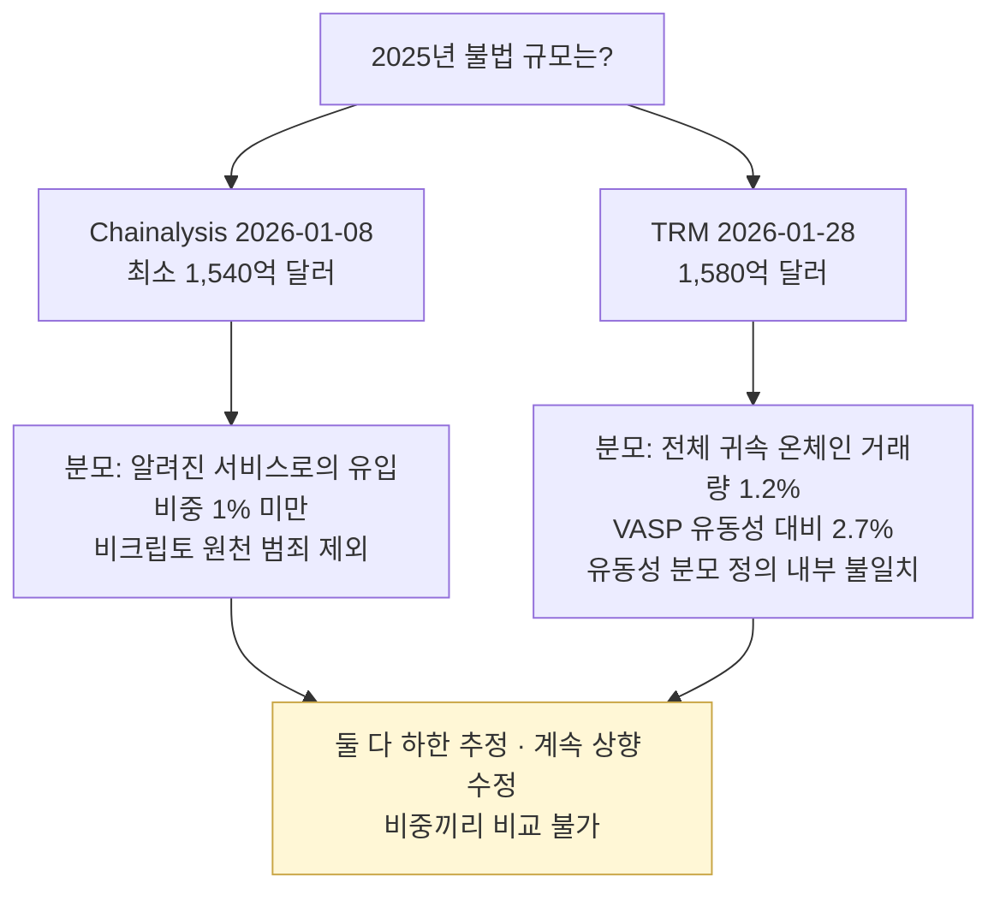

# 산업·기관 리포트

> 매년 발간되는 **주요 리포트** 모음. 이 글은 "어떤 리포트를 언제, 어떤 주의를 하며 읽어야 하나"의 큐레이션입니다.

> **마지막 갱신**: 2026-10-21
> **다음 리뷰**: 2027-01 (분기 리뷰 — 분석업체 연간 리포트 발간 시점)
> **리뷰 주기**: 분기별 (Q1 집중 — 분석업체 연간 리포트 발간 시점)

> **2026-10-21 정정.** Chainalysis 2026 리포트 항목의 "Money Laundering $82B", "Scams $17B, 사칭 1400%"는 서론 페이지에 없어 지웠습니다(본문 PDF 미확인 — 출처 확인 필요). 하한 추정·전년 수치 상향 수정·분모 정의를 추가했습니다. TRM 리포트명을 "Annual Crypto Threats Report"에서 **"2026 Crypto Crime Report"**로 고쳤습니다. BIS·ECB·FSB 2026 항목과 Elliptic 2025 Typologies를 새로 넣었습니다. 근거는 `research/2026-10-academic-literature.md` P-065~P-070과 정본 보고서 부록 A-41입니다.

## 왜 리포트를 읽나

학술 논문이 "왜 이 알고리즘이 작동하는가"라면, 리포트는 **"시장에서 무슨 일이 일어나고 있는가"**입니다. 감독기관·언론·VASP가 분석업체 연간 수치를 자주 인용합니다. 그러나 이 수치들은 **각 회사의 귀속 데이터에 기반한 추정**이고, 회사마다 정의와 분모가 다릅니다. 숫자보다 **방법론 문장**을 먼저 읽는 습관이 필요합니다.

---

## 1. Chainalysis — 2026 Crypto Crime Report

- 서론 포스트: "Crypto Crime Reaches Record High in 2025 as Nation-State Sanctions Evasion Moves On-Chain at Scale" (2026-01-08) — [Chainalysis 블로그](https://www.chainalysis.com/blog/2026-crypto-crime-report-introduction/)

**서론에서 확인되는 수치**
- 2025년 불법 주소 수취액 **최소 1,540억 달러** (전년 대비 +162%로 서술. $154B / $57.2B의 산술값은 약 +169%로 다르며 원인은 확인되지 않음)
- **2024년 수치를 409억 → 572억 달러로 상향 수정**
- 불법 비중: 알려진 서비스 유입 대비 **1% 미만**
- 스테이블코인이 불법 거래량의 **84%**(B)
- 제재 대상 수취액 +694%, 특정 루블 연동 토큰이 1년 미만에 933억 달러
- DPRK 탈취 20억 달러

**방법론 문장** (그대로 인용)
- "we must caveat that this figure represents a lower-bound estimate"
- "A year from now, these totals will be higher as we continue to identify more illicit addresses"
- 비크립토 원천 범죄는 제외: "Such transactions are virtually indistinguishable from licit transactions in on-chain data"
- 비중 분모: "all inflows to known services across all the assets that we track"(내부 이전 제외)

**확인 안 된 것**: 이전 판의 자금세탁 총액($82B)·스캠 총액($17B)·사칭 +1,400%는 서론 페이지에 없습니다. 본문 PDF로 확인하기 전까지 인용하지 마세요.

### 함께 보는 공공 통계 — FBI IC3 2025

신고 기반 통계라 분석업체 추정과 성격이 다릅니다. 가상자산 관련 피해 113.66억 달러(+22%), 가상자산 투자사기 72.28억 달러, 60세 이상 피해 44.32억 달러([FBI IC3 2025](https://www.ic3.gov/AnnualReport/Reports/2025_IC3Report.pdf)).

---

## 2. TRM Labs — 2026 Crypto Crime Report

- 발간 2026-01-28 — [TRM 2026 Crypto Crime Report](https://www.trmlabs.com/reports-and-whitepapers/2026-crypto-crime-report) (이전 판의 "Annual Crypto Threats Report"는 2026년판 명칭이 아님)

**확인되는 수치**
- 2025년 불법 흐름 **1,580억 달러**(전년 대비 약 +145%). 2024년은 645억 달러(B)
- 전체 온체인 거래량의 **1.2%**(2024년 1.3%)
- 신설 지표: **가용 유동성(VASP 흐름) 대비 2.7%**
- 범주별 증가: 제재 400% 초과, 블록리스트 32%, 해킹·탈취 31%, 다크넷 20%, 불법 재화·서비스 12%
- 해킹 28.7억 달러·약 150건(단일 사건 14.6억 달러), 사기 약 350억 달러, 마약 34억 달러 이상

**방법론 문장**
- "We treat this estimate as a conservative baseline — a minimum, or 'floor'"
- "The illicit volume metric is intended to capture the revenue generated by illicit actors"
- "Illicit activity on blockchains is frequently identified with delay"
- "a dynamic baseline rather than a fixed measurement"

**주의**: 유동성 지표의 분모가 방법론에서는 "VASP outflows", 본문에서는 "incoming VASP flows"로 **보고서 안에서 다르게** 적혀 있습니다. 인용할 때 "정의 불명확"을 병기하세요.

### 두 보고서 나란히 읽기

| 항목 | Chainalysis (2026-01-08) | TRM (2026-01-28) |
|---|---|---|
| 2025년 불법 규모 | 최소 1,540억 달러 | 1,580억 달러 |
| 2024년 수치 | 409억 → 572억 달러로 상향 | 645억 달러(B) |
| 비중의 분모 | 알려진 서비스 유입 (1% 미만) | 전체 귀속 온체인 거래량 (1.2%), VASP 유동성 (2.7%) |
| 성격 | 하한(lower-bound) | 하한(floor), 동적 기준선 |
| 제외·주의 | 비크립토 원천 범죄 제외 | 유동성 분모 정의 내부 불일치 |

두 수치가 비슷해 보여도 정의가 달라 "어느 쪽이 맞다"를 따질 수 없습니다. 비중끼리 비교하는 것도 안 됩니다.

### 사고 분석 블로그

대형 사고 직후 분석업체 블로그가 자금 흐름 분석을 공개합니다. 예: [TRM — Bybit 해킹 분석](https://www.trmlabs.com/resources/blog/the-bybit-hack-following-north-koreas-largest-exploit). 초기 분석은 이후 수정될 수 있으므로 발행일을 함께 기록하세요.

---

## 3. Elliptic — Typologies Report 2025

- "Innovating to fight financial crime in an age of rapid change" (2025-09-30) — [Elliptic](https://www.elliptic.co/insights/elliptics-typologies-report-innovating-to-fight-financial-crime-in-an-age-of-rapid-change/) (B)
- 2018-10부터 연간 발간
- 2025년판 5개 트렌드: AI 활용 스캠(AI 생성 신분증으로 KYC 우회·딥페이크), 산업화된 pig butchering(중국어 보증 마켓플레이스, 자기수탁 지갑 풀링·peeling chain), 제재 회피의 스테이블코인, 카르텔(현금→크립토, 크립토 ATM), 크로스체인 범죄(브리지·DEX·스왑)
- 인용: "most major stablecoins today are designed to contain a freezing functionality"
- **주의**: 유형론을 어떻게 도출했는지(표본·선정 기준)는 적혀 있지 않습니다. 2026년판은 2026-10-21 기준 확인하지 못했습니다.

---

## 4. 기타 분석업체

- Crystal Intelligence 등 다른 분석업체도 연간·사건 리포트를 냅니다. 이 저장소의 2026-10 조사는 이들 리포트의 수치를 원문으로 확인하지 않았으므로 여기에는 수치를 적지 않습니다.
- 분석업체 자동 생성 "corpus" 페이지(예: `…/corpus/gen-NNNN/…`)는 비문·반복 서술이 많아 출처로 쓰지 마세요.

---

## 5. FATF (필독)

### 7차 Targeted Update on VAs and VASPs (2026-07-16)

- [FATF 7차 TU PDF](https://www.fatf-gafi.org/content/dam/fatf-gafi/reports/7th-targeted-update-on-implementation-fatf-standards-vas-vasps-2026.pdf.coredownload.pdf)
- 응답 관할의 **83%(91/109)가 트래블룰을 입법**했지만, 그중 **60%(55/91)는 트래블룰 관련 감독·집행 조치가 한 건도 없음**(본문 para 25 기준. 요약은 "almost half"로 적어 문서 내부가 불일치)
- 개정 기준 R.15 평가에서 대부분준수(LC) 이상은 149개 관할 중 52개(C 1개 포함)
- VASP에 "transactions monitoring and blockchain analytics tools"로 급속 이전을 탐지하라고 처음 명시

### 6차 Targeted Update (2025-06-26)

- [FATF 2025 Targeted Update PDF](https://www.fatf-gafi.org/content/dam/fatf-gafi/recommendations/2025-Targeted-Upate-VA-VASPs.pdf.coredownload.pdf)
- 같은 날 「Best Practices on Travel Rule Supervision」 발간(존재 확인, 이 저장소는 내용 미정독). 7차 TU가 감독기관에 이 문서를 참조하라고 권고

### 2026 타겟보고서 3건

- 「Targeted Report on Stablecoins and Unhosted Wallets — Peer-to-Peer Transactions」(2026-03-03) — [FATF](https://www.fatf-gafi.org/en/publications/Virtualassets/targeted-report-stablecoins-unhosted-wallets.html)
- 「Understanding and Mitigating the Risks of Offshore VASPs」(2026-03-11) — 활동기반 규제·감독 채택 관할은 46% — [FATF](https://www.fatf-gafi.org/en/publications/Virtualassets/Understanding-Mitigating-Risks-Offshore-VASPs.html)
- 「Targeted Report on Regulatory Challenges from Decentralised Finance」(2026-07-21) — [FATF](https://www.fatf-gafi.org/en/publications/Virtualassets/targeted-report-decentralised-finance-2026.html)

### Updated Guidance for a Risk-Based Approach to VAs and VASPs (2021-10-28)

- VASP 의무 가이드라인 원전. 블록체인 분석의 비용·커버리지 한계(para 234), 사람 검토(para 276), 간접 노출(para 277)

**왜 필독인가**: FATF가 각국의 가상자산 AML 이행 현황을 공식 평가합니다. 한국 FIU 정책 방향의 선행 지표입니다.

---

## 6. UN

### UN 대북제재 전문가 패널 보고서

- 북한 가상자산 자금조달에 대한 공식 보고서 계보. 패널의 2026년 활동 현황은 이 저장소의 2026-10 조사에서 확인하지 않았습니다. 최신 보고서 여부는 UN 안보리 페이지에서 직접 확인하세요.

---

## 7. BIS · ECB · FSB · IMF (2026 신설·갱신)

### BIS — Annual Economic Report 2026, Chapter III (2026-06-23)

- "Anchoring trust in money: innovation beyond stablecoins" — [BIS AER 2026 Ch. III](https://www.bis.org/publ/arpdf/ar2026e3.htm)
- 인용: "Experience to date suggests that stablecoins account for a significant share of illicit on-chain activity." 공개 permissionless 체인의 "pseudonymity and the use of unhosted wallets can undermine KYC and AML/CFT compliance."
- 발행자 동결·분석업체 지원은 "cannot replace routine, large-scale AML/CFT controls in everyday payments."
- 권고: permissioned 플랫폼에 AML/CFT·제재 스크리닝 내장("integrity by design"), 규제차익 방지를 위한 국제 정합성
- 수치: 법정화폐 담보 스테이블코인의 99.4%가 USD 페그, 시가총액 3,200억 달러(2026-05 말), 2025년 거래량 28조 달러(동일 주체 지갑 간 이전 포함 총액 — 순액은 "훨씬 낮음")
- 주의: "상당 부분"의 정량 출처는 보고서에 적혀 있지 않습니다.

### ECB — Occasional Paper No. 382 (2026-03-23)

- Crypto-Asset Monitoring Expert Group(CAMEG) 2025 Conference 초록집 — [ECB OP 382](https://www.ecb.europa.eu/pub/pdf/scpops/ecb.op382.en.pdf)
- 전체 판단: 크립토자산 위험과 중앙은행 영역의 함의는 "제한적이거나 관리 가능"(기존 규제·감독 틀 전제)
- AML 관련 수록 초록: MiCAR를 자연실험으로 쓰는 EU 스테이블코인 분석(§2.1.2), 오스트리아 CASP 측정의 지리 식별 문제(§2.7.2), 슬로바키아 2025 스캠 사례(§2.7.3), PET 분류(§2.10.2), EU 수준 시장 감시 MIDAS(§2.5.1)
- 2026년 계획: 온·오프체인 데이터 공동 탐색, **지리적 위치 식별 방법론·지표 개발**, 공동 데이터셋·대시보드
- 주의: 초록집이라 본문·수치는 없습니다. 개별 초록은 저자 개인 견해입니다.

### FSB — Global Stablecoin Arrangements: Cross-border vulnerabilities and financial stability monitoring (2026-10-12)

- G20 보고서 — [FSB](https://www.fsb.org/2026/10/global-stablecoin-arrangements-cross-border-vulnerabilities-and-financial-stability-monitoring/) (B — 웹페이지 요약만 확인, PDF 본문 미확인)
- 글로벌 스테이블코인을 "inherently cross-border and cross-sectoral issue"로 규정하고, 모니터링 지표·가용 데이터 소스와 그 한계를 정리. AML 언급은 확인되지 않음
- 관련: FSB 크립토 규제 프레임워크 주제별 검토(2025-10-16, "진전은 환영하나 격차·불일치 잔존"), [2025 FSB Annual Report](https://www.fsb.org/2026/03/promoting-global-financial-stability-2025-fsb-annual-report/)(2026-03-24)

### IMF

- [IMF Working Papers](https://www.imf.org/en/Publications/WP) — 2026년 스테이블코인 관련 문헌이 있으나 이 저장소는 imf.org 원문을 확인하지 못해 개별 항목을 적지 않습니다.

### 실무 포인트

중앙은행·국제기구 문서는 **거시·금융안정 관점**이지만, 2026년에는 AML과 직접 닿는 문장이 늘었습니다. BIS는 발행자 동결의 한계를, ECB CAMEG는 관할 귀속 측정의 어려움을 짚었습니다. 학계의 "USDT 7.3%·USDC 18.7% 동결 전 전액 인출" 측정([arXiv 2603.27739](https://arxiv.org/abs/2603.27739))과 같은 방향입니다.

---

## 8. 한국 (FIU · 금융위)

### KoFIU 연차보고서·보도자료

- [KoFIU](https://www.kofiu.go.kr/) — 자료실
- STR 통계 추세, 검사 사례

### 금융위 — 가상자산 정책 보도자료

- [FSC 보도자료](https://www.fsc.go.kr/)

**왜 중요한가**: 한국 VASP 관련 감독 통계와 제도 변경이 공식적으로 공개되는 곳입니다. 예: 트래블룰 100만원 기준 폐지는 대통령령 제36592호(공포 2026-08-18)로 확정됐고 시행일은 2027-02-19입니다(enacted-not-in-force). 상세는 [`../notes/3-crypto-aml/travel-rule.md`](../notes/3-crypto-aml/travel-rule.md).

---

## 9. 컨설팅 · 법무법인

- Big 4(PwC, Deloitte, EY, KPMG) 가상자산·AML 보고서
- [Latham & Watkins — US Crypto Policy Tracker](https://www.lw.com/en/us-crypto-policy-tracker/regulatory-developments)
- 국내 법무법인 인사이트

**왜 유용한가**: 규제 변화가 실무에 어떤 영향을 주는지 해설합니다. 단, 2차 해설이므로 날짜·조문은 1차 원문(법제처·FATF·관보)으로 다시 확인하세요. 이 저장소의 kyt 도시에는 법무법인 요약이 입법예고안 기준이라 공포본과 다른 시행일·의무를 적은 사례가 있습니다(`research/README.md` 정오표).

---

## 10. 보안 · 사고 분석

- SlowMist · PeckShield · Halborn · OpenZeppelin — 스마트컨트랙트 감사·사고 분석
- Krebs on Security · The Hacker News — 일반 사이버 보안

---

## 11. 추천 읽기 순서

이 우선순위는 **한국 VASP 실무자 기준**입니다. 처음엔 🔴만 읽고, 여유가 생기면 🟠·🟡로 확장하세요.

| 우선 | 리포트 |
|---|---|
| 🔴 | FATF Targeted Update VAs·VASPs (2026: 7차) |
| 🔴 | 분석업체 연간 리포트 2종 (Chainalysis·TRM — 반드시 나란히, 방법론부터) |
| 🟠 | KoFIU 연차보고서·FIU 보도자료 |
| 🟠 | FATF 2026 타겟보고서 3건 (스테이블코인·역외 VASP·DeFi) |
| 🟡 | BIS AER 2026 Ch. III · ECB OP 382 · FSB GSC 보고서 |
| 🟡 | Elliptic Typologies 2025 |

---

## 12. 구독·알림 추천

- 분석업체 뉴스레터(Chainalysis·TRM·Elliptic)
- 트래블룰 솔루션 업체 뉴스레터
- FATF 발간물 알림, FSC·FIU 보도자료 RSS
- ACAMS · ACFCS (AML 전문가 협회)

### 실무 포인트

뉴스레터는 요약이므로 **수치는 반드시 원 리포트 방법론 절과 함께** 옮기세요. "1,540억 달러"만 옮기고 "하한 추정, 매년 상향 수정"을 빼면 이듬해 같은 해의 수치가 달라졌을 때 설명할 수 없습니다.

## 💼 실무 현장 (Industry Reality)

> 이전 판의 "발표 당일 단체 카톡방 공유가 관례", "onboarding 표준 과제", 특정 거래소·은행·벤더의 내부 리서치 운영 방식, "AMLO 리포트 소비 우선순위(2026 추정)" 같은 서술은 공개 출처가 없어 삭제했습니다.

### 이 리포트들을 실무에서 어떻게 쓰나

- **이사회·위험평가 보고**: 분석업체 수치를 업계 동향으로 인용할 때 회사명·발간일·정의(분모)·"하한 추정"을 함께 적습니다.
- **정책 개정 근거**: FATF 7차 TU의 권고(블록체인 분석 도구로 급속 이전 탐지, 브리지·믹서·크로스체인 노출 평가)를 내부 정책 개정의 직접 근거로 씁니다.
- **감독 대응**: 수치를 인용했다면 출처 URL과 확인일을 남기세요. 분석업체는 전년 수치를 상향 수정하므로(예: Chainalysis 2024년 409억 → 572억 달러), 확인일이 없으면 수치가 언제 기준인지 알 수 없습니다.

### 자주 나오는 오해

- **"분석업체 숫자 = 절대 진실"** — 두 회사 모두 스스로 하한 추정이라고 밝힙니다. 귀속되지 않은 주소, 비크립토 원천 범죄는 빠집니다.
- **"두 회사 숫자가 비슷하니 서로 검증된다"** — 분모와 정의가 달라 비교 대상이 아닙니다.
- **"FATF 문서는 법적 구속력이 있다"** — FATF는 권고입니다. 다만 상호평가·회색명단을 통해 실질적 압력이 생깁니다.
- **"연간 리포트만 보면 됨"** — 대형 사고는 분석업체 블로그가 먼저 분석합니다. 연간 리포트는 사후 정리이고, 그마저 이듬해 수정됩니다.

### 실무자가 이 영역을 따라잡는 루틴

- **매주** — FATF·FSC·FIU 발간물 알림 확인
- **분기 1회** — 분석업체 블로그 중 방법론 변경 공지 확인
- **연 1회(1~2월)** — 분석업체 연간 리포트 2종을 나란히 읽고, 정의·분모·전년 수정치를 표로 정리
- **연 1회(7월 전후)** — FATF Targeted Update 정독

## 더 읽을거리

- [`papers.md`](papers.md) — 학술 논문
- [`links.md`](links.md) — 전체 참고 링크
- [`../reports/가상자산 AML KYT FDS 트래블룰 흐름.md`](../reports/가상자산%20AML%20KYT%20FDS%20트래블룰%20흐름.md) — 정본 보고서 (기준일 2026-10-21)
