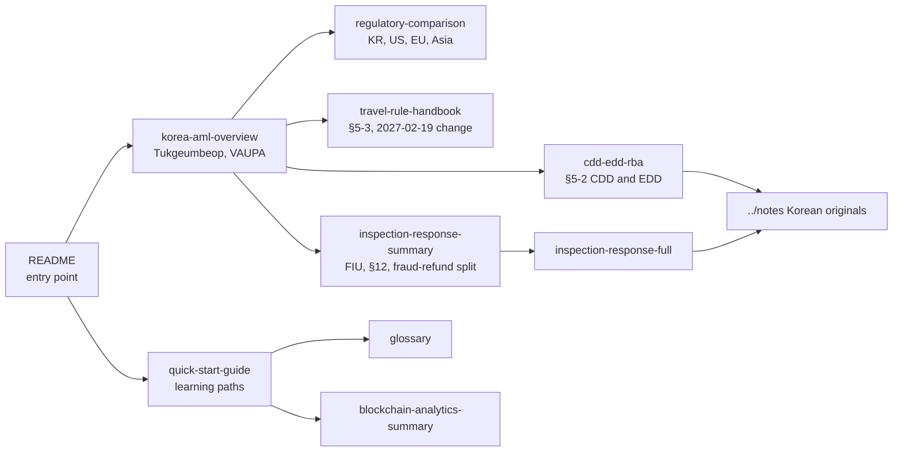

# AML Notes — English Edition

> Korean Anti-Money Laundering (AML) study notes for the virtual asset industry. Originally written in Korean, this English edition provides 5 gateway documents plus 5 additional topical translations for international readers — VASPs evaluating the Korean market, consultants, researchers, and regulators. Last updated: 2026-10-21 (reference date for all status labels: proposed / enacted-not-in-force / in-force / withdrawn).

---

## Who This Is For

- **Global VASPs** evaluating Korean market entry
- **International consultants** advising Korean clients on AML compliance
- **Researchers** studying Asian AML regulatory frameworks
- **Foreign regulators** benchmarking Korea's approach
- **Academic institutions** teaching crypto AML

---

## 5 Gateway Documents

### 1. [`korea-aml-overview.md`](korea-aml-overview.md)

Comprehensive overview of Korean AML for crypto:

- 특금법 (Act on Reporting and Using Specified Financial Transaction Information, "Tukgeumbeop") — VASP registration (§7) and AML duties: STR §4, CTR §4-2, CDD §5-2, Travel Rule §5-3. Current text: Act No. 21857 (in force 2026-10-02); Act No. 21358 registration changes in force 2026-08-20
- Travel Rule threshold: Enforcement Decree §10-10 "KRW 1,000,000 or more" until 2027-02-18; all VASP-to-VASP transfers from 2027-02-19 (Decree No. 36592, promulgated 2026-08-18, enacted-not-in-force)
- 가상자산이용자보호법 (Virtual Asset User Protection Act, in force 2024-07-19), including §12 continuous market surveillance
- 통신사기피해환급법 (Telecom Fraud Refund Act) — voice-phishing temporary measures, applied to exchanges from 2026-10-01
- KoFIU (Korea Financial Intelligence Unit), FSC, and FSS roles

### 2. [`inspection-response-summary.md`](inspection-response-summary.md)

English summary of the Korean inspection response workbook:

- 4-week preparation timeline for FIU and FSS on-site inspections
- Self-assessment checklist (8 categories, including the three-way FIU / §12 / Telecom Fraud Refund Act split)
- 40 mandatory document categories
- Common failures (Top 5)
- Administrative appeals process (3 stages)

### 3. [`regulatory-comparison.md`](regulatory-comparison.md)

Korea vs United States vs EU vs Asia (Singapore, UAE, Japan, Hong Kong):

- AML licensing models
- Travel Rule thresholds
- Cold wallet and user asset segregation requirements
- Sanctions enforcement posture
- Decision matrix for global expansion

### 4. [`quick-start-guide.md`](quick-start-guide.md)

Learning paths for international readers:

- "I want to enter the Korean market" → 10-step path
- "I want to compare Korea to my jurisdiction" → reading order
- "I want academic understanding" → curated path

### 5. This README — Entry point

---

## Additional Translations

Five additional topical translations go deeper than the gateway docs and each focuses on a single operational or technical area.

- [`glossary.md`](glossary.md) — Bilingual AML term dictionary (~200 entries, A-Z)
- [`inspection-response-full.md`](inspection-response-full.md) — Full English translation of the Korean inspection workbook. Complements the shorter [`inspection-response-summary.md`](inspection-response-summary.md).
- [`travel-rule-handbook.md`](travel-rule-handbook.md) — Korean VASP Travel Rule implementation (international basis: FATF INR.15 §7(b), 2019-06; message standard IVMS 101.2023), Sunrise Issue handling
- [`blockchain-analytics-summary.md`](blockchain-analytics-summary.md) — Technical summary: CIOH with CoinJoin fingerprint, Exposure Score formula, cross-chain bridge matching, Korean fuzzy matching for sanctions
- [`cdd-edd-rba.md`](cdd-edd-rba.md) — Risk-based customer due diligence: CDD steps (Tukgeumbeop §5-2), EDD triggers and documents, an illustrative 5-factor scoring model with calibration override

**Coverage**: a minority of the Korean corpus; the rest stays in Korean — see [`../notes/`](../notes/). Where an English page and a Korean note disagree, the Korean note dated 2026-10-21 and the canonical report [`../reports/가상자산 AML KYT FDS 트래블룰 흐름.md`](../reports/가상자산%20AML%20KYT%20FDS%20트래블룰%20흐름.md) prevail.

---

## Original Korean Content

The full course is in Korean:

- 60-day curriculum: [`../curriculum/`](../curriculum/)
- Topic notes: [`../notes/`](../notes/)
- 6 mini projects: [`../projects/`](../projects/)
- Deep dive resources: [`../deep/`](../deep/)
- A4 print packets: [`../print/`](../print/)
- Inspection workbook: [`../notes/5-compliance/inspection-response.md`](../notes/5-compliance/inspection-response.md)

---

## Translation Approach

We chose **gateway documents over full translation** because:

1. Korean AML uses domestic legal terminology that does not map one-to-one onto English concepts.
2. The maintenance burden of a fully bilingual repository is unsustainable.
3. International readers benefit more from **conceptual maps plus selective deep dives** than from a word-for-word translation.
4. Korean primary sources are authoritative — we point readers to them.

If you need a specific Korean section translated, open an Issue tagged `english-translation` in the repo.

---

## Contribute

- Translation improvements (current English may have non-native phrasing)
- Additional gateway docs (for example, `en/staking-aml.md` or `en/travel-rule-korea.md`)
- Korean-to-English glossary expansion

See [`../CONTRIBUTING.md`](../CONTRIBUTING.md).

---

## License

- Text: [Creative Commons Attribution 4.0 International (CC BY 4.0)](https://creativecommons.org/licenses/by/4.0/)
- Code samples: [MIT](../LICENSE)

---

Start here: [`korea-aml-overview.md`](korea-aml-overview.md)
