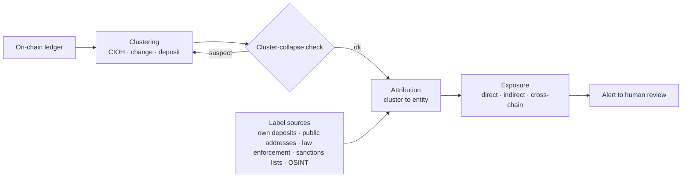
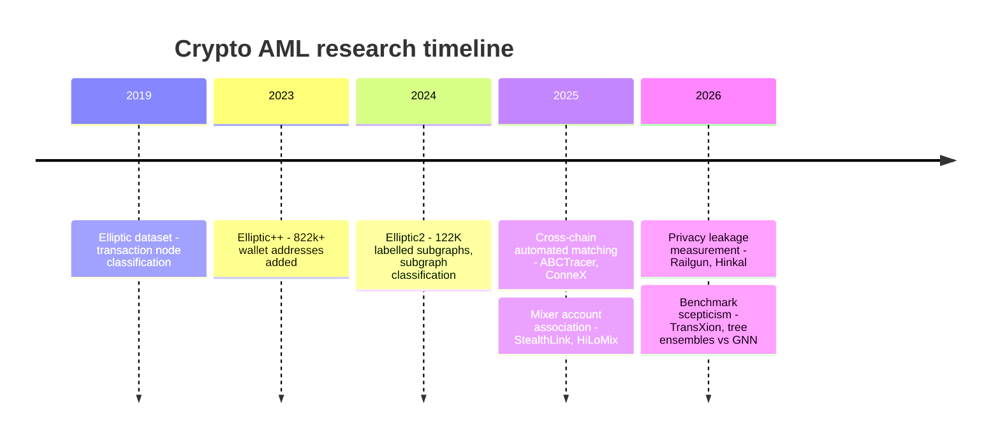

# Blockchain Analytics — Technical Summary

> Summary of the algorithmic core of crypto AML: clustering, attribution, exposure, cross-chain bridge matching, and the Korean name-matching problem in sanctions screening. Condensed from [`../notes/4-technology/blockchain-analytics.md`](../notes/4-technology/blockchain-analytics.md) and [`../notes/5-compliance/sanctions-screening.md`](../notes/5-compliance/sanctions-screening.md). Last updated: 2026-10-21.

> **Correction notice (2026-10-21).** Earlier versions of this summary carried Precision/Recall/F1 tables for CIOH, CoinJoin filtering and GNNs, attributed to Meiklejohn 2013, Möser & Böhme 2017, Androulaki 2013 and Bellei 2024. None of those papers report those figures (see `kb/facts/contradictions.jsonl` CTR:00007). The tables have been removed, together with the vendor exposure formula, category weights, vendor decay constants, per-bridge accuracy table, and the Korean fuzzy-matching performance table, none of which had a public source. Weber 2019, Elliptic++ and Elliptic2 figures were corrected against the original papers. Sources: `research/2026-10-academic-literature.md` §8 and the canonical report's Appendix A-38/A-39.

## TL;DR

- Blockchain analytics sits on two pillars: **Clustering** (which addresses belong to one entity) and **Attribution** (which entity that is). Exposure assessment sits on top.
- Core heuristics: **Common Input Ownership (CIOH)**, change detection, deposit heuristic, behavior-based. **There is no standardized accuracy figure for them.** Möser & Narayanan state that "current techniques rely on heuristics that have not been rigorously evaluated or optimized" ([arXiv 2107.05749](https://arxiv.org/abs/2107.05749)).
- Bitcoin (UTXO) has a structural clustering signal; Ethereum (account model) leans more on attribution data.
- No vendor reviewed in this repository's 2026-10 research publishes its hop limit, decay function or category weights. Treat exposure scores as non-reproducible.
- Cross-chain tracing matured in 2025 into automated matching systems, but studies use different bridge sets and definitions, so **their numbers cannot be compared**.
- Privacy protocols are now measured by anonymity-set reduction and bits of anonymity lost, not "traceable / untraceable".



---

## 1. Common Input Ownership Heuristic (CIOH)

### Algorithm

```python
def common_input_ownership(tx: Transaction) -> set[Address] | None:
    if len(tx.inputs) < 2:
        return None
    if is_coinjoin(tx):
        return None
    return {inp.address for inp in tx.inputs}
```

### Why it works

In Bitcoin's UTXO model, spending any UTXO requires its private key. Multiple inputs in the same transaction therefore suggest a **common key controller**. Even if a user splits funds across many addresses, consolidating them in one transaction links them into one cluster.

### Limits

- **UTXO-only**. Ethereum accounts have a single `from`, so CIOH does not apply.
- **CoinJoin** (Wasabi, Samourai Whirlpool, JoinMarket) intentionally combines inputs from different entities, breaking the assumption.
- **Custodial hot wallets** combine many customers' funds. The cluster identifies the exchange, but not individual customers.

### CoinJoin fingerprint pre-filter (illustrative)

Not any vendor's implementation. Denomination constants are placeholders and must be filled from each wallet's own documentation.

```python
def is_coinjoin(tx: Transaction) -> bool:
    if len(tx.inputs) < 2:
        return False

    amounts = [o.value for o in tx.outputs]
    uniform_outputs = [a for a in amounts if amounts.count(a) >= 3]
    if not uniform_outputs:
        return False

    # Wallet-specific fixed denominations — values differ by wallet and version
    KNOWN_DENOMS = load_wallet_denominations()
    if any(a in KNOWN_DENOMS for a in uniform_outputs):
        return True

    # Symmetric input/output counts
    if len(tx.inputs) >= 5 and len(tx.outputs) >= 5:
        if abs(len(tx.inputs) - len(tx.outputs)) <= 1:
            return True

    return False
```

### Accuracy — what the literature actually says

- Möser & Narayanan (FC 2022) evaluated 26 change-heuristic variants; "Most achieve true positive rates between 10-30%". Their random-forest model reached a TPR of 82% at 0.1% FPR versus 37% for threshold voting (confidence B; body figures verified in the repository's wave-1 research).
- In the same paper, unconstrained change merging inflated the Mt. Gox cluster to 224 million addresses (+1596%). **Cluster collapse** is the operational risk that matters more than any single accuracy number (B).
- In vendor proofs-of-concept, ask how ground truth was built, how cluster collapse is detected, and how past decisions are rolled back — not "what is your accuracy".

---

## 2. Exposure

### Definition

Exposure quantifies how an address (or cluster) is linked to known risk entities (sanctioned parties, mixers, darknet markets, stolen funds).

- **Direct**: the address transacts with a risk entity
- **Indirect**: the risk entity is reached through intermediaries

The normative basis for looking past the immediate counterparty is FATF's 2021 RBA Guidance, para 277: enhanced monitoring should "extend beyond the immediate transaction between the VASP or its customer or counterparty", and thresholds "should be reviewed on a regular basis" ([FATF 2021](https://www.onpcsb.ro/2022/01042022/Updated-Guidance-VA-VASP.pdf)). FATF's 7th Targeted Update (2026-07-16) recommends that VASPs "detect rapid transfer of VAs using transactions monitoring and blockchain analytics tools" and assess exposure to "protocols, bridges, mixers, cross-chain tools" ([FATF 7th TU](https://www.fatf-gafi.org/content/dam/fatf-gafi/reports/7th-targeted-update-on-implementation-fatf-standards-vas-vasps-2026.pdf.coredownload.pdf)).

### What can be said about the formula

The previous "generalized vendor formula", category weight table, vendor λ table, "usually up to 5 hops", worked example and override factors were removed: there is no public source for any of them. Structurally:

```
# Teaching structure only — not any vendor's formula, no coefficients defined
exposure(addr) = Σ_category  f( direct share, indirect share, age, amount )
```

### A score is not an STR

The old worked example ended in "BLOCK + auto-STR". That is wrong. An exposure score is an **input** to block / notify / report decisions, and FATF 2021 para 276 requires that "flagged transactions should go through human/expert analysis". Korea's AML/CFT Business Regulation sets out the transaction-monitoring system in Articles 76–81 ([law.go.kr](https://www.law.go.kr/DRF/lawService.do?OC=test&target=admrul&ID=2100000267264&type=XML)).

---

## 3. Cross-chain Bridge Matching

### Problem

Funds moving across chains (Ethereum → Polygon → Arbitrum → Optimism, and so on) pass through **bridge contracts**. Each chain's transactions are independent, so the two legs must be re-linked. ConneX frames failed pairing of the two legs as the main cause of tracing failure ([arXiv 2511.01393](https://arxiv.org/abs/2511.01393)).

### Bridge event structure (reference — confirm against each contract's ABI)

| Chain / bridge | Event | Key fields | Sequence field |
|---|---|---|---|
| Polygon PoS | LockEvent | (user, token, amount, targetChain, depositCount) | Yes |
| Arbitrum | OutboundTransfer | (token, from, to, seqNumber, amount) | Yes |
| Optimism | WithdrawalInitiated | (l1Token, l2Token, from, to, amount, nonce) | Yes |
| Wormhole | LogMessagePublished | (sender, sequence, nonce, payload) | Yes |
| LayerZero | PacketSent | (dstEid, receiver, payload) | Generic — payload decoding required |
| Hop Protocol | TransferSentToL2 | (chainId, recipient, amount, transferId) | transferId |

### Matching algorithm (illustrative)

```python
def match_bridge_events(lock_events, mint_events, time_window, amount_tolerance):
    # time_window / amount_tolerance: set per bridge, direction and asset type
    matches = []
    for lock in lock_events:
        candidates = []
        for mint in mint_events:
            if mint.token_canonical != lock.token_canonical:
                continue
            if abs(mint.timestamp - lock.timestamp) > time_window:
                continue
            if abs(mint.amount - lock.amount) / lock.amount > amount_tolerance:
                continue
            if hasattr(lock, 'nonce') and hasattr(mint, 'nonce'):
                if lock.nonce == mint.nonce:
                    candidates = [mint]   # deterministic
                    break
            candidates.append(mint)
        if len(candidates) == 1:
            matches.append((lock, candidates[0]))
        elif len(candidates) > 1:
            best = min(candidates, key=lambda m: abs(m.amount - lock.amount))
            matches.append((lock, best))  # fallback — log the ambiguity
        # zero candidates: destination not yet observed — requeue
    return matches
```

### Measured results (do not compare across rows)

The earlier per-bridge "accuracy" table (Polygon 97–99%, LayerZero Generic 40–60%, …) had no source and was removed.

| Study | Scope | Reported result | Source |
|---|---|---|---|
| ABCTracer (Lin et al., 2025) | 12 mainstream bridges | Bidirectional tracing F1 91.75% | [arXiv 2504.01822](https://arxiv.org/abs/2504.01822) |
| ConneX (Liang et al., 2025) | 5 bridges, ~500k transactions | Average F1 0.9746 | [arXiv 2511.01393](https://arxiv.org/abs/2511.01393) |
| Yan, Huang & Tessone (2025) | Ethereum–Polygon, 2020-08-28 to 2023-08-28 | Deposits matched 93.04–99.65%, withdrawals 67.55–92.78% by asset type (B) | [arXiv 2504.15449](https://arxiv.org/abs/2504.15449) |

In the third study the withdrawal time window (~6.4 days) was about 380× the deposit window (~24 minutes), and ERC20 withdrawals were the weakest (B). Confidence should differ by **direction and asset type**, even within one bridge. No common cross-chain benchmark exists as of 2026-10-21.

### Limits

- Errors accumulate across successive bridges. The old "3 hops at 90% ≈ 0.73" calculation multiplied unsourced figures and was removed.
- Centralized OTC or P2P transfers leave no on-chain bridge events.
- Liquidity-pool bridges (THORChain, Across) break 1-to-1 sender-to-receiver linkage.

---

## 4. Privacy Protocols, Mixers and Monero

| Target | Measurement | Source |
|---|---|---|
| Railgun (Ethereum) | 17.65% of withdrawals uniquely linked to a deposit; median anonymity loss 3.42 bits | [arXiv 2606.25926](https://arxiv.org/abs/2606.25926) |
| Railgun + Hinkal, 6 EVM chains | 186,356 unshields; public-token constraints alone shrink the average anonymity set by 40.1–59.0% | [arXiv 2608.22987](https://arxiv.org/abs/2608.22987) |
| Tornado Cash sanctions | Deposits fell 71.03% over 957 days, yet 78.33% of Ethereum security incidents still used it (WWW '26) | [arXiv 2507.11721](https://arxiv.org/abs/2507.11721) |
| Stablecoin freezes | 7.3% of sanctioned USDT addresses and 18.7% of USDC addresses withdrew in full before the freeze took effect | [arXiv 2603.27739](https://arxiv.org/abs/2603.27739) |

The Tornado Cash deposit/withdrawal clustering preprint (arXiv 2510.09433) was withdrawn by its authors on 2025-11-18; do not cite its figures.

**Monero.** "Untraceable" is too strong. Hammad & Victor (IEEE ICBC 2024) found that wallet-bug heuristics ("10 Block Decoy Bug", "Differ-by-one"), P2Pool output merging and Mordinal-derived heuristics were mostly high-precision on 2019–2023 data, but the bugs were patched in early 2023 and do not apply to later transactions ([arXiv 2408.05332](https://arxiv.org/abs/2408.05332)).

---

## 5. Korean Name Matching in Sanctions Screening

### Problem

A small number of Korean surnames are very common, and romanization varies (e.g. Kim / Gim). Applying a generic global similarity threshold to Korean names produces many false positives against sanctions lists that include DPRK nationals. The earlier version quoted surname-share percentages, analyst-time shares, and a threshold-performance table for a "representative Korean VASP"; none had a public source and they were removed.

### Tuned pipeline (illustrative — thresholds are parameters to calibrate, not recommendations)

```python
from jellyfish import jaro_winkler_similarity

def screen_korean_customer(customer, sdn_list, cfg) -> list:
    hits = []
    for sdn in sdn_list:
        # 1. Surname variant match (Kim / Gim / Ghim etc.)
        if not any(jaro_winkler_similarity(normalize_kr(customer.surname),
                                           normalize_kr(v)) >= cfg.surname_min
                   for v in sdn.surname_variants):
            continue
        # 2. Stricter full-name threshold for very common surnames
        threshold = (cfg.common_surname_threshold
                     if customer.surname in cfg.common_surnames
                     else cfg.default_threshold)
        name_score = jaro_winkler_similarity(normalize(customer.full_name),
                                             normalize(sdn.name))
        if name_score < threshold:
            continue
        # 3. Require a secondary identifier (DOB or nationality)
        dob_match = customer.dob and customer.dob == sdn.dob
        nat_match = sdn.nationalities and customer.nationality in sdn.nationalities
        if not (dob_match or nat_match):
            continue
        # 4. Documented, time-limited whitelist of cleared pairs
        if (customer.id, sdn.id) in cfg.whitelist:
            continue
        hits.append((sdn, name_score, dob_match, nat_match))
    return hits
```

Calibrate thresholds on your own labelled alert history and document the trade-off: lowering false positives raises false negatives. FATF 2021 para 277 expects such thresholds to be reviewed regularly.

---

## 6. Public Datasets and Per-paper Results

### Datasets

| Dataset | Year | Size (as stated in the paper) | Labels | Source |
|---|---|---|---|---|
| Elliptic | 2019 | 203,769 transaction nodes, 234,355 edges, 166 features, 49 time steps | 4,545 illicit (2%), 42,019 licit (21%), rest unlabelled | [arXiv 1908.02591](https://arxiv.org/abs/1908.02591) |
| Elliptic++ | 2023 (KDD 2023) | 822k+ wallet addresses, 56 features, 1.27M temporal interactions | Transaction and address level | [arXiv 2306.06108](https://arxiv.org/abs/2306.06108) |
| Elliptic2 | 2024 | **122K labelled subgraphs** (121,810), 49M node clusters, 196M edge transactions | 119,047 licit / 2,763 suspicious (B) | [arXiv 2404.19109](https://arxiv.org/abs/2404.19109) |
| BABD-13 | 2022 arXiv / 2024 IEEE TIFS | 544,462 labels, 148 features, 13 address types | 13 behavior classes | [arXiv 2204.05746](https://arxiv.org/abs/2204.05746) |

The earlier "Elliptic++ (2022), ~840K tx, 1.6M addresses" and "Elliptic2 ~122M tx" were wrong on year and scale: Elliptic2's 122 refers to **122 thousand labelled subgraphs**, not 122 million transactions. The unsourced "WalletExplorer dump" row was removed.

### Per-paper results — do not merge into one table

The old "Bitcoin clustering accuracy" table mixed clustering and classification papers and quoted figures that are not in those papers. It was removed. What the papers actually report:

| Paper | Task | Reported | Note |
|---|---|---|---|
| Weber et al. 2019 | Elliptic transaction classification (illicit class) | Random Forest (all features + node embeddings) P 0.971 / R 0.675 / F1 0.796; GCN 0.812 / 0.512 / 0.628 | Body figures, B. Best model is RF, not a GNN. All models collapsed after the dark-market shutdown at time step 43 |
| Bellei et al. 2024 | Elliptic2 subgraph classification | GLASS F1 0.933, PR-AUC 0.208, ROC-AUC 0.889 | Body figures, B. Roughly 1 in 4 predicted-suspicious subgraphs is truly suspicious |
| Xiang et al. 2022/2024 (BABD) | Address behavior multiclass | Accuracy 93.24–97.13% across 5 models | Abstract |
| Akter et al. 2026 | Elliptic temporal split | Extra Trees AUPRC 0.570 vs GraphSAGE 0.311 | B |
| Alarab et al. 2020 | Elliptic GCN | Not verified (ACM abstract not accessed) | Venue is ACM ICMLT 2020 |

---

## 7. Research Directions 2025–2026



Five shifts: node classification → subgraph / path / intent tracing; automated cross-chain matching; quantitative measurement of privacy protocols; larger-scale fraud measurement (270 million address-poisoning attempts, USENIX Security 2025, [arXiv 2501.16681](https://arxiv.org/abs/2501.16681)); and explicit benchmark scepticism. Three gaps as of 2026-10-21: no peer-reviewed causal study of Travel Rule effects, no LLM AML evaluation on real crypto data (all synthetic), and no academic evaluation of self-hosted wallet ownership verification.

---

## 8. References

- Meiklejohn et al. (2013) — "A Fistful of Bitcoins: Characterizing Payments Among Men with No Names" (ACM IMC 2013).
- Androulaki et al. (2013) — "Evaluating User Privacy in Bitcoin" (Financial Cryptography 2013, DOI 10.1007/978-3-642-39884-1_4).
- Möser & Böhme (2017) — "Anonymous Alone? Measuring Bitcoin's Second-Generation Anonymization Techniques" (IEEE EuroS&PW 2017, DOI 10.1109/eurospw.2017.48).
- Harlev et al. (2018) — "Breaking Bad: De-Anonymising Entity Types on the Bitcoin Blockchain Using Supervised Machine Learning" (HICSS 2018, DOI 10.24251/hicss.2018.443).
- Weber et al. (2019) — "Anti-Money Laundering in Bitcoin: Experimenting with Graph Convolutional Networks for Financial Forensics" (KDD 2019 workshop, [arXiv 1908.02591](https://arxiv.org/abs/1908.02591)).
- Möser & Narayanan (2022) — "Resurrecting Address Clustering in Bitcoin" (FC 2022, [arXiv 2107.05749](https://arxiv.org/abs/2107.05749)).
- Elmougy & Liu (2023) — "Demystifying Fraudulent Transactions and Illicit Nodes in the Bitcoin Network for Financial Forensics" (KDD 2023, Elliptic++).
- Bellei et al. (2024) — "The Shape of Money Laundering: Subgraph Representation Learning on the Blockchain with the Elliptic2 Dataset" (KDD MLF Workshop 2024, [arXiv 2404.19109](https://arxiv.org/abs/2404.19109)). Supervised subgraph classification — not self-supervised and not a clustering paper.
- Xiang et al. (2024) — "BABD: A Bitcoin Address Behavior Dataset for Pattern Analysis" (IEEE TIFS 19).
- Farrugia et al. (2020) — "Detection of Illicit Accounts over the Ethereum Blockchain".
- 2025–2026 papers: see [`../deep/papers.md`](../deep/papers.md) §7.

---

## Korean Source

- [`../notes/4-technology/blockchain-analytics.md`](../notes/4-technology/blockchain-analytics.md) — core analytics
- [`../notes/5-compliance/sanctions-screening.md`](../notes/5-compliance/sanctions-screening.md) — Korean name matching detail
- [`../notes/7-vendors/analytics-vendors.md`](../notes/7-vendors/analytics-vendors.md) — vendor overview
- [`../research/2026-10-academic-literature.md`](../research/2026-10-academic-literature.md) — 70-paper literature dossier (check each item's confidence before citing)
