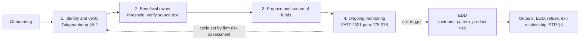
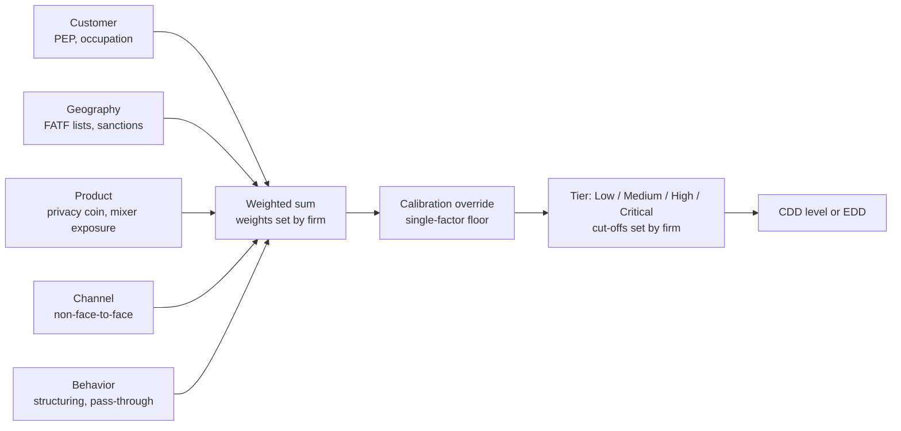

# CDD, EDD, and RBA — Risk-Based Customer Due Diligence

> Korean VASP approach to customer due diligence and the risk-based approach (RBA). Condensed from [`../notes/5-compliance/cdd-edd.md`](../notes/5-compliance/cdd-edd.md). Covers the CDD steps, EDD triggers, an **illustrative** risk-scoring model, and what supervisors expect to see during inspection. Statutory anchors follow the corrected notes in [`../notes/2-regulations/korea-fiu-act.md`](../notes/2-regulations/korea-fiu-act.md). Last updated: 2026-10-21.

## TL;DR

- **Legal anchor (Korea)**: customer due diligence is **Tukgeumbeop §5-2** (특금법 제5조의2). STR is §4, CTR is §4-2, the Travel Rule is §5-3. Enforcement Decree No. 36592 (promulgated 2026-08-18) clarified CDD methods and requires the EDD decision to consider **customer characteristics, transaction patterns, and product risk** ([FSC 2026-08-11](https://www.fsc.go.kr/no010101/87499)).
- **CDD** applies to every customer: identify and verify, identify the beneficial owner, establish purpose and source of funds, monitor on an ongoing basis.
- **EDD** adds source-of-funds/wealth evidence, senior approval, and enhanced monitoring on top of CDD for higher-risk customers. It **supplements**, not replaces, CDD.
- **Ongoing monitoring** is defined by FATF 2021 guidance para 275–276 as checking transactions for consistency with the customer profile; automated systems may be the only realistic method, but flagged items need human review ([FATF 2021 RBA guidance](https://www.fatf-gafi.org/content/dam/fatf-gafi/guidance/Updated-Guidance-VA-VASP.pdf.coredownload.pdf)).
- **Re-review cycles, scoring weights, and tier thresholds are not fixed by statute** — the firm sets them in its own risk assessment and documents the rationale. The scoring model below is an illustration, not a regulatory standard.
- **2027-02-19 change**: transfers to and from self-hosted addresses will be allowed only when the customer and the counterparty are the **same person** (Decree §10-20 ⑧, Supervisory Regulation §28-2 ④; enacted-not-in-force; ownership-proof method not specified).

---

## 1. CDD — Standard Steps



### Step 1 — Identification and Verification

**Identification** is collecting what the customer tells you. **Verification** is confirming it through an independent source. Regulators treat these as distinct checks.

| Item | Individual | Corporate |
|---|---|---|
| Required | Name, DOB, address, contact | Legal name, business number, address, representative, business purpose |
| Verification | ID document check + liveness + 본인확인기관 (licensed identity verification institution) | Business registration, corporate registry, articles of incorporation |
| Supplementary | Mobile phone / email verification | Shareholder list, officer list |

### Step 2 — Beneficial Owner (Legal Entities)

Identify the **natural person who ultimately owns or controls** the entity, tracing multi-layer ownership to the end.

- The ownership percentage that triggers BO identification under Korean law is **not confirmed in this repository's 2026-10 sources — verify against the Enforcement Decree text** before writing it into policy. Earlier editions stated "25%" without a source.
- Indirect ownership is usually computed by multiplying stakes along the chain (A ← B 50% ← C 60% ← person X 100% ⇒ X holds 30% of A). Compare the result against the threshold in the source text.
- Fallback rules when no natural person can be identified (for example, designating a senior manager) must also be taken from the source text, not from industry habit.

### Step 3 — Purpose and Source of Funds

- **Purpose**: investment, payment, custody, business operations
- **Expected activity**: amount, frequency, counterparty countries
- **Source of Funds** (SoF): origin of the funds entering the account
- **Source of Wealth** (SoW): origin of the customer's overall wealth (emphasized in EDD)

SoF is about **this specific money** (this month's salary). SoW is about **the customer's total wealth** (career earnings plus real-estate proceeds).

### Step 4 — Ongoing Monitoring

- Keep KYC data current
- Check transaction patterns against declared purpose (FATF 2021 para 275–276)
- In higher-risk situations, extend monitoring "beyond the immediate transaction" (para 277–278)
- Re-review when risk factors change (newly designated PEP, move to a high-risk jurisdiction)
- **Re-review cycle**: not fixed by statute; set it in the firm's risk assessment and keep the rationale. Earlier editions cited "low 5 years / medium 3 years / high 1 year" as a Korean guideline — no public source was confirmed, so it is removed.

---

## 2. EDD Triggers (Korean Context)

EDD layers on top of CDD — it does not replace it.

### Typical triggers

| Category | Example |
|---|---|
| **PEP** | PEP or their family or close associates |
| **High-risk jurisdiction** | FATF "call for action" or increased-monitoring list (22 jurisdictions after the 2026-06-19 plenary, count B — see [`../notes/2-regulations/fatf.md`](../notes/2-regulations/fatf.md)) |
| **Non-face-to-face + additional risk** | Virtual-asset onboarding is non-face-to-face, so another factor typically tips it into EDD |
| **Large transactions** | Amounts disproportionate to declared purpose |
| **Complex ownership** | Shell companies, multi-layer holdings |
| **High-risk product / exposure** | Privacy-coin activity, mixer or bridge exposure (FATF 7th Targeted Update, 2026-07-16, recommendation 6-iv) |
| **Counterparty type** | Foreign VASP outside FATF-standard supervision; from 2027-02-19 the foreign-VASP three-tier rule in Supervisory Regulation §28-2 ② applies |
| **Adverse media** | Match against negative-news sources |

### EDD additional procedures

1. **Source of funds / wealth evidence** — salary slips, business records, account statements, sale contracts
2. **Senior approval** — sign-off by the AML reporting officer or designated executive
3. **Enhanced monitoring** — lower internal thresholds, higher alert priority
4. **Shorter re-review cycle** — set by the firm
5. **Additional information** — occupation, income, business partners, counterparty countries

**Common mistake**: treating EDD as "one extra ID photo". The core of EDD is **source-of-funds evidence**. Outputs are EDD completion, refusal, relationship exit, or an STR under §4 — not an automatic freeze. Holding user assets requires a separate legal basis (see [`../notes/4-technology/kyc-kyt.md`](../notes/4-technology/kyc-kyt.md)).

### Source-of-funds documents commonly requested

| Customer type | Documents |
|---|---|
| Salaried employee | Recent pay slips + withholding tax receipts |
| Self-employed | Business registration + VAT returns + bank statements |
| Inheritance / gift | Inheritance or gift tax receipts + asset schedule |
| Real-estate sale | Sale contract + proof of receipt |
| Foreign resident | Home-country tax filings + bank records (translated) |
| Crypto miner | Electricity bills + equipment records + on-chain reward history |

Processing-time SLAs differ by firm; no public benchmark exists, so earlier "3–7 days" figures are removed.

---

## 3. Risk Scoring — An Illustrative Five-Factor Model

### Why quantify?

FATF R.1 and Tukgeumbeop §5-2 both require **controls proportionate to risk**. A documented score helps prove consistency at inspection, reduces analyst-to-analyst variance, and can be automated. Note that FATF has flagged that its 2021 VA guidance "does not reflect … the 2025 revisions to Recommendation 1" ([FATF page](https://www.fatf-gafi.org/en/publications/Fatfrecommendations/Guidance-rba-virtual-assets-2021.html)).

> **Status of the numbers below**: the factor list, weights, scores, and tier cut-offs are a **teaching illustration with no regulatory or public empirical basis**. Each firm must set and justify its own values.

### Formula

```
risk_score = w_customer  × customer_factor
           + w_geography × country_factor
           + w_product   × product_factor
           + w_channel   × channel_factor
           + w_behavior  × behavior_factor
```



### Illustrative factor scores

| Factor | Example attribute | Illustrative score |
|---|---|---|
| Customer | PEP | 30 |
| Customer | PEP family or close associate | 20 |
| Customer | High-risk occupation | 15 |
| Geography | FATF call-for-action jurisdiction | 40 |
| Geography | FATF increased-monitoring jurisdiction | 25 |
| Geography | Comprehensively sanctioned jurisdiction | 35 |
| Product | Privacy-coin trading | 30 |
| Product | Mixer exposure history | 25 |
| Product | Large self-hosted wallet flows | 15 |
| Channel | Fully non-face-to-face | 15 |
| Behavior | Suspected structuring | 40 |
| Behavior | Repeated deposit-then-withdraw within 24h (FATF Red Flag 2020 pattern) | 30 |

### Illustrative tier mapping

| Total score | Tier | Treatment |
|---|---|---|
| 0–29 | Low | Simplified CDD where permitted |
| 30–59 | Medium | Standard CDD |
| 60–79 | High | EDD |
| 80+ | Critical | EDD + manual approval + senior review |

---

## 4. Calibration — Override for Single-Factor Spikes

A weighted sum can **under-count** a customer whose risk comes from one factor. A calibration step promotes the customer when any factor hits a top bucket:

```python
def calibrate(raw_score, factors):
    if max(factors) >= 25:
        raw_score = max(raw_score, 50)  # Medium floor (illustrative)
    if max(factors) >= 35:
        raw_score = max(raw_score, 70)  # High floor (illustrative)
    return min(raw_score, 100)
```

### Worked example

Customer B — construction contractor, video KYC, privacy-coin activity, repeated 24-hour pass-through.

- Customer: 15 × 0.25 = 3.75
- Geography: 5 × 0.20 = 1.0
- Product: 30 × 0.20 = 6.0
- Channel: 15 × 0.10 = 1.5
- Behavior: 30 × 0.25 = 7.5

Raw total 19.75 ("Low" on the raw scale). Two factors are ≥ 25, so the Medium floor (50) applies.

The principle matters more than the numbers: **any single material risk is enough** to require enhanced scrutiny. FATF Red Flag Indicators (2020-09-14) also warn that a single indicator alone is not proof of suspicion (para 8), so calibration should raise scrutiny, not auto-file an STR.

---

## 5. Re-assessment

No statutory re-review cycle was confirmed in this repository's sources. Set cycles per tier in the firm's risk assessment and add **event triggers**:

- Large or out-of-profile transaction
- New counterparty country or foreign VASP
- Elevated monitoring-alert volume
- Change in customer-reported information
- From 2027-02-19: attempted transfers to self-hosted addresses not owned by the customer (same-person rule)

---

## 6. Documentation for Inspectors

During inspection, FIU and FSS commonly ask for:

- **Documented scoring method** (spreadsheet or pseudocode)
- **Weight justification** — why these weights, not others
- **Tier distribution** over the last 12 months
- **Re-assessment audit trail** samples
- **EDD decision records** linking each decision to customer, pattern, and product risk (Decree No. 36592)

Earlier editions gave an "expected distribution for a typical Korean VASP" (Low 70–85% etc.) — no public source exists, so it is removed. Explain your own distribution and its trend instead.

Reference enforcement: on 2025-11-06 FIU imposed KRW 35.2 billion in administrative fines on Dunamu for CDD, transaction-restriction, and STR violations — the Travel Rule (§5-3) was not among the grounds ([FIU press release, KDI mirror](https://eiec.kdi.re.kr/policy/materialView.do?num=273166)).

---

## 7. Common Mistakes

- **Treating CDD as onboarding only** — ongoing monitoring gets skipped
- **Defining PEP too narrowly** — include family and close associates
- **Stopping at the nominal representative** — BO tracing must reach the controller
- **Treating EDD as "another ID"** — the core is source-of-funds evidence
- **Tipping off** — telling the customer about an STR
- **Missing records** — cannot produce evidence at inspection
- **Citing un-sourced thresholds** (BO %, re-review years) in policy without checking the source text

---

## Korean Source

- [`../notes/5-compliance/cdd-edd.md`](../notes/5-compliance/cdd-edd.md) — Full Korean note
- [`../notes/2-regulations/korea-fiu-act.md`](../notes/2-regulations/korea-fiu-act.md) — Tukgeumbeop article map and the 2027-02-19 transition
- [`../notes/5-compliance/sanctions-screening.md`](../notes/5-compliance/sanctions-screening.md) — Sanctions screening
- [`../notes/5-compliance/str-ctr.md`](../notes/5-compliance/str-ctr.md) — STR and CTR reporting
- [KoFIU](https://www.kofiu.go.kr/) — Korean regulator
