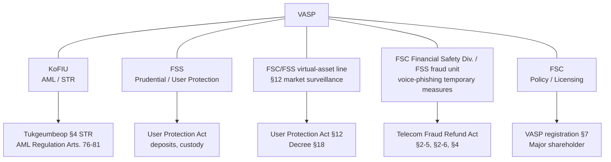
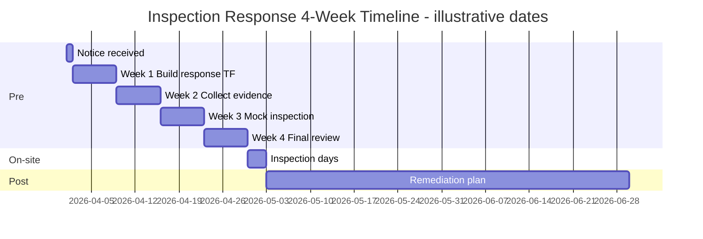
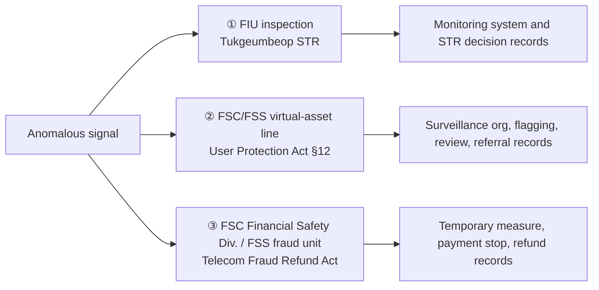
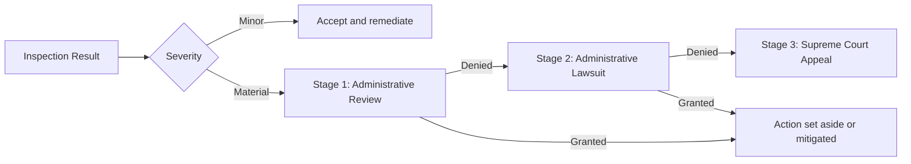

# FIU/FSS On-site Inspection Response — Full Workbook

> Full English translation of the Korean inspection response workbook ([`../notes/5-compliance/inspection-response.md`](../notes/5-compliance/inspection-response.md)). Covers the 4-week preparation timeline, self-assessment checklist, document requirements, interview guides, post-inspection remediation, and the appeals process. Inspection cycles, durations, and document counts here are **planning assumptions with no public basis**. Last updated: 2026-10-21.

## TL;DR

- **Inspectors**: KoFIU (AML — STR, transaction monitoring), FSS (prudential, user protection), the FSC/FSS virtual-asset line (§12 market surveillance under the Virtual Asset User Protection Act), the FSC Financial Safety Division / FSS fraud unit (Telecom Fraud Refund Act temporary measures, applied to exchanges from 2026-10-01), and FSC (policy).
- **"Anomalous transaction" readiness splits three ways**: ① FIU — Tukgeumbeop §4 STR and transaction monitoring; ② §12 continuous surveillance; ③ Telecom Fraud Refund Act holds and payment stops ([§3-H](#h-three-way-anomalous-transaction-readiness)).
- **Frequency**: no public cycle for regular or ad hoc inspections was confirmed in this repository's sources.
- **Preparation window**: plan backward from an assumed 2-4 weeks after notice.
- **Deliverables**: self-assessment report, evidence, FAQ response kit.
- **Must-avoid**: missing documents, number inconsistencies, tipping-off violations, AMLO absence, unremediated prior findings.

---

## 1. Regulatory Body Overview

### Division of labor across Korean agencies

| Agency | Scope | Example inspection focus |
|---|---|---|
| **KoFIU (FIU)** | AML, STR, CTR, Travel Rule | STR quality, transaction-monitoring system (AML Regulation Arts. 76-81), tipping-off controls, internal controls |
| **FSS (Financial Supervisory Service)** | Prudential, user asset protection | Deposits and virtual-asset custody, insurance |
| **FSC virtual-asset division / FSS virtual-asset investigation** | §12 continuous market surveillance | Surveillance organization, analysis system, handling and referral records of flagged trades |
| **FSC Financial Safety Division / FSS fraud unit** | Telecom Fraud Refund Act (exchanges from 2026-10-01) | Temporary measures, purpose checks, payment stops, refund procedures and records |
| **FSC (Financial Services Commission)** | Policy, licensing | VASP registration maintenance, major shareholder changes |
| **DAXA (self-regulator)** | Industry self-regulation | Inspection role and joint blacklist operations: no public basis confirmed in this repository |



### Three inspection types

1. **Comprehensive** — all domains.
2. **Thematic** — targeted (STR quality, Travel Rule, user protection, §12 surveillance). Example: FSC/FSS on-site checks of Upbit and Bithumb surveillance operations on 2024-08-22 ([FSC/FSS 2024-08-22](https://fsc.go.kr/po010101/82943)).
3. **Ad hoc / emergency** — triggered by incidents (hack, large STR, complaint surge).

Cycles and on-site days differ by agency and matter; no public standard was confirmed, so none is stated.

### Legal basis

- **Tukgeumbeop §15** — inspection and supervision authority (FIU)
- **Tukgeumbeop §16** — document production authority
- **VAUPA §13-14** — FSS inspection authority
- **FSC Establishment Act §17** — FSC supervisory authority
- **VAUPA §12, Decree §18, Market Investigation Regulation** — continuous surveillance duty and action/referral criteria; administrative fine up to KRW 100 million (§22 ① 6-7) ([law.go.kr](https://www.law.go.kr/LSW/lsInfoR.do?lsiSeq=290735&efYd=20261002&ancYnChk=0&chrClsCd=010202&urlMode=lsInfoR))
- **Telecom Fraud Refund Act §2-5, §2-6, §4** — exchange temporary measures, purpose checks, payment stops (in force 2026-10-01); damages for failing to stop payment (§4 ③) ([law.go.kr](https://www.law.go.kr/LSW/lsInfoR.do?lsiSeq=290245&efYd=20261002&ancYnChk=0&chrClsCd=010202&urlMode=lsInfoR))

(The Tukgeumbeop §15-16, VAUPA §13-14, and FSC Establishment Act article numbers were not re-verified in this repository's 2026-10 sources.)

### Intensity comparison

| Item | Comprehensive | Thematic | Ad hoc |
|---|---|---|---|
| Notice | Advance notice | Advance notice | Depends on matter |
| Scope | All domains | One area | Incident-related |
| Penalty likelihood | Medium | Medium | High |

Notice days, on-site days, document-request counts, and interview headcounts have no public standard; earlier figures were removed. The 4-week timeline below is a planning assumption.

---

## 2. Timeline — 4 weeks of preparation + on-site + aftermath



### Notice received (D-30 or D-15)

The notice typically includes:

- Inspector agency, dates, location (firm HQ or FIU offices)
- Scope and focus areas
- **Required document list**
- Contact person, inspection team composition

### Immediate actions (within 24 hours of notice)

- [ ] Brief the CEO, board, and audit committee
- [ ] AMLO convenes the response task force (TF)
- [ ] Put external counsel on standby
- [ ] Archive the original notice under chain-of-custody controls

### Week 1 (D-30 to D-22): Team Formation

- [ ] **AMLO-led response TF** — AMLO + operations head + legal + IT
- [ ] Internal kickoff — scope, timeline, roles
- [ ] Board notice — reporting cadence during the inspection
- [ ] External legal / compliance advisors retained if needed
- [ ] Review prior-year findings and remediation status
- [ ] Secure a dedicated War Room
- [ ] Establish communication policy — external, press, customers

### Week 2 (D-21 to D-14): Evidence Collection

- [ ] First-pass collection of the requested items
- [ ] Apply the self-diagnostic checklist (see §3)
- [ ] Remediate any gaps you can fix before inspection
- [ ] Cross-check key numbers (STR counts, volumes, account totals)
- [ ] Scan, classify, and index evidence
- [ ] Validate data-extraction queries — ensure reports reproduce
- [ ] Risk-score items with weak evidence and prepare alternate support

### Week 3 (D-14 to D-7): Mock Inspection

- [ ] Document QA — final AMLO sign-off
- [ ] Draft FAQ responses (see §4)
- [ ] Interview prep — 30-minute AMLO, analyst, IT Q&A simulations
- [ ] Environment check — conference rooms, demo systems, printers, network
- [ ] Half-day mock drill led by external counsel
- [ ] Emergency response to any gaps the mock exposes

### Week 4 (D-7 to D-0): Final Review

- [ ] Submit documents (D-3 or D-1)
- [ ] Final AMLO all-hands briefing
- [ ] Prepare inspector reception — parking, badges, conference rooms
- [ ] Pre-brief CS and sales teams on escalation during inspection
- [ ] Security check — define inspector network access boundaries
- [ ] Pre-print document receipt forms

### On-site days (D-day to D+2)

- [ ] Inspector reception — CEO and AMLO greet
- [ ] Interviews per pre-agreed guidance
- [ ] Rapid response to supplementary document requests
- [ ] Daily 17:00 internal debrief
- [ ] Final confirmation at inspector departure — document receipt
- [ ] Maintain clean-desk policy in any inspector-visible area

#### Daily debrief template

```
[Date] Inspection Day-N Debrief
─────────────────────────────
1. Topics covered today:
2. Additional document requests: __ (submitted __, pending __)
3. Interviews completed: __ (scheduled __)
4. Inspector tone: neutral / favorable / stern
5. Expected topics tomorrow:
6. Overnight action items:
Prepared by: ____  Approved: AMLO ____
```

### Post-inspection (D+3 to D+60)

- [ ] Receive inspection opinion (D+30 to D+60)
- [ ] Submit remediation plan within 60 days
- [ ] Reporting cadence — quarterly or per instruction
- [ ] Prevent repeat findings — SOP revisions and training
- [ ] Internal lessons-learned session before TF is disbanded
- [ ] Final board report — findings plus remediation plan

---

## 3. 40-Item Self-Diagnostic Checklist

### A. Registration and Licensing (5 items)

- [ ] FIU registration certificate (original, valid)
- [ ] ISMS certificate valid
- [ ] Real-name banking contract on file
- [ ] Recent major shareholder changes filed
- [ ] Articles of incorporation and business registration current

### B. AMLO and Governance (6 items)

- [ ] AMLO appointment letter and resume (qualification requirements per source text)
- [ ] AMLO authority and reporting documents (direct board line)
- [ ] Internal control standards current (AML policy and SOPs)
- [ ] Quarterly board AML reporting records
- [ ] Annual independent audit (internal or external) evidence
- [ ] Annual employee AML training records
- [ ] AML staffing meets the 2026-08-13 registration manual (4+ AML staff; IT infrastructure located in Korea, domestic cloud region accepted) ([FSC 2026-08-13](https://www.fsc.go.kr/no010101/87521))

### C. KYC / CDD / EDD (7 items)

- [ ] KYC policy and SOP
- [ ] Tukgeumbeop §5-2 CDD procedures; real-name verification (integration with 본인확인기관)
- [ ] Customer risk tier criteria (3-5 tiers)
- [ ] EDD trigger list and execution records
- [ ] Non-face-to-face verification flow (video call, document checks)
- [ ] PEP screening vendor and records
- [ ] Customer profile refresh cycle (set by firm risk assessment; no statutory cycle confirmed)

### D. KYT and Transaction Monitoring (8 items)

- [ ] KYT / blockchain-analytics vendor contracts (kept distinct from Travel Rule solution contracts)
- [ ] Rule catalog and activation status, mapped to the transaction-monitoring system in AML Regulation Arts. 76-81 (in force 2026-01-22)
- [ ] Alert-handling SOP and internal SLA
- [ ] False-positive management policy with periodic tuning records
- [ ] Rule committee minutes
- [ ] Wallet blacklist (internal; any shared industry list documented with its source)
- [ ] Enhanced monitoring evidence for top customers
- [ ] STR-candidate escalation path, including FDS alerts and §12 surveillance referrals flowing into the AML queue (details in [§3-H](#h-three-way-anomalous-transaction-readiness))

### E. STR / CTR / Reporting (6 items)

- [ ] Tukgeumbeop §4 STR submissions (annual count, processing time, AMLO approvals)
- [ ] Evidence of compliance with STR drafting criteria
- [ ] Tipping-off controls and training records
- [ ] Tukgeumbeop §4-2 CTR records (threshold per Enforcement Decree)
- [ ] Rejection and resubmission history with response
- [ ] FIU-TIS portal access rights and logs

### F. Sanctions Screening (4 items)

- [ ] OFAC SDN daily refresh and update records
- [ ] Daily comparison against UN, EU, Korean MOFA lists
- [ ] Wallet-address sanctions screening records
- [ ] Potential-match disposition records

### G. Travel Rule (4 items)

- [ ] Travel Rule (Tukgeumbeop §5-3) solution contract
- [ ] Threshold applied correctly: Enforcement Decree §10-10 "KRW 1,000,000 or more" until 2027-02-18; all transfers to other VASPs from 2027-02-19 (Decree No. 36592, enacted-not-in-force)
- [ ] IVMS 101 message quality validation logs
- [ ] Sunrise Issue policy plus handled cases; readiness for the 2027-02 foreign-VASP three-tier rule and self-hosted same-person rule (Supervisory Regulation §28-2; exact effective date 02-19 or 02-21 not settled)
- [ ] PIPA compliance — national ID handling

### H. Three-way "anomalous transaction" readiness

Lumping everything into "anomalous transaction escalation" blurs which inspection you are preparing for. In Korea, "이상거래" maps to three distinct legal regimes with different inspecting bodies ([`../notes/4-technology/fds.md`](../notes/4-technology/fds.md)).



**H-1. FIU — Tukgeumbeop STR and transaction monitoring**

- [ ] Rules, alerts, and review records aligned to AML Regulation Arts. 76-81
- [ ] STR decisions (filed / not filed, with reasons) for cases arriving from FDS or §12
- [ ] 2027-02 readiness: an in-house suspicious-transaction monitoring system for transfers of KRW 10 million or more with foreign VASPs and self-hosted wallets (Supervisory Regulation §28-2 ③) — **not an automatic STR**

**H-2. FSC/FSS virtual-asset line — §12 continuous surveillance**

- [ ] Surveillance organization and committee separate from the listing function
- [ ] Analysis-system flagging variables, thresholds, and change history
- [ ] Records of flag, review, and referral to FSC/FSS (or report to investigators)
- [ ] Retention of surveillance results and referral records (Decree §13)

Basis: the 2024-08-22 on-site check covered surveillance organization, the analysis system, and handling of flagged trades ([FSC/FSS 2024-08-22](https://fsc.go.kr/po010101/82943)).

**H-3. FSC Financial Safety Division / FSS fraud unit — Telecom Fraud Refund Act (from 2026-10-01)**

- [ ] Temporary-measure procedure (delay or suspension of withdrawals and virtual-asset transfers) and execution records
- [ ] Notice, identity confirmation, and release records (§2-5 ④)
- [ ] Transaction-purpose checks and limits (§2-6)
- [ ] Payment-stop execution on victim claims (§4; damages under §4 ③ if not executed)
- [ ] Enhanced withdrawal-delay standard internal rules (2026-04-07) applied to exempt accounts

### Scoring

Each item is marked **Complete / Partial / Deficient**. Three or more deficient items triggers an emergency TF meeting — these gaps get first priority. Items that cannot be fixed before inspection need a reasonable alternate evidence bundle plus a management sign-off memo.

---

## 4. Expected Questions and Model Answers

### Q1. "Why is your STR count low relative to peers?"

**Framing**:

- Customer mix (institutional / B2B customers produce fewer false positives)
- KYT and EDD **prevention at entry** — risk filtered before transaction
- STR quality policy (low rejection rate)
- Support with your own numbers (annual filings, rejection rate, average approval time, FIU supplementary requests), not with "industry averages"

**Supporting evidence**:

- Year-over-year STR trend chart
- Rejection rate and AMLO processing time statistics
- EDD / denial report (pre-entry prevention record)

### Q2. "Why is a Tornado Cash interaction address still blocked?"

**Framing**:

- "Independent decision under the firm's risk assessment (Tukgeumbeop §5-2 CDD framework), even after the 2025-03-21 SDN removal" ([OFAC 2025-03-21](https://ofac.treasury.gov/recent-actions/20250321))
- "Past money-laundering risk persists"
- Policy document + AMLO signature + board approval

**Supporting evidence**:

- Internal Tornado risk memo
- Unblock / appeal SOP

### Q3. "How do you evidence user asset segregation?"

**Answer**:

- Quarterly external audit reports (auditor attestation)
- Disclosed multi-sig cold-wallet addresses with balance proof
- Per-user internal ledger reconciled to on-chain balances (Proof of Reserves, PoR)

**Supporting evidence**:

- External or designated auditor opinion
- Signed multi-sig address list with balance snapshots
- PoR Merkle tree report

### Q4. "Does the AMLO have sufficient authority?"

**Answer**:

- Organizational chart — direct CEO / board reporting line
- Transaction-stop authority in the SOP
- Attendance at board and executive meetings

**Supporting evidence**:

- Appointment letter and delegation-of-authority rules
- Board attendance records
- D&O insurance policy

### Q5. "How are monitoring rules maintained?"

**Answer**:

- Regular rule committee — AMLO + analytics lead + KYT engineer + legal
- Quantitative tuning from alert and FP data
- Board reporting for material changes
- Full version control (Git or equivalent)

**Supporting evidence**:

- Rule committee minutes
- Change log (Git commits or Jira)
- Before/after FP metric comparison

### Q6. "Can you walk us through a specific large STR case?"

**Framing**:

- **Never** disclose a specific case number or customer ID orally — tipping-off risk.
- Describe the **process** instead: alert -> EDD -> AMLO sign-off -> FIU submission route.
- Offer a written follow-up if the inspector insists.

### Q7. "How reliable is your non-face-to-face identity verification?"

**Framing**:

- API integration with 본인확인기관 (KCB, NICE, and others)
- Recorded video calls with face matching
- Forgery/impersonation detection statistics

### Q8. "Has any employee communicated favorably with a customer after an STR?"

**Framing**:

- Tipping-off SOP — automatic masking of STR-subject customer IDs plus CS ticket isolation
- Dedicated tipping-off training module in employee AML training
- No prior violations, or documented remediation

---

## 5. Required Documents (approximately 40)

Grouped into three sets.

### Policy / SOP (10)

- [ ] AML policy (top-level)
- [ ] KYC / CDD SOP
- [ ] EDD SOP
- [ ] KYT rule-operations SOP
- [ ] STR drafting and submission SOP
- [ ] Sanctions screening SOP
- [ ] Travel Rule operations SOP
- [ ] Tipping-off controls SOP
- [ ] User protection policy
- [ ] Board AML reporting SOP

### Evidence / Records (20)

- [ ] FIU registration certificate
- [ ] ISMS certificate
- [ ] Real-name banking contract
- [ ] AMLO appointment letter
- [ ] Board minutes (AML-related)
- [ ] Independent audit reports
- [ ] Employee AML training records
- [ ] KYC vendor contract
- [ ] KYT vendor contract
- [ ] Travel Rule vendor contract
- [ ] External audit of asset segregation
- [ ] Proof of Reserves (PoR)
- [ ] Monthly alert / FP reports
- [ ] Rule committee minutes
- [ ] STR submission records and evidence
- [ ] Sanctions screening logs
- [ ] IVMS101 message quality logs
- [ ] Customer risk-tier distribution report
- [ ] Escalation records kept separately per regime — STR decisions (Tukgeumbeop) / §12 flags and referrals (User Protection Act) / temporary measures and payment stops (Telecom Fraud Refund Act)
- [ ] Prior-year remediation progress report

### Incident Response Records (10)

- [ ] Hacking and fraud response
- [ ] Large STR case files
- [ ] Suspected sanctions-violation cases
- [ ] Customer complaints
- [ ] Service suspension / block records
- [ ] Law-enforcement cooperation records
- [ ] Press response records
- [ ] Customer notices
- [ ] System-outage response records
- [ ] Foreign VASP cooperation

### Document index template

Every artifact is assigned a unique ID so inspectors can reference it:

```
[ID] [Category] [Title] [Version] [Date] [Owner] [Path]
POL-001  Policy   AML Policy       v3.2  2026-01-15  AMLO       /compliance/policy/aml-policy-v3.2.pdf
POL-002  Policy   KYC SOP          v2.1  2025-11-03  Ops lead   /compliance/sop/kyc-sop-v2.1.pdf
EVD-001  Evidence FIU cert         orig  2021-09-24  Legal      /legal/cert/fiu-2021.pdf
EVD-002  Evidence ISMS cert        2025  2025-06-30  Security   /security/isms-2025.pdf
...
```

### Submission format

- PDF originals + Excel summary in parallel
- File naming: `ID_title_date.pdf`
- Password-protected, delivered via a separate channel

---

## 6. On-site Interview Guides

### General principles

1. **3-second rule** — pause for three seconds after a question before answering. Do not blurt.
2. **"I don't know" is acceptable** — speculation or fabrication creates perjury risk.
3. **Reference documents** — "Please see document ID EVD-XXX" is a valid answer.
4. **Ask for time** — "Let me confirm and get back within the hour" is acceptable.
5. **Recording** — confirm whether the inspector is recording and under what notice.

### AMLO interview (30-60 min)

**Likely questions**:

- Organization, authority, reporting structure
- Reasoning behind major policy decisions
- Three significant incidents from the past year
- Self-assessed weaknesses and improvement plan

**Principles**:

- Cite numbers, dates, and document paths
- "I will confirm and respond" — never guess
- Emphasize executive and board-level support

**Materials to have on hand**:

- AMLO playbook (authority and decisions log)
- Board reports for the last four quarters
- Major STR case number list (numbers only, not content)

### Analyst interview (30 min)

**Likely questions**:

- Daily alert-handling flow
- FP determination criteria and SOP
- STR drafting experience
- A recent difficult case

**Principles**:

- SOP-grounded responses
- Walk through alert -> FP / STR flow step by step
- Share rule-tuning proposals

### IT / Engineer interview (30 min)

**Likely questions**:

- KYT system architecture
- Vendor API integration and latency
- Data retention and encryption
- Change management process

**Principles**:

- Bring architecture diagrams
- Demo live logs and monitoring dashboards

### Executive interview (15-30 min, CEO / board member)

**Likely questions**:

- AMLO support and resource allocation
- AML strategic direction
- Involvement in major incident response

**Principles**:

- Emphasize AMLO independence
- Cite annual AML budget and headcount growth
- Describe board AML-agenda frequency

### Top 5 things to avoid

1. Disclosing specific customer IDs or case numbers aloud (tipping-off)
2. Inventing numbers you don't remember
3. Pre-coordinating answers with colleagues
4. Shifting blame for document delays
5. Offering gifts or entertainment to inspectors

---

## 7. Post-Inspection Remediation

### Finding severity tiers

| Tier | Meaning | Response deadline |
|---|---|---|
| **Recommendation** | Room for improvement | 6 months |
| **Finding** | Potential violation | 3 months |
| **Warning** | Material violation | 1 month + administrative fine |

### Remediation-plan principles

- Specific, measurable, time-bound
- Owner assigned (AMLO accountable)
- Board-approved
- Monthly internal progress reporting

### Remediation plan template

```
────────────────────────────────────
Remediation Plan
────────────────────────────────────
Company: ___
Regulator: FIU / FSS
Inspection period: 2026-__-__ to __-__
Submitted: 2026-__-__

[Finding 1]
- Original text: "____________________"
- Tier: Recommendation / Finding / Warning
- Root cause: ____________________
- Actions:
  1) ____________________
  2) ____________________
  3) ____________________
- Owner: AMLO ___ / Implementer ___
- Deadline: 2026-__-__
- KPI: ____________________

[Finding 2]
...

────────────────────────────────────
AMLO signature ____  CEO approval ____  Board resolution date ____
────────────────────────────────────
```

### Reporting cadence

- **Monthly internal** — AMLO -> Board Risk Committee
- **Quarterly regulatory** — to FIU / FSS per stated deadline
- **Completion notice** — formal document per finding on closure

### Administrative fines

- **Amounts**: take them from the statute text. Earlier "KRW 10M-100M+ under §20" and "14-day right of reply" figures were not sourced and are removed.
- **Reference case**: FIU imposed KRW 35.2 billion in fines on Dunamu on 2025-11-06 for CDD, transaction-restriction, and STR violations; the Travel Rule (§5-3) was not a ground ([FIU press release, KDI mirror](https://eiec.kdi.re.kr/policy/materialView.do?num=273166)).
- **Appeal**: see §8.

---

## 8. Appeals Process — when you disagree with the result

When the inspection result (finding, administrative action, or fine) contains factual errors, legal misinterpretation, or proportionality problems, a VASP can pursue formal appeal routes. Large actions (major fines, business suspension, deregistration) usually prompt appeal consideration.

> Filing deadlines and processing periods below come from general administrative law (Administrative Appeals Act, Administrative Litigation Act) and were **not re-verified** in this repository's 2026-10 sources. Confirm them against the statute text before relying on them.

### 8.1 Three-stage appeal path



### 8.2 Stage 1 — Administrative Review (행정심판)

**Basis**: Administrative Basic Act §28-29, Administrative Appeals Act

**Filing deadline**: 90 days from notice of the disposition (Administrative Appeals Act §27)

**Forum**:
- FSC action: FSC Administrative Appeals Committee
- FIU action: Commissioner of KoFIU (supervising authority)

**Required documents**:
- Administrative review petition (prescribed form)
- Copy of the original disposition notice
- Evidence rebutting the facts (transaction logs, emails, minutes, external audit)
- Legal opinion (for large matters)
- Power of attorney (if acting through counsel)

**Processing time**: 60 days (extendable by 30)

**Practical tips**:
- Filing **does not** stay enforcement. Fines are paid first, then refunded if the appeal prevails.
- No public grant-rate statistic for Korean VASP cases was found; earlier rate figures and law-firm references were removed.

### 8.3 Stage 2 — Administrative Lawsuit (행정소송)

**Basis**: Administrative Litigation Act §19 (cancellation suit)

**Filing deadline**: 90 days from the administrative review decision, or 90 days from the original disposition if review is skipped.

**Forum**: Seoul Administrative Court (has jurisdiction over FSC / FIU actions)

**Suit types**:
- **Cancellation suit** — most common, seeks to void the disposition
- **Nullity confirmation** — argues the disposition is legally void ab initio
- **Illegal inaction** — when a mandated FIU action was not taken

**Processing time**: typically 1-2 years (longer for complex matters)

**Practical tips**:
- **Preliminary injunction (stay of enforcement)** can be filed separately, suspending the disposition while the case proceeds.
- Loss exposes the firm to counsel fees and court costs.

### 8.4 Stage 3 — Supreme Court

Supreme Court appeal is available after losing at the administrative court, but:

- **Legal review only** — no factual reargument, only law and application.
- Virtually no precedent exists in major crypto matters — the industry's Korean history is still too short.

### 8.5 Negotiated settlement

Korea has no formal consent-decree mechanism, but in practice:

- **Demonstrated remediation** — showing "we are already improving" during or after the inspection can lead to reduced severity in negotiation.
- **Voluntary self-reporting** — self-reporting plus remediation before a formal disposition may be weighed in mitigation.

**US-style consent decrees** — Korea has no formal equivalent. Settlement amounts in foreign cases such as Binance (2023) and OKX (2025) are **not confirmed by a public source in this repository** ([`../notes/6-cases/major-enforcement.md`](../notes/6-cases/major-enforcement.md)).

### 8.6 Appeals in practice

The earlier year-by-year appeals table (2021-2025) had no source and was removed. The primary-source large sanction is FIU's 2025-11-06 decision fining Dunamu KRW 35.2 billion (grounds: CDD, transaction restriction, STR; not the Travel Rule) ([FIU press release, KDI mirror](https://eiec.kdi.re.kr/policy/materialView.do?num=273166)). The progress of any subsequent challenge was not confirmed in primary sources.

**General view**: procedural-defect and proportionality arguments are commonly considered easier to contest than factual rebuttal, but no success-rate statistic for Korean VASP cases exists.

### 8.7 Risks of appealing

- **Relationship risk** — you will work with FIU/FSS long term; emotionally charged appeals tend to invite stricter subsequent inspections.
- **Reputational risk** — lawsuits are public and Korean court decisions are published by default.
- **Cost risk** — external counsel costs scale with the matter; no public benchmark.
- **Timing risk** — statutory deadlines are strict.

### 8.8 Recommended paths

For most VASPs:

1. **Minor findings**: accept and remediate diligently. Do not appeal.
2. **Moderate action**: attempt closure through voluntary remediation.
3. **Major action (large fine, suspension, deregistration)**: administrative review with counsel.
4. **Administrative review denied + existential business threat**: administrative lawsuit plus preliminary injunction.

The operating principle: **appeals are usually about severity mitigation, not outright victory**.

### 8.9 Decision checklist for appeals

Before deciding to appeal:

- [ ] Read the disposition notice and its statutory basis carefully
- [ ] Confirm existence of rebutting evidence on the facts
- [ ] Assess proportionality — compare with similar cases
- [ ] Financial impact analysis — compliance vs appeal cost
- [ ] Relationship risk assessment (future inspections, licensing)
- [ ] Reputational risk (public lawsuit)
- [ ] Counsel opinion (objective probability of success)
- [ ] Board approval for large matters
- [ ] Confirm you can prepare within the statutory deadline

If the decision is "proceed", activate a dedicated TF, retain outside counsel, and set up shareholder communication promptly.

---

## 9. Top 5 Failures

1. **Late document submission** — even one day of delay costs points. Build in slack.
2. **Number inconsistency** — STR count in the report differs from the underlying database.
3. **Tipping-off violation** — a CS agent casually tells a customer the account was frozen because of an STR.
4. **AMLO absence** — AMLO is traveling on inspection day without a pre-designated deputy.
5. **Unremediated prior findings** — the same issue flagged two years running.

### Extended patterns

| # | Type | Concrete case | Mitigation |
|---|---|---|---|
| 1 | Documents | Submitted 48 of 50 requested items | Two-person cross-check on submission checklist |
| 2 | Numbers | STR report says 120 filings; DB says 118 | Single source of truth (SQL) with auto-extraction |
| 3 | Tipping-off | CS agent tells customer "your account is frozen because of an STR" | CS training + scripted responses |
| 4 | AMLO absence | AMLO at an overseas conference on inspection day | Pre-appoint a deputy AMLO |
| 5 | Repeat finding | "Training records deficient" two years in a row | Final D-7 confirmation of prior-year remediation |
| 6 | Demo failure | KYT dashboard errors out during the live demo | Dry-run rehearsal + backup screenshots |
| 7 | Interview contradiction | AMLO and analyst give opposite answers | Unified answer guide + mock inspection |

### Peer benchmarks inspectors reference

- Annual STR count per monthly trading volume
- EDD coverage ratio
- Alert -> STR conversion rate
- Average AMLO processing time
- False-positive rate
- FDS temporary-measure counts, release rate, and handling time; §12 flag and referral counts (tracked separately per regime)

No public crypto-specific alert-to-STR benchmark exists (B; [EY 2018](https://ey.com/content/dam/ey-unified-site/ey-com/en-uk/industries/financial-services/documents/ey-anti-money-laundering-transaction-monitoring-2018-emeia-survey.pdf) is a banking survey). Do not lean on "industry averages"; produce a quarterly internal report that explains your own trends and calculation methods.

---

## 10. RACI — Role and Responsibility

| Task | AMLO | Ops lead | Legal | IT | CEO |
|---|---|---|---|---|---|
| TF formation | R | A | C | C | I |
| Evidence collection | A | R | C | R | I |
| Self-assessment | R | A | C | C | I |
| Mock inspection | R | A | C | C | I |
| Interview participation | R | R | C | R | R |
| Remediation plan | R | A | C | C | A |
| Board reporting | R | C | C | I | A |

> R=Responsible, A=Accountable, C=Consulted, I=Informed

---

## 11. War Room Setup

### Physical space

- Dedicated conference room (lockable, cameras off)
- Two large monitors (for inspector demos)
- Printer, copier, shredder
- Document index on wall charts
- Emergency contact board

### Digital space

- Shared drive for the response (encrypted)
- Access limited to TF members
- Version control (Git or equivalent)
- Full audit logging

### Communications

- Dedicated Slack or Teams channel — `#inspection-2026`
- Daily standup at 17:00
- AMLO mobile available 24/7 for emergencies

---

## 12. TF Kickoff Agenda Template

```
─────────────────────────────────
Inspection Response TF — Kickoff
─────────────────────────────────
Date: 2026-__-__ 10:00-12:00
Attendees: AMLO, Ops lead, Legal, IT, CFO

1. Review the inspection notice (10 min)
2. Confirm scope and timeline (10 min)
3. RACI assignment (20 min)
4. Document request review (30 min)
5. Prior-year remediation status (15 min)
6. External communications policy (10 min)
7. Next meeting schedule (5 min)
─────────────────────────────────
```

---

## 13. When to Bring in External Experts

### Retain external advisors when

- A material fine is expected
- Criminal referral is possible
- Prior-year finding reached the **Warning** tier
- Major shareholder or executive changes are concurrent
- Structure ties to a foreign VASP are material

### Cost

No public benchmark exists for legal, consulting, mock-drill, or forensic costs. The earlier cost-range table was unsourced and has been removed.

---

## 14. Comparison With Other Jurisdictions

| Country | Supervisor | Key distinction |
|---|---|---|
| Korea | FIU, FSS, FSC | Tukgeumbeop, VAUPA (incl. §12), and the Telecom Fraud Refund Act (from 2026-10-01) in parallel |
| US | FinCEN, OCC, state regulators | BSA/AML exam + MSB state licensing |
| Singapore | MAS | Payment Services Act basis, comprehensive on-site |
| Japan | FSA, JAFIC | Joint inspection with JVCEA self-regulator |
| EU | AMLA (rule-making and guidance powers from 2026-01-01), national supervisors | MiCA and TFR apply; AMLR applies from 2027-07-10 |

Korea's **real-name banking requirement** is unique globally. The partner bank effectively re-inspects the VASP, creating a double-check dynamic that other markets lack.

---

## 15. Post-inspection Internal Reset

Within 30 days of the inspection close, complete:

- [ ] SOP revisions addressing the gaps surfaced
- [ ] All-hands retraining on misunderstandings spotted during interviews
- [ ] Emergency rule committee session for any flagged rules
- [ ] Board resolution formally approving the remediation plan
- [ ] Vendor re-evaluation if KYT / Travel Rule performance was questioned
- [ ] Internal audit schedule adjustment — reset next-quarter focus
- [ ] Internal "lessons learned" document for next inspection

---

## 16. Crisis Scenarios During Inspection

### Scenario A — hack or incident occurs mid-inspection

1. Inform inspectors immediately — do not conceal.
2. Run incident response and IR workflows in parallel.
3. Request formal inspection pause if necessary.
4. Deploy legal and communications teams.

### Scenario B — sensitive data exposure in submitted documents

- Mask as required by PIPA before submission.
- Get the inspector's scope request in writing.
- Pre-consult with PIPC (Personal Information Protection Commission) if needed.

### Scenario C — suspected employee tipping-off

- Immediately escalate to AMLO
- Place the employee on standby and schedule retraining
- Initiate internal disciplinary process — **disclose proactively to inspectors**

### Scenario D — inspector request is unreasonable or overbroad

- Legal reviews, then file formal objection
- Escalate to the inspector's supervising official
- Document meticulously

---

## 17. D-1 Final Checklist

The 12 items the AMLO confirms the day before inspection:

- [ ] 100% of requested documents submitted?
- [ ] Full TF confirmed present on D-day?
- [ ] Deputy AMLO appointment letter prepared?
- [ ] Conference room / demo environment verified?
- [ ] Document index and ID system ready?
- [ ] Interview participants briefed one more time?
- [ ] Tipping-off reminder sent to all staff?
- [ ] External advisors on standby confirmed?
- [ ] CEO and board availability confirmed?
- [ ] Press / social-media response owner designated?
- [ ] Prior-year remediation evidence table ready?
- [ ] War Room keys / badges distributed?

A single "No" on this list triggers emergency action the next morning.

---

## Further Reading

- Original Korean workbook with all templates: [`../notes/5-compliance/inspection-response.md`](../notes/5-compliance/inspection-response.md)
- [`inspection-response-summary.md`](inspection-response-summary.md) — Condensed English summary
- [`../notes/4-technology/fds.md`](../notes/4-technology/fds.md) — Boundaries between FDS, §12 surveillance, and STR
- [`korea-aml-overview.md`](korea-aml-overview.md) — Regulatory context
- [KoFIU official site](https://www.kofiu.go.kr/)
- [FSS official site](https://www.fss.or.kr/)
