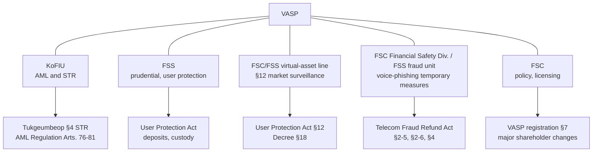
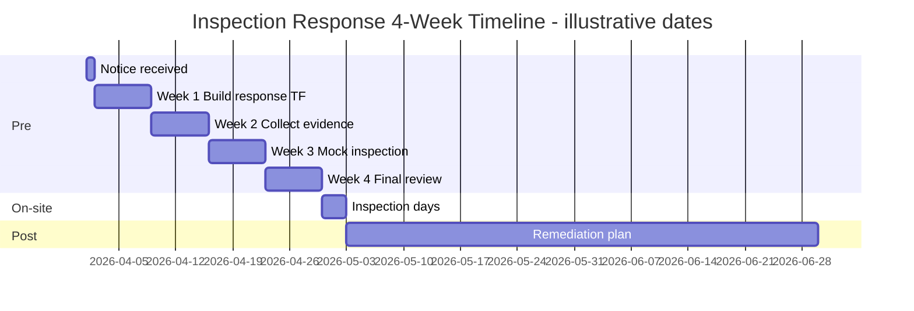
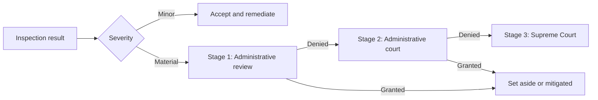

# Inspection Response — English Summary

> English summary of the Korean inspection response workbook ([`../notes/5-compliance/inspection-response.md`](../notes/5-compliance/inspection-response.md)). How a Korean VASP prepares for and responds to KoFIU (FIU), FSS, and FSC on-site inspections. Inspection cycles, durations, and document counts in this summary are **planning assumptions, not public standards**. Last updated: 2026-10-21.

---

## TL;DR

- **Who inspects what**: KoFIU (AML — STR, transaction monitoring), FSS (prudential and user protection), the FSC/FSS virtual-asset line (market surveillance under the Virtual Asset User Protection Act §12), and the FSC Financial Safety Division / FSS fraud unit (voice-phishing temporary measures under the Telecom Fraud Refund Act, applied to exchanges from 2026-10-01).
- **"Anomalous transaction" readiness splits three ways**: ① FIU — Tukgeumbeop §4 STR and the transaction-monitoring system (AML Regulation Arts. 76–81, in force 2026-01-22); ② §12 continuous market surveillance; ③ Telecom Fraud Refund Act temporary holds and payment stops.
- **Frequency**: no public cycle for regular or ad hoc inspections was confirmed in this repository's sources.
- **Preparation window**: plan backward from an assumed 2–4 weeks after notice.
- **Core deliverables**: self-assessment report, evidence, FAQ responses.
- **Top failure modes**: missing documents, number mismatches, tipping-off, AMLO absence, unremediated prior findings.

---

## 1. Who Inspects — Three Legal Exits

### Inspection types

| Type | Scope | Penalty likelihood |
|---|---|---|
| Comprehensive | All domains | Medium |
| Thematic | One area (STR quality, Travel Rule, user protection, §12 surveillance). Example: on-site checks of Upbit and Bithumb surveillance operations on 2024-08-22 ([FSC/FSS 2024-08-22](https://fsc.go.kr/po010101/82943)) | Medium |
| Ad hoc | Incident-driven (hack, large STR, complaint surge) | High |

Notice periods, on-site days, document counts, and interview headcounts have no public standard; earlier figures were removed.

**Statutory basis** (article numbers marked * were not re-verified in the 2026-10 sources):

- Tukgeumbeop §15* (inspection) and §16* (document production) — FIU
- User Protection Act §13–14* — FSS inspection
- User Protection Act §12, Decree §18 — continuous surveillance; administrative fine up to KRW 100 million (§22 ① 6–7) ([law.go.kr](https://www.law.go.kr/LSW/lsInfoR.do?lsiSeq=290735&efYd=20261002&ancYnChk=0&chrClsCd=010202&urlMode=lsInfoR))
- Telecom Fraud Refund Act §2-5, §2-6, §4 — temporary measures, purpose checks, payment stops (exchanges from 2026-10-01); damages for failing to stop payment (§4 ③) ([law.go.kr](https://www.law.go.kr/LSW/lsInfoR.do?lsiSeq=290245&efYd=20261002&ancYnChk=0&chrClsCd=010202&urlMode=lsInfoR))

---

## 2. 4-Week Preparation Timeline (planning assumption)

- **Within 24 hours of notice**: brief CEO, board, audit committee; AMLO convenes the TF; put counsel on standby; archive the notice.
- **Week 1**: build the TF (AMLO lead + operations, legal, IT); war room; communication policy; review prior findings.
- **Week 2**: collect requested items; apply the self-assessment checklist; cross-check key numbers against a **single source of truth**.
- **Week 3**: mock inspection; FAQ responses; 30-minute interview simulations.
- **Week 4**: submit documents; final briefing; prepare demo environment.
- **On-site**: daily 17:00 debrief; clean desk; track every supplementary request.
- **Post**: receive opinion; submit remediation plan; lessons-learned session.

---

## 3. Self-Assessment Checklist (8 Categories)

| # | Category | Focus |
|---|---|---|
| A | Registration and licensing | FIU registration, ISMS, real-name bank contract, major-shareholder filing (30-day prior notice under the 2026-08-13 registration manual) |
| B | AMLO and governance | AMLO appointment, board reporting, internal controls, training; registration manual requires 4+ AML staff ([FSC 2026-08-13](https://www.fsc.go.kr/no010101/87521)) |
| C | KYC / CDD / EDD | Tukgeumbeop §5-2; risk tiers; EDD records; non-face-to-face verification; PEP screening; refresh cycle set by the firm |
| D | KYT and transaction monitoring | Rule catalog mapped to AML Regulation Arts. 76–81; alert SOP; false-positive tuning; rule committee minutes |
| E | STR / CTR / reporting | §4 STR records and approvals; tipping-off controls; §4-2 CTR records; FIU-TIS access logs |
| F | Sanctions screening | OFAC/UN/EU/Korean list refresh; wallet screening; potential-match disposition |
| G | Travel Rule (§5-3) | Decree §10-10 "KRW 1,000,000 or more" until 2027-02-18; all transfers from 2027-02-19 (enacted-not-in-force); IVMS 101 quality logs; sunrise policy; PIPA |
| H | Three-way "anomalous" split | Separate records for FIU STR decisions, §12 surveillance referrals, and Telecom Fraud Refund Act holds |

**Scoring**: each item Complete / Partial / Deficient. Three or more deficient items triggers an emergency TF meeting.

Full Korean checklist: [`../notes/5-compliance/inspection-response.md`](../notes/5-compliance/inspection-response.md) §3.

---

## 4. Mandatory Documents (~40)

1. **Policies and SOPs (10)**: AML policy, KYC/CDD, EDD, KYT operations, STR, sanctions, Travel Rule, tipping-off, user protection, board AML reporting.
2. **Evidentiary records (20)**: registration and ISMS certificates, bank contract, AMLO appointment, board minutes, audits, training, vendor contracts, asset-segregation audit, PoR, alert/FP reports, rule committee minutes, STR records, screening logs, IVMS 101 logs, risk-tier distribution, **escalation records kept separately per regime**, prior-year remediation.
3. **Incident records (10)**: hacks and fraud, large STR cases, sanctions cases, complaints, suspensions, law-enforcement cooperation, press, user notices, outages, foreign VASP cooperation.

Each document gets a unique ID (`POL-001`, `EVD-001`, `INC-001`).

---

## 5. FAQ — Frequent Inspector Questions

- **Q1. Low STR count vs peers?** Explain customer mix, prevention at entry, and STR quality using your own trend data (count, rejection rate, approval time). Do not cite "industry averages" — no public crypto alert-to-STR benchmark exists (B; [EY 2018](https://ey.com/content/dam/ey-unified-site/ey-com/en-uk/industries/financial-services/documents/ey-anti-money-laundering-transaction-monitoring-2018-emeia-survey.pdf) is a banking survey).
- **Q2. Why still block Tornado Cash-linked addresses after the 2025-03-21 SDN removal?** Present the firm's own risk assessment, signed by the AMLO and approved by the board ([OFAC 2025-03-21](https://ofac.treasury.gov/recent-actions/20250321)).
- **Q3. How do you evidence user-asset segregation?** External audit opinion, disclosed cold-wallet addresses with balance snapshots, ledger-to-chain reconciliation.
- **Q4. Does the AMLO have authority?** Org chart, transaction-stop authority in the SOP, board attendance, delegation rules.
- **Q5. How are rules maintained?** Rule committee minutes, change log, before/after metrics, periodic integrity review (FATF 2021 para 275–276).
- **Q6. Describe a large STR case?** Never disclose case or customer IDs orally; describe the process and offer a written follow-up.
- **Q7. Non-face-to-face verification reliability?** Identity-verification institution integration, liveness, forgery detection records.
- **Q8. Staff contact after an STR?** Tipping-off SOP, CS ticket masking, training records.

---

## 6. Common Failures — Top 5

1. **Late document submission**
2. **Number inconsistencies** between reports and the database
3. **Tipping-off** by CS staff
4. **AMLO absence** without a designated deputy
5. **Unremediated prior findings**

---

## 7. Remediation and Sanctions

- Remediation plans: specific, measurable, time-bound; AMLO accountable; board-approved; monthly internal reporting.
- **Fine amounts**: take them from the statute text. Reference case — FIU imposed KRW 35.2 billion on Dunamu on 2025-11-06 for CDD, transaction-restriction, and STR violations; the Travel Rule was not a ground ([FIU press release, KDI mirror](https://eiec.kdi.re.kr/policy/materialView.do?num=273166)). Earlier "KRW 10M–100M+ under §20" ranges were not sourced and are removed.

---

## 8. Appeals Process — 3 Stages

- **Administrative review** (행정심판) and **administrative litigation** (행정소송) are the formal routes. Filing deadlines and processing periods come from the Administrative Appeals Act and Administrative Litigation Act — **confirm them against the statute text**; they were not re-verified in this repository's 2026-10 sources.
- Filing a review does not by itself stay enforcement; a stay must be sought separately.
- Grant rates, law-firm rankings, and cost ranges in earlier editions had no source and were removed. No grant-rate statistic for Korean VASP cases exists in this repository.
- Korea has no formal consent-decree mechanism. Foreign settlement amounts (e.g., Binance 2023, OKX 2025) are **not confirmed by a public source in this repository** — see [`../notes/6-cases/major-enforcement.md`](../notes/6-cases/major-enforcement.md).
- Practical goal: usually **severity mitigation**, not outright victory.

---

## Further Reading

- Full Korean workbook with templates: [`../notes/5-compliance/inspection-response.md`](../notes/5-compliance/inspection-response.md)
- Full English translation: [`inspection-response-full.md`](inspection-response-full.md)
- FDS, §12 surveillance, and STR boundaries: [`../notes/4-technology/fds.md`](../notes/4-technology/fds.md)
- Korean AML overview: [`korea-aml-overview.md`](korea-aml-overview.md)
- Regulatory comparison: [`regulatory-comparison.md`](regulatory-comparison.md)
