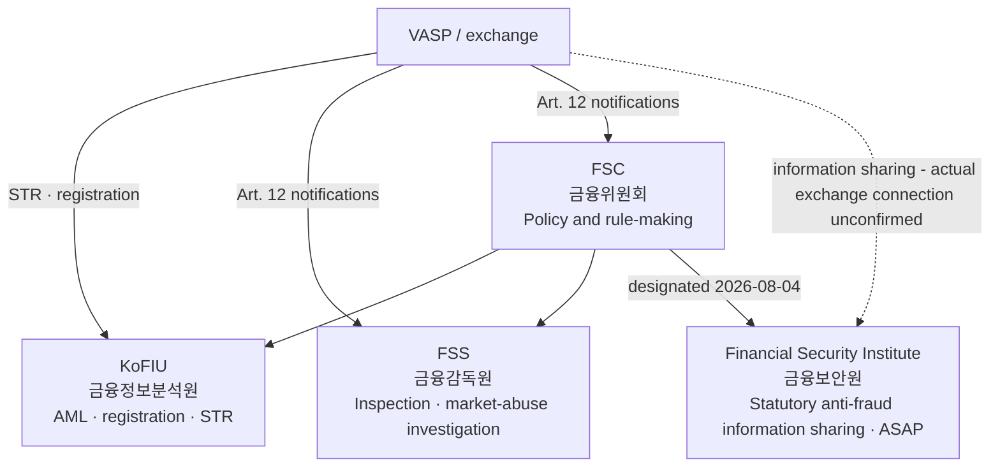
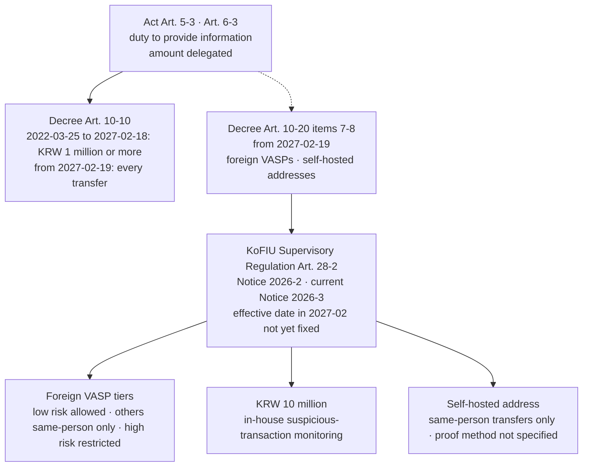
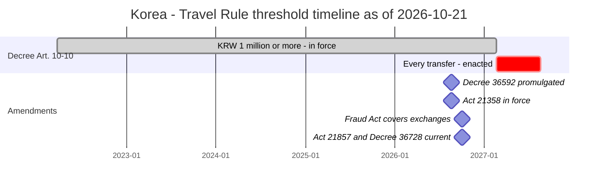

# Korean AML for Virtual Assets — Comprehensive Overview

> A map of how Korea regulates AML, market surveillance and fraud prevention for virtual asset service providers (VASPs), as of 2026-10-21. Written for international audiences evaluating Korean market entry or benchmarking against other jurisdictions. Last updated: 2026-10-21.

---

## TL;DR

- **Three statutes, three different "abnormal transaction" regimes**: the Specified Financial Information Act (특금법, AML/STR), the Virtual Asset User Protection Act (가상자산이용자보호법, user protection and **market surveillance under Art. 12**), and the Telecommunications Financial Fraud Act (통신사기피해환급법, **voice-phishing holds, binding on crypto exchanges from 2026-10-01**).
- **Regulators**: KoFIU for AML, FSC/FSS for user protection and market abuse, FSC (Financial Safety Division) and the Financial Security Institute for anti-fraud information sharing.
- **Travel Rule threshold**: **KRW 1,000,000 or more until 2027-02-18** (in force). **From 2027-02-19, every transfer to another VASP**, with no threshold (Presidential Decree No. 36592, promulgated 2026-08-18 — enacted, not yet in force).
- **New from 2027-02-19**: three-tier treatment of foreign VASPs, self-hosted addresses allowed only for same-person transfers, and an in-house suspicious-transaction monitoring system for transfers of KRW 10 million or more (not an automatic STR).
- **Current statute**: Act No. 21857 (in force 2026-10-02). The substantive registration amendment, Act No. 21358, took effect 2026-08-20 (major-shareholder review, conditional acceptance).
- Market-size, market-share and vendor-stack figures from earlier versions of this page were removed: no public primary source supports them.

---

## 1. Three Laws, Three Different Purposes

### 1.1 특금법 — Specified Financial Information Act (AML)

- Full Korean name: 특정 금융거래정보의 보고 및 이용 등에 관한 법률
- **Purpose**: AML and CFT.
- **Key provisions**:
  - Art. 4: suspicious transaction reports (STR)
  - Art. 5-2: customer due diligence
  - Art. 5-3 and Art. 6(3): information accompanying virtual asset transfers (Travel Rule) — the amount is **delegated to the Enforcement Decree**
  - Art. 7: VASP registration
- **Current version**: Act No. 21857 (promulgated 2026-08-04, in force 2026-10-02, consequential amendment). Preceded by Act No. 21358 (promulgated 2026-02-19, in force 2026-08-20) ([law.go.kr DRF](https://www.law.go.kr/DRF/lawSearch.do?OC=test&target=law&type=JSON&query=특정금융거래정보의보고및이용등에관한법률)).
- **Korean deep dive**: [`../notes/2-regulations/korea-fiu-act.md`](../notes/2-regulations/korea-fiu-act.md)

### 1.2 가상자산이용자보호법 — Virtual Asset User Protection Act

- **Enacted** as Act No. 19563 (2023-07-18), **in force 2024-07-19**. Current version Act No. 21857 (in force 2026-10-02).
- **Purpose**: segregation of user deposits and virtual assets, prohibition of unfair trading, market surveillance.
- **Key provisions**:
  - Art. 10: prohibition of insider trading, market manipulation, fraudulent trading, and trading in self-issued or related-party-issued assets
  - Art. 12: **continuous surveillance of abnormal trading** by exchange operators; notify the FSC and FSS when an Art. 10 violation is suspected, report to investigators when the suspicion is sufficiently proven
  - Art. 17: administrative penalty of up to 2x the gain (KRW 4 billion cap where the gain cannot be computed)
  - Art. 19: imprisonment of at least 1 year or a fine of 3-5x the gain
  - Art. 22(1)(6)-(7): administrative fine of up to KRW 100 million for breaching Art. 12
- Source: [law.go.kr — VAUPA current text](https://www.law.go.kr/LSW/lsInfoR.do?lsiSeq=290735&efYd=20261002&ancYnChk=0&chrClsCd=010202&urlMode=lsInfoR)
- **Korean deep dive**: [`../notes/2-regulations/korea-user-protection.md`](../notes/2-regulations/korea-user-protection.md)

### 1.3 통신사기피해환급법 — Telecommunications Financial Fraud Act

- Art. 2-5 requires "financial companies, etc." to run continuous self-checks and to **delay or suspend transfers, withdrawals or virtual asset transfers** from accounts presumed to be used for voice phishing (a "temporary measure").
- **Act No. 21503** (promulgated 2026-03-31) brought **crypto exchanges into the definition of "financial companies, etc." from 2026-10-01**, together with purpose-of-transaction checks (Art. 2-6), payment suspension (Art. 4) and victim refunds ([law.go.kr — current text](https://www.law.go.kr/LSW/lsInfoR.do?lsiSeq=290245&efYd=20261002&ancYnChk=0&chrClsCd=010202&urlMode=lsInfoR)).
- Act No. 21320 (in force 2026-08-04) created a statutory information-sharing body; the FSC designated the Financial Security Institute on 2026-08-04 ([FSC 2026-08-04](https://www.fsc.go.kr/no010101/87474)).

### Why three regimes matter

| | ① Fraud detection / voice-phishing hold | ② Market surveillance (VAUPA Art. 12) | ③ AML / KYT → STR |
|---|---|---|---|
| Legal basis | Fraud Act Arts. 2-5, 2-6, 4 (exchanges from 2026-10-01) | VAUPA Art. 12, Decree Art. 18, FSC Investigation Regulation Arts. 3-4 | 특금법 Art. 4, KoFIU AML Business Regulation Arts. 76-81 |
| Purpose | Protect users from account takeover and phishing | Detect manipulation and insider trading | Stop money laundering and terrorist financing |
| Output | Delay, suspension, payment stop, refund | Notification to FSC/FSS (investigators if proven), trading warnings, trading halts | STR, refusal, enhanced due diligence |
| Penalty for failure | Damages for failing to stop payment | Fine up to KRW 100 million | 특금법 fines and business suspension |

Source: [the canonical report in this repository](../reports/가상자산%20AML%20KYT%20FDS%20트래블룰%20흐름.md). Korean law uses three different terms: "의심되는 거래" (suspicious transaction, 특금법), "이상거래" (abnormal trading, VAUPA Art. 12) and "피해의심거래계좌등" (accounts suspected of fraud victimisation, Fraud Act). Translating STR as "abnormal transaction report" conflates them.

---

## 2. Regulators

- **FSC (Financial Services Commission, 금융위원회)**: policy body; drives statute and Enforcement Decree amendments and issues FSC notices such as the Virtual Asset Market Investigation Regulation.
- **KoFIU (Korea Financial Intelligence Unit, 금융정보분석원)**: accepts VASP registrations, receives STRs, inspects and sanctions; issues KoFIU notices such as the Supervisory Regulation (감독규정).
- **FSS (Financial Supervisory Service, 금융감독원)**: inspection trustee for KoFIU; investigates unfair trading under VAUPA through its Virtual Asset Investigation Department.
- **Financial Security Institute (금융보안원)**: launched the ASAP voice-phishing information-sharing platform on 2025-10-29 (about 130 participating financial companies, 90 data items in 9 categories). Crypto exchanges were listed as "to join in stages"; their actual connection as of 2026-10-21 is not confirmed ([FSC 2025-10-29](https://www.fsc.go.kr/no010101/85526); [FSC 2026-01-28](https://www.fsc.go.kr/no010101/86149)).
- **DAXA (Digital Asset eXchange Association)**: a voluntary association of KRW exchanges with no statutory power. It runs joint self-regulation such as listing standards and, with the FSC, the 2025-05 withdrawal-delay scheme strengthened on 2026-04-07 (B) ([FSC 2026-04-07](https://www.fsc.go.kr/po010102/86656)).

---

## 3. The Market — What Public Sources Say

The FSC/KoFIU H1-2026 survey (as of 2026-06-30, published 2026-10-01) covered **26 registered operators (17 exchanges and 9 wallet/custody providers)**. Of **KRW 62.8 trillion in total outflows, KRW 9.5 trillion (about 15%) was subject to the Travel Rule** — the coverage of a regime limited to transfers of KRW 1 million or more between domestic VASPs ([FSC 2026-10-01](https://www.fsc.go.kr/no010101/87835)).

Earlier versions of this page listed exchange market shares, bank partners and vendor stacks per exchange. None of these has a public primary source and they were removed. Exchanges named here are named only where a regulator's own release names them.

---

## 4. VASP Registration

Registration with KoFIU under Art. 7 is formally a "report" but works as a gate: KoFIU may refuse acceptance and, since Act No. 21358 (in force 2026-08-20), accept with conditions. Elements include ISMS certification, a real-name bank account arrangement for KRW trading, an AML internal control system, and fitness of executives and major shareholders.

What changed on 2026-08-20 ([FSC 2026-08-11](https://www.fsc.go.kr/no010101/87499); [FSC 2026-08-13](https://www.fsc.go.kr/no010101/87521)):

- **Major shareholders** now include shareholders that appointed the CEO or a majority of directors; if the largest shareholder is a company, its largest shareholder and representative are included.
- **Refusal grounds** include a debt ratio above 200% (user deposits excluded), damage to credit order within 3 years, and missing organisation, staff, facilities or internal controls. Existing operators get a **1-year grace period** for the debt-ratio and organisation/IT/internal-control requirements.
- The revised **registration manual** requires **at least 4 AML staff**, **domestic IT facilities** for unique identifiers and personal credit data (domestic cloud regions accepted), and **prior notice 30 days before** a change of major shareholder.

---

## 5. Travel Rule — The Delegation Chain and the 2027-02-19 Switch

The Act imposes the duty but sets no amount; the Enforcement Decree sets the scope; from 2027 the Decree delegates criteria and the KRW 10 million figure further down to a KoFIU notice.

| Item | Until 2027-02-18 (in force) | From 2027-02-19 (enacted, not in force) |
|---|---|---|
| Scope | Transfers to another VASP of **KRW 1,000,000 or more** — the amount gates the duty itself | **Every transfer** to another VASP |
| Data | Decree Art. 10-10 items (wording not re-checked here) | Name and address **with the transfer**; resident registration / passport / alien registration number **within 3 business days of a request** by KoFIU or the receiving VASP |
| Foreign VASPs | No statutory tiering | Low risk (FATF-compliant jurisdiction, equivalent AML, licensed) allowed; others **only where customer and counterparty are the same person**; FATF high-risk jurisdiction or unlicensed **restricted** |
| Self-hosted addresses | Exchange self-regulation | Restricted while risk is markedly high; otherwise **same-person only**; no proof method prescribed |
| Large transfers | — | **In-house suspicious-transaction monitoring system** for KRW 10 million or more |

Sources: [Decree, version effective 2026-08-20](https://www.law.go.kr/DRF/lawService.do?OC=test&target=eflaw&MST=288765&efYd=20260820&type=XML) · [Decree, version effective 2027-02-19](https://www.law.go.kr/DRF/lawService.do?OC=test&target=eflaw&MST=288765&efYd=20270219&type=XML) · [KoFIU Supervisory Regulation](https://www.law.go.kr/DRF/lawService.do?OC=test&target=admrul&ID=2100000285986&type=XML)

Three points that are often misreported:

1. **The switch date is 2027-02-19**, per the addenda ("six months after promulgation") and the law.go.kr effective-date index. Some press reports say 2027-02-20; this repository does not adopt that date.
2. **KRW 10 million is not an automatic STR.** The 2026-03-30 draft said transfers of KRW 10 million or more would be treated as suspicious regardless of risk ([FSC 2026-03-30](https://www.fsc.go.kr/no010101/86589)); the promulgated Decree requires an in-house monitoring system instead.
3. **Art. 28-2's own effective date is open.** The KoFIU notice also runs "six months after promulgation"; counted from its 2026-08-20 issue date it could fall on 2027-02-21, two days after the Decree.

Message standard: IVMS 101.2023 is the current interVASP version; there is no "IVMS101 v2" ([interVASP](https://intervasp.org/)). Domestic and global Travel Rule solution names, network sizes and "sunrise" percentages from earlier versions were removed — no public primary source.

---

## 6. KYT — Where the Legal Hook Is

"KYT" does not appear in FATF, MAS or Korean rules. The Korean hook is the KoFIU **AML Business Regulation** (Notice 2025-2, issued 2025-10-22, in force 2026-01-22), Arts. 76-81 "transaction monitoring system" — a regulation common to all financial institutions whose text does not mention virtual assets once ([law.go.kr](https://www.law.go.kr/DRF/lawService.do?OC=test&target=admrul&ID=2100000267264&type=XML)). From 2027-02-19 Decree Art. 10-20 item 7(b) adds the KRW 10 million monitoring duty for foreign-VASP and self-hosted counterparties.

For vendor landscape notes, see [`../notes/7-vendors/korea-solutions.md`](../notes/7-vendors/korea-solutions.md). Per-exchange vendor usage shares are not published.

---

## 7. Market Surveillance — VAUPA Art. 12 in Practice

- The FSC's 2024-07-08 framework: exchanges detect and review abnormal trading → notify FSC/FSS or report to investigators → case classification → investigation → Virtual Asset Investigation Deliberation Committee → five outcomes: criminal referral, notification to investigators, administrative penalty, warning, caution ([FSC 2024-07-08](https://www.fsc.go.kr/no010101/82625)).
- The 2024-08-22 on-site inspection found rule-based, in-house systems that flag when variables such as price increase rate or volume growth exceed thresholds, run by surveillance teams separate from listing functions ([FSC/FSS 2024-08-22](https://fsc.go.kr/po010101/82943)).
- Two-year results published 2026-07-20: about 40 investigations completed, about 30 referrals, 25 suspects, average unfair gain KRW 1.4 billion, 2 administrative penalties at 125-165% of the gain ([FSC 2026-07-20](https://fsc.go.kr/po010106/87357)). The number of exchange notifications is not published.

---

## 8. Enforcement Snapshot

- KoFIU announced total administrative fines of KRW 35.2 billion on Dunamu (Upbit) on 2025-11-06, for CDD, transaction-restriction and STR failures among others — **not for Travel Rule breaches** ([KoFIU release via KDI](https://eiec.kdi.re.kr/policy/materialView.do?num=273166)).
- No case in any jurisdiction between 2024-01-01 and 2026-10-21 was found that named a Travel Rule breach as a standalone sanction ground.
- On 2026-10-13 KoFIU reported 27 unregistered-operator websites blocked domestically, with 44 illegal operators referred to investigators in total ([FSC 2026-10-13](https://www.fsc.go.kr/no010101/87916)).

Inspection frequency and preparation-time figures from earlier versions were removed — no public source.

---

## 9. Key Dates (as of 2026-10-21)

| Date | Event | Status |
|---|---|---|
| 2022-03-25 | Travel Rule, KRW 1 million or more | in force until 2027-02-18 |
| 2024-07-19 | VAUPA in force (Art. 12 surveillance) | in force |
| 2026-02-19 | Act No. 21358 promulgated | — |
| 2026-08-18 | Presidential Decree No. 36592 promulgated | main body in force 2026-08-20 / Arts. 10-10, 10-20 enacted-not-in-force |
| 2026-08-20 | Act No. 21358 and KoFIU Notice 2026-2 in force | in force (Art. 28-2 deferred) |
| 2026-10-01 | Exchanges covered by the Fraud Act (Act No. 21503) | in force |
| 2026-10-02 | Act No. 21857, Decree No. 36728, KoFIU Notice 2026-3 become the current versions | in force |
| **2027-02-19** | **Travel Rule threshold abolished; foreign VASP / self-hosted rules** | enacted-not-in-force |
| 2027-02 (date open) | KoFIU Supervisory Regulation Art. 28-2 | enacted-not-in-force |

> The 180-day bar after 2027-02-19 is for display only and is not an end date.

---

## 10. Comparison to Other Jurisdictions

For a detailed comparison, see [`regulatory-comparison.md`](regulatory-comparison.md). On the Travel Rule specifically:

- **Korea** is a type-A regime (amount gates the duty) until 2027-02-18, then "every transfer + data on request".
- **EU** (TFR 2023/1113, EBA/GL/2024/11, applied 2024-12-30): all transfers regardless of amount; EUR 1,000 triggers assessment of self-hosted address ownership or control.
- **UK** (MLR 2017 Part 7A): enhanced-information threshold was 1,000 euros from 2023-09-01 and **£800 from 2026-06-30** (S.I. 2026/621).
- **Japan** (Act on Prevention of Transfer of Criminal Proceeds Art. 10-5, 2023-06-01): no amount condition; JPY 100,000 in the Order is a CDD trigger.

Sources: [the canonical report](../reports/가상자산%20AML%20KYT%20FDS%20트래블룰%20흐름.md).

---

## Further Reading (Korean)

- [`../notes/2-regulations/korea-fiu-act.md`](../notes/2-regulations/korea-fiu-act.md) — 특금법, delegation chain and the 2027-02-19 switch
- [`../notes/2-regulations/korea-user-protection.md`](../notes/2-regulations/korea-user-protection.md) — VAUPA Art. 12 and the three-way split with fraud detection and STR
- [`../notes/5-compliance/inspection-response.md`](../notes/5-compliance/inspection-response.md) — Inspection workbook
- [`../notes/7-vendors/korea-solutions.md`](../notes/7-vendors/korea-solutions.md) — Korean infrastructure providers
- [`../notes/glossary.md`](../notes/glossary.md) — Korean-English glossary

## External References

- [law.go.kr — 특금법 Enforcement Decree, version effective 2027-02-19](https://www.law.go.kr/DRF/lawService.do?OC=test&target=eflaw&MST=288765&efYd=20270219&type=XML)
- [law.go.kr — KoFIU Supervisory Regulation](https://www.law.go.kr/DRF/lawService.do?OC=test&target=admrul&ID=2100000285986&type=XML)
- [FSC — 2026-08-11 Cabinet approval of the Decree amendment](https://www.fsc.go.kr/no010101/87499)
- [FSC — 2026-03-13 Fraud Act amendment covering exchanges](https://www.fsc.go.kr/no010101/86446)
- [FSC official site](https://www.fsc.go.kr/)
