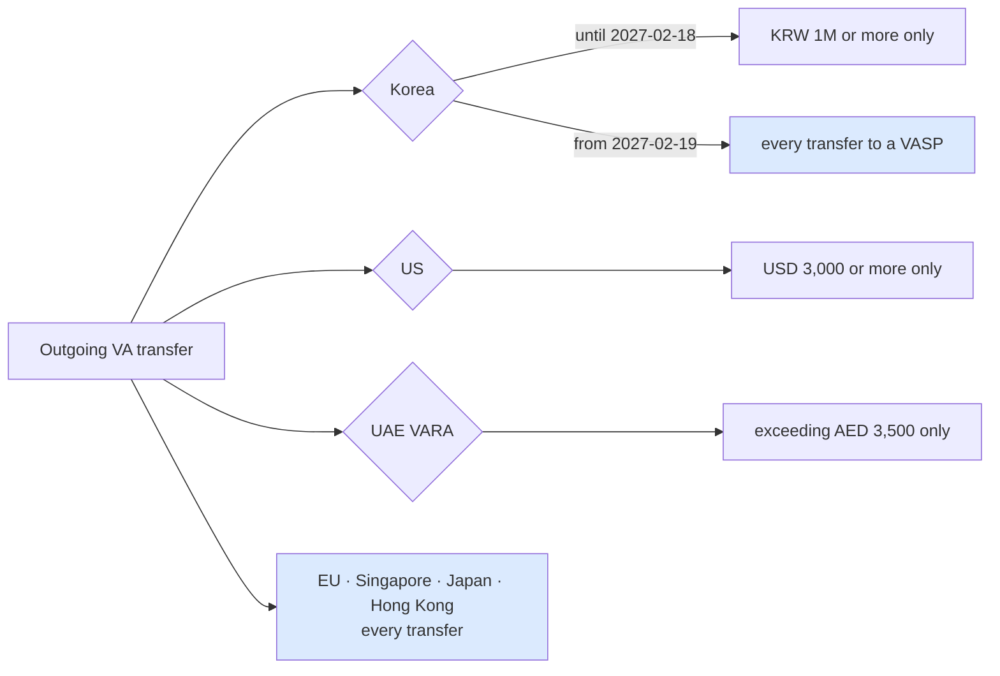
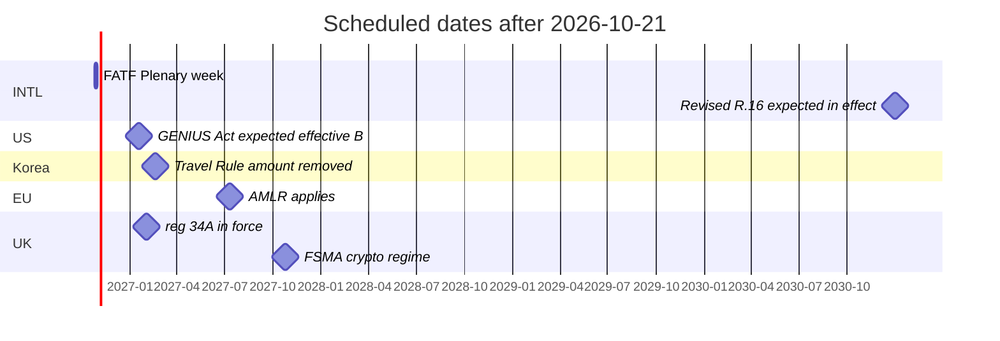

# Regulatory Comparison — Korea vs US vs EU vs Asia

> Cross-jurisdictional comparison of crypto AML regimes **as of 2026-10-21**. Korea (KR) versus the United States (US), the European Union (EU), and four Asia-Pacific / Middle East peers (Singapore, UAE-Dubai, Japan, Hong Kong). Based on the Korean deep notes in [`../notes/2-regulations/`](../notes/2-regulations/) and the canonical report [`../reports/가상자산 AML KYT FDS 트래블룰 흐름.md`](../reports/가상자산%20AML%20KYT%20FDS%20트래블룰%20흐름.md). Last updated: 2026-10-21.

Status vocabulary used throughout: **proposed / enacted-not-in-force / in-force / withdrawn**.

---

## 1. Side-by-Side Summary

| Dimension | Korea | United States | EU | Singapore | UAE (VARA, Dubai) | Japan | Hong Kong |
|---|---|---|---|---|---|---|---|
| **Primary AML basis** | Act on Reporting and Using Specified Financial Transaction Information (特金法) | Bank Secrecy Act (31 CFR Ch. X) | National AMLD laws + EBA guidelines today; AMLR (2024/1624) from 2027-07-10 | MAS Notice PSN02 | VARA Compliance & Risk Management Rulebook | Act on Prevention of Transfer of Criminal Proceeds (APTCP) | AMLO Cap. 615 |
| **AML supervisor** | KoFIU | FinCEN (+ OFAC for sanctions) | National FIUs/NCAs + **AMLA** (EBA's AML mandate moved to AMLA on 2026-01-01) | MAS | VARA | FSA | SFC (VATPs), HKMA (stablecoin issuers) |
| **Travel Rule — duty trigger** | **KRW 1,000,000 or more** until 2027-02-18; **every transfer to another VASP** from 2027-02-19 (enacted-not-in-force) | **USD 3,000 or more** | Every transfer | Every transfer | **Exceeding AED 3,500** | Every transfer | Every transfer |
| **Travel Rule — data-depth tier** | From 2027-02-19: additional data on request within 3 business days | — | (EUR 1,000 triggers a *separate* self-hosted-address ownership/control assessment) | Exceeds SGD 1,500 | — | None | Not less than HKD 8,000 |
| **Self-hosted wallets** | From 2027-02-19: transfers allowed only where customer and counterparty are the same person | No explicit rule (unhosted-wallet NPRM **withdrawn** 2026-10-06) | EBA GL ¶83: at least one verification method; whitelisting allowed | No dedicated clause in PSN02 ¶13 | ¶7: risk consideration duty | Primary text not obtained | Information collection and risk assessment (B) |
| **2026 key change** | Presidential Decree No. 36592 promulgated 2026-08-18 | Mixing §311 and unhosted-wallet NPRMs withdrawn (FR 2026-10-06); A7 special-measure NPRM proposed | AMLA submitted first 3 AMLR RTS to the Commission on 2026-10-01 | MAS stablecoin PSA amendment consultation 2026-09-01 to 10-16 (proposed, B) | Federal CMA framework widened from 3 to 8 activity categories, 2026-04 (B) | Bill moving crypto-assets into the FIEA passed 2026-07-15; commencement not yet set | 13 licensed VATPs (2026-10-16); 2 licensed stablecoin issuers (2026-04-10) |

Earlier versions of this table carried cold-storage percentages, maximum fines, licensing timelines and M&A review durations. None of those figures were verified against primary sources in this repository's 2026-10 dossiers, so they were removed.

See the Korean notes for full details: [`../notes/2-regulations/korea-fiu-act.md`](../notes/2-regulations/korea-fiu-act.md), [`us-bsa-fincen.md`](../notes/2-regulations/us-bsa-fincen.md), [`eu-mica-amlr.md`](../notes/2-regulations/eu-mica-amlr.md), [`asia-regs.md`](../notes/2-regulations/asia-regs.md), [`fatf.md`](../notes/2-regulations/fatf.md).

---

## 2. The International Baseline — FATF

- The legal source of the crypto Travel Rule is **INR.15 §7(b)** (adopted 2019-06), not the text of R.16. The 2021 RBA Guidance (para 178) says R.16 "applies in an amended way to VAs as set out in paragraph 7(b) of INR.15" ([FATF 2021 Guidance](https://www.fatf-gafi.org/content/dam/fatf-gafi/guidance/Updated-Guidance-VA-VASP.pdf.coredownload.pdf)).
- USD/EUR 1,000 is a **de minimis threshold countries may choose** (para 191–192); below it, names and wallet address (or transaction reference) are still collected.
- **R.16 was revised in 2025-06** ("Payment transparency"). VASPs are not brought directly into scope; changes reach them "indirectly through R.15" (Explanatory Note para 54). De minimis stays "no higher than USD/EUR 1,000" (para 33). Expected implementation: **end-2030** (para 59) ([Explanatory Note](https://www.fatf-gafi.org/content/dam/fatf-gafi/recommendations/Explanatory%20note%20for%20revised%20R.16.pdf.coredownload.pdf)).
- The draft R.16 implementation guidance was consulted on **2026-06-24 to 2026-08-21**; no final version had been published by 2026-10-21 (proposed, B).
- **7th Targeted Update (2026-07-16)**: 83% (91/109) of jurisdictions have Travel Rule legislation, but 60% (55/91) of those have taken no Travel Rule supervisory or enforcement action (para 25) ([7th TU PDF](https://www.fatf-gafi.org/content/dam/fatf-gafi/reports/7th-targeted-update-on-implementation-fatf-standards-vas-vasps-2026.pdf.coredownload.pdf)).
- Korea: the 2020 Mutual Evaluation rated R.15 **"C"** under the pre-2019 standard; the 7th TU marks Korea **"N/A"** under the revised standard.

---

## 3. Travel Rule — Thresholds and Architecture

Types: **A** = the duty itself carries an amount (no duty below it) · **B** = duty on every transfer, amount only widens the data set · **C** = no amount at all.

| Jurisdiction | Duty provision | Type | Amount and boundary wording | In force | Status (2026-10-21) |
|---|---|---|---|---|---|
| FATF | INR.15 §7(b) | C | none (USD/EUR 1,000 de minimis optional) | 2019-06 | in-force (soft law) |
| Korea (current) | Act §5-3, Decree §10-10(1) | **A** | KRW 1,000,000 "or more" | 2022-03-25 | in-force until 2027-02-18 |
| Korea (2027) | Decree §10-10, §10-20; KoFIU Rule §28-2 | every transfer + data on request | KRW 10M "or more" triggers an in-house suspicious-transaction monitoring system, **not** automatic STR | 2027-02-19 | enacted-not-in-force |
| United States | 31 CFR 1010.410(f) | **A** | USD 3,000 "or more" | — | in-force |
| EU | TFR Art 14, 16 | B′ | same data on every transfer; EUR 1,000 "amounts to or exceeds" triggers self-hosted assessment | 2024-12-30 | in-force |
| Singapore | PSN02 ¶13 | B | SGD 1,500 "exceeds" adds identity verification | 2024-04-04 (amended 2025-07-01) | in-force |
| UAE (VARA) | Rulebook III.G ¶2 | **A** | AED 3,500 "exceeding" | 2025-05-19 edition | in-force |
| Japan | APTCP Art 10-5 | C | none | 2023-06-01 | in-force |
| Hong Kong | AMLO Sch.2 s.13A | B | HKD 8,000 "not less than" | 2023-06-01 (immediacy from 2024-01-01, B) | in-force |

Sources: [Korea DRF scheduled version](https://www.law.go.kr/DRF/lawService.do?OC=test&target=eflaw&MST=288765&efYd=20270219&type=XML), [31 CFR 1010.410](https://www.law.cornell.edu/cfr/text/31/1010.410), [EBA/GL/2024/11](https://www.eba.europa.eu/sites/default/files/2024-07/6de6e9b9-0ed9-49cd-985d-c0834b5b4356/Travel%20Rule%20Guidelines.pdf), [MAS PSN02](https://www.mas.gov.sg/-/media/amld-amendments---30-june-2025/mas-notice-psn02-amendment--new.pdf), [VARA III.G](https://rulebooks.vara.ae/node/146), [e-Gov APTCP Art 10-5](https://laws.e-gov.go.jp/api/1/articles;lawId=419AC0000000022;article=10%E3%81%AE5), [Clyde & Co 2023-06-07](https://www.clydeco.com/en/insights/2023/06/hong-kong-virtual-assets-regulatory-update).

> **Reading note.** Earlier versions said "only Korea and the US gate the duty itself on an amount" and listed the UAE as "all transfers, USD 1,000 data tier". The VARA text is "exceeding AED 3,500" — a duty trigger, so the UAE belongs with Korea (current) and the US. From 2027-02-19 Korea leaves that group.
>
> The commonly cited **JPY 100,000 is not a Travel Rule figure** — it is the 特定取引 definition in Art. 7(1)(i) of the APTCP Enforcement Order, which triggers **CDD** ("十万円を超える", i.e. exceeding). **EUR 1,000** under the EU TFR governs a separate duty to assess ownership/control of a self-hosted address.
>
> An earlier observation that "the EU's AMLR will go to zero threshold for crypto transfers" mixed two instruments: the zero-threshold information duty is in the **TFR (applied since 2024-12-30)**; the AMLR (from 2027-07-10) brings, among other things, the Art. 79 ban on handling anonymity-enhancing coins.

For protocol details see [`../notes/4-technology/travel-rule-protocols.md`](../notes/4-technology/travel-rule-protocols.md).

---

## 4. Enforcement — What Is Actually Documented

- **No case sanctioning a Travel Rule breach as a stand-alone ground** was found in any jurisdiction between 2024-01-01 and 2026-10-21. The closest is FINTRAC's C$176,960,190 penalty on Xeltox (Cryptomus), 2025-10-22, where "Travel rule" appears as one item in a list of compliance-policy deficiencies ([FINTRAC](https://fintrac-canafe.canada.ca/pen/amps/pen-2025-10-22-eng)).
- **US**: FinCEN fined Paxful USD 3.5M on 2025-12-09 for MSB non-registration, AML programme failures and missing SARs — not Travel Rule ([FinCEN](https://www.fincen.gov/news/news-releases/fincen-assesses-35-million-penalty-against-paxful-facilitating-suspicious)). On 2025-10-14 OFAC designated Prince Group (146 targets) and FinCEN issued a §311 final rule on Huione Group ([Treasury sb0278](https://home.treasury.gov/news/press-releases/sb0278)).
- **US, 2026**: FinCEN withdrew the CVC-mixing §311 NPRM (88 FR 72701) and the unhosted-wallet NPRM (85 FR 83840) by notices published 2026-10-06 ([FR 2026-20429](https://public-inspection.federalregister.gov/2026-20429.pdf); [FR 2026-20430](https://public-inspection.federalregister.gov/2026-20430.pdf)), and proposed a special measure against A7 Network sub-agents under §9714 rather than §311 ([FR 2026-20371](https://public-inspection.federalregister.gov/2026-20371.pdf)). OFAC designated Iranian exchange BitBank on 2026-09-17 ([OFAC](https://ofac.treasury.gov/recent-actions/20260917)).
- **Korea**: KoFIU's KRW 35.2bn fine on Dunamu (2025-11-06) was for CDD, transaction-restriction and STR failures; the Travel Rule article (§5-3) was not among the grounds.
- **UK**: FCA's 2026 fines list (17 items to 2026-09-30) contains no MLR Part 7A breach ([FCA](https://www.fca.org.uk/news/news-stories/2026-fines)).

Earlier versions of this section cited penalty amounts for Binance and OKX. Those figures were not re-verified in this repository's 2026-10 sources and were removed; see [`../notes/6-cases/major-enforcement.md`](../notes/6-cases/major-enforcement.md).

---

## 5. Licensing and Registers — Public Data Points

| Jurisdiction | Public register / data point (as of) |
|---|---|
| EU | ESMA interim CASP register: 379 rows, 376 distinct LEIs (2026-10-19) ([CSV](https://www.esma.europa.eu/sites/default/files/2024-12/CASPS.csv)) |
| Hong Kong | SFC: 13 licensed VATPs (2026-10-16); HKMA: 2 licensed stablecoin issuers (2026-04-10) |
| UK | FSMA crypto authorisation application window 2026-09-30 to 2027-02-28; new regime expected 2027-10-25 ([FCA](https://www.fca.org.uk/firms/cryptoassets-information)) |
| FATF-wide | 73% (95/130) of jurisdictions require licensing/registration; 58% (76/130) have actually licensed or registered a VASP (7th TU para 18) |

Typical licensing timelines, surety-bond costs and rejection rates quoted in earlier versions had no verified public source and were removed.

---

## 6. Key Dates After 2026-10-21

The October 2026 FATF Plenary (2026-10-26 to 30, Paris) had not taken place on 2026-10-21, so the grey list in effect is the **2026-06-19** version ([FATF calendar](https://www.fatf-gafi.org/en/calendars/events.html); [June 2026 outcomes](https://www.fatf-gafi.org/en/publications/Fatfgeneral/outcomes-fatf-plenary-june-2026.html)).

---

## 7. Observations for International Readers

1. **Korea's "abnormal transaction" is three different legal regimes.** Electronic-finance FDS and voice-phishing temporary measures (a statutory duty for crypto exchanges since 2026-10-01), market surveillance under the Virtual Asset User Protection Act Art. 12, and STR under the 特金法. Each has a different legal output: delay/suspension, notification to FSC/FSS, or STR.
2. **Korea's legal basis for transaction monitoring is a cross-sector rule.** KoFIU Notice No. 2025-2 (in force 2026-01-22) Arts. 76–81 define the "transaction monitoring system" without using the word "virtual asset" once.
3. **"KYT" is industry vocabulary.** It does not appear in FATF, MAS or Korean regulatory texts; FATF says "ongoing monitoring" and, since 2026-07-16, "transactions monitoring and blockchain analytics tools".
4. **2027 Q1 is crowded.** Expected US GENIUS effectiveness (2027-01-18, B), UK reg 34A (2027-02-01), Korea's Travel Rule change (2027-02-19), Thailand's compliance deadline (2027-02-27, B).

---

## Further Reading

- Korean overview: [`korea-aml-overview.md`](korea-aml-overview.md)
- Korean inspection workbook summary: [`inspection-response-summary.md`](inspection-response-summary.md)
- Korean FIU Act deep note: [`../notes/2-regulations/korea-fiu-act.md`](../notes/2-regulations/korea-fiu-act.md)
- US BSA and FinCEN: [`../notes/2-regulations/us-bsa-fincen.md`](../notes/2-regulations/us-bsa-fincen.md)
- EU MiCA and AMLR: [`../notes/2-regulations/eu-mica-amlr.md`](../notes/2-regulations/eu-mica-amlr.md)
- Asia-Pacific regulations: [`../notes/2-regulations/asia-regs.md`](../notes/2-regulations/asia-regs.md)
- FATF standards: [`../notes/2-regulations/fatf.md`](../notes/2-regulations/fatf.md)
