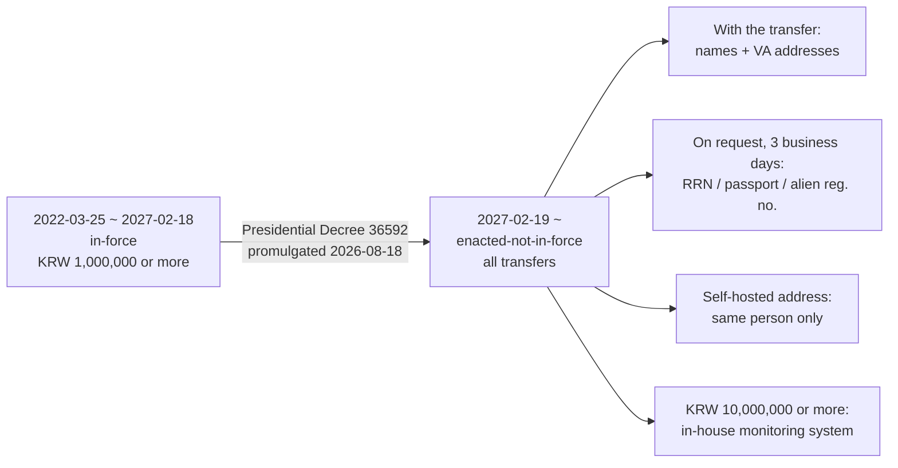
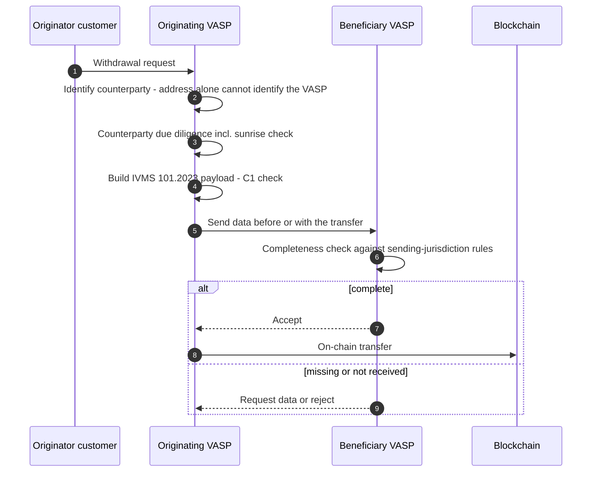
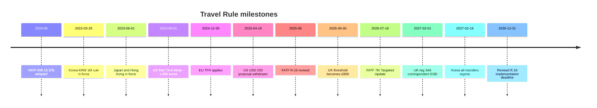

# Travel Rule — Korean VASP Perspective

> How the Travel Rule works for Korean VASPs, read against the FATF standard and other jurisdictions. Covers the legal basis under the Act on Reporting and Using Specified Financial Transaction Information (Tukgeumbeop), the KRW 1,000,000 threshold that applies until 2027-02-18 and the all-transfers regime from 2027-02-19, the IVMS 101.2023 data model, protocol facts, and the sunrise problem. Derived from the Korean source notes in [`../notes/3-crypto-aml/travel-rule.md`](../notes/3-crypto-aml/travel-rule.md), [`../notes/4-technology/travel-rule-protocols.md`](../notes/4-technology/travel-rule-protocols.md), and [`../notes/2-regulations/korea-fiu-act.md`](../notes/2-regulations/korea-fiu-act.md). Last updated: 2026-10-21.

## TL;DR

- **FATF basis**: INR.15 §7(b) (adopted 2019-06). No amount threshold. The 2025-06 revision of R.16 applies to VASPs only **indirectly through R.15**; implementation is expected by end-2030.
- **Korea, until 2027-02-18 (in-force)**: information must accompany transfers to another VASP of **KRW 1,000,000 or more** (Enforcement Decree §10-10 item 1).
- **Korea, from 2027-02-19 (enacted-not-in-force)**: **every** transfer to another VASP. Name and VA address go with the transfer; resident registration number etc. only **on request, within 3 business days**. Self-hosted addresses and "other" foreign VASPs: **same-person transfers only**. Transfers of KRW 10,000,000 or more: an in-house suspicious-transaction monitoring system (not automatic STR). Presidential Decree No. 36592, promulgated 2026-08-18.
- **Data model**: **IVMS 101.2023** (published 2023-08). There is no "IVMS101 v2".
- **No public benchmarks** exist for sunrise rates, latency, SLA, or error distribution. Figures in earlier versions of this handbook had no source and were removed.

---

## 1. Legal Basis — Tukgeumbeop §5-3

- Statute: Tukgeumbeop §5-3 (information provision on VA transfers), delegating to Enforcement Decree §10-10
- Current law version: Act No. 21857 (promulgated 2026-08-04, in force 2026-10-02)
- First effective: 2022-03-25

### Two regimes on one timeline



Sources: [Decree, current version](https://www.law.go.kr/DRF/lawService.do?OC=test&target=eflaw&MST=288765&efYd=20260820&type=XML), [Decree, version effective 2027-02-19](https://www.law.go.kr/DRF/lawService.do?OC=test&target=eflaw&MST=288765&efYd=20270219&type=XML), [FIU Supervisory Regulation No. 2026-2](https://www.law.go.kr/DRF/lawService.do?OC=test&target=admrul&ID=2100000285986&type=XML), [FSC 2026-08-11](https://www.fsc.go.kr/no010101/87499).

The effective date 2027-02-19 is the Ministry of Government Legislation index value ("6 months after promulgation" counted from 2026-08-18). Press reports of 2027-02-20 appear to assume a 2026-08-19 promulgation. The supervisory regulation's §28-2 may start on 2027-02-21 depending on how its own "6 months after promulgation" is counted — not yet confirmed.

### What changes on 2027-02-19

| Item | Until 2027-02-18 | From 2027-02-19 |
|---|---|---|
| Scope | Transfers of KRW 1M or more to another VASP | **All** transfers to another VASP |
| Sent with the transfer | — | Names (legal persons: name + representative), VA addresses |
| On request | — | Originator RRN / corporate reg. no. / passport / alien reg. no., within 3 business days of a request from the FIU or the receiving VASP |
| Foreign VASPs | Not regulated by decree | Low risk (FATF-compliant country, equivalent AML, licensed) allowed; otherwise **same person only**; FATF high-risk country or unlicensed restricted |
| Self-hosted addresses | Not regulated (exchange self-policy) | **Same person only**; restricted where risk is markedly high. No verification method prescribed |
| KRW 10M or more | — | In-house suspicious-transaction monitoring system (Decree §10-20 ⑦(b), Regulation §28-2③) |

The pre-legislative draft (2026-03-30) proposed treating KRW 10M+ transfers to foreign VASPs or personal wallets as suspicious "regardless of risk" and reporting them to the FIU. The promulgated text replaced this with the in-house monitoring requirement ([FSC 2026-03-30](https://www.fsc.go.kr/no010101/86589)).

### Coverage baseline

In the FSC's 2026 first-half survey, of KRW 62.8 trillion in total outbound transfers, **KRW 9.5 trillion (about 15%)** was covered by the Travel Rule ([FSC 2026-10-01](https://www.fsc.go.kr/no010101/87835)).

### Enforcement reality

No case between 2024-01-01 and 2026-10-21 in any jurisdiction cited a Travel Rule breach as a standalone sanction ground. In Korea, the FIU's KRW 35.2 billion fine on Dunamu (decided 2025-11-06) was for CDD, transaction-restriction and STR breaches — not Tukgeumbeop §5-3 ([FIU release, KDI mirror](https://eiec.kdi.re.kr/policy/materialView.do?num=273166)). Sanction amounts by violation type are set by statute; earlier versions of this handbook listed ranges without a source, so they were removed.

---

## 2. Amount Structures Across Jurisdictions

**Never put "the threshold" in one cell.** The obligation provision and the amount provision are often different, and the amount does different jobs.

- **Type A** — the amount triggers the obligation itself (below it, no Travel Rule duty): US, Korea until 2027-02-18, UAE (VARA).
- **Type B** — the duty applies to all transfers; the amount only deepens the information (or adds identity verification): UK, Singapore, Hong Kong, Indonesia. The EU is **B′** — same information for all transfers; EUR 1,000 triggers only the self-hosted ownership assessment.
- **Type C** — no amount at all: FATF, Japan, Switzerland, Canada, Brazil.

| Jurisdiction | Obligation provision | Amount provision | Amount (boundary wording) | What the amount does | Valid from ~ to | Status (2026-10-21) |
|---|---|---|---|---|---|---|
| FATF | INR.15 §7(b) | — (USD/EUR 1,000 in §7(a) is CDD) | none | — | 2019-06 ~ | in-force (soft law) |
| Korea ① | Tukgeumbeop §5-3, Decree §10-10 item 1 | same item | KRW 1,000,000 or more | **triggers duty (A)** | 2022-03-25 ~ 2027-02-18 | in-force |
| Korea ② | Decree §10-10 item 1 "all cases" | item 3 (on request); §10-20 ⑦(b) + Reg. §28-2③ | KRW 10,000,000 or more for monitoring | request-based extra data; monitoring trigger | 2027-02-19 ~ | enacted-not-in-force |
| EU | TFR Art 14(1), Art 16 | Art 14(5), 16(2) | EUR 1,000 "amounts to or exceeds" | self-hosted ownership assessment (B′) | 2024-12-30 ~ | in-force |
| UK ① | MLR 2017 reg 64C(1) | reg 64C(4) "1,000 euros" | "equal to or exceeds", linked transfers aggregated | deeper information (B) | 2023-09-01 ~ 2026-06-29 | ended by amendment |
| UK ② | MLR 2017 reg 64C(1) | reg 64C(4) "£800" (S.I. 2026/621 reg 32) | "equal to or exceeds", linked transfers aggregated | deeper information (B) | 2026-06-30 ~ | in-force |
| US | 31 CFR 1010.410(f) | same | USD 3,000 "or more" | **triggers duty (A)** | — | in-force |
| Japan | APTCP Art. 10-5 | none (JPY 100,000 "exceeding" is a CDD trigger) | none | — (C) | 2023-06-01 ~ | in-force |
| Singapore | PSN02 ¶13.3–13.11 | ¶13.4 / ¶13.6 | S$1,500 "below or equal to" / "exceeds" | deeper information + identity verification (B) | 2024-04-04 ~ (amended 2025-07-01) | in-force |
| Hong Kong | AMLO Sch.2 s.13A(1),(4) | s.13A(2),(3) | HK$8,000 "not less than" | deeper information (B) | 2023-06-01 ~ (B; immediate transmission from 2024-01-01) | in-force |
| Australia | AML/CTF Act s 66A(3) | delegated to AML/CTF Rules — amount unconfirmed | none in the Act | C (Act) | commencement date conflicts between sources | in-force |

Sources: [legislation.gov.uk reg 64C (2023-09-01)](https://www.legislation.gov.uk/uksi/2017/692/regulation/64C/2023-09-01), [S.I. 2026/621](https://www.legislation.gov.uk/uksi/2026/621/made), [EBA/GL/2024/11](https://www.eba.europa.eu/sites/default/files/2024-07/6de6e9b9-0ed9-49cd-985d-c0834b5b4356/Travel%20Rule%20Guidelines.pdf), [Cornell LII 31 CFR 1010.410](https://www.law.cornell.edu/cfr/text/31/1010.410), [e-Gov API](https://laws.e-gov.go.jp/api/1/articles;lawId=419AC0000000022;article=10%E3%81%AE5), [MAS PSN02](https://www.mas.gov.sg/-/media/amld-amendments---30-june-2025/mas-notice-psn02-amendment--new.pdf), [Clyde & Co 2023-06-07](https://www.clydeco.com/en/insights/2023/06/hong-kong-virtual-assets-regulatory-update) (B).

**US: no change.** The proposal to cut the threshold from USD 3,000 to USD 250 (RIN 1506-AB41) was **withdrawn on 2025-04-16** ([reginfo](https://www.reginfo.gov/public/do/eAgendaViewRule?pubId=202504&RIN=1506-AB41)). The pending amendment to 1010.410 (89 FR 72274, delayed to 2028-01-01) edits the (e)(6) exclusion list for investment advisers and does not touch the VA Travel Rule. No "USD 1,000 proposal" could be found. Treasury's March 2026 report to Congress (footnote 63) confirms that a transmittal of funds of USD 3,000 or more may trigger requirements on a DASP ([Treasury report](https://home.treasury.gov/system/files/246/GENIUS-Act-Illicit-Finance-Innovation-Congressional-Report-March-2026.pdf)).

**Hong Kong date**: the oft-quoted "2024-06-01" is not a Travel Rule date. The regime started 2023-06-01, with "as soon as practicable" transmission accepted until 2024-01-01; 2024-06-01 appears to be confused with the end of the 12-month transition for existing SFO-licensed platforms (B).

---

## 3. IVMS 101.2023 — Data Model and Field Rules

### What it is

- **IVMS 101.2023, interVASP data model standard, Issue 1 FINAL** (published August 2023). The 2020-05 original came from the JWG; the 2023 edition is maintained by the interVASP Standards Working Group (ISWG), formed 2023-04 by GDF, OpenVASP and VASPnet. ISWG announced an update on 2024-06-04 ([interVASP](https://intervasp.org/)).
- The standard document **does not include a JSON/XML schema** — schemas are maintained by implementations.
- It formalizes PayloadVersionCode (`101` / `101.2023`), LEI constraints C9–C11, address type GEOG, and constraint **C1** ([IVMS 101.2023 PDF](https://cdn.jsdelivr.net/npm/ivms101@2.0.0/specs/ivms101-2023.pdf)).

> C1: "If the originator is a NaturalPerson either (geographicAddress with an addressType value of 'GEOG' or 'HOME' or 'BIZZ') and/or customerIdentification and/or nationalIdentification and/or dateAndPlaceOfBirth is required."

### Field rules by jurisdiction — follow the wording

| Jurisdiction | Originator fields (summary) |
|---|---|
| Korea from 2027-02-19 | With transfer: names, VA addresses. On request (3 business days): RRN / corporate reg. no. / passport / alien reg. no. |
| EU (TFR Art 14(1)) | Name, DLT address, account number, **address or date and place of birth**, LEI etc. No amount simplification |
| UK (reg 64C(5),(6)) | (5) names, account no. or unique transaction ID; (6) for individuals **one of** customer ID / address / ID document no. / DOB + place of birth — at or above the (4) amount |
| Singapore (PSN02 ¶13.4, ¶13.6) | ≤ S$1,500: four items; > S$1,500: identity verification + **one of** address / unique ID / DOB |
| US (31 CFR 1010.410(f)) | USD 3,000+: name, account no., address, amount, execution date, recipient's institution |

### Corrections from earlier versions

- "EU requires date and place of birth" — **wrong**. TFR Art 14(1) is address **or** date and place of birth. A validator that rejects an EU message with an address but no DOB rejects a lawful message.
- "Korean national IDs must be SHA-256 hashed" and "names must be Hangul + Latin" — **no legal source found**. The 2027 decree provides for disclosing identification numbers on request; it does not prescribe hashing or bilingual names.
- "DateAndPlaceOfBirth is optional" — under C1 it is one of four fields of which **at least one** is required.

### Validator sketch

```python
from datetime import date

DEPTH_THRESHOLDS = {  # valid_to = last valid day (inclusive)
    "GB": [
        {"amount": 1000, "currency": "EUR", "from": date(2023, 9, 1), "to": date(2026, 6, 29)},
        {"amount": 800,  "currency": "GBP", "from": date(2026, 6, 30), "to": None},
    ],
}

RULES = {
    "EU": {"required": ["originator.name", "originator.accountNumber",
                        "beneficiary.name", "beneficiary.accountNumber"],
           "one_of": [["originator.geographicAddress", "originator.dateAndPlaceOfBirth"]]},
    "KR_2027": {"required": ["originator.name", "originator.accountNumber",
                             "beneficiary.name", "beneficiary.accountNumber"],
                "on_request": ["originator.nationalIdentification"]},
}

C1_ANY_OF = ["originator.geographicAddress", "originator.customerIdentification",
             "originator.nationalIdentification", "originator.dateAndPlaceOfBirth"]

def validate(msg: dict, jurisdiction: str, transfer_date: date) -> list[str]:
    errors = [f"missing {p}" for p in RULES[jurisdiction].get("required", [])
              if not get_nested(msg, p)]
    for group in RULES[jurisdiction].get("one_of", []):
        if not any(get_nested(msg, p) for p in group):
            errors.append(f"need one of {group}")
    if is_natural_person(msg, "originator") and not any(get_nested(msg, p) for p in C1_ANY_OF):
        errors.append("IVMS 101.2023 C1 violated")
    # amount tiers are evaluated at the transfer date, never with today's value
    return errors
```

Error-share tables ("35% jurisdictional mismatch, 22% romanization…") in earlier versions had no public source and were removed. No public statistics on rejection or field-missing rates exist as of 2026-10-21.

---

## 4. Protocols and Networks — Public Facts Only

No ranking, pricing or coverage claims. Vendor self-descriptions are marked (B).

- **TRP** — managed by the OpenVASP Association (Zug). "Bilateral exchange of encrypted data (VASP-to-VASP). No data or metadata is ever exchanged with any third party." Compatible with ISO 24165 (DTI) and IVMS101 ([OpenVASP TRP](https://www.openvasp.org/trp)). The old description "OpenVASP = Ethereum/ENS/Whisper" is a pre-2020 design.
- **TRISA** — gRPC/protobuf open-source protocol with a Global Directory Service; the open-source Envoy node supports both TRISA and TRP (B) ([trisa.dev](https://trisa.dev/)).
- **GTR** — operated by **Infozone Technologies Pte. Ltd. (Singapore)** ([GTR](https://www.globaltravelrule.com/)). The old "BitGo-led consortium" description had no source.
- **CODE** — operated by CODE Inc.; its site lists interoperability with CodeVASP, VerifyVASP, GTR, Sumsub, Sygna, Notabene and CryptoSwift (B) ([CODE](https://www.codevasp.com/)).
- **VerifyVASP** — site shows TravelRule API, VerifyName API and VerifyWallet; the operator is not named on the site (B) ([VerifyVASP](https://www.verifyvasp.com/)).
- **Sumsub** — lists five protocols: its own, GTR, CODE, TRP, Sygna (B) ([Sumsub](https://sumsub.com/protocols/)).
- **Notabene** — states "Every Notabene customer has a live TRP 1.0 endpoint" (B) ([Notabene TRP](https://notabene.id/travel-rule-messaging-protocols/trp)).

Ownership structures of the Korean networks, their interconnection dates, network sizes and latencies were not confirmed from primary sources and are not repeated here.

### Message flow



Basis: no post-facto submission (FATF 2021 guidance para 185, 187); address alone cannot identify the VASP (para 197(a)); IVMS 101.2023 C1; beneficiary-side detection and execute/reject/suspend policy (PSN02 ¶13.12, ¶13.14).

---

## 5. Sunrise Issue

When a counterparty cannot receive Travel Rule data, the norms allow different responses:

| Basis | What it allows or requires |
|---|---|
| FATF 2021 guidance para 200–201 | Require compliance by contract/business practice; restrict to internal or verified first-party transfers |
| UK FCA statement (2023-08-17) | When sending to a non-implementing jurisdiction, check whether the recipient can receive data; if not, collect, verify and retain the data and then transfer. Decide risk-based on incoming transfers with missing data ([FCA](https://www.fca.org.uk/news/statements/fca-sets-out-expectations-uk-cryptoasset-businesses-complying-travel-rule)) |
| UK reg 64C(9), Singapore PSN02 ¶13.11 | Do not make or execute the transfer until compliant |
| EU EBA GL §4.5, §4.7 | Treat as a high-risk factor; report institutions that repeatedly fail within 3 months of identification |
| Korea from 2027-02-19 | The counterparty's Travel Rule compliance is a condition for "low risk" (Reg. §28-2②) — sunrise handling becomes an allow/deny rule |

```python
def handle_sunrise(msg, target_vasp: str, policy: str):
    discovered = await discover_vasp(target_vasp)
    if discovered:
        return await send_tr(msg, discovered)
    if policy == "HOLD":                 # hold period is a firm policy, not set by law
        await queue.delay(msg, target_vasp)
        return Status.PENDING
    if policy == "COLLECT_AND_RECORD":   # e.g. FCA 2023-08-17 approach
        await audit_log.record(msg, reason="sunrise_counterparty")
        return Status.SENT_WITH_RECORD
    return Status.REJECTED               # e.g. UK reg 64C(9), SG ¶13.11
```

Earlier versions cited a "5–15% sunrise share", production SLAs and specific exchange anecdotes. None had a public source; they were removed.

---

## 6. FATF 2025–2026

- **R.16 revised at the 2025-06 Plenary**. Explanatory note para 54: "FATF has agreed not to bring VASPs directly into the scope of R.16 but to apply the updated requirements indirectly through R.15". De minimis stays "no higher than USD/EUR 1,000" (para 33). Expected implementation by end-2030 (para 59) — an implementation deadline, not an "effective date" ([R.16 explanatory note](https://www.fatf-gafi.org/content/dam/fatf-gafi/recommendations/Explanatory%20note%20for%20revised%20R.16.pdf.coredownload.pdf)).
- **R.16 implementation guidance draft** — public consultation 2026-06-24 to 2026-08-21; no final version as of 2026-10-21 (proposed, B) ([FIAU Malta](https://fiaumalta.org/news/latest-updates-from-the-fatf/)).
- **7th Targeted Update (2026-07-16)** — 83% (91/109) of surveyed jurisdictions have Travel Rule legislation; 60% (55/91) of those took no supervisory or enforcement action. First FATF recommendation that VASPs use "transactions monitoring and blockchain analytics tools" to detect rapid transfers ([7th TU PDF](https://www.fatf-gafi.org/content/dam/fatf-gafi/reports/7th-targeted-update-on-implementation-fatf-standards-vas-vasps-2026.pdf.coredownload.pdf)).
- Earlier claims that the revision "standardizes messaging identifiers" or creates "a separate tailored framework for VASPs" could not be confirmed from primary text and were removed.



---

## 7. Self-hosted Wallets

Until 2027-02-18, external-wallet registration at Korean exchanges is a self-regulatory practice (DAXA), not a statutory duty. **From 2027-02-19 it becomes a regulatory duty**: Decree §10-20 item 8 and Regulation §28-2④ allow transfers to an address over which the VASP has no exclusive control only when **the customer and the counterparty are the same person**. The regulation does **not** prescribe how ownership is proven.

Other jurisdictions differ completely:

| Jurisdiction | Rule |
|---|---|
| EU | EUR 1,000 or more: assess ownership/control using **at least one** of remote onboarding verification, a predefined small transfer (Satoshi test), message signing, or other technical means; whitelisting allowed (EBA GL ¶83, ¶86) |
| Switzerland | Allowed only if the institution's own customer's ownership is proven by "suitable technical means" (FINMA 02/2019) |
| UK | No ownership-proof duty; may request missing data and "must not make the cryptoasset available to the beneficiary" if not received ([reg 64G](https://www.legislation.gov.uk/uksi/2017/692/regulation/64G)) |
| US | No specific rule |

---

## 8. Checklist for a Korean VASP

```
[ ] Store every amount rule with its validity period (UK EUR→GBP, Korea KRW 1M→all)
[ ] Remove the KRW 1M gate on 2027-02-19; add a 3-business-day request-response queue
[ ] Counterparty VASP assessment records for Reg. §28-2 grading
[ ] Same-person evidence process for self-hosted addresses (method not prescribed)
[ ] In-house monitoring for transfers of KRW 10M or more
[ ] IVMS 101.2023 validation (PayloadVersionCode, C1, LEI constraints)
[ ] Sunrise policy with the legal basis for each option
[ ] Retention period confirmed from each jurisdiction's record-keeping provision
[ ] Cross-border personal data basis (EU: GDPR Chapter V)
[ ] Watch: FATF R.16 guidance final, 2026-10-26~30 Plenary
```

---

## Further Reading

- [`../notes/3-crypto-aml/travel-rule.md`](../notes/3-crypto-aml/travel-rule.md) — concept, jurisdiction comparison, operational flow (Korean)
- [`../notes/4-technology/travel-rule-protocols.md`](../notes/4-technology/travel-rule-protocols.md) — IVMS 101.2023 and protocol details (Korean)
- [`../notes/2-regulations/korea-fiu-act.md`](../notes/2-regulations/korea-fiu-act.md) §5 — legal basis (Korean)
- [`../notes/7-vendors/travel-rule-vendors.md`](../notes/7-vendors/travel-rule-vendors.md) — vendor public facts (Korean)
- [`../research/2026-10-travel-rule.md`](../research/2026-10-travel-rule.md) — source dossier with confidence ratings
- [FATF 2021 RBA Guidance](https://www.fatf-gafi.org/content/dam/fatf-gafi/guidance/Updated-Guidance-VA-VASP.pdf.coredownload.pdf)
- [EBA Travel Rule Guidelines](https://www.eba.europa.eu/sites/default/files/2024-07/6de6e9b9-0ed9-49cd-985d-c0834b5b4356/Travel%20Rule%20Guidelines.pdf)
- [interVASP — IVMS 101.2023](https://intervasp.org/)
