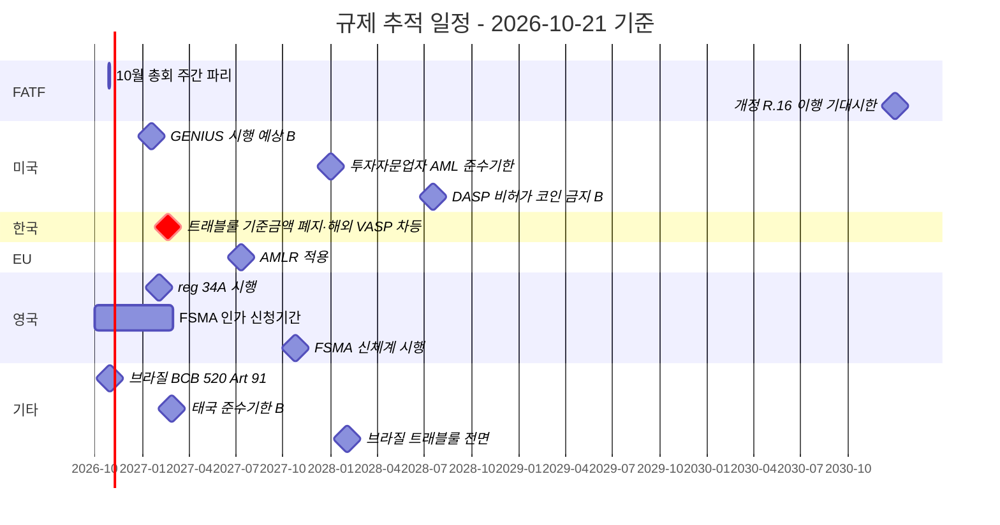

# Regulatory Watch — 규제 변화 추적 시스템

> AML·가상자산 규제는 분기별로 바뀐다. 이 저장소는 **자동·반자동 추적 체계**로 stale 콘텐츠를 방지한다. 마지막 갱신: 2026-10-21 (추적 일정 §0 갱신; 배포 상태 목록은 2026-04-23 점검 기준).

## 배포 상태 (2026-04-23 기준)

- [x] **`ingest/legacy/regulatory_rss.py`** — 13개 피드 수집, 키워드 필터, JSON+Markdown 출력
- [x] **GitHub Actions 자동화** — `.github/workflows/regulatory-watch.yml`, 매주 월요일 UTC 00:00 (KST 09:00) 실행
- [x] **자동 Issue 생성** — 변화 감지 시 `regulatory-update` · `automated` 라벨로 Issue
- [x] **수동 실행 지원** — `workflow_dispatch` 트리거로 on-demand 실행
- [x] **산출물 보관** — GitHub Actions artifacts 90 일 (`regulatory-changes.json`, `.md`)
- [x] **검증 CI** — `.github/workflows/validate.yml` 로 링크·Mermaid PR 자동 검증
- [ ] **한국 기관 RSS** — FSC/KoFIU/FSS 공식 RSS 미제공 → 웹 스크레이핑 별도 이슈

## TL;DR

- **추적 대상**: FATF · 한국 (FSC·KoFIU·FSS·DAXA) · 미국 (FinCEN·OFAC·SEC) · EU (AMLA·ESMA) · 아시아 (MAS·VARA·FSA·SFC)
- **추적 방법**: RSS·email subscription·웹 모니터링·분기 수동 리뷰
- **반영 주기**: Major 변화 1주 내 / Minor 변화 분기별
- **검증**: 모든 콘텐츠는 1차 자료 링크 보유 → 깨진 링크는 `validate_links.py` 자동 탐지
- **2026-10-21 기준 가장 가까운 확인 대상**: FATF 총회(2026-10-26~30) 성과문 — 회색명단 갱신, 개정 R.16 이행 가이던스 최종본 여부

---

## 0. 추적 일정 — 2026-10-21 기준

> 근거는 정본 보고서 [`reports/가상자산 AML KYT FDS 트래블룰 흐름.md`](../../reports/가상자산%20AML%20KYT%20FDS%20트래블룰%20흐름.md) "2026-10-22 이후" 절과 `research/2026-10-*.md` 도시에. (B)는 2차 출처 기준이라 1차 확인이 필요한 날짜다.

### 0.1 이미 날짜가 정해진 일정



| 일자 | 관할 | 무엇 | 상태 | 확인처 |
|---|---|---|---|---|
| 2026-10-26~30 | INTL | FATF 총회·작업반 주간(영국 의장국 첫 총회) — 회색명단, R.16 가이던스 최종본 | 예정(2026-10-21 미개최) | [FATF 일정표](https://www.fatf-gafi.org/en/calendars/events.html), 성과문 `outcomes-fatf-plenary-october-2026` |
| 2026-10-30 | BR | Res. BCB 520 Art. 91 무허가 상대방 거래 금지 발효 | 예정 | [Res. BCB 520 미러](https://www.migalhas.com.br/arquivos/2025/11/23462FAD2E8205_Resolucao520.pdf) |
| 2026 하반기 | INTL | 국가위험평가 가이던스 VA/VASP 부속서("later in 2026", 7차 TU para 11) | 예고 | FATF 발간물 |
| 2027-01-18 | US | GENIUS Act 법정 최종기한 시행 | 예상(B) | [Jones Day](https://www.jonesday.com/en/insights/2026/08/us-treasury-proposes-genius-act-rules-for-stablecoin-issuance-offer-and-sale) |
| 2027-02-01 | GB | MLR reg 34A(암호자산 코레스 관계 강화 CDD) | enacted-not-in-force | [S.I. 2026/621](https://www.legislation.gov.uk/uksi/2026/621/made) |
| **2027-02-19** | KR | **트래블룰 100만원 기준 폐지, 해외 VASP 3등급·자기수탁 동일인 요건**(시행령 §10-10·§10-20) | enacted-not-in-force | [법제처 DRF 시행예정 판본](https://www.law.go.kr/DRF/lawService.do?OC=test&target=eflaw&MST=288765&efYd=20270219&type=XML) |
| 2027-02 중 | KR | 감독규정 §28-2 시행 — 2027-02-19 vs 02-21 기산점 미확정 | enacted-not-in-force | 법제처 행정규칙 시행일 색인 |
| 2027-02-27 | TH | SEC 트래블룰 준수기한 | 예정(B) | — |
| 2027-02-28 | GB | FSMA 가상자산 인가 신청 마감 | 예정 | [FCA](https://www.fca.org.uk/firms/cryptoassets-information) |
| 2027-07-10 | EU | AMLR 적용(제79조 익명성강화코인 금지 포함) | enacted-not-in-force | [EUR-Lex](https://eur-lex.europa.eu/legal-content/EN/TXT/PDF/?uri=OJ:L_202401624) |
| 2027-10-25 | GB | FSMA 가상자산 신체계 시행 | 예정 | FCA |
| 2028-01-01 | US | 투자자문업자 AML 규칙 준수기한(1010.410(e)(6) 포함) | 연기 확정 | [LII](https://www.law.cornell.edu/cfr/text/31/1010.410) |
| 2028-02-02 | BR | 트래블룰 전면 의무화 | in-force(단계) | Res. BCB 520 |
| 2028-07-18 | US | GENIUS — DASP의 비허가 결제 스테이블코인 취급 금지 | 예정(B) | Jones Day |
| 2030-12-31 | INTL | 개정 R.16 이행 기대시한 | — | [R.16 설명서 para 59](https://www.fatf-gafi.org/content/dam/fatf-gafi/recommendations/Explanatory%20note%20for%20revised%20R.16.pdf.coredownload.pdf) |

### 0.2 날짜 미정 — 상태 변화를 감시할 항목

| 항목 | 2026-10-21 상태 | 감시 트리거 |
|---|---|---|
| FATF 개정 R.16 이행 가이던스 | proposed — 의견수렴 2026-06-24~08-21 종료, 최종본 미발간(B) | FATF Recommendations 페이지, 10월 총회 성과문 |
| AMLA RTS 3건(Art. 28(1)·19(9)·16(4)/17(3)) | 2026-10-01 집행위 제출, 채택 전 | 집행위 채택·관보 게재 |
| EU MiCA 재검토 | AMLA 의견 제출(2026-10-07), 입법 제안 전 | 집행위 제안 |
| 미국 A7 특별조치 NPRM(RIN 1506-AB77) | proposed, 관보 2026-10-05·의견 30일 | 최종규칙 공고 |
| 미국 GENIUS 하위 규칙(PPSI AML·CIP, §3) | 전부 proposed, 최종규칙 0건 | 연방관보 |
| 미국 FinCEN AML/CFT 프로그램 규칙 | proposed(의견 2026-06-09 마감) | 연방관보 |
| 미국 시장구조 법안(CLARITY Act) | 상원 진행 상황 1차 미확인 | senate.gov 롤콜·congress.gov |
| 일본 금상법 이관 개정법 | 2026-07-15 성립, 이관 조항 시행일 미정 | 정령 공포, e-Gov |
| 싱가포르 PSA 스테이블코인 개정 | proposed — 의견수렴 2026-09-01~10-16 종료(B) | MAS 법안 제출 |
| 대만 트래블룰 2단계 | enacted-not-in-force — 2026-08-04 계획 발표(B) | 金管會 지정일 |
| AMLA 직접감독 잠정목록 | 공개 흔적 없음, CASP 포함 여부 미공개 | AMLA 보도자료 |

### 0.3 이미 결론 난 항목 — 다시 "진행 중"으로 쓰지 말 것

| 항목 | 결론 | 근거 |
|---|---|---|
| 미국 CVC 믹싱 §311 NPRM(88 FR 72701) | **withdrawn** — 관보 2026-10-06 | [FR 2026-20429](https://public-inspection.federalregister.gov/2026-20429.pdf) |
| 미국 비수탁지갑 NPRM(85 FR 83840) | **withdrawn** — 관보 2026-10-06 | [FR 2026-20430](https://public-inspection.federalregister.gov/2026-20430.pdf) |
| 미국 트래블룰 $250 하향안(RIN 1506-AB41) | **withdrawn** — 2025-04-16 | [reginfo.gov](https://www.reginfo.gov/public/do/eAgendaViewRule?pubId=202504&RIN=1506-AB41) |
| GENIUS 법정 규칙제정 기한 | 2026-07-18 경과 | Chapman 트래커(B) |
| FATF 7차 Targeted Update | 2026-07-16 발간 — 차기는 2027 | [7차 TU PDF](https://www.fatf-gafi.org/content/dam/fatf-gafi/reports/7th-targeted-update-on-implementation-fatf-standards-vas-vasps-2026.pdf.coredownload.pdf) |
| EU AML 권한 이관 | 2026-01-01 EBA→AMLA 완료 | [EBA](https://www.eba.europa.eu/regulation-and-policy/anti-money-laundering-and-countering-financing-terrorism) |
| 한국 대통령령 제36592호 | 2026-08-18 공포(본칙 2026-08-20 시행) | 법제처 |

---

## 1. 추적 채널 매트릭스

### 1.1 한국 채널 (필수 일일 모니터)

| 기관 | 채널 | 주기 | URL |
|---|---|---|---|
| FSC (금융위) | 보도자료 | 일별 | https://www.fsc.go.kr/no010101 |
| FSC | 정책 발표 | 주별 | https://www.fsc.go.kr/no010102 |
| KoFIU | 보도자료 | 주별 | https://www.kofiu.go.kr/kor/notice/news.do |
| FSS (금감원) | 보도자료 | 일별 | https://www.fss.or.kr/fss/bbs/B0000188/list.do |
| DAXA | 공식 발표 | 부정기 | https://www.daxa.or.kr/ |
| 법제처 | 법령 개정 알림 | 주별 | https://www.law.go.kr/ |

### 1.2 글로벌 채널 (주별 모니터)

| 기관 | 채널 | URL |
|---|---|---|
| FATF | News·Reports | https://www.fatf-gafi.org/en/publications.html |
| FATF | Mutual Evaluation | https://www.fatf-gafi.org/en/topics/mutual-evaluations.html |
| FinCEN | News Releases | https://www.fincen.gov/news/news-releases |
| OFAC | Recent Actions | https://ofac.treasury.gov/recent-actions |
| SEC | Press Releases | https://www.sec.gov/news/pressreleases |
| EU AMLA | News | https://amla.europa.eu/news |
| MAS (Singapore) | Media Room | https://www.mas.gov.sg/news |
| VARA (UAE) | News | https://www.vara.ae/en/news |
| FSA (Japan) | Press Releases | https://www.fsa.go.jp/en/news/index.html |
| SFC (Hong Kong) | News | https://www.sfc.hk/en/News-and-announcements |

### 1.3 산업 채널 (월별)

| 채널 | 종류 |
|---|---|
| Chainalysis Blog | 사건·리포트 1차 분석 |
| TRM Labs Insights | 사건 신속 분석 |
| Elliptic Resources | EU 중심 리포트 |
| ACAMS Today | 자격 분야 트렌드 |
| Coin Center | 미국 정책·법원 분석 |

### 1.4 학술·연구 (분기)

- arXiv (cs.CR) "money laundering" "AML" filter
- Google Scholar Alerts: "blockchain" "AML" "KYT"
- IEEE/ACM Digital Library 새 논문

---

## 2. 자동 모니터링 인프라 (배포됨)

### 2.1 RSS aggregator — `ingest/legacy/regulatory_rss.py`

배포 상태: **운영 중** · 13 개 피드 수집 · 키워드 필터 · 에러 격리 (피드 하나 다운 ≠ 전체 실패).

수집 대상:

| 권역 | 피드 |
|---|---|
| 국제 | FATF, BIS |
| 미국 | SEC Press, FinCEN News, OFAC Recent Actions, DOJ News, CFTC Press |
| EU | ESMA News |
| 아시아 | MAS News, HK SFC News |
| 업계 | Chainalysis Blog, Elliptic Blog, TRM Labs Blog |

> 한국 기관 (FSC/KoFIU/FSS) 은 공식 RSS 미제공 → 추후 HTML 스크레이핑 추가 예정.

실행:

```bash
pip install -r ingest/legacy/requirements.txt
python ingest/legacy/regulatory_rss.py --days 7 --verbose
# → regulatory-changes.json + regulatory-changes.md 생성
# → exit code 1 이면 신규 항목 있음 (CI 에서 Issue 생성)
```

자세한 사용법은 [`ingest/legacy/README.md`](../../ingest/legacy/README.md) 참조.

### 2.2 GitHub Actions — `.github/workflows/regulatory-watch.yml`

배포 상태: **운영 중** · 매주 월요일 UTC 00:00 (KST 09:00) 자동 실행.

잡 흐름:

1. `actions/checkout@v4` · `actions/setup-python@v5` (3.11, pip 캐시)
2. `pip install -r ingest/legacy/requirements.txt`
3. `python ingest/legacy/regulatory_rss.py --days 7 --verbose` → 산출물 2 개 생성
4. **신규 항목 있으면** `peter-evans/create-issue-from-file@v5` 로 Issue 자동 생성 (`regulatory-update` · `automated` 라벨)
5. `actions/upload-artifact@v4` 로 JSON+MD 90 일 보관

수동 실행: GitHub UI → Actions → Regulatory Watch → `Run workflow`.

### 2.3 검증 CI — `.github/workflows/validate.yml`

배포 상태: **운영 중** · PR 마다 자동 검증.

- **PR / push → main**: `validate_links.py` · `validate_mermaid.py` 실행 (빠른 피드백)
- **분기 스케줄 · 수동**: `check_external_urls.py` 도 추가 실행 (rate-limit · flaky 대응 `continue-on-error: true`)

---

## 3. 분기 리뷰 체크리스트

### Q별 표준 절차 (4시간 작업)

- [ ] **Step 1: RSS 수집 결과 검토** (`regulatory-changes.json`)
- [ ] **Step 2: 우선순위 분류**
  - **Critical**: 한국 특금법·이용자보호법 개정 / FATF 권고 개정 / OFAC 가상자산 관련 → 1주 내 반영
  - **Major**: 미국·EU·아시아 주요 규제 변화 / 대형 enforcement 사건 → 1개월 내 반영
  - **Minor**: 가이드라인·FAQ 갱신·통계 → 다음 분기 리뷰
- [ ] **Step 3: 영향 받는 파일 식별**
  - `grep -r` 키워드 검색
  - CHANGELOG 참조
- [ ] **Step 4: 콘텐츠 업데이트**
  - 1차 자료 링크 갱신
  - 날짜·금액·조항 정확성 검증
  - "마지막 업데이트" 타임스탬프
- [ ] **Step 5: 자동 검증**
  - `python quality/validate_mermaid.py`
  - `python quality/validate_links.py`
  - `python quality/check_external_urls.py`
- [ ] **Step 6: CHANGELOG 추가**
- [ ] **Step 7: GitHub release tag** (분기별 v0.X.Y)

### 분기 일정 (KST)

- **Q1 (1~3월)**: 신년 규제 대응 (특금법·MiCA·FATF 연초 변경)
- **Q2 (4~6월)**: 중간 점검 (FATF Plenary 주로 6월)
- **Q3 (7~9월)**: 미국 정책 변화 추적 (대선 영향)
- **Q4 (10~12월)**: 연말 정리 + 다음해 예정 변화

---

## 4. Major 변화 알림 워크플로

새 Critical 변화 발견 시:

1. **GitHub Issue 생성** (`regulatory-update` 라벨)
2. **CHANGELOG 임시 추가** (Unreleased)
3. **24시간 내 1차 패치** (이슈 본문에 1차 자료 링크)
4. **1주일 내 정식 반영** (관련 파일 업데이트)
5. **Discussion 게시** (대형 변화 시 사용자 알림)

---

## 5. 외부 자료 링크 health check

자동:
```bash
python quality/check_external_urls.py
```

수동 (분기별):
- 깨진 URL 발견 시 → 신규 URL 검색 → `python charts/fix_urls.py` REPLACEMENTS dict 갱신 → 재실행

---

## 6. 추적 누락 시 신고

규제 변화를 발견했는데 교재에 미반영이면 [GitHub Issue 04-regulatory-update](https://github.com/lala-david/aml-notes/issues/new?template=04-regulatory-update.yml) 사용.
