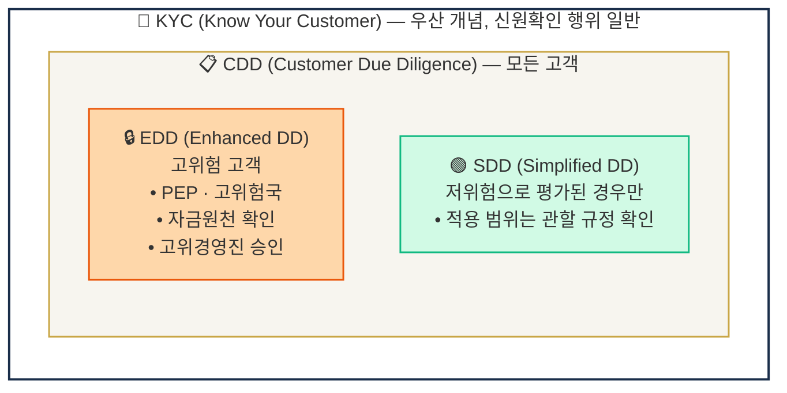
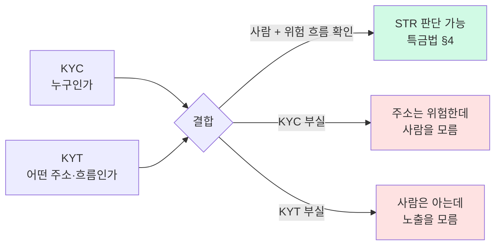
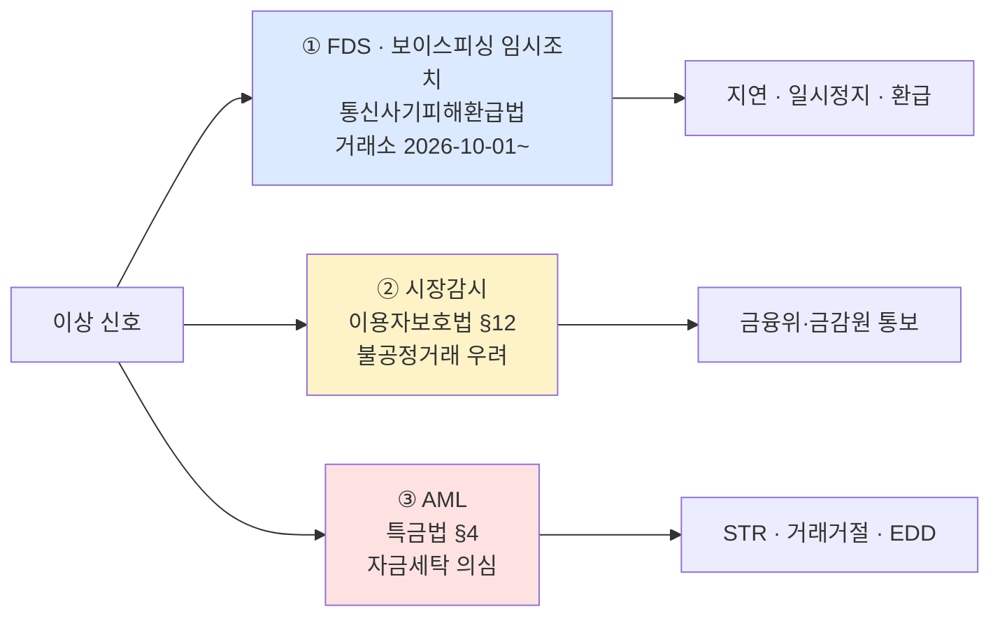
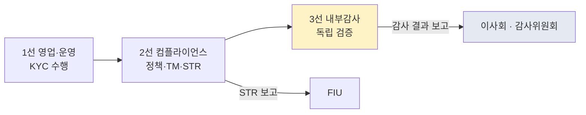

# Key Concepts — AML 핵심 용어 정리

> 외우기 전에 차이부터 잡고 가야 할 핵심 용어들. 이 글의 목표는 "용어 A를 봤을 때 A가 B와 어떻게 다른지, 실무에서 어떤 판단을 바꾸는지 즉시 말할 수 있게" 하는 것입니다. 마지막 업데이트: 2026-10-21.

> **근거 범위**: 조문 번호는 정정된 [`../2-regulations/korea-fiu-act.md`](../2-regulations/korea-fiu-act.md)·[`../5-compliance/str-ctr.md`](../5-compliance/str-ctr.md)를 따릅니다(특금법 §4 STR · §4의2 CTR · §5의2 고객확인 · §5의3 트래블룰). 이전 판의 실소유자 "25% 국제 표준", 벤더 점유·구독료, 거래소별 도입 현황, 분석가 처리량·오탐 비율, 보고책임자 교체 기한, DAXA 주간 공유 등은 이 저장소 근거 자료로 확인되지 않아 삭제하거나 "원문 확인 필요/공개 근거 미확인"으로 표시했습니다.

## TL;DR
- **KYC ≠ CDD ≠ EDD** — 점점 강도가 세지는 동심원
- **KYC vs KYT** — KYC는 사람을 안다, KYT는 거래·지갑을 안다. 단 "KYT"는 업계 용어이고 FATF·MAS·한국 고시의 규범 용어는 **거래모니터링(transaction monitoring)** 이다
- **STR vs CTR** — STR은 의심거래(특금법 §4, 금액 무관), CTR은 기준금액 이상 현금거래(§4의2)
- **"이상거래"는 한 단어, 세 제도** — FDS·보이스피싱 임시조치 / 이용자보호법 §12 시장감시 / 특금법 §4 STR
- **AMLO / MLRO / CCO** — AML 책임자. 한국 특금법상 명칭은 "보고책임자"
- **PEP** — 정치적 주요인물, 강화된 고객확인(EDD) 대상

---

## 1. 고객 식별·실사 라인 (KYC / CDD / EDD / SDD)

### 왜 이 네 용어가 헷갈리나

네 용어 모두 "고객을 확인한다"는 같은 의미처럼 들리지만, 실무에서는 **적용 대상 고객군**과 **확인 강도**가 다릅니다. 내부 정책서에 이 넷을 명확히 구분하지 않고 섞어 쓰면 운영팀이 "이 고객에게 뭘 적용해야 하나"에서 혼선을 겪습니다. 동심원 그림 하나로 기억하면 잘 안 흔들립니다.

### 동심원 구조



### KYC (Know Your Customer)

**정의**: "이 사람이 정말 본인이 맞는가"를 확인하는 **광범위 개념**. 흔히 "KYC 심사"라고 하면 신분증 제출, 얼굴 대조, 주소증빙 등 전체 과정을 통칭.

**실무 예시**:
- 신분증 확인 + 휴대폰 본인인증
- 실명확인 입출금계정(원화 거래 VASP의 신고 요건) 연결

**왜 중요한가**: KYC가 부실하면 그 위에 쌓는 CDD·EDD·모니터링이 흔들립니다. 주소만 위험하고 사람은 누군지 모르는 상태로는 STR을 쓸 수 없기 때문입니다. (이전 판의 "AML 사고의 80% 이상이 onboarding에서 시작"은 출처가 없어 삭제했습니다.)

### CDD (Customer Due Diligence)

**정의**: KYC를 수행한 뒤 고객의 **위험을 평가하고 지속 모니터링**하는 과정. FATF R.10의 이름이 Customer Due Diligence이기 때문에 가장 공식적인 용어. 한국 근거는 **특금법 §5의2(고객확인의무)** 입니다.

**4단계 구성**:
1. 신원확인 (Identification)
2. 실소유자(Beneficial Owner) 확인 — 법인 고객의 실제 지배자·수익자(지분 기준은 §6 참조, **원문 확인 필요**)
3. 거래 목적·자금 원천 파악
4. 지속 모니터링 (Ongoing Monitoring)

**왜 중요한가**: CDD는 **거래관계가 유지되는 한 계속** 해야 합니다. FATF 2021 가이던스 para 275~276은 지속 모니터링을 고객 프로파일 대비 거래 일관성 검증으로 정의합니다([FATF 2021 가이던스 미러](https://www.onpcsb.ro/2022/01042022/Updated-Guidance-VA-VASP.pdf)). 고객 정보가 낡으면 재실사(refresh)합니다. 재실사 주기는 위험등급별 사내 정책으로 정하며, 법정 주기는 이 노트의 근거 자료로 확인하지 않았습니다(원문 확인 필요).

### EDD (Enhanced Due Diligence)

**정의**: CDD를 **이미 한 위에 추가로** 강화된 확인을 덧붙이는 단계. 고위험 고객에게만 적용. 2026-08-18 개정 시행령은 **강화된 고객확인 여부를 고객 특성·거래양태·상품 위험도로 판단**하도록 했습니다([금융위 2026-08-11](https://www.fsc.go.kr/no010101/87499)).

**트리거 예시**:
- PEP (정치적 주요인물)
- 고위험국(FATF 회색·흑색명단) 관련 — 명단은 판본 일자와 함께 관리(2026-10-21 기준 2026-06-19 총회판)
- 비대면 + 기타 위험요소 조합
- 거액 거래 또는 복잡한 소유구조
- 고위험 해외 VASP·자기수탁 주소와의 이전(한국 2027-02-19부터 고시 §28-2 규율)

**추가 절차**:
- **자금출처(SoF, Source of Funds)** 확인 — 월급? 사업수익? 상속? 문서 요구
- **자산출처(SoW, Source of Wealth)** 확인 — 전체 재산이 어떻게 형성됐는가
- **고위경영진 승인** — 관계 수립·유지 결정을 상위 결재선에서
- 더 빈번한 재실사

**실무 예시**: 고액 OTC 거래 고객이 고위험국 관련으로 확인됐다면, 단순 KYC로 끝나지 않고 SoF 증빙(세무서류, 고용계약서, 매매계약서)과 승인 기록을 시스템에 남깁니다.

### SDD (Simplified Due Diligence)

**정의**: 저위험으로 평가된 고객에게만 적용 가능한 **간소화** 실사. 정부기관, 상장기업, 다른 규제받는 금융기관 등이 전형적 예.

**한국 가상자산 분야**: 적용 가능 범위는 특금법 시행령·업무규정 원문으로 확인해야 합니다(이 노트의 근거 자료로는 확인하지 않음).

### 실무 포인트

내부 정책서에 이 넷을 정확히 쓰려면 "KYC는 프로세스, CDD는 프로그램, EDD는 추가 강화, SDD는 예외"라는 틀로 문장을 쓰면 혼선이 줄어듭니다. 예: "모든 고객에 대해 CDD를 수행하며(특금법 §5의2), PEP·고위험국·거액거래 트리거 발생 시 EDD 절차를 추가 적용한다."

---

## 2. KYC vs KYT — 가상자산의 핵심 구분

### 왜 KYT가 따로 있나

전통 금융 AML에는 KYC와 TM(Transaction Monitoring, 거래 모니터링)이 있지 "KYT"는 없었습니다. 가상자산 산업에서 **블록체인 분석의 비중**이 커지면서 TM 중 온체인 부분을 따로 부르는 업계 용어가 KYT입니다. **"KYT"라는 말은 FATF·MAS·한국 고시 어디에도 나오지 않습니다.** FATF 7차 TU(2026-07-16)는 "transactions monitoring and blockchain analytics tools"라고 쓰고(권고 6-ii), 한국 근거는 FIU 고시 「자금세탁방지 업무규정」 제76~81조 "거래모니터링체계"입니다(가상자산 전용 조문 아님)([법제처 DRF 업무규정](https://www.law.go.kr/DRF/lawService.do?OC=test&target=admrul&ID=2100000267264&type=XML)).

용어:
- **KYT (Know Your Transaction)** — 가상자산 거래와 지갑 주소의 위험을 상시 분석하는 업계 용어. 전통 금융 TM의 블록체인 확장판.
- **TM (Transaction Monitoring)** — 규범 용어. 거래 패턴 이상을 탐지하는 체계 전반. KYT의 상위 개념.

### 이 표를 어떻게 읽어야 하나

같은 "모니터링" 기능이 KYC와 KYT에서 어떻게 다른 지점을 보는지 대조. 두 영역은 **서로 대체가 아니라 보완** 관계 — 가상자산 AML은 둘 다 필요.

| 구분 | KYC (Know Your Customer) | KYT (Know Your Transaction) |
|---|---|---|
| 대상 | **사람·법인** | **거래·지갑주소** |
| 시점 | 주로 onboarding 때 + 재실사 | **상시** |
| 데이터 | 신분증, 얼굴 대조, 주소 | 온체인 흐름, 클러스터, 노출(exposure) |
| 도구 | 신원확인·본인인증 서비스 | 블록체인 분석도구 + 사내 룰 |
| 규범 근거(한국) | 특금법 §5의2 | 특금법 §4 + 업무규정 제76~81조 |

(이전 판의 벤더명 열은 근거 없는 거래소별 매핑이 섞여 있어 삭제했습니다. 벤더 일반은 [`../7-vendors/`](../7-vendors/README.md) 참조.)



### 실무 포인트

분석도구는 결과를 위험점수나 라벨로 줍니다. 이 정보를 KYC로 식별한 고객과 연결하면 **"고위험 고객의 고위험 거래"** 같은 복합 신호가 보입니다. 점수 산정 방식은 벤더별 자사 방식이라 공개 근거가 없으므로(보고서 부록 A-37), 점수만 보지 말고 어떤 라벨에 어떤 경로로 노출됐는지 분석가가 확인해 기록합니다. NYDFS(2022-04-28)도 분석도구가 실소유자를 "may not be able to identify"라고 적었습니다([NYDFS](https://www.dfs.ny.gov/industry_guidance/industry_letters/il20220428_guidance_use_blockchain_analytics)).

---

## 3. 보고 의무 — STR / SAR / CTR

### 왜 세 약어가 있나

같은 "의심거래 보고" 개념이 관할별로 다른 이름입니다. 한국·FATF는 STR, 미국은 SAR, 그리고 "현금거래"만을 따로 보고하는 게 CTR입니다.

### 이 표를 어떻게 읽어야 하나

실무에서는 어느 나라 규제를 적용받는지에 따라 양식과 보고처가 달라집니다. 한국 회사는 STR을 FIU에, 미국 회사는 SAR을 FinCEN에 제출.

| 약어 | 풀이 | 트리거 | 한국에서 |
|---|---|---|---|
| **STR** | Suspicious Transaction Report | 의심되는 거래 (**금액 무관**) | 특금법 §4, FIU에 보고 |
| **SAR** | Suspicious Activity Report (US 용어) | 위와 같은 개념 (FinCEN 용어) | (미국 BSA 관할) |
| **CTR** | Currency Transaction Report | **기준금액 이상 현금거래** (한국 1천만원, 미국 $10,000 — [`../5-compliance/str-ctr.md`](../5-compliance/str-ctr.md) 기준) | 특금법 §4의2, FIU에 보고 |

### STR의 핵심 속성

- **금액 무관**: 소액 거래여도 의심이 있으면 보고
- **의심 자체가 기준**: 실제 범죄 확정이 필요 없음
- **Tipping-off 금지**: 고객에게 STR 사실을 알리면 별도 처벌 대상
- **보호**: 정당한 절차로 보고하면 민사·형사 면책
- **2027-02-19 주의**: 해외 VASP·자기수탁 주소와의 1천만원 이상 이전에는 "자체 의심거래 감시체계" 구축·운영 의무가 생긴다(시행령 §10-20 ⑦나, 고시 §28-2③, enacted-not-in-force). **자동 STR 의무가 아니다** — 입법예고안(2026-03-30)의 "위험도 무관 STR"은 최종본에서 바뀌었다([금융위 2026-08-11](https://www.fsc.go.kr/no010101/87499))

### CTR이 가상자산에서 애매한 이유

CTR은 본래 "**현금**이 금융 시스템에 들어오는 순간"을 잡는 제도. 가상자산 자체 거래는 현금이 아니므로 CTR 대상이 아닙니다. VASP에서는 현금을 직접 받는 예외적 영업에서만 문제가 됩니다. 실무에서는 STR이 압도적으로 중요합니다.

### "이상거래"는 STR이 아니다 — 세 갈래 구분



출처: [보고서 "KYT·FDS·시장감시" 표](../../reports/가상자산%20AML%20KYT%20FDS%20트래블룰%20흐름.md), [`../4-technology/fds.md`](../4-technology/fds.md).

### 실무 포인트

STR 결정은 "의심되는가"가 기준이므로, 분석가가 **입증 부담 때문에 보고를 미루는 문화**는 위험합니다. 반대로 형식적인 대량 보고도 판단 근거가 비어 있으면 의미가 없습니다. 회사 정책에 "의심이 들면 근거를 문서화해 STR, 아니라고 판단한 경우 사유 기록"을 기본값으로 명시합니다. (이전 판의 "감독당국은 STR 수가 적으면 의심하므로 양이 많은 편이 안전"은 근거가 없어 삭제했습니다.)

---

## 4. RBA — Risk-Based Approach (위험기반접근)

### 한 줄 정의

FATF R.1이 정한 운영 원칙:

> "고객·상품·거래·지역의 **위험 수준에 비례해서** AML 통제를 적용하라"

R.1은 2025년에 개정됐고, FATF는 2021 가상자산 가이던스 페이지에 "does not reflect … the 2025 revisions to Recommendation 1"이라는 경고문을 달았습니다([FATF 공식 페이지](https://www.fatf-gafi.org/en/publications/Fatfrecommendations/Guidance-rba-virtual-assets-2021.html)). (이전 판의 "2012년 권고 개정에서 명시화"는 이 저장소 근거 자료로 확인하지 않았습니다.)

### 왜 중요한가

RBA의 실질적 의미는 **"모든 고객을 똑같이 취급하지 말라"** 입니다. 저위험 고객에게 두꺼운 통제를 적용하면 비용만 낭비되고 고위험 고객이 묻혀 버림. 반대로 고위험에 얇은 통제를 적용하면 사고를 놓침.

### 가상자산에서 RBA의 실질적 의미

- 고객 위험등급 산정 (KYC 정보 + 거래 패턴 + 지갑 노출)
- 등급이 기준을 넘으면 EDD 트리거
- 등급 변화 시 재실사 및 통제 수준 재조정
- 저위험: 관할 규정이 허용하는 범위에서 간소화
- 고위험: EDD + 고위경영진 승인

### 실무 포인트

"우리는 RBA를 한다"고 말하려면 위험평가의 **요소·가중치·등급 경계와 그 근거**가 문서로 남아 있어야 설명이 됩니다. 산식을 어떻게 짜야 한다는 공개 기준은 없으므로, 기준을 정한 이유와 정기 검증 기록이 핵심입니다. FATF 2021 가이던스도 운영 룰의 무결성을 "regular basis"로 검증하라고 합니다.

---

## 5. PEP — Politically Exposed Person (정치적 주요인물)

### 정의

**고위 공직자, 그 가족, 그 측근** — 부패와 뇌물 위험에 구조적으로 노출된 사람들. FATF 기준은 R.12입니다.

### 3가지 분류

- **Foreign PEP (외국 PEP)** — 외국 정부 고위직.
- **Domestic PEP (국내 PEP)** — 자국 고위직.
- **International Organization PEP** — 국제기구 고위직.

분류별로 강화조치가 의무인지 위험기반인지는 R.12와 국내 규정 원문으로 확인합니다(이 노트의 근거 자료로는 대조하지 않음 — 원문 확인 필요).

### 중요한 오해 풀기

PEP라는 건 **범죄자라는 뜻이 아닙니다**. 공직자가 거래소에서 가상자산을 사는 건 합법입니다. 다만 **"부패·뇌물 수수에 노출될 구조적 환경"**에 있으므로 금융기관이 거래를 **더 주의 깊게** 보자는 게 PEP 제도의 취지.

### 어떻게 스크리닝하나

전 세계 PEP 목록을 스스로 유지하기는 어려워 상용 PEP·제재 데이터베이스를 구독하는 경우가 많습니다. 특정 제품의 시장 지위·가격은 공개 근거 미확인이라 적지 않습니다.

### 실무 포인트

PEP 매칭이 떴다고 **자동 거래 차단**이 되는 건 아닙니다. 우선 **동명이인(False Positive)** 여부를 판단해야 합니다. 흔한 이름은 출생년도·국적·직업 맥락으로 거르는 **2차 검토(Secondary Review)** 절차가 필요합니다.

---

## 6. Beneficial Owner — 실소유자

### 한 줄 정의

**법인 고객의 실제 지배자·수익자**. 명의상 대표가 아니라 실질적으로 지배하거나 이익을 받는 자연인.

### 지분 기준 — 원문 확인 필요

이전 판은 "25% 이상이 국제 표준이고 한국 특금법과 EU AMLR 모두 25%를 채택, EU는 15% 인하 논의"라고 적었습니다. 이 저장소의 근거 자료(`research/2026-10-*`, 정정된 규제 노트)에는 이 수치를 확인한 원문이 없습니다. **지분율 기준은 특금법 시행령·EU AMLR 원문으로 확인한 뒤 정책에 적으십시오(원문 확인 필요).**

### 실무에서 어려운 이유

실소유자 확인은 **법인 문서를 통해 재귀적으로 파고드는** 작업입니다. 예(기준을 X%로 둔다고 가정):
- 고객 법인 A → 주주: 법인 B(50%)
- 법인 B → 주주: 법인 C(60%)
- 법인 C → 주주: 자연인 X(100%)
- → X의 A에 대한 간접 지분 = 50% × 60% × 100% = 30%. 이 값을 확인된 법정 기준과 비교

이 작업을 수동으로 하면 오래 걸리므로 법인정보 조회 서비스를 연동하는 경우가 많습니다(특정 제품명은 적지 않음).

### 실무 포인트

실소유자 확인이 안 되는 고객을 어떻게 처리할지(거래 거절 등)는 특금법 §5의2와 하위규정의 문언으로 정합니다. 감독기관도 귀속·실소유 확인의 한계를 인정하는 만큼(NYDFS 2022), 확인 시도와 결과를 기록으로 남기는 것이 중요합니다.

---

## 7. Sanctions Screening — 제재 스크리닝

### 핵심

차단해야 할 **명단**과 고객·거래 당사자·지갑 주소를 **대조**하는 통제. FATF 7차 TU 권고 5-ii는 통제 요소로 "KYC, wallet screening, blacklisting, and, where appropriate, whitelisting mechanisms as well as freezing and blocking capabilities"를 열거합니다.

### 주요 리스트

| 리스트 | 발행 | 비고 |
|---|---|---|
| **OFAC SDN List** (Specially Designated Nationals) | 미국 재무부 OFAC | 가상자산 지정이 잦음 |
| **UN Consolidated Sanctions List** | UN 안보리 | 회원국 이행 |
| **EU Consolidated Financial Sanctions** | EU | EU CASP |
| **영국 제재 명단** | 영국 | 영국 사업자 |
| **한국 국내 지정 명단** | 한국 | 근거 법령·고시는 원문 확인 필요 |

상세는 [`../5-compliance/sanctions-screening.md`](../5-compliance/sanctions-screening.md).

### 가상자산 추가 속성

- SDN 항목에 **디지털화폐 주소가 기재되는 경우**가 있다. 예: 2025-03-21 삭제 전 Tornado Cash(엔티티 1개·ETH 주소 90개)([OFAC 2025-03-21](https://ofac.treasury.gov/recent-actions/20250321))
- 반대로 **주소 없이 지정되는 경우**도 있다 — 2026-09-17 이란 거래소 BitBank 지정 공고에는 디지털화폐 주소가 없다([OFAC 2026-09-17](https://ofac.treasury.gov/recent-actions/20260917)). 주소 매칭만으로는 부족하고 엔티티·네트워크 단위 정보가 필요하다
- 2025~2026 미국 집행은 Prince Group(2025-10-14 TCO 지정)·Huione(§311 최종규칙)·A7 네트워크(2026-10-01 TCO 지정, B) 같은 **네트워크 단위 차단**으로 옮겨 갔다([`../6-cases/major-enforcement.md`](../6-cases/major-enforcement.md))
- 거래 발생 **전** 송신·수신 주소를 스크리닝 (Pre-transaction)

### OFAC 적용 범위

OFAC 제재는 미국인·미국 관련 거래에 적용되며, 달러 연동 스테이블코인과 미국 발행자를 거치는 거래는 실무상 영향을 받습니다. 역외 적용 범위와 2차 제재 가능성은 개별 프로그램(E.O.)의 문언으로 판단해야 하며, 이 노트에서 일반화하지 않습니다.

### 실무 포인트

제재 스크리닝의 최대 적은 **False Positive**. 흔한 이름이 명단에 있다고 해서 모두 차단하면 업무가 마비됩니다. 이름 + 생년월일 + 국적 + 주소를 조합한 **스코어링 매칭**과, 1차 보류 후 분석가 검토로 처리하는 **Disposition Workflow**를 둡니다.

---

## 8. AMLO / MLRO / CCO — AML 책임자

### 같은 직무, 다른 이름

| 약어 | 풀이 | 비고 |
|---|---|---|
| **AMLO** | Anti-Money Laundering Officer | 일반 명칭. 한국 특금법상 명칭은 "보고책임자" |
| **MLRO** | Money Laundering Reporting Officer | 영국·EU 명칭, STR 보고 책임 |
| **CCO** | Chief Compliance Officer | 컴플라이언스 총괄 |
| **DMLRO** | Deputy MLRO | 부책임자 |

### 한국 특금법의 요구

VASP는 **자금세탁방지 보고책임자**를 임명해야 하고 신고 준비 체크리스트에도 들어갑니다([`../2-regulations/korea-fiu-act.md`](../2-regulations/korea-fiu-act.md) §3). 보고책임자의 직급 요건(임원 여부)·교체 기한은 이 노트의 근거 자료로 확인하지 않았습니다(원문 확인 필요). 2026-08-13 신고매뉴얼은 **AML 인력 4인 이상**을 정했습니다([금융위 2026-08-13](https://www.fsc.go.kr/no010101/87521)).

### 실무 포인트

보고책임자를 **실권 없는 명목직**으로 두면 STR 판단의 독립성을 설명하기 어렵습니다. "이 책임자가 STR 제출 여부를 결정할 수 있는가"를 보여 주는 권한 문서(위임전결 규정 등)를 갖춰 둡니다.

---

## 9. Three Lines of Defense (3중 방어선)

### 은행·VASP 내부 통제 모델

1. **1선 (Business / Frontline)** — 영업 부서. 고객 응대, KYC 1차 수행, 일상 모니터링.
2. **2선 (Compliance / Risk)** — 컴플라이언스 팀. 정책 수립, TM 운영, STR 보고, 2차 리뷰.
3. **3선 (Internal Audit)** — 내부감사. 1선·2선이 제대로 돌아가는지 **독립 검증**.



### 핵심은 "독립성"

3선 내부감사가 보고책임자나 CCO에게 보고하면 "감독자가 감독자를 감사"하는 꼴이 됩니다. 감사 결과는 이사회(또는 감사위원회)로 가는 구조가 독립성을 설명하기 쉽습니다. 상세는 [`../5-compliance/internal-controls.md`](../5-compliance/internal-controls.md).

### 실무 포인트

신생 회사는 인력이 부족해 2선이 3선 역할까지 겸하기 쉽습니다. 이 경우 외부 전문기관에 독립 점검을 맡기는 방법이 있으며, 점검 범위·주기와 독립성 근거를 문서화해 둡니다.

---

## 10. 자주 헷갈리는 짝 — 한 눈 대조표

### 이 표를 어떻게 읽어야 하나

용어 암기 완료 체크용입니다. 한 줄씩 보며 **차이를 바로 설명할 수 있으면** 해당 용어는 내 것입니다.

| A | B | 차이 |
|---|---|---|
| **AML** vs **CFT** | 자금세탁방지 vs 테러자금조달방지 | ML은 출처 은닉, TF는 목적지 차단 |
| **KYC** vs **CDD** | 신원확인 vs 종합실사 | CDD가 더 큰 개념 (KYC 포함) |
| **CDD** vs **EDD** | 표준 vs 강화 | EDD = 고위험에 SoF/SoW 확인 + 고위경영진 승인 추가 |
| **KYC** vs **KYT** | 사람 vs 거래·지갑 | KYT = 업계 용어, 규범 용어는 거래모니터링 |
| **STR** vs **CTR** | 의심거래(§4) vs 기준금액 이상 현금(§4의2) | 가상자산은 STR 위주 |
| **STR** vs **SAR** | 한국·FATF vs 미국 용어 | 본질 같음, 제출처 다름 (FIU vs FinCEN) |
| **STR** vs **"이상거래"** | 특금법 §4 vs 이용자보호법 §12·통신사기피해환급법 | 법적 출구가 다름 — §3 그림 |
| **VASP** vs **CASP** | FATF·한국 vs EU 용어 | 본질 같음 (CASP = Crypto-Asset Service Provider) |
| **FATF** vs **FIU** | 국제 표준제정 vs 각국 정보분석·감독 | FATF는 권고, FIU는 보고 수리·분석 |
| **AMLR** vs **AMLD** | EU 규정 vs EU 지침 | AMLR 직접효력(2027-07-10 적용 예정) / AMLD 국내법화 필요 |
| **OFAC** vs **FinCEN** | 제재 집행 vs FIU | 둘 다 미국 재무부 산하, 역할 다름 |
| **트래블룰 근거** | INR.15 §7(b) vs R.16 | VASP 트래블룰 원천은 INR.15 §7(b). 2025-06 개정 R.16은 R.15를 거쳐 간접 적용 |

---

## 요약 부록 — 빠른 참조용

**동심원**: KYC ⊃ CDD ⊃ EDD / CDD ⊃ SDD (범위만 좁음)
**가상자산 특화 3대**: 거래모니터링(KYT) · Travel Rule(특금법 §5의3) · 지갑 주소 스크리닝
**조직 필수 2대**: 보고책임자(개인) · 3LoD(구조)

## 💼 실무 현장 (Industry Reality)

### 각 용어가 실제 시스템 어디에 박혀 있나

| 용어 | 한국 VASP에서 구현되는 지점(일반 구조) | 근거 |
|---|---|---|
| KYC | 가입 플로 — 신원확인 + 실명확인 입출금계정 연동 | 특금법 §5의2 |
| CDD | 고객 위험등급 필드 + 재실사 스케줄 | 특금법 §5의2, 2026-08-18 개정 시행령 |
| EDD | 별도 케이스 — 자금원천 증빙 + 결재선 | 동상 |
| KYT | 거래 스트림 → 분석도구·룰 → 알림 큐 | 특금법 §4, 업무규정 제76~81조 |
| STR | 보고책임자 결재 후 FIU 제출 | 특금법 §4 |
| CTR | 현금 직접 수취 시에만 해당 | 특금법 §4의2 |
| Sanctions | 명단 갱신 → 내부 차단목록 → 거래 전 매칭 | FATF 7차 TU 권고 5-ii |
| Travel Rule | 2027-02-18까지 100만원 이상, 2027-02-19부터 전건 | 특금법 §5의3, 시행령 §10의10 |

이전 판의 제품명(본인확인·OCR·KYT·PEP DB·트래블룰 솔루션)과 "국내 4사 전부 도입", "DAXA 4사 분할 채택", "구독료 연 1~3억"은 공개 근거가 없어 삭제했습니다. 공적 기관의 도입은 공개 사실로 확인됩니다 — FIU는 2026-02-05 업무계획에 "체이널리시스(가상자산 분석도구) 도입"을 넣었습니다([금융위 2026-02-05](https://fsc.go.kr/no010101/86209)).

### 용어별 업무 빈도

이전 판의 "KYT 알림 하루 30~80건, 80% FP", "STR 분석가당 월 3~10건", "PEP 주 2~5건"은 공개 근거가 없어 삭제했습니다. 가상자산 전용 alert-to-STR 공개 벤치마크는 존재하지 않습니다(은행권 EY 2018 리테일 평균 14%만 있음, B)([EY 2018](https://ey.com/content/dam/ey-unified-site/ey-com/en-uk/industries/financial-services/documents/ey-anti-money-laundering-transaction-monitoring-2018-emeia-survey.pdf)).

### 자주 나오는 오해

- **"KYC 한 번 하면 끝"** — CDD는 거래관계가 유지되는 동안 지속됩니다. 재실사 주기는 위험등급별 사내 정책이며 법정 주기는 원문 확인 필요.
- **"STR 많이 내면 잘하는 것"** — 수량이 아니라 판단 근거의 기록이 핵심입니다.
- **"KYT 점수가 높으면 STR"** — 점수는 입력값일 뿐이고, STR은 "의심되는가"에 대한 사람의 판단과 기록입니다(FATF 2021 para 275~276).
- **"1천만원 이상이면 자동 STR"** — 틀림. 2027-02-19부터 해외 VASP·자기수탁 1천만원 이상 이전은 "자체 의심거래 감시체계" 대상입니다.
- **"RBA는 선언만 하면 된다"** — 위험평가 요소·기준과 그 근거를 문서로 보여 줄 수 있어야 합니다.

### 룰/코드 예시 — EDD 트리거 의사코드 (가설 모델)

```python
# 개념 예시 — 금액·점수 임계값은 공개 기준이 없는 사내 정책값(policy.*)이다
def trigger_edd(customer, tx, policy):
    triggers = []
    if customer.pep_status: triggers.append("PEP")
    if customer.country in policy.fatf_list_2026_06_19: triggers.append("HIGH_RISK_JURISDICTION")
    if tx.amount_krw >= policy.large_tx_krw: triggers.append("LARGE_TX")
    if tx.counterparty_risk >= policy.counterparty_threshold: triggers.append("COUNTERPARTY_HIGH")
    if tx.to_self_hosted and tx.date >= "2027-02-19":
        triggers.append("SELF_HOSTED_SAME_PERSON_CHECK")  # 고시 §28-2: 동일인 이전만 허용
    return triggers  # 하나라도 있으면 EDD 큐로
```

### 한국 특수 현실

- **보고책임자 신고**: 대주주·보고책임자 변경 이력은 검사 때 확인 대상이고, 2026-08-20 이후 대주주 변경은 30일 전 사전신고입니다([`../2-regulations/korea-fiu-act.md`](../2-regulations/korea-fiu-act.md)). 교체 기한은 원문 확인 필요.
- **본인확인 수단**: 특정 기관 "독점" 서술은 공개 근거 미확인이라 삭제했습니다.
- **DAXA 공동 블랙리스트**: 운영 방식·공유 주기는 공개 근거 미확인입니다([`../6-cases/korea-enforcement.md`](../6-cases/korea-enforcement.md)).

---

## 더 읽을거리
- [`what-is-aml.md`](what-is-aml.md) — AML 3단계 모델 기초
- [`why-crypto-different.md`](why-crypto-different.md) — 가상자산 AML의 특수성
- [`../5-compliance/cdd-edd.md`](../5-compliance/cdd-edd.md) — CDD·EDD 실무 상세
- [`../5-compliance/str-ctr.md`](../5-compliance/str-ctr.md) — STR·CTR 실무
- [`../glossary.md`](../glossary.md) — 전체 용어 사전 (ABC 순)
