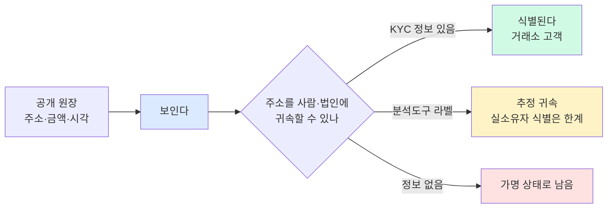
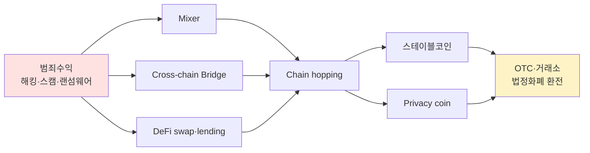
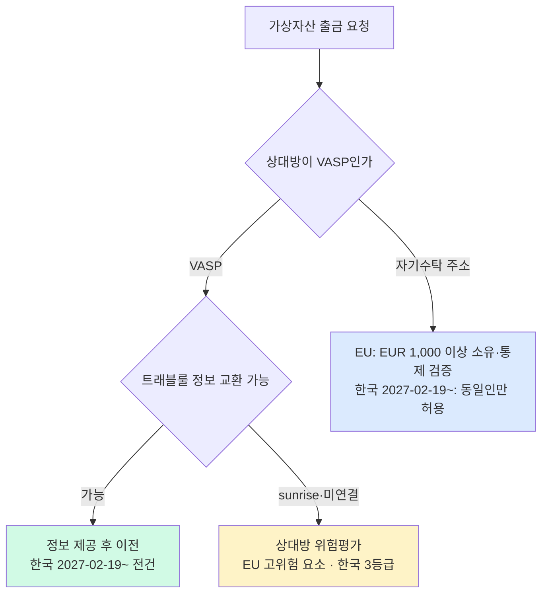
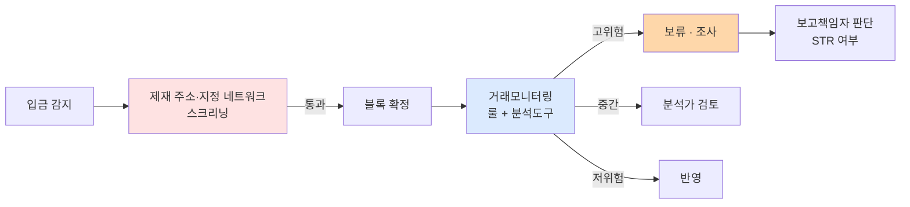

# Why Crypto AML? — 가상자산 AML이 왜 다른가

> 전통 금융 AML과 가상자산 AML의 본질적 차이. 이 글을 읽고 나면 "공개 원장인데 왜 어려운가"라는 직관적 모순을 설명할 수 있고, 가상자산 AML이 투자한 도구 지형(mixer, bridge, stablecoin)의 **왜**를 이해하게 됩니다. 마지막 업데이트: 2026-10-21.

> **근거 범위**: `research/2026-10-*.md` 도시에와 정본 보고서에서 confidence A(일부 B, "(B)" 표시)로 확인된 사실만 씁니다. 이전 판의 위협 행위자별 규모(CMLN $16.1B, Lazarus 누적액, 스캠 $17B, 랜섬웨어 규모), Bybit "48시간 $160M layering", 벤더 제품명·시장 지위, 거래소별 은행 제휴·상장폐지 연도, DAXA 공동 블랙리스트, 노출도 hop 기준·위험점수 임계값은 근거가 없어 삭제하거나 "공개 근거 미확인"으로 표시했습니다([`../6-cases/README.md`](../6-cases/README.md) 기준과 같음).

## TL;DR
- 가상자산은 **공개 원장(public ledger)** 이라 흐름은 보이지만 주소가 사람과 연결되지 않는다 → "투명성의 역설"
- 운영 난이도를 키우는 요인: **속도·24/7·국경 없음·가명 주소·스마트컨트랙트·체인 다양성**
- 자금세탁자는 **mixer / cross-chain bridge / DeFi / privacy coin / 스테이블코인** 을 layering 도구로 활용
- Chainalysis(2026-01-08)는 2025년 불법 주소 수취액을 **최소 1,540억 달러**로 추정하고 그중 **스테이블코인 비중을 84%** 로 적었다(B). TRM(2026-01-28)은 1,580억 달러로 추정했다(B). 두 수치는 정의·분모가 달라 직접 비교하지 않는다
- FATF 7차 TU(2026-07-16)는 VASP에 "transactions monitoring and blockchain analytics tools"로 급속 이전을 탐지하라고 처음 권고했다. 그래서 가상자산 AML은 **온체인 분석 + 오프체인 KYC** 의 결합이 핵심

---

## 1. 전통 금융 AML과 가상자산 AML의 구조적 차이

### 왜 "다르다"를 먼저 이해해야 하나

은행 AML 경력자가 가상자산 회사에 들어오면 가장 먼저 혼란을 겪는 지점이 **"원칙은 같은데 도구가 완전히 다르다"** 입니다. 고객확인(KYC), 의심거래보고(STR), 제재 스크리닝 — 용어는 같지만 실행 환경이 판이하게 달라서, 전통 금융 룰북을 그대로 가져오면 작동하지 않습니다. 이 섹션은 그 차이를 한 표로 잡고 갑니다.

용어:
- **VASP (Virtual Asset Service Provider)** — 가상자산사업자. FATF는 2018-10 R.15 개정으로 VA·VASP 정의를 용어집에 신설했습니다. 한국 특금법은 §2 제1호 하목에서 가상자산사업자의 행위를 정하고, 가상자산 정의는 가상자산이용자보호법 제2조를 상호참조합니다([`../2-regulations/korea-fiu-act.md`](../2-regulations/korea-fiu-act.md)).
- **Public Ledger (공개 원장)** — 누구나 블록 탐색기로 열람 가능한 거래 기록 데이터베이스. 블록체인의 본질 속성.
- **Finality (결제 완결성)** — 한 번 확정된 거래는 되돌릴 수 없음. 확정 규칙은 체인마다 다릅니다.

### 이 표를 어떻게 읽어야 하나

왼쪽이 전통 은행에서 당연하게 여겨지는 속성, 오른쪽이 가상자산 환경에서 그 속성이 어떻게 바뀌거나 사라지는지를 대조합니다.

| 항목 | 전통 금융 (은행) | 가상자산 (VASP/온체인) |
|---|---|---|
| 거래 원장 | 비공개 (은행 내부) | **공개 원장 (public blockchain)** |
| 거래 속도 | 영업시간·결제망 의존 | **24/7, 블록 단위 확정** |
| 국경 | 환거래은행 네트워크 거쳐야 함 | 모든 VA 이전을 국경 간 전신송금으로 취급(FATF 2021 가이던스 para 179) |
| 식별자 | 계좌번호 = 실명 연결됨 | **주소(address) = 가명(pseudonym)** |
| 거래 방식 | 송금 지시 → 은행이 처리 | **사용자가 직접 서명, 확정 후 되돌릴 수 없음** |
| 자금흐름 차단 | 동결(freeze) 가능 | 일반 자산은 차단 불가, **중앙화 스테이블코인은 발행자가 동결 가능**(단, 늦을 수 있음 — §3) |
| 자산 종류 | 통화 단일 | 수많은 토큰, NFT, 합성자산 |
| 중개 | 항상 중개자 존재 | **DeFi는 코드가 중개** — 단 통제·영향력을 가진 사람은 VASP가 될 수 있음 |
| 신원 확인 | 지점·오피스에서 대면 가능 | 대부분 비대면(non-face-to-face) |

### 실무 포인트

표의 각 행이 AML 통제의 어느 부분을 흔드는지 한 줄로 정리하면: **공개 원장**은 온체인 모니터링을 가능하게 하지만, **가명 주소**는 KYC 없이 주체 식별을 불가능하게 하고, **24/7·국경 없음**은 실시간 통제를 요구하며, **비가역성**은 사후 환원을 어렵게 합니다. 이 조합 때문에 가상자산 AML은 거래 전 스크리닝(pre-transaction screening)의 비중이 커집니다.

---

## 2. 투명성의 역설 — 공개 원장인데 왜 어려운가

### 핵심 긴장점

가상자산은 모든 거래가 공개 블록체인에 기록되므로 **이론상으로는 누구나 흐름을 본다**. 이 속성만 놓고 보면 가상자산은 전통 금융보다 오히려 AML에 유리해 보입니다. 그런데 현실 AML 실무는 정반대 — 왜?

답은 **"보인다"와 "식별된다"는 다르다**는 한 줄에 있습니다. 공개 원장에는 주소(예: `0x7F...`)가 적혀 있지 실명이 적혀 있지 않습니다. 주소를 **사람·법인과 연결**하는 일이 별개 작업입니다. 감독기관도 이 한계를 인정합니다. NYDFS(2022-04-28)는 분석도구가 "may not be able to identify underlying owners"라고 적었고([NYDFS](https://www.dfs.ny.gov/industry_guidance/industry_letters/il20220428_guidance_use_blockchain_analytics)), FATF 2021 가이던스 para 197(a)는 주소만으로 수취 지갑을 관리하는 VASP를 식별하는 "technically proven means"를 알지 못한다고 밝혔습니다([FATF 2021 RBA 가이던스](https://www.fatf-gafi.org/content/dam/fatf-gafi/guidance/Updated-Guidance-VA-VASP.pdf.coredownload.pdf)).



용어:
- **Pseudonymity (가명성)** — 실명은 아니지만 특정 식별자(주소)에 행동 이력이 계속 축적되는 속성. 완전 익명(anonymity)과는 다름.
- **Address (주소)** — 블록체인 상 자금의 목적지. 한 사람이 여러 개를 만들 수 있음.
- **Address Attribution (주소 귀속)** — 주소/클러스터를 알려진 엔티티(거래소, 믹서, 제재 대상 등)에 연결하는 작업.

### 추적을 막는 7가지 실무 장애물

1. **주소 ≠ 사람** — 한 사람이 여러 주소를 자유롭게 만들고, 지갑 소프트웨어가 새 주소를 자동 생성하기도 함.
2. **체인이 많음** — Bitcoin, Ethereum, Tron, Solana 등과 수많은 L2. 각각 데이터 구조·주소 형식이 다름.
3. **Cross-chain Bridge** — A 체인에서 자금을 잠그고 B 체인에서 대응 토큰을 발행. 한 체인만 보면 **추적 단절**이 생김. FATF 7차 TU 권고 6-iv는 브리지·믹서·크로스체인 노출 평가를 요구합니다.
4. **익명·프라이버시 도구** — Mixer, Privacy Coin(Monero, Zcash). Monero는 "추적 불가/가능" 이분법으로 말하기 어렵습니다 — 2019~2023년 지갑 버그 구간은 부분 추적이 가능했고, 2023년 초 패치 이후 거래에는 그 휴리스틱이 통하지 않습니다([arXiv 2408.05332](https://arxiv.org/abs/2408.05332)).
5. **DeFi의 무중개성** — KYC 없는 DEX·lending·AMM이 layering 인프라가 됨. FATF 7차 TU 기준 DeFi 위험평가를 마친 관할은 18%(26/142), 자국 내 VASP 해당 DeFi를 식별하지 못한 관할은 93%입니다.
6. **스마트컨트랙트 복잡성** — 한 트랜잭션이 여러 internal call을 유발. 분석 도구가 각 호출의 자금 효과까지 풀어내야 함.
7. **속도** — FATF 7차 TU가 "detect rapid transfer of VAs"를 권고한 이유입니다. DPRK의 Bybit USD 14.6억 탈취는 회수율이 3.8%에 그쳤습니다(6차 TU, 2025-06-26)([6차 TU](https://www.fatf-gafi.org/content/dam/fatf-gafi/recommendations/2025-Targeted-Upate-VA-VASPs.pdf.coredownload.pdf)). 이전 판의 "48시간 내 $160M layering"은 출처가 없어 삭제했습니다.

### 왜 블록체인 분석 산업이 탄생했나

위 7개를 풀어내려면 **"주소 → 엔티티"** 매핑이 필요합니다. 클러스터링 휴리스틱과 누적 라벨링이 이 일을 합니다. 다만 벤더가 공개하는 커버리지·라벨 주소 수·정확도는 자사 주장(T5)이고, **표준화된 공개 정확도 수치는 없습니다**([`../4-technology/blockchain-analytics.md`](../4-technology/blockchain-analytics.md)). 공적 영역에서도 이 도구를 씁니다. 한국 FIU는 2026-02-05 업무계획에 "체이널리시스(가상자산 분석도구) 도입"을 넣었습니다([금융위 2026-02-05](https://fsc.go.kr/no010101/86209)).

### 실무 포인트

분석도구를 살지 자체 개발할지는 회사마다 다르며, "어느 쪽이 표준"이라는 공개 근거는 없습니다. 확인되는 규범은 NYDFS(2022)가 **외주 분석도구와 자체 도구를 모두 허용**하고 지원 자산마다 추적 절차를 두라고 한 것, FATF 2021 가이던스 para 234가 분석도구의 비용·자산 커버리지 한계를 지적한 것입니다. 어떤 도구를 쓰든 그 한계를 문서화해 두는 편이 검사 대응에 유리합니다.

---

## 3. 가상자산 자금세탁의 새로운 도구들

### 개요

전통 ML의 도구(smurfing, shell company 등)는 가상자산에서도 그대로 쓰이지만, 가상자산만의 추가 도구가 있습니다. 각 도구는 자금세탁 3단계 중 주로 **Layering**에 집중돼 있고, 도구별로 탐지 방법이 다릅니다.



### Mixer / Tumbler — 자금 섞기

여러 사용자의 자금을 한 풀(pool)에 모아 섞은 뒤 다시 뽑아내는 서비스. 입금 주소와 출금 주소의 **온체인 연결을 끊는** 것이 목적.

- **Tornado Cash** — Ethereum 기반. 영지식 증명으로 풀에서 출금할 때 어느 입금이었는지를 가림. 미 재무부는 **2025-03-21 Tornado Cash를 SDN에서 삭제**했다(엔티티 1개·ETH 주소 90개)([OFAC 2025-03-21](https://ofac.treasury.gov/recent-actions/20250321)). 2022년 최초 지정과 소송 경과는 이 저장소 근거 자료로 확인하지 않았다([`../6-cases/tornado-cash.md`](../6-cases/tornado-cash.md)). 제재 후 957일 동안 입금액은 71.03% 줄었지만 Ethereum 보안사고의 78.33%는 여전히 Tornado Cash를 거쳤다([arXiv 2507.11721](https://arxiv.org/abs/2507.11721)).
- **CoinJoin(Bitcoin)** — 여러 사용자가 동시에 같은 금액을 섞는 방식. 개별 서비스의 제재·체포 일자는 공개 근거 미확인.
- 미국은 2026-10-05 CVC 믹싱 §311 제안규칙을 **철회**했다(관보 2026-10-06, withdrawn)([Federal Register 2026-20429](https://public-inspection.federalregister.gov/2026-20429.pdf)).

**탐지 포인트**: Mixer는 특유의 **트랜잭션 지문(fingerprint)** 이 있음 — 균등 금액, 특정 output 수, 특정 스크립트 패턴. 분석도구는 이런 지문으로 mixer 관련 주소 클러스터를 라벨링합니다.

### Cross-chain Bridge — 체인 점프

A 체인에서 자금을 잠그고 B 체인에서 같은 가치의 토큰을 발행하는 프로토콜. FATF 7차 TU는 DPRK가 **브리지·비수탁 지갑·OTC 네트워크**로 세탁한다고 적었습니다(para 33)([7차 TU PDF](https://www.fatf-gafi.org/content/dam/fatf-gafi/reports/7th-targeted-update-on-implementation-fatf-standards-vas-vasps-2026.pdf.coredownload.pdf)). 특정 브리지 이름별 이용 순위는 공개 근거 미확인.

**탐지 어려운 이유**: 브리지 진입 측과 출구 측이 **서로 다른 체인**이라, 두 체인을 함께 보지 않으면 흐름이 끊어진 것처럼 보임. 학계는 자동 매칭으로 이 문제를 풀고 있습니다(ABCTracer 12개 브리지 F1 91.75%, ConneX 5개 브리지 F1 0.9746 — 브리지 집합이 달라 직접 비교 불가)([arXiv 2504.01822](https://arxiv.org/abs/2504.01822); [arXiv 2511.01393](https://arxiv.org/abs/2511.01393)).

### Chain Hopping — 체인 점프의 연장

여러 체인·자산을 연달아 바꾸며 흔적을 흐리는 기법. Cross-chain bridge와 DEX의 조합으로 실현. FinCEN 주의보(FIN-2023-Alert005, 2023-09-08)는 "ETH를 받은 뒤 수수료가 낮은 TRX로 전환해 급출금" 같은 적신호를 제시했습니다([FinCEN Alert](https://www.fincen.gov/sites/default/files/shared/FinCEN_Alert_Pig_Butchering_FINAL_508c.pdf)).

### Peel Chain — 긴 사슬로 떼어내기

큰 금액이 들어온 주소에서 **소액을 한 번씩 떼어내(peel)** 다른 주소로 보내고, 나머지는 또 다른 주소로. 이 과정을 여러 번 반복해 **긴 사슬 모양**의 흐름을 만듦.

**왜 쓰나**: 추적하려면 여러 단계를 거쳐야 하고, 중간에 거래소 입금이 섞이면 끊기기 쉬움. **전통 금융의 smurfing(분할입금)의 온체인 버전**이라고 이해하면 직관적.

**탐지 포인트**: 한 주소에서 비슷한 간격으로 비슷한 소액이 빠져나가는 패턴. 그래프 분석에서 눈에 띄는 형태입니다.

### DeFi 활용 — 무중개 Layering

DeFi 프로토콜은 KYC를 요구하지 않으므로 layering 인프라로 악용될 수 있습니다.

- **Swap (DEX)** — 토큰 A를 토큰 B로 바꿔 **자산 형태 변환**.
- **Lending / Liquidity Pool** — 토큰 입금 후 다른 자산으로 인출하거나 LP 토큰 발행·소각으로 출처를 흐림.
- **Flash Loan** — 한 트랜잭션 안에서 대출→사용→상환을 마치는 기술.
- **NFT Wash Trading** — 자기들끼리 NFT를 고가에 사고팔며 가격을 부풀려 자금 이전을 정당화.

규범: FATF 2021 가이던스는 "A DeFi application (i.e. the software program) is not a VASP"이지만 통제력·영향력을 가진 사람은 VASP가 될 수 있다고 했고(para 66–69), 2026-07-21 DeFi 타겟보고서는 통제 존재를 기능적으로 판정하라고 권고했습니다([FATF 2026-07-21](https://www.fatf-gafi.org/en/publications/Virtualassets/targeted-report-decentralised-finance-2026.html)).

### Privacy Coin — 설계 자체가 익명

- **Monero (XMR)** — Ring signature + stealth address + RingCT(금액 은닉). 앞의 §2-4처럼 "완전 추적 불가"라고 단정하지 않습니다.
- **Zcash (ZEC)** — zk-SNARK 기반 shielded transaction.

규제: EU **AMLR 제79조**는 CASP의 익명성강화코인 취급을 금지하며, **2027-07-10 적용 예정(enacted-not-in-force)** 입니다([EUR-Lex OJ L 2024/1624](https://eur-lex.europa.eu/legal-content/EN/TXT/PDF/?uri=OJ:L_202401624)). 국가·거래소별 상장폐지 연도는 공개 근거 미확인.

### 스테이블코인 — 주 경로이자 동결 지렛대

Chainalysis(2026-01-08)는 2025년 불법 주소 수취액 중 **스테이블코인 비중을 84%** 로 적었습니다(B)([Chainalysis](https://www.chainalysis.com/blog/2026-crypto-crime-report-introduction/)). BIS 연차경제보고서(2026-06-23)도 "stablecoins account for a significant share of illicit on-chain activity"라고 했습니다([BIS AER 2026](https://www.bis.org/publ/arpdf/ar2026e3.htm)).

**왜 이 경로가 쓰이나(일반적 설명)**: 가격 변동이 작고, 저수수료 체인에서 국경을 넘는 이전이 쉽고, 환전 수요가 넓습니다.

**양날의 검**: 중앙화 스테이블코인은 **발행자가 컨트랙트 수준에서 특정 주소를 동결**할 수 있습니다. 그러나 2026년 근거는 모두 "동결에 기대지 말라"는 쪽입니다.
- **동결은 늦을 수 있다**: USDT 제재 주소의 7.3%, USDC의 18.7%가 동결 발효 전에 전액 인출됐다([arXiv 2603.27739](https://arxiv.org/abs/2603.27739)).
- **동결 회피 코인**: 제3자 발행자가 USD 2,900만 이상을 동결하자 캄보디아 소재 복합체가 "immune to asset freezing"을 내세운 자체 스테이블코인을 발행했고, FATF는 VASP가 "issuer-level asset freeze/burn mechanisms"를 준수 안전장치로 믿을 수 없을 수 있다고 결론 내렸습니다(7차 TU para 35).
- BIS는 발행자 동결과 분석업체 지원이 "cannot replace routine, large-scale AML/CFT controls"라고 했습니다. 상세는 [`../6-cases/circle-stablecoin-freeze.md`](../6-cases/circle-stablecoin-freeze.md).

### 실무 포인트

거래모니터링 룰을 처음 설계할 때는 **도구별 하위 룰 그룹**으로 나누면 오탐 원인을 역추적하기 쉽습니다: (1) Mixer 노출, (2) Bridge 노출, (3) Peel chain 패턴, (4) DeFi 이상 패턴, (5) Privacy coin 접점, (6) 제재 대상·지정 네트워크 노출. 이 분류는 설계 편의를 위한 것이고 업계 표준이라는 공개 근거는 없습니다. 지표의 원형은 FATF Red Flag Indicators(2020-09-14, 6개 범주·상위 지표 58개)에서 찾을 수 있습니다([FATF Red Flag](https://www.fatf-gafi.org/en/publications/Methodsandtrends/Virtual-assets-red-flag-indicators.html)).

---

## 4. 위협 행위자 지형

### 이 표를 어떻게 읽어야 하나

AML 부서가 방어해야 할 주요 위협 행위자 목록입니다. 규모 칸에는 1차 문서나 분석업체 보고서(B)로 확인되는 수치만 적고, 나머지는 "공개 근거 미확인"으로 둡니다. 분석업체 수치는 정의·분모가 달라 서로 더하거나 비교하지 않습니다.

| 행위자 | 주요 활동 | 규모(근거) |
|---|---|---|
| **DPRK** | 거래소·제3자 인프라(RPC 노드·멀티시그 공급자) 공격, 브리지·비수탁 지갑·OTC로 세탁 | Bybit USD 14.6억, 회수율 3.8%(6차 TU). 2025년 DPRK 탈취 약 USD 20억(Chainalysis, B) |
| **동남아 스캠 복합체** | 스캠 컴파운드, 강제노동, 자금세탁 서비스 | 캄보디아 소재 복합체 2021-08~2025-01 최소 USD 40억 세탁, 그중 최소 USD 3,700만 DPRK 자금(7차 TU para 29–30). 2025-10-14 Prince Group TCO 지정(146개 대상)·Huione §311 최종규칙 |
| **투자사기(pig butchering 등)** | 가짜 투자 플랫폼 유도 | FBI IC3 2025 가상자산 투자사기 피해 72.28억 달러(신고 기반)([FBI IC3 2025](https://www.ic3.gov/AnnualReport/Reports/2025_IC3Report.pdf)) |
| **제재 회피 네트워크** | 러시아 연계 A7 네트워크, 루블 스테이블코인 A7A5 | A7A5 1년 미만 USD 933억 이상 거래(Chainalysis, B). 2026-10-01 A7 TCO 지정(B) |
| **랜섬웨어 그룹·다크넷 마켓** | 몸값 수취, 불법 상품 거래 | 공개 근거 미확인(이 저장소 근거 자료 범위 밖) |
| 이전 판의 "CMLN $16.1B·1,800+ wallet" | — | **공개 근거 미확인 — 삭제** |

출처: [7차 TU PDF](https://www.fatf-gafi.org/content/dam/fatf-gafi/reports/7th-targeted-update-on-implementation-fatf-standards-vas-vasps-2026.pdf.coredownload.pdf), [재무부 sb0278](https://home.treasury.gov/news/press-releases/sb0278), [Chainalysis](https://www.chainalysis.com/blog/2026-crypto-crime-report-introduction/), [Federal Register 2026-20371](https://public-inspection.federalregister.gov/2026-20371.pdf).

### 각 행위자의 고유한 운영 특성

- **DPRK** — FATF 문서는 행위자를 "DPRK"로 쓰고, "Lazarus"는 업계 통칭입니다. 하위 조직 구분과 정형화된 "playbook"은 공개 근거 미확인입니다. 7차 TU는 딥페이크 면접을 이용한 채용사기로 USD 100만 이상이 탈취된 사례와 제3자 인프라 공격을 지적했습니다(para 33–34). 상세는 [`../6-cases/lazarus-dprk.md`](../6-cases/lazarus-dprk.md).
- **스캠 복합체** — 2025~2026년 미국 집행은 개별 거래소가 아니라 **조직·네트워크 단위 차단**(Prince Group·Huione·A7·BitBank)으로 옮겨 갔습니다([`../6-cases/major-enforcement.md`](../6-cases/major-enforcement.md)).
- **투자사기** — FinCEN 주의보는 "고유 IP·기기 ID·지역이 과거 접속 패턴과 불일치" 같은 기술 적신호를 제시했습니다. 이는 AML보다 FDS 룰로 바로 옮길 수 있는 서술입니다.

### 실무 포인트

고객 구성에 따라 어느 행위자와의 접점이 큰지 보고 룰 우선순위를 정합니다. B2C 거래소라면 사기 피해자의 출금(→ 한국에서는 통신사기피해환급법 임시조치, 2026-10-01부터 거래소에도 법정 의무)이, 수탁·B2B라면 제3자 인프라 공격과 제재 회피 네트워크 노출이 커질 수 있습니다. 이 우선순위 배분은 판단의 예시이며 공개 기준은 없습니다.

---

## 5. 가상자산 AML은 운영 관점에서 어떻게 다른가

### 이 표를 어떻게 읽어야 하나

같은 AML 의무(왼쪽 열)가 두 세계에서 어떻게 다른 도구로 구현되는지 보여줍니다.

| AML 의무 | 전통 금융 | 가상자산 |
|---|---|---|
| **KYC** | 신분증, 대면확인, 주소증빙 | 비대면 신원확인 + 실명확인 입출금계정(한국) + **자기수탁 주소 규율**(EU: EUR 1,000 이상 소유·통제 검증 / 한국: 2027-02-19부터 동일인 이전만 허용, 방법 미지정) |
| **거래 모니터링** | 룰 기반 TM 시스템 | 룰 + **블록체인 분석도구**(FATF 7차 TU 권고 6-ii). 한국 근거는 AML 업무규정 제76~81조(가상자산 전용 조문 아님) |
| **Travel Rule** | 전신송금 메시지에 송금정보 포함 | **별도 메시징 필요**(IVMS 101.2023), 미이행 관할 상대방은 sunrise 문제 |
| **제재 스크리닝** | 이름·생년월일 매칭 | 이름 + **지갑 주소 매칭**(단, 주소 없이 지정되는 경우도 있음 — 2026-09-17 BitBank) |
| **STR** | 거래 패턴 기반 | 거래 패턴 + **온체인 노출** 정보. 한국 근거 특금법 §4 |
| **기록보관** | 관할별 보존기간 | 한국: 특금법 고객확인·거래 기록 + 가상자산이용자보호법 시행령 §13 가상자산거래기록(상시감시·조치·통보 기록 포함). 각 기간은 법령 원문 확인 |

### 세 가지 결정적 전환

1. **자기수탁 주소 규율** — 관할마다 다릅니다. EU는 EUR 1,000 이상 자기수탁 이전에 원격 온보딩 검증·소액 송금(Satoshi test)·메시지 서명 등 **최소 1종**으로 소유·통제를 평가합니다(EBA/GL/2024/11 ¶83, ¶86)([EBA/GL/2024/11](https://www.eba.europa.eu/sites/default/files/2024-07/6de6e9b9-0ed9-49cd-985d-c0834b5b4356/Travel%20Rule%20Guidelines.pdf)). 한국은 **2027-02-19 전까지 법령상 소유증명 의무가 없고**, 2027-02-19부터(감독규정 §28-2 시행일은 02-19 또는 02-21로 미확정) 동일인 간 이전만 허용하며 증명 방법은 정하지 않습니다. 서명은 "통제"를 증명할 뿐 "수익적 소유"를 증명하지 못한다는 점, 이 검증 방식을 평가한 학술 논문이 없다는 점도 기억해 둡니다.
2. **Travel Rule의 Sunrise 문제** — 7차 TU에서 트래블룰을 입법한 관할은 83%(91/109)이지만 그중 60%(55/91)는 감독·집행 조치가 전혀 없었습니다. EU는 sunrise 상대방을 금지하지 않고 "고위험 요소"로 분류하며, 한국은 2027-02-19부터 해외 VASP를 3등급(허용 / 동일인일 때만 허용 / 제한)으로 나눕니다([`../3-crypto-aml/travel-rule.md`](../3-crypto-aml/travel-rule.md)).
3. **온체인 노출(Exposure)** — 가상자산 STR 판단에는 수신·발신 주소가 제재 대상·믹서 등과 얼마나 연결되는지가 들어갑니다. FATF 2021 가이던스 para 277~278은 고위험 상황에서 모니터링을 "extend beyond the immediate transaction"하라고 요구합니다. 다만 노출도 산정 공식·hop 기준·점수 임계값은 벤더별 자사 방식이고 **공개 근거가 없습니다**(보고서 부록 A-37).



### 실무 포인트

전통 금융 AML 경력자에게 이 세 가지 전환을 먼저 설명하면 기존 원칙(RBA, CDD, STR)이 어디서 그대로 쓰이고 어디서 달라지는지 빨리 잡힙니다. 경력 이식 비율 같은 수치는 공개 근거가 없습니다.

---

## 요약 부록 — 빠른 참조용

**투명성의 역설**: 공개 원장 = 흐름은 보임 / 가명 주소 = 식별은 별도 작업 → KYC와 분석도구의 결합
**6대 layering 도구**: Mixer · Cross-chain Bridge · Chain Hopping · Peel Chain · DeFi · Privacy Coin
**스테이블코인 역설**: 불법 수취액의 84%(Chainalysis, B)를 차지하지만 발행자 동결이 가능 — 단 동결 전 인출(USDT 7.3%·USDC 18.7%)과 동결 회피 코인 때문에 의존 불가

## 💼 실무 현장 (Industry Reality)

### 가상자산 특수성이 실제 방어선에 어떻게 박혔나

전통 금융의 배치(batch) 모니터링과 달리 가상자산은 24/7 이전을 전제로 설계합니다. 아래 흐름은 개념 예시이며, 위험등급 경계값은 사내 정책으로 정합니다(공개 기준 없음).



### 기술 스택

이전 판의 레이어별 제품명(모니터링 솔루션·스트리밍·그래프 DB)과 "알림 처리 SLA 15분~1시간"은 공개 근거가 없어 삭제했습니다. 확인되는 것은 규범뿐입니다 — FATF 2021 para 273(블랙리스트 주소 대조), para 275~276(자동화 + 사람 검토, 룰 무결성 정기 검증), 7차 TU 권고 5-ii("KYC, wallet screening, blacklisting, and, where appropriate, whitelisting mechanisms as well as freezing and blocking capabilities").

### 분석가가 자주 마주치는 가상자산 특유 케이스

- **믹서 간접 노출** — 고객 지갑의 상류 몇 단계 전에 믹서가 있는 경우. 몇 hop까지 볼지는 사내 정책이며 공개 기준은 없습니다.
- **브리지 송금 흐름 단절** — 체인이 바뀐 뒤 흐름이 끊어진 것처럼 보이는 경우. 브리지 양쪽을 함께 봐야 합니다.
- **사기 피해자 출금** — 고객 자신이 피해자인 경우는 STR보다 먼저 **통신사기피해환급법상 임시조치**(피해의심거래계좌등 추정 시 가상자산 이전 지연·일시정지, 2026-10-01부터 거래소 적용)를 검토합니다. "이상거래"라는 말은 FDS·시장감시(이용자보호법 §12)·STR 중 어느 것인지 구분해 씁니다([`../4-technology/fds.md`](../4-technology/fds.md)).
- **지정 네트워크 노출** — OFAC 지정 대상과의 직·간접 거래. 주소가 공고에 없을 수 있어(BitBank) 엔티티 단위 정보도 함께 봐야 합니다.

### 룰 예시 — Mixer 노출 탐지 (가설 모델)

```python
# 개념 예시 — 노출도 산정 방식·임계값은 공개 근거가 없는 사내 정책값이다
def mixer_exposure_rule(wallet, exposure, policy):
    direct = exposure.direct("mixer")          # 직접 거래 여부
    indirect = exposure.indirect("mixer")      # 간접 노출 비율(산정 방식은 도구별)
    if direct:
        return "HIGH", "보류 + 보고책임자 보고 + STR 검토"
    if indirect >= policy.indirect_mixer_threshold:
        return "MEDIUM", "EDD + 자금원천 확인"
    return "CLEAR", None
```

### 자주 나오는 오해

- **"블록체인은 공개니까 추적이 쉽다"** — 주소와 사람 연결은 별개 작업이고, 감독기관도 귀속의 한계를 인정합니다(NYDFS 2022, FATF 2021 para 197(a)).
- **"Privacy coin 상장 폐지하면 해결"** — 불법 수취액의 주 경로는 스테이블코인입니다(84%, B). 문제가 다른 자산으로 이동할 뿐입니다.
- **"DeFi는 우리 책임 아니다"** — CEX가 DeFi와 상호작용한 주소의 자금을 받는 이상 CEX의 모니터링이 1차 방어선입니다. FATF는 통제력·영향력을 가진 사람을 VASP로 볼 수 있다고 합니다(2021 para 66–69, 2026-07-21 DeFi 보고서).
- **"발행자가 동결해 주면 된다"** — 위 §3 스테이블코인 항목 참조. FATF·BIS·학계가 모두 의존 불가 쪽을 가리킵니다.

### 한국 특수 현실

- **실명확인 입출금계정**: 원화 거래를 하는 VASP는 신고 요건으로 실명확인 입출금계정을 갖춰야 합니다([`../2-regulations/korea-fiu-act.md`](../2-regulations/korea-fiu-act.md) §3). 거래소별 제휴 은행 목록은 이 노트에서 다루지 않습니다.
- **DAXA 공동 대응**: 공동 블랙리스트·공동 정책의 운영 방식은 공개 근거 미확인입니다([`../6-cases/korea-enforcement.md`](../6-cases/korea-enforcement.md)).
- **Travel Rule 100만원 기준**: 특금법 §5의3·시행령 §10의10 「100만원 이상」은 **2027-02-18까지**이고, **2027-02-19부터 기준금액 없이 전건**입니다(대통령령 제36592호 2026-08-18 공포, enacted-not-in-force). 비교 대상인 FATF 기준에는 트래블룰 금액이 없고(INR.15 §7(b)), USD/EUR 1,000은 국가가 선택할 수 있는 de minimis입니다. 2026-10-01 실태조사에서 상반기 총 출고 62.8조원 중 트래블룰이 적용된 것은 9.5조원(약 15%)이었습니다([금융위 2026-10-01](https://www.fsc.go.kr/no010101/87835)).

### Exposure Score 읽는 법 — 무엇을 확인할 수 있나

벤더가 주는 위험점수는 주소 직접 속성과 간접 노출을 결합한 값이지만, **산정 공식·가중치·hop 정의는 공개되지 않았거나 자사 주장(T5)** 입니다. 이전 판의 "Direct 1-hop 자동 홀드 / 1~3 hop 리뷰 / 4+ hop 낮은 우선순위" 구분은 근거가 없어 삭제했습니다. 실무에서는 점수 자체보다 ① 어떤 라벨(제재·믹서·스캠)에 ② 직접인지 간접인지 ③ 금액 비중이 얼마인지를 분석가가 확인하고, 사내 기준과 그 근거를 문서화해 두는 편이 안전합니다.

---

## 더 읽을거리
- [`what-is-aml.md`](what-is-aml.md) — AML 3단계 모델 기초
- [`key-concepts.md`](key-concepts.md) — KYC·KYT·CDD·EDD 용어 체계
- [`../3-crypto-aml/onchain-typology.md`](../3-crypto-aml/onchain-typology.md) — 온체인 자금세탁 유형 상세
- [`../6-cases/lazarus-dprk.md`](../6-cases/lazarus-dprk.md) — DPRK·Bybit 사례 심화
- [`../6-cases/circle-stablecoin-freeze.md`](../6-cases/circle-stablecoin-freeze.md) — 스테이블코인 동결의 한계
- [Chainalysis 2026 Crypto Crime Report 서문](https://www.chainalysis.com/blog/2026-crypto-crime-report-introduction/)
- [FATF 7차 Targeted Update (2026-07-16)](https://www.fatf-gafi.org/content/dam/fatf-gafi/reports/7th-targeted-update-on-implementation-fatf-standards-vas-vasps-2026.pdf.coredownload.pdf)
