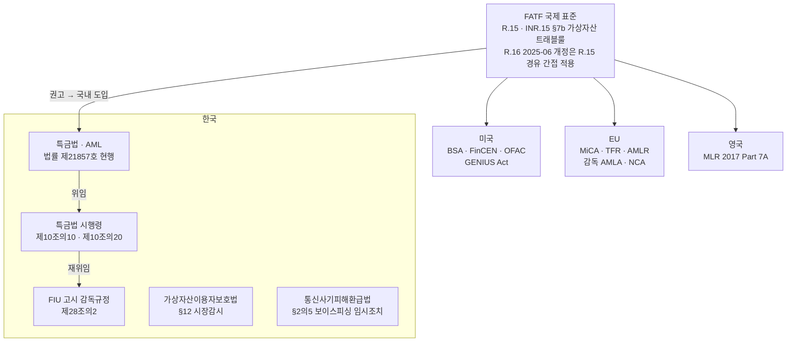
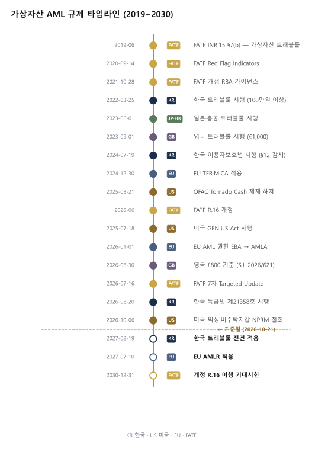
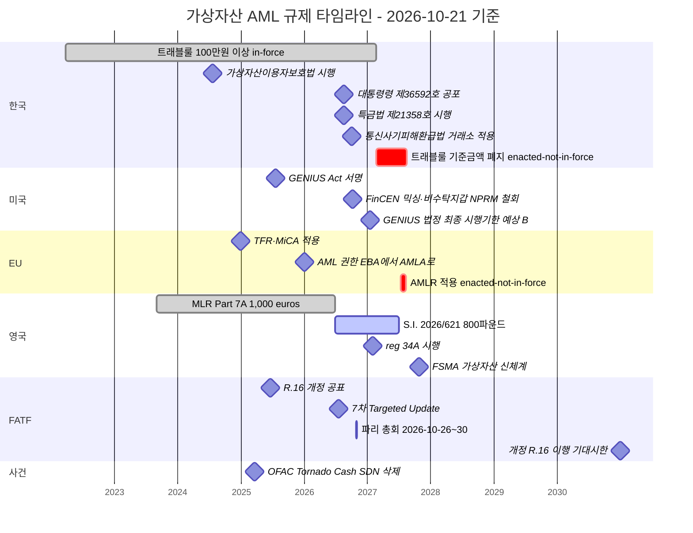

# 2️⃣ Regulations — 규제 맵

> 가상자산 AML 관련 규제의 **전체 지도**. 이 글은 이 폴더의 상세 문서를 언제 어떻게 읽어야 할지 안내합니다. 마지막 업데이트: 2026-10-21.

## 규제가 어떻게 흘러내리는가

가상자산 AML 규제는 **하나의 법**이 아니라 **여러 층의 규범**이 서로 참조하면서 작동합니다. 맨 위에 국제 표준이 있고, 그 아래에 각국이 자국 법으로 받아들이는 구조입니다. 한국 안에서도 다시 **법률 → 시행령 → 고시**로 내려가며, 트래블룰 금액 같은 실무 숫자는 대부분 아래층에 있습니다.

> VASP 트래블룰의 FATF 근거는 R.16 이 아니라 INR.15 §7(b) 입니다(KB 상충 레지스트리 CTR:00002).

### 이 구조를 어떻게 활용하나

- **한국 VASP 실무자**: FATF 원문을 직접 준수할 의무는 없지만, **특금법 조항의 논리적 근거**를 찾으려면 FATF를 참조.
- **해외 진출 검토자**: 해당 관할의 AML 법을 처음부터 배우기보다 **FATF 공통 구조에서 관할별 차이만 파악**하면 효율적. 단, 같은 FATF 문언이 관할마다 다른 금액 구조로 바뀐다는 점에 주의 — 의무에 금액이 붙는 A형(한국 ~2027-02-18), 의무는 전건이고 금액은 정보 깊이만 가르는 B형, 금액이 없는 C형([보고서](../../reports/가상자산%20AML%20KYT%20FDS%20트래블룰%20흐름.md)).
- **규제 변화 모니터링**: FATF 개정은 각국 개정의 선행 지표입니다. 다만 2026-07-16 FATF 7차 Targeted Update 기준 트래블룰을 입법한 관할의 60%(55/91)가 감독·집행 조치를 한 건도 하지 않았습니다 — 입법과 집행은 따로 봐야 합니다([보고서](../../reports/가상자산%20AML%20KYT%20FDS%20트래블룰%20흐름.md)).

---

## 영역별 문서 — 무엇을 읽어야 하나

| 파일 | 다루는 내용 | 먼저 읽어야 할 사람 |
|---|---|---|
| [`fatf.md`](fatf.md) | FATF 권고안 (R.15, R.16), 트래블룰, 상호평가 | 모든 사람 — 이게 기반 |
| [`korea-fiu-act.md`](korea-fiu-act.md) | 한국 특금법 — VASP 신고제, 트래블룰 위임 사슬(법률 → 시행령 → FIU 고시)과 2027-02-19 전환 | 한국 VASP 실무자 |
| [`korea-user-protection.md`](korea-user-protection.md) | 가상자산이용자보호법(2024-07-19 시행) — §12 이상거래 상시감시, FDS·시장감시·STR 3분리, 통신사기피해환급법(거래소 2026-10-01~) | 한국 VASP (자산보호·시장감시·이용자보호 담당) |
| [`us-bsa-fincen.md`](us-bsa-fincen.md) | 미국 BSA, FinCEN, OFAC, GENIUS Act (스테이블코인) | 미국 진출 검토자·OFAC 담당자 |
| [`eu-mica-amlr.md`](eu-mica-amlr.md) | EU MiCA, AMLR, TFR (트래블룰) | EU 진출 검토자·글로벌 트래블룰 담당자 |
| [`asia-regs.md`](asia-regs.md) | 싱가포르·UAE·일본·홍콩 VASP 규제 비교 | 한국 VASP 글로벌 진출 검토자 |

---

## 적용 우선순위 (한국 법인·한국 신고 VASP 기준)

1. **🔴 1순위 (직접 적용)** — 한국 특금법 + 시행령 + FIU 고시, 가상자산이용자보호법, 통신사기피해환급법(2026-10-01~ 거래소)
2. **🟠 2순위 (글로벌 거래·해외 고객)** — FATF 표준, 외국 VASP와의 트래블룰 호환. 2027-02-19 부터는 해외 VASP 위험평가(감독규정 §28-2)가 한국법상 의무가 됨
3. **🟡 3순위 (해외 진출·자회사 시)** — EU MiCA·TFR, US BSA
4. **⚪ 항시 의식** — OFAC·UN 제재 (전 세계 적용)

### 이 우선순위를 어떻게 활용하나

신입 AML 담당자 교육은 이 순서대로 짜면 효율적입니다. 단 **제재(OFAC·UN)는 1일차부터 의식**하도록 교육 — 한국에만 영업해도 제재 스크리닝은 사실상 필수이기 때문입니다.

---

## 핵심 일정 — 2022~2030 규제 로드맵 (2026-10-21 기준)

> 막대 길이가 표시용인 항목(한국 2027-02-19 이후 180일, 영국 £800 365일, EU AMLR 30일)은 종료일을 뜻하지 않습니다. "B"는 보고서가 B 등급(T3 복수 출처 등)으로 표시한 항목입니다.

## 핵심 일정 — 상태별 표

| 일자 | 사건 | 관할 | 상태(2026-10-21) |
|---|---|---|---|
| 2022-03-25 | 한국 트래블룰(시행령 제10조의10, 100만원 이상) | KR | in-force → **2027-02-18 까지** |
| 2024-07-19 | 한국 가상자산이용자보호법 시행(§12 이상거래 감시) | KR | in-force |
| 2024-12-30 | EU TFR·MiCA 적용 | EU | in-force |
| 2025-03-21 | OFAC, Tornado Cash SDN 삭제 | US | 해제 완료 |
| 2025-06-18 | FATF R.16 개정 공표(VASP 는 R.15 경유) | INTL | 기준 채택, 이행 진행 |
| 2025-07-18 | 미국 GENIUS Act 서명 | US | enacted-not-in-force |
| 2026-01-01 | EU AML 권한 EBA → AMLA | EU | in-force |
| 2026-06-30 | 영국 S.I. 2026/621 — 1,000 euros → £800 | GB | in-force |
| 2026-07-16 | FATF 7차 Targeted Update | INTL | 발간 |
| 2026-08-18 | 한국 대통령령 제36592호 공포(트래블룰 기준금액 폐지) | KR | 본칙 in-force / 제10조의10·20 enacted-not-in-force |
| 2026-08-20 | 한국 특금법 제21358호 시행·감독규정 제2026-2호 | KR | in-force(§28-2 등 유예) |
| 2026-10-01 | 한국 거래소 보이스피싱 임시조치 의무 시행(통신사기피해환급법 제21503호) | KR | in-force |
| 2026-10-05~06 | 미국 FinCEN 믹싱 §311·비수탁지갑 NPRM 철회 | US | withdrawn |
| 2026-10-26~30 | FATF 파리 총회 | INTL | 예정 |
| 2027-01-18 | 미국 GENIUS 법정 최종 시행기한(예상, B) | US | enacted-not-in-force |
| 2027-02-01 | 영국 reg 34A(암호자산 코레스 관계 강화 CDD) | GB | enacted-not-in-force |
| **2027-02-19** | **한국 100만원 기준 폐지·해외 VASP/자기수탁 차등** | KR | enacted-not-in-force |
| 2027-02 중 | 한국 감독규정 §28-2 시행(기산점에 따라 02-19 또는 02-21, 미확정) | KR | enacted-not-in-force |
| 2027-07-10 | EU AMLR 적용(익명성강화코인 취급 금지 포함) | EU | enacted-not-in-force |
| 2027-10-25 | 영국 FSMA 가상자산 신체계 | GB | enacted-not-in-force |
| 2030-12-31 | 개정 R.16 이행 기대시한 | INTL | — |

출처: [보고서 연대기 표·"2026-10-22 이후" 절](../../reports/가상자산%20AML%20KYT%20FDS%20트래블룰%20흐름.md). 종전 판의 "MiCA grandfathering 종료 2026-07-01", "GENIUS 시행규정 마감 2026-07-18", "AMLA 직접 감독 2028-01-01", "R.16 발효 2030-12-01"은 근거를 재확인하지 못했거나 보고서와 달라 삭제·정정했습니다.

### 실무 포인트

2027년 1분기에 일정이 몰려 있습니다 — GENIUS 예상 시행(2027-01-18, B), 영국 reg 34A(2027-02-01), **한국 트래블룰 전환(2027-02-19)**, 영국 FSMA 인가 신청 마감(2027-02-28). 한국 VASP 는 2027-02-19 전환과 감독규정 §28-2 시행일 확정 여부를 같은 분기에 추적해야 합니다.

---

## 이 폴더 전체를 관통하는 2가지 원리

### 1. FATF가 원형, 각국이 변형

한국·미국·EU 법을 각각 배우려 하면 무한 반복처럼 느껴집니다. 그러나 **핵심은 FATF 권고 몇 개**이고, 각국은 이를 자국 법 체계에 맞게 변형합니다. 변형은 주로 **"의무를 부과하는 조문"과 "수치를 정하는 조문"이 분리**되는 형태로 나타납니다 — 한국 트래블룰은 의무가 법률 §5의3 에, 금액이 시행령 §10의10 에, 2027년부터 1천만원 감시 금액이 FIU 고시 §28-2 에 있습니다.

### 2. 동시 적용이 표준

한국 VASP는 특금법(AML) + 이용자보호법(시장감시) + 통신사기피해환급법(보이스피싱)을 동시 적용받고, 글로벌 영업 시에는 여기에 미국 OFAC + EU TFR 까지 고려해야 합니다. 처음부터 **멀티 관할 설계**가 효율적입니다.
