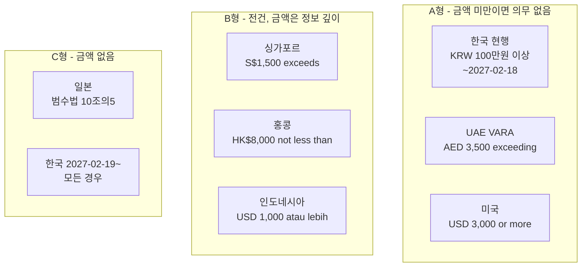
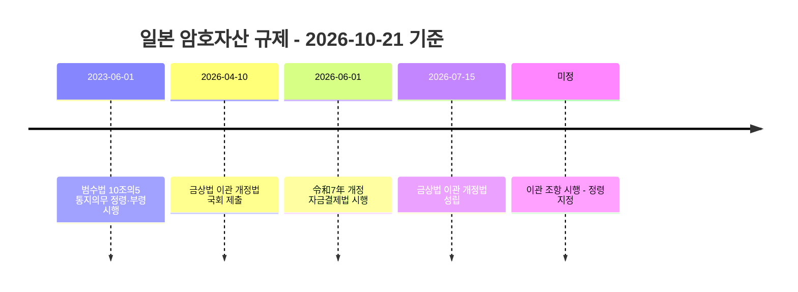

# 아시아 주요 VASP 규제 — 싱가포르·UAE·일본·홍콩 (+ 인도·인도네시아·대만·태국)

> 한국 VASP가 자주 마주치는 아시아·중동 관할의 핵심 법령·감독·트래블룰 구조를 **비교 가능한 수준**으로 정리. 금액 조문과 의무 조문을 따로 읽는 것이 이 노트의 핵심입니다. 마지막 업데이트: 2026-10-21.

## TL;DR

- **싱가포르 (MAS PSN02)**: 트래블룰은 **금액 무관 전건**. S$1,500 초과는 정보 항목과 신원 검증이 늘어나는 지점. PSN02는 2025-06-30 개정·2025-07-01 시행. MAS 스테이블코인 PSA 개정안은 2026-09-01~10-16 의견수렴(proposed, B)
- **UAE 두바이 (VARA)**: Rulebook III.G가 **AED 3,500 "exceeding"** 이전에 정보 의무를 건다 — 금액 미만이면 의무가 없는 **A형**. 이전 판의 "임계 0, 1 AED부터"는 틀렸다
- **일본**: 트래블룰 근거는 **범죄수익이전방지법 제10조의5**, 금액 조건 없음(2023-06-01~). 10만엔은 CDD 기준. 암호자산을 금융상품거래법으로 옮기는 개정법이 **2026-07-15 성립, 시행일 미정(enacted-not-in-force)** — 2026-06-01 시행된 令和7年 개정 자금결제법과는 별개 법
- **홍콩 (AMLO Sch.2 s.13A)**: 금액 무관 전건, HK$8,000 "not less than"이면 정보 심화. **2023-06-01 시행**(즉시전송은 2024-01-01까지 과도조치, B). VATP 인가 **13개**(2026-10-16), 스테이블코인 발행 인가 **2개**(2026-04-10)
- 한국은 **2027-02-18까지 100만원 이상(A형)**, **2027-02-19부터 전건**(enacted-not-in-force)

---

## 0. 금액 구조로 먼저 나눈다

유형: **A** 의무 자체에 금액(미만이면 대상 아님) · **B** 의무는 전건, 금액은 정보 깊이만 · **C** 금액 없음.

근거: [법제처 DRF 시행예정 판본](https://www.law.go.kr/DRF/lawService.do?OC=test&target=eflaw&MST=288765&efYd=20270219&type=XML), [VARA Rulebook III.G](https://rulebooks.vara.ae/node/146), [MAS PSN02](https://www.mas.gov.sg/-/media/amld-amendments---30-june-2025/mas-notice-psn02-amendment--new.pdf), [e-Gov 범수법 제10조의5](https://laws.e-gov.go.jp/api/1/articles;lawId=419AC0000000022;article=10%E3%81%AE5), [OJK SEOJK 16/2025](https://ojk.go.id/id/regulasi/Pages/SEOJK-16-SEOJK07-2025-Penerapan-Program-APU-PPT-dan-Pencegahan-Pendanaan-Proliferasi-Senjata-Pemusnah-Massal-Pedagang-AKD.aspx). 한국 2027 규율은 1천만원 이상 "자체 의심거래 감시체계"가 따로 붙어 단순 C형은 아니다 — [`korea-fiu-act.md`](korea-fiu-act.md).

---

## 1. 싱가포르 — MAS PSN02

### 핵심 법령·감독
- **MAS (Monetary Authority of Singapore)** — 중앙은행 + 금융감독
- **PSA (Payment Services Act 2019)** — DPT(Digital Payment Token) 서비스 라이선스 근거
- **MAS Notice PSN02** — DPT 서비스 AML/CFT 의무. 2024-04-02 발행, **2024-04-04 효력**, **2025-06-30 개정 → 2025-07-01 효력**. 2026년 추가 개정은 확인되지 않았다([MAS PSN02](https://www.mas.gov.sg/-/media/amld-amendments---30-june-2025/mas-notice-psn02-amendment--new.pdf))
  - 근거 법률 주의: PSN02는 금융서비스시장법 2022 제16조에 근거해 발령된다. PSA는 DPT 서비스 *라이선스*의 근거다

### 트래블룰 (PSN02 ¶13)
- **금액 무관 전건 적용**. S$1,500 이하(¶13.4)에도 송·수신인 성명·계좌번호(또는 고유거래참조번호) 4항목을 동반
- **S$1,500 초과**(¶13.6): 송신인 신원확인·검증 의무가 더해지고 주소·고유식별번호·생년월일 중 하나가 추가
  - 경계 문언이 「below or equal to / exceeds」이므로 **정확히 S$1,500은 하위 구간**
- **¶13.8**: S$1,500 초과 이전에서 싱가포르 내 중개기관 앞 완화(고유거래참조번호 + 수익자 정보만, 요청 시 3영업일 내 제공) — 이전 판이 미확인으로 남겼던 조항, 확인 완료
- **¶13.9** "immediately and securely" 제출, **¶13.11** 미준수 시 "shall not execute or arrange for the value transfer"
- **¶6.27**: FATF 기준 감독을 받지 않는 상대와 DPT를 이전할 때 강화조치
- ¶13에 비호스팅 지갑 전용 조항은 없다. MAS 집행조치 색인(2026-05-25~10-14 구간)에 PSN02 ¶13 관련 건은 없다(B)

### 2026 변경
- **MAS PSA 개정 스테이블코인 체계 의견수렴**: 2026-09-01 공개, 2026-10-16 마감(**proposed**, B). 신규 "stablecoin issuance" 라이선스, 발행자의 추적·동결·소각 기술능력 등이 제안됐다([Allen & Gledhill](https://www.allenandgledhill.com/sg/perspectives/articles/33474/sgkh-mas-consults-on-amendments-to-payment-services-act-2019-to-implement-stablecoin-regulatory-framework))
- 사기 대응: Shared Responsibility Framework(2024-12-16)는 금융회사에 실시간 사기감시 의무를 지웠다([MAS](https://www.mas.gov.sg/news/media-releases/2024/mas-and-imda-announce-implementation-of-shared-responsibility-framework-from-16-december-2024))

---

## 2. UAE — VARA(두바이) · 연방 CMA · ADGM · DFSA

### 핵심 구조
- **VARA (Virtual Assets Regulatory Authority)** — 두바이 가상자산 규제기관
- **연방 CMA(옛 SCA)** — 2026-04 가상자산 체계 발표, 규제활동을 3개에서 8개 범주로 확대(B)
- **ADGM FSRA**(아부다비 자유지대) · **DFSA**(DIFC) — 별도 자유지대 감독
- VARA Exchange Services Rulebook v2.1은 2026-03-31 시행(B)([Clyde & Co 2026-05](https://www.clydeco.com/en/insights/2026/05/uae-virtual-assets-update-q2-2026))

### VARA 트래블룰 (Compliance and Risk Management Rulebook Part III.G)
- **¶2**: "Prior to initiating any transfer of Virtual Assets with an equivalent value **exceeding AED 3,500**" 송·수신인 정보 확보·보유·당국 제공 → **A형**. 정확히 AED 3,500은 대상 외
- ¶3 수익 VASP 대칭 의무, ¶4·5 최소 항목(송신인 성명·계좌/지갑주소·주소, 수익자 성명·계좌/지갑주소)
- **¶7**: "non-obliged entities (i.e. unhosted VA Wallets)" 위험 고려 의무
- **¶9**: 임계 회피 구조화(분할) 모니터링
- 근거: [VARA Rulebook III.G](https://rulebooks.vara.ae/node/146)(판본 2025-05-19). CBUAE·ADGM 규칙은 이번 기준일에 확인하지 않았다

이전 판의 "임계 0(1 AED부터) — 세계에서 가장 엄격", 라이선스 수수료·최소자본·심사 기간, 특정 거래소의 VARA 진출 사례는 원문 근거가 없거나 틀려 삭제했다. 연방 AML Decree-Law 관련 주장은 단일 블로그 출처(D)라 싣지 않는다.

---

## 3. 일본 — FSA(금융청) · 범죄수익이전방지법 · 자금결제법 · 금융상품거래법

### 트래블룰 — 범수법 제10조의5
- 근거는 자금결제법이 아니라 **범죄수익이전방지법 제10조의5**(암호자산 이전 통지의무). 「暗号資産交換業者は、顧客から依頼を受けて暗号資産の移転を行う場合…」 — **금액 조건 없음**
- 위임받은 시행규칙 제31조의7도 통지 항목만 정하고 금액이 없다
- 흔히 인용되는 **10만엔은 시행령 제7조 제1항 제1호의 特定取引 정의**로 **고객확인(CDD)** 을 발동시키는 기준이다. 문언도 「十万円を**超える**」(초과)다
- 시행: 관련 政令·内閣府令이 **2023-06-01** 시행([金融庁 2023-05-26](https://www.fsa.go.jp/news/r4/sonota/20230526/20230526.html))
- 비호스팅 지갑 취급의 1차 문언은 확보하지 못했다

### 두 개의 2026 개정 — 섞지 말 것

| 법 | 핵심 | 상태(2026-10-21) |
|---|---|---|
| 令和7年 개정 자금결제법 | 중개업 신설 등 | **2026-06-01 시행**(이전 조사 근거) |
| 金融商品取引法及び資金決済に関する法律の一部を改正する法律 | 암호자산 규제를 자금결제법 → **금융상품거래법**으로 이관, 정보공표·불공정거래 규제 | 2026-04-10 국회 제출, **2026-07-15 성립**, 이관 조항 **시행일 미정(enacted-not-in-force)** |

근거: [金融庁 국회 제출 법안](https://www.fsa.go.jp/common/diet/index.html). 공포일·법률번호·정령 시행기한은 단일 2차 출처라 확정하지 않았다. 범수법 제10조의5의 2026-07-30 이후 개정은 확인되지 않았다(B, 부재 증거). 이전 판의 "2026 개정 자금결제법 2026-04 시행 예정" 서술은 두 법을 섞은 것이라 정정했다.

이전 판의 콜드월렛 95% 의무, JVCEA 화이트리스트 코인 수, 한국 거래소의 일본 진출·철수 서술은 이 저장소 기준일 근거로 확인하지 않아 삭제했다.

---

## 4. 홍콩 — SFC VATP · AMLO · HKMA 스테이블코인

### 트래블룰 — AMLO Cap.615 Sch.2 s.13A
- **금액 무관 전건 적용**. HK$8,000 미만에도 송·수신인 성명·계좌번호 4항목 동반
- **HK$8,000 "not less than"** 이면 송신인 주소·고객식별번호·신분증번호 또는 생년월일·출생지 추가 → **정확히 HK$8,000은 상위 구간**
- 시행: AMLO 개정·VATP 체제와 SFC AML 지침 개정은 **2023-06-01** 시행. SFC는 "as soon as practicable after the virtual asset transfer" 제출을 **2024-01-01까지** 과도조치로 수용했다(B)([Clyde & Co 2023-06-07](https://www.clydeco.com/en/insights/2023/06/hong-kong-virtual-assets-regulatory-update))
- 흔히 보이는 "홍콩 트래블룰 2024-06-01"은 어느 출처에서도 확인되지 않는다. 기존 SFO 인가 VATP의 12개월 과도기간 종료와 혼동된 것으로 보인다
- 자기수탁 지갑 이전에도 정보 수집·위험평가가 필요하다는 요약이 있다(B, 21 Analytics)

### 인가 현황 (공식 등록부)
- **SFC VATP 인가 13개**(2026-10-16 갱신, 최신 인가 2026-05-18), 심사 중 5개([SFC 명단](https://www.sfc.hk/en/Welcome-to-the-Fintech-Contact-Point/Virtual-assets/Virtual-asset-trading-platforms-operators/Lists-of-virtual-asset-trading-platforms))
- **HKMA 스테이블코인 발행 인가 2개**(2026-04-10 효력, 등록부 최종 갱신 2026-04-23, 이후 추가 없음)([HKMA 등록부](https://www.hkma.gov.hk/eng/regulatory-resources/registers/register-of-licensed-stablecoin-issuers/))

이전 판의 콜드월렛 97~98%, 보험 50%, PoR 분기 공개, 최소 자본, 심사 기간, 2024 이벤트 목록은 이 저장소 기준일 근거로 확인하지 않아 삭제했다.

---

## 5. 기타 아시아 관할 (2026-10-21)

| 관할 | 근거 | 금액 구조 | 상태 | 확신도 |
|---|---|---|---|---|
| 인도 | PMLA + FIU-IND VDA 가이드라인 | 임계 없음(T3) | in-force. **2026-09-09 FIU-IND가 역외 VDA 사업자 15곳에 PMLA 위반 통지**, 앱·URL 차단 요구 — 의무는 활동 기준으로 인도 내 소재와 무관([News on AIR](https://newsonair.gov.in/fiu-ind-cracks-down-on-15-vda-service-providers-over-pmla-non-compliance/)) | A(통지)/B·C(금액) |
| 인도네시아 | SEOJK 16/SEOJK.07/2025 | USD 1,000 "atau lebih" 이상/미만 2단 정보(B형) | in-force(2025-07-03) | A |
| 대만 | VASP AML 辦法 第7條 | NT$30,000 초과 심화(B) | enacted-not-in-force. 2026-08-04 2단계 시행 계획 발표(B) | B |
| 태국 | SEC 고시(2026-09-02 발표) | 금액 미확인 | enacted-not-in-force. 준수기한 2027-02-27, 자기수탁 지갑 소유·통제 검증 의무(B) | B |
| 호주 | AML/CTF Act s 66A | 법률상 금액 없음(C), Rules 금액 미확인 | in-force. Rules 시행일은 출처 간 상충이라 표기 안 함 | A(법률) |

---

## 6. 관할 종합 비교 (트래블룰·감독)

| 항목 | 🇰🇷 한국 | 🇸🇬 싱가포르 | 🇦🇪 UAE(VARA) | 🇯🇵 일본 | 🇭🇰 홍콩 |
|---|---|---|---|---|---|
| AML 감독 | FIU | MAS | VARA | FSA | SFC |
| 트래블룰 근거 | 특금법 §5-3, 시행령 §10-10 | PSN02 ¶13 | Rulebook III.G | 범수법 §10-5 | AMLO Sch.2 s.13A |
| 의무 발동 | 현행 **100만원 이상** → 2027-02-19 **전건** | 금액 무관 전건 | **AED 3,500 초과** | 금액 무관 전건 | 금액 무관 전건 |
| 정보 심화 기준 | 2027~: 요청 시 추가정보(3영업일) | S$1,500 초과 | — | 없음 | HK$8,000 이상 |
| 자기수탁 지갑 | 2027-02-19~ 동일인 간만 허용 | ¶13 전용 조항 없음 | ¶7 위험 고려 | 1차 문언 미확보 | 정보 수집·위험평가(B) |
| 2026 주요 변경 | 대통령령 제36592호(2026-08-18) | 스테이블코인 PSA 개정안(proposed) | CMA 체계 확대(B) | 금상법 이관법 성립 | VATP 13·발행 인가 2 |

---

## 7. 실무 포인트

### 상대 관할의 금액 구조를 거래 정책에 반영
- **A형 상대(UAE AED 3,500 이하, 미국 $3,000 미만)** 에서는 상대가 정보를 보내지 않아도 상대 쪽에선 합법일 수 있다. 한국이 2027-02-19 전건 체계로 바뀌면 이 구간이 sunrise와 같은 문제가 된다
- **B형 상대(싱가포르·홍콩·인도네시아)** 는 금액 미만에도 기본 4항목이 온다. 금액 이상에서 오는 추가 항목을 수신 측 데이터 모델이 받을 수 있어야 한다
- 경계 문언(초과 vs 이상)을 룰 엔진에 그대로 옮긴다: S$1,500은 하위, HK$8,000은 상위, AED 3,500은 대상 외

### 확인 경로
- 등록부: SFC VATP 명단, HKMA 발행자 등록부, ESMA CASP 등록부(EU)
- 조문: MAS PSN02 PDF, VARA Rulebook, e-Gov 法令API
- 상태 변화: MAS 의견수렴 후속 법안, 일본 이관 조항 시행 정령, 대만·태국 시행 일정

이전 판의 "한국 VASP 진출 의사결정 가이드"(라이선스 비용·기간 추정, 진출 패턴 3가지)는 근거 없는 수치와 사업전략 서술이라 삭제했다.

## 더 읽을거리

- [`fatf.md`](fatf.md) — FATF 권고 원형
- [`korea-fiu-act.md`](korea-fiu-act.md) — 한국 특금법 비교 기준
- [`eu-mica-amlr.md`](eu-mica-amlr.md) — EU 규제 비교
- [`us-bsa-fincen.md`](us-bsa-fincen.md) — 미국 규제 비교
- [`../3-crypto-aml/travel-rule.md`](../3-crypto-aml/travel-rule.md) — 17개 관할 트래블룰 비교
- [MAS PSN02 (2025-06-30 개정판)](https://www.mas.gov.sg/-/media/amld-amendments---30-june-2025/mas-notice-psn02-amendment--new.pdf)
- [VARA Rulebook Part III.G](https://rulebooks.vara.ae/node/146)
- [e-Gov 범수법 제10조의5](https://laws.e-gov.go.jp/api/1/articles;lawId=419AC0000000022;article=10%E3%81%AE5)
- [金融庁 국회 제출 법안](https://www.fsa.go.jp/common/diet/index.html)
- [SFC VATP 명단](https://www.sfc.hk/en/Welcome-to-the-Fintech-Contact-Point/Virtual-assets/Virtual-asset-trading-platforms-operators/Lists-of-virtual-asset-trading-platforms)
- [HKMA 스테이블코인 발행자 등록부](https://www.hkma.gov.hk/eng/regulatory-resources/registers/register-of-licensed-stablecoin-issuers/)
