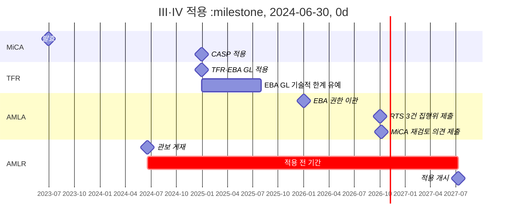
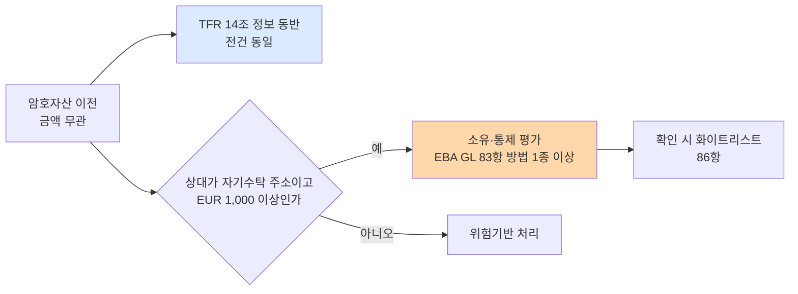

# EU — MiCA, AMLR/AMLD6, TFR

> EU의 가상자산 규제 **3종 세트**: MiCA(시장규제) + AMLR/AMLD6(AML) + TFR(트래블룰). 이 글을 읽고 나면 EU 트래블룰이 왜 "금액 기준 없음"이면서도 EUR 1,000이라는 숫자를 갖는지, MiCA의 "발효"와 "적용"이 왜 다른 날짜인지, 그리고 2026-01-01 AMLA로 권한이 넘어간 뒤 AML 본체(AMLR)가 2027-07-10까지 아직 적용 전이라는 비대칭을 이해하게 됩니다. 마지막 업데이트: 2026-10-21.

## TL;DR
- **MiCA**(Regulation (EU) 2023/1114) — **발효 2023-06-29 / 적용개시: 스테이블코인(Title III·IV) 2024-06-30, CASP 2024-12-30**. "2024-12-30 전면 시행"은 두 날짜를 섞은 표현이다
- **TFR**(Regulation (EU) 2023/1113) + **EBA/GL/2024/11** — **2024-12-30 적용**(in-force). 가상자산 이전 정보 의무에는 **금액 기준이 없고**, EUR 1,000은 자기수탁 주소 소유·통제 평가의 발동선
- **AMLA** — **2026-01-01 EBA의 AML/CFT 규칙제정·가이던스 권한 이관**. 기존 EBA 가이드라인은 AMLA가 대체할 때까지 유효
- **2026-10-01 AMLA가 AMLR 최초 RTS 3건 최종안을 집행위에 제출**(채택 전). 2026-10-07 MiCA 재검토에 AML 우선과제 5개 제출
- **AMLR**(Regulation (EU) 2024/1624) — 2024-06-19 관보, **2027-07-10 적용 예정(enacted-not-in-force)**. 제79조 익명성강화코인 취급 금지 포함
- **ESMA 임시 CASP 등록부(2026-10-19)**: 379행·고유 LEI 376개
- **CASP** = Crypto-Asset Service Provider (≈ 한국 VASP)

---

## 1. EU 가상자산 규제 3종 세트 — 상태부터 구분

| 법령 | 정체성 | 핵심 일자 | 상태(2026-10-21) |
|---|---|---|---|
| **MiCA** (2023/1114) | 가상자산 **시장 규제**(인가·발행·영업행위) | 발효 2023-06-29 / 적용 2024-06-30(Title III·IV), 2024-12-30(CASP) | in-force |
| **TFR** (2023/1113) | EU **트래블룰** | 적용 2024-12-30 | in-force |
| **AMLR** (2024/1624) | AML **단일 규칙**(회원국 직접 적용) | 관보 2024-06-19 / 적용 2027-07-10 | enacted-not-in-force |
| **AMLD6** | AML **지침**(회원국 국내법화) | 이번 기준일 재확인 안 됨 | — |
| **AMLA** | EU AML 감독기구 | 2026-01-01 EBA 권한 이관 | 운영 중 |



근거: [EBA AML/CFT 페이지](https://www.eba.europa.eu/regulation-and-policy/anti-money-laundering-and-countering-financing-terrorism), [AMLA RTS 보도자료](https://www.amla.europa.eu/press-release-amla-finalises-key-standards-private-sector_en), [EUR-Lex OJ L 2024/1624](https://eur-lex.europa.eu/legal-content/EN/TXT/PDF/?uri=OJ:L_202401624), [EBA/GL/2024/11](https://www.eba.europa.eu/sites/default/files/2024-07/6de6e9b9-0ed9-49cd-985d-c0834b5b4356/Travel%20Rule%20Guidelines.pdf). MiCA 발효·적용 구분은 KB `REG:eu-mica`.

용어:
- **Regulation vs Directive** — Regulation은 회원국 법 변환 없이 직접 적용, Directive는 회원국이 국내법으로 옮겨야 작동.
- **발효(entry into force) vs 적용개시(date of application)** — EU 규정은 관보 게재 후 발효하고, 의무는 별도 적용일부터 생긴다.

---

## 2. MiCA — Markets in Crypto-Assets Regulation

### EU 통합 가상자산 시장 규제

MiCA는 Regulation이므로 27개 회원국에 동일 적용된다. 제3조 제1항 제5호가 "crypto-asset"을 "a digital representation of a value or of a right that is able to be transferred and stored electronically using distributed ledger technology or similar technology"로 정의하고, 인가·영업행위·발행 규율의 범위가 이 정의에서 갈린다(KB `DOC:eu-mica-2023-1114`).

- **발효**: 2023-06-29
- **적용개시**: 스테이블코인(ART·EMT, Title III·IV) 2024-06-30 → CASP 2024-12-30
- 회원국별 경과규정(grandfathering) 길이와 종료 시점은 이번 기준일 근거로 재확인하지 않았다

### 토큰 분류 — 3개 카테고리

1. **ART (Asset-Referenced Token)** — 여러 통화·자산 등을 참조
2. **EMT (E-Money Token)** — 단일 법정통화 참조
3. **기타 암호자산** — 위 둘을 제외한 것

### 인가와 등록부

- CASP 인가는 회원국 NCA가 발급하고, 인가 CASP는 다른 회원국에서 서비스를 제공할 수 있다(passporting)
- **ESMA 임시 CASP 등록부(CASPS.csv, 2026-10-19 갱신)**: **379개 데이터 행·고유 LEI 376개**. 본국별 DE 109 · FR 36 · NL 29 · CY 25 · MT 23 순. 인가 종료일이 기재된 행은 2건([ESMA CASPS.csv](https://www.esma.europa.eu/sites/default/files/2024-12/CASPS.csv))
- 행 수와 사업자 수는 완전히 일치하지 않을 수 있다(동일 LEI 다중행 3건). 2차 출처의 "280/300+/325" 같은 수치는 추출 시점 차이다

### MiCA 재검토와 AML (2026-10-07)

AMLA는 집행위의 MiCA 재검토 의견수렴에 AML/CFT 우선과제 5개를 제출했다([AMLA](https://www.amla.europa.eu/amla-identifies-amlcft-priorities-review-mica_en)):
1. 스테이킹·대출·차입을 규제체계로 편입 검토
2. DeFi의 실효적 통제자를 식별하는 법적 정의·공통 기준
3. 무인가 스테이블코인에 대한 EU 일관 접근
4. 특정 ART 발행자의 AML/CFT 규칙 편입 여부 재검토
5. 국경 간 감독을 위한 정보요건 명확화

MiCA 개정은 2026-10-21 기준 입법 제안 전 단계다.

### 실무 포인트

EU 진출을 검토할 때 "MiCA 시행 = 2024-12-30" 한 줄로 정리하면 스테이블코인 규율(2024-06-30)과 CASP 규율(2024-12-30), 그리고 아직 적용 전인 AML 본체(2027-07-10)가 뭉개집니다. 일정표는 위 gantt처럼 법령별로 따로 두는 것이 안전합니다.

---

## 3. TFR — 트래블룰 (EU 버전)

### 금액 기준이 없다 — 그리고 EUR 1,000은 다른 의무다

- **TFR 제14조 제1항**: 송신 CASP는 암호자산 이전에 송신인 성명·DLT 주소·계정번호·주소(또는 생년월일·출생지 등)·LEI 등을 동반시킨다 — 금액 기준 없음
- EBA는 TFR 전문 30항을 근거로 "all crypto-asset transfers are subject to the same requirements regardless of their amount and of whether they are domestic or cross-border transfers"라고 해석한다
- **EUR 1,000**은 자기수탁 주소와의 이전이 이 금액에 "amounts to or exceeds"할 때 그 주소의 **소유·통제를 평가**하게 하는 발동선이다(Art 14(5)·16(2))

### EBA 트래블룰 가이드라인 (EBA/GL/2024/11)

| 항목 | 단락 | 내용 |
|---|---|---|
| 일자 | 표지·¶10 | 2024-07-04 발간, 2024-12-30 적용 |
| 전송 인프라 | ¶21–23 | 정보를 "without gaps or errors" 전송·수신할 수 있어야 함 |
| 기술적 한계 유예 | ¶24 | **2025-07-31까지** 한시 예외 — 종료됨 |
| EUR 1,000 판정 | ¶81–82 | 수수료 제외, 이전 시점 환율 |
| 자기수탁 검증 방법 | ¶83 | 원격 온보딩 검증, 소액 송금(Satoshi test), 메시지 서명, 기타 기술적 수단 중 **최소 1종** |
| 방법 조합·화이트리스트 | ¶85–86 | 단일 방법이 불충분하면 조합. 확인된 주소는 화이트리스트(위험 변화 시 제거) |
| 고위험 요소 | §4.5 | 트래블룰 미이행 국가 소재 기관, 미인가 제3국 기관, 자기수탁 주소와의 이전, 반복 누락 기관 |
| 반복 누락 보고 | §4.7 | "repeatedly failing" 기관을 식별하면 3개월 안에 당국 보고 |

근거: [EBA/GL/2024/11](https://www.eba.europa.eu/sites/default/files/2024-07/6de6e9b9-0ed9-49cd-985d-c0834b5b4356/Travel%20Rule%20Guidelines.pdf). EU는 sunrise 상대와의 거래를 금지하지 않고 고위험 요소로 분류한다.



### 실무 포인트

EU 거래가 섞이면 금액 미만 이전을 건너뛰는 룰(한국 현행 100만원·미국 $3,000 구조)을 그대로 쓸 수 없습니다. 한국도 2027-02-19부터 다른 VASP로의 모든 이전에 정보제공 의무가 생기므로, 두 체계의 차이는 "자기수탁 검증 방법을 열거하는가(EU)"와 "동일인 요건만 두는가(한국 2027)"로 좁혀집니다.

---

## 4. AMLR + AMLD6 — AML 패키지

### 상태

- **AMLR**(2024/1624): 2024-06-19 관보 게재, **2027-07-10 적용 예정**(enacted-not-in-force). 제79조의 익명성강화코인 취급 금지도 이때부터다
- "EU 신 AML 체계가 시행 중"은 오류다 — MiCA·TFR은 적용 중이지만 AML 본체는 2027-07-10까지 적용 전이다
- AMLD6 전환 기한과 각 회원국 이행 현황은 이번 기준일 근거로 재확인하지 않았다

### AMLA RTS 3건 (2026-10-01 집행위 제출, 채택 전)

| RTS | AMLR 근거 | 내용 |
|---|---|---|
| ① 고객확인 | Art. 28(1) | CDD 세부 |
| ② 거래관계·일회성 거래 기준 | Art. 19(9) | 거래관계·일회성·연결거래 식별기준과 하한 |
| ③ 그룹 요건 | Art. 16(4)·17(3) | 그룹 차원 최소요건, 제3국 자회사·지점 추가조치 |

적용은 발효 후 6개월(축구 에이전트·구단은 2029-07-10)이다. 보도자료에 CASP 특칙 언급은 없고, CASP는 AMLR 의무주체로서 일반 규정을 적용받는다([AMLA](https://www.amla.europa.eu/press-release-amla-finalises-key-standards-private-sector_en)).

### CASP 관련 기존 가이드라인

EBA는 2024-01-16 ML/TF 위험요소 가이드라인에 CASP를 편입하며 "transaction monitoring tools and advanced analytics tools"를 요구했다(B)([CMS 요약](https://cms.law/en/bih/legal-updates/new-eba-guidelines-to-manage-aml-risks-as-part-of-the-activities-of-crypto-asset-service-providers)). 2026-01-01 이후에도 AMLA가 대체할 때까지 유효하다.

### 실무 포인트

2026-10-21 기준 EU CASP의 AML 실체 의무는 여전히 각 회원국의 AMLD 국내법 + EBA 가이드라인이 정합니다. AMLR 단일 규칙과 RTS는 "적용 전" 단계이므로, 정책 문서에서 AMLR 조문을 현행 근거로 인용하면 안 됩니다.

---

## 5. AMLA — EU AML Authority

### 정체성과 일정

- 본부: 프랑크푸르트
- **2026-01-01**: EU 차원의 AML/CFT 정책·가이던스 권한이 EBA에서 AMLA로 이관(AMLAR Art. 54). 그래서 2026년 이후 EU 차원의 AML 가이던스는 EBA가 아니라 AMLA 명의로 나온다([EBA](https://www.eba.europa.eu/regulation-and-policy/anti-money-laundering-and-countering-financing-terrorism))
- **2026-10-01**: AMLR RTS 3건 집행위 제출
- **2026-10-07**: MiCA 재검토 AML 우선과제 제출, EU 단일 AML/CFT 데이터베이스 기술기준 의견수렴 개시(B)

### 직접감독 대상

AMLA 직접감독 대상은 **6개 이상 회원국에서 영업하는 금융기관(그룹) 약 40개**이고 VASP 전용 목록이 아니다. 직접감독 대상 잠정목록이 공개됐는지, 그리고 CASP가 포함되는지는 **2026-10-21 기준 공개되지 않았다**(B, 이전 조사 근거).

### 실무 포인트

이전 판의 "대형 CASP의 관심사는 AMLA 직접감독 40개 포함 여부"는 선정 기준을 빼고 적은 서술이었다. 선정 기준은 업종이 아니라 다수 회원국 영업 여부이고, CASP 포함 여부는 미공개 상태다.

---

## 6. EU vs 한국 vs 미국 — 가상자산 AML 비교 (2026-10-21)

| 항목 | EU | 한국 | 미국 |
|---|---|---|---|
| 시장규제 | MiCA(in-force) | 가상자산이용자보호법 | 연방 단일 시장구조법 없음 |
| AML 본체 | AMLD 국내법 + EBA GL / AMLR은 2027-07-10 적용 예정 | 특금법 | BSA |
| 트래블룰 금액 구조 | 전건 동일 정보 | 현행 100만원 이상 → 2027-02-19부터 전건 | $3,000 이상 |
| 자기수탁 주소 | EUR 1,000 이상 소유·통제 평가, 방법 열거 | 2027-02-19부터 동일인 간 이전만 허용, 방법 미지정 | 명시 규정 없음(비수탁지갑 NPRM withdrawn) |
| AML 감독 | AMLA + 각국 NCA·FIU | FIU | FinCEN + OFAC |
| 스테이블코인 | MiCA Title III·IV | 별도 법제 미시행 | GENIUS Act(enacted-not-in-force) |

근거는 [`korea-fiu-act.md`](korea-fiu-act.md)·[`us-bsa-fincen.md`](us-bsa-fincen.md)와 위 각 절.

---

## 7. 한국 사업자가 EU 진출 시 체크

```
□ MiCA CASP 인가 회원국과 passporting 범위
□ ESMA 등록부에 상대 CASP가 있는지 (CASPS.csv)
□ TFR 14조 정보 — 금액 무관 전건 송수신
□ 자기수탁 주소 EUR 1,000 이상 — EBA GL ¶83 검증 방법 1종 이상, 화이트리스트 관리
□ 반복 정보 누락 상대 기관 — 식별 후 3개월 내 당국 보고 체계
□ 현행 근거(AMLD 국내법 + EBA GL)와 2027-07-10 AMLR·RTS를 분리한 정책 문서
□ AMLR 제79조 익명성강화코인 취급 금지(2027-07-10~) 대응
□ GDPR과 AML 기록보관의 관계 — TFR 전문 19항(GDPR 완전 준수) 확인
```

---

## 8. 주요 시점 정리

| 시점 | 사건 | 상태(2026-10-21) |
|---|---|---|
| 2023-05-31 | MiCA·TFR 규정 일자(KB 문서 기준) | — |
| 2023-06-29 | MiCA 발효 | — |
| 2024-01-16 | EBA ML/TF 위험요소 가이드라인에 CASP 편입(B) | in-force |
| 2024-06-19 | AMLR 관보 게재 | enacted-not-in-force |
| 2024-06-30 | MiCA Title III·IV(ART·EMT) 적용 | in-force |
| 2024-07-04 | EBA/GL/2024/11 발간 | in-force(2024-12-30~) |
| **2024-12-30** | **MiCA CASP 규율 적용 + TFR·EBA GL 적용** | in-force |
| 2025-07-31 | EBA GL ¶24 기술적 한계 유예 종료 | 종료 |
| **2026-01-01** | **EBA → AMLA AML 권한 이관** | in-force |
| **2026-10-01** | **AMLA RTS 3건 집행위 제출** | 제출(채택 전) |
| 2026-10-07 | AMLA MiCA 재검토 AML 우선과제 제출 | 의견 |
| 2026-10-19 | ESMA CASP 등록부 379행 | 데이터 |
| **2027-07-10** | **AMLR 적용 개시**(익명성강화코인 금지 포함) | enacted-not-in-force |

---

## 💼 실무 현장 (Industry Reality)

### 공개 데이터로 확인할 수 있는 것

- **CASP 인가 현황**은 ESMA CASPS.csv가 1차 자료다. 2026-10-19 기준 379행·376 LEI, 독일 109로 가장 많다. 이전 판의 "EU 전체 ~200개 CASP"는 근거가 없어 삭제했다
- **AMLA 공식 발표**는 amla.europa.eu 보도자료로 추적한다. 이전 판의 AMLA 예산·인원 수치는 공개 근거를 확인하지 못해 삭제했다

### 자기수탁 검증 운영

EBA GL ¶83의 네 가지 방법 중 무엇을 쓸지는 CASP 선택이다. 소액 송금(Satoshi test)과 메시지 서명은 주소에 대한 **통제**를 보여 줄 뿐 수익적 소유를 증명하지는 못한다. 자기수탁 소유 검증 방식을 학술적으로 평가한 2025~2026 논문은 확인되지 않았다.

### 이전 판에서 삭제한 것

특정 거래소의 인가 회원국 선택, NCA 심사 기간·거부율, 벤더 모듈 구매 사례, 컴플라이언스 인력 비중, 현금거래 한도, 기록 보존 연수 비교는 이 저장소 기준일 도시에가 원문으로 확인하지 않은 서술이어서 삭제했다.

### 자주 나오는 오해

- **"MiCA는 2024-12-30 전면 시행"** — 발효 2023-06-29, 스테이블코인 적용 2024-06-30, CASP 적용 2024-12-30.
- **"EU 트래블룰 임계값은 EUR 1,000"** — 정보 의무는 전건이다. EUR 1,000은 자기수탁 주소 소유·통제 평가 발동선.
- **"AMLR이 이미 시행 중"** — 2027-07-10 적용 예정. RTS도 2026-10-01 제출 단계로 채택 전.
- **"2026년 EBA가 새 AML 가이드라인을 냈다"** — 2026-01-01부터 EU 차원 AML 가이던스 권한은 AMLA에 있다.

---

## 더 읽을거리
- [`fatf.md`](fatf.md) — FATF 권고와의 관계
- [`korea-fiu-act.md`](korea-fiu-act.md) — 한국과 비교
- [`../3-crypto-aml/travel-rule.md`](../3-crypto-aml/travel-rule.md) — 관할별 트래블룰 비교
- [ESMA — MiCA 페이지](https://www.esma.europa.eu/esmas-activities/digital-finance-and-innovation/markets-crypto-assets-regulation-mica)
- [ESMA — 임시 CASP 등록부 CSV](https://www.esma.europa.eu/sites/default/files/2024-12/CASPS.csv)
- [AMLA — RTS 최종안 제출 (2026-10-01)](https://www.amla.europa.eu/press-release-amla-finalises-key-standards-private-sector_en)
- [AMLA — MiCA 재검토 AML 우선과제 (2026-10-07)](https://www.amla.europa.eu/amla-identifies-amlcft-priorities-review-mica_en)
- [EBA — AML/CFT 권한 이관 안내](https://www.eba.europa.eu/regulation-and-policy/anti-money-laundering-and-countering-financing-terrorism)
- [EBA/GL/2024/11 트래블룰 가이드라인 PDF](https://www.eba.europa.eu/sites/default/files/2024-07/6de6e9b9-0ed9-49cd-985d-c0834b5b4356/Travel%20Rule%20Guidelines.pdf)
- [EUR-Lex — AMLR OJ L 2024/1624](https://eur-lex.europa.eu/legal-content/EN/TXT/PDF/?uri=OJ:L_202401624)
