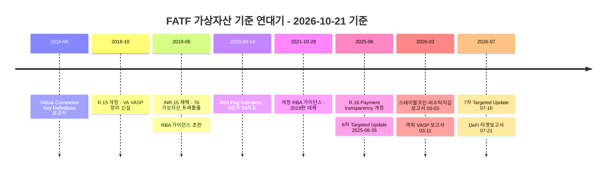
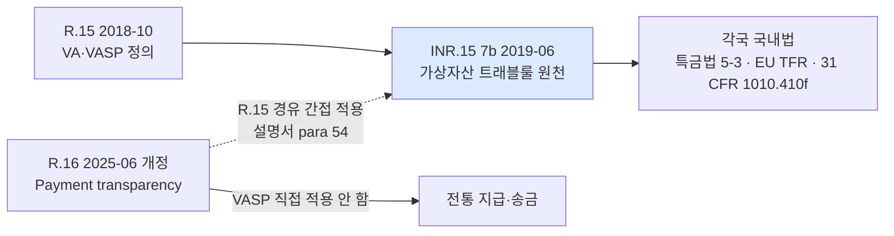
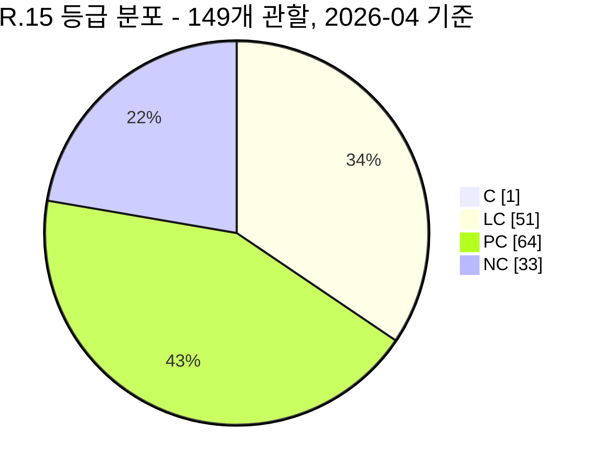
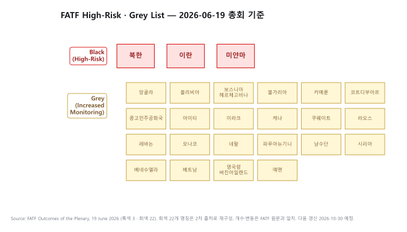
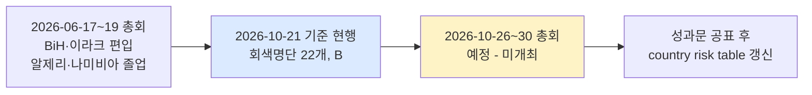
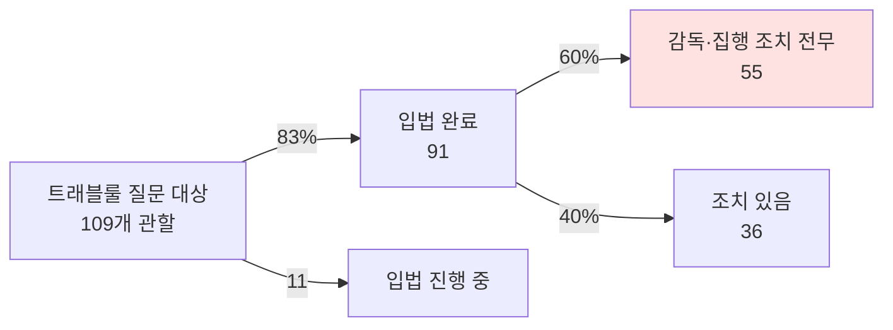

# FATF — 국제 자금세탁방지 표준

> Financial Action Task Force. 가상자산 AML의 **모든 룰의 출발점**. 이 글을 읽고 나면 가상자산 트래블룰의 국제기준 근거가 왜 R.16 본문이 아니라 INR.15 §7(b)인지, 2025-06 R.16 개정이 VASP에 어떤 경로로 들어오는지, 그리고 2026-07-16 7차 Targeted Update가 드러낸 "입법은 됐지만 집행은 비어 있는" 상태를 이해하게 됩니다. 마지막 업데이트: 2026-10-21.

## TL;DR
- FATF는 **법은 안 만들고 권고(Recommendation)** 를 낸다. 회원국은 이를 국내법으로 도입하고 **상호평가(ME)** 로 점수를 받으며, 결과가 나쁘면 **회색명단(강화 모니터링)** 에 오른다
- 가상자산 핵심: **R.15**(2018-10 개정으로 VA·VASP 정의 신설) + **INR.15 §7(b)**(2019-06 신설, 가상자산 트래블룰의 실제 원천). R.16 본문이 2019년에 개정된 것이 아니다
- **2025-06 R.16("Payment transparency") 개정**: VASP는 R.16 직접 적용이 아니라 **R.15 경유 간접 적용**, de minimis는 **USD/EUR 1,000 이하** 유지, 이행 기대시한 **2030년 말**
- R.16 이행 가이던스 초안 의견수렴은 **2026-06-24~08-21**에 진행됐고, **2026-10-21 기준 최종본은 발간되지 않았다**(proposed, B)
- **7차 Targeted Update(2026-07-16)**: 트래블룰 입법 **83%(91/109)**, 그중 **60%(55/91)는 트래블룰 감독·집행 조치 전무**, R.15 평가 149개 관할 중 LC 이상 52개
- 한국: 2020 MER **R.15 "C"**(2019-06 가상자산 개정 이전 기준), 7차 TU 표에서는 개정 기준 미평가 **"N/A"**
- 회색명단은 **2026-06-19 총회 결과**가 기준일 현행본. 다음 총회는 **2026-10-26~30 예정(2026-10-21 기준 미개최)**

---

## 1. FATF 기본 구조 — 법 아닌 "권고"

### 왜 법이 아니라 권고인가

FATF는 조약 기구가 아니라 정부간 작업반(task force)이라 각국에 강제할 법적 수단이 없습니다. 권고는 soft law이고, 강제력은 상호평가와 회색명단 공개에서 나옵니다(아래 §6·§7). 저장소 KB도 `REG:intl-fatf-r15` 를 `binding: soft-law` 로 기록합니다.

설립 연도(1989)·40개 권고(1990)는 배경 정보일 뿐 이 저장소 기준일 도시에가 원문으로 검증한 범위 밖입니다. 회원 수·한국 가입 연도 같은 조직 통계도 같은 이유로 여기 적지 않습니다.

용어:
- **APG (Asia-Pacific Group on Money Laundering)** — FATF의 아시아·태평양 지역 그룹(FSRB).
- **FSRB** — FATF-Style Regional Body. 7차 TU 설문 응답 147개 관할은 FATF 38 + FSRB 109로 구성됐다([7차 TU PDF](https://www.fatf-gafi.org/content/dam/fatf-gafi/reports/7th-targeted-update-on-implementation-fatf-standards-vas-vasps-2026.pdf.coredownload.pdf)).
- **CFT / CPF** — 테러자금조달방지 / 대량살상무기 확산금융 차단.
- **VACG (Virtual Assets Contact Group)** — FATF 가상자산 작업반. 2025-09 가상회의, 2025-12 심포지엄, 2026-05 회의가 7차 TU 자료원이다.

### 실무 포인트

특금법·이용자보호법 조항이 왜 그렇게 설계됐는지 막히면 FATF 원문(권고·해석주석·가이던스)을 찾아보는 것이 최단 경로입니다. 다만 FATF 문서는 "기준(Standards)", "가이던스", "이행 보고서"의 성격이 다르므로 §9 표에서 구분해 읽어야 합니다.

---

## 2. FATF 권고 — 가상자산 핵심만

### FATF 가상자산 기준의 연대기

근거: [Red Flag PDF](https://www.fatf-gafi.org/content/dam/fatf-gafi/reports/Virtual-Assets-Red-Flag-Indicators.pdf)(2014 보고서를 자료원으로 명시), [2021 RBA 가이던스](https://www.fatf-gafi.org/content/dam/fatf-gafi/guidance/Updated-Guidance-VA-VASP.pdf.coredownload.pdf)(2018-10·2019-06 경과, 2019판 "incorporates and supersedes"), [R.16 개정 설명서](https://www.fatf-gafi.org/content/dam/fatf-gafi/recommendations/Explanatory%20note%20for%20revised%20R.16.pdf.coredownload.pdf), [7차 TU PDF](https://www.fatf-gafi.org/content/dam/fatf-gafi/reports/7th-targeted-update-on-implementation-fatf-standards-vas-vasps-2026.pdf.coredownload.pdf).

### Recommendation 15 — New Technologies

- 신기술(가상자산 포함)에서 발생하는 ML·TF 위험을 평가·관리할 의무
- **2018-10 개정**: 용어집에 가상자산(VA)·가상자산사업자(VASP) 정의 신설
- **2019-06 INR.15 채택**: VASP에 대한 라이선스·등록, 감독, 예방조치 적용. 임시거래 CDD 기준은 USD/EUR 1,000(§7(a); 일반 금융기관의 15,000보다 낮음 — 2021 가이던스 para 146·264)

### Recommendation 16 과 가상자산 트래블룰 — 원천은 INR.15 §7(b)

- 가상자산 트래블룰의 법적 원천은 **2019-06 신설된 INR.15 §7(b)** 다. 송신 VASP가 "required and accurate originator information and required beneficiary information"을 확보·보유하고 수신 VASP에 "immediately and securely" 제출하라는 문언에는 금액 기준이 없다([FATF Recommendations](https://www.fatf-gafi.org/content/fatf-gafi/en/publications/Fatfrecommendations/Fatf-recommendations.html))
- 2021 가이던스 para 178: "Recommendation 16 applies in an amended way to VAs as set out in paragraph 7(b) of INR.15"([2021 RBA 가이던스](https://www.fatf-gafi.org/content/dam/fatf-gafi/guidance/Updated-Guidance-VA-VASP.pdf.coredownload.pdf))
- **2025-06 R.16 개정**: 표제가 "Payment transparency"로 바뀌었지만 "FATF has agreed not to bring VASPs directly into the scope of R.16 but to apply the updated requirements indirectly through R.15"(설명서 para 54)

### Recommendation 1 — Risk-Based Approach

위험기반접근(RBA) — 모든 AML 의무의 운영 원칙. **R.1은 2025년에 개정됐고**, FATF는 2021 가상자산 가이던스 페이지에 "does not reflect … the 2025 revisions to Recommendation 1"이라는 경고문을 달았다([FATF 공식 페이지](https://www.fatf-gafi.org/en/publications/Fatfrecommendations/Guidance-rba-virtual-assets-2021.html)). 2021 가이던스의 RBA 서술은 최신 위험평가·금융포용 가이던스와 함께 읽어야 한다.

### Recommendation 10 (CDD) · 20 (STR) · 22 (DNFBP)

CDD·의심거래보고·비금융 전문직 의무의 국제 원형. 한국 조문과의 대응은 [`korea-fiu-act.md`](korea-fiu-act.md) 에서 다룹니다.

### 실무 포인트

사내 AML 정책 문서에 근거 권고를 적을 때 트래블룰 근거는 **"R.16"이 아니라 "R.15 / INR.15 §7(b)"** 로 적어야 원문과 맞습니다. 저장소 KB 상충 레지스트리 CTR:00002가 이 오류를 판정해 둔 항목입니다.

---

## 3. VASP 정의 — FATF Glossary

2021 가이던스 para 55 기준, 다른 사람을 위해 영업으로 다음 활동 중 하나 이상을 하는 자연인·법인이 VASP다([2021 RBA 가이던스](https://www.fatf-gafi.org/content/dam/fatf-gafi/guidance/Updated-Guidance-VA-VASP.pdf.coredownload.pdf)).

> 1. Exchange between virtual assets and fiat currencies
> 2. Exchange between one or more forms of virtual assets
> 3. Transfer of virtual assets
> 4. Safekeeping and/or administration of virtual assets or instruments enabling control over virtual assets
> 5. Participation in and provision of financial services related to an issuer's offer and/or sale of a virtual asset

해석 포인트(같은 가이던스):
- 동일 VASP 내부 이전도 (iii) 이전에 해당(para 64), 멀티시그라고 (iv) 면제가 되지 않음(para 73)
- 단순 소프트웨어 개발·판매, 언호스티드 지갑 공급자는 제외(para 76, 82–83)
- **DeFi**: "A DeFi application (i.e. the software program) is not a VASP" — 다만 통제력·충분한 영향력을 가진 사람은 VASP가 될 수 있다(para 66–69). 2026-07-21 DeFi 타겟보고서가 이 분석을 "updates and complements"한다([FATF DeFi 보고서](https://www.fatf-gafi.org/en/publications/Virtualassets/targeted-report-decentralised-finance-2026.html))

한국 특금법 정의와의 비교는 [`korea-fiu-act.md`](korea-fiu-act.md) 참조.

---

## 4. 트래블룰 핵심 요건 (INR.15 §7(b) + 2021 가이던스)

### 2021 가이던스가 정한 운영 규칙

| 쟁점 | 단락 | 내용 |
|---|---|---|
| 적용 범위 | para 179 | "Countries should treat all VA transfers as cross-border wire transfers" |
| 요구정보 | para 181–183 | 송금인: 성명·계좌(지갑주소)·주소/국가 ID/고객 ID/생년월일·출생지 중 하나. 수취인: 성명·계좌(지갑주소) |
| 즉시성 | para 185, 187 | 이전 이전·동시·병행 전송. "Post facto submission … should not be permitted" |
| 체인 외 전송 | para 188 | 정보를 VA 이전 자체에 붙일 필요 없음 — 오프체인 메시징 근거 |
| **de minimis** | para 191–192 | "Countries **may choose** to adopt a de minimis threshold for VA transfers of USD/EUR 1 000". 미만 이전에도 송수신인 성명 + 지갑주소(또는 거래참조번호)는 수집, 의심이 없으면 검증 불요 |
| 상대 VASP 실사 | para 196–199 | 3단계: 상대가 VASP인지 → 어느 VASP인지 → 적격성. 매 거래마다 할 필요는 없고 주기 갱신 |
| sunrise | para 200–201 | 계약·사업관행으로 상대에게 준수 요구, 내부이전 한정·확인된 본인(first-party) 이전만 허용 등 |
| unhosted | para 203–204 | 자기 고객 쪽 정보 확보, STR·제재 의무 적용, 추가 제한 선택 가능 |

para 197(a)는 "the FATF is not aware of any technically proven means of identifying the VASP that manages the beneficiary wallet exhaustively, precisely, and accurately … from the VA address alone"라고 인정한다. 주소만으로는 상대 VASP를 식별할 수 없다는 뜻이다.

### 관할별 금액 구조 — "임계값" 한 칸으로 적으면 틀린다

| 관할 | 근거 | 금액 구조 | 상태(2026-10-21) |
|---|---|---|---|
| FATF | INR.15 §7(b) | 의무에 금액 없음. USD/EUR 1,000 de minimis는 **국가 선택** | in-force(soft law) |
| 한국(현행) | 특금법 §5-3, 시행령 §10-10 ①호 | **KRW 1,000,000 이상**에만 의무(A형) | in-force, 2027-02-18까지 |
| 한국(2027-02-19~) | 대통령령 제36592호(2026-08-18 공포) | 다른 VASP로 이전하는 **모든 경우**. 1천만원 이상은 "자체 의심거래 감시체계" | enacted-not-in-force |
| 미국 | 31 CFR 1010.410(f) | **USD 3,000 "or more"**(A형) | in-force |
| EU | TFR(2023/1113) Art 14·16 | 정보는 전건 동일. EUR 1,000은 자기수탁 주소 소유·통제 평가 발동선 | in-force(2024-12-30 적용) |

근거: [법제처 DRF 시행예정 판본](https://www.law.go.kr/DRF/lawService.do?OC=test&target=eflaw&MST=288765&efYd=20270219&type=XML), [31 CFR 1010.410](https://www.law.cornell.edu/cfr/text/31/1010.410), [EBA/GL/2024/11](https://www.eba.europa.eu/sites/default/files/2024-07/6de6e9b9-0ed9-49cd-985d-c0834b5b4356/Travel%20Rule%20Guidelines.pdf). 전체 관할 비교는 [`../3-crypto-aml/travel-rule.md`](../3-crypto-aml/travel-rule.md).

### 실무 포인트

FATF의 USD/EUR 1,000은 **의무 발동선이 아니라 국가가 택할 수 있는 간소화 기준**입니다. 한국(현행)·미국처럼 금액 미만이면 의무가 없는 구조와, EU처럼 전건에 의무를 걸고 금액은 다른 의무(자기수탁 검증)만 발동시키는 구조를 한 표 칸에 섞으면 룰 엔진이 금액 미만 이전을 조용히 빠뜨립니다.

### R.16 2025-06 개정에서 VASP에 대해 확인된 것

개정 설명서로 확인되는 것은 세 가지뿐이다([R.16 개정 설명서](https://www.fatf-gafi.org/content/dam/fatf-gafi/recommendations/Explanatory%20note%20for%20revised%20R.16.pdf.coredownload.pdf)):

- de minimis는 **"no higher than USD/EUR 1,000"** 로 유지(para 33)
- VASP는 R.16 직접 적용 대상이 아니고 **R.15를 경유해 간접 적용**(para 54)
- 이행 기대시한 **2030년 말** — "The FATF will expect that most, or all of the new requirements are in effect by that date"(para 59)

이 노트의 이전 판에 있던 "임계값 €1~$3,000 범위 재량", "분기별 FIU 보고", "Protocol Interop 의무", "PII 보관기간 명시"는 설명서에 근거가 없어 삭제했다. 개정 R.16의 확대 정보항목과 평가방법론(Annex IV) 발효 상태는 이번 기준일에 재확인하지 못했다.

---

## 5. 2025-06 R.16 개정의 의미

### 왜 개정했나

기존 R.16은 전통 전신송금 중심이었다. 2차 요약(T2: CSSF·FIAU·OJK)으로 확인되는 개정 방향은 지급 사슬상 책임 명확화, 국경 간 지급 정보 표준화, 사기·오류 방지(수취인 계좌 확인), 2030년 말 이행이다(B). VASP에 대한 실체적 변경은 위 §4대로 R.15를 거쳐서만 들어온다.

### 일정과 상태

| 항목 | 일자 | 상태(2026-10-21) |
|---|---|---|
| R.16 개정 공표 | 2025-06-18(2025-06 총회) | 기준 채택 |
| 이행 가이던스 초안 공개의견수렴 | 2026-06-24 ~ 2026-08-21 | 마감, **최종본 미발간**(proposed, B) |
| 이행 기대시한 | 2030-12-31 | — |

의견수렴 일정 근거: [FIAU Malta 요약](https://fiaumalta.org/news/latest-updates-from-the-fatf/)(FATF 원 페이지는 접근 차단으로 직접 확인 못 함). 최종본 여부는 2026-10-26~30 총회 이후 확인 대상이다.

### 실무 포인트

2025-06 개정은 VASP에게 "지금 당장의 의무 변경"이 아니라 "2030년 말까지 각국 R.15 이행을 통해 들어올 변경"입니다. 트래블룰 시스템을 새로 고를 때는 현행 국내 조문뿐 아니라 이 경로로 들어올 변경을 수용할 수 있는지를 함께 봐야 합니다. 한국은 R.16 개정과 별개로 2027-02-19 국내 시행령 개정이 먼저 시행됩니다.

---

## 6. 상호평가 (Mutual Evaluation, ME) 와 R.15 등급

### 메커니즘

FATF가 회원국의 AML·CFT 이행을 평가하는 공식 절차. 기술적 이행(Technical Compliance)과 효과성(Effectiveness) 두 축으로 보고, 기술적 이행은 **C**(Compliant) / **LC**(Largely Compliant) / **PC**(Partially Compliant) / **NC**(Non-Compliant)로 매긴다. 평가 이후 후속보고서(FUR)로 등급이 재평가되기도 한다.

### 한국의 R.15 등급 — 두 가지를 구분해야 한다

| 문서 | 한국 R.15 | 읽는 법 |
|---|---|---|
| 4차 상호평가 보고서(2020-04-16 공개, 2020-02 총회 채택) | **"C"**, R.16은 "LC" | **2019-06 가상자산 개정 이전 기준**으로 매긴 등급 |
| 7차 TU Annex A(2026-07-16) | **"N/A"** | 개정 R.15 기준으로 아직 평가받지 않았다는 표시 |

근거: [FATF 한국 MER 2020](https://www.fatf-gafi.org/en/publications/Mutualevaluations/Mer-korea-2020.html), [7차 TU PDF](https://www.fatf-gafi.org/content/dam/fatf-gafi/reports/7th-targeted-update-on-implementation-fatf-standards-vas-vasps-2026.pdf.coredownload.pdf) Annex A 각주 3("For jurisdictions which have not been assessed against the revised FATF Standards on VAs and VASPs, the R.15 rating is marked as not applicable (N/A)"). 이전 판의 "4차 ME에서 가상자산 영역 PC" 서술은 원문과 달라 삭제했다.

같은 Annex A 표의 한국 행: 위험평가 Yes · 명시적 금지 No · VASP 입법 Yes · **스테이블코인 발행자 등록·인가 요구 No** · 감독검사 Yes · 집행 Yes · 트래블룰 입법 Yes(2026-02~06 자기보고 기준).

### 7차 TU의 R.15 등급 분포 (2026-04 기준, 149개 관할)

2025년(138개)은 C 1 · LC 40(29%) · PC 68(50%) · NC 29(21%)였다. 모집단이 매년 늘어나므로 백분율만 비교하면 오독한다(7차 TU para 5–6).

### 한국 5차 평가 일정

5차 평가 일정은 이 저장소 기준일(2026-10-21) 근거로 재확인되지 않았다. 확정 일정이 공표되면 FATF 평가 캘린더와 FIU 보도자료로 갱신한다.

---

## 7. 회색명단 · 흑색명단

### 기준일의 현행본은 2026-06-19 총회 결과다

- **2026-06-17~19 총회**: 보스니아헤르체고비나·이라크를 강화 모니터링 대상(회색명단)에 추가, 알제리·나미비아는 졸업([FATF 2026-06 총회 결과](https://www.fatf-gafi.org/en/publications/Fatfgeneral/outcomes-fatf-plenary-june-2026.html))
- 그 결과 회색명단은 **22개 관할**이다(B — 개수는 2차 재구성과 일치하나 FATF 목록 페이지는 직접 열지 못함)
- 이전 판 예시의 "나미비아"는 2026-06-19 해제됐고, "필리핀"은 현행 명단에 없다
- 개별 22개국 명단과 흑색명단 구성은 FATF 원문 페이지로 확인하고 쓴다. 이 저장소 기준일 근거로는 개별 국가명을 확정하지 않았다
- **다음 총회: 2026-10-26~30, 파리**(FATF 일정표상 총회·작업반 주간, 영국 의장국 첫 총회). **2026-10-21 기준 미개최**이므로 10월 명단 변동은 아직 없다([FATF 일정표](https://www.fatf-gafi.org/en/calendars/events.html))

### 왜 무서운가

회색명단은 법적 제재가 아니지만, 각국 금융기관이 이를 위험평가 입력으로 쓰기 때문에 해당 관할과의 거래에 강화 실사가 붙는다. 2021 가이던스 para 199는 라이선스·등록을 효과적으로 이행하지 않는 국가의 VASP를 모두 고위험으로 지정하는 선택지를 두고, 7차 TU Annex A가 이를 그대로 인용한다. 등재가 특정 국가 경제에 준 영향의 수치는 이 저장소 근거 범위 밖이라 싣지 않는다.

### 실무 포인트

사내 정책에서 "회색·흑색명단 관할 고객은 EDD 대상"으로 두는 경우, **명단 버전 일자(예: 2026-06-19판)를 정책에 함께 기록**해야 검사 때 어느 판을 적용했는지 설명할 수 있습니다. 한국 2027-02-19 규율도 FATF 고위험국 소재 해외 VASP와의 이전을 제한 대상으로 둡니다([`korea-fiu-act.md`](korea-fiu-act.md)).

---

## 8. Sunrise Issue — 입법 격차에서 집행 격차로

- 원래 의미: A국은 트래블룰을 시행했는데 B국은 안 해서, B국 VASP가 정보를 받을 체계가 없는 상태
- 2021 가이던스 대응(para 200–201): 단계적 집행 허용, 계약·사업관행으로 상대에게 준수 요구, 내부이전·확인된 본인 이전만 허용 등
- **2026-07-16 7차 TU가 보여 준 변화**: 입법은 83%(91/109)로 올랐지만 입법 관할의 60%(55/91)는 트래블룰 관련 지적·지시·집행·감독조치가 전혀 없었다(para 25). FATF는 "persistent gaps in Travel Rule implementation remain a serious concern"이라 썼다(para 26)
- 같은 보고서 요약문은 이 수치를 "almost half"로 표현해 본문과 어긋난다. 인용할 때는 본문 para 25의 60%(55/91)를 쓴다

프로토콜 연동 방식은 [`../3-crypto-aml/travel-rule.md`](../3-crypto-aml/travel-rule.md)·[`../4-technology/travel-rule-protocols.md`](../4-technology/travel-rule-protocols.md) 참조.

---

## 9. FATF 발간물 — 가상자산 관련 필수 문서

| 문서 | 발간 | 성격 | 2026-10-21 기준 읽는 법 | KB 문서 ID |
|---|---|---|---|---|
| [Red Flag Indicators of ML/TF](https://www.fatf-gafi.org/en/publications/Methodsandtrends/Virtual-assets-red-flag-indicators.html) | 2020-09-14 | 비구속 유형론, 6범주·상위 지표 58개·사례 13건 | 현행 유일판. 감독 체크리스트로 쓰지 말라고 명시(para 20). 2021년 이후 유형은 없음 | `DOC:intl-fatf-va-red-flags-2020` |
| [Updated Guidance for a RBA to VAs and VASPs](https://www.fatf-gafi.org/en/publications/Fatfrecommendations/Guidance-rba-virtual-assets-2021.html) | 2021-10-28 | 가이던스, 단락 1–357, 2019판 대체 | in-force. 2025 R.1 개정 미반영 고지 | `DOC:intl-fatf-va-rba-2021` |
| [Explanatory Note for Revised R.16](https://www.fatf-gafi.org/content/dam/fatf-gafi/recommendations/Explanatory%20note%20for%20revised%20R.16.pdf.coredownload.pdf) | 2025-06-18 | 기준 개정 설명서 | para 33·54·59 | `DOC:intl-fatf-r16-explanatory-note` |
| [6차 Targeted Update](https://www.fatf-gafi.org/content/dam/fatf-gafi/recommendations/2025-Targeted-Upate-VA-VASPs.pdf.coredownload.pdf) | 2025-06-26 | 이행 점검 | 7차로 갱신됨 | — |
| [Best Practices on Travel Rule Supervision](https://www.fatf-gafi.org/content/dam/fatf-gafi/recommendations/Best-Practices-Travel-Rule-Supervision.pdf) | 2025-06-26 | 감독 모범사례 | 존재만 확인, 내용 미정독 | — |
| [스테이블코인·비수탁지갑 타겟보고서](https://www.fatf-gafi.org/en/publications/Virtualassets/targeted-report-stablecoins-unhosted-wallets.html) | 2026-03-03 | 타겟보고서 | "FATF Standards do not require jurisdictions to adopt regulatory frameworks for stablecoin arrangements beyond those already applicable to VASPs" | — |
| [역외 VASP(oVASP) 보고서](https://www.fatf-gafi.org/en/publications/Virtualassets/Understanding-Mitigating-Risks-Offshore-VASPs.html) | 2026-03-11 | 타겟보고서 | 활동기반 접근 채택 46% | — |
| [7차 Targeted Update](https://www.fatf-gafi.org/content/dam/fatf-gafi/reports/7th-targeted-update-on-implementation-fatf-standards-vas-vasps-2026.pdf.coredownload.pdf) | 2026-07-16 | 이행 점검, PDF 34쪽, 147개 관할 응답 | 아래 수치표 | `DOC:intl-fatf-tu7-2026` |
| [DeFi 타겟보고서](https://www.fatf-gafi.org/en/publications/Virtualassets/targeted-report-decentralised-finance-2026.html) | 2026-07-21 | 타겟보고서(기준 변경 아님) | 2021 가이던스 DeFi 분석 갱신 | — |
| R.16 이행 가이던스 초안 | 2026-06-24 의견수렴 개시, 08-21 마감 | 가이던스 초안 | proposed, 최종본 미발간(B) | — |

### 7차 TU 핵심 수치 (2026-07-16)

| 지표 | 2025(6차) | 2026(7차) | locator |
|---|---|---|---|
| R.15 LC 이상 | C 1 + LC 40 / 138 | **C 1 + LC 51 / 149** | para 5–6 |
| 트래블룰 입법 완료 | 73%(85/117) | **83%(91/109)** | para 24 |
| 입법 관할 중 TR 감독·집행 전무 | 59%(50/85) | **60%(55/91)** | para 25 |
| 라이선스·등록 요구 | — | 73%(95/130) | para 18 |
| 실제 인가·등록 발급 | 65%(76/117) | **58%(76/130)** | para 18 |
| 역외 VASP 인가 요구 | 37%(35/96) | 34%(39/114) | para 21 |
| 금지 접근(부분+전면) | 20% | 23%(33/144) | para 12, 14 |
| P2P 고위험 평가 / 시장지표 수집 | — | 88%(58/66) / 23%(31/133) | para 38 |
| DeFi 위험평가 완료 / 인가 부과 / 실제 등록 / 집행 | — | 18%(26/142) / 4개 / 2개 / 1개 | para 46–47 |

설문 무응답 58/205개 관할은 진전 없음으로 추정 처리됐다(para 3, 각주 4).

### 7차 TU가 새로 넣은 것

- **블록체인 분석 권고**: VASP는 "identify suspicious patterns … and detect rapid transfer of VAs using transactions monitoring and blockchain analytics tools"(민간 권고 6-ii). 통제 요소로 "KYC, wallet screening, blacklisting, and, where appropriate, whitelisting mechanisms as well as freezing and blocking capabilities"(5-ii)
- **역외 VASP 위장 탐지**: 소매 사용자로 위장한 역외 VASP 계정 탐지, 고위험 관계 제한·종료, 무인가 플랫폼 연계 온·오프램프 모니터링(6-iii). 브리지·믹서·크로스체인 노출 평가(6-iv)
- **위험 서술**: 캄보디아 소재 금융 복합체가 2021-08~2025-01 최소 USD 40억 세탁(그중 최소 USD 3,700만이 DPRK 탈취자금, para 29–30), "immune to asset freezing"을 내세운 자체 스테이블코인 발행(para 35 — 발행자 동결 기능에 기댈 수 없을 수 있음), 딥페이크 면접 채용사기 USD 100만 이상·AI 코딩 도구의 익스플로잇 생성(para 34), RPC 노드·멀티시그 공급자 같은 제3자 인프라 공격(para 33)

용어 메모: 업계 용어 "KYT"는 FATF 문서에 나오지 않는다. FATF의 언어는 "ongoing monitoring"(2021 para 275)과 "transactions monitoring and blockchain analytics tools"(7차 TU)다.

---

## 10. 그래서 VASP 실무에서 무엇을 확인하나

1. 트래블룰 근거를 **INR.15 §7(b)** 로 정리하고, R.16 2025 개정은 "R.15 경유·2030년 말" 일정으로 별도 추적
2. **회색명단 버전 일자** 관리 — 2026-06-19판이 기준일 현행, 2026-10-26~30 총회 성과문 공표 후 갱신
3. 7차 TU 민간 권고(5·6)를 내부 통제 목록과 대조 — 지갑 스크리닝·블랙/화이트리스트·동결·차단 능력, 급속 이전 탐지, 역외 VASP 위장 계정, 브리지·믹서 노출
4. 비수탁 지갑 고위험 활동 EDD(권고 6-i)와 국내 2027-02-19 동일인 요건을 함께 설계
5. 발행자 동결에 의존하는 통제가 있다면 7차 TU para 35의 경고를 반영해 거래소 측 모니터링으로 보완

## 💼 실무 현장 (Industry Reality)

### 관할별 가상자산 AML 감독 주체

| 관할 | FIU / AML 감독 | 비고(2026-10-21) |
|---|---|---|
| 한국 | 금융정보분석원(KoFIU) | 2027-02-19 트래블룰 개정 시행 예정 |
| 미국 | FinCEN(재무부) · OFAC(제재) | 2026-10-06 믹싱·비수탁지갑 NPRM 철회 공고 |
| EU | 각국 FIU·NCA + **AMLA** | 2026-01-01 EBA의 AML 규칙제정·가이던스 권한이 AMLA로 이관 |
| 일본 | 금융청(FSA) | 범수법 §10-5 |
| 싱가포르 | MAS | PSN02 |

AMLA 직접감독에 대해 이전 판은 "2028년부터 EU 40개 고위험 VASP 직접 감독"이라고 적었다. 실제 대상은 **6개 이상 회원국에서 영업하는 금융기관(그룹) 약 40개**이고 VASP 전용 목록이 아니며, CASP가 포함되는지는 2026-10-21 기준 공개되지 않았다(B, 이전 조사 근거). 자세한 내용은 [`eu-mica-amlr.md`](eu-mica-amlr.md).

### FATF 업데이트를 실무에 반영하는 루틴

1. **총회 성과문**(연 3회) — URL 패턴 `outcomes-fatf-plenary-<month>-<year>.html`. 10월판은 2026-10-21 기준 미발간
2. **회색·흑색명단 변경** → 내부 country risk table을 명단 일자와 함께 갱신
3. **Targeted Update**(연 1회, 차기 2027) — 수치는 본문 단락 번호로 인용
4. **R.16 이행 가이던스 최종본** 발간 시 트래블룰 정책 문서 개정 트리거로 사용

### 자주 나오는 오해

- **"FATF 권고는 가이드라인일 뿐"** — 법적으론 soft law가 맞다. 그러나 상호평가 등급과 회색명단이 국내 입법·감독 강도를 움직인다.
- **"트래블룰은 2019년 R.16 개정으로 가상자산에 확장됐다"** — 확장은 **2019-06 INR.15 §7(b) 신설**로 이뤄졌다. 2021 가이던스 para 178 참조.
- **"FATF 트래블룰 임계값은 USD 1,000"** — 1,000은 국가가 **선택할 수 있는** de minimis이고, 미만 이전에도 성명·지갑주소 수집은 남는다(para 191–192).
- **"한국은 4차 ME에서 가상자산 영역 PC"** — 원문 등급표는 R.15 "C"(개정 전 기준)이고, 개정 기준 등급은 아직 없다(7차 TU "N/A").
- **"R.16 개정은 2030년 일이니 지금 신경 쓸 필요 없다"** — 한국은 별개 일정으로 2027-02-19 국내 개정이 먼저 시행된다.

---

## 더 읽을거리
- [`korea-fiu-act.md`](korea-fiu-act.md) — 특금법이 FATF를 어떻게 반영했는지
- [`../3-crypto-aml/travel-rule.md`](../3-crypto-aml/travel-rule.md) — 트래블룰 운영 상세
- [`../../reports/가상자산 AML KYT FDS 트래블룰 흐름.md`](../../reports/가상자산%20AML%20KYT%20FDS%20트래블룰%20흐름.md) — 2026-10-21 기준 정본 보고서
- [FATF — Virtual Assets](https://www.fatf-gafi.org/en/topics/virtual-assets.html)
- [FATF — Recommendations 원문](https://www.fatf-gafi.org/content/fatf-gafi/en/publications/Fatfrecommendations/Fatf-recommendations.html)
- [FATF — 7차 Targeted Update PDF (2026-07-16)](https://www.fatf-gafi.org/content/dam/fatf-gafi/reports/7th-targeted-update-on-implementation-fatf-standards-vas-vasps-2026.pdf.coredownload.pdf)
- [FATF — 2021 RBA 가이던스 PDF](https://www.fatf-gafi.org/content/dam/fatf-gafi/guidance/Updated-Guidance-VA-VASP.pdf.coredownload.pdf)
- [FATF — Red Flag Indicators PDF (2020)](https://www.fatf-gafi.org/content/dam/fatf-gafi/reports/Virtual-Assets-Red-Flag-Indicators.pdf)
- [FATF — Revised R.16 Explanatory Note](https://www.fatf-gafi.org/content/dam/fatf-gafi/recommendations/Explanatory%20note%20for%20revised%20R.16.pdf.coredownload.pdf)
- [FATF — 행사 일정](https://www.fatf-gafi.org/en/calendars/events.html)
