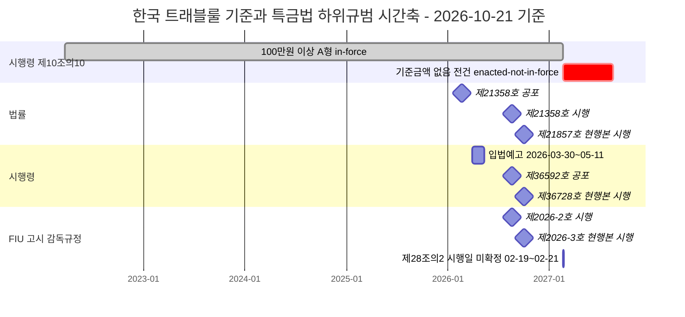
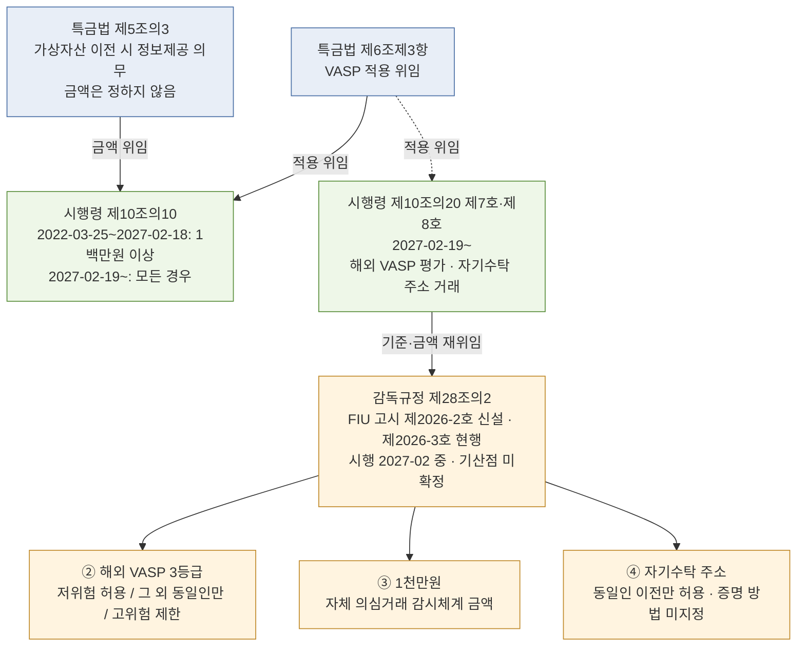

# 한국 — 특정금융정보법 (특금법)

> 한국 가상자산 AML의 **헌법**. VASP 신고제·고객확인·트래블룰·의심거래보고의 법적 근거. 이 글을 읽고 나면 특금법이 왜 AML 법이면서도 가상자산 산업 전반의 **진입 규제**가 됐는지, 그리고 법률 → 시행령 → FIU 고시로 내려가는 위임 사슬에서 실무 숫자가 어디에 적혀 있는지 이해하게 됩니다. 마지막 업데이트: 2026-10-21.

## TL;DR
- **정식명칭**: 「특정 금융거래정보의 보고 및 이용 등에 관한 법률」 (특금법)
- **2020-03-24 개정**으로 가상자산사업자(VASP) 신고제 도입 → **2021-03-25 시행**
- VASP 의무: **신고, 고객확인, 가상자산 이전 시 정보제공(트래블룰), 의심거래보고(STR), 기록보존**
- **현행본(2026-10-21 기준)**: 법률 **제21857호**(2026-08-04 공포, 2026-10-02 시행, 타법개정). 직전 실체 개정 **제21358호**(2026-02-19 공포, **2026-08-20 시행**, in-force) — 대주주 심사·신고 조건부 수리·퇴직자 제재통보
- **트래블룰 기준금액**: **2027-02-18 까지 100만원 이상**(in-force) → **2027-02-19 부터 기준금액 없이 전건**(대통령령 제36592호, 2026-08-18 공포, enacted-not-in-force)
- **2027-02-19 부터 새로 생기는 규율**: 해외 VASP 3등급(허용 / 동일인만 / 제한), 자기수탁 주소는 동일인 이전만, 1천만원 이상 거래 **자체 의심거래 감시체계**(자동 STR 아님)
- 감독기구: **금융정보분석원(FIU)** — 금융위원회 소속

---

## 1. 법의 정체성과 변천사

### 특금법은 원래 가상자산 법이 아니었다

특금법의 정식 명칭은 「특정 금융거래정보의 보고 및 이용 등에 관한 법률」입니다. 이름만 보면 가상자산과 관계없어 보이고, 실제로 2001년 제정 당시에는 **일반 금융기관의 AML/CFT 보고 의무**를 규정하는 법이었습니다.

가상자산의 헌법이 된 건 **2020년 개정**부터입니다. FATF가 2018-10 R.15 를 개정해 가상자산(VA)·가상자산사업자(VASP)를 정의하고, 2019-06 INR.15 §7(b)로 VASP 에 트래블룰을 적용하자([보고서 연대기 표](../../reports/가상자산%20AML%20KYT%20FDS%20트래블룰%20흐름.md)), 한국은 가상자산만을 위한 새 법을 만들지 않고 **기존 특금법에 VASP 조항을 끼워 넣는 방식**을 택했습니다. 그래서 특금법은 "AML 법이 가상자산 진입 규제를 겸하는" 구조가 됐습니다.

> VASP 트래블룰의 국제 근거는 R.16 이 아니라 **INR.15 §7(b)** 입니다. FATF 는 2025-06 R.16 개정에서 VASP 를 R.16 에 직접 넣지 않고 R.15 를 경유해 간접 적용하기로 했습니다(저장소 상충 레지스트리 CTR:00002).

### 연혁 — 왜 지금 이 모습이 됐나

| 일자 | 사건 | 상태(2026-10-21) |
|---|---|---|
| 2001-09-27 | 제정 — AML·테러자금조달방지 보고법. 가상자산 무관 | — |
| 2020-03-24 | 개정 — 가상자산사업자 정의·신고제 신설 | in-force |
| 2021-03-25 | 개정법 시행 — VASP 신고제 시작 | in-force |
| 2022-03-25 | 트래블룰 시행 — 시행령 제10조의10 「1백만원 이상」(A형) | in-force → **2027-02-18 까지** |
| 2024-07-19 | 가상자산이용자보호법 시행 — 이용자 보호·시장감시는 별도 법으로 | in-force |
| 2026-01-29 | 신고제 강화 개정안 국회 본회의 통과([금융위 2026-01-29](https://www.fsc.go.kr/no010101/86168)) | — |
| 2026-02-19 | 법률 제21358호 공포 | — |
| 2026-03-30 | 시행령·감독규정 개정안 입법예고(~05-11)([금융위 2026-03-30](https://www.fsc.go.kr/no010101/86589)) | proposed → 공포로 종료 |
| 2026-08-04 | 법률 제21857호(타법개정) 공포 | — |
| 2026-08-11 | 시행령 개정안 국무회의 의결([금융위 2026-08-11](https://www.fsc.go.kr/no010101/87499)) | — |
| **2026-08-18** | **대통령령 제36592호 공포** | 본칙 in-force / 제10조의10·제10조의20 등 enacted-not-in-force |
| 2026-08-20 | 법률 제21358호 시행, 시행령 본칙 시행, 감독규정(FIU 고시 제2026-2호) 시행 | in-force (감독규정 §28-2 등 유예) |
| 2026-10-02 | 법률 제21857호 현행본, 시행령 제36728호(타법개정) 현행본, 감독규정 제2026-3호 현행본 | in-force |
| **2027-02-19** | **시행령 제10조의10(기준금액 폐지)·제10조의20 시행** | enacted-not-in-force |
| 2027-02 중 | 감독규정 제28조의2 시행 — 고시 부칙 「공포 후 6개월」 기산점 미확정(02-19 또는 02-21) | enacted-not-in-force |

근거: [법제처 DRF 법령 검색(법률 제21857호)](https://www.law.go.kr/DRF/lawSearch.do?OC=test&target=law&type=JSON&query=특정금융거래정보의보고및이용등에관한법률) · [법제처 DRF 시행예정 판본(대통령령 제36592호)](https://www.law.go.kr/DRF/lawService.do?OC=test&target=eflaw&MST=288765&efYd=20270219&type=XML) · [감독규정 FIU 고시](https://www.law.go.kr/DRF/lawService.do?OC=test&target=admrul&ID=2100000285986&type=XML)



> 첫 막대의 끝(2027-02-18)과 둘째 막대의 시작(2027-02-19)이 한국 트래블룰의 시점 경계입니다. 둘째 막대 길이(180일)는 표시용이며 종료일이 아닙니다. 언론 일부가 보도한 "2027-02-20"은 법제처 시행일 색인(20270219)과 다르고, 공포일을 08-19 로 가정한 계산으로 보입니다. 이 저장소는 2027-02-19 를 씁니다([research/2026-10-travel-rule.md](../../research/2026-10-travel-rule.md) F-012).

### 소관·감독 기관

- **금융위원회(FSC)** — 소관 부처. 법령 개정·시행령 개정 추진.
- **금융정보분석원(FIU)** — 집행 기관. 신고 접수·수리, STR 수신·분석, 검사, 감독규정 등 FIU 고시 발령.
- **금융감독원(FSS)** — 검사 수탁기관. 2026-08-18 개정 시행령은 FIU 의 퇴직자 제재통보 권한 중 임원 문책경고·주의적경고·주의와 직원 제재 전체를 검사수탁기관에 위탁합니다([금융위 2026-08-11](https://www.fsc.go.kr/no010101/87499)).

### 실무 포인트

특금법 한 조만 보고 실무를 판단하면 안 됩니다. 법 아래 **시행령(대통령령) → FIU 고시(감독규정·업무규정) → 신고매뉴얼**이 쌓여 있고, 트래블룰 금액처럼 실무를 바꾸는 숫자는 대부분 법률이 아니라 시행령·고시에 있습니다(7절).

---

## 2. VASP의 정의 — 누가 이 법을 적용받는가

### 특금법 §2 제1호 하목의 행위

특금법은 가상자산사업자를 **"가상자산과 관련하여 다음 행위를 영업으로 하는 자"** 로 정의합니다.

1. **매도·매수**
2. **다른 가상자산과의 교환**
3. **이전** (외부 지갑 또는 타 사업자로의 이동)
4. **보관·관리** (수탁, custody)
5. **위 1~4 행위의 중개·알선·대행**
6. 그 밖에 **시행령으로 정하는** 행위

가상자산의 정의 자체는 가상자산이용자보호법 제2조를 상호참조합니다 — 한쪽 정의가 바뀌면 두 법의 적용 범위가 함께 움직입니다(KB `PROV:kr-vaupa-art2`).

### 실무 번역 — 누가 포함되나

| 사업 유형 | 포함 여부 | 근거 |
|---|---|---|
| 거래소 | ✅ | 매수도 + 교환 + 이전 + 중개 모두 해당 |
| 수탁업자 (custody) | ✅ | 보관·관리 |
| OTC desk | ✅ | 중개 |
| P2P 플랫폼 | ✅ | 중개·알선 |
| 단순 발행자 | ❌ (이론상) | 영업으로 매수도·교환·이전 안 하면 제외 |
| 자기계산 거래만 하는 자 | ❌ | VASP 정의 미충족 |
| DApp / DEX 자체 | 회색지대 | 운영자 식별 가능 시 포함 검토 |

### 용어

- **VASP (Virtual Asset Service Provider)** — 가상자산사업자. FATF 용어.
- **Custody (수탁)** — 고객 가상자산을 보관·관리. 거래 자체를 많이 하지 않아도 VASP로 포섭.
- **DApp (Decentralized Application)** — 블록체인 위에서 돌아가는 탈중앙 앱. 운영 주체가 불명확하면 규제 포섭 어려움.

### 실무 포인트

"이 사업이 VASP인가?"는 단순해 보여도 실제 판단은 법률 자문을 받는 게 안전합니다. 특히 **중개·알선** 문언이 넓어서, 가상자산 결제 중개·게임 내 코인 매매 기능·NFT 마켓플레이스까지 해석상 쟁점이 됩니다.

---

## 3. VASP 신고 의무 (§7) — 진입 관문

### 조문 요지

§7은 가상자산사업자로 영업하려는 자가 금융정보분석원장에게 신고하도록 합니다. 형식은 "신고"지만 요건 미충족 시 **수리하지 않을 수 있고**, 법률 제21358호(2026-08-20 시행)로 불수리 사유가 늘고 **조건부 수리**가 가능해졌습니다(KB `EVT:kr-tfia-21358-promulgated-2026`). 미신고 영업은 형사처벌 대상입니다(형량은 [법 원문](https://www.law.go.kr/DRF/lawSearch.do?OC=test&target=law&type=JSON&query=특정금융거래정보의보고및이용등에관한법률) 확인).

### 신고 시 갖춰야 할 것

1. **정보보호관리체계(ISMS) 인증**
2. **실명확인이 가능한 입출금계정** — 원화 거래를 하는 거래소에 해당
3. **AML/CFT 내부통제체계** — 정책·절차 문서화
4. **대표자·임원·대주주 결격사유 부재**

### 2026-08-20 시행 개정의 핵심: 대주주까지 심사

2026-08-11 국무회의를 통과한 시행령은 심사 대상 대주주에 최대주주 외에 **"대표이사 또는 이사의 과반수를 선임한 주주"** 를 넣고, 최대주주가 법인이면 그 법인의 최대주주와 대표자도 포함합니다. 불수리 요건으로 **부채비율 200% 이하**(이용자예치금 등은 부채총액에서 제외), 최근 3년간 신용질서 침해 사실 없음, 부실금융기관·인허가 취소자 아님, 임원·대표자의 지배구조법상 자격요건, 조직·인력·물적설비·내부통제체계 구비를 정하며, **기존 사업자에게는 부채비율·조직인력·전산·내부통제 요건을 1년간 유예**합니다([금융위 2026-08-11](https://www.fsc.go.kr/no010101/87499)).

2026-08-13 전면 개정된 「가상자산사업자 신고매뉴얼」은 **AML 업무 인력 4인 이상**(겸직 인정 가능), 고유식별정보·개인신용정보 처리 **전산설비의 국내 소재**(클라우드는 국내 리전 인정), 대주주·법령준수체계 변경의 **"변경 30일 전 사전신고"**(종전 변경 후 14일 내 사후신고)를 정했습니다([금융위 2026-08-13](https://www.fsc.go.kr/no010101/87521)).

### 신고 갱신

신고에는 유효기간이 있어 갱신 신고가 필요합니다. 기간·갱신 요건은 법 §7 원문으로 확인하세요(이 노트의 근거 자료로는 재확인하지 않았습니다). 기존 신고 사업자의 개정법상 재신고 기한은 부칙 원문을 이번에 확인하지 못해 적지 않습니다(보고서 부록 B #9).

### 실무 포인트

신고 준비는 법무만이 아니라 IT 보안(ISMS), 은행 제휴(실명계정), 컴플라이언스(AML 문서), 인사(보고책임자 임명)가 함께 움직이는 전사 프로젝트입니다. 2026-08-20 이후에는 대주주 변경이 **30일 전 사전신고** 대상이므로, 투자 유치·M&A 일정에 신고 일정을 넣어야 합니다.

---

## 4. AML/CFT 의무 — 운영 관문

### 조문별 실무 매핑

#### 특금법 §5의2 — 고객확인의무

**법 문언 요지**: 거래 상대방의 신원을 확인하고, 자금세탁 우려가 있으면 강화된 고객확인을 수행.

**실무 번역**: 신분증 확인·본인 인증, 실명확인 입출금계정 연동, 고위험 신호(고액 외부 출금, PEP 매칭, 제재 노출 등) 발생 시 강화된 고객확인(EDD)으로 전환하는 체계가 필요합니다. 2026-08-18 개정 시행령은 고객확인의 방법·대상을 명확히 하고, **강화된 고객확인 여부를 고객 특성·거래양태·상품 위험도로 판단**하도록 했습니다([금융위 2026-08-11](https://www.fsc.go.kr/no010101/87499)).

#### 특금법 §4 — 의심거래보고(STR)

**법 문언 요지**: 거래가 자금세탁·공중협박자금조달로 **의심되는** 경우 FIU 에 보고.

**실무 번역**: 금액 기준이 없습니다. 보고 후 **누설(Tipping-off) 금지**. 거래모니터링의 세부는 FIU 고시 「자금세탁방지 및 공중협박자금조달금지에 관한 업무규정」(고시 제2025-2호, 2025-10-22 발령, 2026-01-22 시행) **제76조~제81조 "거래모니터링체계"** 에 있습니다. 이 조문들 본문에 "가상자산"이라는 단어는 한 번도 나오지 않습니다 — 한국 KYT 의 법적 근거는 가상자산 전용 조문이 아니라 금융권 공통 규정입니다([법제처 DRF 업무규정](https://www.law.go.kr/DRF/lawService.do?OC=test&target=admrul&ID=2100000267264&type=XML)).

> 용어 주의: 특금법의 용어는 **"의심되는 거래(의심거래보고)"** 입니다. "이상거래"는 가상자산이용자보호법 제12조(시장감시)의 용어이고, "피해의심거래계좌등"은 통신사기피해환급법(보이스피싱 임시조치)의 용어입니다 — [`korea-user-protection.md`](korea-user-protection.md) 4절.

#### 특금법 §4의2 — 고액현금거래보고(CTR)

**법 문언 요지**: 일정 금액 이상의 **현금거래**를 FIU 에 보고(기준금액은 시행령 소관).

**실무 번역**: 가상자산 자체 거래는 현금이 아니므로 CTR 대상이 아닙니다. VASP 에서는 현금을 직접 받는 예외적 영업에서만 문제가 됩니다.

#### 기록 보존

특금법은 고객확인 자료·거래 기록의 보존을 요구합니다. 가상자산이용자보호법도 별도로 가상자산거래기록 보존을 요구하며, 시행령 제13조는 상시감시·조치 결과와 통보·신고·보고 기록을 보존 대상 거래기록에 넣습니다([이용자보호법 시행령](https://www.law.go.kr/LSW/lsInfoR.do?lsiSeq=290171&efYd=20261002&ancYnChk=0&chrClsCd=010202&urlMode=lsInfoR)). 두 법의 보존기간이 다를 수 있으므로 같은 자료가 둘 다에 해당하면 긴 쪽을 따릅니다. 각 기간은 법령 원문으로 확인하세요.

#### 트래블룰 (§5의3 · §6제3항 + 시행령 §10의10)

아래 5번 섹션 참조.

### 실무 포인트

AML 내부 정책서의 각 절차 옆에 **"근거: 특금법 §4, 업무규정 제76조"** 처럼 조문을 적어 두면 감독 검사에서 추적성을 보이기 쉽고, 하위규범이 개정될 때 영향받는 절차를 바로 찾을 수 있습니다.

---

## 5. 트래블룰 — 법적 근거와 2027-02-19 전환

> **이 섹션의 역할**: 특금법 트래블룰의 **법적 근거와 시점**만 다룸. 개념·역사·운영 흐름은 [`../3-crypto-aml/travel-rule.md`](../3-crypto-aml/travel-rule.md), 메시지 표준·프로토콜은 [`../4-technology/travel-rule-protocols.md`](../4-technology/travel-rule-protocols.md) 참조.

### 위임 사슬 — 숫자는 법률에 없다

법률 제5조의3 은 가상자산 이전 시 정보제공 의무를 부과하되 **금액을 정하지 않고 대통령령에 위임**하고, 제6조제3항이 VASP 적용을 위임합니다. 실제 기준은 시행령 제10조의10 에 있고, 2027-02-19 부터는 시행령 제10조의20 이 다시 **FIU 고시(감독규정 제28조의2)** 에 기준과 1천만원 금액을 위임합니다. 그래서 국회를 거치지 않고 시행령·고시만으로 실무 기준이 바뀝니다 — 2026-08-18 대통령령 제36592호가 바로 그런 경우입니다.



> 점선(제6조제3항 → 제10조의20)은 이 노트의 근거 자료가 제10조의20 의 상위 위임 조문을 직접 확인하지 않았다는 표시입니다. 실선은 법령 문언으로 확인된 위임입니다.

### 핵심 법적 요건 — 시점별

| 항목 | ~2027-02-18 (in-force) | 2027-02-19~ (enacted-not-in-force) |
|---|---|---|
| 적용 범위 | 다른 VASP 에게 **1백만원 이상**에 상당하는 가상자산을 이전하는 경우(A형 — 금액이 의무 자체를 가름) | 다른 VASP 에게 가상자산을 이전하는 **모든 경우** |
| 정보 항목 | 현행 제10조의10 각 호(정보 항목 문언은 이 노트에서 대조하지 않음) | 성명(법인은 명칭·대표자 성명)·가상자산주소는 **이전과 동시에**; 주민등록번호(법인등록번호)·여권번호·외국인등록번호는 FIU 원장 또는 수취 VASP 가 **요청하면 3영업일 이내** |
| 해외 VASP | 별도 법령 규율 없음 | 감독규정 §28-2② — 저위험(FATF 권고 이행국·동등 AML·인허가 모두 충족)은 허용, 그 외는 **고객과 상대방이 동일한 경우에만**, FATF 고위험국·무인허가·고위험 평가는 **제한** |
| 자기수탁 주소 | 거래소 자율 운영 | 시행령 §10-20⑧·감독규정 §28-2④ — 위험이 현저히 높으면 해소 전까지 제한, 그 외는 **동일인 이전만 허용**(소유 증명 방법은 미지정) |
| 고액 거래 | — | 시행령 §10-20⑦나·감독규정 §28-2③ — **1천만원 이상 거래에 자체 의심거래 감시체계** 구축·운영 |
| 근거 | 시행령 제10조의10 제1호([2026-08-20 판](https://www.law.go.kr/DRF/lawService.do?OC=test&target=eflaw&MST=288765&efYd=20260820&type=XML)) | 대통령령 제36592호 부칙 제1조 단서([2027-02-19 판](https://www.law.go.kr/DRF/lawService.do?OC=test&target=eflaw&MST=288765&efYd=20270219&type=XML)), [감독규정](https://www.law.go.kr/DRF/lawService.do?OC=test&target=admrul&ID=2100000285986&type=XML) |

2027 판의 추가정보(주민등록번호 등)는 금액이 아니라 **요청**으로 발동됩니다. "금액이 정보 깊이를 가르는" B형과도 다른 구조입니다.

**입법예고안과 공포본은 다릅니다.** 2026-03-30 입법예고안은 1,000만원 이상 거래를 "위험도와 관계없이 의심거래로 보아" FIU 에 보고하게 했지만([금융위 2026-03-30](https://www.fsc.go.kr/no010101/86589)), 공포본 시행령 제10조의20 제7호나목은 **"자체적인 의심거래 감시체계를 구축ㆍ운영할 것"** 입니다. "1천만원 이상 자동 STR"은 공포본 기준으로 틀린 서술입니다.

**감독규정 §28-2 의 시행일은 확정되지 않았습니다.** FIU 고시 제2026-2호 부칙은 §28-2 를 "공포 후 6개월이 경과한 날"부터 시행하는데, 발령일 2026-08-20 을 기산점으로 하면 2027-02-21 이 되어 시행령 §10-20(2027-02-19)과 이틀 어긋날 수 있습니다. 법제처 행정규칙 시행일 색인으로 확정해야 합니다.

### 현행 제도가 실제로 덮는 범위

2026-10-01 공표된 상반기 실태조사에서 **총 출고 62.8조원 가운데 트래블룰이 적용된 것은 9.5조원(약 15%)** 이었습니다([금융위 2026-10-01](https://www.fsc.go.kr/no010101/87835)). 100만원 기준과 국내 VASP 간 이전으로 한정된 현행 제도의 커버리지를 보여 주는 수치이고, 2027-02-19 이후 비교할 기준선입니다.

### 실무 포인트

트래블룰의 본질은 **"AML 데이터의 VASP 간 공유"** 입니다. 2027-02-19 부터는 (1) 100만원 미만 이전도 정보제공 대상이 되고, (2) 요청형 추가정보에 3영업일 응답 체계가 필요하며, (3) 해외 VASP 위험평가와 동일인 확인이 이전 허용의 전제 조건이 됩니다. 고객 식별정보가 상대 VASP 로 넘어가므로 개인정보 보호법과의 교차 검토도 함께 필요합니다.

---

## 6. 감독·처벌

### 감독 구조

- **FIU** — 신고 수리·검사·자료 제출 요구·제재.
- **금융감독원(FSS)** — 검사 수탁. 2026-08-20 이후 퇴직자 제재통보 일부도 위탁.
- **금융위원회(FSC)** — 정책·법령 개정.

### 행정처분의 종류

시정명령, 영업의 전부 또는 일부 정지, 신고 수리 취소, 과태료가 있습니다. 미신고 영업 등은 형사처벌 대상입니다. 각 사유와 형량·금액은 [법 원문](https://www.law.go.kr/DRF/lawSearch.do?OC=test&target=law&type=JSON&query=특정금융거래정보의보고및이용등에관한법률)으로 확인하세요 — 종전 판의 위반 유형별 형량표는 근거를 확인하지 못해 삭제했습니다.

### 제재 실례

- **두나무(업비트)**: FIU 가 2025-11-06 과태료 총 352억원(약 860만건; 고객확인·거래제한·의심거래보고 의무 위반 등)을 발표했습니다. **트래블룰(제5조의3) 위반은 사유가 아니었습니다**([FIU 보도자료, KDI 경제정보센터 전재](https://eiec.kdi.re.kr/policy/materialView.do?num=273166)).
- 2024-01-01~2026-10-21 사이 **트래블룰 위반을 독립 제재사유로 명시한 사건은 어느 관할에서도 확인되지 않았습니다**([research/2026-10-travel-rule.md](../../research/2026-10-travel-rule.md) BLUF).
- 2026-07~10 금융위 보도자료에는 가상자산사업자 대상 신규 과태료·영업정지·기관경고 발표가 없습니다(aml-landscape 도시에 F-041).

### 실무 포인트

검사는 사전 요구 자료를 받는 시점부터 시작된다고 봐야 합니다. 2026-08-20 이후에는 대주주·지배구조, 부채비율, AML 인력 같은 신고 요건이 수리 후에도 유지되는지가 함께 점검 대상이 됩니다.

---

## 7. 시행령·규정·매뉴얼 — 층위 구조

법만 읽어선 실무가 안 되는 이유:

| 층위 | 문서 | 2026-10-21 현행 | 역할 |
|---|---|---|---|
| 1층 | **특금법** (법률) | 제21857호(2026-10-02 시행) | 의무 조항·위임 |
| 2층 | **특금법 시행령** (대통령령) | 제36728호(2026-10-02 시행, 타법개정). AML 실체 개정은 제36592호(2026-08-18 공포) | 트래블룰 범위(§10-10), 해외 VASP·자기수탁(§10-20), 신고 요건 |
| 3층 | **특정 금융거래정보 보고 및 감독규정** (FIU 고시) | 제2026-3호(2026-10-02). §28-2 는 제2026-2호(2026-08-20)가 신설, 시행 2027-02 중 | 해외 VASP 3등급·1천만원·자기수탁 기준(§28-2), 환산 기준(§26) |
| 3층 | **특정 금융거래정보 보고 등에 관한 검사 및 제재규정** (FIU 고시) | 제2026-1호(2026-02-19 시행, KB FACT:0000018) | 검사·제재 절차 — 감독규정과 별개 |
| 3층 | **자금세탁방지 및 공중협박자금조달금지에 관한 업무규정** (FIU 고시) | 제2025-2호(2026-01-22 시행) | 거래모니터링체계(제76~81조) 등 AML 업무 기준 |
| 4층 | **가상자산사업자 신고매뉴얼** (FIU·금감원) | 2026-08-13 전면 개정 | AML 인력·전산설비·변경신고 실무 |

> 2026-07-30 이전 자료는 감독규정 최신본을 제2024-1호로 적고 있습니다. 2026-08-20 제2026-2호, 2026-10-02 제2026-3호로 두 번 개정됐습니다. 제2026-3호의 개정 내용은 법제처 원문에 개정이유가 없어 확인하지 못했습니다.

### 실무 포인트

시점 판단은 반드시 **판본을 지정해서** 읽어야 합니다. 법제처 현행 시행령(MST 290511) 화면은 아직 시행되지 않은 제10조의10 "모든 경우" 문언을 이미 보여 줍니다. 2026-10-21 에 효력 있는 문언을 보려면 시행일(efYd=20260820) 판본을 열어야 합니다.

---

## 8. 미신고 사업자 단속 동향

- FIU 요청으로 방송미디어통신심의위원회가 2026-10-06~07 심의해 운영 중인 미신고 가상자산 취급업자 사이트 **27건을 국내 접속차단**했고(2026-10-13 공표), 수사기관에 통보된 불법업체는 누적 **44개**입니다. 구글·애플 앱마켓의 신규 설치·업데이트 차단은 이미 시행 중이었습니다([금융위 2026-10-13](https://www.fsc.go.kr/no010101/87916)).
- 2027-02-19 부터는 미신고 여부와 별개로, 해외 VASP 가 **FATF 고위험국 소재이거나 인허가 의무를 이행하지 않으면 거래 제한** 대상이 됩니다(감독규정 §28-2②3).

### 실무 임팩트

해외 VASP 로의 출금 허용 여부는 2027-02-19 부터 거래소 자율 판단이 아니라 고시 기준(3등급)에 따른 법적 판단이 됩니다. 상대 VASP 의 관할·인허가·트래블룰 이행 여부를 거래관계 수립 전에 평가하고 주기적으로 재평가하는 절차(§28-2①)가 필요합니다.

---

### DAXA — 원화 거래소 자율협의기구 (참고)

DAXA(디지털자산거래소 공동협의체)는 원화거래소들의 **자율협의기구**로, 법적 강제력은 없습니다. 2025-05 출금지연제도와 2026-04-07 강화된 출금지연제도는 금융위·DAXA·거래소가 함께 시행한 자율규제입니다(B)([금융위 2026-04-07](https://www.fsc.go.kr/po010102/86656)).

**상세**: [`../7-vendors/korea-solutions.md`](../7-vendors/korea-solutions.md) §12 DAXA 참조.

---

## 9. 2단계 입법 — 향후 방향

디지털자산기본법 정부안, 원화 스테이블코인, 법인 실명계좌 2단계 등은 2026-10-21 기준 1차 원문으로 진행 상태를 확인하지 못해 이 노트에서 다루지 않습니다(보고서 부록 B #10). 이미 날짜가 정해진 한국 일정은 **2027-02-19 시행령 제10조의10·제10조의20 시행**과 **2027-02 중 감독규정 §28-2 시행**입니다.

### 실무 포인트

이미 공포된 규범(enacted-not-in-force)과 논의 중인 규범(proposed)을 구분해 대응 우선순위를 정하세요. 2026-10-21 기준 한국에서 날짜가 확정된 다음 변화는 2027-02-19 트래블룰 전환입니다.

---

## 10. 컴플라이언스 체크리스트

```
□ FIU 신고 수리 상태 + 갱신 일정 관리
□ 2026-08-20 개정 신고 요건 — 대주주 범위, 부채비율 200%(기존 사업자 1년 유예), AML 인력 4인 이상
□ 대주주·법령준수체계 변경 시 30일 전 사전신고
□ ISMS 인증 유지
□ 자금세탁방지 보고책임자 임명
□ 내부통제기준 + AML 정책 문서화 (조문 근거 병기)
□ 고객확인·강화된 고객확인 절차 (고객 특성·거래양태·상품 위험도 기준)
□ 거래모니터링체계 (업무규정 제76~81조)
□ STR 보고 프로세스 + 누설 금지 통제
□ 트래블룰 — ~2027-02-18: 100만원 이상 / 2027-02-19~: 전건 + 요청 시 3영업일 추가정보
□ 2027-02-19 대비 — 해외 VASP 위험평가·재평가, 동일인 확인, 자기수탁 주소 거래 기준, 1천만원 이상 자체 감시체계
□ 제재 스크리닝 (OFAC/UN/EU + 국내)
□ 기록 보존 — 특금법·이용자보호법 기간 중 긴 쪽
```

## 💼 실무 현장 (Industry Reality)

### 특금법 조문별 실제 검사 포인트

검사관이 확인하는 것은 **"조문대로 운영하는지 증명할 수 있느냐"** 입니다. 조문별로 준비해야 할 증빙의 유형:

| 조문 | 검사관 질문 | 회사가 제시해야 할 증거 |
|---|---|---|
| §5의2 (고객확인) | "고객 A의 온보딩 기록을 보여주세요" | 신원확인 결과 + 실명계정 매칭 기록 + 위험평가 결과 |
| §4 (STR) | "최근 STR 결정 과정" | 알림 → 조사 기록 → 보고책임자 결재 → FIU 제출 기록 |
| 기록 보존 | "과거 거래 기록 조회" | 보존 정책 + 변경 불가 저장 + 접근 로그 |
| §5의3 (트래블룰) | "정보 미수신·불일치 이전의 처리" | 거절·보류 사유 기록 + SOP |
| §7 (신고) | "대주주·보고책임자 변경 이력" | 변경 신고서(2026-08-20 이후 30일 전 사전신고) + 내부 결재 |

### 2027-02-19 전환 준비에서 자주 놓치는 것

- **"100만원 미만은 정보 없이 보내도 된다"** — 2027-02-18 까지만 맞습니다.
- **요청형 추가정보** — 상대 VASP 나 FIU 가 주민등록번호 등을 요청하면 **3영업일** 안에 제공해야 하므로, 평소에 전송하지 않는 정보의 조회·전송 절차를 따로 만들어야 합니다.
- **동일인 확인** — "그 외 해외 VASP"와 자기수탁 주소는 고객과 상대방이 동일할 때만 허용됩니다. 고시는 확인 방법을 정하지 않으므로, 어떤 방법으로 동일인을 판단했는지 내부 기준과 기록을 남겨야 합니다.

### 자주 나오는 오해

- **"특금법 신고는 한 번 하면 끝"** — 유효기간이 있어 갱신이 필요하고, 2026-08-20 부터 대주주 변경도 사전신고 대상입니다.
- **"Travel Rule은 100만원 이상만 해당"** — **2027-02-18 까지만** 맞습니다. 2027-02-19 부터 다른 VASP 로의 모든 이전이 대상입니다(대통령령 제36592호, enacted-not-in-force).
- **"1천만원 이상은 무조건 STR"** — 입법예고안(2026-03-30)의 내용이었고 공포본에서 바뀌었습니다. 공포본은 **자체 의심거래 감시체계 구축·운영**입니다.
- **"외부지갑 등록은 규제 요구가 아니다"** — 2027-02 중(감독규정 §28-2 시행일 미확정)부터 자기수탁 주소와의 이전은 **고시상 동일인일 때만** 허용됩니다. 등록제 형식이나 소유 증명 방법은 고시가 정하지 않습니다.
- **"트래블룰 위반으로 거래소가 제재받았다"** — 2025~2026 한국 VASP 제재에서 트래블룰(제5조의3) 위반은 사유로 공표되지 않았습니다.

### 한국 특수 현실

- **판본 혼동**: 법제처 "현행" 화면이 미시행 문언을 보여 주는 탓에 "기준금액이 이미 없어졌다"는 오해가 생기기 쉽습니다. 시점 판단은 efYd 판본 지정이 원칙입니다.
- **시행일 이틀 차이**: 시행령(2027-02-19)과 감독규정 §28-2(기산점에 따라 02-19 또는 02-21)가 어긋날 수 있습니다. 2027-02-19~21 사이 운영 기준을 미리 정해 두는 편이 안전합니다.

---

## 더 읽을거리
- [`korea-user-protection.md`](korea-user-protection.md) — 가상자산이용자보호법 §12 시장감시와 통신사기피해환급법(보이스피싱 임시조치)
- [`../3-crypto-aml/travel-rule.md`](../3-crypto-aml/travel-rule.md) — 트래블룰 운영 상세
- [`../7-vendors/korea-solutions.md`](../7-vendors/korea-solutions.md) — 한국 솔루션 시장
- [`../../reports/가상자산 AML KYT FDS 트래블룰 흐름.md`](../../reports/가상자산%20AML%20KYT%20FDS%20트래블룰%20흐름.md) — 2026-10-21 기준 정본 보고서
- [법제처 DRF — 시행령 시행예정 판본(2027-02-19)](https://www.law.go.kr/DRF/lawService.do?OC=test&target=eflaw&MST=288765&efYd=20270219&type=XML)
- [법제처 DRF — 시행령 현재 효력 판본(2026-08-20)](https://www.law.go.kr/DRF/lawService.do?OC=test&target=eflaw&MST=288765&efYd=20260820&type=XML)
- [법제처 DRF — 특정 금융거래정보 보고 및 감독규정](https://www.law.go.kr/DRF/lawService.do?OC=test&target=admrul&ID=2100000285986&type=XML)
- [금융위 2026-08-11 — 시행령 개정안 국무회의 의결](https://www.fsc.go.kr/no010101/87499)
- [금융위 2026-08-13 — 신고매뉴얼 전면 개정](https://www.fsc.go.kr/no010101/87521)
- KB 노드: `REG:kr-tfia` · `REG:kr-tfia-sd` · `PROV:kr-tfia-sd-art10-10` · `PROV:kr-tfia-sd-art10-20` · `REG:kr-fiu-supervisory-rule` · `PROV:kr-fiu-supervisory-rule-art28-2` · `EVT:kr-tfia-sd-36592-promulgated-2026`
