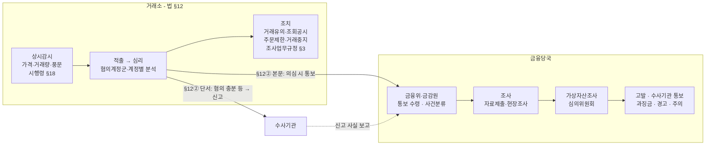
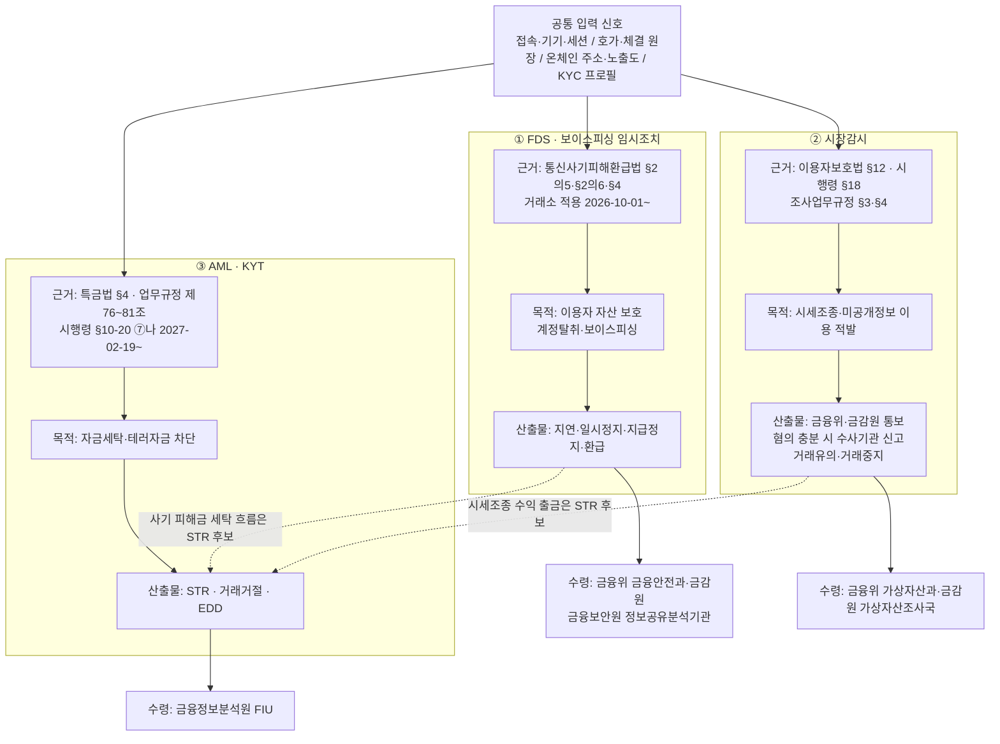
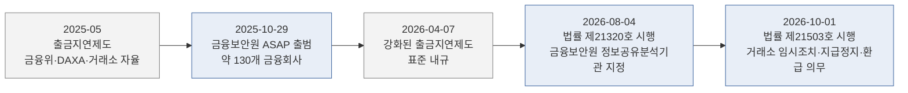

# 한국 — 가상자산 이용자 보호 등에 관한 법률

> 한국 최초의 **가상자산 전용** 법률. 2024-07-19 시행. 이 글을 읽고 나면 왜 특금법만으로 부족해서 이 법이 따로 제정됐는지, 거래소의 **이상거래 상시감시(§12)** 가 FDS·의심거래보고(STR)와 어떻게 다른지, 그리고 2026-10-01 부터 거래소에 걸린 **보이스피싱 임시조치 의무**(통신사기피해환급법)까지 한국 "이상거래" 3제도가 어떻게 나뉘는지 이해하게 됩니다. 마지막 업데이트: 2026-10-21.

## TL;DR
- **정식명칭**: 「가상자산 이용자 보호 등에 관한 법률」 (약칭 가상자산이용자보호법)
- **제정 법률 제19563호(2023-07-18 공포), 2024-07-19 시행**. 2026-10-21 기준 현행본은 **법률 제21857호**(2026-08-04 타법개정, 2026-10-02 시행)
- 핵심 축: ① **이용자 예치금·가상자산 보호** ② **불공정거래 금지(§10)** ③ **이상거래 상시감시(§12)** ④ **감독·조사·과징금·벌칙**
- **§12 는 FDS 가 아니라 시장감시다** — 이상거래의 정의(시행령 §18)가 불공정거래 우려에 묶여 있고, 산출물은 차단이 아니라 금융위·금감원 **통보**(혐의 충분 시 수사기관 신고). 위반 시 과태료 1억원 이하(§22①6·7호)
- 보이스피싱·계정탈취 대응(FDS)의 법정 근거는 **통신사기피해환급법** — 법률 제21503호로 **2026-10-01 부터 가상자산거래소도 임시조치·지급정지·피해환급 의무** 대상
- 특금법(AML)과 **별개의 법** — 둘 다 동시 적용

---

## 1. 왜 이 법이 만들어졌나 — 특금법만으로 부족했던 이유

### 문제 인식의 출발

2020~2022년 국내외 거래소 사고(FTX 파산, 테라·루나 붕괴)를 거치며 거래소 파산, 임의 출금 정지, 시세조종, 내부자 거래 같은 문제가 반복됐지만 이용자를 보호할 법적 장치는 거의 없었습니다.

여기서 드러난 **특금법의 한계**는 분명했습니다. 특금법은 AML(자금세탁방지) 중심 법이므로, "거래소가 고객 자산을 제대로 분리 보관하는가"나 "누가 시세를 조작했는가" 같은 **이용자 보호 이슈는 다루지 않았습니다**. AML은 범죄수익 차단을 위한 것이고, 이용자 보호는 개별 이용자의 재산권과 시장 건전성을 위한 것이라 목적 자체가 다릅니다.

### 국회의 선택

국회는 여러 가상자산 법안 가운데 **"이용자 보호"라는 가장 긴급한 공통분모**를 1단계로 먼저 입법하고, 발행·유통 규율과 스테이블코인 등은 **2단계 입법**으로 미뤘습니다.

### 실무 포인트

이 법은 **짧고 핵심만 담은 1단계 입법**입니다. 현행법에서 DeFi·스테이블코인 같은 주제의 명시 조항을 찾지 못하면 "아직 입법 공백"으로 이해하는 게 정확합니다.

---

## 2. 적용 대상 — 특금법과 같은 VASP, 단 §12 는 거래소만

가상자산이용자보호법은 **가상자산사업자**를 적용 대상으로 하며, 가상자산 정의는 특금법과 결합되어 있습니다(특금법 제2조가 이 법 제2조를 참조 — KB `PROV:kr-vaupa-art2`).

**주의**: §12 이상거래 감시 의무의 주체는 **"가상자산시장을 개설·운영하는 가상자산사업자"(거래소)** 로 한정됩니다. 지갑·보관업자에게는 §12 의무가 없습니다([법 원문](https://www.law.go.kr/LSW/lsInfoR.do?lsiSeq=290735&efYd=20261002&ancYnChk=0&chrClsCd=010202&urlMode=lsInfoR)).

---

## 3. 핵심 의무 — 조문별 실무 매핑

조문 구조(2026-10-21 현행본): §6~§9 이용자 자산 보호(예치금·가상자산 보관·보험·거래기록), **§10 불공정거래 금지**, §11 입출금 차단 금지, **§12 이상거래 감시**, §13~§18 감독·조사·과징금, §19~§22 벌칙·과태료([research/2026-10-fds.md](../../research/2026-10-fds.md) §9.1).

### A. 이용자 자산 보호 (§6~§9)

#### 조문 요지

- **예치금**: 이용자의 원화 예치금을 사업자 고유재산과 분리해 공신력 있는 기관(은행)에 보관.
- **가상자산**: 이용자 가상자산을 사업자 자기 가상자산과 분리 보관하고, 이용자 몫과 같은 종류·수량을 실질 보유.
- **보험·준비금**: 해킹·사고 대비 보험 가입 또는 준비금 적립.
- **거래기록**: 가상자산 거래기록 작성·보존.

위 의무 위반은 **과태료 1억원 이하**입니다(§22①1~4호)([법 원문](https://www.law.go.kr/LSW/lsInfoR.do?lsiSeq=290735&efYd=20261002&ancYnChk=0&chrClsCd=010202&urlMode=lsInfoR)). 종전 판의 "분리보관 위반 5년 이하 징역 또는 5천만원 이하 벌금"은 현행 §22① 문언과 맞지 않아 삭제했습니다.

> 콜드월렛 보관 비율·보험금액 산정 같은 구체 수치는 하위규범 소관입니다. 이 노트의 근거 자료로 원문을 재확인하지 못해 수치를 적지 않습니다.

#### 실무 번역

"이용자가 BTC 10개를 맡겼다면 거래소는 실제로 BTC 10개를 **이용자 몫으로 따로** 보유해야 한다"는 의미입니다. 이용자 몫을 자체 영업이나 대여에 쓸 수 없습니다. 거래기록 보존과 관련해 시행령 제13조는 **상시감시·조치 결과 기록(6호)과 통보·신고·보고 기록(7호)** 을 보존 대상 가상자산거래기록에 넣습니다 — §12 시장감시의 산출물 자체가 보존 대상입니다([시행령 원문](https://www.law.go.kr/LSW/lsInfoR.do?lsiSeq=290171&efYd=20261002&ancYnChk=0&chrClsCd=010202&urlMode=lsInfoR)).

#### 용어

- **콜드월렛 (Cold Wallet)** — 인터넷에 연결되지 않은 지갑.
- **핫월렛 (Hot Wallet)** — 인터넷에 연결된 지갑. 출금 처리 속도 빠름.
- **옴니버스 지갑 (Omnibus Wallet)** — 여러 이용자 자산을 한 주소에 통합 보관하고 내부 장부로 이용자별 몫을 관리.

### B. 불공정거래 금지 (§10) — 처벌은 §17·§19·§20

#### 조문 요지

§10 은 다섯 가지를 금지합니다([법 원문](https://www.law.go.kr/LSW/lsInfoR.do?lsiSeq=290735&efYd=20261002&ancYnChk=0&chrClsCd=010202&urlMode=lsInfoR)).
- ① **미공개중요정보 이용**
- ②③ **시세조종**
- ④ **부정거래**
- ⑤ **자기 또는 특수관계인이 발행한 가상자산의 거래**

#### 실무 번역

"가상자산판 자본시장법"이라고 이해하면 됩니다. 허수주문, 통정·가장매매, 고가매수 반복, API 를 이용한 초단기 매매로 가격·거래량을 움직이는 행위가 시세조종의 전형입니다. 2025~2026 금융위 정례회의 의결 사례에는 일일 가격 기준 시각을 노린 고가매수, 다수 계정의 **API 키를 대여받은** 통정매매, 해외거래소에서 먼저 가격을 끌어올린 연계 시세조종, 마켓메이커를 고용한 **거래량 90% 이상 가장매매**가 있습니다([금융위 2026-04-29](https://www.fsc.go.kr/no010101/86809); [2026-07-01](https://www.fsc.go.kr/no010101/87235); [2026-09-23](https://www.fsc.go.kr/no010101/87783)).

### C. §12 이상거래에 대한 상시감시 — 시장감시 의무

종전 판은 §10~§19 를 한데 묶어 §12 를 다루지 않았습니다. §12 는 거래소의 **시장감시(market surveillance)** 의무를 정하는 별도 조문입니다.

#### 조문 — 법 §12 ①②

> ① 가상자산시장을 개설ㆍ운영하는 가상자산사업자는 가상자산의 가격이나 거래량이 비정상적으로 변동하는 거래 등 대통령령으로 정하는 이상거래(이하 "이상거래"라 한다)를 상시 감시하고 이용자 보호 및 건전한 거래질서 유지를 위하여 금융위원회가 정하는 바에 따라 적절한 조치를 취하여야 한다.
> ② … 제10조를 위반한 사항이 있다고 의심되는 경우에는 지체 없이 금융위원회 및 금융감독원장 … 에게 통보하여야 한다. 다만, 제10조를 위반한 혐의가 충분히 증명된 경우 등 금융위원회가 정하여 고시하는 경우에는 지체 없이 수사기관에 신고하고 그 사실을 금융위원회 및 금융감독원장에게 보고하여야 한다.

출처: [가상자산이용자보호법 §12](https://www.law.go.kr/LSW/lsInfoR.do?lsiSeq=290735&efYd=20261002&ancYnChk=0&chrClsCd=010202&urlMode=lsInfoR). 위반 시 ①은 §22①6호, ②는 §22①7호로 각각 **과태료 1억원 이하**.

#### 하위 규범 — 정의·조치·신고 요건

| 단계 | 규범 | 내용 |
|---|---|---|
| 무엇이 이상거래인가 | **시행령 §18** | 법 §10 ①~⑤의 불공정거래 금지의무를 **위반할 우려가 있는 거래 또는 행위**로서 ① 가격·거래량 비정상 변동 ② 가격에 영향을 줄 수 있는 풍문·보도 ③ 그 밖에 공정한 거래질서를 해칠 우려([시행령](https://www.law.go.kr/LSW/lsInfoR.do?lsiSeq=290171&efYd=20261002&ancYnChk=0&chrClsCd=010202&urlMode=lsInfoR)) |
| 어떤 조치를 하나 | **가상자산시장조사업무규정 §3** | ① 이용자 거래유의 안내 ② 발행자 조회·공시 ③ 해당 이용자 주문 수량·횟수 제한 ④ 해당 이용자 또는 가상자산 거래 중지 — 전부 또는 일부, 세부기준 마련·사전 안내·즉시 고지 |
| 언제 수사기관에 신고하나 | **같은 규정 §4** | ① 법 §10 위반 혐의가 **충분히 증명된 경우** ② 수사 중 사건과 관련해 **수사기관의 요청이 있는 경우** |
| 통보 후 | **같은 규정 §7①2호** | 거래소 통보가 조사 개시 사유. 혐의사실이 특정되지 않으면 보완 요구 가능 |

조사업무규정은 금융위 고시로, 제정 고시 제2024-38호(2024-07-10, 2024-07-19 시행), 현행 **제2026-39호**(2026-09-23, 2026-10-02 시행)입니다([법제처](https://www.law.go.kr/LSW/admRulInfoR.do?admRulSeq=2100000285440&chrClsCd=010201)). 「가상자산업감독규정」(고시 제2024-37호)에는 이상거래 조문이 없습니다 — 상시감시 세부는 조사업무규정에만 있습니다([법제처](https://www.law.go.kr/LSW/admRulInfoR.do?admRulSeq=2100000244180&chrClsCd=010201)).

**범위 주의**: 정의가 "불공정거래 우려"에 묶여 있으므로 **보이스피싱·계정탈취 탐지는 §12 의 법적 범위 밖**입니다. 그쪽은 5절 통신사기피해환급법입니다.

#### 처리 흐름 — 적출에서 조치까지

금융위는 2024-07-08 조사체계를 공표했습니다: 거래소가 상시감시로 이상거래를 **적출·심리**해 금융당국에 통보 또는 수사기관에 신고 → 금융위·금감원 사건분류 → 조사 → **가상자산조사심의위원회** 심의 → **고발·수사기관 통보·과징금·경고·주의 5단계** 조치([금융위 2024-07-08](https://www.fsc.go.kr/no010101/82625)).



#### 감독당국이 확인한 거래소 시장감시의 실제 모습

2024-08-22 금융위·금감원은 업비트·빗썸을 현장점검하고 5대 원화거래소·DAXA 와 점검회의를 열었습니다. 공개된 운영 모습([금융위·금감원 2024-08-22](https://fsc.go.kr/po010101/82943)):

- **조직**: 거래지원 부서와 분리된 전담 시장감시 조직(예: 심의위원회 10명·시장감시부 21명 / 준법감시인 산하 위원회 7명·시장감시부 16명)
- **시스템**: 가격상승률·거래량증가율·최고가 변동폭·일평균 거래량 증가율 등이 **임계값을 넘으면 적출하는 자체 개발 룰 기반 시스템**
- **조치**: 이용자 안내 → 거래유의 지정 → 주문·거래 제한 → 거래중단의 단계적 조치
- **심리**: 종목 적출 → 심리보고서 → 혐의계정군 선정 → 계정별 분석 → 통보/신고
- **소통**: 금융당국–5대 거래소 핫라인

점검 기준으로 쓰인 「이상거래 상시감시 가이드라인」은 금융위 자료가 "업계 자율규제"로, DAXA·언론이 "금융감독원이 2024-07-04 발표한 가이드라인"으로 적어 제정 주체 표기가 상충합니다(B). DAXA 는 이를 기준으로 2024-07-16 「이상거래 상시감시 모범규정」을 마련해 2024-07-19 시행했다고 알려져 있습니다(B, 원문 미확인)([research/2026-10-fds.md](../../research/2026-10-fds.md) F-028·F-029).

#### 집행 실적 (2026-10-21 기준 공표분)

| 일자 | 내용 | 출처 |
|---|---|---|
| 2024-10 | 시세조종 사건 첫 수사기관 통보(패스트트랙) | [금융위 2026-07-20](https://fsc.go.kr/po010106/87357) |
| 2025-09-03 | **법 시행 후 최초 과징금** — 테더마켓 자전거래로 비트코인 가격을 올려 다른 코인의 원화환산가를 왜곡 | [금융위 2025-09-03](https://www.fsc.go.kr/po010101/85233) |
| 2026-07-01 | 시세조종 2건 고발. 소수계정(상위 10개) 매매관여율 기준 시장경보(투자주의 50~75%, 투자경고 75~90%, 투자위험 90% 이상) 개선 계획 | [금융위 2026-07-01](https://www.fsc.go.kr/no010101/87235) |
| 2026-07-20 | **시행 2년 성과**: 조사 완료 40여건, 고발·통보 30여건, 혐의자 25명, 평균 부당이득 14억원, 과징금 2건(부당이득의 125~165%) | [금융위 2026-07-20](https://fsc.go.kr/po010106/87357) |
| 2026-09-23 | 제16차 정례회의 4건 고발·통보 — API 초단기 시세조종, 거래량 90% 이상 가장매매 등 | [금융위 2026-09-23](https://www.fsc.go.kr/no010101/87783) |

**거래소의 이상거래 "통보" 건수 자체는 공표 자료에서 확인되지 않습니다.** 2026-07-20 자료도 "거래소는 이상거래 상시감시 체계를 구축하였으며 이를 고도화하고 있다"고만 적습니다.

### D. 감독·조사·과징금 (§13~§18)

- **금융위·금감원**의 가상자산사업자 감독·검사, 불공정거래 조사 권한.
- **§17 과징금**: §10①~④ 위반자에게 위반이익(미실현 포함) 또는 회피손실의 **2배 이하**, 산정 곤란 시 **40억원 이하**.
- 조직: 금융위 가상자산과(2024-06-25 기준 9명), 금감원 가상자산조사국(불공정거래 조사 전담, 2024-01-09 기준 17명)([금융위 2024-07-08](https://www.fsc.go.kr/no010101/82625)).

특금법은 FIU 가 감독하지만 이용자보호법은 **금융위·금감원**이 감독합니다. AML 검사는 FIU, 이용자 자산 보호·불공정거래는 금융위·금감원 — 두 체계가 병렬로 움직입니다.

---

## 4. 한국의 "이상거래" 3분리 — FDS · 시장감시 · STR

같은 "이상한 거래" 신호가 한국 법에서는 **세 제도**로 갈라지고, 각 제도는 목적·근거·산출물·수령기관이 다릅니다. 하나의 엔진·하나의 출력축으로 섞으면 "차단"의 법적 근거를 설명할 수 없게 됩니다.



| 구분 | ① FDS / 보이스피싱 임시조치 | ② 시장감시(이용자보호법 §12) | ③ AML·KYT → STR |
|---|---|---|---|
| 법률 용어 | "피해의심거래계좌등"(통신사기피해환급법), "이상금융거래"(금감원 가이드라인) | "이상거래"(법 §12, 시행령 §18) | "의심되는 거래"(특금법 §4) |
| 한국 법적 근거 | 통신사기피해환급법 §2의5·§2의6·§4(거래소 2026-10-01~), 전자금융거래법 §21 + 금감원 가이드라인(자율) | 법 §12, 시행령 §18, 가상자산시장조사업무규정 §3·§4 | 특금법 §4, AML 업무규정 제76~81조, 시행령 §10-20 ⑦나(2027-02-19~) |
| 1차 데이터 | 접속·기기·세션, 입출금 패턴, ASAP 공유정보 | 호가·체결 원장, 계정 집중도 | 온체인 주소·노출도, KYC 프로필 |
| 산출물 | 지연·일시정지·지급정지·환급 | 통보(혐의 충분 시 수사기관 신고), 거래유의·거래중지 | STR, 거래거절, EDD |
| 위반 시 | 지급정지 미이행 손해배상(통신사기피해환급법 §4③) | 과태료 1억원 이하(§22①6·7) | 특금법 과태료·영업정지 |

출처: [보고서 "KYT·FDS·시장감시는 같은 이상 신호를 서로 다른 법적 산출물로 보낸다"](../../reports/가상자산%20AML%20KYT%20FDS%20트래블룰%20흐름.md), [research/2026-10-fds.md](../../research/2026-10-fds.md) §1-A.

**겹치는 지점**: 다수 계정의 API 키를 대여받은 시세조종(2026-04-29 의결)은 ②시장감시 사건이면서 ①계정보안 이슈입니다. 사기 피해금이 가상자산으로 세탁되는 흐름이나 시세조종 수익의 출금은 ③STR 후보가 됩니다. 공통 라벨·케이스 관리는 묶되 **산출물은 제도별로 분리**하는 것이 원칙입니다.

---

## 5. 통신사기피해환급법 — 거래소의 보이스피싱 임시조치 의무 (2026-10-01~)

전자금융 FDS 는 법률·감독규정에 "명시된" 의무가 아닙니다. 현행 「전자금융감독규정」(고시 제2026-29호)에는 "이상금융거래"나 "FDS"라는 용어가 없고, 전자금융거래법 §21(안전성 확보의무) 아래 금감원·금융보안원 「FDS 운영 가이드라인」(2023-10-05)과 자율배상 기준으로 운영됩니다([금감원 2023-10-05](https://www.fss.or.kr/fss/bbs/B0000188/view.do?nttId=130709&menuNo=200218); [전자금융감독규정](https://www.law.go.kr/LSW/admRulInfoR.do?admRulSeq=2100000282622&chrClsCd=010201)). **보이스피싱 FDS 의 실질적 법정 근거는 통신사기피해환급법**입니다.

### 조문 요지

- **§2의5 임시조치**: 금융회사등은 "대통령령으로 정하는 절차에 따라 자체점검을 상시적으로 실시"하여 피해의심거래계좌등으로 추정되면 **이체·송금·출금 또는 가상자산 이전을 지연시키거나 일시 정지**해야 하고, 즉시 통지·본인확인 후 해당이 없으면 해제합니다.
- **§2의6 금융거래 목적 확인**: 가상자산 거래 포함. 계좌 개설 거절·한도 제한 가능.
- **§4 지급정지**: ③ 일정 의무 위반 시 손해배상 책임.
- **§2 제1호 하목**: 가상자산이용자보호법상 가상자산시장을 개설·운영하는 가상자산사업자("가상자산거래소")가 **금융회사등**에 포함.

출처: [통신사기피해환급법 현행본](https://www.law.go.kr/LSW/lsInfoR.do?lsiSeq=290245&efYd=20261002&ancYnChk=0&chrClsCd=010202&urlMode=lsInfoR) (법률 제22047호, 2026-10-02 시행).

### 개정 경과

| 법률 | 공포 → 시행 | 내용 | 상태(2026-10-21) |
|---|---|---|---|
| 제20368호 | 2024-02-27 → 2024-08-28 | 계좌 개설 시 금융거래 목적 확인·한도제한 계좌, 간편송금업자 정보공유 | in-force |
| 제21320호 | 2026-02-03 → **2026-08-04** | 의심정보 공유·활용 근거(§13의4 정보공유분석기관), 동의 없는 제공 | in-force — 같은 날 금융보안원을 정보공유분석기관으로 지정 |
| **제21503호** | **2026-03-31 → 2026-10-01** | **가상자산거래소를 "금융회사등"에 편입**, 제명을 「피해자산 환급」으로 변경, 피해자 요청 시 가상자산 매도 후 대금 지급 근거 | **in-force** |

근거: [금융위 2024 개정](https://www.fsc.go.kr/no010101/81640) · [금융위 2026-01-15](https://www.fsc.go.kr/no010101/86063) · [금융위 2026-08-04](https://www.fsc.go.kr/no010101/87474) · [금융위 2026-03-13](https://www.fsc.go.kr/no010101/86446). 제21503호 부칙 제2조는 가상자산 피해자 규정을 시행 전 범행에도 적용하고, 임시조치·거래목적 확인·지급정지 개정규정은 시행 이후 발생 건부터 적용합니다. 금감원은 2026-07-15 피해환급자산의 환급형태·산정·평가기준과 가상자산 매도지원 전담기관 지정요건을 하위규정으로 마련했다고 공표했습니다([금감원 2026-07-15](https://www.fss.or.kr/fss/bbs/B0000188/view.do?nttId=219215&menuNo=200218)).

### 거래소 보이스피싱 대응의 흐름 — 자율규제에서 법정 의무로



- **출금지연제도(B)**: 2025-05 금융위·DAXA·거래소가 신규 이용자의 가상자산 출금을 일정 기간 제한하는 제도를 시행했으나 예외 적용 최소기준이 불명확했습니다. 2025-06~09 거래소 사기이용계좌 2,526개 중 1,490개(59%)가 예외계좌였고, 피해금액의 75.5%가 예외계좌에서 유출됐다는 금융위 집계가 표준화의 근거가 됐습니다. 2026-04-07 배포된 표준 내규는 거래 빈도·기간·입출금 금액 등을 고려한 강화 기준, 예외 고객에 대한 연 1회 이상 자금출처 등 확인, 출금 데이터 모니터링 시스템 구축을 담았습니다([금융위 2026-04-07](https://www.fsc.go.kr/po010102/86656)). 지연 시간은 거래소 자율로 본문에 없습니다.
- **ASAP**: 금융보안원 「보이스피싱 정보공유·분석 AI 플랫폼」이 2025-10-29 출범했습니다. 참여 금융회사 약 130개가 9개 유형·90개 항목을 실시간 공유합니다. 출범 자료에는 가상자산거래소가 참여기관으로 명시되지 않았고([금융위 2025-10-29](https://www.fsc.go.kr/no010101/85526)), 2026-01-28 자료는 12주간 186.5억원 피해 방지·2,705개 계좌 조치를 공표하며 가상자산거래소를 "순차 참여 확대" 대상으로 적었습니다([금융위 2026-01-28](https://www.fsc.go.kr/no010101/86149)). **2026-10-21 현재 거래소의 실제 ASAP 연동 여부는 확인되지 않습니다.**

---

## 6. 특금법과의 관계 — 역할 분담

| 영역 | 특금법 (FIU법) | 가상자산이용자보호법 | 통신사기피해환급법 |
|---|---|---|---|
| **목적** | AML/CFT | 이용자 보호·시장 건전성 | 보이스피싱 피해 방지·환급 |
| **감독·수령** | FIU | 금융위·금감원 | 금융위(금융안전과)·금감원, 금융보안원(정보공유) |
| **VASP 진입** | 신고제 | 별도 등록제 없음 | — |
| **고객확인·STR** | ✅ | — | 거래목적 확인(§2의6) |
| **트래블룰** | ✅ ~2027-02-18 100만원 이상 / 2027-02-19~ 전건 | — | — |
| **이용자 자산 분리보관** | — | ✅ | — |
| **이상거래 감시** | 의심거래 모니터링(업무규정) | ✅ §12 시장감시(거래소) | ✅ §2의5 자체점검 상시 실시(2026-10-01~ 거래소) |
| **차단·정지** | 거래거절 | 거래유의·주문제한·거래중지(조사업무규정 §3) | 임시조치·지급정지 |
| **거래기록 보존** | ✅ | ✅ (시행령 §13 — 상시감시 기록 포함) | 임시조치 통지·해제 기록 |

> 종전 판의 "특금법 신고 3년 갱신", "거래기록 특금법 5년 / 이용자보호법 15년" 칸은 이 노트의 근거 자료로 원문을 재확인하지 못해 수치를 뺐습니다. 보존기간은 각 법령 원문으로 확인하세요.

### 실무 포인트

AML 의무는 특금법, 자산 보호 + 시장감시는 이용자보호법, 보이스피싱 차단은 통신사기피해환급법이라는 **3법 분업**을 내부 조직·정책 구조에 그대로 반영하면 혼선이 줄어듭니다. 2024-08-22 점검 기록에서도 시장감시 조직은 거래지원 부서와 분리된 전담 조직이었습니다.

---

## 7. 시행령·고시

| 층위 | 규범 | 2026-10-21 현행 | 이상거래 관련 내용 |
|---|---|---|---|
| 법률 | 가상자산이용자보호법 | 법률 제21857호(2026-10-02 시행) | §10 금지, §12 감시, §17 과징금, §19 벌칙, §22 과태료 |
| 대통령령 | 시행령 | 제36728호(2026-09-29 타법개정, 2026-10-02 시행). 최초 제34658호(2024-07-02) | §18 이상거래의 범위, §13 거래기록, §17 입출금 차단 허용 사유 |
| 금융위 고시 | 가상자산시장조사업무규정 | 제2026-39호(2026-10-02 시행) | §3 조치, §4 신고, §7 조사 개시 |
| 금융위 고시 | 가상자산업감독규정 | 제2024-37호(2024-07-19 시행) | 이상거래 조문 없음 |
| 자율규제 | DAXA 이상거래 상시감시 모범규정 | 2024-07-19 시행(B, 원문 미확인) | 감시위원회·경보제·공통 절차 |

> **§11 입출금 차단 금지**: 정당한 사유 없는 입출금 차단은 금지되고, 시행령 §17 이 허용 사유(전산장애·보수점검·거래지원 종료·실사 등)를 열거합니다. "의심되면 차단부터"라는 운영은 §11 과 통신사기피해환급법 임시조치 절차(통지·본인확인·해제·기록 보존)에 맞춰 근거를 따져야 합니다([research/2026-10-fds.md](../../research/2026-10-fds.md) F-023 note, §9.1).

### 실무 포인트

상장 심사 기준은 DAXA 자율규제로 주로 운영됩니다. 법이 강제하지 않지만 원화거래소들이 공동 기준을 채택해 사실상 산업 표준이 됐습니다.

---

## 8. 위반 시 처벌

| 위반 행위 | 처벌 | 조문 |
|---|---|---|
| 미공개중요정보 이용, 시세조종, 부정거래 | **1년 이상 유기징역 또는 이익·회피손실의 3~5배 벌금**(5배가 5억원 이하면 상한 5억원), 몰수·추징 | §19①, §20 |
| 같은 행위(§10①~④) | **과징금** — 이익(미실현 포함)·회피손실의 2배 이하, 산정 곤란 시 40억원 이하 | §17① |
| §12① 이상거래에 적절한 조치 미이행 | **과태료 1억원 이하** | §22①6호 |
| §12② 통보·보고 미이행·거짓 | **과태료 1억원 이하** | §22①7호 |
| 예치금·가상자산 보관·보험·거래기록 의무 위반 | **과태료 1억원 이하** | §22①1~4호 |

출처: [가상자산이용자보호법 현행본](https://www.law.go.kr/LSW/lsInfoR.do?lsiSeq=290735&efYd=20261002&ancYnChk=0&chrClsCd=010202&urlMode=lsInfoR). §17②은 같은 행위로 벌금이 부과되면 과징금을 취소·감액할 수 있게 하고, 2026-08-04 타법개정은 §17③에 "중대범죄수사청장"을 추가했습니다.

### 자본시장법 수준의 엄벌

벌금이 부당이득의 3~5배라는 것은 "범죄 수익을 다 토해내고도 추가 벌금"이라는 신호입니다. 실제로 2026-07-20 공표 기준 과징금 2건은 부당이득의 **125~165%** 수준으로 부과됐습니다([금융위 2026-07-20](https://fsc.go.kr/po010106/87357)).

---

## 9. 2단계 입법

법 제정 당시 2단계로 미뤄진 주제는 발행·유통 규율, 스테이블코인, 평가·자문·공시업, 외국 사업자, DeFi 등입니다. 디지털자산기본법 정부안과 원화 스테이블코인의 2026-10-21 현재 진행 상태는 1차 원문으로 확인하지 못해 이 노트에서 다루지 않습니다(보고서 부록 B #10). 상태는 proposed 이하로만 이해하세요.

---

## 10. 시행 후 임팩트 — 2024-07-19 이후

- **시장감시**: 법 시행 2년간 조사 완료 40여건·고발·통보 30여건·혐의자 25명·평균 부당이득 14억원·과징금 2건(2026-07-20 공표). 첫 조치는 2024-10 패스트트랙 수사기관 통보, 첫 과징금은 2025-09-03.
- **감시 대상 수법의 이동**: 2025~2026 의결 사례는 API 자동매매·초단기 시세조종, API 키 대여, 해외거래소 연계, 마켓메이커 가장매매로 옮겨 갔습니다.
- **보이스피싱 측면**: 2026-10-01 부터 거래소가 통신사기피해환급법상 금융회사등이 되어 FDS 가 자율에서 법정 의무로 바뀌었습니다.
- 거래소별 통보 건수, 시스템 성능 같은 지표는 공표되지 않았습니다.

---

## 11. 컴플라이언스 체크 (특금법 외 추가)

```
□ 이용자 원화 예치금 → 은행 분리 보관
□ 이용자 가상자산 → 자기자산과 분리 보관 + 동종동량 실질보유
□ 해킹 대비 보험 가입 또는 준비금 적립
□ 거래기록 보존 — 상시감시·조치 결과, 통보·신고·보고 기록 포함 (시행령 §13 6·7호)
□ §12 이상거래 상시감시 — 시행령 §18 범위 기준 적출 룰, 심리 절차 문서화
□ 조사업무규정 §3 조치 4종의 세부기준 마련·사전 안내·즉시 고지
□ §12② 통보 / 단서 신고 판단 기준 (조사업무규정 §4 — 혐의 충분 증명, 수사기관 요청)
□ 시장감시 조직을 거래지원 부서와 분리
□ 통신사기피해환급법 (2026-10-01~) — §2의5 자체점검 상시 실시·임시조치·통지·해제·기록 보존
□ §2의6 거래목적 확인, §4 지급정지·피해환급 절차
□ 출금지연 표준 내규 (2026-04-07) — 예외 고객 연 1회 이상 확인
□ §11 입출금 차단 사유 관리 (시행령 §17 허용 사유)
□ 상장·상장폐지 심사 기준 문서화 (DAXA 기준 참조)
```

## 💼 실무 현장 (Industry Reality)

### 시장감시 — 공개된 운영 모델

2024-08-22 감독당국 점검 기록이 거래소 시장감시에 관해 공개된 사실상 유일한 1차 자료입니다. 핵심은 세 가지입니다.

- **조직 분리**: 거래지원(상장) 부서와 분리된 전담 조직 + 합의제 심의기구. 공개 사례 규모는 심의위원회 10명·시장감시부 21명, 준법감시인 산하 위원회 7명·시장감시부 16명입니다.
- **룰 기반 적출**: 가격상승률·거래량증가율·최고가 변동폭·일평균 거래량 증가율 같은 변수가 임계값을 넘으면 적출. 임계값 자체는 공개되지 않았습니다.
- **단계적 조치**: 안내 → 거래유의 → 주문·거래 제한 → 거래중단.

벤더 솔루션 도입 여부·제품명·조직 신설 시점은 공개 근거가 없어 종전 판에서 삭제했습니다.

### 룰 예시 — 공개 기준을 쓴 매매관여율 경보

정량 기준이 공개된 유일한 사례는 금융당국이 언급한 시장경보의 **소수계정(상위 10개) 매매관여율** 구간입니다(투자주의 50~75%, 투자경고 75~90%, 투자위험 90% 이상)([금융위 2026-07-01](https://www.fsc.go.kr/no010101/87235)). 아래는 이 구간을 그대로 쓴 의사코드입니다. 적출 후 처리는 §12②와 조사업무규정 §3·§4 를 따릅니다.

```python
def market_alert_level(trades, asset, window):
    # 상위 10개 계정의 매매관여율 (공개 기준: 50 / 75 / 90%)
    by_account = volume_by_account(trades, asset, window)
    top10_share = sum(sorted(by_account.values(), reverse=True)[:10]) / max(sum(by_account.values()), 1)
    if top10_share >= 0.90:
        return "투자위험"
    if top10_share >= 0.75:
        return "투자경고"
    if top10_share >= 0.50:
        return "투자주의"
    return None
    # 경보는 시장 전체 공지(거래유의 안내)이고, 특정 계정 혐의는 별도 심리 → §12② 통보 판단
```

### 자주 나오는 오해

- **"§12 이상거래 감시 = 거래소 FDS"** — 아닙니다. §12 는 불공정거래(시세조종 등) 우려 거래만 대상으로 하는 **시장감시**입니다. 보이스피싱·계정탈취는 통신사기피해환급법, 자금세탁은 특금법 STR 입니다.
- **"§12 위반하면 형사처벌"** — §12 위반은 **과태료 1억원 이하**입니다. 형사처벌(§19)은 §10 불공정거래 행위자에 대한 것입니다.
- **"이상거래가 보이면 통보 대신 수사기관 신고"** — 원칙은 금융위·금감원 **통보**이고, 수사기관 신고는 혐의가 충분히 증명된 경우나 수사기관 요청이 있는 경우(조사업무규정 §4)입니다.
- **"거래소는 보이스피싱 관련 법정 의무가 없다"** — 2026-10-01 부터 있습니다(법률 제21503호).
- **"이용자보호법과 특금법은 같은 팀이 다룬다"** — 산출물과 수령기관이 다르므로(통보 vs STR) 조직·절차를 분리하는 것이 원칙입니다.

### 한국 특수 현실

- **DAXA 공동 기준**: 원화거래소들이 상장 심사·시장경보 등 공동 자율규제를 운영합니다.
- **"이상거래" 용어 충돌**: 업계 문서에서 "이상거래 탐지"가 FDS·시장감시·STR 탐지를 가리지 않고 쓰입니다. 법률상 "이상거래"는 이용자보호법 §12 의 용어이고, 특금법은 "의심되는 거래", 통신사기피해환급법은 "피해의심거래계좌등"입니다.

---

## 더 읽을거리
- [`korea-fiu-act.md`](korea-fiu-act.md) — 특금법 (AML·트래블룰)
- [`../3-crypto-aml/vasp-obligations.md`](../3-crypto-aml/vasp-obligations.md) — VASP 의무 통합
- [`../../research/2026-10-fds.md`](../../research/2026-10-fds.md) — FDS·§12 시장감시·AML 경계 도시에
- [`../../reports/가상자산 AML KYT FDS 트래블룰 흐름.md`](../../reports/가상자산%20AML%20KYT%20FDS%20트래블룰%20흐름.md) — 2026-10-21 기준 정본 보고서
- [국가법령정보센터 — 가상자산이용자보호법 현행본](https://www.law.go.kr/LSW/lsInfoR.do?lsiSeq=290735&efYd=20261002&ancYnChk=0&chrClsCd=010202&urlMode=lsInfoR)
- [국가법령정보센터 — 가상자산시장조사업무규정](https://www.law.go.kr/LSW/admRulInfoR.do?admRulSeq=2100000285440&chrClsCd=010201)
- [국가법령정보센터 — 통신사기피해환급법 현행본](https://www.law.go.kr/LSW/lsInfoR.do?lsiSeq=290245&efYd=20261002&ancYnChk=0&chrClsCd=010202&urlMode=lsInfoR)
- [금융위 2024-07-08 — 가상자산시장 불공정거래 조사체계](https://www.fsc.go.kr/no010101/82625)
- [금융위·금감원 2024-08-22 — 이상거래 상시감시 현장점검](https://fsc.go.kr/po010101/82943)
- KB 노드: `REG:kr-vaupa` · `PROV:kr-vaupa-art12` · `REG:kr-tsf-act` · `ORG:kr-fsi-asap` · `EVT:kr-tsf-21503-effective-2026`
