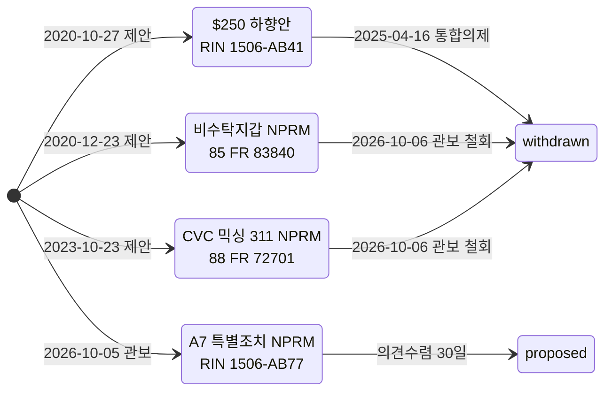
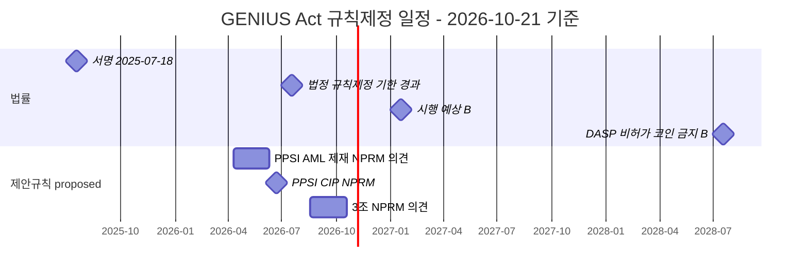
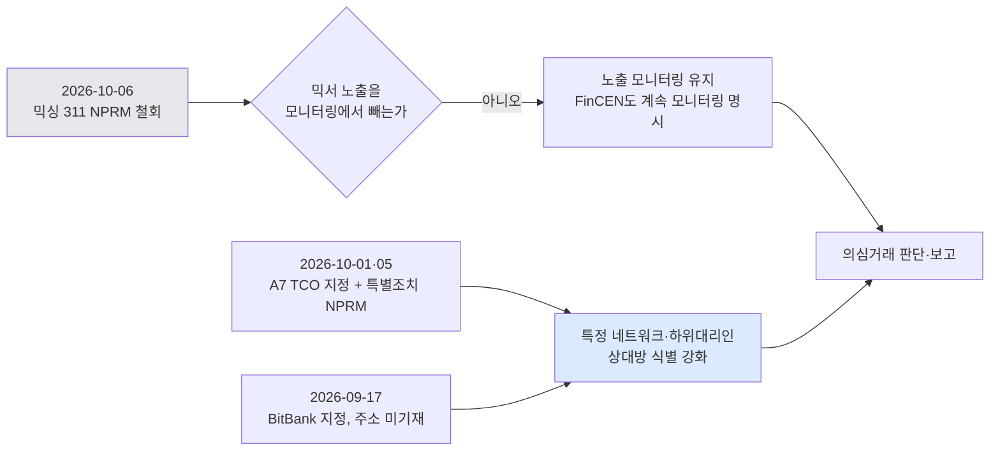

# 미국 — BSA, FinCEN, OFAC

> 미국 가상자산 AML 체계: **BSA → FinCEN (자금세탁) + OFAC (제재) → GENIUS Act (스테이블코인)**. 이 글을 읽고 나면 미국 트래블룰이 왜 2026-10-21에도 여전히 "$3,000 or more" 하나인지, 2026-10-06 철회된 두 제안규칙이 무엇이었는지, 그리고 미국이 거래 "유형" 규제에서 특정 "네트워크" 차단으로 옮겨 간 흐름을 이해하게 됩니다. 마지막 업데이트: 2026-10-21.

## TL;DR
- **BSA (Bank Secrecy Act)** — 미국 AML의 모법. 가상자산 사업자는 별도 범주 없이 MSB 정의의 "other value that substitutes for currency" 문언(31 CFR 1010.100(ff)(5)(i)(A))으로 포섭된다
- **트래블룰은 31 CFR 1010.410(f) "$3,000 or more" 하나**(in-force). $250 하향안은 2025-04-16 withdrawn
- **2026-10-06 연방관보**: FinCEN의 **CVC 믹싱 §311 NPRM(88 FR 72701)** 과 **비수탁지갑 NPRM(85 FR 83840)** 철회 공고 → 둘 다 **withdrawn**
- 같은 시기 **A7 네트워크 하위대리인 자금이체 금지 특별조치 NPRM**(RIN 1506-AB77, 2026-10-05 관보, **proposed**) — 근거는 §311이 아니라 Combating Russian Money Laundering Act §9714
- **GENIUS Act**: 2025-07-18 서명(enacted-not-in-force). **2026-07-18은 법정 규칙제정 기한(경과)** 이지 "시행규정 마감"이 아니다. §3 NPRM 2026-08-18 관보(의견 2026-10-19 마감). 법 시행은 법정 최종기한 **2027-01-18 예상(B)**
- OFAC 2026 축: "Operation Economic Outcast"(2026-08-24~), 이란 거래소 BitBank 등 지정(2026-09-17), A7 네트워크 TCO 지정(2026-10-01, B)

---

## 1. BSA — 미국 AML의 토대

| 항목 | 내용 |
|---|---|
| 인용 | 31 U.S.C. 5311 et seq. / 31 CFR Chapter X |
| 가상자산 포섭 경로 | MSB 정의 31 CFR 1010.100(ff)(5)(i)(A) "other value that substitutes for currency" |
| 트래블룰 | 31 CFR 1010.410(f) "transmittal of funds in the amount of $3,000 or more" |
| 집행 기관 | FinCEN(규칙제정·집행), OFAC(제재) |

근거: [31 CFR 1010.410 (LII)](https://www.law.cornell.edu/cfr/text/31/1010.410). KB 노드 `REG:us-bsa`.

BSA의 제정 연혁(1970)·USA PATRIOT Act(2001) 확장은 배경 지식입니다. 이 저장소 기준일 도시에가 원문으로 검증한 범위 밖이어서 세부는 적지 않습니다.

### 실무 포인트

미국 법을 볼 때 핵심은 "가상자산 전용 조문이 거의 없다"는 점입니다. 송금업(MSB) 정의와 자금이체 규칙을 그대로 적용하므로, 미국 쪽 의무를 확인하려면 가상자산 보도자료보다 31 CFR 조문을 먼저 봐야 합니다.

---

## 2. FinCEN — 미국 FIU와 트래블룰

### 정체성

- **Financial Crimes Enforcement Network**, 재무부 소속
- BSA 시행, SAR·CTR 수집·분석, 규칙제정, MSB 등록 관리

용어:
- **MSB (Money Services Business)** — 송금·환전·가치전송 등을 하는 비은행 금융사업자.
- **CVC (Convertible Virtual Currency)** — 법정화폐로 환전 가능한 가상통화. FinCEN 규칙·공고의 용어.
- **DASP (Digital Asset Service Provider)** — GENIUS 법·재무부 보고서의 용어.

### 트래블룰 (FinCEN 버전)

- **31 CFR 1010.410(f)**: 송신·중개 금융기관은 "$3,000 or more" 이체지시에 송신인 성명·계좌번호·주소·금액·실행일·수취 금융기관 등 정보를 다음 기관에 전달(in-force)([LII](https://www.law.cornell.edu/cfr/text/31/1010.410))
- 의무 자체에 금액이 붙은 **A형** 구조 — $3,000 미만이면 트래블룰 의무가 없다
- 재무부 2026-03 의회보고서(GENIUS 법 이행) 각주 63이 송금업자인 DASP에 "Funds Transfer Rule" 또는 "Travel Rule"이 적용됨을 다시 확인했다([재무부 보고서](https://home.treasury.gov/system/files/246/GENIUS-Act-Illicit-Finance-Innovation-Congressional-Report-March-2026.pdf))
- 1010.410에 걸린 미시행 개정(89 FR 72274)은 투자자문업자 AML 규칙의 (e)(6) 제외목록 수정이고 준수기한이 2028-01-01로 연기됐다 — 가상자산 트래블룰과 무관

### 제안됐다가 철회된 규칙 — 상태를 뭉뚱그리지 말 것

| 제안 | 공고 | 상태(2026-10-21) | 근거 |
|---|---|---|---|
| 국경 간 임계 $3,000→$250 하향 + CVC 명확화 (FinCEN·FRB, RIN 1506-AB41) | 2020-10-27 (85 FR 68005) | **withdrawn** — Spring 2025 통합의제 "Withdrawn 04/16/2025" | [reginfo.gov](https://www.reginfo.gov/public/do/eAgendaViewRule?pubId=202504&RIN=1506-AB41) |
| 비수탁지갑 CVC/LTDA 거래 보고·기록·신원확인 (85 FR 83840) | 2020-12-23 | **withdrawn** — 2026-10-06 관보 철회 공고. "FinCEN will not take any further action on this NPRM" | [FR 2026-20430](https://public-inspection.federalregister.gov/2026-20430.pdf) |
| CVC 믹싱을 §311 주요 자금세탁 우려 거래군으로 지정 (88 FR 72701) | 2023-10-23 | **withdrawn** — 2026-10-06 관보 철회 공고 | [FR 2026-20429](https://public-inspection.federalregister.gov/2026-20429.pdf) |
| A7 네트워크 하위대리인 자금이체 금지 특별조치 (RIN 1506-AB77) | 2026-10-05 관보, 의견 30일 | **proposed** | [FR 2026-20371](https://public-inspection.federalregister.gov/2026-20371.pdf) |

**철회 사유**: 믹싱 공고는 "rule could have a chilling effect on legitimate activity and place a large reporting burden on covered financial institutions. However, FinCEN will continue to monitor activity involving CVC mixers"라고 했고, FinCEN 보도자료는 "as part of the Trump Administration's deregulatory agenda"라고 밝혔다([FinCEN 2026-10-05](https://www.fincen.gov/news/news-releases/fincen-announces-withdrawals-proposed-digital-asset-related-rules)).

**RIN 표기 주의**: 믹싱 NPRM의 원래 RIN은 1506-AB64인데, 2026-10-06 철회 공고에는 1506-AB47(비수탁지갑 규칙과 같은 번호)이 적혀 있다. 공고의 오기로 보이며, 식별은 88 FR 72701 인용으로 한다.

**비수탁지갑 규칙의 두 날짜**: 이전 조사는 통합의제상 2024-04-12 종결을 기록하고 "연방관보 공고 없음"이라 적었다. 2026-10-06 관보 철회 공고가 실제로 게재됐으므로, 의제상 종결(2024)과 공식 관보 철회(2026)를 별개 행정행위로 기록한다.

### 같은 시기 다른 FinCEN 규칙

- **AML/CFT 프로그램 규칙 NPRM**: 관보 2026-04-10, 의견 2026-06-09 마감. 2026-10-21 기준 최종규칙 공고 없음(proposed)
- **A7 특별조치 NPRM**: A7 네트워크가 Garantex·Grinex·A7A5(루블 스테이블코인) 등과 연계되고 이란·테러 대리세력도 이용했다고 기술한다(FR 2026-20371)

### 실무 포인트

믹서 "유형" 전체를 §311로 묶으려던 계획은 철회됐지만, 같은 주에 특정 "네트워크"(A7)와의 이체를 막는 조치가 제안됐습니다. 따라서 믹서 노출을 거래모니터링에서 빼도 된다는 뜻이 아닙니다. 철회 공고도 믹서 활동을 계속 모니터링하겠다고 적었습니다.

---

## 3. OFAC — 제재 집행

### 정체성

- **Office of Foreign Assets Control**, 재무부 소속. 경제·무역 제재 집행
- **SDN List**에 가상자산 주소가 기재될 수 있다 — 이 경우 거래 상대 주소 스크리닝 대상이 된다

### 2025~2026 가상자산 관련 조치

| 일자 | 조치 | 상태 | 근거 |
|---|---|---|---|
| 2025-03-21 | **Tornado Cash SDN 삭제** — 엔티티 1개·ETH 주소 90개 | 해제 완료 | [OFAC 2025-03-21](https://ofac.treasury.gov/recent-actions/20250321) |
| 2025-10-14 | 캄보디아 **Prince Group TCO 지정**(146개 대상) + FinCEN **Huione Group §311 최종규칙** | in-force | [재무부 sb0278](https://home.treasury.gov/news/press-releases/sb0278) |
| 2026-08-24 | "Operation Economic Outcast" 개시 | — | [재무부 sb0632](https://home.treasury.gov/news/press-releases/sb0632/) |
| 2026-09-17 | 이란 거래소 **BitBank**·개발사 Pishtaz Simorgh·개인 3인 지정(E.O. 13902) | in-force | [OFAC 2026-09-17](https://ofac.treasury.gov/recent-actions/20260917) |
| 2026-10-01 | **A7 Network** TCO 지정(E.O. 13581, 개정 E.O. 13863) | in-force(B — FinCEN NPRM 각주로 확인, OFAC 원 공고 미열람) | [FR 2026-20371](https://public-inspection.federalregister.gov/2026-20371.pdf) |

재무부는 2026-09-17 지정과 관련해 기지정자가 2026-06~07 BitBank로 수억 달러 상당 비트코인을 IRGC에 이전했다고 밝혔다. OFAC 공고에는 디지털화폐 주소가 기재되지 않았다.

### Tornado Cash — 제재 해제 ≠ 형사 종결

- 2025-03-21 OFAC 제재 해제
- 2025-08-06 배심은 Roman Storm에게 무면허 송금업 공모 유죄를 평결했고, 자금세탁·IEEPA 위반 공모는 배심 불일치로 끝났다(B)([Willkie 2025-08-08](https://complianceconcourse.willkie.com/articles/tornado-cash-cofounder-convicted-for-conspiring-to-operate-an-unlicensed-money-transmitting-business/))

자세한 내용은 [`../6-cases/tornado-cash.md`](../6-cases/tornado-cash.md).

### 실무 포인트

2026년 OFAC 가상자산 제재의 축은 이란·러시아 연계 네트워크입니다. 개별 주소가 공고에 없는 지정(BitBank)도 있으므로, 주소 리스트 대조만으로는 부족하고 거래 상대 VASP 식별·실사가 함께 필요합니다.

---

## 4. 주요 집행 사례 (가상자산)

| 일자 | 대상 | 기관 | 내용 | 근거 |
|---|---|---|---|---|
| 2025-10-14 | Huione Group | FinCEN | §311 최종규칙 — 미국 금융시스템에서 차단 | [재무부 sb0278](https://home.treasury.gov/news/press-releases/sb0278) |
| 2025-12-09 | Paxful | FinCEN | **$3.5M 민사벌금** — MSB 미등록·AML 프로그램 미비·SAR 미제출. 트래블룰 위반은 사유가 아님 | [FinCEN](https://www.fincen.gov/news/news-releases/fincen-assesses-35-million-penalty-against-paxful-facilitating-suspicious) |

2024-01-01~2026-10-21 사이 **트래블룰 위반을 독립 제재 사유로 명시한 미국 사건은 확인되지 않았다**(FinCEN 집행 색인 전수 점검은 아님).

이전 판 표에 있던 2020~2025 대형 사건(BitMEX·BitGo·Bittrex·Binance·Kraken·OKX)의 금액은 이 저장소 기준일 도시에가 원문으로 확인하지 않은 수치라 표에서 뺐다. 사건별 상세는 [`../6-cases/major-enforcement.md`](../6-cases/major-enforcement.md) 에서 원문과 대조해 읽어야 한다.

### 참고 가이던스 (기술 신호)

- **NYDFS 2022-04-28 산업서한**: 지원 자산마다 거래 추적 절차, 외주·자체 분석도구 모두 허용, 분석도구가 "may not be able to identify underlying owners"라는 한계 인정([NYDFS](https://www.dfs.ny.gov/industry_guidance/industry_letters/il20220428_guidance_use_blockchain_analytics))
- **FinCEN FIN-2023-Alert005(2023-09-08)**: pig butchering 적신호 — 과거 접속 패턴과 다른 IP·기기 ID·지역, ETH 수취 후 TRX 전환·급출금 등([FinCEN Alert](https://www.fincen.gov/sites/default/files/shared/FinCEN_Alert_Pig_Butchering_FINAL_508c.pdf))

---

## 5. GENIUS Act — 스테이블코인 발행자의 BSA 편입

### 정체성과 상태

- **2025-07-18 서명**(Pub. L. 119-27). 2026-10-21 기준 **enacted-not-in-force**
- 결제 스테이블코인 허가 발행자(PPSI)를 BSA 금융기관으로 편입하는 하위 규칙이 진행 중

### 날짜 — 무엇의 기한인지 구분할 것

| 일자 | 무엇인가 | 상태 | 근거 |
|---|---|---|---|
| 2025-07-18 | 법 서명 | enacted | [재무부 2026-03 보고서](https://home.treasury.gov/system/files/246/GENIUS-Act-Illicit-Finance-Innovation-Congressional-Report-March-2026.pdf) |
| 2026-04-10 | FinCEN·OFAC **PPSI AML/CFT·제재 프로그램 NPRM** 관보(의견 2026-06-09 마감) | proposed | [Federal Register API](https://www.federalregister.gov/api/v1/documents.json?conditions%5Bterm%5D=%221010.410%22&conditions%5Bagencies%5D%5B%5D=financial-crimes-enforcement-network&order=newest&per_page=20) |
| 2026-06-22 | PPSI CIP NPRM | proposed | 동상 |
| **2026-07-18** | **법정 규칙제정 기한**(제정 후 1년) — 경과, 최종규칙 0건 | — | Chapman 트래커(B) |
| 2026-08-18 | 재무부 **§3 NPRM**(발행·제공·판매, RIN 1505-AC95) 관보, 의견 2026-10-19 마감 | proposed | [FR 2026-16796](https://public-inspection.federalregister.gov/2026-16796.pdf) |
| **2027-01-18** | 법 시행 예상 — 최종규칙이 늦어 법정 최종기한 적용 | 예상(B) | [Jones Day](https://www.jonesday.com/en/insights/2026/08/us-treasury-proposes-genius-act-rules-for-stablecoin-issuance-offer-and-sale) |
| 2028-07-18 | DASP의 비허가 결제 스테이블코인 제공·판매 금지 개시 | 예정(B) | 동상 |

이전 판의 "2026-04-08 합동 제안 → 시행규정 2026-07-18 마감, 전면 시행 2027-01-18"은 날짜의 성격을 섞었다. 2026-04-10은 NPRM 관보일, 2026-06-09는 그 의견 마감, 2026-07-18은 법정 규칙제정 기한이다.

### 실무 포인트

PPSI NPRM은 2차 시장 거래에 규칙이 적용되는지를 다루지 않는다는 해설이 있다(DLA Piper, B). 발행자의 동결 기능에 대해서는 FATF 7차 TU(para 35)와 BIS 2026 연차보고서가 "발행자 수준 동결로 거래소 측 AML 통제를 대신할 수 없다"는 방향을 가리킵니다. 거래소는 발행자 동결 이벤트를 자체 모니터링 입력으로 받되, 그것에 의존하는 통제 설계는 피해야 합니다.

---

## 6. 미국 외부 영향력 — 역외 적용 경로

미국 규제가 한국 VASP에 닿는 경로는 대체로 다음과 같습니다. 각 경로의 실제 적용 여부는 사안별 법률 검토가 필요합니다.

1. **USD 결제망·환거래 은행** — 미국 금융기관이 거래 상대에 제재·§311 결과를 적용
2. **OFAC 지정** — SDN 주소·지정 VASP와의 거래 차단
3. **§311·§9714 특별조치** — Huione(최종), A7(제안)처럼 특정 기관·네트워크와의 이체를 미국 금융기관에 금지
4. **달러 스테이블코인 발행자** — 발행자가 미국 규제를 따르므로 동결 결과가 거래소 잔고에 반영될 수 있음

---

## 7. 미국 가상자산 감독 기관 분포

| 기관 | 다루는 것 |
|---|---|
| **FinCEN** | BSA 규칙제정·집행, MSB 등록, SAR |
| **OFAC** | 제재 지정·집행 |
| **SEC / CFTC** | 증권·상품 측면의 시장규제 |
| **OCC / FDIC / NCUA** | 은행·신협 감독, GENIUS 하위 인가 규칙(proposed) |
| **주 감독당국(예: NYDFS)** | 주 송금업 라이선스, 감독 가이던스 |

시장구조 법안(CLARITY Act)의 상원 진행 상황은 이 저장소 기준일 근거로 1차 확인되지 않아 상태를 적지 않는다. 확인되면 [`../../intel/watchlist/regulatory-watch.md`](../../intel/watchlist/regulatory-watch.md) 에 반영한다.

---

## 8. 한국 사업자가 알아야 할 미국 룰

| 상황 | 확인할 것 |
|---|---|
| 한국에서만 영업 | OFAC 지정 주소·VASP 스크리닝, §311·§9714 대상 기관과의 거래 여부 |
| 미국 고객을 받음 | MSB 등록·주 송금업 라이선스 요건(별도 법률 검토) |
| 미국 VASP와 이전 | 상대방은 $3,000 이상에서만 트래블룰 의무 — $3,000 미만 이전에서 정보가 오지 않을 수 있음 |
| 달러 스테이블코인 취급 | 발행자 동결 이벤트 처리 절차, 2027-01-18 이후 GENIUS 시행 영향 |

### 실무 포인트

한국은 2027-02-19부터 다른 VASP로의 **모든** 이전에 정보제공 의무가 생기지만, 미국 상대방은 $3,000 이상에서만 의무가 있습니다. 이 비대칭 구간(국내 전건 vs 미국 $3,000 미만)은 sunrise와 같은 방식으로 다뤄야 합니다.

---

## 💼 실무 현장 (Industry Reality)

### SAR 제출

FinCEN SAR는 BSA E-Filing System으로 제출합니다. 제출 기한·연장·보완 SAR 규칙은 31 CFR 원문으로 확인해야 하며, 이 저장소 기준일 도시에가 검증한 범위 밖이라 기한 수치를 여기 적지 않습니다. 이전 판에 있던 특정 거래소의 내부 처리 시간·조직 인원·연봉·라이선스 비용 수치는 공개 근거가 없어 삭제했습니다.

### 철회 이후 거래모니터링 설계

### 자주 나오는 오해

- **"미국 비수탁지갑 규칙은 관보 공고 없이 흐지부지됐다"** — 2026-10-06 관보에 철회 공고가 실렸다(FR 2026-20430).
- **"믹싱 §311 규칙은 2027년 최종화 예정"** — 2026-10-06 관보로 withdrawn. 이전 통합의제의 "최종조치 목표 2027-12"는 더 이상 유효하지 않다.
- **"GENIUS 시행규정은 2026-07-18 마감"** — 2026-07-18은 법정 규칙제정 기한이고, 2026-10-21 기준 하위 규칙은 전부 proposed다.
- **"미국도 트래블룰 기준을 낮췄다"** — $250 안은 2025-04-16 withdrawn, 현행은 $3,000 그대로다.

---

## 더 읽을거리
- [`korea-fiu-act.md`](korea-fiu-act.md) — 한국 특금법과 비교
- [`fatf.md`](fatf.md) — FATF 기준
- [`../6-cases/tornado-cash.md`](../6-cases/tornado-cash.md) — Tornado Cash 제재 상세
- [`../6-cases/major-enforcement.md`](../6-cases/major-enforcement.md) — 대형 집행 사례
- [Federal Register 2026-20429 — 믹싱 NPRM 철회](https://public-inspection.federalregister.gov/2026-20429.pdf)
- [Federal Register 2026-20430 — 비수탁지갑 NPRM 철회](https://public-inspection.federalregister.gov/2026-20430.pdf)
- [Federal Register 2026-20371 — A7 특별조치 NPRM](https://public-inspection.federalregister.gov/2026-20371.pdf)
- [FinCEN — 디지털자산 제안규칙 철회 발표 (2026-10-05)](https://www.fincen.gov/news/news-releases/fincen-announces-withdrawals-proposed-digital-asset-related-rules)
- [31 CFR 1010.410 (LII)](https://www.law.cornell.edu/cfr/text/31/1010.410)
- [OFAC Recent Actions](https://ofac.treasury.gov/recent-actions)
