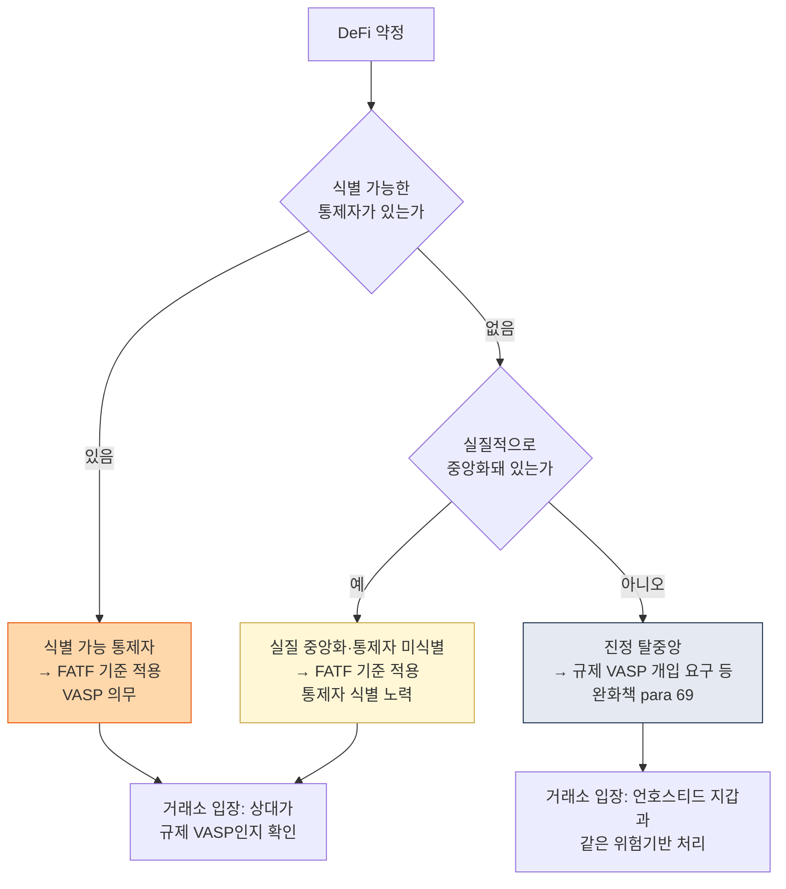
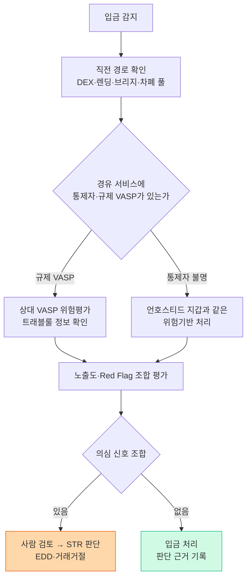

# DeFi / NFT / Privacy Coin — 특수 영역 AML 리스크

> 중앙화 VASP **외부의 회색지대**. 이 글을 읽고 나면 FATF가 DeFi·NFT를 어떤 기준으로 VASP·VA 범위에 넣는지, 2026-10-21 기준 각국 집행이 얼마나 비어 있는지, 그리고 거래소가 이 영역에서 들어오는 자금을 어떻게 다뤄야 하는지 이해하게 됩니다. 마지막 업데이트: 2026-10-21.

## TL;DR
- **DeFi**: FATF 2021 가이던스 para 67 — "A DeFi application (i.e. the software program) is not a VASP", 그러나 통제력·충분한 영향력을 가진 사람은 VASP가 될 수 있다. 2026-07-21 DeFi 타겟보고서가 이 분석을 갱신했다.
- **집행 공백**: 7차 TU(2026-07-16) 기준 DeFi 위험평가를 마친 관할 18%(26/142), 자국 내 VASP 해당 DeFi를 식별하지 못한 관할 93%, 실제 인가 2개 관할, 집행 1개 관할.
- **NFT**: FATF 2021 para 53 — 일반적으로 VA가 아니지만 결제·투자 용도로 실사용되면 VA.
- **Privacy coin**: EU AMLR 제79조 CASP 취급 금지 **2027-07-10 적용 예정(enacted-not-in-force)**. Monero는 2023년 패치 이전 구간만 공개 휴리스틱으로 부분 추적 가능.
- **Tornado Cash**: 2025-03-21 SDN 삭제, 2025-08-06 Storm 유죄 평결(B) — 제재 해제 ≠ 위험 해제.

---

## 1. DeFi (Decentralized Finance)

### 정체성

**DeFi**는 중개자 없이 스마트컨트랙트가 lending·swap·derivatives를 처리하는 금융 인프라입니다.

용어:
- **TVL (Total Value Locked)** — 프로토콜에 예치된 자산의 총 USD 환산 가치.
- **AMM (Automated Market Maker)** — 알고리즘이 자동으로 가격을 정하는 DEX 구조.
- **DAO (Decentralized Autonomous Organization)** — 거버넌스 토큰 홀더의 투표로 운영되는 조직.

### 왜 AML에서 문제인가

| 항목 | 이슈 |
|---|---|
| **운영자 식별** | 누가 통제하는가 → 누가 VASP인가 |
| **KYC 부재** | 사용자가 지갑만 연결 |
| **글로벌 즉시 접근** | 제재국 사용자 접근 차단이 프로토콜 수준에서 어려움 |
| **세탁 도구화** | DEX swap·LP가 layering 경로 |
| **Fork 가능성** | 코드 복제로 프런트엔드 차단을 우회 |

### FATF 기준 — 통제자 판정

FATF 2021 가이던스 para 67: "A DeFi application (i.e. the software program) is not a VASP under the FATF standards ... However, creators, owners and operators or some other persons who maintain control or sufficient influence in the DeFi arrangements, even if those arrangements seem decentralized, may fall under the FATF definition of a VASP where they are providing or actively facilitating VASP services."

식별 질문(para 93): 누가 이익을 얻는가, 규칙 설정·변경 권한, 운영 결정, 출범 주도, 사용자와의 지속 관계·데이터 통제, 서비스 중단 권한. 통제자를 식별하지 못하면 국가는 규제 VASP의 개입을 요구하는 등 완화책을 고려합니다(para 69)([FATF 2021 RBA 가이던스](https://www.fatf-gafi.org/content/dam/fatf-gafi/guidance/Updated-Guidance-VA-VASP.pdf.coredownload.pdf)).

2026-07-21 「Targeted Report on Regulatory Challenges from Decentralised Finance」는 이 분석을 "updates and complements"하며 기능적·위험기반 접근과 통제 존재 판정을 권고했습니다. 가이던스가 아니며 기준 변경도 아닙니다([FATF DeFi 보고서](https://www.fatf-gafi.org/en/publications/Virtualassets/targeted-report-decentralised-finance-2026.html)). 7차 TU 각주 1은 DeFi를 세 갈래로 나눕니다.



### 각국 집행 — 7차 TU 수치

| 지표 (2026 설문) | 수치 |
|---|---|
| DeFi 위험평가 완료 / 진행 | 18%(26/142) / 9%(12/142) |
| 자국 내 VASP 해당 DeFi 미식별 | 93%(132/142) |
| 완화조치 적용 | 31%(44/142) |
| 인가·등록 요건 부과 | 4개 관할 |
| 실제 인가·등록 | 2개 관할 |
| 집행조치 | 1개 관할 |

출처: [7차 TU PDF](https://www.fatf-gafi.org/content/dam/fatf-gafi/reports/7th-targeted-update-on-implementation-fatf-standards-vas-vasps-2026.pdf.coredownload.pdf) para 46~47. 7차 TU는 민간 권고 5에서 "VASPs, including Stablecoin issuers and qualifying DeFi arrangements"가 AML/CFT 체계와 트래블룰을 갖춰야 한다고 했고, 권고 6-iv에서 VASP에 프로토콜·브리지·믹서·크로스체인 노출 평가를 요구했습니다.

EU에서는 AMLA가 2026-10-07 MiCA 재검토와 관련한 AML 우선과제 5개(스테이킹·대출, DeFi 통제자 정의, 무인가 스테이블코인 등)를 제출했습니다([AMLA](https://www.amla.europa.eu/amla-identifies-amlcft-priorities-review-mica_en)).

한국의 DeFi 규율은 2단계 입법 진행 상황이 확인되지 않아(보고서 부록 B #10) 여기 싣지 않습니다. 이전 판의 미국 입법·SEC 조치, MiCA의 "fully decentralized" 적용 제외 서술은 이번 근거 자료로 재확인하지 못해 삭제했습니다.

### 주요 DeFi 자금세탁 패턴

1. **Swap layering**: 여러 토큰을 연쇄 교환해 출처 단절.
2. **Liquidity Pool 세탁**: LP 입금 → 다른 자산으로 인출.
3. **Flash Loan 결합**: 가격 조작 → 차익 인출 → 믹서.
4. **MEV 활용**: 트랜잭션 순서 조작으로 자금 흐름 위장.

### 실무 포인트

DeFi 규제의 압력은 **통제자**에게 몰립니다. 거래소 입장에서 실무 질문은 "이 자금이 지나온 DeFi에 통제자가 있었나, 규제 VASP였나"이고, 답을 모르면 언호스티드 지갑과 같은 위험기반 처리를 적용하는 것이 FATF 2021 para 69와 정합합니다.

---

## 2. NFT (Non-Fungible Token)

### AML 관점에서 NFT의 본질

NFT는 **고유 자산 + 가격 자율 책정 + 즉시 글로벌 거래**의 조합입니다. 거래 가격을 당사자가 정하므로 자금 이전을 "작품 대금"으로 위장하기 쉽습니다.

### 주요 패턴

| 패턴 | 설명 |
|---|---|
| **Wash trading** | 자기들끼리 사고팔아 가격·거래량 부풀림 |
| **Self-laundering** | 같은 사람의 다른 주소 간 매매 |
| **Trading mule** | 범죄 수익으로 NFT 매수 → 정당 자산화 |
| **Phishing 결합** | 가짜 민팅으로 지갑 탈취 |
| **Royalty 악용** | 로열티 수취 지갑으로 반복 거래 수익 집적 |

이전 판의 wash trading 비중(25~50%, 45~60%)과 마켓플레이스별 정책 변경 서술은 이번 근거 자료로 재확인하지 못해 삭제했습니다.

### FATF 입장

FATF 2021 가이던스 para 53: NFT는 "generally not considered to be VAs"이지만 결제·투자 용도로 실사용되면 VA가 될 수 있고, "assets that do not qualify as VAs should not be presumed to fall outside the scope of the FATF Standards"(para 50)입니다. 하나의 자산이 VA와 금융자산을 동시에 겸하지는 않습니다(para 51).

한국의 NFT 가상자산 해당 여부 판단 기준은 이번 근거 자료로 재확인하지 못했습니다. 이전 판의 "2024-06 FSC 가이드라인" 세부 서술은 원문 확인 전까지 [`../2-regulations/korea-fiu-act.md`](../2-regulations/korea-fiu-act.md)를 참조하세요.

### 실무 포인트

NFT 마켓플레이스를 운영하거나 NFT 대금이 거래소로 들어온다면, **기능 기준**(결제·투자 용도인가)으로 VA 해당성을 판단한 근거를 남기세요. 판단 기준이 기능적이라 사례마다 결론이 바뀔 수 있습니다.

---

## 3. Privacy Coin

### 대표 코인과 기술

| 코인 | 기술 | 추적 가능성 (공개 연구 기준) |
|---|---|---|
| **Monero (XMR)** | Ring Signature + Stealth Address + RingCT | 2019~2023 지갑 버그("10 Block Decoy Bug" 등)·P2Pool·Mordinal 휴리스틱은 대부분 고정밀. 2023년 초 패치 이후 신규 거래에는 무효([arXiv 2408.05332](https://arxiv.org/abs/2408.05332)) |
| **Zcash (ZEC)** | zk-SNARK shielded transaction | shielded 사용 여부에 따라 다름 |

### 기술 원리 한 줄 요약

- **Ring Signature** — 여러 후보 서명자 중 실제 서명자를 숨김.
- **Stealth Address** — 받는 주소를 거래마다 새로 생성.
- **RingCT** — 금액도 암호화.
- **zk-SNARK** — 거래 유효성만 증명하고 내용은 숨김.

### 규제

- **EU AMLR(2024/1624) 제79조**: CASP가 익명성강화코인을 포함해 거래를 익명화·난독화하는 계좌를 보유·취급하는 것을 금지. **2027-07-10 적용 예정(enacted-not-in-force)**([EUR-Lex](https://eur-lex.europa.eu/legal-content/EN/TXT/PDF/?uri=OJ:L_202401624)).
- **FATF Red Flag RF-A1·A2**: 수수료를 감수한 AEC 사용, 투명 체인 자산 → 거래소 → 즉시 AEC 전환([FATF Red Flag](https://www.fatf-gafi.org/content/dam/fatf-gafi/reports/Virtual-Assets-Red-Flag-Indicators.pdf)).

이전 판의 국가별 상장폐지 연도(한국 2021, 일본 2018)는 이번 근거 자료로 재확인하지 못해 삭제했습니다.

### 차폐 풀(privacy pool)의 정량 측정

2026년 연구는 "추적 불가/가능" 이분법 대신 수치로 측정합니다.
- Railgun: 출금의 17.65%가 입금과 하나로 연결, 중위 익명성 손실 3.42비트([arXiv 2606.25926](https://arxiv.org/abs/2606.25926))
- Railgun·Hinkal unshield 186,356건: 공개 토큰 제약만으로 평균 익명성 집합 40.1~59.0% 감소([arXiv 2608.22987](https://arxiv.org/abs/2608.22987))
- Railgun PPoI 스크리닝은 오프체인에서 수행되며, 브로드캐스터는 PPoI를 요구하지만 사용자 직접 제출 거래는 검사를 건너뛴다(B)([L2BEAT](https://l2beat.com/privacy/projects/railgun))

### 실무 포인트

Privacy coin을 취급하지 않는 거래소에서도 위험은 **진입·탈출 순간**에 있습니다. 해외에서 AEC를 쓴 뒤 투명 체인 자산으로 바꿔 입금하는 흐름은 RF-A2의 역방향이며, 입금 주소의 직전 경로 노출을 봐야 합니다.

---

## 4. Cross-chain Bridge

### 정체성

A 체인 자산을 잠그고(lock) B 체인에서 wrapped 토큰을 발행. 환원하려면 B에서 소각 → A에서 해제.

### AML 관점

- **Layering 인프라** — 체인 간 끊김.
- 7차 TU: DPRK가 탈취 자금을 브리지·언호스티드 지갑·OTC로 세탁하고, RPC 노드·멀티시그 공급자 같은 제3자 인프라를 공격한다(para 33).
- 추적 연구: 12개 브리지 양방향 F1 91.75%(ABCTracer), 5개 브리지 F1 0.9746(ConneX), Ethereum–Polygon 입금 매칭 93.04~99.65%·출금 67.55~92.78%. 브리지 집합·정의가 달라 **수치 비교 불가**([arXiv 2504.01822](https://arxiv.org/abs/2504.01822); [arXiv 2511.01393](https://arxiv.org/abs/2511.01393); [arXiv 2504.15449](https://arxiv.org/abs/2504.15449)).

이전 판의 브리지 해킹 손실 표는 이번 근거 자료로 재확인하지 못해 삭제했습니다.

### 실무 포인트

출금 주소가 브리지 컨트랙트라면 다음 홉을 추적할 수 있는지가 관건입니다. 추적이 끊기면 그 시점 노출은 사실상 unknown이므로, 금액·고객 위험과 결합해 판단합니다. 이전 판의 "모든 브리지 출금에 자동 STR 후보 큐잉"은 근거 있는 업계 관행이 아니어서 삭제했습니다 — STR은 의심 판단의 결과이지 경로 자체의 자동 산출물이 아닙니다.

---

## 5. MEV · Flash Loan · Rug Pull · 기타

### MEV (Maximal Extractable Value)

블록 생성 시 트랜잭션 순서 조작으로 얻는 이득. Sandwich attack은 가격 조작 유형입니다. 2026 연구는 제재 주소가 동결 발효 전 순서 선점으로 자금을 빼는 "Sanction-Evasion MEV"를 측정했습니다 — **USDT 제재 주소의 7.3%, USDC의 18.7%가 동결 발효 전 전액 인출**([arXiv 2603.27739](https://arxiv.org/abs/2603.27739)).

### Flash Loan

담보 없이 한 트랜잭션 안에서 빌리고 갚는 대출. 가격 조작 → 차익 추출 → 믹서로 이어질 수 있습니다.

### Rug Pull

- SoK(ISSTA 2025): **35개 rug pull 유형**(9개 신규), 13개 탐지 도구 커버리지 **25.7~62.9%**, 복합 기법 rug pull에서 성능 급락([ISSTA 2025](https://conf.researchr.org/details/issta-2025/issta-2025-papers/25/SoK-A-Taxonomic-Analysis-of-DeFi-Rug-Pulls-Types-Dataset-and-Tool-Assessment)).
- rug pull의 **정의 자체가 복수**(TVL 급감 기반 vs 거래 유휴 기반)이고, 벤치마크 데이터 누수가 탐지 성능을 부풀린다는 지적이 있습니다(academic 도시에 P-042·P-043).

### LST · Restaking

자산이 staking 토큰으로 감싸지고 또 감싸지면 자산 형태가 바뀌어 layering에 쓰일 수 있습니다. 이전 판의 "2025년 부상한 신종 유형", 벤더별 LST 모듈 출시 서술은 근거가 확인되지 않아 삭제했습니다.

용어:
- **LST (Liquid Staking Token)** — staking 증표 토큰.
- **LRT (Liquid Restaking Token)** — LST를 다시 restaking하고 받는 토큰.

---

## 6. 회사 관점 — 어떻게 대응하나



### 거래소

- DeFi·브리지 경유 입금의 직전 경로 확인
- DEX·브리지·차폐 풀 컨트랙트 주소 라벨링
- 2027-02-19부터 자기수탁 지갑과의 이전은 동일인일 때만 허용(enacted-not-in-force) — DeFi에서 직접 들어오는 자금의 처리 정책 정비

### 수탁업자

- 고객의 DeFi·staking 위탁 시 별도 정책과 출금 흐름 분석

### 실무 포인트

차단 우선과 탐지 강화 사이의 선택은 회사 위험평가로 하되, 어느 쪽이든 **판단 근거를 기록**하는 것이 공통 요건입니다(업무규정 제79·80조). 이전 판의 "한국 거래소는 대체로 차단 우선" 같은 일반화는 근거가 없어 삭제했습니다.

---

## 요약 부록 — 빠른 참조용

**DeFi 기준**: 소프트웨어는 VASP 아님 / 통제자는 VASP 가능 (2021 para 67), 2026-07-21 보고서로 갱신
**DeFi 집행 공백**: 위험평가 18%, 미식별 93%, 인가 2개, 집행 1개 (7차 TU)
**NFT 기준**: 기능 기준 — 결제·투자 용도면 VA (2021 para 53)
**Privacy coin**: EU AMLR 제79조 2027-07-10, Monero 패치 이전만 부분 추적
**신종 측정**: Sanction-Evasion MEV 7.3%/18.7%, rug pull 도구 커버리지 25.7~62.9%

## 💼 실무 현장 (Industry Reality)

### 회색지대에서 선을 긋는 기준

공개 근거로 쓸 수 있는 기준은 다음 셋입니다.

1. **통제자 기준** (FATF 2021 para 67·93): 경유한 DeFi에 통제자가 있으면 그 통제자를 상대 VASP로 보고 실사한다.
2. **기능 기준** (para 53): NFT·토큰이 결제·투자 용도로 쓰이면 VA로 다룬다.
3. **노출 평가** (7차 TU 권고 6-iv): 프로토콜·브리지·믹서·크로스체인 도구 노출을 평가한다.

이전 판의 "한국 4대 거래소 정책 표"(DeFi 입금·브리지 출금·LST 상장·Tornado 차단), 글로벌 거래소별 DeFi 대응, Risk Score 80/50 기준의 "한국 VASP 실제" 판정 플로, 마켓플레이스·거래소 NFT 사업 변화는 공개 근거가 없어 삭제했습니다.

### 자주 나오는 오해

- **"DeFi는 규제 불가니 우리 책임 아님"** — CEX가 DeFi 경유 자금을 받는 순간 그 자금은 우리 거래모니터링 대상이다. 그리고 DeFi 통제자는 VASP가 될 수 있다.
- **"NFT는 예술품이라 AML 무관"** — 기능 기준으로 VA가 될 수 있다.
- **"Monero는 한국에서 안 다루니 리스크 없음"** — 해외에서 AEC를 쓴 뒤 투명 체인 자산으로 바꿔 들어오는 흐름이 리스크다.
- **"Tornado Cash는 해제됐으니 정상"** — 형사 절차는 별개였고(2025-08-06 Storm 유죄 평결, B), 제재 기간 중에도 보안사고 자금의 다수가 Tornado Cash를 거쳤다([arXiv 2507.11721](https://arxiv.org/abs/2507.11721)).

---

## 7. 스테이킹 서비스의 AML 함의

### 7.1 Staking이 왜 AML 문제가 되나

**Staking**: PoS 블록체인에서 코인을 묶어 네트워크 검증에 참여하고 보상을 받는 것.

VASP가 제공하는 유형:
- **Native Staking**: 고객 자산을 validator에 위임
- **Liquid Staking**: 스테이킹 증서(LST) 발행
- **Pooled Staking**: 소액 보유자 대상 풀

### 7.2 AML 판단 논점

- **보상이 자금원천 판단에 어떻게 들어가는가**: 보상 자체보다, 스테이킹을 경유한 자금 흐름이 출처를 흐리는지가 문제다.
- **LST를 별도 자산으로 볼 것인가**: 별도 가격·유동성을 가지므로 거래모니터링·트래블룰 대상 자산 목록에 포함할지 결정해야 한다.
- **Unstaking 대기 기간**: 자금이 묶인 상태에서의 조사·동결 대응 절차.

### 7.3 규제 동향

- EU AMLA는 2026-10-07 MiCA 재검토 AML 우선과제에 **스테이킹·대출**을 포함했다([AMLA](https://www.amla.europa.eu/amla-identifies-amlcft-priorities-review-mica_en)).
- 한국의 스테이킹 관련 정책 진행은 이번 근거 자료로 확인되지 않았다.

이전 판 7.3~7.7의 거래소별 스테이킹 AML 대응 표, Lido 등 프로토콜 점유율 표, "LST → privacy pool 연간 ~$200M", 한국 출시 예상 시기, 미출시 이유 목록은 출처가 없어 삭제했습니다.

### 7.4 기술적 리스크

- **Slashing**: validator 위반 시 stake 일부 소각 → 고객 자산 손실 시 책임 경계(약관) 문제
- **MEV**: 스테이킹 보상에 MEV 수익이 섞이면 자금원천 설명이 어려워짐
- **Restaking**: 여러 서비스에 위임되면 연쇄 slashing 위험과 통제 경계가 복잡해짐

---

## 8. NFT 로열티 악용 — 숨은 typology

### 8.1 로열티란

2차 시장 거래 시 원작자가 일정 비율을 받는 구조. 마켓플레이스·컨트랙트 수준에서 집행됩니다.

### 8.2 악용 메커니즘

1. 컬렉션 발행 + 높은 로열티 설정
2. 공모자 간 반복 거래(wash trading)
3. 로열티 지갑에 대금 누적
4. 표면상 "예술품 2차 거래" → 자금 이전 은폐

### 8.3 탐지 룰 예시 (설명용 — 임계값은 가정)

```python
def detect_nft_wash_trading(trades):
    alerts = []
    for collection in group_by_collection(trades):
        # 1. 소수 거래자 집중도
        top_ratio = top_n_traders_volume(collection, n=10) / total_volume(collection)
        if top_ratio > POLICY_CONCENTRATION:
            alerts.append("Concentrated trading")
        # 2. 동일 주소쌍 반복 거래
        for pair in address_pairs(collection):
            if pair.trade_count >= POLICY_REPEAT and pair.value_cycle_ratio < POLICY_CYCLE:
                alerts.append(f"Wash trading pair: {pair}")
        # 3. 로열티 수취 지갑의 유출 흐름
        if suspicious_outflow(collection.royalty_wallet):
            alerts.append("Royalty wallet outflow")
    return alerts
```

이전 판 8.3·8.5의 마켓별 wash trading 비중과 로열티 정책 변경 연표는 이번 근거 자료로 재확인하지 못해 삭제했습니다.

---

## 더 읽을거리
- [`onchain-typology.md`](onchain-typology.md) — Red Flag 지표와 유형론
- [`travel-rule.md`](travel-rule.md) — 트래블룰 (DeFi 적용 한계)
- [`../4-technology/blockchain-analytics.md`](../4-technology/blockchain-analytics.md) — 크로스체인 추적 기법
- [`../6-cases/tornado-cash.md`](../6-cases/tornado-cash.md) — Tornado Cash 사례
- [FATF DeFi 타겟보고서 (2026-07-21)](https://www.fatf-gafi.org/en/publications/Virtualassets/targeted-report-decentralised-finance-2026.html)
- [FATF 2021 RBA 가이던스](https://www.fatf-gafi.org/content/dam/fatf-gafi/guidance/Updated-Guidance-VA-VASP.pdf.coredownload.pdf)
- [FATF 7차 Targeted Update (2026-07-16)](https://www.fatf-gafi.org/content/dam/fatf-gafi/reports/7th-targeted-update-on-implementation-fatf-standards-vas-vasps-2026.pdf.coredownload.pdf)
