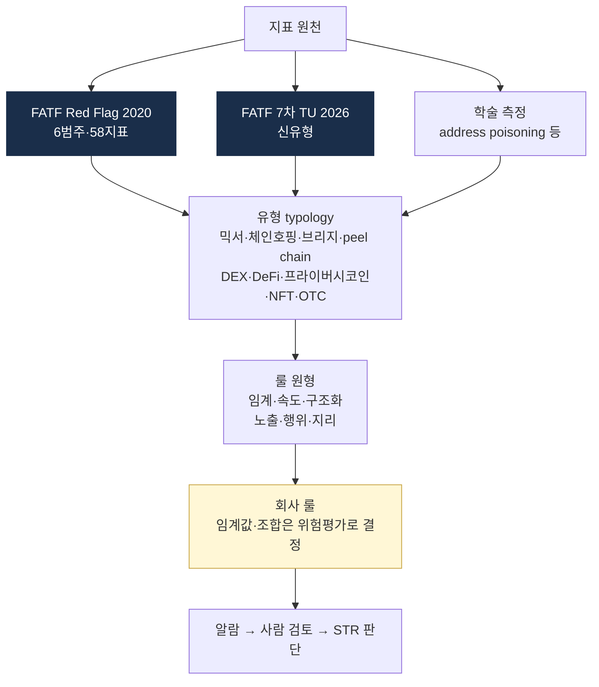
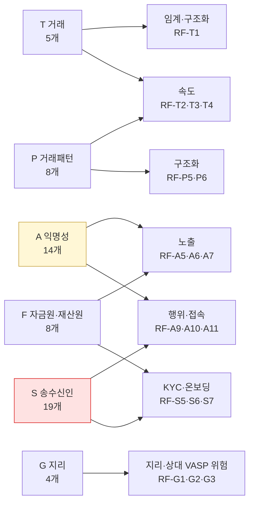

# 온체인 자금세탁 유형 (Typologies)

> 가상자산 자금세탁의 **실제 패턴**. 이 글을 읽고 나면 FATF Red Flag 58개 지표가 거래모니터링 룰의 어떤 원형으로 이어지는지, 9개 고전 유형이 각각 어떤 원리로 작동하고 왜 탐지가 어려운지, 그리고 FATF 7차 TU(2026-07-16)가 새로 지목한 유형이 무엇인지 설명할 수 있게 됩니다. 마지막 업데이트: 2026-10-21.

## TL;DR
- **공식 지표 원천은 FATF Red Flag Indicators(2020-09-14)** 다: 6개 범주(거래·거래패턴·익명성·송수신인·자금원/재산원·지리), 상위 지표 58개(5·8·14·19·8·4). 감독 체크리스트로 쓰지 말고(para 20), 지표 하나만으로 의심 근거가 되지 않는다(para 8).
- 고전 9가지 유형: **믹서 · 체인호핑 · 브리지 · peel chain · DEX swap · DeFi lending · 프라이버시코인 · NFT wash · OTC 환전** — 대부분 Red Flag의 익명성(A)·거래패턴(P) 범주에 대응한다. 송수신인(S)·자금원(F) 범주는 온체인보다 KYC·행위 신호다.
- **7차 TU(2026-07-16)의 신유형**: 동결 회피용 자체 스테이블코인, RPC 노드·멀티시그 공급자 같은 제3자 인프라 공격, 딥페이크 채용사기·AI 익스플로잇, 가스비 조달 은닉, 소매 고객으로 위장한 역외 VASP 계정.
- 학계가 측정한 사기 유형: **address poisoning**(Ethereum·BSC 2년간 공격 2.7억 건, 최소 8,380만 달러 손실, USENIX Security '25).
- 스테이블코인이 2025년 불법 거래량의 **84%**(Chainalysis 2026-01-08, B).

---

## 1. 유형론의 계층 — Red Flag에서 룰까지

### 공식 지표 원천

FATF 「Virtual Assets — Red Flag Indicators of ML/TF」(2020-09-14)는 2017~2020년 관할이 제출한 100건 이상의 사례로 6개 범주·상위 지표 58개·번호 사례 13건을 정리했습니다([FATF Red Flag PDF](https://www.fatf-gafi.org/content/dam/fatf-gafi/reports/Virtual-Assets-Red-Flag-Indicators.pdf)). 2026-10-21 현재 유일판이며, 2021년 이후 유형(브리지·DeFi 유동성·드레이너·동결저항 스테이블코인)은 들어 있지 않아 7차 TU와 2026 타겟보고서로 보완해야 합니다.



### Red Flag 6범주 → 거래모니터링 룰 원형

룰 원형 분류(임계·속도·구조화·노출·행위·지리)와 지표 ID(RF-T1 등)는 fatf-virtual-asset-reports 도시에 §3A-3의 정리를 따릅니다. 매핑은 해석이며, 지표 원문은 Red Flag PDF에 있습니다.



| 범주 | 대표 지표(원문 요지) | 룰 원형 | 주 데이터 |
|---|---|---|---|
| T 거래 | 임계 미만 분할(RF-T1), 24시간 내 다수 고액·규칙 간격(RF-T2), 즉시 다수 해외 VASP 이전(RF-T3), 입금 후 즉시 무거래 출금 "turns the exchange/VASP into an ML mixer"(RF-T4), 도난자금 주소발 입금(RF-T5) | 임계·속도·구조화 | 내부 원장 + 체인 |
| P 거래패턴 | 프로필 불일치 대액 초기 입금(RF-P1·P2), 다수 무관 지갑 소액 집적 후 일괄 이전(RF-P6), 손실 감수 환전(RF-P7) | 속도·구조화·행위 | 내부 원장 |
| A 익명성 | AEC·프라이버시코인 전환(RF-A1·A2), 믹서 이용(RF-A5·A6), 직·간접 노출(RF-A7), Tor·VPN 접속(RF-A10), 동일 IP 다수 지갑(RF-A11) | 노출·행위 | 귀속 DB + 접속 로그 |
| S 송수신인 | KYC 미비·자금원 질의 거부(RF-S5), 위조 서류(RF-S7), 프로필 IP 불일치(RF-S9), VA 비숙련 송금인(RF-S12), 고령 고객 다건 거래(RF-S13), 식별정보 빈번 변경(RF-S16), 메모 필드 불법 암시 문구(RF-S18) | 행위·KYC | KYC·디바이스 |
| F 자금원 | 사기·랜섬웨어·제재·다크넷 연계 주소(RF-F1), 믹서 직접 유입(RF-F6) | 노출 | 귀속 DB |
| G 지리 | 미등록 거래소(RF-G1), 고위험 관할 VASP(RF-G2·G3) | 지리 | VASP 디렉터리 |

송수신인(S) 범주가 19개로 가장 큽니다. 즉 Red Flag의 다수는 온체인 구조가 아니라 고객·행위 신호이고, 블록체인 분석 도구만으로는 덮이지 않습니다.

### 자금세탁 3단계와의 매핑

| 전통 ML | 가상자산 ML 예시 |
|---|---|
| **Placement** | 현금 → 거래소 입금, OTC 매수, P2P 거래 |
| **Layering** | 믹서, 체인호핑, 브리지, DEX swap, peel chain, NFT wash |
| **Integration** | OTC 환전, 상품권 구매, 고가 자산 결제, 합법 사업체 자금화 |

가상자산은 단계 사이 간격이 짧을 수 있다는 점이 전통 금융과 다릅니다. Red Flag RF-T4는 입금 직후 무거래 출금이 거래소를 "사실상 믹서로 만든다"고 표현합니다. 이전 판의 "Bybit 사례: 48시간 내 $160M layering 완료"는 출처가 없어 삭제했습니다. Bybit 사건의 공식 수치는 FATF 6차 TU(2025-06-26)의 **DPRK 탈취 USD 14.6억, 회수율 3.8%** 입니다([6차 TU](https://www.fatf-gafi.org/content/dam/fatf-gafi/recommendations/2025-Targeted-Upate-VA-VASPs.pdf.coredownload.pdf)).

### 한국 사례

Red Flag Case Study 2는 한국 제출 사례입니다. **피싱 피해금 약 4억원이 3종 가상자산으로 바뀐 뒤 국내 VASP 48개 계정을 거쳐 55회 이전되고 해외 지갑으로 빠져나갔습니다**(p.7). RF-T3(즉시 다수 해외 VASP 이전)·RF-P4(설명 없는 다종 자산·다계정)의 전형입니다.

---

## 2. 9가지 고전 유형 — 원리·도구·탐지 포인트

### A. Mixer / Tumbler (믹서) — RF-A5·A6·F6

**원리**: 여러 사용자의 자금을 한 풀에 섞은 뒤 출금해 입금 주소와 출금 주소의 **온체인 연결을 끊음**.

**대표 방식**:
- **Tornado Cash** (Ethereum) — zk-SNARK 기반 고정 액면 풀. OFAC 제재 후 **2025-03-21 SDN에서 삭제**(엔티티 1·ETH 주소 90)([OFAC 2025-03-21](https://ofac.treasury.gov/recent-actions/20250321)). 형사 절차는 별개로, **2025-08-06 Roman Storm 무면허 송금업 공모 유죄**, 자금세탁·IEEPA 공모는 배심 불일치(B)([Willkie](https://complianceconcourse.willkie.com/articles/tornado-cash-cofounder-convicted-for-conspiring-to-operate-an-unlicensed-money-transmitting-business/)). 제재 효과 측정 연구는 957일간 입금액이 71.03% 줄었지만 Ethereum 보안사고의 78.33%가 여전히 Tornado Cash를 거쳤다고 보고했다(WWW '26)([arXiv 2507.11721](https://arxiv.org/abs/2507.11721)). **제재 해제 ≠ 위험 해제.**
- **CoinJoin** (Bitcoin) — 여러 사용자가 동시에 균등 금액을 섞는 방식.
- **Railgun 등 차폐 풀** — 2026 측정에서 출금의 17.65%가 입금과 하나로 연결됐고 중위 익명성 손실은 3.42비트였다([arXiv 2606.25926](https://arxiv.org/abs/2606.25926)). "추적 불가/가능" 이분법이 아니라 정량 측정의 대상이다.

**탐지 포인트**:
- 알려진 믹서 컨트랙트 주소 노출
- 액면 표준화(고정 액면 풀)
- Input/Output 개수 균등 (CoinJoin 지문)
- 믹서 진입 후 체류시간 분포

### B. Chain Hopping (체인 점프) — RF-P4·P8

**원리**: 여러 체인을 넘나들며 흔적을 흐림. 분석 도구가 한 체인에서 끊기는 점을 노림.

FATF 7차 TU는 VASP에 프로토콜·브리지·믹서·크로스체인 도구 노출 평가를 요구했습니다(권고 6-iv)([7차 TU PDF](https://www.fatf-gafi.org/content/dam/fatf-gafi/reports/7th-targeted-update-on-implementation-fatf-standards-vas-vasps-2026.pdf.coredownload.pdf)).

### C. Cross-chain Bridge 활용

**원리**: A 체인에서 자금을 잠그고 B 체인에서 wrapped 토큰 발행 → 추적 단절.

**이중 리스크**: 브리지는 세탁 경로이면서 해킹 표적이기도 합니다. 7차 TU는 DPRK가 탈취 자금을 브리지·언호스티드 지갑·OTC 네트워크로 세탁한다고 적었습니다(para 33). 이전 판의 브리지 해킹 손실 표는 이번 근거 자료로 재확인하지 못해 삭제했습니다.

**탐지 포인트**: 브리지 컨트랙트 입출금 인덱싱 + 시간·금액 매칭. 2025년 연구는 12개 브리지 양방향 F1 91.75%(ABCTracer), 5개 브리지 약 50만 건 F1 0.9746(ConneX)을 보고했지만, 브리지 집합이 달라 두 수치를 비교할 수 없습니다([arXiv 2504.01822](https://arxiv.org/abs/2504.01822); [arXiv 2511.01393](https://arxiv.org/abs/2511.01393)).

### D. Peel Chain (껍질 사슬) — RF-T1

**원리**: 큰 금액 주소에서 소액씩 떼어내(peel) 다른 주소로 보내고 잔액은 또 다른 주소로 → 길게 늘어진 사슬.

**탐지 포인트**: 그래프 분석 — 출력 2개 구조의 반복, 분기 간격, 소액의 상대적 일정성.

### E. DEX Swap — RF-P8·A1

**원리**: KYC 없는 DEX에서 토큰을 교환해 자산 형태를 바꿈.

**탐지 포인트**: DEX 자체는 합법이므로 **swap 자체가 아니라 swap 전후 흐름**을 본다.

### F. DeFi Lending / Liquidity Pool

**원리**: 렌딩 프로토콜에 토큰 입금 → 다른 자산으로 인출, 또는 LP 토큰 발행·소각으로 출처 흐림.

**규범**: FATF 2021 가이던스 para 67은 "A DeFi application (i.e. the software program) is not a VASP"이지만 통제력·충분한 영향력을 가진 사람은 VASP가 될 수 있다고 했습니다. 2026-07-21 DeFi 타겟보고서가 이 분석을 갱신했습니다([FATF DeFi 보고서](https://www.fatf-gafi.org/en/publications/Virtualassets/targeted-report-decentralised-finance-2026.html)). 상세는 [`defi-nft-risks.md`](defi-nft-risks.md).

### G. Privacy Coin — RF-A1·A2

**원리**: 프로토콜 설계로 송수신인·금액을 숨김.

| 코인 | 기술 | 추적 가능성 (공개 연구 기준) |
|---|---|---|
| **Monero (XMR)** | Ring Signature + Stealth Address + RingCT | 2019~2023 지갑 버그·P2Pool·Mordinal 휴리스틱은 대부분 고정밀이었으나, 2023년 초 패치 이후 신규 거래에는 무효 — **패치 이전 구간은 부분 추적 가능, 이후는 아니다**([arXiv 2408.05332](https://arxiv.org/abs/2408.05332)) |
| **Zcash (ZEC)** | zk-SNARK shielded transaction | shielded 사용 여부에 따라 다름 |

**규제**: EU AMLR(2024/1624) 제79조는 CASP의 익명성강화코인 취급을 금지하며 **2027-07-10 적용 예정(enacted-not-in-force)** 입니다([EUR-Lex](https://eur-lex.europa.eu/legal-content/EN/TXT/PDF/?uri=OJ:L_202401624)). Red Flag RF-A2는 "투명 체인 자산 → 거래소 → 즉시 AEC 전환"을 지표로 듭니다. **진입·탈출 순간**이 탐지 기회입니다.

### H. NFT Wash Trading

**원리**: 자기들끼리 NFT를 사고팔며 가격·거래량을 부풀려 자금 이전을 정당화.

**유형**: 자기거래(양쪽 지갑 동일인), 순환거래(A→B→C→A), 가격 펌프 후 외부 매도.

**규범**: FATF 2021 가이던스 para 53 — NFT는 "generally not considered to be VAs"이나 결제·투자 용도로 실사용되면 VA로 볼 수 있습니다. 이전 판의 "wash trading 비중 25~50%"는 이번 근거 자료로 재확인하지 못해 삭제했습니다.

**탐지 포인트**: 짧은 시간 내 같은 NFT의 반복 거래, 거래자 주소 간 클러스터 관계.

### I. OTC Desk · 전문 세탁 네트워크 — RF-A3·G1

**원리**: 저KYC OTC·비규제 거래소에서 가상자산 ↔ 법정화폐 환전.

**공식 사례**:
- FATF 7차 TU: **캄보디아 소재 금융 복합체가 2021-08~2025-01 최소 USD 40억을 세탁, 그중 최소 USD 3,700만이 DPRK 탈취자금**(para 29~30). 스페인 Operation Borrelli(2025-06, EUR 4.6억·피해자 5,000명).
- 미국: 2025-10-14 OFAC가 Prince Group을 초국가범죄조직으로 지정(146개 대상), FinCEN이 같은 날 Huione Group §311 최종규칙을 발동([재무부 sb0278](https://home.treasury.gov/news/press-releases/sb0278)).

이전 판의 "CMLN 2025년 $16.1B 처리, 활성 wallet 1,799개", "수수료 5~15%"는 이번 근거 자료로 재확인하지 못해 삭제했습니다.

### 실무 포인트

룰을 유형별 그룹으로 관리하고 **각 룰에 대응하는 RF-ID를 메타데이터로** 달면, 알람의 근거를 STR에 쓰기 쉽고 오탐 원인을 역추적하기 쉬워집니다.

---

## 3. FATF 7차 TU(2026-07-16)가 지목한 신유형

| 신유형 | 내용 | 위치 | 거래모니터링 시사점 |
|---|---|---|---|
| **동결 회피용 자체 스테이블코인** | 제3자 발행자가 USD 2,900만 이상을 동결하자 범죄 복합체가 "immune to asset freezing"을 내세운 자체 스테이블코인 발행(다중 체인 + 자체 체인). FATF: VASP가 "issuer-level asset freeze/burn mechanisms"에 기댈 수 없을 수도 있다 | para 35 | 발행자 동결을 통제 수단으로 가정하지 말 것. 자체 발행 코인 노출을 별도 카테고리로 |
| **제3자 인프라 공격** | DPRK가 VASP·DeFi뿐 아니라 RPC 노드·멀티시그 보안 공급자를 공격하고 브리지·언호스티드 지갑·OTC로 세탁 | para 33 | 해킹 직후 급속 이전 탐지(권고 6-ii) |
| **AI 악용** | 딥페이크 영상 면접 채용사기로 USD 100만 이상 탈취(주로 스테이블코인), AI 코딩 도구·에이전트로 스마트컨트랙트 익스플로잇 생성 | para 34 | 온보딩 딥페이크 대응(RF-S7 확장), 익스플로잇 직후 자금 흐름 |
| **TF와 가스비 은닉** | ISIL·AQ가 스테이블코인 선호, 주소 로테이션·micro-splitting·multi-hop, Tron 기반 USDT, 가스비 조달 패턴을 숨기는 서비스 | para 33·36 | 소액 분할·주소 로테이션 패턴 |
| **소매 위장 역외 VASP** | 역외 VASP가 소매 고객으로 위장해 계정 사용 | 권고 6-iii | 계정 거래 규모·패턴이 개인 프로필과 맞지 않는지 |

출처: [7차 TU PDF](https://www.fatf-gafi.org/content/dam/fatf-gafi/reports/7th-targeted-update-on-implementation-fatf-standards-vas-vasps-2026.pdf.coredownload.pdf).

학계도 같은 방향을 측정했습니다. **USDT 제재 주소의 7.3%, USDC의 18.7%가 동결 발효 전에 전액 인출**됐습니다([arXiv 2603.27739](https://arxiv.org/abs/2603.27739)).

---

## 4. 학술 측정으로 드러난 사기 유형

| 유형 | 측정 | 출처 |
|---|---|---|
| **Address poisoning** — 피해자 거래 이력에 유사 주소를 주입해 오송금 유도 | Ethereum·BSC 2년간 공격 시도 2.7억 건, 피해 대상 1,700만, 사고 6,633건, 최소 8,380만 달러 손실(v3 초록 기준) | [USENIX Security '25, arXiv 2501.16681](https://arxiv.org/abs/2501.16681) |
| 지갑 단 방어 | 인기 Ethereum 지갑 53종 중 피싱 주소 송금 시 명시적 경고를 띄운 것은 3종 | [arXiv 2508.12107](https://arxiv.org/abs/2508.12107) |
| **자격증명 탈취형 피싱** (승인 서명형 드레이너와 구분) | 6개월 배포에서 사이트 5,138개·앱 10,612개 탐지, 83%·79%가 커뮤니티에 보고되지 않은 신규 | [NDSS 2026 CtPhishCapture](https://www.ndss-symposium.org/wp-content/uploads/2026-f2854-paper.pdf) |
| **Rug pull** | 35개 유형 분류, 13개 탐지 도구 커버리지 25.7~62.9% | [ISSTA 2025 SoK](https://conf.researchr.org/details/issta-2025/issta-2025-papers/25/SoK-A-Taxonomic-Analysis-of-DeFi-Rug-Pulls-Types-Dataset-and-Tool-Assessment) |

Address poisoning은 지갑 단에서 경고가 거의 없으므로, 거래소 출금 시점에 "최근 거래 상대와 앞뒤 자리만 같은 주소"를 확인하는 것이 마지막 방어선이 될 수 있습니다. 이것은 FDS(이용자 보호)의 영역이고, 피해금이 세탁되는 흐름은 AML(STR)의 영역입니다.

---

## 5. 2025~2026 흐름

### A. 스테이블코인의 비중

- **2025년 불법 거래량의 84%가 스테이블코인**(Chainalysis 2026-01-08, B)([Chainalysis](https://www.chainalysis.com/blog/2026-crypto-crime-report-introduction/)). FATF 2026-03-03 스테이블코인·비수탁지갑 타겟보고서도 같은 수치를 인용합니다([FATF 2026-03-03](https://www.fatf-gafi.org/en/publications/Virtualassets/targeted-report-stablecoins-unhosted-wallets.html)).
- 동결 가능성은 양면입니다. 발행자 동결이 작동한 사례도 있지만, 7차 TU는 동결 회피 설계를 경고했습니다(§3).

이전 판의 자산별 비중 차트(스테이블코인 외 BTC·ETH·알트 분할)와 2025 통계 카드(DPRK $2.02B, CMLN $16.1B)는 근거가 확인되지 않은 수치를 포함해 이 문서에서 뺐습니다.

### B. 국가 단위 제재 회피망

- Chainalysis는 러시아 루블 스테이블코인 **A7A5가 1년 미만에 USD 933억 이상** 거래됐다고 보고했습니다(B)([Chainalysis](https://www.chainalysis.com/blog/2026-crypto-crime-report-introduction/)). TRM은 제재 주체·관할 유입 USD 930억 중 A7A5를 약 720억으로 추정했습니다(B)([TRM](https://www.trmlabs.com/reports-and-whitepapers/2026-crypto-crime-report)).
- 미국 FinCEN은 2026-10-05 A7 네트워크의 역외 하위대리인과의 자금이체를 금지하는 특별조치 NPRM(RIN 1506-AB77)을 냈습니다(proposed)([Federal Register 2026-20371](https://public-inspection.federalregister.gov/2026-20371.pdf)). 같은 날 믹싱 §311 NPRM은 철회됐습니다(withdrawn). 규제의 대상이 "유형"에서 "네트워크"로 옮겨 갔습니다.

### C. DPRK

- FATF 6차 TU: Bybit 탈취 USD 14.6억, 회수율 3.8%.
- Chainalysis: 2025년 DPRK 연계 해커 탈취 약 USD 20억(Bybit 약 15억 포함)(B).
- FATF 7차 TU: 제3자 인프라(RPC 노드·멀티시그 공급자) 공격, 캄보디아 복합체 경유 USD 3,700만.

이전 판의 "2025년 $2.02B 탈취, 누적 $6.75B"는 출처가 확인되지 않아 위 수치로 바꿨습니다.

### D. 산업화

7차 TU가 다룬 캄보디아 복합체 사례처럼, 사기·세탁·환전이 한 조직 안에서 분업되고 자체 스테이블코인까지 발행하는 수준에 이르렀습니다.

---

## 6. 탐지 기법 (방어 측)

### A. Address Clustering

- **Common Input Ownership Heuristic (CIOH)** — UTXO 모델에서 한 트랜잭션의 input 주소들은 한 사람이 통제한다는 휴리스틱.
- **Change Detection** — 거스름돈 주소 식별.
- **Deposit Heuristic** — 거래소의 consolidation 패턴을 이용한 클러스터 식별.

### B. Attribution

클러스터를 알려진 엔티티(거래소·믹서·제재 대상)에 연결. 라벨 정확도의 공개 벤치마크는 없고, 감독기관도 분석도구가 실소유자를 "may not be able to identify"라고 인정합니다(NYDFS 2022-04-28).

### C. 온체인 이상 패턴(anomaly) 탐지

- Peel chain 패턴, 믹서 사용 패턴, 시간대 패턴
- 룰 기반 + 머신러닝 결합
- 용어 주의: 한국 법률에서 "이상거래"는 가상자산이용자보호법 §12의 불공정거래 우려 거래를 뜻합니다. 온체인 분석 맥락에서는 "이상 패턴(anomaly) 탐지"라고 부르는 편이 혼동이 없습니다.

### D. Cross-chain Tracing

- 브리지 입출금 매칭, 시간·금액·메타데이터 짝짓기
- 공통 벤치마크가 없어 연구 간 수치 비교 불가(§2-C)

### E. Exposure (노출도)

한 주소가 직·간접으로 믹서·제재 대상·도난자금에 닿는지를 나타내는 지표. 규범 근거는 FATF 2021 para 277~278 "extend beyond the immediate transaction". **홉 수 상한·감쇠 방식을 공개한 벤더는 없으므로** "N hop 안"이라는 고정 기준은 회사 정책의 선택입니다.

### 기술적 정밀화

**Peel Chain 탐지 쿼리 예시** (SQL, UTXO 기준 — 임계값은 설명용 가정이며 근거 있는 기준값이 아님):

```sql
WITH chain AS (
  SELECT tx_hash, FROM_address, TO_address, amount,
         LAG(amount) OVER (PARTITION BY FROM_address ORDER BY block) as prev_amount
  FROM utxo_transactions
  WHERE block_time > NOW() - INTERVAL '30 days'
)
SELECT * FROM chain
WHERE amount < prev_amount * 0.05  -- 예시 임계값
  AND prev_amount > 10000000       -- 예시 임계값
ORDER BY tx_hash;
```

**정확도에 대한 주의**: "CIOH는 정확도 X%" 식의 단일 수치는 인용 가능한 근거가 없습니다. Möser & Narayanan (*Resurrecting Address Clustering in Bitcoin*, arXiv 2107.05749 / FC 2022)은 초록에서 *"current techniques rely on heuristics that **have not been rigorously evaluated or optimized**"* 라고 지적합니다. 실무 함의는 정확도 숫자가 아니라 **클러스터 붕괴(cluster collapse)** 위험입니다. 휴리스틱이 잘못 병합하면 무관한 엔티티가 한 클러스터로 뭉치고 그 위의 위험 점수가 통째로 오염됩니다.

### 실무 포인트

벤더 점수는 산정 방식이 비공개라 벤더마다 다른 결과를 냅니다. 같은 주소 샘플을 여러 벤더에 넣어 **출력 일치율**을 직접 재는 것이 유일한 비교 방법입니다([`../7-vendors/vendor-benchmark.md`](../7-vendors/vendor-benchmark.md)).

---

## 7. 탐지의 한계

- **Privacy coin**: Monero는 2023년 패치 이후 신규 거래에 대한 공개 휴리스틱이 무효
- **Off-chain trade**: 거래소 내부 이체는 외부에서 안 보임
- **새 믹서·브리지**: 라벨링 전까지 탐지 어려움
- **Adversarial behavior**: 무작위 금액·시간으로 패턴 회피
- **벤치마크 착시**: 템플릿 기반 이상 주입 벤치마크는 모델 강건성을 과대평가한다(TransXion, KDD '26)([arXiv 2604.17420](https://arxiv.org/abs/2604.17420))
- **법적 제한**: 다른 회사 고객 정보 접근 제한
- **주소만으로 상대 VASP를 완전 식별하는 기술적 수단은 없다**(FATF 2021 para 197(a))

---

## 8. 거래소·수탁업자 관점 — 알람 체크리스트 (RF-ID 병기)

```
□ 입금 주소가 제재·도난자금·믹서에 직·간접 노출           RF-A7, RF-F1, RF-T5
□ 믹서 직접 유입 자금                                     RF-F6, RF-A5·A6
□ 출금 요청 주소가 위 동일                                RF-A7
□ 임계 미만 분할 입금 / 다수 무관 지갑 소액 집적          RF-T1, RF-P6
□ 입금 직후 무거래 전액 출금 (pass-through)               RF-T4, RF-P2
□ 즉시 다수 해외·규제취약 VASP로 이전                     RF-T3, RF-G2·G3
□ 24시간 내 다수 고액 / 규칙적 간격 송금                  RF-T2
□ 투명 체인 자산 → 즉시 AEC·프라이버시코인 전환           RF-A1·A2
□ peel chain 패턴 진입                                    RF-T1 계열 (온체인 구조)
□ DEX·브리지로의 빈번한 출금                              7차 TU 권고 6-iv
□ KYC 정보와 거래 규모 불일치 (재산 대비 과대 매수)       RF-P1, RF-S15
□ Tor·VPN·제재국 IP 접속 + 고위험 출금 조합               RF-A10, RF-S2
□ 프로필 IP와 거래 IP 불일치, 동일 IP 다수 지갑           RF-S9, RF-A11
□ 손실·고수수료를 감수하는 환전                           RF-P7
□ 메모·메시지 필드의 불법 암시 문구                       RF-S18
□ VA 비숙련 송금인·고령 고객의 다건 거래 (뮬·피해자)      RF-S12, RF-S13
□ 이메일·IP·금융정보 빈번 변경 (계정탈취 의심)            RF-S16
□ 동결 회피형 자체 스테이블코인 노출                      7차 TU para 35
□ 소매 고객으로 위장한 역외 VASP 계정                     7차 TU 권고 6-iii
□ 최근 상대와 앞뒤 자리만 같은 주소로의 출금              address poisoning (FDS)
```

### 실무 포인트

위 알람은 같은 강도가 아닙니다. Red Flag 보고서도 "the presence of multiple indicators in a transaction with no logical business explanation"이 의심을 만든다고 말합니다(para 10). 제재 대상 주소 일치는 제재 이행 절차로 바로 가지만, 시간대·접속 신호 하나만으로는 약합니다. **단일 신호 차단을 최소화하고 복합 신호 조합**에 의존하세요. 계정탈취(RF-S16)·고령 피해자(RF-S13)·address poisoning처럼 이용자 피해 신호는 FDS 임시조치 절차(통신사기피해환급법)로도 보내야 합니다.

---

## 요약 부록 — 빠른 참조용

**공식 지표**: FATF Red Flag 2020 — 6범주 58지표 (T5·P8·A14·S19·F8·G4)
**9대 유형**: Mixer · Chain Hopping · Bridge · Peel Chain · DEX Swap · DeFi L/LP · Privacy Coin · NFT Wash · OTC
**7차 TU 신유형**: 동결 회피 스테이블코인 · 제3자 인프라 공격 · AI 악용 · 가스비 은닉 · 소매 위장 oVASP
**탐지 5축**: Clustering · Attribution · 온체인 이상 패턴 · Cross-chain · Exposure

## 💼 실무 현장 (Industry Reality)

### 유형별 룰 의사코드 (설명용)

아래 임계값은 원리를 보여 주기 위한 가정입니다. 실제 값은 회사 위험평가로 정하고 정기 재검토해야 합니다(FATF 2021 para 278).

**믹서 노출 탐지** (RF-A5·A6·A7):
```python
def mixer_rule(wallet, exposure):
    # exposure: 회사가 정의한 직접/간접 노출 지표 (벤더별 정의가 다름)
    if exposure.direct("MIXER") > 0:
        return "HIGH"
    if exposure.indirect_share("MIXER") > POLICY_THRESHOLD:
        return "MEDIUM"
    return None
```

**Peel Chain 탐지** (RF-T1 계열):
```python
def peel_chain(addr, depth=20):
    chain = []
    curr = addr
    for _ in range(depth):
        outs = get_outputs(curr)
        if len(outs) != 2: break          # peel 특징: 출력 2개
        small, large = sorted(outs, key=lambda o: o.value)
        if small.value / large.value > 0.3: break  # 예시 비율
        chain.append(curr)
        curr = large.to_addr
    return len(chain) >= 5                # 예시 길이
```

**Pass-through 탐지** (RF-T4):
```python
def pass_through(account, window_minutes):
    deps = deposits(account, window_minutes)
    wds = withdrawals(account, window_minutes)
    traded = trades(account, window_minutes)
    return deps and wds and not traded and sum(w.amount for w in wds) >= 0.9 * sum(d.amount for d in deps)
```

이전 판의 "유형별 월간 알람 건수·FP 비율·STR 전환 비율" 표와 "벤더별 유형 커버리지 비교(PoC 결과 예시)" 표는 출처가 없어 삭제했습니다.

### 자주 나오는 오해

- **"Tornado 제재 해제됐으니 이제 괜찮다"** — 2025-03-21 SDN 삭제 후에도 Storm은 2025-08-06 유죄 평결을 받았고, 해제 전 측정에서도 보안사고 자금의 다수가 Tornado Cash를 거쳤다.
- **"Red Flag 58개를 체크리스트로 돌리면 된다"** — FATF가 명시적으로 금지한 사용법이다(para 20). 조합과 맥락으로 판단한다.
- **"스테이블코인은 발행자가 동결하니 안전"** — 7차 TU는 동결 회피 설계 코인을 경고했고, 동결 발효 전 인출이 측정됐다.
- **"Privacy coin은 영원히 추적 불가"** — 패치 이전 Monero 거래는 공개 휴리스틱으로 부분 추적됐다. 다만 패치 이후 거래에는 무효다.

### 한국 특수 현실

- **Red Flag 한국 사례**: 피싱 피해금 4억원·48계정·55회 이전 — 보이스피싱 피해금이 가상자산으로 세탁되는 흐름은 FDS(임시조치)와 AML(STR) 두 출구 모두에 걸린다.
- **2027-02-19 이후**: 해외 VASP 3등급 분류와 자기수탁 지갑 동일인 요건이 시행된다(enacted-not-in-force). RF-G1~G3(지리·상대 VASP) 룰이 법정 허용 요건과 직접 연결된다.

이전 판의 "4대 거래소 2021 프라이버시코인 공동 상폐", "DAXA Lazarus 공유 리스트", 한국 연관 해킹 사건 목록은 이번 근거 자료로 재확인하지 못해 삭제했습니다.

---

## 더 읽을거리
- [`vasp-obligations.md`](vasp-obligations.md) — VASP 의무
- [`defi-nft-risks.md`](defi-nft-risks.md) — DeFi·NFT·프라이버시 코인 상세
- [`../4-technology/kyc-kyt.md`](../4-technology/kyc-kyt.md) — 거래모니터링 흐름과 산출물 3축
- [`../4-technology/blockchain-analytics.md`](../4-technology/blockchain-analytics.md) — 블록체인 분석 기법
- [`../6-cases/lazarus-dprk.md`](../6-cases/lazarus-dprk.md) — DPRK 사례
- [FATF Red Flag Indicators (2020-09-14)](https://www.fatf-gafi.org/content/dam/fatf-gafi/reports/Virtual-Assets-Red-Flag-Indicators.pdf)
- [FATF 7차 Targeted Update (2026-07-16)](https://www.fatf-gafi.org/content/dam/fatf-gafi/reports/7th-targeted-update-on-implementation-fatf-standards-vas-vasps-2026.pdf.coredownload.pdf)
- [Chainalysis 2026 Crypto Crime Report 서론](https://www.chainalysis.com/blog/2026-crypto-crime-report-introduction/)
