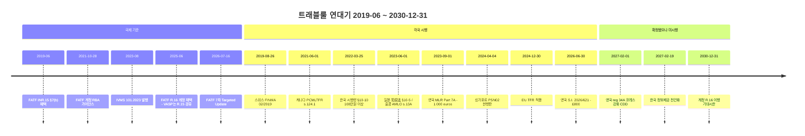
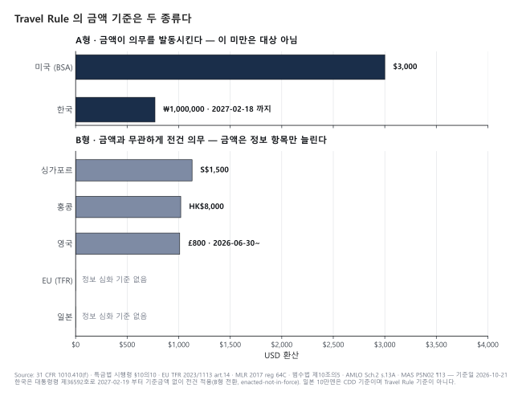
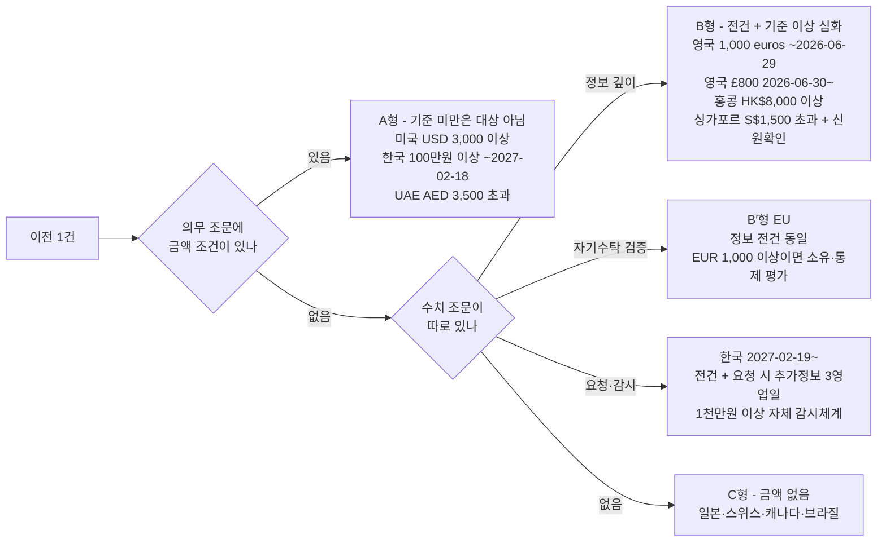
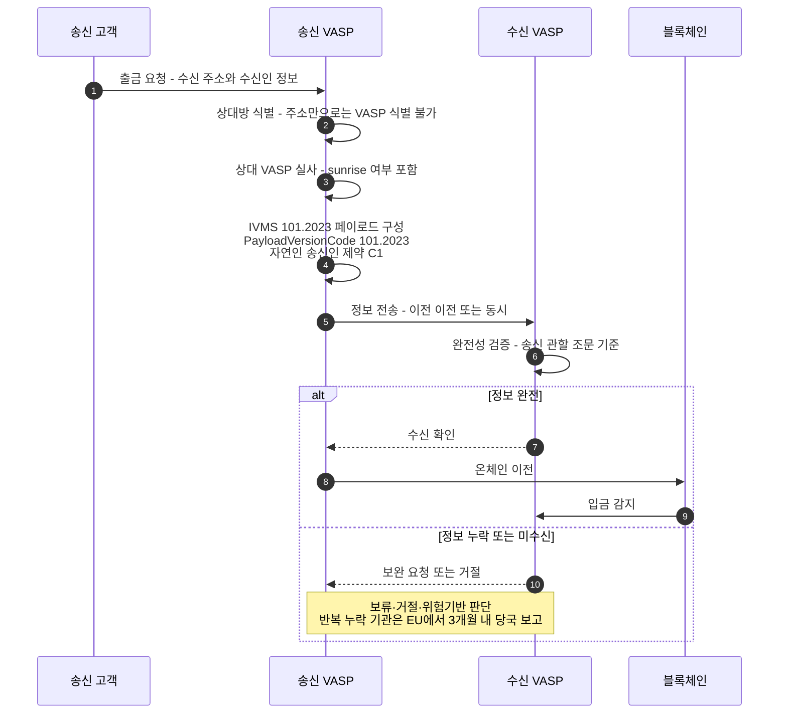

# Travel Rule — 가상자산 송수신인 정보 동반 의무

> FATF 기준(INR.15 §7(b))을 가상자산 이전에 적용한 규칙. VASP 운영에서 가장 손이 많이 가는 테마 중 하나입니다. 이 글을 읽고 나면 Travel Rule 이 왜 "임계금액 하나"로 요약되지 않는지, 관할마다 금액 조문과 의무 조문이 어떻게 갈라지는지, 그리고 한국이 2027-02-19 에 무엇이 바뀌는지 이해하게 됩니다. 마지막 업데이트: 2026-10-21.

> **이 파일의 역할**: Travel Rule 의 **개념·역사·관할 비교·운영 흐름**. 법적 근거는 [`../2-regulations/korea-fiu-act.md`](../2-regulations/korea-fiu-act.md) §5 참조, 기술 상세(IVMS 101.2023 데이터 모델·프로토콜)는 [`../4-technology/travel-rule-protocols.md`](../4-technology/travel-rule-protocols.md) 참조. 정본 근거는 [`../../reports/가상자산 AML KYT FDS 트래블룰 흐름.md`](../../reports/가상자산%20AML%20KYT%20FDS%20트래블룰%20흐름.md) 「트래블룰 관할 비교」 절과 [`../../research/2026-10-travel-rule.md`](../../research/2026-10-travel-rule.md) §2A 입니다.

## TL;DR
- VASP 가 다른 VASP 에게 가상자산을 이전할 때 **송신인 + 수신인 정보를 함께 전달**해야 하는 의무. 국제 기준은 2019-06 채택된 **INR.15 §7(b)** 이고, 금액 조건이 없습니다
- 금액 구조는 **세 유형** — **A** 의무 자체에 금액(미국 USD 3,000 이상, 한국 ~2027-02-18 의 100만원 이상) · **B** 의무는 전건, 금액은 정보 깊이만(영국·싱가포르·홍콩, EU 는 변형 B′) · **C** 금액 없음(일본·스위스·캐나다·브라질). "임계 얼마" 한 칸으로 적으면 B·C 가 전부 틀립니다
- 금액은 **시점이 붙습니다** — 영국 심화 기준은 1,000 euros(2023-09-01~2026-06-29) → **£800**(2026-06-30~, S.I. 2026/621). 한국은 100만원 이상(~2027-02-18) → **전건**(2027-02-19~, 대통령령 제36592호, 2026-10-21 기준 **enacted-not-in-force**)
- 2026-10-21 기준 쟁점은 입법이 아니라 집행: FATF 7차 Targeted Update(2026-07-16) 응답 관할의 **83%(91/109)** 가 입법했지만 그중 **60%(55/91)** 는 트래블룰 감독·집행 조치가 한 건도 없음. 트래블룰 위반을 독립 제재 사유로 명시한 사건은 2024-01-01~2026-10-21 어느 관할에서도 확인되지 않음
- 메시지 데이터 모델 현행판은 **IVMS 101.2023**(2023-08). "IVMS101 v2" 는 존재하지 않음

---

## 1. Travel Rule 이 뭐고 왜 만들어졌나

### 전통 금융의 유산

은행 송금에서는 이체지시에 송신인 정보가 함께 실려 갑니다. 미국의 규정 근거는 31 CFR 1010.410(f) 로, 미국 내 송신·중개 금융기관은 **"transmittal of funds in the amount of $3,000 or more"** 의 이체지시에 송신인 성명·계좌번호·주소·금액·실행일·수취 금융기관 정보를 포함해야 합니다([Cornell LII 31 CFR 1010.410](https://www.law.cornell.edu/cfr/text/31/1010.410)). "돈이 움직이면 사람 정보도 같이 움직여야 한다"는 원칙이 가상자산으로 옮겨 온 것이 Travel Rule 입니다.

### FATF 가 이걸 가상자산에 확장한 경로

FATF 는 R.16 을 고쳐서 가상자산에 적용한 것이 아닙니다. **2018-10 R.15 개정으로 VA·VASP 정의를 용어집에 신설하고, 2019-06 INR.15 와 RBA 가이던스 초판을 채택**했습니다. 가상자산 정보 전달 의무는 **INR.15 §7(b)** 에 있습니다([FATF 2021 RBA 가이던스](https://www.fatf-gafi.org/content/dam/fatf-gafi/guidance/Updated-Guidance-VA-VASP.pdf.coredownload.pdf)).

> INR.15 §7(b) — "Countries should ensure that originating VASPs obtain and hold required and accurate originator information and required beneficiary information on virtual asset transfers, submit the above information to the beneficiary VASP or financial institution (if any) immediately and securely" — **금액 기준 없음.** USD/EUR 1,000 은 §7(a) 의 CDD(임시거래) 기준입니다([FATF Recommendations](https://www.fatf-gafi.org/content/fatf-gafi/en/publications/Fatfrecommendations/Fatf-recommendations.html)).

2021-10-28 개정 RBA 가이던스가 운영 규칙을 단락 단위로 고정했습니다 — 모든 VA 이전은 국경 간 전신송금으로 취급(para 179), "즉시" 는 이전 이전·동시·병행 전송이며 "Post facto submission … should not be permitted"(para 185, 187), USD/EUR 1,000 de minimis 는 국가 선택이고 그 미만에도 성명·지갑주소는 수집(para 191–192), 상대 VASP 실사 3단계(para 196–199)([FATF 2021 RBA 가이던스](https://www.fatf-gafi.org/content/dam/fatf-gafi/guidance/Updated-Guidance-VA-VASP.pdf.coredownload.pdf)).

### 실무 포인트

Travel Rule 은 "기술 구현 문제"로 포장되지만 본질은 VASP 끼리 고객 정보를 주고받자는 합의입니다. 2026-10-21 기준 병목은 기준이 없어서가 아니라 집행이 비어 있어서입니다 — 7차 TU 본문 para 25 는 입법 관할 91 곳 중 55 곳(60%)이 지적·지시·집행·감독조치를 하지 않았다고 적습니다(요약문의 "almost half" 가 아니라 본문 수치를 인용할 것)([FATF 7차 TU PDF](https://www.fatf-gafi.org/content/dam/fatf-gafi/reports/7th-targeted-update-on-implementation-fatf-standards-vas-vasps-2026.pdf.coredownload.pdf)).

---

## 2. 연대기 — 기준 채택에서 각국 시행까지



근거: FATF 일자는 [2021 RBA 가이던스](https://www.fatf-gafi.org/content/dam/fatf-gafi/guidance/Updated-Guidance-VA-VASP.pdf.coredownload.pdf)·[R.16 개정 설명서](https://www.fatf-gafi.org/content/dam/fatf-gafi/recommendations/Explanatory%20note%20for%20revised%20R.16.pdf.coredownload.pdf)·[7차 TU](https://www.fatf-gafi.org/content/dam/fatf-gafi/reports/7th-targeted-update-on-implementation-fatf-standards-vas-vasps-2026.pdf.coredownload.pdf), 각국 일자는 §3 표의 조문 링크. 홍콩 2023-06-01 은 T3 두 건 일치(B)이고, 흔히 보이는 "홍콩 2024-06-01" 은 트래블룰 일자가 아닙니다 — 기존 SFO 인가 VATP 의 12개월 과도기간 종료와 혼동된 것으로 보입니다([Clyde & Co 2023-06-07](https://www.clydeco.com/en/insights/2023/06/hong-kong-virtual-assets-regulatory-update)).

---

## 3. 핵심 정보 항목

FATF 문언은 "required originator information / required beneficiary information" 이라고만 하고 항목은 INR.16 정의를 따릅니다. 2025 개정 INR.16 의 항목 목록은 이 저장소가 1차 문언으로 확보하지 못했습니다. 관할별 조문으로 확인된 것만 적습니다.

| 관할 | 기본 항목(금액 무관) | 추가 항목과 발동 조건 | 근거 |
|---|---|---|---|
| 🇰🇷 한국(2027-02-19~) | 송·수신 고객 성명(법인은 명칭·대표자 성명), 가상자산주소 — 이전과 **동시** 제공 | 송신 고객 주민등록번호(법인등록번호)·여권번호·외국인등록번호 — FIU 원장 또는 수취 VASP **요청 시 3영업일 이내** | [시행령 §10-10 시행예정 판본](https://www.law.go.kr/DRF/lawService.do?OC=test&target=eflaw&MST=288765&efYd=20270219&type=XML) |
| 🇪🇺 EU | 송신인 성명·DLT 주소·계정번호·**주소 또는 생년월일·출생지**·LEI 등 | 금액 간소화 없음(전건 동일) | TFR 제14조(1), [EBA/GL/2024/11](https://www.eba.europa.eu/sites/default/files/2024-07/6de6e9b9-0ed9-49cd-985d-c0834b5b4356/Travel%20Rule%20Guidelines.pdf) |
| 🇬🇧 영국 | (5) 송·수신인 성명(법인 등록명/상호), 계좌번호 또는 고유거래식별자 | (6) 법인: 고객식별번호 또는 등록사무소·주영업소 주소 / 개인: 고객식별번호·주소·신분증 번호·생년월일+출생지 중 하나 — §4 의 (4)항 금액 이상 | [MLR reg 64C](https://www.legislation.gov.uk/uksi/2017/692/regulation/64C) |
| 🇸🇬 싱가포르 | ¶13.4 양측 성명·계좌번호(또는 고유거래참조번호) 4항목 | ¶13.6 S$1,500 초과 시 송신인 **신원확인·검증** + 주소·고유식별번호·생년월일 중 하나 | [MAS PSN02](https://www.mas.gov.sg/-/media/amld-amendments---30-june-2025/mas-notice-psn02-amendment--new.pdf) |
| 🇭🇰 홍콩 | 양측 성명·계좌번호 4항목 | HK$8,000 이상 시 송신인 주소·고객식별번호·신분증번호 또는 생년월일·출생지 | SFC AML 지침 ¶12.11.5·12.11.6(AMLO Sch.2 s.13A) |
| 🇮🇩 인도네시아 | USD 1,000 미만: 양측 성명·지갑주소 | USD 1,000 이상: 주소·신분증 포함 전체 정보 | [OJK SEOJK 16/2025](https://ojk.go.id/id/regulasi/Pages/SEOJK-16-SEOJK07-2025-Penerapan-Program-APU-PPT-dan-Pencegahan-Pendanaan-Proliferasi-Senjata-Pemusnah-Massal-Pedagang-AKD.aspx) |

### 실무 포인트

EU 를 "모든 필드 필수"로 적는 경우가 많지만 TFR 제14조(1)은 주소 **또는** 생년월일·출생지입니다. IVMS 101.2023 의 제약 C1 도 자연인 송신인에 대해 주소(GEOG/HOME/BIZZ)·고객식별번호·국가식별번호·생년월일·출생지 중 **1개 이상**을 요구합니다([IVMS 101.2023 PDF](https://cdn.jsdelivr.net/npm/ivms101@2.0.0/specs/ivms101-2023.pdf)). 수신 측 검증기를 "EU 는 생년월일 필수"로 짜면 적법한 메시지를 거절하게 됩니다.

---

## 4. 관할 비교 — 의무 조문과 수치 조문은 따로 읽는다




### 이 표를 어떻게 읽어야 하나

**"임계금액"을 한 칸에 적으면 대부분의 관할이 틀립니다.** 의무를 부과하는 조문과 금액을 정하는 조문이 다르고, 금액이 하는 일도 다릅니다.

- **A형 — 의무 자체에 금액이 붙는다.** 기준 미만이면 Travel Rule 대상이 아닙니다. 미국, 한국(~2027-02-18), UAE(VARA).
- **B형 — 의무는 전건, 금액은 정보 깊이(또는 신원확인)만 나눈다.** 영국·싱가포르·홍콩·인도네시아. EU 는 정보는 전건 동일이고 금액은 자기수탁 주소 검증만 발동하는 **B′**.
- **C형 — 금액이 없다.** FATF·일본·스위스·캐나다·브라질, 호주(법률 단계).



### 핵심 관할 (2026-10-21 기준)

| 관할 | 의무 조문 | 수치 조문 | 금액·경계 문언 | 수치가 하는 일 | 유효 구간(valid_from ~ valid_to) | 상태 |
|---|---|---|---|---|---|---|
| 🌐 FATF | INR.15 §7(b) | — (§7(a) USD/EUR 1,000 은 CDD, de minimis 는 국가 선택) | 없음 | — | 2019-06 ~ | in-force(soft law) |
| 🇰🇷 한국 ① | 특금법 §5-3, 시행령 §10-10 ①호 | 같은 호 「1백만원 이상」 | KRW 1,000,000 이상 | **의무 발동(A)** | 2022-03-25 ~ 2027-02-18 | in-force |
| 🇰🇷 한국 ② | 시행령 §10-10 ①호 「모든 경우」 | §10-10 ③호(요청 발동) · §10-20 ⑦나 + 고시 §28-2③ 「1천만원」 | 정보제공: 없음 / 감시체계: KRW 10,000,000 이상 | 추가정보는 **요청**, 1천만원은 **자체 의심거래 감시체계** | 2027-02-19 ~ | **enacted-not-in-force** |
| 🇪🇺 EU | TFR 제14조(1)·제16조 | 제14조(5)·제16조(2) | EUR 1,000 「amounts to or exceeds」 | 자기수탁 소유·통제 평가 발동(B′) | 2024-12-30 ~ | in-force |
| 🇬🇧 영국 ① | MLR reg 64C(1) | reg 64C(4) 「1,000 euros」 | 「equal to or exceeds」, 연결 이전 합산 | 정보 심화(B) | 2023-09-01 ~ 2026-06-29 | 개정으로 종료 |
| 🇬🇧 영국 ② | MLR reg 64C(1) | reg 64C(4) 「£800」(S.I. 2026/621 reg 32) | 「equal to or exceeds」, 연결 이전 합산 | 정보 심화(B) | 2026-06-30 ~ | in-force |
| 🇺🇸 미국 | 31 CFR 1010.410(f) | 같은 조문 | USD 3,000 「or more」 | **의무 발동(A)** | 시행일 미등재 ~ | in-force |
| 🇯🇵 일본 | 犯収法 §10-5 | 없음(施行令 §7 「十万円を超える」 는 CDD) | 없음 | — (C) | 2023-06-01 ~ | in-force |
| 🇸🇬 싱가포르 | PSN02 ¶13.3~13.11 | ¶13.4 / ¶13.6 | S$1,500 「below or equal to」 / 「exceeds」 | 정보 심화 + 신원확인·검증(B) | 2024-04-04 ~ (개정분 2025-07-01) | in-force |
| 🇭🇰 홍콩 | AMLO Sch.2 s.13A(1)·(4) | s.13A(2)·(3) | HK$8,000 「not less than」 | 정보 심화(B) | 2023-06-01 ~ (B, 즉시전송 2024-01-01) | in-force |
| 🇦🇺 호주 | AML/CTF Act s 66A(3) | AML/CTF Rules 위임 — 금액 미확인 | 법률상 없음 | C(법률) | 시행일 출처 간 상충 — 미기재 | in-force |

근거: 한국 [시행령 현행 판본](https://www.law.go.kr/DRF/lawService.do?OC=test&target=eflaw&MST=288765&efYd=20260820&type=XML)·[시행예정 판본](https://www.law.go.kr/DRF/lawService.do?OC=test&target=eflaw&MST=288765&efYd=20270219&type=XML)·[감독규정 FIU 고시 제2026-2호](https://www.law.go.kr/DRF/lawService.do?OC=test&target=admrul&ID=2100000285986&type=XML) · EU [EBA/GL/2024/11](https://www.eba.europa.eu/sites/default/files/2024-07/6de6e9b9-0ed9-49cd-985d-c0834b5b4356/Travel%20Rule%20Guidelines.pdf) · 영국 [reg 64C 2023-09-01 판](https://www.legislation.gov.uk/uksi/2017/692/regulation/64C/2023-09-01)·[S.I. 2026/621](https://www.legislation.gov.uk/uksi/2026/621/made) · 미국 [Cornell LII](https://www.law.cornell.edu/cfr/text/31/1010.410) · 일본 [e-Gov 法令API](https://laws.e-gov.go.jp/api/1/articles;lawId=419AC0000000022;article=10%E3%81%AE5)·[金融庁 2023-05-26](https://www.fsa.go.jp/news/r4/sonota/20230526/20230526.html) · 싱가포르 [MAS PSN02](https://www.mas.gov.sg/-/media/amld-amendments---30-june-2025/mas-notice-psn02-amendment--new.pdf) · 홍콩 [Clyde & Co](https://www.clydeco.com/en/insights/2023/06/hong-kong-virtual-assets-regulatory-update)(B).

미국은 2026-10-21 기준 변동이 없습니다. $3,000→$250 하향안(RIN 1506-AB41)은 **2025-04-16 withdrawn** 이고([reginfo](https://www.reginfo.gov/public/do/eAgendaViewRule?pubId=202504&RIN=1506-AB41)), 1010.410 에 걸린 미시행 개정(89 FR 72274, 2028-01-01 로 연기)은 투자자문업자 규칙의 (e)(6) 제외목록 수정이라 가상자산 트래블룰과 무관합니다. 재무부 2026-03 의회보고서 각주 63 은 DASP 에 "$3,000 or more" 의 트래블룰이 적용된다고 다시 확인했습니다([재무부 보고서](https://home.treasury.gov/system/files/246/GENIUS-Act-Illicit-Finance-Innovation-Congressional-Report-March-2026.pdf)).

### 보조 관할

| 관할 | 의무 조문 | 유형 | 금액(경계 문언) | 시행 | 상태 |
|---|---|---|---|---|---|
| 🇦🇪 UAE(VARA) | Rulebook Part III.G ¶2 | A | AED 3,500 「exceeding」 — 정확히 3,500 은 대상 외 | 판본 2025-05-19 | in-force |
| 🇨🇭 스위스 | Art. 10 GwV-FINMA + FINMA 02/2019 | C | 없음(Art. 51a CHF 1,000 은 CDD) | 2019-08-26 | in-force |
| 🇨🇦 캐나다 | PCMLTFR s.124.1 | C | 조문상 없음 | 2021-06-01 | in-force |
| 🇧🇷 브라질 | Res. BCB 520 Art. 44 | C | 없음 | 2026-02-02 발효, 전면 의무 2028-02-02 | in-force(단계) |
| 🇮🇩 인도네시아 | SEOJK 16/2025 | B | USD 1,000 「atau lebih」 | 2025-07-03 | in-force |
| 🇹🇼 대만 | VASP AML 辦法 第7條 | B(B) | NT$30,000 초과(B) | FSC 별도 지정일 | enacted-not-in-force |
| 🇹🇭 태국 | SEC 고시(2026-09-02 발표) | 미확인 | 미확인 | 준수기한 2027-02-27(B) | enacted-not-in-force |

근거: [VARA Rulebook](https://rulebooks.vara.ae/node/146) · [Fedlex GwV-FINMA](https://www.fedlex.admin.ch/filestore/fedlex.data.admin.ch/eli/cc/2015/390/20230101/de/html/fedlex-data-admin-ch-eli-cc-2015-390-20230101-de-html-4.html)·[FINMA 02/2019](https://www.finma.ch/en/~/media/finma/dokumente/dokumentencenter/myfinma/4dokumentation/finma-aufsichtsmitteilungen/20190826-finma-aufsichtsmitteilung-02-2019.pdf) · [Justice Laws Canada](https://laws-lois.justice.gc.ca/eng/regulations/SOR-2002-184/section-124.1.html) · [Res. BCB 520 미러](https://www.migalhas.com.br/arquivos/2025/11/23462FAD2E8205_Resolucao520.pdf) · [OJK](https://ojk.go.id/id/regulasi/Pages/SEOJK-16-SEOJK07-2025-Penerapan-Program-APU-PPT-dan-Pencegahan-Pendanaan-Proliferasi-Senjata-Pemusnah-Massal-Pedagang-AKD.aspx) · [Notabene Taiwan](https://notabene.id/world/taiwan)(B) · [Sumsub Thailand](https://sumsub.com/media/news/thailand-introduces-new-crypto-travel-rule-compliance-requirements/)(B).

> ⚠️ **자주 인용되는 두 숫자는 Travel Rule 기준이 아닙니다.**
>
> - **일본 10만엔** — 범수법 *시행령* 제7조1항1호의 **특정거래(特定取引)** 정의이며 **고객확인(CDD)** 을 발동시키는 기준입니다. 통지의무를 정한 법 제10조의5, 그 위임을 받은 시행규칙 제31조의7 어디에도 금액 조건이 없습니다. 문언은 「十万円を**超える**」 초과입니다.
> - **EU EUR 1,000** — 자기수탁(unhosted) 주소의 소유·통제를 **평가할 의무**를 발동시키는 별개 기준입니다. EBA 는 TFR 전문 30항을 근거로 "all crypto-asset transfers are subject to the same requirements regardless of their amount" 라고 해석합니다.

**경계값은 관할마다 다릅니다.** 뭉뚱그리면 틀립니다.

| 관할 | 문언 | 정확히 기준값인 이전 |
|---|---|---|
| 영국 | *equal to or exceeds* £800 (2026-06-29 까지 1,000 euros) | **상위** |
| 홍콩 | *not less than* HK$8,000 | **상위** |
| EU | *amounts to or exceeds* EUR 1,000 | **상위**(자기수탁 검증) |
| 인도네시아 | USD 1,000 *atau lebih* | **상위** |
| 싱가포르 | *below or equal to* / *exceeds* S$1,500 | **하위** |
| UAE | *exceeding* AED 3,500 | **대상 아님** |
| 일본 | 十万円を*超える* (CDD 기준) | **대상 아님** |

**싱가포르만 성격이 다릅니다.** 다른 B형은 금액이 정보 항목만 나누는데, 싱가포르는 S$1,500 초과 시 *"shall identify … and verify the value transfer originator's identity"* 로 **신원확인·검증 의무**가 함께 붙습니다.

**한국 2027 은 한 행에 세 개의 발동 조건이 겹칩니다** — 정보제공(금액 없음), 추가정보(요청 시), 감시체계(1천만원). 이를 한 칸에 적으면 틀립니다.

**호주는 한 층 더 남아 있습니다.** s 66A 본문에 금액이 없는 것은 확인했지만 전달할 정보 항목은 AML/CTF Rules 에 위임돼 있고, Rules 의 금액 구분과 시행일(2026-03-31 vs 2026-07-01)은 출처끼리 상충해 확정하지 못했습니다.

### 자기수탁(unhosted) 지갑 — 관할마다 전혀 다른 규율

| 관할 | 규율 | 근거 |
|---|---|---|
| FATF | 위험기반(2021 가이던스 para 203–204, 295–297), 7차 TU 는 "higher-risk unhosted wallet activity" 모니터링 권고 | 2021 RBA 가이던스 |
| 🇪🇺 EU | EUR 1,000 이상이면 소유·통제 평가 — 원격 온보딩 검증·소액 송금(Satoshi test)·메시지 서명·기타 기술적 수단 중 **최소 1종**, 확인 주소 화이트리스트 | EBA GL ¶83·¶86 |
| 🇨🇭 스위스 | 자기 고객 소유를 "suitable technical means" 로 증명한 경우만 허용, 방법 미지정 | FINMA 02/2019 |
| 🇬🇧 영국 | 소유 증명 의무 없음 — 고객에게 정보 요청 재량, 받지 못하면 "must not make the cryptoasset available to the beneficiary" | [reg 64G](https://www.legislation.gov.uk/uksi/2017/692/regulation/64G) |
| 🇰🇷 한국(2027-02-19~) | "독점적인 관리 권한을 가지지 않은 가상자산주소" 와의 이전은 **고객과 상대방이 동일인일 때만** 허용, 위험이 현저히 높으면 제한. 방법 미지정 | 시행령 §10-20 ⑧, 고시 §28-2④ |
| 🇭🇰 홍콩 | 정보 수집·위험평가(B) | 21 Analytics 요약 |
| 🇺🇸 미국 | 명시 규정 없음 | 31 CFR 1010.410(f) |
| 🇹🇭 태국 | 소유·통제 검증 의무(B), 준수기한 2027-02-27 | Sumsub 요약 |

### 실무 포인트

룰 엔진을 만들 때는 **B·C형 관할에 금액 게이트를 걸면 안 됩니다.** 게이트는 "의무 발동"이 아니라 "어떤 필드를 채울 것인가"에 걸어야 합니다. 그리고 금액 기준은 **반드시 유효 구간과 함께** 저장해야 합니다 — 2026-06-29 이전 영국 거래를 감사할 때 £800 을 대입하면 틀린 판정이 나옵니다. 한국은 2027-02-19 부터 A형 게이트 자체가 사라집니다.

---

## 5. 메시지 표준: IVMS 101.2023

### 정체성

- **IVMS 101** — 송·수신인 정보 데이터 모델. 2020-05 원판은 JWG 가, 현행판 **IVMS 101.2023**(Issue 1 FINAL, 2023-08 발행)은 GDF·OpenVASP·VASPnet 이 2023-04 결성한 interVASP Standards Working Group(ISWG)이 유지. ISWG 는 2024-06-04 갱신을 공표([interVASP](https://intervasp.org/))
- 2023판은 PayloadVersionCode(101 / 101.2023), LEI 제약(C9~C11), 주소유형 GEOG, 자연인 송신인 필수항목 제약 C1 을 정식화([IVMS 101.2023 PDF](https://cdn.jsdelivr.net/npm/ivms101@2.0.0/specs/ivms101-2023.pdf))
- 표준 문서에는 JSON/XML 스키마가 포함되지 않습니다 — 스키마는 구현체가 별도로 관리합니다
- "IVMS101 v2" 라는 판은 없습니다. npm 패키지 버전(ivms101@2.0.0)과 표준 판 명칭을 혼동하지 말 것

**데이터 모델 상세·관할별 검증 규칙**: [`../4-technology/travel-rule-protocols.md`](../4-technology/travel-rule-protocols.md) §2·§N 참조.

### 실무 포인트

IVMS 101 은 데이터 모델일 뿐이고, 관할별 필수 항목은 각 조문이 정합니다. 같은 메시지라도 수신 측은 **송신 관할의 조문 기준**으로 완전성을 판정해야 합니다. EBA GL ¶24 의 기술적 한계 보완 유예는 2025-07-31 에 끝났으므로, 2025-08-01 이후 EU 에서는 필드 누락을 기술적 한계로 정당화할 수 없습니다([EBA/GL/2024/11](https://www.eba.europa.eu/sites/default/files/2024-07/6de6e9b9-0ed9-49cd-985d-c0834b5b4356/Travel%20Rule%20Guidelines.pdf)).

---

## 6. Travel Rule 프로토콜 — 개요

표준(IVMS 101)이 "무엇을"이라면, 프로토콜은 "어떻게"입니다. 2026-10-21 공개 자료로 확인된 사실만 적습니다(벤더 간 우열 평가 없음).

- **TRP** — OpenVASP Association(Zug)이 관리하는 양자 간 암호화 교환 표준. "No data or metadata is ever exchanged with any third party", ISO 24165(DTI)·IVMS101 호환([OpenVASP TRP](https://www.openvasp.org/trp))
- **TRISA** — gRPC/protobuf 기반 오픈소스 프로토콜 + Global Directory Service. 오픈소스 노드 Envoy 가 TRISA 와 TRP 를 모두 지원(자사 페이지, B)([trisa.dev](https://trisa.dev/))
- **GTR** — 운영 주체는 Infozone Technologies Pte. Ltd.(싱가포르)([GTR](https://www.globaltravelrule.com/))
- **상호운용 허브(자사 페이지, B)** — CODE 홈페이지는 CodeVASP·VerifyVASP·GTR·Sumsub·Sygna·Notabene·CryptoSwift 연동을 표시([CODE](https://www.codevasp.com/)), Sumsub 는 자체·GTR·CODE·TRP·Sygna 5개 프로토콜 연동을 표시([Sumsub](https://sumsub.com/protocols/)), Notabene 는 고객별 TRP **1.0** 엔드포인트를 지원한다고 밝힘([Notabene TRP](https://notabene.id/travel-rule-messaging-protocols/trp))

각 네트워크의 VASP 수는 자사 주장(T5급)이라 이 저장소에서 인용하지 않습니다.

**프로토콜별 상세**: [`../4-technology/travel-rule-protocols.md`](../4-technology/travel-rule-protocols.md) §3 참조.

### 실무 포인트

프로토콜 선택은 "고객의 출금 상대방이 어느 네트워크에 있나"로 결정됩니다. 어떤 네트워크도 모든 상대방을 덮지 못하므로, 상대방 미연결(sunrise) 상황의 처리 정책을 먼저 정해 두는 편이 낫습니다(§8-A).

---

## 7. 한국 시장의 Travel Rule

### 현행(2022-03-25 ~ 2027-02-18) — 100만원 이상, 국내 VASP 간

시행령 제10조의10 제1호는 「1백만원 이상에 상당하는 가상자산을 이전하는 경우」에 정보제공 의무를 겁니다(A형)([법제처 현행 판본](https://www.law.go.kr/DRF/lawService.do?OC=test&target=eflaw&MST=288765&efYd=20260820&type=XML)). 금융위의 2026-10-01 상반기 실태조사에서 **총 출고 62.8조원 가운데 트래블룰이 적용된 것은 9.5조원(약 15%)** 이었습니다([금융위 2026-10-01](https://www.fsc.go.kr/no010101/87835)). 100만원 기준과 국내 VASP 간 이전으로 한정된 현행 제도가 덮는 범위를 보여 주는 수치이고, 2027년 이후 비교의 기준선입니다.

국내 사업자 간 메시지는 VerifyVASP·CODE 등 솔루션 네트워크로 오갑니다. CODE 홈페이지는 VerifyVASP 를 상호운용 목록에 올리고 있습니다(B)([CODE](https://www.codevasp.com/)). 운영 주체 지분 구조·연동 완료 시점은 공개 1차 근거로 확인되지 않았습니다.

### 2027-02-19 부터 — 전건 + 상대방 유형별 허용 규율 (enacted-not-in-force)

대통령령 제36592호(2026-08-11 국무회의 의결, **2026-08-18 공포**)의 부칙 제1조 단서가 제10조의10·제10조의20 등을 「공포 후 6개월이 경과한 날」로 유예했고, 법제처 시행일 색인은 **2027-02-19** 를 가리킵니다(언론의 2027-02-20 은 공포일을 하루 늦게 잡은 계산으로 보임)([법제처 시행예정 판본](https://www.law.go.kr/DRF/lawService.do?OC=test&target=eflaw&MST=288765&efYd=20270219&type=XML); [금융위 2026-08-11](https://www.fsc.go.kr/no010101/87499)).

| 항목 | ~2027-02-18 (in-force) | 2027-02-19~ (enacted-not-in-force) |
|---|---|---|
| 정보제공 범위 | 100만원 이상 이전 | 다른 VASP 에게 이전하는 **모든 경우** |
| 동시 제공 정보 | — | 송·수신 고객 성명, 가상자산주소 |
| 추가 정보 | — | 주민등록번호 등 — **요청 시 3영업일 이내** |
| 해외 VASP | 법령 규율 없음 | 저위험(FATF 이행국·동등 AML·인허가) 허용 / 그 외 **동일인 간에만** 허용 / FATF 고위험국·무인허가는 제한(고시 §28-2②) |
| 자기수탁 지갑 | 법령 미규율(거래소 자율) | **동일인 간에만** 허용, 위험 현저하면 제한(시행령 §10-20 ⑧, 고시 §28-2④) |
| 1천만원 이상 | — | **자체 의심거래 감시체계** 구축·운영(§10-20 ⑦나, 고시 §28-2③) — 자동 STR 이 아님 |

입법예고안(2026-03-30)의 "1,000만원 이상 거래는 위험도와 관계없이 의심거래로 보아 보고" 는 공포본에서 "자체적인 의심거래 감시체계를 구축ㆍ운영할 것" 으로 바뀌었습니다([금융위 2026-03-30](https://www.fsc.go.kr/no010101/86589); [감독규정 FIU 고시 제2026-2호](https://www.law.go.kr/DRF/lawService.do?OC=test&target=admrul&ID=2100000285986&type=XML)). 감독규정 제28조의2 는 고시 부칙의 "공포 후 6개월" 기산점에 따라 시행령보다 이틀 늦은 2027-02-21 로 산정될 수 있어 **시행일이 확정되지 않았습니다.**

### 외부지갑(unhosted wallet) 등록 — 자율에서 고시 의무로

2026-10-21 기준 거래소의 외부지갑 등록은 법령이 아니라 거래소 자율 정책(DAXA 외부지갑 등록제)입니다. **2027-02-19 부터는 고시 의무가 됩니다** — 시행령 제10조의20 제8호가 「독점적인 관리 권한을 가지지 않은 가상자산주소」와의 이전에 고시 기준 준수를 요구하고, 고시 제28조의2 제4항이 "고객과 가상자산 이전거래의 상대방이 동일한 경우에 한해" 허용합니다. **소유 증명 방법은 고시가 정하지 않았습니다.** 법령은 "개인지갑"이라는 말을 쓰지 않습니다.

### 실무 포인트

2027-02-19 이후 해외 거래소 출금 허용 여부는 "상대 VASP 가 트래블룰을 이행하는가"가 저위험 요건(고시 §28-2② 나목)에 들어갑니다. sunrise 대응이 처음으로 허용 요건으로 법령화된 것입니다. 상대 VASP 평가 기록·재평가 주기를 이 시점 전에 갖춰야 합니다.

---

## 8. 세 가지 핵심 난제

### A. Sunrise Issue — 관할별 시행 격차

A국은 시행, B국은 미시행이면 A국 VASP 가 보낸 정보를 B국 상대방이 받을 수단이 없습니다. 규범이 허용하는 대응은 다음과 같습니다.

- **FATF 2021 가이던스 para 200–201** — 계약·사업관행으로 상대에게 준수를 요구, 내부이전 한정, 확인된 본인(first-party) 이전만 허용
- **영국 FCA(2023-08-17)** — 미시행 관할로 보낼 때 상대의 수신 가능 여부를 합리적으로 확인하고, 불가하면 정보를 수집·검증·보관한 뒤 이전 가능. 그런 관할에서 받은 정보 누락 이전은 위험기반으로 지급 여부 결정([FCA 성명](https://www.fca.org.uk/news/statements/fca-sets-out-expectations-uk-cryptoasset-businesses-complying-travel-rule))
- **EU** — 거래 금지가 아니라 "고위험 요소"로 분류하고, 반복적으로 정보를 누락하는 기관은 식별 후 3개월 안에 당국에 보고(EBA GL §4.5·§4.7)
- **한국(2027-02-19~)** — 상대 VASP 의 트래블룰 이행이 저위험 허용 요건
- **거절·보류** — 영국 reg 64C(9)(완전 준수 전 이전 금지), 싱가포르 ¶13.11(준수 불가 시 이전 실행 금지)

2030-12-31 은 sunrise 해소 목표가 아니라 **개정 R.16 의 이행 기대시한**입니다.

### B. VASP Discovery — 지갑주소 식별

FATF 2021 가이던스 para 197(a)는 "the FATF is not aware of any technically proven means of identifying the VASP that manages the beneficiary wallet exhaustively, precisely, and accurately … from the VA address alone" 라고 인정합니다. 주소만으로는 상대 VASP 를 알 수 없다는 것이 출발점입니다.

- EBA GL ¶77~78 — 상대 주소가 자기수탁인지 판단할 때 블록체인 분석·제3자 데이터·메시징 식별자를 쓰고, 불가하면 고객에게 직접 확인
- 식별자 표준 — 법인은 LEI(ISO 17442, IVMS 101.2023 제약 C9~C11), 토큰은 DTI(ISO 24165, TRP 호환)
- 7차 TU 권고 — 상대방 VASP 식별을 "completely and accurately" 수행, 소매고객으로 위장한 역외 VASP 계정 탐지

### C. 개인정보 보호와의 긴장

Travel Rule 은 본질적으로 개인정보를 VASP 간에 전송합니다. EU 는 TFR 전문 19항에서 "the processing of personal data under this Regulation should take place in full compliance with Regulation (EU) 2016/679" 를, 제3국 이전은 GDPR 제5장을 따르라고 정합니다(EBA 의견수렴 결과표 인용)([EBA/GL/2024/11](https://www.eba.europa.eu/sites/default/files/2024-07/6de6e9b9-0ed9-49cd-985d-c0834b5b4356/Travel%20Rule%20Guidelines.pdf)). 메시지 보존기간을 관할별로 정리한 공개 근거는 이 저장소에서 확인하지 못했습니다 — 각 관할 기록보존 조문을 따로 확인해야 합니다. 한국 개인정보보호위원회의 트래블룰 국외이전 관련 의결·안내도 확인되지 않았습니다.

### 실무 포인트

세 난제 중 실제 거래 허용 여부를 가르는 것은 A·B 입니다. 2026-10-21 기준 "트래블룰 미준수 리스크"는 제재 리스크라기보다 **상대방 실사와 거래 허용 여부의 문제**입니다 — 트래블룰 위반만으로 제재된 사례가 어느 관할에도 없기 때문입니다.

---

## 9. 운영 흐름 — 송신 VASP 에서 수신 VASP 까지



근거: 사후 전송 금지 FATF 2021 para 185·187, 주소 식별 한계 para 197(a), IVMS 101.2023 제약 C1, 수신 측 누락 탐지·집행·거절·보류 정책 PSN02 ¶13.12·¶13.14, EU 반복 누락 보고 EBA GL §4.7.

### 실무 포인트

정보 교환이 안 되면 송금 자체가 멈춥니다. 그래서 상대방별 실패 기록이 운영의 핵심 데이터입니다. EU 는 이를 "repeatedly failing" 판정 기준(정성·정량)과 보고 의무로 법제화했습니다. 미연결 상대방 비율·자동 성공률·오류 유형 분포 같은 업계 평균치는 공개 출처로 확인되지 않습니다 — 자사 로그로 기준선을 잡아야 합니다.

---

## 10. FATF 2025~2026 — R.16 개정 이후

- **2025-06 총회 R.16("Payment transparency") 개정** — 설명서 para 54: "FATF has agreed not to bring VASPs directly into the scope of R.16 but to apply the updated requirements indirectly through R.15". de minimis 는 "no higher than USD/EUR 1,000" 유지(para 33). 이행시한은 2030년 말(para 59) — **"발효"가 아니라 이행 기대시한**([R.16 개정 설명서](https://www.fatf-gafi.org/content/dam/fatf-gafi/recommendations/Explanatory%20note%20for%20revised%20R.16.pdf.coredownload.pdf))
- **R.16 이행 가이던스 초안** — 2026-06-24 공개의견수렴, 2026-08-21 마감. 2026-10-21 기준 최종본 미발간(proposed, B)([FIAU Malta 요약](https://fiaumalta.org/news/latest-updates-from-the-fatf/))
- **7차 Targeted Update(2026-07-16)** — 트래블룰 입법 83%(91/109, 2025년 73%), 입법 관할의 60%(55/91) 조치 없음. 처음으로 VASP 에 "transactions monitoring and blockchain analytics tools" 로 급속 이전 탐지를 권고([7차 TU PDF](https://www.fatf-gafi.org/content/dam/fatf-gafi/reports/7th-targeted-update-on-implementation-fatf-standards-vas-vasps-2026.pdf.coredownload.pdf))
- **함께 읽을 FATF 문서** — Red Flag Indicators(2020-09-14)([PDF](https://www.fatf-gafi.org/content/dam/fatf-gafi/reports/Virtual-Assets-Red-Flag-Indicators.pdf)), 스테이블코인·비수탁지갑 보고서(2026-03-03)([FATF](https://www.fatf-gafi.org/en/publications/Virtualassets/targeted-report-stablecoins-unhosted-wallets.html)), 역외 VASP 보고서(2026-03-11)([FATF](https://www.fatf-gafi.org/en/publications/Virtualassets/Understanding-Mitigating-Risks-Offshore-VASPs.html)), DeFi 보고서(2026-07-21)([FATF](https://www.fatf-gafi.org/en/publications/Virtualassets/targeted-report-decentralised-finance-2026.html))
- 2025 개정 INR.16 의 "구조화 데이터·ISO 20022" 같은 세부 문언은 이 저장소가 원문으로 재확인하지 못했습니다

### 실무 포인트

개정 R.16 은 VASP 에 직접 적용되지 않고 R.15 를 거쳐 들어오므로, 실체 변화는 **각국 국내법 개정** 형태로 옵니다. 2026-10-26~30 FATF 총회에서 가이던스 최종본 여부가 확인될 수 있습니다. 시스템 로드맵은 FATF 일정보다 국내 시행일(한국 2027-02-19, 영국 reg 34A 2027-02-01)에 맞추는 편이 정확합니다.

---

## 11. 체크리스트

```
□ 관할별 금액 기준을 유효 구간(valid_from~valid_to)과 함께 저장 — 영국 €1,000→£800, 한국 100만원→전건
□ B·C형 관할 상대방에는 금액 게이트 없이 전건 처리
□ IVMS 101.2023 기준 완전성 검증 (자연인 송신인 C1: 주소·식별번호·생년월일 중 1개 이상)
□ 상대 VASP 실사·재평가 기록 (한국 2027-02-19~ 고시 §28-2 대비)
□ 미연결(sunrise) 상대방 처리 정책 — 거절·보류·위험기반 판단의 근거 조문 명시
□ 자기수탁 지갑: 2027-02-19~ 동일인 요건 증빙 절차 (방법은 고시 미지정)
□ 1천만원 이상 자체 의심거래 감시체계 (한국 2027-02-19~)
□ 개인정보 국외이전 근거 점검 (EU: GDPR 제5장)
□ 기록 보존기간 — 각 관할 기록보존 조문으로 확인 (공개 통합 근거 없음)
□ FATF R.16 가이던스 최종본·2026-10 총회 결과 모니터링
```

## 💼 실무 현장 (Industry Reality)

### 한국 — 2027-02-19 전환 준비

- **기준선**: 2026 상반기 총 출고 62.8조원 중 트래블룰 적용 9.5조원(약 15%)([금융위 2026-10-01](https://www.fsc.go.kr/no010101/87835)). 전건화 이후 메시지 처리량이 크게 늘어날 수 있는 구조입니다
- **FIU 계획**: 2026-02-05 업무계획에 트래블룰을 100만원 미만 거래와 수신거래소로 확대하는 방안이 들어 있었습니다([금융위 2026-02-05](https://fsc.go.kr/no010101/86209))
- **제재 현실**: FIU 가 2025-11-06 두나무에 결정한 과태료 352억원의 사유는 고객확인·거래제한·의심거래보고 위반이었고 트래블룰(특금법 제5조의3)은 포함되지 않았습니다([FIU 보도자료 KDI 미러](https://eiec.kdi.re.kr/policy/materialView.do?num=273166))

### IVMS 101.2023 메시지 — 흔한 검증 오류

```json
{
  "originator": {
    "naturalPerson": {
      "name": {"primaryIdentifier": "김민수"}
    },
    "accountNumber": ["bc1q..."]
  }
}
```

(구조를 줄인 예시입니다. 실제 경로·필드명은 IVMS 101.2023 원문 기준으로 구현하세요.)

**자연인 송신인인데 주소·고객식별번호·국가식별번호·생년월일 중 아무것도 없으면** IVMS 101.2023 제약 C1 위반입니다. 반대로 주소만 있고 생년월일이 없는 메시지를 "EU 필수 항목 누락"으로 거절하면 TFR 제14조(1)(주소 **또는** 생년월일·출생지)와 어긋납니다. 한국 2027 판의 주민등록번호는 동시 제공이 아니라 **요청 시** 제공 항목입니다.

### 자주 나오는 오해

- **"Travel Rule = 분석 도구"** — 블록체인 분석(노출도·주소 귀속)과 트래블룰 메시징은 별개 시스템입니다. FATF 7차 TU 는 전자를 "transactions monitoring and blockchain analytics tools" 로, 후자를 R.15/INR.15 의무로 따로 다룹니다
- **"100만원 미만은 신경 안 써도 됨"** — 2027-02-19 부터 틀립니다(전건). 그 전에도 FIU 업무계획은 미만 거래 확대를 검토했습니다
- **"외부지갑 등록은 규제 요구사항이 아님"** — 2026-10-21 기준으로는 맞지만, **2027-02-19 부터 틀립니다.** 시행령 §10-20 ⑧·고시 §28-2④ 가 동일인 요건을 의무화합니다
- **"영국 트래블룰 기준 £800"** — 2026-06-30 이후에만 맞습니다. 2023-09-01~2026-06-29 는 1,000 euros 였고, £800 은 의무 발동이 아니라 정보 심화 기준입니다
- **"홍콩 트래블룰 2024-06-01 시행"** — 2023-06-01 시행(즉시전송 2024-01-01)입니다(B)
- **"미국이 기준을 $250 또는 $1,000 으로 낮춘다"** — $250 안은 2025-04-16 철회됐고 $1,000 안은 존재가 확인되지 않습니다
- **"FATF 2030 년 발효"** — 2030-12-31 은 개정 R.16 의 이행 기대시한입니다. VASP 의무의 근거(INR.15 §7(b))는 2019-06 부터 있었습니다

---

## 더 읽을거리
- [`vasp-obligations.md`](vasp-obligations.md) — VASP 의무 종합
- [`../4-technology/travel-rule-protocols.md`](../4-technology/travel-rule-protocols.md) — 프로토콜 기술 상세
- [`../7-vendors/travel-rule-vendors.md`](../7-vendors/travel-rule-vendors.md) — 벤더 공개 사실
- [`../7-vendors/korea-solutions.md`](../7-vendors/korea-solutions.md) — 한국 솔루션 상세
- [`../../research/2026-10-travel-rule.md`](../../research/2026-10-travel-rule.md) — 17개 관할 조문 도시에(출처·확신도)
- [FATF 2021 RBA 가이던스](https://www.fatf-gafi.org/content/dam/fatf-gafi/guidance/Updated-Guidance-VA-VASP.pdf.coredownload.pdf)
- [FATF 7차 Targeted Update (2026-07-16)](https://www.fatf-gafi.org/content/dam/fatf-gafi/reports/7th-targeted-update-on-implementation-fatf-standards-vas-vasps-2026.pdf.coredownload.pdf)
- [EBA Travel Rule Guidelines (EBA/GL/2024/11)](https://www.eba.europa.eu/sites/default/files/2024-07/6de6e9b9-0ed9-49cd-985d-c0834b5b4356/Travel%20Rule%20Guidelines.pdf)
- [interVASP — IVMS 101.2023](https://intervasp.org/)
