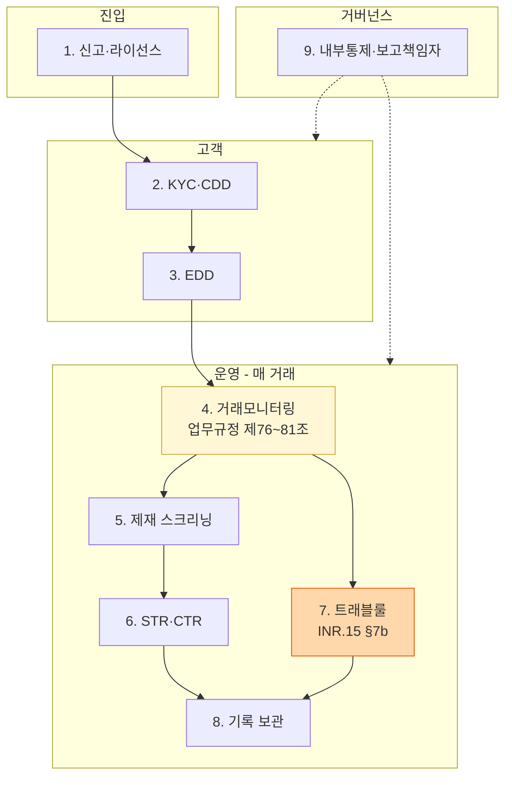
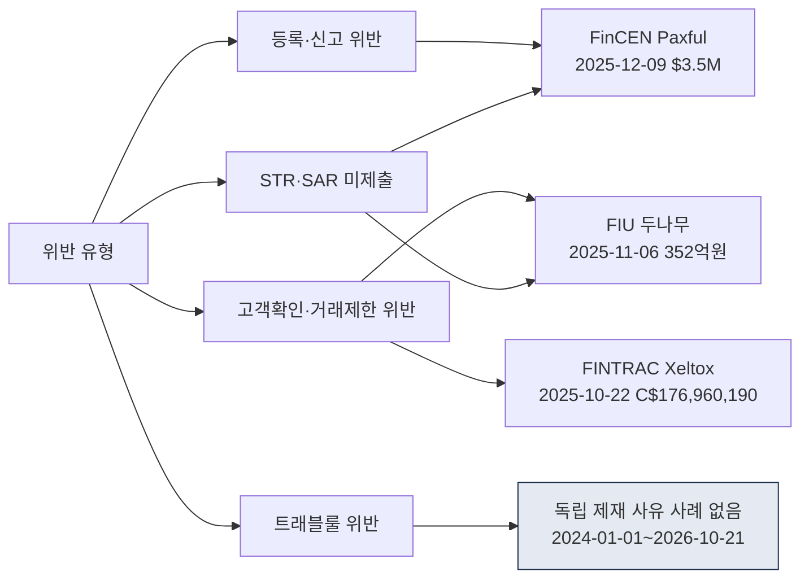

# VASP 의무 — 가상자산사업자가 해야 할 일 정리

> VASP가 법적·실무적으로 떠안는 **9대 의무**를 한 장에. 이 글을 읽고 나면 회사가 "AML 프로그램을 갖췄다"고 주장할 때 어떤 능력이 있어야 하는지, 그리고 2026-10-21 기준 무엇이 이미 시행 중이고 무엇이 "확정됐으나 미시행"인지 구분해 말할 수 있게 됩니다. 마지막 업데이트: 2026-10-21.

## TL;DR
- VASP 의무는 **FATF 기준(R.15/INR.15) → 각국법(특금법·BSA·AMLR)** 으로 흘러내려온다.
- 핵심 9가지: **신고/라이선스 → KYC/CDD → EDD → 거래모니터링 → 제재 스크리닝 → STR/CTR → 트래블룰 → 기록보관 → 내부통제**
- **거래모니터링**의 규제 용어는 "KYT"가 아니라 transaction monitoring / 한국 업무규정의 **"거래모니터링체계"(제76~81조)** 다.
- 한국은 **2027-02-19**에 트래블룰 전건화, 해외 VASP 3등급, 자기수탁 지갑 동일인 요건, 1천만원 이상 이전 자체 감시체계가 한꺼번에 시작된다(enacted-not-in-force).
- 2024-01-01~2026-10-21 사이 **트래블룰 위반을 독립 제재 사유로 명시한 사건은 어느 관할에서도 확인되지 않았다.** 대형 제재는 고객확인·STR·등록 위반에서 나왔다.

---

## 1. VASP 정의 — 누가 이 의무를 지는가

### 관할별 용어

- **VASP (Virtual Asset Service Provider)** — FATF 용어. 2018-10 R.15 개정으로 용어집에 신설.
- **MSB (Money Services Business)** — 미국 용어.
- **CASP (Crypto-Asset Service Provider)** — EU MiCA 용어.
- **가상자산사업자** — 한국 특금법 용어.

| 관할 | 용어 | 정의 (간단히) |
|---|---|---|
| FATF | VASP | 교환·이전·보관·관련 금융서비스를 영업으로 하는 자. 정의는 광의·기능적·기술중립(2021 가이던스 para 47~53) |
| 한국 | 가상자산사업자 | 매도·매수·교환·이전·보관관리·중개 (특금법) |
| 미국 | MSB | 가상통화 송금업 |
| EU | CASP | MiCA 열거 서비스 |

### 실무 포인트

수탁(custody)도 VASP 행위입니다. DeFi의 경우 FATF는 소프트웨어 자체는 VASP가 아니지만 통제력을 가진 사람은 VASP가 될 수 있다고 봅니다(2021 para 67) — [`defi-nft-risks.md`](defi-nft-risks.md) 참조.

---

## 2. VASP 9대 의무 (RBA 기반) — 순서 자체가 의미가 있다

### 1. 신고·라이선스

사업자 등록 없이 영업하면 이후 모든 AML 통제는 무의미합니다.

- **한국**: FIU 신고. 개정 특금법(법률 제21358호, 2026-02-19 공포)의 신고제 부분은 2026-08-20 시행됐고, 신고매뉴얼(2026-08-13 전면 개정)은 AML 업무 인력 4인 이상, 고유식별정보 처리 전산설비 국내 소재, 대주주·법령준수체계 변경 30일 전 사전신고를 정했다([금융위 2026-08-13](https://www.fsc.go.kr/no010101/87521)).
- **FATF 이행 현황**: 7차 TU 기준 라이선스·등록을 요구하는 관할은 73%(95/130)지만 실제 인가·등록을 내준 관할은 58%(76/130)다([7차 TU PDF](https://www.fatf-gafi.org/content/dam/fatf-gafi/reports/7th-targeted-update-on-implementation-fatf-standards-vas-vasps-2026.pdf.coredownload.pdf)).
- **EU**: MiCA CASP 인가. ESMA 임시 CASP 등록부(2026-10-19)는 379행·고유 LEI 376개다([ESMA CASPS.csv](https://www.esma.europa.eu/sites/default/files/2024-12/CASPS.csv)).

### 2. KYC · CDD

기본 4단계: 신원확인 → 실소유자 확인 → 거래목적·자금원천 → 지속 모니터링.

- **실소유자 확인**: 법인 고객은 지분·지배 구조를 따라 자연인까지 추적. 지분 기준은 관할별 법령을 따른다.
- **지속 모니터링**: FATF 2021 para 275~276 — 고객정보·거래목적 대비 거래 일관성 검증.

### 3. EDD (강화된 실사)

**트리거 예시**: PEP, 고위험국, 비대면 + 기타 위험요소, 거액거래, 복잡한 소유구조, 언호스티드 지갑 고위험 활동(7차 TU 권고 6-i).

**추가 절차**: 자금출처(SoF)·자산출처(SoW) 증빙, 고위경영진 승인, 재실사 주기 단축. FATF 2021 para 156(c)는 EDD 수단으로 블록체인 분석을 든다.

### 4. 거래모니터링

| 근거 | 요구 |
|---|---|
| FATF 2021 para 273~278 | 블랙리스트 대조, 자동화 + 사람 분석, 룰 무결성 정기 검증, 고위험 시 즉시 거래 너머 추적, 임계값 정기 재검토 |
| FATF 7차 TU 권고 6-ii (2026-07-16) | "transactions monitoring and blockchain analytics tools"로 급속 이전 탐지 |
| 한국 업무규정 제76~81조 (2026-01-22 시행) | 거래모니터링체계, 비정상 거래 주의, 분석 절차, 분석담당자, 5년 이상 보존, 보고체제 |
| 한국 시행령 §10-20 ⑦나 · 고시 §28-2③ (2027-02-19~, enacted-not-in-force) | 해외 VASP·자기수탁 지갑 대상 1천만원 이상 이전에 **자체 의심거래 감시체계** 구축·운영 — 자동 STR이 아님 |

알람 발생 → 사람 검토 → 케이스 → STR / EDD / 종결. 흐름은 [`../4-technology/kyc-kyt.md`](../4-technology/kyc-kyt.md) §3. 한국에서 거래소는 이와 별도로 **시장감시(이용자보호법 §12)** 와 **보이스피싱 임시조치(통신사기피해환급법, 2026-10-01~)** 의무도 진다 — 산출물이 다르므로 같은 큐에 섞지 않는다.

### 5. 제재 스크리닝

- **고객 신원** vs 제재 명단 — 이름·생년월일·국적 매칭
- **지갑 주소** vs 제재 목록의 가상자산 주소 — FATF 2021 para 273, 7차 TU 권고 5-ii "wallet screening, blacklisting"
- 제재 목록의 변화를 반영해야 한다: Tornado Cash는 2025-03-21 SDN에서 삭제됐다(엔티티 1·ETH 주소 90)([OFAC](https://ofac.treasury.gov/recent-actions/20250321)). 반대로 2025-10-14 Prince Group 초국가범죄조직 지정(146개 대상)처럼 네트워크 단위 지정이 늘었다([재무부 sb0278](https://home.treasury.gov/news/press-releases/sb0278)).

### 6. STR · CTR

- **STR**: 의심되면 FIU에 보고. 금액 기준이 아니라 의심 판단이 기준이다.
- **CTR**: 고액 현금거래 보고. VASP는 현금 취급이 드물어 트리거가 적다. 기준금액은 [`../2-regulations/korea-fiu-act.md`](../2-regulations/korea-fiu-act.md) 참조.
- **누설 금지(Tipping-off)**: 고객에게 STR 사실을 알리면 안 된다.

### 7. 트래블룰

| 관할 | 금액 구조 | 상태(2026-10-21) | 출처 |
|---|---|---|---|
| FATF | INR.15 §7(b) 금액 없음, USD/EUR 1,000 de minimis는 국가 선택 | in-force | [FATF 2021](https://www.fatf-gafi.org/content/dam/fatf-gafi/guidance/Updated-Guidance-VA-VASP.pdf.coredownload.pdf) |
| 한국(현행) | 시행령 §10-10 "1백만원 이상" | in-force, 2027-02-18까지 | [법제처 DRF](https://www.law.go.kr/DRF/lawService.do?OC=test&target=eflaw&MST=288765&efYd=20260820&type=XML) |
| 한국(2027) | 다른 VASP로의 모든 이전 | enacted-not-in-force, 2027-02-19 | [법제처 DRF 시행예정](https://www.law.go.kr/DRF/lawService.do?OC=test&target=eflaw&MST=288765&efYd=20270219&type=XML) |
| 미국 | 31 CFR 1010.410(f) "$3,000 or more" | in-force ($250 안 2025-04-16 withdrawn) | [31 CFR 1010.410](https://www.law.cornell.edu/cfr/text/31/1010.410) |
| EU | TFR — 정보는 금액 무관 전건, EUR 1,000은 자기수탁 주소 검증 발동 기준 | in-force (2024-12-30 적용) | [EBA/GL/2024/11](https://www.eba.europa.eu/sites/default/files/2024-07/6de6e9b9-0ed9-49cd-985d-c0834b5b4356/Travel%20Rule%20Guidelines.pdf) |

한국 2026년 상반기 실태: **총 출고 62.8조원 중 트래블룰 적용 9.5조원(약 15%)**([금융위 2026-10-01](https://www.fsc.go.kr/no010101/87835)). 상세는 [`travel-rule.md`](travel-rule.md).

### 8. 기록 보관

한국은 두 법이 서로 다른 대상에 다른 기간을 부과합니다. 같은 자료가 둘 다에 해당하면 더 긴 쪽이 안전합니다.

- **가상자산이용자보호법 시행령 §13**: 상시감시·조치 결과 기록(6호)과 통보·신고·보고 기록(7호)이 보존 대상 가상자산거래기록에 포함 — **15년**(fds 도시에 §1-A)([시행령](https://www.law.go.kr/LSW/lsInfoR.do?lsiSeq=290171&efYd=20261002&ancYnChk=0&chrClsCd=010202&urlMode=lsInfoR))
- **특금법·업무규정**: AML 관련 기록 5년, 거래모니터링 분석자료 5년 이상(업무규정 제80조)
- **통신사기피해환급법 §2의5④**: 임시조치 통지·해제·본인확인 내역 보존

이전 판의 "가상자산이용자보호법 §11 — 거래 정보 15년"은 조문 번호가 틀렸습니다(§11은 입출금 차단 제한). 위와 같이 고쳤습니다.

### 9. 내부통제 + 보고책임자

- 자금세탁방지 보고책임자 지정, AML 정책·절차 문서화
- 신고매뉴얼(2026-08-13): AML 업무 인력 4인 이상(겸직 인정 가능)
- 3중 방어선: 영업(1선) / 컴플라이언스(2선) / 감사(3선)
- 임직원 정기 교육과 기록
- 독립 감사

### 실무 포인트

검사에서 지적받는 건 "있지만 작동하지 않는" 경우가 많습니다. FIU는 2025-11-06 두나무에 과태료 352억원을 결정했고, 사유는 고객확인·거래제한·의심거래보고 등의 위반이었습니다([FIU 보도자료 KDI 미러](https://eiec.kdi.re.kr/policy/materialView.do?num=273166)). 형식과 실질을 모두 증빙해야 합니다.

---

## 3. 사업 유형별 의무 강도 차이 (RBA)

같은 VASP라도 사업 유형에 따라 무엇이 최우선인지 다릅니다. 아래는 상대적 강조점이며, 법령이 정한 등급이 아닙니다.

| 사업 유형 | 특히 강조되는 의무 | 근거·이유 |
|---|---|---|
| **거래소** | 전 영역 + §12 시장감시 + 보이스피싱 임시조치 | 이용자보호법 §12는 "가상자산시장을 개설·운영하는" 사업자에 한정. 통신사기피해환급법 "가상자산거래소" 정의 |
| **수탁업** | 출금 시 주소 스크리닝, 자기수탁 이전 규율 | 2027-02-19 자기수탁 동일인 요건 |
| **OTC** | 고액·국경 간 거래 EDD, 상대방 실사 | Red Flag RF-T3·G1~G3 |
| **NFT 마켓** | VA 해당성 판단, wash trading 모니터링 | FATF 2021 para 53 |
| **DeFi 통제자** | VASP 해당성 자체 | FATF 2021 para 67, 2026-07-21 DeFi 보고서 |

이전 판의 사업 유형별 의무 강도 레이더 차트는 근거 없는 주관 점수여서 이 문서에서 뺐습니다.

---

## 4. 의무 위반 → 제재 — 실제 사례로 본 무게중심

| 일자 | 사건 | 사유 | 출처 |
|---|---|---|---|
| 2025-10-22 | 캐나다 FINTRAC, Xeltox(Cryptomus) C$176,960,190 행정벌 | 컴플라이언스 정책 결함 등. "Travel rule"은 결함 목록의 한 항목으로만 등장 | [FINTRAC](https://fintrac-canafe.canada.ca/pen/amps/pen-2025-10-22-eng) |
| 2025-11-06 | 한국 FIU, 두나무 과태료 352억원 | 고객확인·거래제한·의심거래보고 등. 트래블룰(특금법 §5의3)은 포함되지 않음 | [KDI 미러](https://eiec.kdi.re.kr/policy/materialView.do?num=273166) |
| 2025-12-09 | 미국 FinCEN, Paxful $3.5M 민사벌금 | MSB 미등록·AML 프로그램 미비·SAR 미제출. 트래블룰 위반 없음 | [FinCEN](https://www.fincen.gov/news/news-releases/fincen-assesses-35-million-penalty-against-paxful-facilitating-suspicious) |

7차 TU에 따르면 트래블룰을 입법한 관할의 **60%(55/91)는 트래블룰 관련 감독·집행 조치가 전혀 없었습니다**. 따라서 2026-10-21 현재 트래블룰 미준수 리스크는 제재 리스크라기보다 상대방 실사와 거래 허용 여부의 문제입니다.

이전 판의 관할별 형량·벌금 표(한국 "5년/5천만원", 미국 "$500K~", EU "€10M 또는 매출 5%")와 임원 실형 사례는 이번 근거 자료로 재확인하지 못해 삭제했습니다. 법정형은 [`../2-regulations/korea-fiu-act.md`](../2-regulations/korea-fiu-act.md) 등 법령 노트를 보세요.

### 실무 포인트

제재 사례를 보면 무게중심은 **고객확인·STR·등록**입니다. 다만 한국은 2027-02-19부터 트래블룰 허용 요건(해외 VASP 등급·자기수탁 동일인)이 법령에 들어가므로, 트래블룰이 "거래를 해도 되는가"의 판단 근거로 바뀝니다.

---

## 5. 컴플라이언스 프로그램 구조 — Pillars

AML 프로그램 문서를 다음 축으로 구조화하면 국내외 검사·실사에서 읽기 쉽습니다.

1. **Internal Controls** — 정책·절차·시스템 (거래모니터링체계 포함)
2. **Designated Officer** — 보고책임자
3. **Training** — 임직원 교육
4. **Independent Audit** — 독립 감사
5. **CDD / Beneficial Ownership** — 실소유자 확인

미국 BSA의 pillar 체계에서 온 구조입니다. 한국 신고매뉴얼·업무규정의 요구 항목과 대응시켜 목차를 짜면 됩니다. 이전 판의 연도별 연혁과 "한국 FIU 검사도 사실상 동일 기준"이라는 단정은 근거를 재확인하지 못해 뺐습니다.

---

## 6. 수탁업자 관점 추가 의무

- **출금 시 주소 스크리닝** — 외부 주소의 제재·믹서·도난자금 노출
- **자기수탁 지갑 이전** — 2027-02-19부터 "독점적인 관리 권한을 가지지 않은 가상자산주소"와의 이전은 고객과 상대방이 동일인일 때만 허용(enacted-not-in-force). 소유 확인 방법은 법령이 정하지 않았다.
- **자산 분리·보안** — 가상자산이용자보호법상 이용자 자산 보호 의무 (세부는 [`../2-regulations/korea-user-protection.md`](../2-regulations/korea-user-protection.md))

이전 판의 "콜드월렛 비율(시행령 80%)" 등 수치는 이번 근거 자료로 재확인하지 못해 법령 노트로 넘깁니다.

---

## 요약 부록 — 빠른 참조용

**9대 의무 순서**: 신고 → KYC → EDD → 거래모니터링 → 제재 → STR/CTR → 트래블룰 → 기록 → 내부통제
**한국 2027-02-19**: 트래블룰 전건 · 해외 VASP 3등급 · 자기수탁 동일인 · 1천만원 감시체계
**기록 보존**: 이용자보호법 시행령 §13 15년 · 업무규정 제80조 5년 이상
**제재 무게중심**: 고객확인·STR·등록 (트래블룰 독립 제재 사례 없음)

## 💼 실무 현장 (Industry Reality)

### 9의무별 증빙 — 검사관이 보는 것

| 의무 | 검사관 요구 증빙 (예) |
|---|---|
| 신고 | 신고 수리 서류, 변경 사전신고 기록 |
| KYC·CDD | 온보딩 기록, 재실사 이력 |
| EDD | 승인 기록, 자금원천 증빙 |
| 거래모니터링 | 룰 목록·임계값 근거·정기 검증 기록, 알람 처리 사유, 분석자료(5년 이상) |
| 제재 | 목록 갱신 반영 기록 |
| STR | 판단 근거와 보고 기록 |
| 트래블룰 | 메시지 로그, 상대 VASP 실사, 거절 사유 |
| 기록 | 보존 기간·무결성 |
| 내부통제 | 정책서, 교육 이수 기록, 감사 보고서 |

이전 판의 "Upbit 스타일" 시스템·SLA 표, 유형별 조직 인원, 임원 보험 트렌드, 위험점수 가중치 의사코드의 점수는 출처가 없어 삭제했습니다.

### 자주 나오는 오해

- **"9가지 다 있으면 통과"** — 검사관은 "작동하는가"를 본다.
- **"트래블룰은 이미 모든 이전에 적용"** — 2026-10-21 한국 현행은 100만원 이상이다. 전건화는 2027-02-19.
- **"2027년부터 1천만원 이상은 자동 STR"** — 공포본은 "자체 의심거래 감시체계"다.
- **"트래블룰 위반이 가장 큰 제재 위험"** — 2024~2026 독립 제재 사례가 없다. 대형 제재는 고객확인·STR·등록 위반이었다.

### 한국 특수 현실

- **한 신호, 세 출구**: 거래소는 AML(STR) 외에 §12 시장감시와 보이스피싱 임시조치를 따로 운영해야 한다.
- **대주주 변경**: 신고매뉴얼상 변경 30일 전 사전신고(종전 변경 후 14일 내 사후신고).

---

## 더 읽을거리
- [`travel-rule.md`](travel-rule.md) — 트래블룰 상세
- [`onchain-typology.md`](onchain-typology.md) — 온체인 자금세탁 유형
- [`../4-technology/kyc-kyt.md`](../4-technology/kyc-kyt.md) — 거래모니터링 흐름·산출물 3축
- [`../5-compliance/cdd-edd.md`](../5-compliance/cdd-edd.md) — CDD·EDD 운영
- [금융위 2026-08-13 신고매뉴얼 전면 개정](https://www.fsc.go.kr/no010101/87521)
- [FATF 7차 Targeted Update (2026-07-16)](https://www.fatf-gafi.org/content/dam/fatf-gafi/reports/7th-targeted-update-on-implementation-fatf-standards-vas-vasps-2026.pdf.coredownload.pdf)
