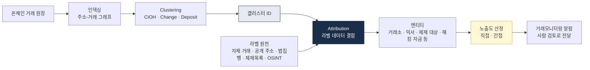
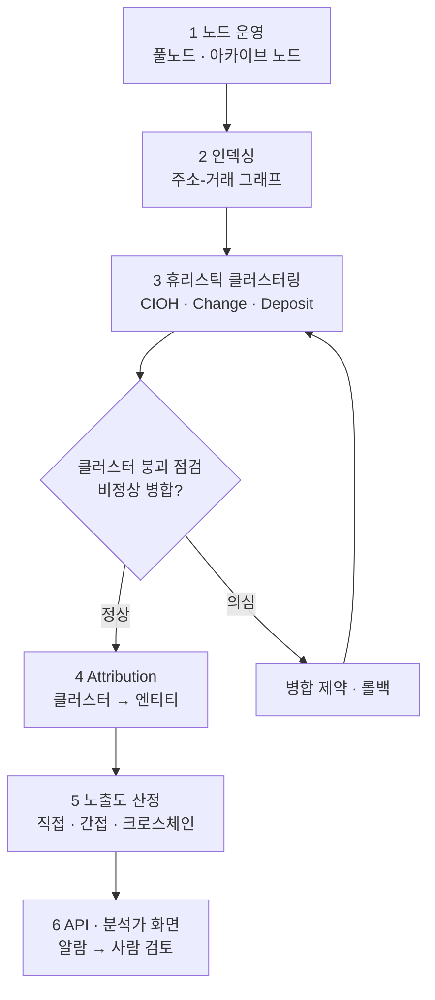
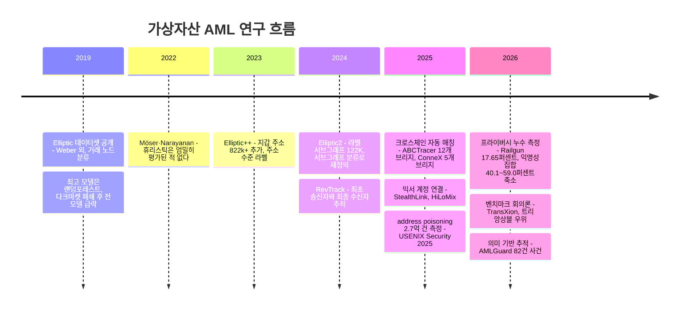
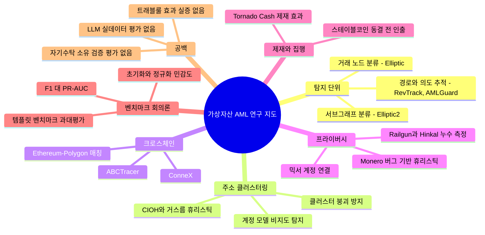

# Blockchain Analytics — 온체인 분석 기법

> KYT의 **기술적 기반**. 어떻게 익명 주소를 분석하는가. 이 글을 읽고 나면 블록체인 분석 도구가 어떤 휴리스틱과 데이터 위에서 돌아가는지, 그리고 그 결과의 정확도에 대해 **공개적으로 말할 수 있는 것과 없는 것**이 무엇인지 구분할 수 있습니다. 마지막 업데이트: 2026-10-21.

> **정정 안내 (2026-10-21).** 이 노트의 이전 판에는 CIOH·CoinJoin 필터·GNN의 Precision/Recall/F1 비교표가 세 군데(§2.A, §2.B, §11.2) 있었습니다. 표에 출처로 단 Meiklejohn 2013·Möser & Böhme 2017·Androulaki 2013·Bellei 2024 어느 논문도 그 수치를 보고하지 않습니다. `kb/facts/contradictions.jsonl` `CTR:00007`(2026-08-04)이 같은 계열 수치를 다른 두 파일에서 지웠고, 이 파일에 남아 있던 세 표도 이번에 지웠습니다. Weber 2019·Elliptic++·Elliptic2의 수치와 브리지 정확도 표, Monero 서술도 원문에 맞게 고쳤습니다. 근거는 `research/2026-10-academic-literature.md` §8과 정본 보고서 부록 A-38·A-39입니다.

## TL;DR
- 블록체인 분석의 두 축: **Clustering**(주소 묶기) + **Attribution**(주소→엔티티 매핑). 그 위에 **노출도(exposure)** 산정이 올라간다.
- 핵심 휴리스틱: **Common Input Ownership(CIOH), Change Detection, Deposit Heuristic**. 이 휴리스틱들의 **표준화된 정확도 수치는 존재하지 않는다.** Möser & Narayanan은 초록에서 "current techniques rely on heuristics that have not been rigorously evaluated or optimized"라고 썼다([arXiv 2107.05749](https://arxiv.org/abs/2107.05749)).
- Bitcoin(UTXO 모델)과 Ethereum(Account 모델)은 분석법이 다르다.
- 크로스체인 추적은 2025년에 "휴리스틱"에서 "자동 매칭 시스템"으로 넘어갔다. 다만 연구마다 브리지 집합·정의가 달라 **수치를 서로 비교할 수 없다**.
- 프라이버시 프로토콜은 "추적 불가/가능" 이분법이 아니라 **익명성 집합 축소율·비트 손실**로 측정된다. Monero도 2019~2023년 지갑 버그 구간은 부분 추적이 가능했다.
- 한계: 새 mixer·브리지의 라벨링 지연, off-chain(CEX 내부) 거래, 공개 벤치마크와 실운영 사이의 격차.

---

## 1. 두 축 — Clustering + Attribution, 그리고 노출도



### 블록체인 분석이 답하려는 두 질문

1. **이 주소들이 같은 사람인가?** → Clustering
2. **이 클러스터는 누구인가?** → Attribution

이 둘이 합쳐져야 "주소 `0x...`가 누구"를 말할 수 있습니다. Clustering은 **알고리즘**에 가깝고, Attribution은 **데이터·OSINT·협력 관계**에 의존합니다. 알고리즘은 논문으로 공개돼 있지만 라벨 데이터는 각 회사가 따로 쌓기 때문에, 분석 결과의 차이는 대부분 라벨에서 나옵니다.

마지막 단계의 출력은 "판정"이 아니라 **사람이 검토할 알람**입니다. FATF 2021 RBA 가이던스 para 276은 대량 거래에서는 자동화 시스템이 유일한 현실적 수단일 수 있지만 "flagged transactions should go through human/expert analysis"라고 요구합니다([FATF 2021 RBA 가이던스](https://www.onpcsb.ro/2022/01042022/Updated-Guidance-VA-VASP.pdf)).

> Clustering (구조 분석) + Attribution (라벨 데이터) → Exposure (노출도) → 사람 검토

---

## 2. 주요 클러스터링 휴리스틱

### A. Common Input Ownership Heuristic (CIOH) — Bitcoin

**한 트랜잭션의 여러 input 주소 = 같은 사람이 통제.**

UTXO 모델 비트코인에서는 한 트랜잭션이 여러 UTXO를 input으로 소비합니다. 각 input을 소비하려면 해당 UTXO의 **private key로 서명**해야 하므로, 같은 트랜잭션에 모인 input들은 같은 개인키 소유자가 통제한다고 추정합니다.

**왜 강력한가**: 한 사용자가 주소를 여러 개로 쪼개도, 여러 UTXO를 합쳐 보내는 순간 그 주소들이 한 클러스터로 묶입니다.

**예외·한계**: CoinJoin(Wasabi, Samourai, JoinMarket) 같은 **협력 소비**는 서로 다른 엔티티가 의도적으로 input을 합치는 것이라 CIOH가 **오작동**합니다. 그래서 CIOH를 적용하기 전에 CoinJoin 형태의 트랜잭션을 먼저 걸러냅니다.

### 2.A Common Input Ownership Heuristic — 엄밀 정의

**알고리즘**:

```
def common_input_ownership(tx: Transaction) -> set[Address] | None:
    if len(tx.inputs) < 2:
        return None
    if is_coinjoin(tx):   # 2.B 참조
        return None
    return {inp.address for inp in tx.inputs}
```

**전제**: Bitcoin UTXO에서 여러 input을 한 tx에 소비하려면 각 input의 private key에 접근해야 함 → "소유자 동일"이라는 통계적 가정.

**엄밀한 한계**:
- UTXO 모델에서만 성립. **Ethereum Account 모델에는 적용 불가**(from 주소가 항상 1개).
- CoinJoin(의도적 input 합치기)은 가정 위반.
- Custodial 거래소 hot wallet은 여러 고객 자금을 한 tx에 합침 → "거래소"라는 엔티티로는 맞지만 "고객"까지 맞지 않음.

**정확도 — 표준화된 수치가 없다**

이 자리에 있던 "실증 정확도" 표(Meiklejohn 2013·Weber 2019·Möser & Böhme 2017·Bellei 2024 출처)는 삭제했습니다. 표의 수치는 귀속된 논문에 없습니다(CTR:00007). 특히 Weber 2019와 Bellei 2024는 주소 클러스터링 논문이 아니라 **거래·서브그래프 분류** 논문입니다.

공개 문헌에서 확인되는 것은 다음 정도입니다.

- Möser & Narayanan(FC 2022)은 기존 기법이 엄밀히 평가·최적화되지 않았다고 명시합니다([arXiv 2107.05749](https://arxiv.org/abs/2107.05749)).
- 같은 논문은 거스름 휴리스틱 26개 변종을 평가했고, 개별 휴리스틱의 진양성률은 "Most achieve true positive rates between 10-30%"였습니다. 랜덤포레스트 결합 모델은 FPR 0.1%에서 TPR 82%(임계값 투표 방식 37%)로 개선됐습니다(B, 본문 수치는 저장소 wave1 검증).
- 같은 논문에서 제약 없는 거스름 병합은 Mt.Gox 클러스터를 2억 2,400만 주소(+1596%)로 부풀렸습니다. **클러스터 붕괴(cluster collapse)**가 정확도 숫자보다 더 중요한 실무 위험입니다(B).

정확도는 데이터셋·시기·지갑 소프트웨어 구성에 따라 달라집니다. 벤더 PoC에서는 "정확도 몇 %"보다 **ground truth를 무엇으로 잡았는지, 클러스터 붕괴를 어떻게 탐지하고 되돌리는지**를 물어야 합니다(`curriculum/day_30.md` 참조).

### 2.B CoinJoin Fingerprint Detection (CIOH 전 필터)

**문제**: Wasabi·Samourai Whirlpool·JoinMarket 같은 CoinJoin은 서로 다른 사용자가 의도적으로 input을 합칩니다. CIOH 단독 적용 시 오분류가 납니다.

**Fingerprint 탐지 규칙 (교육용 예시)** — 특정 벤더의 구현이 아니며, 아래 상수는 이 노트가 검증하지 않은 자리표시자입니다.

```
def is_coinjoin(tx: Transaction) -> bool:
    # 1. Input 수 ≥ 2 (최소 조건)
    if len(tx.inputs) < 2:
        return False
    # 2. Output 동일 금액 클러스터 검출
    amounts = [o.value for o in tx.outputs]
    uniform_outputs = [a for a in amounts if amounts.count(a) >= 3]
    if not uniform_outputs:
        return False
    # 3. 지갑별 고정 denomination 대조
    #    값은 지갑·버전마다 다르다 — 각 지갑의 공개 문서로 확인한 뒤 채울 것
    KNOWN_DENOMS: set[int] = load_wallet_denominations()
    if any(a in KNOWN_DENOMS for a in uniform_outputs):
        return True
    # 4. Input/Output 수가 대칭인 구조
    if len(tx.inputs) >= 5 and len(tx.outputs) >= 5:
        if abs(len(tx.inputs) - len(tx.outputs)) <= 1:
            return True
    return False
```

**결합 정확도**: 이전 판의 "CIOH 단독 0.75 / Fingerprint 필터 후 0.95 / ML 분류기 0.97(벤더 추정)" 표는 출처가 없어 삭제했습니다. 공개 근거 없음.

**참고**:
- Meiklejohn et al. (2013) "A Fistful of Bitcoins: Characterizing Payments Among Men with No Names" (ACM IMC 2013)
- Möser & Böhme (2017) "Anonymous Alone? Measuring Bitcoin's Second-Generation Anonymization Techniques" (IEEE EuroS&PW 2017, DOI 10.1109/eurospw.2017.48)
- Möser & Narayanan (2022) "Resurrecting Address Clustering in Bitcoin" (FC 2022, [arXiv 2107.05749](https://arxiv.org/abs/2107.05749))

### B. Change Detection (거스름돈 식별)

UTXO 모델에서 **거스름돈(change)은 새 주소로 반환**됩니다. 이 거스름돈 output을 원 주소 소유자와 같은 클러스터로 묶는 기법.

**휴리스틱 예**:
- "optimal change": 입력이 2개 이상인 거래에서 어떤 출력이 모든 입력값보다 작으면 그 출력이 거스름일 가능성이 높다(Möser & Narayanan 정의, B)
- 주소 타입 일치, 반올림 금액, 지갑 지문(트랜잭션 버전·locktime·RBF·스크립트 타입 등)

**정확도**: 이전 판의 "약 60~80%"는 출처가 없어 삭제했습니다. 위 논문 기준으로 개별 휴리스틱은 대체로 TPR 10~30% 수준이라 **단독으로 쓰지 않고 결합**합니다(B).

### C. Deposit Heuristic (거래소 입금 식별)

**배경**: 거래소는 고객별로 입금 주소를 따로 발급합니다. 거래소는 입금된 자금을 주기적으로 **consolidation 주소**로 모아 핫월렛·콜드월렛을 관리합니다. 이 흐름을 따라가면 거래소 주소 체계가 드러납니다.

**결과**: 거래소 attribution의 핵심 방법. "이 주소에서 나가는 consolidation 흐름이 알려진 거래소 핫월렛으로 흐른다 → 이 주소는 그 거래소의 입금 주소" 식의 추론. 단, 입금주소 재사용·스윕 패턴 기반 식별의 정밀도를 공개 ground truth로 평가한 2025~2026 논문은 확인되지 않았습니다(academic §3-6).

### D. Behavior-based Clustering (행동 기반)

- 시간대, 금액, 거래 빈도 패턴이 비슷한 주소들
- ML 기반
- **약한 신호지만 다른 휴리스틱과 결합 시 유용**

### E. Multi-input Heuristic for Ethereum (계정 모델)

Ethereum은 UTXO가 아닌 **Account 모델**이라 CIOH를 **직접 적용할 수 없습니다**. 대신 다음 패턴을 활용합니다.

- 같은 EOA(Externally Owned Account)가 여러 contract와 상호작용하는 패턴
- Smart contract 호출 패턴 (funding relationship)
- Gas 지불 주소 분석 (누가 ETH로 가스비를 내는가)
- 같은 ENS 도메인 사용

2025년 연구는 계정 모델에서 **방향·시간 피처**와 **거래 텍스트화**로 이 공백을 메우려 합니다. DiT-SGCR은 방향성 시간 집계와 미분가능 클러스터링을 결합한 비지도 인코더로, 3개 데이터셋에서 기존 SOTA 대비 F1 3.62~10.83%p 향상을 보고했습니다([arXiv 2506.20123](https://arxiv.org/abs/2506.20123)). KGBERT4Eth는 거래 언어모델과 지식그래프를 결합해 피싱 탐지 F1 8~16%p, 비익명화 6~26%p 개선을 보고했습니다([arXiv 2509.03860](https://arxiv.org/abs/2509.03860)). 두 편 모두 동료심사 전 프리프린트이고 개선폭만 보고합니다.

용어:
- **EOA (Externally Owned Account)** — 사용자가 private key로 통제하는 Ethereum 계정.
- **UTXO (Unspent Transaction Output)** — Bitcoin의 미사용 거래 출력. 비트코인의 기본 단위.

### 실무 포인트

Ethereum은 Bitcoin보다 **클러스터링이 구조적으로 더 어렵습니다**. CIOH 같은 강한 구조 신호가 없기 때문입니다. 그래서 Ethereum 쪽 결과는 라벨 데이터(Attribution)에 더 크게 의존한다고 기억하면 됩니다. 체인별 정확도를 수치로 비교한 공개 벤치마크는 없습니다.

---

## 3. Attribution — 주소를 누구에게 매핑하나

### 데이터 소스

Attribution은 "알고리즘"이 아니라 "**데이터 누적**"의 문제입니다.

| 소스 | 예시 |
|---|---|
| **자체 거래** | 분석회사가 거래소에 입금해 주소 라벨 확보 |
| **공개 정보** | 거래소가 공개한 hot/cold wallet 주소 |
| **다크넷 마켓** | 운영 관찰로 주소 라벨링 |
| **법집행 정보** | 압수·체포로 노출된 주소 |
| **제재 목록** | OFAC SDN 등 정부 발표 주소 |
| **Smart Contract 분석** | 컨트랙트 deployer, 함수 호출 패턴 |
| **소셜 / OSINT** | 소셜미디어·메신저에서 주소 노출 |

### 라벨 카테고리 (일반적 예시)

- Exchange · DEX · Mixer · Sanctions · Stolen Funds · Ransomware · Darknet Market · Scam · Gambling · Mining Pool · High-risk Jurisdiction Exchange · ATM · Merchant Service

### 실무 포인트

라벨 데이터의 한계는 감독기관 문서에도 적혀 있습니다.

- FATF 2021 RBA 가이던스 para 234: "There is a cost consideration with these tools and not all VAs are covered by all vendors." 프라이버시·데이터보호 영향도 고려하라고 합니다([FATF 2021](https://www.onpcsb.ro/2022/01042022/Updated-Guidance-VA-VASP.pdf)).
- NYDFS 산업서한(2022-04-28)은 지원하는 자산마다 추적 절차를 갖추라고 요구하고, 외부 서비스와 자체 개발 도구를 모두 허용합니다. 분석 도구가 "may not be able to identify underlying owners"라는 한계도 명시합니다([NYDFS](https://www.dfs.ny.gov/industry_guidance/industry_letters/il20220428_guidance_use_blockchain_analytics)).
- FATF 7차 Targeted Update(2026-07-16)는 MIVA 표 검증에 "blockchain analytics companies' data"를 썼다고 밝히면서도, 그 데이터가 관할의 불법금융 위험 평가에 기반한 것은 아니라고 단서를 답니다([FATF 7차 TU](https://www.fatf-gafi.org/content/dam/fatf-gafi/reports/7th-targeted-update-on-implementation-fatf-standards-vas-vasps-2026.pdf.coredownload.pdf)).

벤더별 지역·분야 강점을 비교한 공개 평가는 확인되지 않았습니다. 커버리지는 PoC에서 자사 지원 자산 목록을 기준으로 직접 확인해야 합니다.

---

## 4. Exposure Score — 개념과 공개 근거의 한계

### 4.1 정의

**노출도(Exposure)**: 한 주소(또는 클러스터)가 위험 엔티티(제재 대상·믹서·다크넷 등)와 어떻게 연결돼 있는지를 정량화한 값.

- **Direct**: 분석 대상이 위험 엔티티와 직접 거래
- **Indirect**: 중개 주소를 거쳐 도달

간접 노출을 보는 규범적 근거는 FATF 2021 RBA 가이던스 para 277입니다. 고위험 상황의 강화 모니터링은 "extend beyond the immediate transaction between the VASP or its customer or counterparty"여야 하고, 기준·임계값은 "reviewed on a regular basis"여야 합니다([FATF 2021](https://www.onpcsb.ro/2022/01042022/Updated-Guidance-VA-VASP.pdf)). FATF 7차 TU는 VASP가 "transactions monitoring and blockchain analytics tools"로 급속 이전을 탐지하고, 프로토콜·브리지·믹서·크로스체인 도구에 대한 노출을 평가하라고 권고했습니다([FATF 7차 TU](https://www.fatf-gafi.org/content/dam/fatf-gafi/reports/7th-targeted-update-on-implementation-fatf-standards-vas-vasps-2026.pdf.coredownload.pdf)).

### 4.2 공식에 대해 말할 수 있는 것

이전 판에는 "벤더 일반화 공식", 카테고리별 가중치 표, 벤더별 감쇠계수 λ 표, "보통 5-hop까지"라는 서술과 그 계산 예시가 있었습니다. **모두 공개 근거가 없어 삭제했습니다**(정본 보고서 부록 A-37, kyt 도시에 §9 #8).

2026-10-21 기준 이 저장소의 조사에서 홉 수 상한·감쇠함수·카테고리 가중치를 공개한 벤더 자료는 확인되지 않았습니다. 따라서 노출도 점수는 **재현할 수 없는 블랙박스**로 다뤄야 합니다. 구조만 적으면 다음과 같습니다. 계수는 일부러 비워 둡니다.

```
# 교육용 가설 구조 — 어떤 벤더의 공식도 아니며 계수는 정의하지 않는다
exposure(addr) = Σ_category  f( 직접 노출 비중, 간접 노출 비중, 경과 시간, 금액 )
```

### 4.3 점수 다음 단계 — 자동 STR이 아니다

이전 판의 계산 예시는 "64점 → BLOCK + STR 자동 발동"으로 끝났습니다. 이것은 틀린 연결입니다. 노출도 점수는 차단·통보·STR 판단의 **입력**일 뿐입니다. 한국 「자금세탁방지 및 공중협박자금조달금지에 관한 업무규정」은 제76조~제81조에서 거래모니터링체계와 보고체제를 규정하고([법제처](https://www.law.go.kr/DRF/lawService.do?OC=test&target=admrul&ID=2100000267264&type=XML)), FATF는 플래그된 거래의 사람 검토를 요구합니다. 산출물을 차단/통보/STR 세 축으로 나누는 설계는 [`kyc-kyt.md`](kyc-kyt.md)를 보세요.

이전 판의 "KYT 점수 그대로 차단하면 FP 30~50%", "목표 FP 5%·FN 1%", override 계수표도 출처가 없어 삭제했습니다.

### 4.4 한계

1. 노출도는 **과거 라벨 기반** → 새 라벨이 반영되기까지 지연이 있습니다(지연 기간을 측정한 공개 자료는 확인되지 않음).
2. 간접 노출을 깊이 따라갈수록 무관한 주소가 섞입니다. 깊이를 어디서 끊는지가 공개돼 있지 않다는 점이 설명 가능성의 문제입니다.
3. **프라이버시 프로토콜 진화** → Railgun 같은 shielded pool은 §7.5의 측정 연구를 보세요.
4. **Cross-chain** → 브리지 매칭이 따로 필요합니다(§5).

### 실무 포인트

노출도 공식은 벤더마다 다르고 공개되지 않습니다. 이게 STR 작성 시 "왜 이 점수인가"를 설명하기 어려운 원인입니다. 대응은 벤더에게 **카테고리별 하위 점수와 추적 경로**를 받아 사내 정책 언어로 다시 쓰는 것입니다. FATF 2021 para 276이 "operating rules"를 이해하고 무결성을 정기 검증하라고 요구한다는 점을 근거로 들 수 있습니다.

---

## 5. Cross-chain Tracing — Bridge Matching

### 도전

한 체인에서 끊어진 흐름이 다른 체인에서 시작되는 구조. 중간에 **wrapped 토큰화**(A 체인의 ETH가 B 체인의 wETH로)로 같은 가치지만 다른 형태가 됩니다.

### 5.1 문제 정의

Ethereum → Polygon → Arbitrum → Optimism 간 자산 이동은 **bridge contract**를 거칩니다. 각 체인의 tx는 독립적이므로, 추적을 이어 가려면 "bridge event를 체인 간 연결"해야 합니다. 2025년 연구(ConneX)는 **브리지 양측 거래 쌍 매칭 실패가 자금 추적 실패의 주원인**이라고 문제를 정의했습니다([arXiv 2511.01393](https://arxiv.org/abs/2511.01393)).

### 5.2 Bridge 이벤트 구조 (참고)

이벤트명·필드는 각 브리지 컨트랙트 버전마다 다를 수 있으므로 실제 구현 전에 컨트랙트 ABI로 확인하세요.

| 체인/브리지 | 이벤트 이름 | 주요 필드 | 순번 필드 |
|---|---|---|---|
| Polygon PoS | LockEvent | (user, token, amount, targetChain, depositCount) | ✓ |
| Arbitrum | OutboundTransfer | (token, from, to, seqNumber, amount) | ✓ |
| Optimism | WithdrawalInitiated | (l1Token, l2Token, from, to, amount, nonce) | ✓ |
| Wormhole | LogMessagePublished | (sender, sequence, nonce, payload) | ✓ |
| LayerZero | PacketSent | (dstEid, receiver, payload) | generic — payload 해석 필요 |
| Hop Protocol | TransferSentToL2 | (chainId, recipient, amount, transferId) | transferId |

### 5.3 매칭 알고리즘 (교육용 예시)

`time_window`·`amount_tolerance` 기본값은 예시입니다. 실측 연구(§5.5)에서는 입금과 출금의 시간창이 크게 달랐습니다.

```
def match_bridge_events(
    lock_events: list[LockEvent],
    mint_events: list[MintEvent],
    time_window: int,          # 초 — 브리지·방향별로 따로 정한다
    amount_tolerance: float,   # 수수료 차감 토큰은 별도 처리
) -> list[tuple[LockEvent, MintEvent]]:
    matches = []
    for lock in lock_events:
        candidates = []
        for mint in mint_events:
            if mint.token_canonical != lock.token_canonical:
                continue
            if abs(mint.timestamp - lock.timestamp) > time_window:
                continue
            if abs(mint.amount - lock.amount) / lock.amount > amount_tolerance:
                continue
            # 순번(nonce) 필드가 양쪽에 있으면 결정적 매칭
            if hasattr(lock, 'nonce') and hasattr(mint, 'nonce'):
                if lock.nonce == mint.nonce:
                    candidates = [mint]
                    break
            candidates.append(mint)
        if len(candidates) == 1:
            matches.append((lock, candidates[0]))
        elif len(candidates) > 1:
            # 금액 차이 최소 선택 (차선책 — 오매칭 위험 기록)
            best = min(candidates, key=lambda m: abs(m.amount - lock.amount))
            matches.append((lock, best))
        # 0개: 목적지 체인에 아직 도착 안 함 — 재큐잉
    return matches
```

### 5.4 실패 케이스

| 시나리오 | 원인 | 대응 |
|---|---|---|
| LayerZero Generic Message | Payload가 임의 bytes, 표준 금액 필드 없음 | DApp별 payload decoder |
| Fee-on-Transfer 토큰 | 전송 시 수수료 차감 → 금액 불일치 | 토큰별 허용오차 |
| Batched Bridge | 한 tx에 여러 sender를 합쳐 전송 | 개별 사용자 추적 어려움 |
| 우연 매칭 | 같은 토큰·비슷한 금액이 시간창 안에 여럿 | 다중 조건 강화 |
| Failed Relay (stuck message) | 목적지 도착이 크게 지연 | 시간창 확장 |

### 5.5 정확도 — 실측 연구 3건 (서로 비교 불가)

이전 판의 브리지별 "매칭 정확도(공개 + 추정)" 표(Polygon 97~99%, LayerZero Generic 40~60% 등)는 출처가 없어 삭제했습니다. 대신 원문에서 확인된 측정치를 둡니다. **브리지 집합·매칭 정의·지표가 연구마다 달라 한 표의 숫자끼리 비교하면 안 됩니다.**

| 연구 | 대상 | 방법 | 보고치 | 출처 |
|---|---|---|---|---|
| ABCTracer (Lin 외 2025) | 주류 브리지 12개 | 이벤트 로그 마이닝 + 개체명 인식 + 정보검색 | 양방향 추적 F1 91.75% | [arXiv 2504.01822](https://arxiv.org/abs/2504.01822) |
| ConneX (Liang 외 2025) | 브리지 5개, 약 50만 건 | LLM으로 탐색공간 1e10 → 100 미만 축소 후 금액 검증 | 평균 F1 0.9746 | [arXiv 2511.01393](https://arxiv.org/abs/2511.01393) |
| Yan·Huang·Tessone 2025 | Ethereum–Polygon 1개, 2020-08-28~2023-08-28 | 수취인·시간창·토큰·금액 4기준 매칭 | 입금 93.04~99.65%, 출금 67.55~92.78% (자산 유형별) (B) | [arXiv 2504.15449](https://arxiv.org/abs/2504.15449) |

세 번째 연구에서 출금 쪽 시간창(약 6.4일)은 입금(약 24분)의 약 380배였고, ERC20 출금(67.55%)이 가장 약했습니다(B). 같은 브리지 안에서도 **방향과 자산 유형별로 신뢰도를 다르게 둬야 한다**는 뜻입니다. 2025 서베이(Kumar & Thing)는 원장 간 자산 이동 추적 기법을 정리했습니다([arXiv 2510.09624](https://arxiv.org/abs/2510.09624)). 공통 ground truth 벤치마크는 2026-10-21 기준 없습니다.

### 5.6 한계

- 여러 브리지를 연달아 거치면 단계마다 오류가 누적됩니다. 이전 판의 "3-hop ≈ 0.73" 계산은 출처 없는 단일 브리지 수치를 곱한 것이라 삭제했습니다.
- 비표준 경로(중앙화 OTC·P2P)는 온체인 브리지 이벤트가 없습니다.
- THORChain·Across 같은 유동성 풀 기반 브리지는 sender-receiver가 1:1로 연결되지 않습니다.
- DeFi 거래의 **의미 해석**이 병목입니다. AMLGuard는 DeFi 거래를 "DeFi Semantic Unit"으로 추상화해, 실제 세탁 사건 82건에서 목적지 정밀도 94.4%(단일체인)/87.6%(크로스체인)를 보고했습니다([arXiv 2607.18869](https://arxiv.org/abs/2607.18869)). 알려진 사건만 쓴 평가라 선택 편향이 있습니다.

### 실무 포인트

FATF 7차 TU가 브리지·크로스체인 도구 노출 평가를 명시했으므로, 크로스체인 추적은 선택 기능이 아니라 위험평가 항목입니다. PoC에서는 자사가 지원하는 체인 조합으로 실제 경로를 여러 개 만들어 복원 여부를 직접 확인하고, 결과를 **브리지·방향·자산 유형별로** 기록하세요. 단일 정확도 숫자로 요약하지 않는 것이 핵심입니다.

---

## 6. UTXO 모델 vs Account 모델 분석

### 이 표를 어떻게 읽어야 하나

두 모델의 분석 방법론은 근본적으로 다릅니다.

| 측면 | Bitcoin (UTXO) | Ethereum (Account) |
|---|---|---|
| **기본 단위** | UTXO (unspent output) | Account (EOA + Contract) |
| **클러스터링** | Common Input Ownership 적용 가능 | EOA-Contract 패턴 분석 |
| **Smart Contract** | 제한적 | 풍부 (분석 더 복잡) |
| **Token** | Layer 1엔 없음 (Ordinals 등 별도) | ERC-20/721/1155 풍부 |
| **공개 라벨 데이터셋** | Elliptic·Elliptic++·Elliptic2·BABD | 피싱·rug pull 위주 (§11) |

### 실무 포인트

같은 금액의 거래라도 체인에 따라 **분석 근거의 성격이 다릅니다**. Bitcoin은 구조 신호(CIOH)가 있고 Ethereum은 라벨 의존도가 큽니다. 위험 점수를 체인 간에 비교할 때 이 차이를 감안해야 합니다. 다만 체인별 정확도 차이를 수치로 보인 공개 연구는 확인되지 않았습니다.

---

## 7. 분석 도구의 데이터 파이프라인



1. **Node Operation** — Bitcoin Core, Geth, Erigon, Reth 등. 전체 이력이 필요하면 archive node.
2. **Indexing** — 트랜잭션을 그래프 저장소에 적재, 주소 ↔ 트랜잭션 매핑.
3. **Heuristic Clustering** — CIOH·Change Detection·Deposit 휴리스틱으로 클러스터 ID 부여. **병합 제약과 붕괴 점검**을 둡니다(Möser & Narayanan의 지출-출력 제약 사례, B).
4. **Attribution** — 라벨 DB(자체 + 외부)로 클러스터 → 엔티티 매핑.
5. **Risk Scoring** — 노출도 계산.
6. **API / UI** — 외부 API, 분석가용 시각화. 출력은 사람 검토로 갑니다.

### 실무 포인트

노드 운영과 인덱싱은 체인마다 따로 해야 해서 지원 체인이 늘수록 부담이 커집니다. 그래서 자체 노드와 외부 API를 함께 쓰는 구성이 흔합니다. 이전 판의 인프라 용량·비용 수치는 출처가 없어 삭제했습니다.

---

## 7.5 프라이버시 프로토콜·믹서·Monero — 측정의 시대

2025~2026년 연구는 "깨졌다/안전하다" 대신 **얼마나 줄었는지**를 잽니다.

| 대상 | 측정 | 출처 |
|---|---|---|
| Railgun (Ethereum) | 출금의 17.65%가 입금과 유일 연결, 중위 익명성 손실 3.42비트. 5가지 누수원(타이밍·주소 재사용·그래프 근접성·금액 지문·배낭식 금액 매칭) | Huseynov 외 2026, [arXiv 2606.25926](https://arxiv.org/abs/2606.25926) |
| Railgun 4개 배포 + Hinkal 5개 풀, EVM 6체인 | unshield 186,356건에서 공개 토큰 제약만으로 평균 익명성 집합 40.1~59.0% 축소, 후보 10개 이하 3,679건(단일 후보 1,228건) | Guo 외 2026, [arXiv 2608.22987](https://arxiv.org/abs/2608.22987) |
| Tornado Cash 제재 효과 | 957일간 입금액 71.03% 감소, 그러나 Ethereum 보안사고의 78.33%가 여전히 경유 | Liu 외, WWW '26, [arXiv 2507.11721](https://arxiv.org/abs/2507.11721) |
| 믹서 계정 연결 | StealthLink F1 96.98%, 10-shot에서도 지도학습 대비 우위 | Che 외 2025, [arXiv 2505.09892](https://arxiv.org/abs/2505.09892) |
| 믹서 계정 연결 | 노이즈·희소 라벨 대응 고·저주파 대조학습 HiLoMix (초록에 수치 없음) | Tu 외, AAAI 2026, [arXiv 2511.07759](https://arxiv.org/abs/2511.07759) |
| 스테이블코인 동결 | USDT 제재 주소의 7.3%, USDC의 18.7%가 동결 발효 전 전액 인출 | Wu 외 2026, [arXiv 2603.27739](https://arxiv.org/abs/2603.27739) |

> Tornado Cash 입출금 클러스터링 논문(arXiv 2510.09433)은 2025-11-18 저자가 철회했습니다("mistakes in the references"). 수치를 인용하지 마세요.

**Monero 서술 정정.** 이전 판은 "Monero 거의 분석 불가", "완전 추적 불가는 지속"이라고 했습니다. Hammad & Victor(IEEE ICBC 2024)는 2019~2023년 Monero 체인에서 지갑 버그("10 Block Decoy Bug", "Differ-by-one"), P2Pool 출력 병합, Mordinal 유래 휴리스틱을 ground truth로 평가해 **대부분 고정밀**이라고 보고했습니다. 다만 해당 버그는 2023년 초 패치돼 이후 신규 거래에는 효과가 없습니다([arXiv 2408.05332](https://arxiv.org/abs/2408.05332)). 정확한 서술은 "**패치 이전 구간은 부분 추적이 가능했고, 패치 이후 거래에는 이 휴리스틱이 통하지 않는다**"입니다.

---

## 8. ML·AI의 활용

### 적용 영역

- **클러스터링 보조**: 휴리스틱이 잡지 못하는 패턴 발견
- **거래·서브그래프 분류**: Elliptic(거래 노드), Elliptic2(서브그래프)
- **믹서 계정 연결**: §7.5
- **피싱·rug pull 탐지**: PhishEye는 자기지도 방식으로 실배포에서 미지의 피싱 주소 1,803개를 찾았습니다([arXiv 2605.01207](https://arxiv.org/abs/2605.01207)). RugScreener는 균형 데이터(500/500)에서 균형 정확도 95.7%를 보고했습니다(IEEE TIFS 2025).

### 공개 벤치마크가 실제로 말하는 것

- **Weber et al. 2019(Elliptic 공개 논문)에서 최고 성능은 GNN이 아니라 랜덤포레스트였습니다.** 불법 클래스 기준 RF(전체 피처+노드 임베딩) precision 0.971 / recall 0.675 / F1 0.796, GCN 0.812 / 0.512 / 0.628([arXiv 1908.02591](https://arxiv.org/abs/1908.02591), 본문 수치 B). 이전 판의 "RF 0.93/0.77/0.84, GCN 0.92/0.83/0.87"은 논문과 다릅니다.
- 같은 논문에서 시점 43의 다크마켓 폐쇄 이후 **모든 모델의 성능이 급락**했습니다(B). 개념 표류(concept drift)가 운영 위험의 본질입니다.
- Elliptic2의 GLASS 모델은 F1 0.933이지만 PR-AUC 0.208, 혼동행렬 TP 245 / FP 765 — 의심으로 예측한 4건 중 약 1건만 실제 의심입니다(B)([arXiv 2404.19109](https://arxiv.org/abs/2404.19109)). 극단적 불균형에서 F1만 보면 오독합니다.
- Elliptic 시계열 분할에서 Extra Trees AUPRC 0.570 vs GraphSAGE 0.311로 트리 앙상블이 앞섰습니다(B)([Akter 외 2026](https://publications.eai.eu/index.php/airo/article/download/13658/4313/36724)).
- GCN·GAT·GraphSAGE의 Elliptic 결과는 가중치 초기화·정규화 선택만으로 달라집니다([arXiv 2602.23599](https://arxiv.org/abs/2602.23599)). 논문 간 F1 비교표를 만드는 것 자체가 위험합니다.
- TransXion(KDD '26)은 템플릿 기반 이상 주입 벤치마크가 모델 강건성을 과대평가한다고 보였습니다([arXiv 2604.17420](https://arxiv.org/abs/2604.17420)).

### 한계

- **라벨 데이터 부족** — 각 회사가 자체 보유하고 공개하지 않습니다. Elliptic·Elliptic2 이후 자금세탁 라벨 Bitcoin/Ethereum 데이터셋의 신규 공개는 2026-10-21 기준 확인되지 않았습니다(academic §3-11).
- **Adversarial behavior** — 분석을 회피하는 패턴(분할 금액, 무작위 시간). 경제적 동기를 가진 공격자를 모델링한 연구는 사실상 공백입니다.
- **모델 설명가능성** — 규제 보고 시 "왜 STR 보고했나"를 설명해야 합니다. 근거 인용을 강제한 LLM 트리아지 연구는 인용 유효성 0.98인데 에스컬레이션 F1은 0.62였습니다(합성 데이터)([arXiv 2604.19755](https://arxiv.org/abs/2604.19755)). 근거를 잘 인용한다고 판단이 맞는 것은 아닙니다.

### 실무 포인트

ML 탐지는 **보조 수단**으로 쓰는 게 안전합니다. 감독 검사에서 "이 고객은 어떤 근거로 STR 대상이 됐나"에 "모델이 그렇게 판단했다"는 답이 될 수 없습니다. 공개 근거로 보면 그래프 모델의 실무 우위는 확인되지 않았고, 트리 앙상블과 운영 지표(PR-AUC, 혼동행렬 원값)로 먼저 검증하라는 것이 2026년 문헌의 공통 메시지입니다.

---

## 9. 자체 구축 vs 벤더 활용

### 규제가 허용하는 것

- NYDFS(2022-04-28): 외부 서비스와 자체 개발 도구 **모두 허용**, 다만 자산별 추적 절차와 역할 분담을 문서화하라고 요구([NYDFS](https://www.dfs.ny.gov/industry_guidance/industry_letters/il20220428_guidance_use_blockchain_analytics)).
- FATF 2021 para 156(c)는 EDD 수단으로 블록체인 분석을 들고, para 323(g)는 일본 JFSA가 "whether blockchain analysis tools are used for transaction monitoring and/or risk analysis purposes"를 감독 KPI로 수집한다고 적었습니다([FATF 2021](https://www.onpcsb.ro/2022/01042022/Updated-Guidance-VA-VASP.pdf)).

### 판단 기준

- **벤더**: 라벨 DB·다체인 커버리지를 바로 얻습니다. 대신 노출도 공식이 비공개라 설명 책임이 남습니다.
- **자체 구축**: 사내 데이터와 결합하고 국내 특화 라벨을 쌓을 수 있습니다. 대신 노드·인덱싱·라벨링을 직접 감당합니다.
- 대부분은 **외부 분석 도구 + 자체 보완 모듈**의 조합입니다. 특정 거래소가 어느 벤더를 쓰는지는 공개 확인된 범위가 좁으므로 일괄 서술하지 않습니다.

### 실무 포인트

"자체 구축 vs 벤더"의 답은 비용보다 **규제 대응 근거**로 봐야 합니다. 어느 쪽이든 감독기관 앞에서 필요한 것은 같습니다. 지원 자산별 추적 절차, 룰·임계값의 정기 검토 기록, 플래그 거래의 사람 검토 기록입니다.

---

## 10. 한계와 미래

### 한계

- **Privacy coin**(Monero): 2023년 패치 이후 거래에는 알려진 버그 기반 휴리스틱이 통하지 않습니다(§7.5). 패치 이전 구간은 부분 추적이 가능했습니다.
- **새 mixer·새 bridge**: 라벨링 지연. 지연 기간을 측정한 공개 자료는 확인되지 않았습니다.
- **Off-chain**(CEX 내부 거래): 보이지 않습니다.
- **관할 귀속**: 가명 주소에는 지리 식별자가 없어 단일 관할 내 온체인 활동을 측정하기 어렵습니다. ECB CAMEG는 2026년 계획에 지리적 위치 식별 방법론·지표 개발을 넣었습니다([ECB OP 382](https://www.ecb.europa.eu/pub/pdf/scpops/ecb.op382.en.pdf)).

### 미래 방향

- **서브그래프·경로·의도 추적**: 거래 하나가 아니라 자금 흐름 전체를 탐지 단위로 삼는 쪽(§12).
- **Cross-chain analytics** 표준화: 공통 벤치마크가 아직 없습니다.
- **ZKP 적용** — 프라이버시와 컴플라이언스 양립. SSI·ZKP·속성기반 접근제어로 KYC 준수 dApp의 온체인 권한부여를 구현한 연구([arXiv 2510.05807](https://arxiv.org/abs/2510.05807)), 중앙은행 전문가의 PET 분류(BIS Innovation Hub Mandala 예시, ECB OP 382 §2.10.2)가 있습니다.

### 실무 포인트

ZKP 기반 프라이버시-컴플라이언스 양립은 **장기 방향**입니다. 2026-10-21 기준 학술 문헌은 설계·분류 단계이고, 감독 실무에서 채택된 사례를 다룬 평가 논문은 확인되지 않았습니다.

---

## 요약 부록 — 빠른 참조용

**두 축**: Clustering (구조) + Attribution (데이터) → 노출도
**5대 휴리스틱**: CIOH · Change · Deposit · Behavior · Ethereum Multi-input
**정확도**: 표준화된 수치 없음. 클러스터 붕괴 점검이 더 중요
**체인별 차이**: Bitcoin UTXO = 구조 신호 있음 / Ethereum Account = 라벨 의존
**노출도**: Direct / Indirect. 홉 상한·가중치·감쇠는 비공개 → 블랙박스로 취급

## 💼 실무 현장 (Industry Reality)

> 이전 판의 벤더 매출 비중·조달액·인력 규모·노드 비용·"KYT 벤더별 강점 PoC 비교"·국내 거래소별 사용 벤더·"자체 구축 실패" 사례는 모두 공개 출처가 없어 삭제했습니다.

### 감독기관이 블록체인 분석에 대해 실제로 쓴 문장

- FATF 7차 TU(2026-07-16) 민간부문 권고: "identify suspicious patterns in VA transactions and detect rapid transfer of VAs using transactions monitoring and blockchain analytics tools." FATF 공식 문서가 VASP 대상 권고에 "blockchain analytics tools"를 직접 쓴 것은 이 조사 범위에서 처음입니다.
- 같은 문서는 통제 요소로 "KYC, wallet screening, blacklisting, and, where appropriate, whitelisting mechanisms as well as freezing and blocking capabilities"를 열거합니다.
- 업계 용어 "KYT"는 FATF 7차 TU·2021 RBA 가이던스·2020 레드플래그·MAS PSN02 어디에도 나오지 않습니다. 한국 업무규정의 용어는 "거래모니터링체계"(제76조)입니다.

### 자주 나오는 오해

- **"CIOH 정확도는 몇 %다"** — 표준화된 수치는 없습니다. 숫자를 들었다면 데이터셋·시기·ground truth를 되물으세요.
- **"GNN이 최신이니 더 정확하다"** — Elliptic 원논문에서도, 2026년 재평가에서도 트리 앙상블이 앞섰습니다(§8).
- **"Monero는 완전히 추적 불가"/"Monero도 다 추적된다"** — 둘 다 틀렸습니다. 시기를 나눠야 합니다(§7.5).
- **"제재하면 믹서는 끝난다"** — Tornado Cash 입금은 71.03% 줄었지만 보안사고의 78.33%가 여전히 경유했습니다. "효과 있음/없음" 이분법이 맞지 않습니다.
- **"발행자가 동결하면 자금은 묶인다"** — USDT 7.3%, USDC 18.7%의 제재 주소가 동결 전에 전액 인출했습니다. BIS도 발행자 동결·분석업체 지원이 "cannot replace routine, large-scale AML/CFT controls in everyday payments"라고 했습니다([BIS AER 2026](https://www.bis.org/publ/arpdf/ar2026e3.htm)).

---

## 11. 공개 데이터셋과 논문별 보고치

### 11.1 공개 벤치마크 데이터셋

| 데이터셋 | 연도 | 규모 (원문 확인치) | 라벨 | 출처 |
|---|---|---|---|---|
| Elliptic | 2019 | 거래 203,769 노드·234,355 엣지·피처 166·시점 49 | 불법 4,545(2%)·합법 42,019(21%), 나머지 미라벨 | [arXiv 1908.02591](https://arxiv.org/abs/1908.02591) |
| Elliptic++ | 2023 (KDD 2023) | 지갑 주소 822k+·주소당 피처 56·시간 상호작용 1.27M (+ Elliptic 거래) | 거래·주소 양 수준 | [arXiv 2306.06108](https://arxiv.org/abs/2306.06108) |
| Elliptic2 | 2024 | **라벨 서브그래프 122K**(121,810)·노드 클러스터 49M·엣지 거래 196M | 합법 119,047 / 의심 2,763 (B) | [arXiv 2404.19109](https://arxiv.org/abs/2404.19109) |
| BABD-13 | 2022 arXiv / 2024 IEEE TIFS | 라벨 544,462·피처 148·주소 유형 13종 (2019-07-12~2021-05-26) | 13개 행태 유형 | [arXiv 2204.05746](https://arxiv.org/abs/2204.05746) |

이전 판의 "Elliptic++ (2022) ~840K txs, 1.6M addresses"와 "Elliptic2 ~122M txs"는 연도·규모가 틀렸습니다. Elliptic2의 122는 1.22억 거래가 아니라 **12.2만 개 라벨 서브그래프**입니다. "WalletExplorer dump ~8M addresses" 행은 출처가 없어 삭제했습니다.

### 11.2 논문별 보고치 — 비교표로 합치지 말 것

이전 판의 "Bitcoin clustering 정확도 비교" 표(CIOH·Change·Fingerprint·RF·GCN·GAT·"Shape-based SSL"·벤더 claim)는 삭제했습니다. 클러스터링 논문과 거래 분류 논문이 섞여 있었고, 대부분의 수치가 원문에 없었습니다. 아래는 원문에서 확인된 값만 **논문별로** 적은 것입니다. 데이터셋·과제·지표가 달라 행끼리 비교하면 안 됩니다.

| 논문 | 과제 | 보고치 | 비고 |
|---|---|---|---|
| Weber 외 2019 | Elliptic 거래 노드 분류 (불법 클래스) | RF(전체 피처+노드 임베딩) P 0.971 / R 0.675 / F1 0.796; GCN 0.812 / 0.512 / 0.628 | 본문 수치 B. 최고 모델은 RF |
| Bellei 외 2024 | Elliptic2 서브그래프 분류 | GLASS F1 0.933, PR-AUC 0.208, ROC-AUC 0.889 | 본문 수치 B. F1과 PR-AUC 괴리 |
| Xiang 외 2022/2024 (BABD) | 주소 행태 다중분류 | 5개 모델 정확도 93.24~97.13% | 초록 확인 |
| Akter 외 2026 | Elliptic 시계열 분할 | Extra Trees AUPRC 0.570 vs GraphSAGE 0.311 | B |
| Alarab 외 2020 | Elliptic GCN | 수치 미검증 — ACM 초록 미열람 | 학회는 ACM ICMLT 2020 |

### 11.3 핵심 참조 논문

- **Meiklejohn et al. (2013)** — "A Fistful of Bitcoins: Characterizing Payments Among Men with No Names" (ACM IMC 2013) — CIOH·Change detection 초기 공식화
- **Androulaki et al. (2013)** — "Evaluating User Privacy in Bitcoin" (FC 2013, DOI 10.1007/978-3-642-39884-1_4)
- **Möser & Böhme (2017)** — "Anonymous Alone? Measuring Bitcoin's Second-Generation Anonymization Techniques" (IEEE EuroS&PW 2017, DOI 10.1109/eurospw.2017.48) — 믹서·CoinJoin 측정
- **Harlev et al. (2018)** — "Breaking Bad: De-Anonymising Entity Types on the Bitcoin Blockchain Using Supervised Machine Learning" (HICSS 2018, DOI 10.24251/hicss.2018.443)
- **Weber et al. (2019)** — "Anti-Money Laundering in Bitcoin: Experimenting with Graph Convolutional Networks for Financial Forensics" (KDD 2019 workshop, [arXiv 1908.02591](https://arxiv.org/abs/1908.02591)) — Elliptic 공개
- **Möser & Narayanan (2022)** — "Resurrecting Address Clustering in Bitcoin" (FC 2022, [arXiv 2107.05749](https://arxiv.org/abs/2107.05749))
- **Elmougy & Liu (2023)** — "Demystifying Fraudulent Transactions and Illicit Nodes in the Bitcoin Network for Financial Forensics" (KDD 2023, [arXiv 2306.06108](https://arxiv.org/abs/2306.06108)) — Elliptic++
- **Bellei et al. (2024)** — "The Shape of Money Laundering: Subgraph Representation Learning on the Blockchain with the Elliptic2 Dataset" (KDD MLF Workshop 2024, [arXiv 2404.19109](https://arxiv.org/abs/2404.19109)) — Elliptic2 공개. 지도학습 서브그래프 분류이며 "self-supervised"·"topology-aware"가 아닙니다
- **Xiang et al. (2024)** — "BABD: A Bitcoin Address Behavior Dataset for Pattern Analysis" (IEEE TIFS 19, [arXiv 2204.05746](https://arxiv.org/abs/2204.05746))
- **Farrugia et al. (2020)** — "Detection of Illicit Accounts over the Ethereum Blockchain"

### 11.4 한국 공개 데이터

- 학술 목적의 한국 VASP 거래 라벨 데이터셋 공개는 확인되지 않았습니다.
- 한국 기술 논문 사례: 신미진 외(2025), 「암호화폐 트랜잭션의 실증적 분석을 통한 자금세탁 탐지 기술」, 융합보안논문지 25(1). 기존 GNN 연구가 **ground truth 부재**로 이미 식별된 불법 지갑만 탐지할 수 있다고 지적합니다([KoreaScience](https://www.koreascience.kr/article/JAKO202512754005711.page)).
- 이전 판의 Etherscan 라벨 수, 국내 거래소 공동 블랙리스트·국내 벤더 라벨 서술은 출처가 없어 삭제했습니다.

---

## 12. 연구 흐름 2019 → 2026





2025~2026년의 이동을 정본 보고서는 다섯 가지로 요약합니다. (1) 노드 분류 → 서브그래프·경로·의도 추적, (2) 크로스체인 자동 매칭, (3) 프라이버시 프로토콜의 정량 측정, (4) 사기 측정 규모 확대(address poisoning 2.7억 건, [arXiv 2501.16681](https://arxiv.org/abs/2501.16681)), (5) 벤치마크 회의론. 반대로 **트래블룰 효과 실증, LLM의 실데이터 평가, 자기수탁 지갑 소유 검증**을 다룬 2025~2026 동료심사 논문은 확인되지 않았습니다. 논문 목록은 [`../../deep/papers.md`](../../deep/papers.md)의 2025~2026 섹션을 보세요.

---

## 더 읽을거리
- [`kyc-kyt.md`](kyc-kyt.md) — KYT의 운영적 측면, 산출물 3축(차단/통보/STR)
- [`travel-rule-protocols.md`](travel-rule-protocols.md) — VASP 식별과의 관계
- [`../3-crypto-aml/onchain-typology.md`](../3-crypto-aml/onchain-typology.md) — 자금세탁 패턴
- [`../7-vendors/analytics-vendors.md`](../7-vendors/analytics-vendors.md) — 벤더 개요
- [`../../research/2026-10-academic-literature.md`](../../research/2026-10-academic-literature.md) — 2025~2026 학술 문헌 70편 (수치는 이 도시에의 확신도 표시를 확인하고 쓸 것)
- Meiklejohn et al. (2013), "A Fistful of Bitcoins" — CIOH 정립
- Möser & Narayanan (2022), "Resurrecting Address Clustering in Bitcoin" — 휴리스틱 재평가·클러스터 붕괴
- Weber et al. (2019), "Anti-Money Laundering in Bitcoin: Experimenting with Graph Convolutional Networks for Financial Forensics" — Elliptic 공개
- Bellei et al. (2024), "The Shape of Money Laundering: Subgraph Representation Learning on the Blockchain with the Elliptic2 Dataset" — Elliptic2 공개
