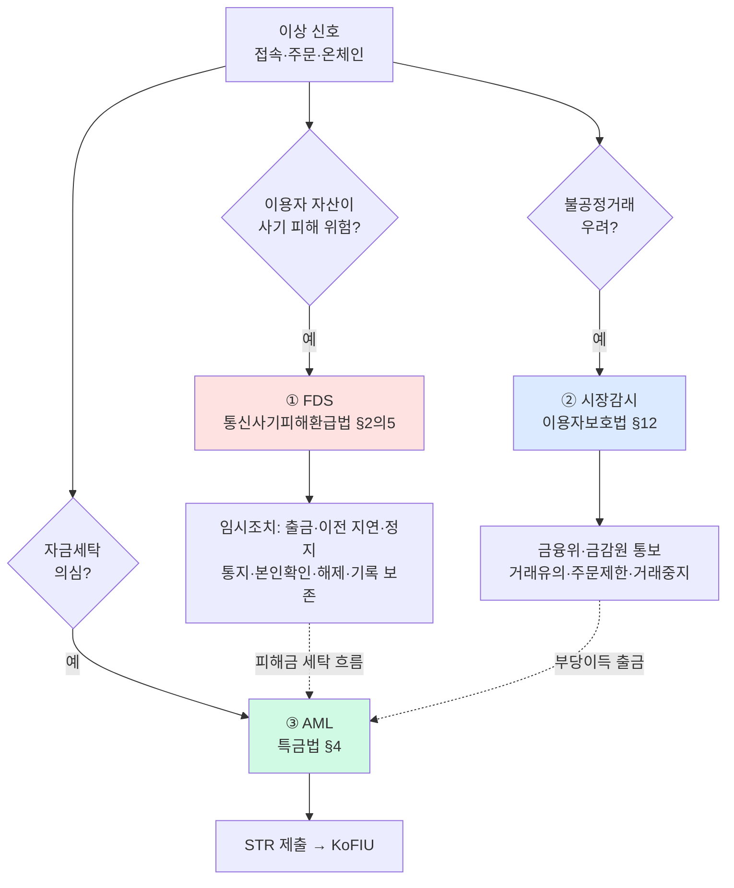
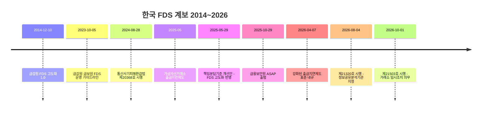
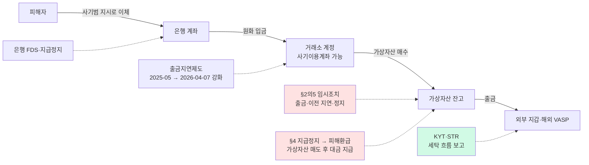

# FDS — 이상거래탐지시스템과 "이상거래" 세 제도의 경계

> FDS(Fraud Detection System)는 AML의 하위 모듈이 아니라 **병렬 제도**입니다. 한국에서 "이상거래"라는 한 단어는 ① 전자금융 FDS·보이스피싱 임시조치, ② 가상자산이용자보호법 §12 시장감시, ③ 특금법 의심거래보고(STR)라는 법적 근거·목적·산출물이 전부 다른 세 제도를 가리킵니다. 이 글을 읽고 나면 하나의 "이상" 신호를 **어느 법적 출구(차단·통보·STR)로 보내야 하는지** 분류하고, 2026-10-01부터 가상자산거래소에 적용된 통신사기피해환급법 의무를 설명할 수 있습니다. 마지막 업데이트: 2026-10-21.

## TL;DR
- **FDS는 법률·감독규정에 '명시된' 의무가 아니다.** 금감원 「FDS 고도화 1.0」(2014-12-10) → 금감원·금융보안원 「FDS 운영 가이드라인」(2023-10-05) → 비대면 금융사고 책임분담기준(자율배상)이라는 **가이드라인·자율 계보**로 형성됐다. 현행 「전자금융감독규정」(고시 제2026-29호) 전문에는 "이상금융거래"·"FDS"라는 용어가 없다.
- **FDS의 실질적 법정 근거는 「통신사기피해환급법」 §2의5(임시조치)다.** 법률 제21503호(2026-03-31 공포, **2026-10-01 시행**)로 가상자산거래소가 "금융회사등"에 포함돼, 2026-10-21 기준 거래소도 임시조치·거래목적 확인·지급정지·피해환급 의무를 진다(in-force).
- **가상자산이용자보호법 §12 "이상거래"는 FDS가 아니라 시장감시다.** 시행령 §18이 이상거래를 "불공정거래행위 등의 금지의무를 위반할 우려가 있는 거래"로 정의하므로 보이스피싱·계정탈취는 범위 밖이고, 산출물은 차단이 아니라 금융위·금감원 **통보**다.
- 가상자산 쪽 보이스피싱 대응은 출금지연제도(2025-05) → 강화된 출금지연제도(2026-04-07) → 법정 임시조치(2026-10-01) 순으로 강화됐고, 정보공유는 금융보안원 **ASAP**(2025-10-29 출범, 2026-08-04 법정 정보공유분석기관 지정)가 맡는다. 거래소의 실제 ASAP 연동 여부는 공개 자료로 확인되지 않는다.
- 세 제도는 공통 라벨 DB·케이스 관리는 공유할 수 있어도 **산출물(차단 / 통보 / STR)은 분리**해야 한다. 실무에서 가장 위험한 것은 탐지 실패보다 **분류 실패**다.

---

## 1. FDS란 무엇인가 — AML과 나란히 선 제도

금융감독원은 2014-12-10 「금융권 이상금융거래탐지시스템(FDS) 고도화 1.0」에서 FDS를 "전자금융거래 접속정보·거래내역 등을 분석하여 이상거래를 탐지·차단하는 시스템"으로 정의했다([금감원 2014-12-10](https://www.fss.or.kr/fss/bbs/B0000188/view.do?nttId=11361&menuNo=200218)). 출발점이 **전자금융사고 예방**이지 자금세탁 방지가 아니라는 점이 핵심이다.

| 질문 | FDS | AML(STR) |
|---|---|---|
| 누구를 보호하나 | 이용자 자산(계정탈취·보이스피싱·무단이체 피해) | 금융시스템·국가(자금세탁·테러자금 차단) |
| 1차 산출물 | 지연·일시정지(임시조치), 추가인증, 지급정지 | 의심거래보고(FIU), 거래거절, EDD |
| 시간 감각 | 출금 직전의 실시간 결정 | 사후 분석·보고 |
| 한국 법적 근거 | 통신사기피해환급법 §2의5·§2의6·§4, 전자금융거래법 §21(일반 안전성 의무) + 가이드라인 | 특금법 §4, FIU 고시 「자금세탁방지 업무규정」 제76~81조 |

「전자금융거래법」 §21은 금융회사등에 선관주의와 금융위 기준 준수를 요구하는 일반 조항이고 FDS를 명시하지 않는다([법제처 전자금융거래법](https://www.law.go.kr/LSW/lsInfoR.do?lsiSeq=290247&efYd=20261002&ancYnChk=0&chrClsCd=010202&urlMode=lsInfoR)). 현행 「전자금융감독규정」(고시 제2026-29호, 시행 2026-07-15) 전문에도 "이상금융거래"·"FDS"·"탐지시스템"이라는 용어는 없다([법제처 전자금융감독규정](https://www.law.go.kr/LSW/admRulInfoR.do?admRulSeq=2100000282622&chrClsCd=010201)). "FDS는 감독규정상 의무"라는 서술은 원문과 맞지 않는다.

---

## 2. "이상거래" 세 제도의 경계

### 경계표

| 구분 | ① FDS / 보이스피싱 임시조치 | ② 시장감시(가상자산이용자보호법 §12) | ③ AML·KYT → STR |
|---|---|---|---|
| **법률 용어** | "이상금융거래"(금감원 가이드라인), "피해의심거래계좌등"(통신사기피해환급법) | "이상거래"(법 §12, 시행령 §18) | "의심되는 거래"(특금법 §4) |
| **법적 근거** | 통신사기피해환급법 §2의5·§2의6·§4(거래소 2026-10-01~), 전자금융거래법 §21 + 금감원·금보원 가이드라인(자율) | 법 §12, 시행령 §18, 「가상자산시장조사업무규정」 §3·§4 | 특금법 §4, AML 업무규정 제76~81조 |
| **목적** | 이용자 자산 보호 | 시세조종·미공개정보 이용 등 불공정거래 적발 | 자금세탁·테러자금조달 차단 |
| **탐지 대상** | 비정상 접속(기기·IP·지역), 신규 기기 고액 출금, 입금 직후 전액 출금, 사기이용계좌 연계 | 가격·거래량 비정상 변동, 통정·가장매매, 고가매수 반복, API 초단기 매매, 풍문 | 믹서·제재주소 노출, 분할입출금, pass-through, 신원-거래 불일치 |
| **1차 데이터** | 로그인·세션·기기, 원화 입금·가상자산 출금 패턴, ASAP 공유정보 | 호가·체결 원장, 계정별 매매관여율 | 온체인 주소·노출도(KYT), KYC 프로필 |
| **산출물** | **지연·일시정지(임시조치)**, 지급정지, 피해환급 | **금융위·금감원 통보**(혐의 충분 시 수사기관 신고 후 보고), 거래유의 안내·조회공시·주문제한·거래중지 | **STR**(FIU), 거래거절, EDD |
| **수령·감독 기관** | 금융위 금융안전과·금감원 금융사기대응단, 금융보안원(정보공유분석기관) | 금융위 가상자산과·금감원 가상자산조사국 | 금융정보분석원(KoFIU) |
| **위반 시** | 지급정지 미이행 시 손해배상(§4③) | 과태료 1억원 이하(법 §22①6·7호) | 특금법상 과태료·영업정지 |

근거: [법제처 통신사기피해환급법](https://www.law.go.kr/LSW/lsInfoR.do?lsiSeq=290245&efYd=20261002&ancYnChk=0&chrClsCd=010202&urlMode=lsInfoR) · [법제처 가상자산이용자보호법](https://www.law.go.kr/LSW/lsInfoR.do?lsiSeq=290735&efYd=20261002&ancYnChk=0&chrClsCd=010202&urlMode=lsInfoR) · [시행령](https://www.law.go.kr/LSW/lsInfoR.do?lsiSeq=290171&efYd=20261002&ancYnChk=0&chrClsCd=010202&urlMode=lsInfoR) · [가상자산시장조사업무규정](https://www.law.go.kr/LSW/admRulInfoR.do?admRulSeq=2100000285440&chrClsCd=010201) · [AML 업무규정(FIU 고시 제2025-2호)](https://www.law.go.kr/DRF/lawService.do?OC=test&target=admrul&ID=2100000267264&type=XML)

### 하나의 신호, 세 개의 출구

한 사건이 여러 출구를 동시에 탈 수 있다. 예를 들어 금융위 2026-04-29 의결 사건은 **다수 계정의 API 키를 대여받아** 통정매매·고가매수를 한 경우인데([금융위 2026-04-29](https://www.fsc.go.kr/no010101/86809)), 시세조종은 ② 시장감시, 계정 대여는 ① 계정보안, 부당이득의 출금은 ③ STR 후보다. 출구마다 **다른 기관, 다른 양식, 다른 기한**이 걸리므로 케이스 관리에서 출구별로 따로 종결 처리해야 한다.

---

## 3. 한국 FDS 계보 — 가이드라인에서 법정 의무로

| 일자 | 사건 | 상태(2026-10-21) | 근거 |
|---|---|---|---|
| 2014-12-10 | 금감원 「금융권 FDS 고도화 1.0」, 금융권 FDS 추진 협의체 | 계보상 선행 | [금감원](https://www.fss.or.kr/fss/bbs/B0000188/view.do?nttId=11361&menuNo=200218) |
| 2022-12-21 | 금감원 "FDS 운영 가이드라인 마련" 예고 | — | [금감원 목록](https://www.fss.or.kr/fss/bbs/B0000188/list.do?menuNo=200218&searchCnd=1&searchWrd=FDS) |
| 2023-10-05 | 금감원·금융보안원 「FDS 운영 가이드라인」 발표 | in-force(자율, 비구속) | [금감원 2023-10-05](https://www.fss.or.kr/fss/bbs/B0000188/view.do?nttId=130709&menuNo=200218) |
| 2024-02-27 | 통신사기피해환급법 제20368호 공포(계좌 개설 시 거래목적 확인·한도제한 계좌 등), 2024-08-28 시행 | in-force | [금융위](https://www.fsc.go.kr/no010101/81640) |
| 2025-05-29 | 금감원 책임분담기준 개선안 — "FDS 고도화 등 사고 예방노력과 사고 후 대응 적정성"을 금융회사 책임 판단에 반영. 은행권 2024-01~2025-04 배상 41건·1억6,891만원(피해금액의 약 18%) | 개선안의 시행 여부 미확인 | [금감원 2025-05-29](https://www.fss.or.kr/fss/bbs/B0000188/view.do?nttId=194420&menuNo=200218) |
| 2026-02-03 | 제21320호 공포(의심정보 공유·정보공유분석기관), 2026-08-04 시행 | in-force | [금융위 2026-01-15](https://www.fsc.go.kr/no010101/86063) · [금융위 2026-08-04](https://www.fsc.go.kr/no010101/87474) |
| 2026-03-31 | **제21503호 공포(가상자산거래소 편입, 제명 "피해자산 환급"으로 변경), 2026-10-01 시행** | in-force | [법제처](https://www.law.go.kr/LSW/lsInfoR.do?lsiSeq=290245&efYd=20261002&ancYnChk=0&chrClsCd=010202&urlMode=lsInfoR) · [금융위 2026-03-13](https://www.fsc.go.kr/no010101/86446) |
| 2026-07-15 | 금감원, 가상자산 보이스피싱 피해 환급 하위규정(환급형태·산정·평가기준, 매도지원 전담기관 지정요건) 공표 | 세부 조문 미열람 | [금감원 2026-07-15](https://www.fss.or.kr/fss/bbs/B0000188/view.do?nttId=219215&menuNo=200218) |

금융위는 제21320호의 입법 배경으로 개별 금융회사 FDS가 "자체 패턴분석에 의존해 사전 차단 효과가 제한적"이라는 점을 들었다([금융위 2026-01-15](https://www.fsc.go.kr/no010101/86063)). 개별사 FDS의 한계를 **공동 정보공유**로 메우는 것이 2026년 입법의 방향이다.

> FDS 운영 가이드라인 본문(탐지 규칙 수·대응 절차)은 첨부 원문을 확인하지 못해 여기 적지 않는다. 언론에 보도된 규칙 개수·협약 은행 수, 제2금융권 자율배상 비율도 1차 원문이 확인되지 않아 뺐다.

---

## 4. 통신사기피해환급법 — 2026-10-01부터 거래소가 지는 의무

「전기통신금융사기 피해 방지 및 피해자산 환급에 관한 특별법」(현행 법률 제22047호, 시행 2026-10-02)의 핵심 조문은 다음과 같다([법제처](https://www.law.go.kr/LSW/lsInfoR.do?lsiSeq=290245&efYd=20261002&ancYnChk=0&chrClsCd=010202&urlMode=lsInfoR)).

| 조문 | 내용 | FDS 설계에 주는 의미 |
|---|---|---|
| §2제1호 하목 | 가상자산시장을 개설·운영하는 가상자산사업자("가상자산거래소")를 금융회사등에 포함 | 거래소가 은행과 같은 보이스피싱 방지 의무 주체 |
| **§2의5 임시조치** | "자체점검을 상시적으로 실시"하여 피해의심거래계좌등으로 추정되면 이체·송금·출금 또는 **가상자산 이전**을 지연·일시정지. 즉시 통지·본인확인 후 해당 없으면 해제 | **상시 탐지 + 지연/정지 + 통지 + 해제** 절차를 시스템으로 갖춰야 함 |
| §2의5④ | 임시조치 통지·해제·본인확인 내역 보존 | 차단 근거와 해제 사유를 남길 수 있는 로그 설계 |
| §2의6 거래목적 확인 | 가상자산 거래 포함, 계좌 개설 거절·한도 제한 가능 | 온보딩 단계 FDS·KYC 연계 |
| §4 지급정지 | 피해구제 신청 시 지급정지. ③ 제1항제1·2호 위반 시 손해배상 책임 | 지급정지 미이행은 손해배상으로 연결 |
| §13의4 정보공유 | 정보주체 동의 없이 정보공유분석기관에 제공 가능 | ASAP 연동의 법적 근거 |
| 부칙(제21503호) §2 | 가상자산 전기통신금융사기 피해자 규정을 시행 전 범행에도 적용 | 2026-10-01 이전 사건 피해자도 적용 대상 |
| 부칙 §3~§5 | 임시조치·거래목적 확인·지급정지 개정규정은 시행 이후 발생 건부터 적용 | 의무 이행 기준일은 2026-10-01 |

금융위는 이 개정이 "가상자산거래소에 금융회사와 동일한 수준의 보이스피싱 방지 및 피해구제 의무를 부과"하며, 피해자 요청 시 가상자산을 매도해 매도대금을 지급할 근거를 둔다고 설명했다([금융위 2026-03-13](https://www.fsc.go.kr/no010101/86446)).

**"차단"의 법적 요건을 구분할 것.** 가상자산이용자보호법은 입출금 차단을 제한하고(§11), 시행령 §17이 허용 사유(전산장애·보수점검·거래지원 종료 등)를 열거한다([시행령](https://www.law.go.kr/LSW/lsInfoR.do?lsiSeq=290171&efYd=20261002&ancYnChk=0&chrClsCd=010202&urlMode=lsInfoR)). 사기 피해 방지를 이유로 출금을 멈추려면 통신사기피해환급법 §2의5의 임시조치 절차(통지·본인확인·해제·기록 보존)를 따르는 것이 원칙이다. "의심되면 일단 차단"은 AML 운영 원칙이 아니다.

### 보이스피싱 피해금 흐름과 개입 지점

FATF Red Flag 보고서(2020-09-14) Case Study 2는 한국 사례다. 피싱 피해금 약 4억원이 3종 가상자산으로 바뀐 뒤 국내 VASP 48개 계정을 거쳐 55회 이전되고 해외 지갑으로 빠져나갔다([FATF Red Flag PDF p.7](https://www.fatf-gafi.org/content/dam/fatf-gafi/reports/Virtual-Assets-Red-Flag-Indicators.pdf)). 이 흐름 위에 2026-10-21 기준 제도를 겹치면 다음과 같다.

---

## 5. 출금지연제도와 ASAP

### 출금지연제도(자율규제 + 감독)

금융위·DAXA·거래소는 2025-05 신규 이용자의 가상자산 출금을 일정 기간 제한하는 「출금지연제도」를 시행했으나 예외 적용의 최소기준이 불명확했다. 금융위 집계로 2025-06~09 거래소 사기이용계좌 2,526개 중 **1,490개(59%)가 예외계좌**였고, 피해금의 **75.5%가 예외계좌에서 유출**됐다(B). 2026-04-07 배포된 표준 내규는 거래 빈도·기간·입출금 금액을 고려한 강화 기준, 예외 고객에 대한 연 1회 이상 자금출처 등 강화된 확인, 출금 데이터 수집·분석 모니터링 시스템 구축을 담았다([금융위 2026-04](https://www.fsc.go.kr/po010102/86656)). 지연 시간은 거래소 자율이며 공표 자료에 없다. 피해 절대액은 집계표 단위가 확정되지 않아 비율만 쓴다.

### ASAP — 공동 정보공유 인프라

| 항목 | 내용 | 근거 |
|---|---|---|
| 출범 | 2025-10-29, 금융보안원 「보이스피싱 정보공유·분석 AI 플랫폼(ASAP)」 | [금융위 2025-10-29](https://www.fsc.go.kr/no010101/85526) |
| 규모 | 참여 금융회사 약 130개, 9개 유형·90개 항목 실시간 공유 | 동상 |
| 방식 | FDS 탐지 의심계좌·수사기관 정보로 공동 AI 모델 개발. 참여기관 자체 인프라 실행 또는 API 호출로 고/중/저 위험등급 수신 | 동상 |
| 12주 성과 | 2025-10-29~2026-01-21 피해 186.5억원 차단, 2,705개 계좌 지급정지 등 조치 | [금융위 2026-01-28](https://www.fsc.go.kr/no010101/86149) |
| 법정 지정 | 2026-08-04 금융보안원을 정보공유분석기관으로 지정. 공유 대상에 "금융회사별 피해의심거래 탐지정보" 포함, 대상기관에 가상자산거래소 포함 | [금융위 2026-08-04](https://www.fsc.go.kr/no010101/87474) |
| 거래소 참여 | 출범 시 참여기관으로 명시되지 않음. "순차적으로 참여 확대" 대상 | [금융위 2026-01-28](https://www.fsc.go.kr/no010101/86149) |

2026-10-21 기준 가상자산거래소의 **실제 ASAP 연동 여부·시점은 공개 자료로 확인되지 않는다.**

---

## 6. 시장감시(§12)와의 경계 — 요약

자세한 조문은 [`../2-regulations/korea-user-protection.md`](../2-regulations/korea-user-protection.md)에 있다. FDS와 구분하는 데 필요한 사실만 정리한다.

- **의무 주체**: 가상자산시장을 개설·운영하는 사업자(거래소). 시행 2024-07-19([법제처](https://www.law.go.kr/LSW/lsInfoR.do?lsiSeq=290735&efYd=20261002&ancYnChk=0&chrClsCd=010202&urlMode=lsInfoR)).
- **조치**: 조사업무규정 §3 — 거래유의 안내, 발행자 조회·공시, 주문 수량·횟수 제한, 거래 중지. §4 — 혐의가 충분히 증명된 경우·수사기관 요청 시 수사기관 신고([조사업무규정](https://www.law.go.kr/LSW/admRulInfoR.do?admRulSeq=2100000285440&chrClsCd=010201)).
- **시스템의 실제 모습**: 2024-08-22 금융당국 현장점검에서 확인된 거래소 감시시스템은 가격상승률·거래량증가율 등 변수가 임계값을 넘으면 적출하는 **룰 기반 자체 개발 시스템**이었고, 거래지원 부서와 분리된 전담 조직이 적출→심리→통보를 맡았다([금융위·금감원 2024-08-22](https://fsc.go.kr/po010101/82943)).
- **공개된 정량 기준**: 소수계정(상위 10개) 매매관여율 기준 시장경보 — 투자주의 50~75%, 투자경고 75~90%, 투자위험 90% 이상([금융위 2026-07-01](https://www.fsc.go.kr/no010101/87235)).
- **집행 실적**: 법 시행 2년간 조사 완료 40여 건, 고발·통보 30여 건, 혐의자 25명, 평균 부당이득 14억원, 과징금 2건(부당이득의 125~165%)([금융위 2026-07-20](https://fsc.go.kr/po010106/87357)). 2026-10-21 기준 가장 최근 조치는 2026-09-23 4건 고발·통보([금융위 2026-09-23](https://www.fsc.go.kr/no010101/87783)). 거래소별 §12 통보 건수는 공표되지 않았다.
- **기록 보존**: 상시감시·조치 결과와 통보·신고·보고 기록은 시행령 §13 6·7호의 가상자산거래기록(15년 보존 대상)에 포함된다.

---

## 7. STR과의 접점 — FDS·시장감시는 STR의 입력원이다

FDS의 1차 산출물(임시조치)과 시장감시의 1차 산출물(통보)은 STR이 아니다. 그러나 **사기 피해금이 가상자산으로 세탁되는 흐름**, **시세조종 부당이득의 출금**은 특금법상 의심거래 판단의 입력이 된다. STR 프로세스 전체는 [`../5-compliance/str-ctr.md`](../5-compliance/str-ctr.md) 참조.

미국에는 이 연결을 공식화한 예가 있다. FinCEN 주의보 FIN-2023-Alert005(2023-09-08)는 pig butchering 관련 SAR에 키워드 "FIN-2023-PIGBUTCHERING"을 기재하도록 요청하고, FDS 룰로 바로 옮길 수 있는 기술 적신호를 제시한다([FinCEN Alert](https://www.fincen.gov/sites/default/files/shared/FinCEN_Alert_Pig_Butchering_FINAL_508c.pdf)).

| FinCEN 적신호(원문 요지) | FDS 룰로 옮기면 |
|---|---|
| 계정이 과거 접속 패턴과 다른 고유 IP·기기 ID·지역에서 반복 접속 | 신규 기기·지역 + 고액 출금 결합 시 추가인증 또는 임시조치 |
| ETH 등을 받은 뒤 수수료가 낮은 TRX 등으로 전환해 급출금 | 입금 직후 자산 전환 + 전액 출금 시퀀스 탐지 |
| 소액 시험송금 후 고액 송금, 보낸 금액에 근접한 입금 후 더 큰 출금 | 시험송금 패턴·"수익 입금" 미끼 패턴 |

---

## 8. 글로벌 사기 지형 2025

| 출처 | 수치·조치 | 측정 방식 |
|---|---|---|
| **FBI IC3 2025 연례보고서** | 총 신고 1,008,597건·피해 208.77억 달러(+26%). 가상자산 관련 신고 181,565건(+21%)·피해 **113.66억 달러(+22%)**. 가상자산 투자사기 61,559건·72.28억 달러. 가상자산 ATM/키오스크 13,460건·3.89억 달러. 60세 이상 가상자산 피해 44.32억 달러. 회복사기 10,516건·14억 달러 | 미국 신고 기반([IC3 2025](https://www.ic3.gov/AnnualReport/Reports/2025_IC3Report.pdf)) |
| **미 재무부 OFAC** | 2025-10-14 캄보디아 Prince Group을 초국가범죄조직(TCO)으로 지정, 146개 대상 제재. FinCEN은 같은 날 Huione Group을 미국 금융시스템에서 단절하는 §311 최종규칙 발동 | 제재 조치([재무부 sb0278](https://home.treasury.gov/news/press-releases/sb0278)) |
| **미 재무부 OFAC(추가)** | 2026-06-23 Prince Group 관련 9명·26개 법인 추가 제재. 미국 정부 추정으로 2024년 미국인의 동남아 스캠 조직 피해 최소 100억 달러(+66%) | 제재 조치([재무부 sb0538](https://home.treasury.gov/news/press-releases/sb0538)) |

IC3의 가상자산 피해 합계는 descriptor 기준이라 범죄유형별 합계와 중복 계산된다. 분석업체들의 온체인 스캠 규모 추정은 정의(온체인 귀속 vs 신고)가 달라 이 표와 비교할 수 없고, 원문이 확인되지 않았거나 1차 출처가 아니어서 여기서는 인용하지 않는다.

**집행의 무게중심이 "유형"에서 "네트워크"로 옮겨 갔다.** Prince Group·Huione처럼 특정 조직을 지정·단절하는 조치가 늘면서, 거래소 FDS·KYT는 제재 대상 네트워크와의 연결을 빠르게 반영해야 하는 부담이 커졌다.

---

## 9. 피해 환급 체계 — 4개 관할, 4개 모델

| 관할 | 제도 | 상태(2026-10-21) | 구조 | 가상자산 |
|---|---|---|---|---|
| 🇬🇧 영국 | PSR APP 사기 의무환급 | in-force(2024-10-07~) | Faster Payments·CHAPS로 영국 은행계좌 간 송금하는 사람을 보호, 대부분 5영업일 내 환급, 송금·수취 PSP 50:50 분담(B) | PSR 문서에 명시 없음. 거래소 경유 가상자산 사기의 적격성에 대한 공식 해석은 확인 안 됨 |
| 🇸🇬 싱가포르 | MAS·IMDA Shared Responsibility Framework | in-force(2024-12-16~, 사기감시 의무 6개월 유예) | 피싱 사기 한정. 금융회사 의무(실시간 사기감시 등)·통신사 의무를 위반한 주체가 금융회사→통신사→소비자 순으로 손실 부담 | 대상 기관에 디지털결제토큰 서비스 제공자 언급 없음 |
| 🇦🇺 호주 | Scams Prevention Framework Act 2025 | in-force(재가 2025-02-20, 발효 2025-02-21). 섹터 지정 도구 발령 여부 미확인 | s58AC: 장관이 입법 도구로 규제 섹터 지정. SPF 원칙 6개(거버넌스·예방·탐지·보고·교란·대응) | 법문에 가상자산 없음 |
| 🇪🇺 EU | PSD3 / PSR | **proposed** — PSD3 절차 2023/0209(COD)는 2026-05-05 위원회가 조기 2차독회 합의문 승인, 이사회 1독 입장 대기, 본회의 지표 일정 2026-12-14(B) | 입법 진행 중 | 미시행 |
| 🇰🇷 한국 | 책임분담기준(자율배상) + 통신사기피해환급법 환급 | 책임분담기준 자율 / 거래소 환급 의무 in-force(2026-10-01~) | 금융회사 귀책 판단에 FDS 운영·사고 예방노력 반영(2025-05-29 개선안) | 가상자산 피해자산 환급 법정화 |

근거: [PSR](https://www.psr.org.uk/our-work/app-scams/) · [MAS 2024-10-24](https://www.mas.gov.sg/news/media-releases/2024/mas-and-imda-announce-implementation-of-shared-responsibility-framework-from-16-december-2024) · [SPF Act 2025](https://www.legislation.gov.au/C2025A00015/asmade/2025-02-20/text/original/pdf) · [EP OEIL 2023/0209](https://oeil.europarl.europa.eu/oeil/en/procedure-file?reference=2023/0209(COD)) · [금감원 2025-05-29](https://www.fss.or.kr/fss/bbs/B0000188/view.do?nttId=194420&menuNo=200218)

공통점은 **FDS 운영 수준이 책임 배분의 기준**이 된다는 것이다. 싱가포르 SRF는 "real-time fraud surveillance" 의무를, 한국 책임분담기준은 "FDS 고도화 등 사고 예방노력"을 금융회사 귀책 판단에 쓴다. 탐지율·오탐·차단 후 해제율·처리시간은 내부 KPI를 넘어 **분쟁 시 증거**가 된다.

---

## 10. 탐지 기술 — 룰·ML·그래프·디바이스

FDS·시장감시·KYT는 같은 "이상" 레이블을 써도 **입력 스키마가 다르다**. FDS는 접속·기기·입출금(오프체인), 시장감시는 호가·체결·계정 집중도(거래소 장부), KYT는 온체인 노출도다.

| 계층 | 기법 | 적합한 맥락 | 강점 | 한계 |
|---|---|---|---|---|
| 룰·임계값 | 신규기기 고액출금, 입금 직후 전액출금, 가격상승률·매매관여율 임계값 | ① FDS 1차 필터, ② 시장감시 적출 | 설명·감사 용이, 규제 기대와 일치 | 패턴 변화에 취약, 오탐 다수 |
| 지도학습 | 과거 피해사례 라벨 학습, 알림 우선순위화, ASAP 공동 모델 | ① FDS 2차 스코어링 | 오탐 감축 | 라벨 희소·지연, 개념 변화 |
| 비지도 이상탐지 | 세션·행위 이상치, 계정군 군집 | ① 계정탈취, ② 혐의계정군 선정 | 신종 패턴 | 설명 어려움, 해제 사유 기록 부담 |
| 그래프 | 트랜잭션 그래프, 주소독살 시그니처 클러스터링 | ③ KYT, ① 출금 주소 위험 | 조직·네트워크 포착 | 라벨 불균형, 적대적 적응 |
| 디바이스·행위 | 기기 핑거프린트, 원격제어·망설임 징후 | ① 계정탈취·사회공학 | 사기 "순간" 탐지 | 개인정보·동의 |
| 정보공유 | ASAP 9유형 90항목 | ① 전 업권 | 개별사 사각지대 보완 | 참여 범위, 데이터 거버넌스 |

설계 원칙 두 가지.

1. **해제 사유를 남길 수 있어야 한다.** 통신사기피해환급법 §2의5④는 임시조치 통지·해제·본인확인 내역 보존을 요구한다. 블랙박스 점수만으로는 "왜 막았고 왜 풀었는가"를 기록하기 어려우므로 룰 근거와 피처 기여도를 함께 저장한다(해석).
2. **산출물 축을 분리한다.** 공통 피처·라벨 DB와 케이스 관리는 공유해도, 임시조치(①)·통보(②)·STR(③)은 서로 다른 큐·양식·기한으로 처리한다. 하나의 ALLOW/BLOCK/STR 축에 섞으면 법적 근거가 흐려진다.

벤더가 공개한 지연시간·커버리지·고객 수는 모두 자사 주장이라 여기서는 다루지 않는다.

---

## 11. 2025~2026 연구 — 탐지 공백을 수치로

| 연구 | 측정 결과 | 의미 |
|---|---|---|
| Tsuchiya 외, "Blockchain Address Poisoning"(USENIX Security '25) | 이더리움·BSC 2년간 공격 시도 2.7억 건, 피해 대상 1,700만 명, 사고 6,633건, 최소 8,380만 달러 손실 | 주소 복사 실수를 노리는 대량 공격 — 출금 주소 유사도 검사의 근거 ([arXiv 2501.16681](https://arxiv.org/abs/2501.16681)) |
| Guan·Li(2025) | 인기 지갑 53종 중 3종만 피싱 주소 송금 전 경고 | 지갑 단 경고가 비어 있어 거래소 출금 시점 FDS의 몫이 크다 ([arXiv 2508.12107](https://arxiv.org/abs/2508.12107)) |
| PhishEye(2026) | 자기지도 피싱 탐지기 실배포에서 미지의 피싱 주소 1,803개 식별 | 라벨 없는 신종 피싱 대응 ([arXiv 2605.01207](https://arxiv.org/abs/2605.01207)) |
| CtPhishCapture(NDSS 2026) | 자격증명 탈취형 피싱 사이트 5,138개·앱 10,612개 중 83%·79%가 커뮤니티 미보고 신규 | 공개 블랙리스트만으로는 부족 ([NDSS 2026](https://www.ndss-symposium.org/wp-content/uploads/2026-f2854-paper.pdf)) |
| Alghuried 외, "Fishing for Phishers"(2025) | 명시적 거래 피처 vs 그래프 피처, 클래스 불균형·적대적 환경 일반화 분석 | 그래프 모델의 한계 확인 ([arXiv 2504.17953](https://arxiv.org/abs/2504.17953)) |

---

## 💼 실무 현장 (Industry Reality)

### 거래소 안에서 세 제도는 누가 맡나

| 제도 | 통상 담당 | 외부 수령처 |
|---|---|---|
| ① FDS·임시조치 | 정보보호·이용자보호 조직(FDS 운영, 고객 통지·본인확인) | 금융위 금융안전과·금감원 금융사기대응단, 금융보안원, 수사기관 |
| ② 시장감시 | 거래지원 부서와 분리된 전담 시장감시 조직·감시위원회 | 금융위 가상자산과·금감원 가상자산조사국 |
| ③ AML·STR | AML팀·보고책임자 | KoFIU |

②의 조직 분리는 2024-08-22 금융당국 현장점검에서 확인된 운영 모습이다([금융위·금감원 2024-08-22](https://fsc.go.kr/po010101/82943)). ①과 ③의 조직 배치는 회사마다 다르며 공개 기준이 없다.

### 2026-10-01 이후 바로 점검할 것

- [ ] 출금·가상자산 이전 지연·일시정지 기능이 **임시조치 절차**(통지 → 본인확인 → 해제)와 연결돼 있는가
- [ ] 임시조치 통지·해제·본인확인 기록이 보존되는가(§2의5④)
- [ ] 피해구제 신청에 따른 **지급정지**를 즉시 실행할 수 있는가(미이행 시 §4③ 손해배상)
- [ ] 피해자 요청 시 가상자산 매도 후 대금 지급 절차가 있는가(금감원 2026-07-15 하위규정)
- [ ] 출금지연 **예외 고객**에 대한 연 1회 이상 강화 확인이 돌아가는가(2026-04-07 표준 내규)
- [ ] FDS 알림 중 세탁 흐름이 보이는 건을 **AML 큐로 넘기는 경로**가 있는가
- [ ] FDS 차단을 "AML상 거래거절"이나 "§12 거래중지"로 잘못 기록하지 않는가

### 자주 나오는 오해

- **"FDS는 AML의 일부"** — 법적 근거·감독기관·산출물이 다르다. FDS 알림이 STR 후보가 될 수는 있어도 FDS 자체가 STR 체계는 아니다.
- **"§12 이상거래 감시 = 보이스피싱 탐지"** — 시행령 §18 정의상 불공정거래 우려 거래만 해당한다.
- **"의심되면 일단 차단"** — 사기 방지 목적의 출금 정지는 §2의5 임시조치 절차를, 입출금 차단 일반은 이용자보호법 §11 제한을 따른다.
- **"거래소 FDS 성과 수치"** — 거래소가 자체 발표한 피해 예방액은 검증할 수 없는 회사 주장이다. 공개 비교 가능한 지표는 없다.

---

## 더 읽을거리
- [`kyc-kyt.md`](kyc-kyt.md) — KYT 파이프라인과 Risk Engine
- [`blockchain-analytics.md`](blockchain-analytics.md) — 온체인 분석 기반
- [`../2-regulations/korea-user-protection.md`](../2-regulations/korea-user-protection.md) — 가상자산이용자보호법 §12 시장감시
- [`../5-compliance/str-ctr.md`](../5-compliance/str-ctr.md) — STR 입력원과 작성
- [`../5-compliance/inspection-response.md`](../5-compliance/inspection-response.md) — 제도별 검사 대비
- [`../glossary.md`](../glossary.md) — FDS·이상거래·이상금융거래·임시조치·시장감시
- [`../../research/2026-10-fds.md`](../../research/2026-10-fds.md) — 원시 도시에(확신도 C/D 혼재, 직접 인용 금지)
- [`../../reports/가상자산 AML KYT FDS 트래블룰 흐름.md`](../../reports/가상자산%20AML%20KYT%20FDS%20트래블룰%20흐름.md) — 정본 보고서
- [법제처 — 통신사기피해환급법](https://www.law.go.kr/LSW/lsInfoR.do?lsiSeq=290245&efYd=20261002&ancYnChk=0&chrClsCd=010202&urlMode=lsInfoR)
- [금융위 — 가상자산거래소 편입 개정(2026-03-13)](https://www.fsc.go.kr/no010101/86446)
- [FinCEN — Pig Butchering Alert(2023-09-08)](https://www.fincen.gov/sites/default/files/shared/FinCEN_Alert_Pig_Butchering_FINAL_508c.pdf)
