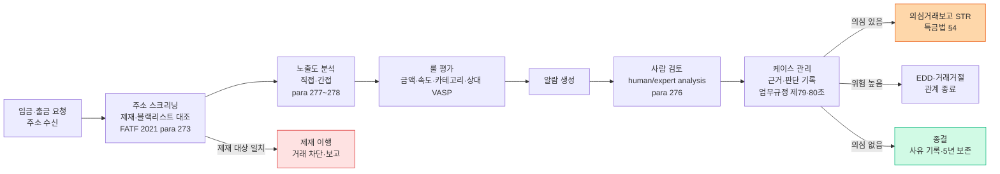
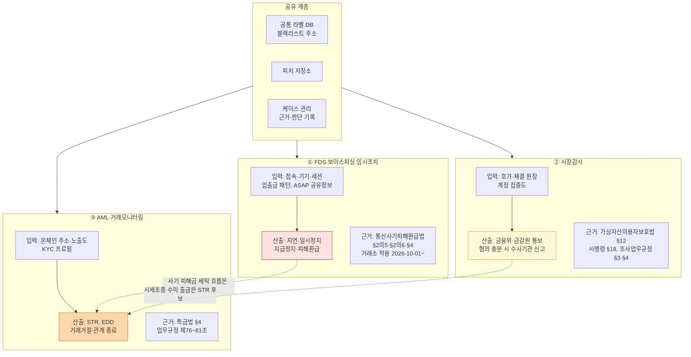

# KYC / KYT — 가상자산 AML 기술의 두 축

> KYC(사람을 안다) + KYT(거래·지갑을 안다). 이 글을 읽고 나면 두 시스템이 왜 **공통 데이터·케이스 관리를 공유하되 법적 산출물은 따로 내보내야 하는지**, 그리고 "KYT"라는 말이 규제 문서에서 어떻게 불리는지 판단할 수 있게 됩니다. 마지막 업데이트: 2026-10-21.

## TL;DR
- **KYC**: 사람·법인의 신원확인 (공통)
- **KYT**: 거래·지갑주소의 위험 분석. 단, **"KYT"는 규제 용어가 아니다** — FATF 7차 Targeted Update·2021 RBA 가이던스·2020 Red Flag·MAS PSN02 어디에도 "KYT"는 0회 나오고, 감독기관의 언어는 "transaction(s) monitoring", "blockchain analytics (tools)", "wallet screening", "ongoing monitoring"이다. 한국 「자금세탁방지 업무규정」은 **"거래모니터링체계"(제76~81조)** 라고 쓴다.
- FATF는 2026-07-16 7차 TU에서 처음으로 VASP에 **"transactions monitoring and blockchain analytics tools"로 급속 이전(rapid transfer)을 탐지**하라고 권고했다.
- 한국에서 "이상" 신호는 **세 개의 법적 출구**로 갈라진다: ① FDS·보이스피싱 임시조치(통신사기피해환급법, 거래소 적용 2026-10-01~) ② 시장감시 통보(가상자산이용자보호법 §12) ③ 의심거래보고 STR(특금법 §4). Risk Engine 출력을 한 축(ALLOW/EDD/STR/BLOCK)으로 그리면 틀린다.
- 노출도(exposure) 산정 깊이·감쇠·가중치를 독립 검증 가능한 형태로 공개한 벤더는 없다. 이 저장소의 노출도 공식은 **가설 모델**이다.

---

## 1. KYC 프로세스 — 5단계 파이프라인

### 왜 파이프라인 구조인가

KYC는 "신분증 한 번 찍고 끝"이 아니라 **onboarding → verification → screening → assessment → ongoing monitoring**로 이어지는 연속 공정입니다. 각 단계가 막히면 이후 단계 전체가 실패하므로, 실무에서는 단계마다 **실패 지점과 fallback**을 명확히 설계해야 합니다.

### 파이프라인 구조

```
1. Onboarding (가입)
   ├─ 개인정보 수집 (이름·생년월일·주소·연락처)
   ├─ 신분증 OCR + 진위확인
   ├─ Liveness check (얼굴 영상 + 신분증 사진 매칭)
   └─ 휴대폰·이메일 인증

2. Verification (검증)
   ├─ 본인인증 (한국: 본인확인기관)
   ├─ 주소 증빙
   └─ 직업·소득 (선택, EDD 시 필수)

3. Screening (스크리닝)
   ├─ PEP 데이터베이스 매칭
   ├─ Sanctions list (OFAC·UN·EU·한국)
   ├─ Adverse media (부정적 보도)
   └─ 가상자산 지갑주소 제재목록

4. Risk Assessment (위험평가)
   ├─ 국가 위험 (FATF 고위험·회색명단)
   ├─ 직업 위험
   ├─ 거래 의도 (예상 금액·빈도·상대국)
   └─ 종합 risk score → 등급

5. Ongoing Monitoring (지속 모니터링)
   ├─ 거래 패턴 vs 신고 의도 비교
   ├─ 위험요소 변경 시 재실사
   └─ EDD 트리거 발동 시 추가 절차
```

용어:
- **OCR (Optical Character Recognition)** — 이미지에서 텍스트를 자동 추출.
- **Liveness Check** — 실제 살아있는 사람인지 검증. 사진·영상·마스크 스푸핑 방어.
- **Adverse Media** — 부정적 뉴스·소송·제재. PEP·Sanctions를 넘어서는 **평판 리스크** 확인.

### 실무 포인트

5단계 중 가장 자주 실패하는 건 **5번 Ongoing Monitoring**입니다. FATF 2021 가이던스 para 275~276은 지속 모니터링을 "고객정보·거래목적 대비 거래 일관성 검증"으로 정의합니다([FATF 2021 RBA 가이던스](https://www.fatf-gafi.org/content/dam/fatf-gafi/guidance/Updated-Guidance-VA-VASP.pdf.coredownload.pdf)). 재실사 주기는 법령이 일률로 정하지 않으므로 회사 위험평가로 정하고 근거를 남겨야 합니다.

---

## 2. KYC 기술 컴포넌트

### 이 표를 어떻게 읽어야 하나

각 컴포넌트는 대체 가능한 벤더가 여러 개 있습니다. 선정 시 고려할 축은 (1) 한국 신분증 포맷 지원, (2) Liveness 스푸핑 방어 수준, (3) 국외 PEP DB 커버리지, (4) SDK 연동 용이성. 이전 판의 "벤더 예시" 열은 국내 채택을 뒷받침하는 공개 1차 근거가 없어 삭제했습니다.

| 컴포넌트 | 기술 |
|---|---|
| **OCR** | 신분증 텍스트 추출 |
| **Document Authentication** | 위변조 검증 (홀로그램·MRZ·배경) |
| **Liveness Check** | 실제 사람 vs 사진·영상 |
| **Face Matching** | 신분증 사진 vs 실시간 셀카 |
| **PEP / Sanctions DB** | 글로벌 watchlist 매칭 |
| **Adverse Media** | 뉴스·제재·소송 검색 |
| **Korean ID Verification** | 본인확인기관 연동 |
| **Risk Scoring** | RBA 점수 계산 |

### 실무 포인트

한국 특화의 핵심은 **본인확인기관 연동**입니다. 글로벌 KYC 도구가 신분증 OCR·얼굴 매칭을 해도 본인확인기관 연동을 대신하지는 못하므로, 실무 구성은 "글로벌 도구 + 국내 본인확인" 조합이 됩니다.

---

## 3. KYT(거래모니터링) 프로세스 — 입금 스크리닝에서 STR까지

### 규범상의 뼈대

KYT의 규범적 근거는 벤더 문서가 아니라 다음 문서들입니다.

| 문서 | 핵심 요구 | 출처 |
|---|---|---|
| FATF 2021 RBA 가이던스 para 273 | 고객·상대방 지갑주소를 블랙리스트 주소와 대조 | [FATF 2021](https://www.fatf-gafi.org/content/dam/fatf-gafi/guidance/Updated-Guidance-VA-VASP.pdf.coredownload.pdf) |
| 같은 문서 para 275~276 | "automated systems may be the only realistic method of monitoring transactions, and flagged transactions should go through human/expert analysis", 운영 룰 무결성 "regular basis" 검증 | 같음 |
| 같은 문서 para 277~278 | 고위험 상황에서 모니터링을 "extend beyond the immediate transaction"(간접 노출 추적의 근거), 임계값 정기 재검토 | 같음 |
| 같은 문서 para 234 | 분석도구의 비용·벤더별 자산 커버리지 한계, 프라이버시 영향 고려 | 같음 |
| NYDFS 산업서한 (2022-04-28) | 지원 자산별 추적 절차, 외주·자체 도구 모두 허용, 분석도구가 "may not be able to identify underlying owners" | [NYDFS](https://www.dfs.ny.gov/industry_guidance/industry_letters/il20220428_guidance_use_blockchain_analytics) |
| MAS PSN02 (2025-06-30 개정, 2025-07-01 시행) ¶6.27 | FATF 기준 감독을 받지 않는 상대와 DPT 이전 시 강화조치 | [MAS PSN02](https://www.mas.gov.sg/-/media/amld-amendments---30-june-2025/mas-notice-psn02-amendment--new.pdf) |
| FATF 7차 TU (2026-07-16) 민간 권고 5-ii·6 | "KYC, wallet screening, blacklisting, and, where appropriate, whitelisting mechanisms as well as freezing and blocking capabilities"; "detect rapid transfer of VAs using transactions monitoring and blockchain analytics tools"; 브리지·믹서·크로스체인 노출 평가 | [7차 TU PDF](https://www.fatf-gafi.org/content/dam/fatf-gafi/reports/7th-targeted-update-on-implementation-fatf-standards-vas-vasps-2026.pdf.coredownload.pdf) |
| 한국 「자금세탁방지 업무규정」(FIU 고시 제2025-2호, 2025-10-22 발령·2026-01-22 시행) 제76~81조 | 거래모니터링체계 범위(76), 비정상 거래 주의(77), 고객정보·거래이력·과거사례 비교와 위험도 측정·패턴 분석 절차(78), 분석담당자·FIU 보고·정보화(79), 분석자료 5년 이상 보존(80), 보고체제(81). 본문에 "가상자산"은 0회 | [법제처 DRF](https://www.law.go.kr/DRF/lawService.do?OC=test&target=admrul&ID=2100000267264&type=XML) |

한국 KYT의 법적 근거는 가상자산 전용 조문이 아니라 금융권 공통 규정이라는 점이 중요합니다. 2027-02-19부터는 특금법 시행령 §10-20 ⑦나와 FIU 고시 제2026-2호 §28-2③에 따라 해외 VASP·자기수탁 지갑과의 **1천만원 이상 이전에 대해 "자체 의심거래 감시체계"를 구축·운영**해야 합니다(enacted-not-in-force). 이것은 "자동 STR"이 아닙니다. 입법예고안(2026-03-30)의 "위험도와 관계없이 의심거래로 보고"는 공포본(대통령령 제36592호, 2026-08-18 공포)에서 감시체계 의무로 바뀌었습니다([감독규정 FIU 고시 제2026-2호](https://www.law.go.kr/DRF/lawService.do?OC=test&target=admrul&ID=2100000285986&type=XML); [금융위 2026-08-11](https://www.fsc.go.kr/no010101/87499)). 고시 §28-2의 정확한 시행일(2027-02-19 또는 02-21)은 기산점이 확정되지 않았습니다.

### 처리 흐름



### 단계별 설명

```
1. Address Discovery (주소 등록)
   ├─ 입금 주소 = 자체 발급 → 자동 매핑
   ├─ 출금 주소 = 사용자 입력 → 외부지갑 등록
   └─ 트래블룰 상대 VASP 주소

2. Address Attribution (행위자 매핑)
   ├─ 분석 벤더 라벨 조회
   ├─ 자체 클러스터링 결과
   └─ 상대 VASP 식별 (주소만으로 완전한 식별은 불가 — FATF 2021 para 197(a))

3. Exposure Analysis (노출 분석)
   ├─ Direct exposure: 상대 주소가 곧 위험 엔티티
   ├─ Indirect exposure: 중간 경유 후 위험 엔티티 도달
   └─ Source(입금) vs Destination(출금) 분리

4. 패턴 탐지
   ├─ 온체인 신호: peel chain, 믹서·브리지 경유, 급속 분산
   └─ 오프체인 행위 신호: 분할 입출금, 입금 직후 출금(pass-through), 접속 이상
      → 오프체인 행위 신호는 FDS(사기)와 AML(세탁) 양쪽이 쓰는 신호다

5. Decision (의사결정)
   ├─ 알람 → 사람 검토
   ├─ 케이스 → STR / EDD·거래거절 / 종결
   └─ 사기 피해 의심이면 FDS 임시조치 절차로 넘김 (§6)
```

### 실무 포인트

외부 분석 API 호출이 가장 느린 단계입니다. 자주 조회되는 주소는 캐싱하고 캐시 miss 시 비동기 조회로 넘기는 설계를 고려하되, 벤더 장애 시에도 "판단 보류"가 기록으로 남게 해야 합니다. 응답 시간·가용성에 관한 벤더 수치는 모두 자사 주장(T5)이라 이 저장소는 싣지 않습니다.

---

## 4. KYT 핵심 개념

### Cluster (클러스터)

**정의**: 같은 사람·엔티티가 통제하는 주소 집합.

- 휴리스틱 + 머신러닝 + 라벨링으로 구성
- 한 거래소가 많은 입금 주소를 운영해도 분석 도구에서는 한 클러스터로 묶일 수 있음
- UTXO 모델(Bitcoin)은 공동입력 휴리스틱이 있어 클러스터링이 상대적으로 쉽고, Account 모델(Ethereum)은 다른 휴리스틱이 필요

### Attribution (귀속)

**정의**: 클러스터를 알려진 엔티티에 매핑.

- 라벨 DB가 분석 벤더의 핵심 자산이다. 다만 **라벨 정확도에 대한 공개 벤치마크는 없다**.
- 이전 판의 "누적 추적 거래량 $24T+, 매핑 주소 10억+"는 출처가 없어 삭제했다. 벤더 홈페이지의 라벨 주소 수·고객 수는 자사 주장(T5)이다.
- 귀속의 한계는 감독기관도 인정한다: NYDFS는 분석도구가 실소유자를 "may not be able to identify"라고 적었다.

### Exposure (노출도)

**정의**: 한 주소가 위험 주소와 어떤 관계에 있는가를 정량화한 것.

- **Direct**: 위험 엔티티와 바로 거래
- **Indirect**: 중간 주소를 거쳐 도달
- 규범적 근거는 FATF 2021 para 277~278의 "extend beyond the immediate transaction"이다.

**공개 근거의 범위**: kyt 도시에가 확인한 바로는 홉 수 상한·감쇠계수·카테고리 가중치를 독립 검증 가능한 형태로 공개한 벤더는 없다. 한 벤더는 제품 페이지에서 간접 노출을 "식별된 서비스에 도달할 때까지 필요한 만큼의 홉"으로 추적한다고 적지만 이는 자사 서술(T5)이다. 따라서 저장소에 있던 다음 서술은 **가설 모델**로 격하한다.

| 이전 서술 | 처리 |
|---|---|
| `score = clip(Σ direct + Σ indirect × decay × f_amount, 0, 100)` | **가설 모델(미검증)**. 어느 벤더의 공식도 아니다. 교육용 예시로만 사용 |
| "보통 5-hop까지 분석" | 공개 근거 없음 — 삭제 |
| 벤더별 감쇠계수 λ 표 | 공개 근거 없음 — 삭제 |

같은 주소라도 벤더마다 점수가 다를 수 있다는 점만은 분명합니다. 산정 방식이 비공개이기 때문입니다.

### Risk Score

**정의**: KYC 정보 + 노출도 + 거래 패턴을 종합한 회사 내부 점수.

- 임계값과 등급은 회사 위험평가로 정하고, FATF 2021 para 278에 따라 **정기 재검토**한다.
- 벤더 점수는 원료이고 판단은 회사 책임이다. 판단 근거(어떤 룰·어떤 노출)가 케이스 기록에 남아야 업무규정 제79·80조의 분석·보존 요건을 충족한다.

---

## 5. KYC vs KYT — 한눈에

| 구분 | KYC | KYT(거래모니터링) |
|---|---|---|
| 대상 | 사람 | 거래·지갑 |
| 시점 | Onboarding 위주 + 주기적 | 상시 |
| 데이터 소스 | 신분증·PEP DB | 공개 블록체인 + 라벨 DB + 내부 원장 |
| 규제 용어 | 고객확인(CDD) | transaction monitoring / 거래모니터링체계 |
| 핵심 도전 | 위변조, deepfake, 합성신원 | 귀속 한계, 클러스터링, 크로스체인 |

### 두 시스템이 결합돼야 하는 이유

KYT만 있고 KYC가 부실하면 "주소는 위험한데 그 뒤 사람은 누군지 모름" → STR 작성이 어렵습니다. KYC만 있고 KYT가 부실하면 고객 지갑의 제재 노출을 모릅니다. FATF Red Flag 58개 지표 중 송수신인(19개)·자금원(8개) 범주는 대부분 KYC·행위 신호여서, 온체인 분석만으로는 덮이지 않습니다([FATF Red Flag Indicators](https://www.fatf-gafi.org/content/dam/fatf-gafi/reports/Virtual-Assets-Red-Flag-Indicators.pdf)).

### 실무 포인트

KYC 팀과 거래모니터링 팀이 분리돼 있어도 **공통 케이스 관리**에서 분석가가 고객 KYC와 노출을 한 화면에서 보게 하는 것이 목표입니다.

---

## 6. 산출물 3축 — Risk Engine 출력을 한 줄로 그리면 안 되는 이유

이전 판은 Risk Engine 출력을 ALLOW / EDD / STR / BLOCK 한 축으로 그렸습니다. 그러나 한국에서 "BLOCK(차단)"과 "STR"은 근거 법률·절차·수령기관이 전부 다릅니다. 공통 피처·라벨 DB와 케이스 관리는 공유하되, **산출물 축은 셋으로 나눠야** 합니다(fds 도시에 §1-A).



| 구분 | ① FDS / 보이스피싱 임시조치 | ② 시장감시 | ③ AML·거래모니터링 |
|---|---|---|---|
| 법률 용어 | "피해의심거래계좌등"(통신사기피해환급법) | "이상거래"(이용자보호법 §12, 시행령 §18) | "의심되는 거래"(특금법 §4) |
| 목적 | 이용자 자산 보호(계정탈취·보이스피싱) | 시세조종·미공개정보 이용 적발 | 자금세탁·테러자금 차단 |
| 산출물 | 이체·출금·가상자산 이전 지연·일시정지, 지급정지, 환급 | 통보·신고, 거래유의·주문제한·거래중지 | STR, EDD, 거래거절 |
| 수령기관 | 금융위 금융안전과·금감원·금융보안원 | 금융위·금감원(가상자산 조사) | 금융정보분석원(FIU) |
| 위반 시 | 지급정지 미이행 손해배상(§4③) | 과태료 1억원 이하(§22①6·7호) | 특금법 과태료·영업정지 |

근거: [통신사기피해환급법](https://www.law.go.kr/LSW/lsInfoR.do?lsiSeq=290245&efYd=20261002&ancYnChk=0&chrClsCd=010202&urlMode=lsInfoR); [가상자산이용자보호법](https://www.law.go.kr/LSW/lsInfoR.do?lsiSeq=290735&efYd=20261002&ancYnChk=0&chrClsCd=010202&urlMode=lsInfoR); [시행령](https://www.law.go.kr/LSW/lsInfoR.do?lsiSeq=290171&efYd=20261002&ancYnChk=0&chrClsCd=010202&urlMode=lsInfoR).

시행령 §18은 이상거래를 "불공정거래행위 등의 금지의무를 위반할 우려가 있는 거래 또는 행위"로 정의합니다. 따라서 보이스피싱·계정탈취는 §12의 범위 밖이고, 거래소의 §12 상시감시 시스템은 2024-08-22 당국 점검에서 가격상승률·거래량증가율 등 임계값 초과 시 적출하는 **룰 기반 자체 개발 시스템**으로 확인됐습니다([금융위·금감원 2024-08-22](https://fsc.go.kr/po010101/82943)).

### 실무 포인트

실무에서 가장 위험한 것은 탐지 실패보다 **분류 실패** — 탐지한 신호를 틀린 출구로 보내는 오류입니다. 케이스 화면에 "어느 제도의 건인가"를 첫 필드로 두고, 한 사건이 두 출구에 해당하면(예: 사기 피해금이 세탁되는 흐름) 각각의 산출물을 따로 남깁니다.

---

## 7. 한국 거래소·수탁업자 기술 스택 — 공개로 확인되는 범위

이전 판의 "한국 시장 선택지" 표와 "4대 거래소 기술 스택 스냅샷(2026-Q1)"은 4개 거래소 모두를 같은 분석 벤더로 표기했으나, 이를 뒷받침하는 1차 출처가 없어 삭제했습니다. 2026-10-21 기준 공개 1차 자료로 확인되는 것은 다음뿐입니다.

| 사실 | 출처 |
|---|---|
| 거래소 §12 상시감시 시스템은 자체 개발 룰 기반(2024-08-22 점검 기록) | [금융위·금감원 2024-08-22](https://fsc.go.kr/po010101/82943) |
| FIU 2026년 업무계획에 "체이널리시스(가상자산 분석도구) 도입"(FIU 자체 도입), 심사분석 AI 도입 | [금융위 2026-02-05](https://fsc.go.kr/no010101/86209) |
| 신고매뉴얼(2026-08-13 전면 개정): AML 업무 인력 4인 이상, 고유식별정보 처리 전산설비 국내 소재(클라우드 국내 리전 인정) | [금융위 2026-08-13](https://www.fsc.go.kr/no010101/87521) |
| 금융보안원 ASAP(2025-10-29 출범): 약 130개 금융회사, 9개 유형·90개 항목 공유. 가상자산거래소는 참여기관으로 명시되지 않음 | [금융위 2025-10-29](https://www.fsc.go.kr/no010101/85526) |

개별 거래소가 어떤 KYC·분석·트래블룰·케이스관리 도구를 쓰는지는 이 저장소가 근거를 확보하지 못했습니다.

---

## 8. 실무 운영 포인트

### 알람 품질

룰이 너무 느슨하면 알람이 쌓여 검토가 밀리고, 너무 빡빡하면 정상 거래가 묶입니다. FATF 2021 para 276은 운영 룰의 무결성을 정기 검증하라고 요구합니다. "룰 튜닝이 운영의 90%" 같은 비율은 근거가 없어 삭제했습니다.

### False Positive vs False Negative

- **FP(오탐)**: 정상 거래에 알람 → 검토 비용, 고객 불편
- **FN(미탐)**: 실제 자금세탁 통과 → 규제 위반

한국 실제 제재 사례로, FIU는 2025-11-06 두나무에 과태료 352억원을 결정했고 사유는 고객확인·거래제한·의심거래보고 등의 위반이었습니다([FIU 보도자료 KDI 미러](https://eiec.kdi.re.kr/policy/materialView.do?num=273166)).

**"의심되면 차단 먼저, 해제는 사후"는 AML의 운영 원칙이 아닙니다.** AML의 산출물은 STR·EDD·거래거절이고, 이용자 자산을 묶는 조치에는 별도 법적 요건이 있습니다.

- **보이스피싱 임시조치(통신사기피해환급법 §2의5)**: 금융회사등(거래소 포함, 2026-10-01~)은 "자체점검을 상시적으로 실시"해 피해의심거래계좌등으로 추정되면 이체·출금·가상자산 이전을 지연·일시정지해야 하고, **즉시 통지·본인확인 후 해당 없으면 해제**하며, 통지·해제·본인확인 내역을 보존해야 합니다.
- **임의적 입출금 차단 제한(가상자산이용자보호법 §11)**: 정당한 사유 없이 이용자의 가상자산 입출금을 차단해서는 안 되고, 차단 시 사유 통지·금융위 보고가 따릅니다. 허용 사유는 시행령 §17에 열거돼 있습니다.

따라서 "차단"을 운영 철학으로 두지 말고, 어떤 법적 절차에 따른 조치인지(임시조치 / 제재 이행 / 거래거절)를 케이스마다 명시해야 합니다.

### 사람 + 기계

FATF 2021 para 276은 자동화를 허용하되 플래그된 거래는 "human/expert analysis"를 거치라고 요구합니다. 벤더들이 알람 자동 기각·에스컬레이션 기능을 내세우기 시작했지만, 자동 기각을 어디까지 허용할지는 감독기관이 정한 기준이 없습니다. 자동 처리 범위와 사람 승인 지점을 정책에 명시하세요.

### 공개 벤치마크의 부재

알람→SAR 전환율의 공개 벤치마크는 은행권 EY 2018 EMEIA 조사(리테일 평균 14%)뿐이며, **가상자산 전용 alert-to-STR 벤치마크는 존재하지 않습니다**(B)([EY 2018](https://ey.com/content/dam/ey-unified-site/ey-com/en-uk/industries/financial-services/documents/ey-anti-money-laundering-transaction-monitoring-2018-emeia-survey.pdf)). 흔히 인용되는 "오탐 90~95%"는 정의가 통일되지 않은 2차 수치입니다.

---

## 요약 부록 — 빠른 참조용

**KYC 5단계**: Onboarding · Verification · Screening · Assessment · Monitoring
**거래모니터링 흐름**: 주소 스크리닝 → 노출도 → 룰 → 알람 → 사람 검토 → 케이스 → STR / EDD / 종결
**산출물 3축**: 임시조치(통신사기피해환급법) · 통보(이용자보호법 §12) · STR(특금법 §4)
**한국 근거 조문**: 업무규정 제76~81조, 2027-02-19~ 1천만원 이상 해외 VASP·자기수탁 이전 자체 감시체계

## 💼 실무 현장 (Industry Reality)

### 분석 벤더 PoC 체크리스트

수치 목표(지연 ms, 일치율 %)는 회사가 정할 일이고, 공개 기준은 없습니다. 비교 항목만 정리합니다.

1. **귀속 일치율**: 같은 주소 샘플을 여러 벤더에 넣었을 때 라벨이 얼마나 일치하는가
2. **점수 안정성**: 재조회 시 점수 변동과 변동 사유 설명
3. **커버리지**: 우리 상장 자산·체인 지원 여부 (벤더별 "체인 수"는 정의가 달라 비교 불가)
4. **크로스체인**: 브리지 경유 추적 가능 범위 — 7차 TU 권고 6-iv의 브리지·믹서·크로스체인 노출 평가에 쓸 수 있는가
5. **감사 가능성**: 알람 근거·룰 변경 이력을 내보낼 수 있는가 (업무규정 제80조 5년 보존)
6. **계약 조건**: 해지 시 분석 이력 이관

이전 판의 벤더 가격 협상 팁(연 라이선스 금액, 상대 가격 비율), "Alert SLA — 실제 한국 VASP 운영 기준" 표, 월간 알람 건수, 주니어 운영자 하루 일과의 건수는 출처가 없어 삭제했습니다.

### 자주 나오는 오해

- **"KYT는 법정 용어다"** — 아니다. 감독 문서는 transaction monitoring / 거래모니터링체계라고 쓴다.
- **"2027년부터 1천만원 이상은 자동 STR"** — 아니다. 공포본은 "자체 의심거래 감시체계 구축·운영"이다.
- **"Risk Engine이 BLOCK을 내면 된다"** — 차단은 임시조치·제재 이행·거래거절 중 무엇인지에 따라 통지·해제·보고 절차가 다르다.
- **"AI·ML로 해결 가능"** — Elliptic 시계열 분할 연구에서 트리 앙상블(Extra Trees AUPRC 0.570)이 GraphSAGE(0.311)를 앞섰다(B)([Akter 외 2026](https://publications.eai.eu/index.php/airo/article/download/13658/4313/36724)). 그래프 모델의 실무 우위는 공개 근거로 확인되지 않는다. 이전 판의 "실무는 룰 80% + ML 20%"는 근거가 없어 삭제했다.

### 한국 특수 현실

- **주민등록번호 취급**: 특금법 고객확인의무와 개인정보보호법 사이의 긴장. 최소 수집·암호화 저장.
- **외부지갑 이전**: 2027-02-19부터 "독점적인 관리 권한을 가지지 않은 가상자산주소"(자기수탁 지갑)와의 이전은 고객과 상대방이 동일인일 때만 허용된다(enacted-not-in-force). 소유 확인 방법은 법령이 정하지 않았다([법제처 DRF 시행예정 판본](https://www.law.go.kr/DRF/lawService.do?OC=test&target=eflaw&MST=288765&efYd=20270219&type=XML)).

---

## 더 읽을거리
- [`blockchain-analytics.md`](blockchain-analytics.md) — 분석 기술 기반 (CIOH, attribution)
- [`travel-rule-protocols.md`](travel-rule-protocols.md) — 트래블룰 기술
- [`../5-compliance/cdd-edd.md`](../5-compliance/cdd-edd.md) — CDD·EDD 운영
- [`../7-vendors/analytics-vendors.md`](../7-vendors/analytics-vendors.md) — 분석 벤더 공개 사실
- [`../3-crypto-aml/onchain-typology.md`](../3-crypto-aml/onchain-typology.md) — Red Flag 지표와 룰 원형
- [FATF 2021 RBA 가이던스](https://www.fatf-gafi.org/content/dam/fatf-gafi/guidance/Updated-Guidance-VA-VASP.pdf.coredownload.pdf)
- [FATF 7차 Targeted Update (2026-07-16)](https://www.fatf-gafi.org/content/dam/fatf-gafi/reports/7th-targeted-update-on-implementation-fatf-standards-vas-vasps-2026.pdf.coredownload.pdf)
- [NYDFS 블록체인 분석 가이던스 (2022-04-28)](https://www.dfs.ny.gov/industry_guidance/industry_letters/il20220428_guidance_use_blockchain_analytics)
