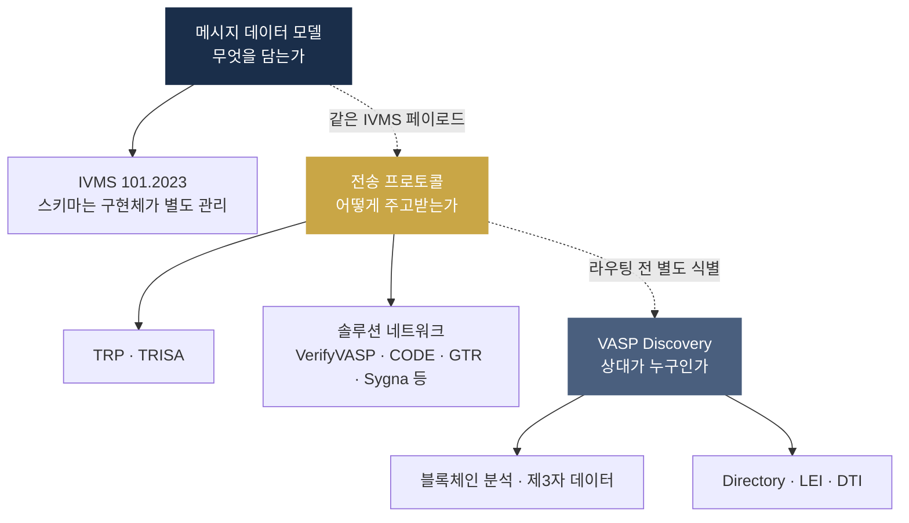
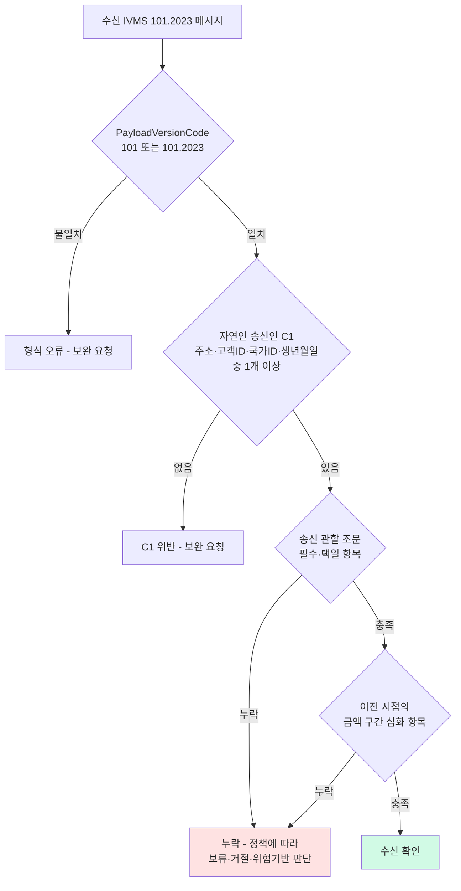
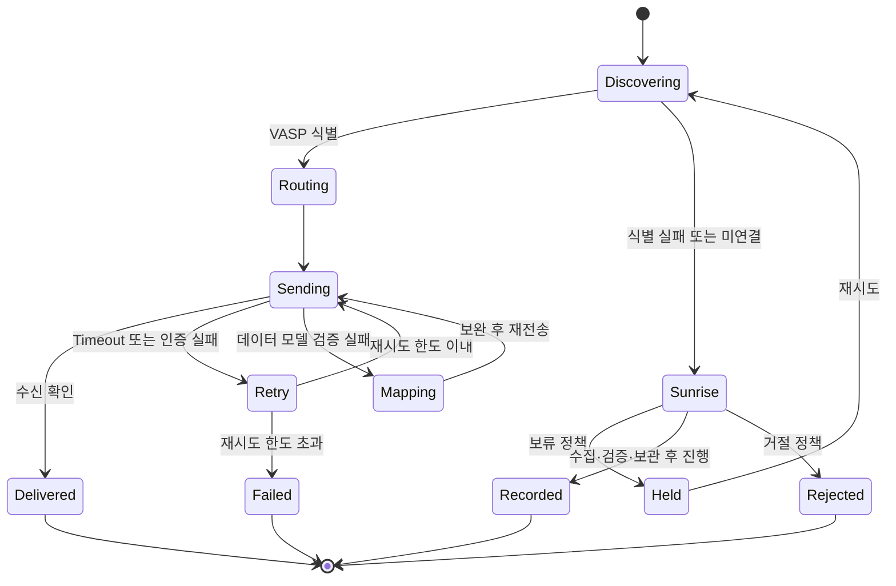
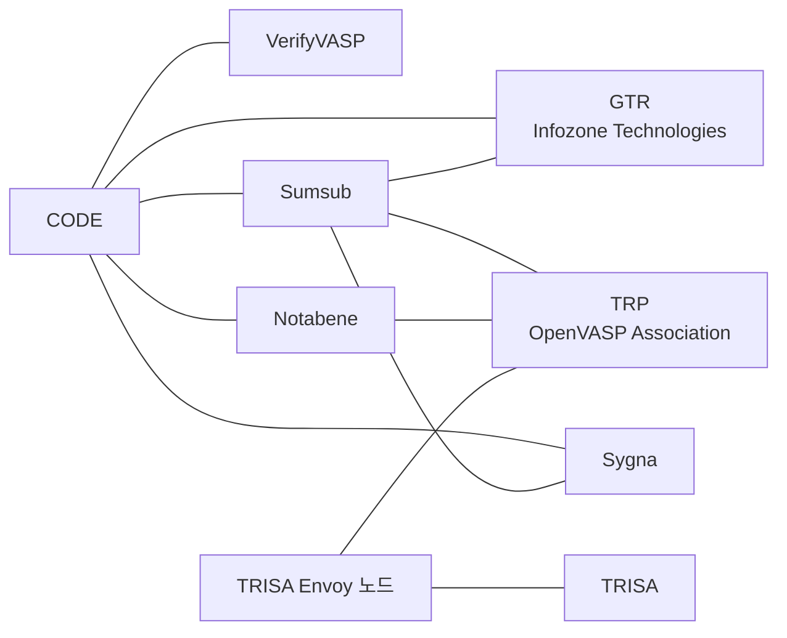

# Travel Rule Protocols — 기술 표준 / 메시징 프로토콜

> Travel Rule 을 **실제로 어떻게** 메시지로 주고받는가. 이 글을 읽고 나면 "IVMS 101 은 데이터 모델이고 TRISA·TRP 는 프로토콜이다"라는 구분을 정리하고, 관할별 검증 규칙을 조문 문언에 맞게 짜는 법을 이해하게 됩니다. 마지막 업데이트: 2026-10-21.

> **이 파일의 역할**: Travel Rule 의 **기술 상세** — IVMS 101.2023 데이터 모델·관할별 검증 규칙·프로토콜 공개 사실·상호운용 설계. 법적 근거는 [`../2-regulations/korea-fiu-act.md`](../2-regulations/korea-fiu-act.md) §5, 개념·관할 비교·운영 흐름은 [`../3-crypto-aml/travel-rule.md`](../3-crypto-aml/travel-rule.md) 참조. 근거 도시에: [`../../research/2026-10-travel-rule.md`](../../research/2026-10-travel-rule.md) §4.11.

## TL;DR
- **데이터 모델 = IVMS 101.2023**(2023-08 발행, interVASP ISWG 유지, 2024-06-04 갱신 공표). "IVMS101 v2" 는 없음
- **전송 프로토콜**은 여러 개: TRP(OpenVASP Association 관리), TRISA, 솔루션 네트워크(VerifyVASP·CODE·GTR·Sygna 등). 어느 것도 모든 상대방을 덮지 못함
- **관할별 필수 항목은 조문이 정함** — EU TFR 제14조(1)은 주소 **또는** 생년월일·출생지, IVMS 101.2023 제약 C1 도 자연인 송신인에 4종 중 **1개 이상**. "EU 모든 필드 필수"는 틀림
- 미국 기준은 31 CFR 1010.410(f) **USD 3,000 이상** 그대로. $250 하향안은 2025-04-16 철회, "$1,000 개정 제안"은 존재 확인 안 됨
- 메시지 실패율·지연·SLA·오류 분포에 대한 **공개 벤치마크는 없음** — 이 문서의 이전 판 수치는 출처가 없어 삭제

---

## 1. 표준 vs 프로토콜 vs Discovery — 3개를 분리해서 이해하라



### 왜 혼동이 자주 일어나나

Travel Rule 구현 용어 혼동의 대부분은 **"메시지에 뭘 넣을지"(데이터 모델)**, **"어떻게 주고받을지"(프로토콜)**, **"누구에게 보낼지"(Discovery)** 가 서로 다른 층위라는 걸 놓쳐서 생깁니다. 같은 IVMS 101 페이로드를 다른 프로토콜로 주고받을 수 있습니다.

| 구분 | 역할 | 예시 |
|---|---|---|
| **메시지 데이터 모델** | 무엇을 담는가 (필드 구조) | IVMS 101.2023 |
| **전송 프로토콜** | 어떻게 주고받는가 (네트워크) | TRP, TRISA, 솔루션 네트워크 |
| **VASP Discovery** | 상대가 누구인가 (라우팅) | 블록체인 분석, Directory, LEI, DTI |

---

## 2. IVMS 101.2023 — 데이터 모델 상세

### 정체성

- **IVMS 101** — interVASP 데이터 모델 표준. 2020-05 원판은 JWG 가, 현행 **「IVMS 101.2023, interVASP data model standard Issue 1 FINAL」**(Published August 2023)은 GDF·OpenVASP·VASPnet 이 2023-04 결성한 interVASP Standards Working Group(ISWG, GDF Open Standards Council 산하)이 유지([interVASP](https://intervasp.org/))
- ISWG 는 2024-06-04 갱신을 공표: "The ISWG released an update to IVMS 101 on 4 June 2024."
- **표준 문서에는 JSON/XML 스키마가 포함되지 않습니다** — 스키마는 구현체가 따로 관리합니다
- 2020→2023 변경 목록(errata)은 이 저장소가 확인하지 못했습니다

### 2023판에서 정식화된 것 (원문 확인)

출처: [IVMS 101.2023 PDF](https://cdn.jsdelivr.net/npm/ivms101@2.0.0/specs/ivms101-2023.pdf)(npm 패키지 미러 — 패키지 버전 2.0.0 은 표준 판 명칭이 아님)

| 항목 | 내용 |
|---|---|
| PayloadVersionCode | `101` / `101.2023` |
| LEIText | ISO 17442, 20자 |
| NationalIdentifierTypeCode | ISO 20022 TypeOfIdentification4Code 제한, `LEIX` 포함 |
| 제약 C1 | 자연인 송신인: geographicAddress(GEOG·HOME·BIZZ) **및/또는** customerIdentification **및/또는** nationalIdentification **및/또는** dateAndPlaceOfBirth — **1개 이상 필수** |
| 제약 C7 | 법인 식별 유형은 RAID / MISC / LEIX / TXID |
| 제약 C9 | LEIX 면 registrationAuthority 금지, 비LEIX 면 필수 |
| 제약 C10·C11 | GLEIF RA 목록, validLEI |
| 주소유형 GEOG | IVMS 고유 추가 |

> C1 원문: "If the originator is a NaturalPerson either (geographicAddress with an addressType value of 'GEOG' or 'HOME' or 'BIZZ') and/or customerIdentification and/or nationalIdentification and/or dateAndPlaceOfBirth is required."

### NaturalPerson 필드 — "선택"이 아니라 "택1 이상"

이전 판은 DateAndPlaceOfBirth 를 단순 "선택"으로 적었습니다. 2023판 C1 에 따르면 주소·고객식별번호·국가식별번호·생년월일·출생지는 **각각은 선택이지만 넷 중 하나는 반드시 있어야** 합니다.

### 관할별 차이 처리 — 조문 문언 기준

| 관할 | 조문 | 송신인 필수 항목(요지) |
|---|---|---|
| 🇪🇺 EU | TFR 제14조(1) | 성명·DLT 주소·계정번호·**주소 또는 생년월일·출생지**·LEI 등. 금액 간소화 없음 |
| 🇬🇧 영국 | MLR reg 64C(5)·(6) | (5) 성명, 계좌번호 또는 고유거래식별자 / (6) 개인: 고객식별번호·주소·신분증 번호·생년월일+출생지 **중 하나** — (4)항 금액(2026-06-30~ £800, 그 전 1,000 euros) 이상 |
| 🇸🇬 싱가포르 | PSN02 ¶13.4·¶13.6 | ≤S$1,500: 4항목 / >S$1,500: 신원확인·검증 + 주소·고유식별번호·생년월일 **중 하나** |
| 🇰🇷 한국 2027-02-19~ | 시행령 §10-10 ②·③ | 동시: 성명·가상자산주소 / **요청 시 3영업일**: 주민등록번호(법인등록번호)·여권번호·외국인등록번호 |
| 🇺🇸 미국 | 31 CFR 1010.410(f) | USD 3,000 이상 이체지시: 송신인 성명·계좌번호·주소·금액·실행일·수취 금융기관 |

근거: [EBA/GL/2024/11](https://www.eba.europa.eu/sites/default/files/2024-07/6de6e9b9-0ed9-49cd-985d-c0834b5b4356/Travel%20Rule%20Guidelines.pdf) · [MLR reg 64C](https://www.legislation.gov.uk/uksi/2017/692/regulation/64C) · [MAS PSN02](https://www.mas.gov.sg/-/media/amld-amendments---30-june-2025/mas-notice-psn02-amendment--new.pdf) · [법제처 시행예정 판본](https://www.law.go.kr/DRF/lawService.do?OC=test&target=eflaw&MST=288765&efYd=20270219&type=XML) · [Cornell LII](https://www.law.cornell.edu/cfr/text/31/1010.410).

### 실무 포인트

검증기에서 가장 어려운 부분은 **관할별 필수 항목을 조문 문언대로 옮기는 것**입니다. "택일" 조문(EU 주소 또는 생년월일, 영국 (6)항 중 하나)을 "전부 필수"로 구현하면 적법한 메시지를 거절하고, 금액 구간을 시점 없이 하드코딩하면 과거 거래 재검증이 틀립니다. 누락 시 **거절할지 보완 요청할지**는 회사 정책으로 명문화하되, 근거 조문(영국 64C(9), 싱가포르 ¶13.11·¶13.14, EU EBA GL §4.7)을 함께 적어 두십시오.

---

## N. IVMS 101 Validator — 관할별 구현

### N.1 관할별 규칙 — 택일 조건과 시점을 표현한다

검증 실패 원인 비율에 대한 공개 통계는 없습니다. 아래는 조문 문언을 코드로 옮기는 **구조 예시**입니다(필드 경로는 단순화).

```python
from datetime import date

# 금액 구간은 반드시 유효 구간과 함께 둔다. valid_to 는 마지막 유효일(포함).
DEPTH_THRESHOLDS = {
    "GB": [  # MLR reg 64C(4) — 의무 발동이 아니라 (6)항 심화정보 기준
        {"amount": 1000, "currency": "EUR", "valid_from": date(2023, 9, 1), "valid_to": date(2026, 6, 29)},
        {"amount": 800,  "currency": "GBP", "valid_from": date(2026, 6, 30), "valid_to": None},
    ],
    "SG": [  # PSN02 ¶13.6 — 'exceeds' 이므로 정확히 1,500 은 하위 구간
        {"amount": 1500, "currency": "SGD", "comparator": "gt", "valid_from": date(2024, 4, 4), "valid_to": None},
    ],
}

JURISDICTION_RULES = {
    "EU": {  # TFR 제14조(1) — 금액 무관 전건
        "required": ["originator.name", "originator.accountNumber",
                     "beneficiary.name", "beneficiary.accountNumber"],
        # 주소 또는 생년월일·출생지 — 택일
        "one_of": [["originator.geographicAddress",
                    "originator.dateAndPlaceOfBirth"]],
    },
    "KR_2027": {  # 시행령 §10-10 (2027-02-19~, enacted-not-in-force)
        "required": ["originator.name", "originator.accountNumber",
                     "beneficiary.name", "beneficiary.accountNumber"],
        # 주민등록번호 등은 동시 전송 항목이 아니라 '요청 시 3영업일' 항목
        "on_request": ["originator.nationalIdentification"],
    },
    "US": {  # 31 CFR 1010.410(f) — USD 3,000 이상에서 의무 발동(A형)
        "trigger": {"amount": 3000, "currency": "USD", "comparator": "gte"},
        "required": ["originator.name", "originator.accountNumber",
                     "originator.geographicAddress"],
    },
}

# IVMS 101.2023 제약 C1 — 자연인 송신인
C1_ANY_OF = ["originator.geographicAddress",      # addressType GEOG/HOME/BIZZ
             "originator.customerIdentification",
             "originator.nationalIdentification",
             "originator.dateAndPlaceOfBirth"]
```

이전 판의 규칙 중 다음은 근거가 없거나 틀려서 뺐습니다: "EU dateOfBirth·placeOfBirth REQUIRED"(TFR 은 주소와 택일), "US 2025 개정 제안 $1,000"(존재 확인 안 됨, $250 안은 2025-04-16 철회), "KR nationalIdentification HASHED"(2027 판 제3호는 요청 시 정보 제공을 정할 뿐 해시 전송 근거 없음), "KR 이름 한글+영문 병기 필수"(조문 근거 없음).

### N.2 Validator 구현 (Python pseudocode)

```python
def validate_ivms101(msg: dict, jurisdiction: str, transfer_date: date) -> ValidationResult:
    errors = []
    rules = JURISDICTION_RULES[jurisdiction]

    for path in rules.get("required", []):
        if not get_nested(msg, path):
            errors.append(f"Missing required: {path}")

    for group in rules.get("one_of", []):
        if not any(get_nested(msg, p) for p in group):
            errors.append(f"Need at least one of: {group}")

    # IVMS 101.2023 C1 — 관할과 무관한 데이터 모델 제약
    if is_natural_person(msg, "originator") and not any(get_nested(msg, p) for p in C1_ANY_OF):
        errors.append("IVMS 101.2023 C1: address/customerId/nationalId/DOB 중 1개 이상 필요")

    # 심화 기준은 이전 시점의 구간으로 판정
    tier = active_threshold(DEPTH_THRESHOLDS.get(jurisdiction, []), transfer_date)
    if tier and exceeds(msg["amount"], tier):
        errors += check_depth_fields(msg, jurisdiction)

    return ValidationResult(passed=not errors, errors=errors)
```

### N.3 카운터파티 이름 일치 검증 (Fuzzy Matching)

IVMS 메시지의 originator·beneficiary 이름이 **자사 KYC DB 와 일치하는지** 검증합니다. 로마자 표기 다양성 때문에 정규화가 필요합니다. 유사도 임계값은 조문이 정하지 않으므로 자사 데이터로 보정해야 하며, 아래 값은 예시입니다.

```python
from jellyfish import jaro_winkler_similarity

def verify_name_match(submitted: str, kyc_db: str, threshold: float) -> bool:
    # threshold 는 자사 오탐·미탐 실측으로 정한다 (공개 기준값 없음)
    return jaro_winkler_similarity(normalize(submitted), normalize(kyc_db)) >= threshold

def normalize(name: str) -> str:
    name = name.lower().strip()
    for old, new in [("-", ""), (",", "")]:
        name = name.replace(old, new)
    return " ".join(name.split())
```

### N.4 오류 분포

이전 판의 "오류 Top 5(35%/22%/18%/12%/8%)" 표는 어떤 공개 출처로도 확인되지 않아 삭제했습니다. 거절률·필드 누락률·이름 불일치율에 대한 공개 통계는 2026-10-21 기준 없습니다. 자사 실패 로그를 오류 유형별로 집계해 기준선을 만드십시오.



---

## M. Protocol Interoperability — 라우팅·재시도·Fallback

### M.1 경로별 지연

이전 판의 경로별 p50 지연(~2~3초, ~5~10초 등) 표는 출처가 없어 삭제했습니다. 지연·타임아웃은 상대 네트워크와 계약 조건에 따라 다르므로 자사 측정값을 쓰십시오.

### M.2 실패 모드 + 재시도 전략 (설계 예시)

```python
class TravelRuleRouter:
    MAX_RETRIES = 3          # 예시 값
    BACKOFF_BASE = 2         # 지수 백오프(초), 예시 값
    # 프로토콜별 타임아웃은 상대 네트워크 계약·실측으로 정한다 (공개 SLA 없음)

    async def send(self, msg, target_vasp: str):
        protocol, endpoint = await self.discover_route(target_vasp)
        for attempt in range(self.MAX_RETRIES):
            try:
                return await self._send(msg, protocol, endpoint,
                                        timeout=self.timeouts[protocol])
            except TimeoutError:
                await asyncio.sleep(self.BACKOFF_BASE ** attempt)
            except AuthError as e:
                if e.code == "cert_expired":
                    await self.refresh_cert()
                    continue
                raise
            except IVMS101ValidationError as e:
                msg = self.mapper.fallback(msg, target_jurisdiction=e.jurisdiction)
            except UnreachableError:
                return await self.handle_unreachable(msg, target_vasp)
        raise UndeliverableError(target_vasp)
```

### M.3 Sunrise Issue (미연결 카운터파티) 처리 — 정책과 근거 조문

```python
def handle_sunrise(msg, target_vasp: str, policy: str):
    discovered = await discover_vasp(target_vasp)
    if discovered:
        return await send_tr(msg, discovered)

    if policy == "HOLD":
        # 보류 후 재시도. 보류 기간은 조문이 정하지 않음 — 자사 정책
        await queue.delay(msg, target_vasp)
        return Status.PENDING
    elif policy == "COLLECT_AND_RECORD":
        # 영국 FCA 2023-08-17: 미시행 관할로는 정보를 수집·검증·보관한 뒤 이전 가능
        # FATF 2021 para 200–201: 계약·사업관행, first-party 이전 한정 등 위험기반 대응
        await audit_log.record(msg, reason="sunrise_counterparty")
        return Status.SENT_WITH_RECORD
    elif policy == "REJECT":
        # 영국 reg 64C(9), 싱가포르 PSN02 ¶13.11 — 완전 준수 불가 시 이전 금지
        return Status.REJECTED
```

관할별로 허용되는 정책이 다릅니다. 영국·싱가포르에서 송신 측이 정보를 갖추지 못하면 이전 자체가 금지되고, EU 는 sunrise 상대를 고위험 요소로 분류하며 반복 누락 기관을 식별 후 3개월 안에 보고하게 하고(EBA GL §4.5·§4.7), 한국은 2027-02-19 부터 상대 VASP 의 트래블룰 이행을 저위험 허용 요건으로 둡니다(고시 §28-2②).

### M.4 Discovery 메커니즘

| 방식 | 공개 근거로 확인된 내용 | 한계 |
|---|---|---|
| 블록체인 분석·제3자 데이터 | EBA GL ¶77~78 이 자기수탁 판단 수단으로 열거 | FATF 2021 para 197(a): 주소만으로 VASP 를 정확히 식별할 기술적 수단 없음 |
| TRISA Global Directory Service | trisa.dev 가 GDS 를 설명(자사 페이지, B) | 운영 상태·회원 수 미확인 |
| 솔루션 네트워크 회원 디렉터리 | VerifyVASP·CODE·GTR 등 | 비회원 접근 범위는 계약 사항 |
| LEI(ISO 17442) | IVMS 101.2023 C9~C11 | 법인만 |
| DTI(ISO 24165) | TRP 가 호환 명시 | 토큰 식별자이지 VASP 식별자가 아님 |

네트워크별 VASP 수는 자사 주장이라 인용하지 않습니다.

### M.5 상태 전이 다이어그램



### M.6 SLA

이전 판의 SLA 표(p50·p99·Sunrise 처리율 5~15%·delivery 90~97%·1차 pass 60~75%)는 출처가 없어 삭제했습니다. 규범상 시간 요건은 "즉시(immediately)" — FATF 2021 para 185·187 은 이전 이전·동시·병행 전송을 뜻하고 사후 전송을 허용하지 않습니다 — 와 요청 기반 제공 기한(영국 reg 64C(3) 3영업일, 한국 2027 판 제3호 3영업일)뿐입니다.

---

## 3. 주요 전송 프로토콜 — 공개 사실 (2026-10-21)

벤더 간 우열 평가는 하지 않습니다. 자사 페이지에서 확인한 내용은 (B) 로 표시합니다.

### A. TRP (Travel Rule Protocol)

- **관리**: OpenVASP Association(Zug)이 TRP 표준을 관리하는 협회. 주간 TRP Working Group, GitLab 공개 사양(CC BY-SA 4.0)
- **모델**: "Bilateral exchange of encrypted data (VASP-to-VASP). No data or metadata is ever exchanged with any third party." ISO 24165(DTI)·IVMS101 호환
- 현행 TRP 버전 번호는 사이트에 표시되지 않음. Notabene 는 "Every Notabene customer has a live TRP 1.0 endpoint" 라고 밝힘(B)
- 근거: [OpenVASP TRP](https://www.openvasp.org/trp), [GitLab](https://gitlab.com/OpenVASP/travel-rule-protocol), [Notabene TRP](https://notabene.id/travel-rule-messaging-protocols/trp)

### B. OpenVASP

이전 판의 "OpenVASP: Ethereum·ENS·Whisper 기반, 활용도 낮음"은 2020년 이전 설계 서술입니다. 2026-10-21 기준 OpenVASP Association 은 **TRP 의 모체 협회**이며 TRP 는 활동 중입니다([OpenVASP](https://www.openvasp.org/)).

### C. TRISA (Travel Rule Information Sharing Architecture)

- gRPC/protobuf 기반 오픈소스 프로토콜 + Global Directory Service(B)
- 오픈소스 노드 **Envoy** 가 TRISA 와 TRP 를 모두 지원한다고 밝힘(B)
- GitHub trisacrypto/trisa 공개. 2026-10-21 trisa.io 는 응답하지 않음 — 접속 불가만으로 운영 중단을 추정하지 말 것
- 근거: [trisa.dev](https://trisa.dev/), [GitHub](https://github.com/trisacrypto/trisa)

### D. VerifyVASP

- 홈페이지에 TravelRule API·VerifyName API·VerifyWallet 제품 표시(B). 운영 주체는 홈페이지에 명시되지 않음
- 근거: [VerifyVASP](https://www.verifyvasp.com/)

### E. CODE

- 운영: CODE Inc.(B). 홈페이지가 CodeVASP·VerifyVASP·GTR·Sumsub·Sygna·Notabene·CryptoSwift 와의 상호운용을 표시(B)
- 지분 구조는 공개 1차 근거로 확인되지 않음
- 근거: [CODE](https://www.codevasp.com/)

### F. Notabene

- 제품 SafeTransact·Notabene Flow·TAP, OpenVASP 회원, TRP 1.0 엔드포인트 지원(B). 2026-07-23 Ripple 전략투자 발표(금액 비공개, B)
- 근거: [Notabene](https://notabene.id/about-us)

### G. Sygna (CoolBitX)

- Sygna Bridge 2.0·IVMS101 지원 표시(B). Sumsub·GTR·CODE 가 지원 프로토콜로 올림
- 근거: [Sygna](https://www.sygna.io/)

### H. GTR (Global Travel Rule)

- **운영 주체: Infozone Technologies Pte. Ltd.(싱가포르)**. 홈페이지에 얼라이언스 회원 목록과 지원 프로토콜(Code·Sumsub·Sygna·Fireblocks) 표시(B)
- 이전 판의 "BitGo 등 일부 사용"은 근거가 없어 삭제
- 근거: [GTR](https://www.globaltravelrule.com/)

### I. 기타

- **Sumsub Travel Rule** — 자체·GTR·CODE·TRP·Sygna 5개 프로토콜 연동 표시(B)([Sumsub](https://sumsub.com/protocols/))

### 실무 포인트

프로토콜 선택은 **고객의 출금 상대방이 어느 네트워크에 있는가**로 정합니다. 어느 네트워크도 모든 상대방을 덮지 못하므로, 선택과 별개로 미연결 상대방 정책(§M.3)을 먼저 정해야 합니다. 가격·커버리지 비교는 공개 1차 근거가 없어 이 문서에서 다루지 않습니다.

---

## 4. 분산형 vs 폐쇄형 — 설계 트레이드오프

두 모델은 신뢰를 어디에 두느냐가 다릅니다. 아래는 구조적 비교이며 어느 쪽이 낫다는 평가가 아닙니다.

| 항목 | 양자 간 오픈 표준 (TRP, TRISA) | 회원제 네트워크 (솔루션 네트워크) |
|---|---|---|
| 참여 | 사양 공개, 각자 구현 | 네트워크 가입 |
| 신뢰 모델 | 인증서·양자 간 확인 | 네트워크 운영자의 회원 검증 |
| 라우팅 | 상대 식별을 별도로 해야 함 | 네트워크 내 디렉터리 |
| 운영 책임 | 각 VASP | 운영자 + 회원 |

### 실무 포인트

한국 시장에 들어오는 외국 VASP 는 국내 사업자가 연결된 네트워크와의 경로를 먼저 확인해야 합니다. 2027-02-19 부터는 한국 VASP 가 해외 VASP 의 AML·트래블룰 이행을 평가해 허용 등급을 정하므로(고시 §28-2), 메시지 경로뿐 아니라 **평가에 필요한 자료(인허가·트래블룰 이행 근거)** 를 함께 준비하는 편이 낫습니다.

---

## 5. VASP Discovery — 지갑 주소가 어느 VASP 인가

### 문제

FATF 2021 가이던스 para 197(a): "the FATF is not aware of any technically proven means of identifying the VASP that manages the beneficiary wallet exhaustively, precisely, and accurately … from the VA address alone"([FATF 2021 RBA 가이던스](https://www.fatf-gafi.org/content/dam/fatf-gafi/guidance/Updated-Guidance-VA-VASP.pdf.coredownload.pdf)).

### 수단

- **블록체인 분석·제3자 데이터·메시징 식별자** — EBA GL ¶77~78 이 자기수탁 판단 수단으로 열거. 불가하면 고객에게 직접 확인하고, 상대가 CASP 로 판명되면 상대 CASP 를 정확히 식별
- **네트워크 디렉터리** — TRISA GDS, 솔루션 네트워크 회원 목록
- **LEI(ISO 17442)** — IVMS 101.2023 의 법인 식별(C9~C11)
- **DTI(ISO 24165)** — 토큰 식별자. TRP 가 호환을 명시

### 실무 포인트

라벨 DB 로 1차 식별하고, 모호하면 디렉터리 조회, 그래도 안 되면 고객 확인·수동 검토로 넘기는 것이 EBA GL ¶77~78 의 순서와도 맞습니다. 7차 TU 는 상대방 VASP 식별을 "completely and accurately" 수행하고 소매고객으로 위장한 역외 VASP 계정을 탐지하라고 권고합니다([7차 TU PDF](https://www.fatf-gafi.org/content/dam/fatf-gafi/reports/7th-targeted-update-on-implementation-fatf-standards-vas-vasps-2026.pdf.coredownload.pdf)).

---

## 6. 호환성 / Interoperability 문제

### Sunrise Issue (미시행 관할 카운터파티)

일부 관할은 Travel Rule 을 시행하지 않아 메시지를 받을 수단이 없습니다. 2026-07-16 기준 FATF 조사 109 관할 중 91(83%)이 입법, 11 관할이 입법 진행 중입니다. 대응 정책은 §M.3.

### Protocol Mismatch

양쪽이 다른 네트워크를 쓰면 직접 호환되지 않습니다. 해결은 (1) 상호운용 연동을 표시한 네트워크 이용, (2) 복수 네트워크 동시 가입, (3) 자체 멀티 프로토콜 어댑터입니다.

### Data Model Version Mismatch

PayloadVersionCode 가 `101` 과 `101.2023` 으로 나뉩니다. 수신 측은 두 값을 모두 처리하고, 2023판 제약(C1·C9~C11)을 어느 버전 메시지에 적용할지 정책으로 정해야 합니다.

### 실무 포인트

EU 에서는 EBA GL ¶24 의 기술적 한계 보완 유예가 2025-07-31 에 끝났습니다. 2025-08-01 이후에는 프로토콜 간 변환에서 생긴 필드 누락을 기술적 한계로 정당화할 수 없습니다([EBA/GL/2024/11](https://www.eba.europa.eu/sites/default/files/2024-07/6de6e9b9-0ed9-49cd-985d-c0834b5b4356/Travel%20Rule%20Guidelines.pdf)).

---

## 7. 한국 시장 운영 패턴

```
국내 VASP → 국내 VASP
  └─ ~2027-02-18: 100만원 이상만 정보제공 / 2027-02-19~: 모든 이전
국내 VASP → 해외 VASP
  └─ 2027-02-19~: 고시 §28-2 평가 — 저위험 허용 / 그 외 동일인 간만 / 고위험 제한
국내 VASP → 자기수탁 주소
  └─ 2027-02-19~: 동일인 간만 허용 (증명 방법 미지정)
수탁업자 내부 지갑 간 이동
  └─ "다른 가상자산사업자에게 이전" 이 아니므로 정보제공 대상 아님
```

근거: [법제처 시행예정 판본](https://www.law.go.kr/DRF/lawService.do?OC=test&target=eflaw&MST=288765&efYd=20270219&type=XML), [감독규정 FIU 고시 제2026-2호](https://www.law.go.kr/DRF/lawService.do?OC=test&target=admrul&ID=2100000285986&type=XML). 2027-02-19 규정은 2026-10-21 기준 enacted-not-in-force 이고, 고시 §28-2 시행일은 기산점 문제로 미확정입니다.

### 실무 포인트

시행령 §10-10 은 "가상자산사업자가 **다른 가상자산사업자에게** 가상자산을 이전하는" 경우를 규율합니다. 같은 사업자의 콜드월렛 간 이동은 이 문언에 들어오지 않으므로, 정책에 이 구분을 명문화해 두면 불필요한 메시지 발송을 막을 수 있습니다.

---

## 8. 기술 스택 통합 예시

```
[ User Request: 출금 ]
        ▼
[ KYC / 거래모니터링 1차 체크 ]
        ▼
[ Sanctions Screening ]
        ▼
[ Travel Rule 모듈 ]
   ├─ Counterparty Discovery (블록체인 분석 → 디렉터리 → 고객 확인)
   ├─ 상대 VASP 실사 결과 조회 (한국 2027-02-19~ 고시 §28-2 등급)
   ├─ IVMS 101.2023 페이로드 구성 (관할·시점별 항목)
   ├─ Protocol Selection
   ▼
[ Counterparty VASP Response ]
   ├─ Accept → 계속
   ├─ Reject → 송금 거절, 사용자 통지
   ├─ Hold → 수동 검토
   └─ Timeout → 폴백 정책 (§M.3)
        ▼
[ On-chain Broadcast ]
        ▼
[ 메시지·판단 기록 보관 — 보존기간은 관할별 기록보존 조문으로 확인 ]
```

### 실무 포인트

가장 자주 고장 나는 지점은 **상대방 무응답** 처리입니다. 대기 시간과 폴백 정책은 조문이 정하지 않으므로 회사 정책으로 정하되, FATF 의 "즉시"(사후 전송 금지) 요건과 충돌하지 않게 "정보 확인 전 온체인 이전 여부"를 명시해야 합니다.

---

## 9. 회사 도입 체크리스트

```
□ 출금 상대방 분포에 맞는 네트워크·프로토콜 선택
□ IVMS 101.2023 검증 (PayloadVersionCode, C1, LEI 제약)
□ 관할별 규칙을 조문 문언대로 — 택일 조건, 금액 구간의 유효기간
□ Counterparty Discovery 절차 (분석 → 디렉터리 → 고객 확인)
□ 미연결 카운터파티 정책 명문화 + 근거 조문
□ 메시지 보존기간 — 관할별 기록보존 조문 확인 (통합 공개 근거 없음)
□ 개인정보 암호화 + 접근 통제, 국외이전 근거 (EU: GDPR 제5장)
□ Audit Log, 시간 동기화(NTP)
□ 인증서 갱신 자동화 (인증서 기반 프로토콜)
□ 한국 2027-02-19 전환: 전건 처리량, 요청 시 3영업일 응답, 자기수탁 동일인 확인
```

---

## 요약 부록 — 빠른 참조용

**3층 구조**: 데이터 모델(IVMS 101.2023) / 프로토콜(TRP·TRISA·솔루션 네트워크) / Discovery(분석·디렉터리·LEI·DTI)
**판 명칭**: IVMS 101.2023 이 현행. "v2" 없음
**검증 원칙**: 조문의 택일 조건 그대로, 금액 구간은 시점과 함께
**수치**: 지연·SLA·실패율 공개 벤치마크 없음 — 자사 실측

## 💼 실무 현장 (Industry Reality)

### 상호운용 지도 — 자사 페이지가 표시한 연동



근거: [CODE](https://www.codevasp.com/), [Sumsub](https://sumsub.com/protocols/), [Notabene TRP](https://notabene.id/travel-rule-messaging-protocols/trp), [trisa.dev](https://trisa.dev/) — 모두 자사 페이지(B), 2026-10-21 열람. 연결선은 "연동을 표시함"이지 품질·커버리지를 뜻하지 않습니다.

### 가격·커버리지·통계

이전 판의 Notabene 가격(월 $5K~$50K+), 벤더 별점 비교표, "대형 거래소 월간 통계(자동 성공 ~85%, Timeout ~8% 등)", 의사 메시지 로그의 지연값은 모두 공개 출처가 없어 삭제했습니다. 벤더 설문 중 공개된 것은 Notabene 「State of Crypto Travel Rule 2025」(VASP 91·규제기관 10 설문)뿐이며, 거절률·필드 누락률 통계는 그 보고서에도 없습니다.

### 자주 나오는 오해

- **"IVMS101 만 지원하면 Travel Rule 완성"** — 데이터 모델은 기본입니다. 실제로는 **프로토콜 선택 + VASP Discovery + 미연결 정책**이 함께 있어야 합니다
- **"IVMS101 v2 로 곧 바뀐다"** — 현행판 명칭은 IVMS 101.2023 입니다. npm 패키지 버전 2.0.0 과 혼동하지 마십시오
- **"EU 는 생년월일 필수"** — TFR 제14조(1)은 주소 또는 생년월일·출생지입니다
- **"게이트웨이 = 특정 프로토콜"** — 허브는 라우터이고, 실제 전송은 하부 프로토콜이 담당합니다
- **"메시지 15년 보관이 법정 의무"** — 이 저장소는 그 근거 조문을 확인하지 못했습니다. 관할별 기록보존 조문을 직접 확인하십시오

### 한국 특수 현실

- **2027-02-19 전건화**: 2026 상반기 총 출고 62.8조원 중 트래블룰 적용은 9.5조원(약 15%)이었습니다([금융위 2026-10-01](https://www.fsc.go.kr/no010101/87835)). 전건화되면 메시지 대상 이전이 크게 늘 수 있는 구조입니다
- **요청 기반 추가정보**: 2027 판 제3호 정보(주민등록번호 등)는 동시 전송이 아니라 요청일부터 3영업일 이내 제공입니다 — 요청 수신·응답 큐가 별도로 필요합니다
- **개인정보 국외이전**: 한국 개인정보보호위원회의 트래블룰 관련 의결·안내는 이 저장소가 확인하지 못했습니다

---

## 더 읽을거리
- [`../3-crypto-aml/travel-rule.md`](../3-crypto-aml/travel-rule.md) — Travel Rule 운영 전반·관할 비교
- [`../7-vendors/travel-rule-vendors.md`](../7-vendors/travel-rule-vendors.md) — 벤더 공개 사실
- [`../7-vendors/korea-solutions.md`](../7-vendors/korea-solutions.md) — 한국 시장
- [interVASP — IVMS 101.2023](https://intervasp.org/)
- [IVMS 101.2023 PDF (npm 미러)](https://cdn.jsdelivr.net/npm/ivms101@2.0.0/specs/ivms101-2023.pdf)
- [OpenVASP — TRP](https://www.openvasp.org/trp)
- [trisa.dev](https://trisa.dev/)
- [EBA Travel Rule Guidelines](https://www.eba.europa.eu/sites/default/files/2024-07/6de6e9b9-0ed9-49cd-985d-c0834b5b4356/Travel%20Rule%20Guidelines.pdf)
