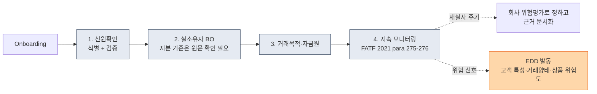
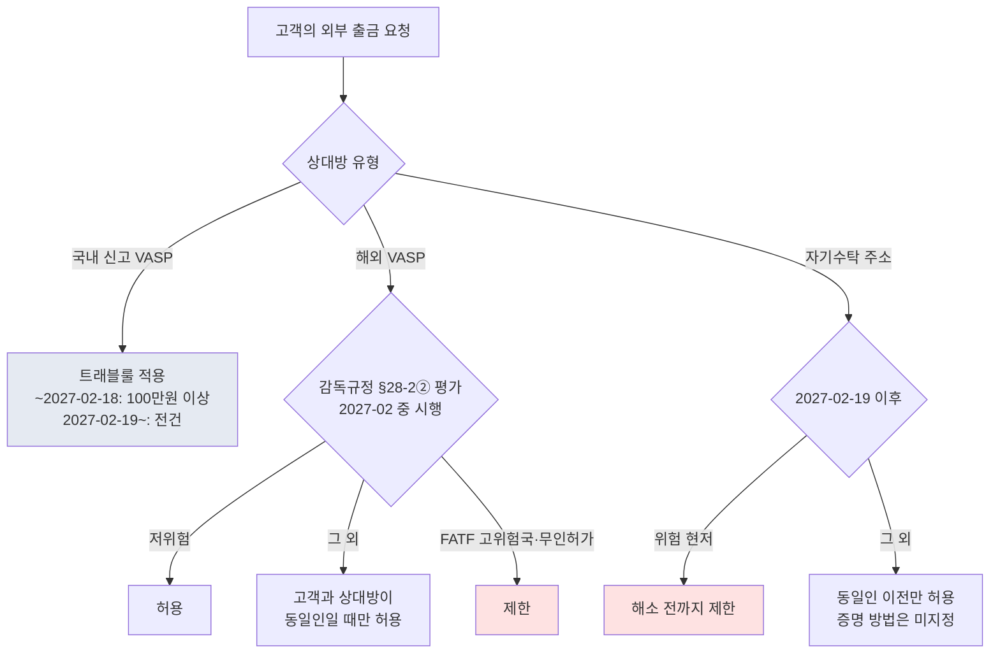
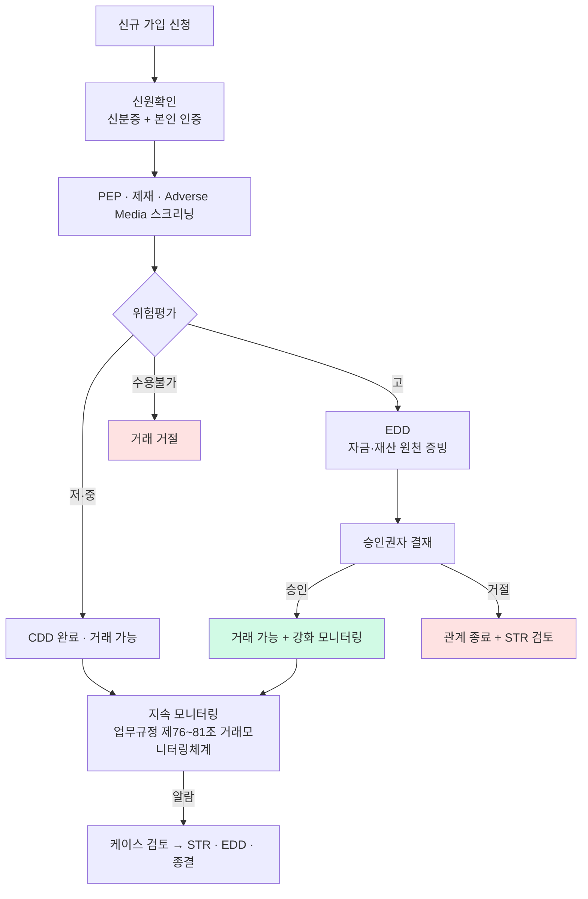
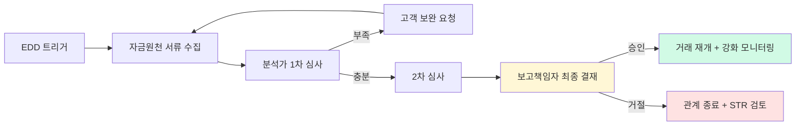

# CDD / EDD — 고객실사 운영 실무

> 표준 실사(CDD)와 강화 실사(EDD)를 **어떻게** 수행하는가. 이 글을 읽고 나면 "CDD는 4단계, EDD는 그 위에 얹는 강화층"이라는 동심원 구조가 머릿속에 남고, 가상자산 고객실사가 왜 지갑주소·자금원·상대 VASP까지 넓어지는지, 그리고 한국에서 2027-02-19부터 무엇이 바뀌는지 설명할 수 있게 됩니다. 마지막 업데이트: 2026-10-21.

> **근거 범위**: `research/2026-10-*.md` 도시에와 정본 보고서, 2026-10-21 기준으로 정정된 노트([`../2-regulations/korea-fiu-act.md`](../2-regulations/korea-fiu-act.md), [`../4-technology/kyc-kyt.md`](../4-technology/kyc-kyt.md))에서 확인된 사실만 쓴다. 이전 판의 실소유자 지분 기준 수치, "저 5년·중 3년·고 1년" 재실사 주기, 위험점수표·등급 분포, 월간 EDD 발생 건수, SLA·승인률, 벤더 목록은 공개 1차 근거가 확인되지 않아 삭제하거나 "원문 확인 필요"로 표시했다.

## TL;DR
- **CDD**: 모든 고객에게 적용하는 표준 실사 4단계 (신원확인 → 실소유자 → 거래목적·자금원 → 지속 모니터링). 한국 근거는 **특금법 §5의2(고객확인의무)**
- **EDD**: 고위험 고객에게 CDD 위에 덧붙이는 강화 실사 (자금·재산 원천 증빙 + 승인권자 결재 + 강화 모니터링). 2026-08-18 공포된 대통령령 제36592호는 **강화된 고객확인 여부를 고객 특성·거래양태·상품 위험도로 판단**하도록 명확히 했다([금융위 2026-08-11](https://www.fsc.go.kr/no010101/87499))
- FATF 기준 가상자산 **임시거래 CDD 기준은 USD/EUR 1,000**(INR.15 §7(a), 2021 가이던스 para 146·264). 트래블룰(INR.15 §7(b))과는 다른 조문이다
- 가상자산 특화 항목: **지갑주소 노출도, 자기수탁 지갑 이전, 상대 VASP 실사**. 한국은 **2027-02-19부터**(enacted-not-in-force) 자기수탁 주소와 저위험이 아닌 해외 VASP와의 이전을 **고객 본인(동일인) 간에만** 허용한다(시행령 §10의20, 감독규정 §28-2)
- 집행 신호: FIU는 2025-11-06 두나무에 과태료 352억원을 결정했고 사유에 **고객확인 의무 위반**이 들어 있다([FIU 보도자료 KDI 미러](https://eiec.kdi.re.kr/policy/materialView.do?num=273166))

---

## 1. CDD (Customer Due Diligence) — 표준 4단계



### 왜 4단계 구조인가

CDD는 "한 번 신분증 찍고 끝"이 아니라 **고객과의 관계 전체에 걸친 지속 공정**입니다. 신원확인·실소유자·거래목적·지속 모니터링은 FATF R.10의 CDD 요소이고, 각각 따로 관리해야 어느 하나가 빠졌을 때 드러납니다. FATF 2021 RBA 가이던스는 VASP의 CDD를 para 265~280에서 다룹니다([FATF 2021 RBA 가이던스](https://www.fatf-gafi.org/content/dam/fatf-gafi/guidance/Updated-Guidance-VA-VASP.pdf.coredownload.pdf)).

### Step 1. 신원확인 (Identification & Verification)

용어:
- **Identification**: 고객이 제공한 신원 정보 수집.
- **Verification**: 그 정보가 진짜인지 독립 소스로 검증.

"이름을 적어달라"는 Identification이고, "그 이름이 신분증과 일치하고 신분증이 위조가 아님"을 확인하는 게 Verification입니다.

| 항목 | 개인 | 법인 |
|---|---|---|
| 수집 | 이름·생년월일·주소·연락처 | 법인명·사업자번호·주소·대표자·사업목적 |
| 검증 방법 | 신분증 확인 + 본인 인증(비대면이면 Liveness 등) | 등기부등본·사업자등록증·정관 |
| 보완 | 휴대폰·이메일 인증 | 주주명부·임원 명단 |

FATF Red Flag 보고서(2020-09-14)의 사례 CS12는 위조 신분증·편집 사진으로 거래소 KYC를 우회한 사건을 싣고 있습니다 — 검증 단계가 실제 공격 대상이라는 뜻입니다([FATF Red Flag PDF](https://www.fatf-gafi.org/content/dam/fatf-gafi/reports/Virtual-Assets-Red-Flag-Indicators.pdf)).

### Step 2. 실소유자(Beneficial Owner) 확인 — 법인

법인 고객 뒤에서 **최종적으로 지분을 갖거나 실질 지배하는 자연인**을 식별합니다. 다층 법인 구조라도 끝까지 추적합니다. 예를 들어:

- 고객 법인 A → 주주: 법인 B(50%)
- 법인 B → 주주: 법인 C(60%)
- 법인 C → 주주: 자연인 X(100%)
- → X의 A에 대한 간접 지분은 50% × 60% × 100% = 30%

**지분 기준(흔히 말하는 "25%")**: 한국 특금법 시행령·EU AMLR의 실소유자 지분 기준 문언은 이 저장소의 근거 자료에서 확인하지 않았습니다 — **원문 확인 필요**. 지분 기준과 별개로 "실질 지배"(의결권·이사 선임 등)를 함께 봐야 한다는 원칙은 공통입니다. 한국 FIU의 2022-09 검사 결과 공개에 "법인 실소유주 오인" 사례가 있었다는 기록이 있으나 이는 보도 기반(C)이라 세부는 쓰지 않습니다.

**식별 불가능 시**의 차선책(예: 고위 경영진을 실소유자로 보는 방식)도 관할 원문으로 확인한 뒤 정책에 적습니다.

### Step 3. 거래 목적·자금 원천 파악

- **거래 목적** — 투자, 결제, 수탁, 사업 운영 등
- **예상 거래 파라미터** — 금액·빈도·상대국
- **자금 원천 (Source of Funds, SoF)** — 지금 들어오는 이 자금의 출처
- **재산 원천 (Source of Wealth, SoW)** — 고객의 전체 재산이 형성된 경로 (EDD에서 강조)

SoF는 **지금 들어오는 이 자금**(이번 달 급여), SoW는 **이 사람이 가진 전체 재산**의 형성 경로(누적 급여 + 부동산 매각 이익)입니다. FATF Red Flag 보고서는 "자금원·재산원" 범주에 8개 지표를 두고, 송수신인 범주에서 "고객이 KYC 서류나 자금원 질의를 거부"(RF-S5), "거래·자금원·상대방 관계를 설명하지 못함"(RF-S6) 같은 행위 신호를 듭니다([FATF Red Flag PDF](https://www.fatf-gafi.org/content/dam/fatf-gafi/reports/Virtual-Assets-Red-Flag-Indicators.pdf)).

### Step 4. 지속 모니터링 (Ongoing Monitoring)

- KYC 정보가 **최신인지** 주기적 점검
- **거래 패턴 vs Step 3의 신고 의도**가 일치하는가 — FATF 2021 가이던스 para 275~276은 지속 모니터링을 고객 프로파일 대비 거래 일관성 검증으로 정의하고, "automated systems may be the only realistic method of monitoring transactions, and flagged transactions should go through human/expert analysis"라고 씁니다([FATF 2021 RBA 가이던스](https://www.fatf-gafi.org/content/dam/fatf-gafi/guidance/Updated-Guidance-VA-VASP.pdf.coredownload.pdf))
- 위험요소 변경 시(PEP 신규 지정, 고위험국 이주 등) 재실사
- **재실사 주기**: 법령이 일률로 정하지 않습니다. 회사 위험평가로 등급별 주기를 정하고 그 근거를 남깁니다(이전 판의 "저 5년·중 3년·고 1년"은 출처 확인 안 됨 — 원문 확인 필요)

### 실무 포인트

Onboarding은 공수가 많이 들어 꼼꼼한데, 기존 고객은 "이미 승인된 사람"이라고 방치하기 쉽습니다. 자동 재실사 큐와 관리자 대시보드가 운영의 안전장치입니다. 한국 대형 거래소 제재(두나무 2025-11-06)의 사유에 고객확인 의무 위반이 들어 있다는 점은 CDD가 서류가 아니라 **작동 증거**의 문제라는 걸 보여 줍니다.

---

## 2. EDD (Enhanced Due Diligence) — 트리거와 추가 절차

### EDD의 본질

EDD는 CDD를 **대체**하지 않고 **덧붙이는** 작업입니다. 고위험 고객에게도 CDD 4단계는 모두 수행하고, 그 위에 자금원천 증빙·승인권자 결재·강화 모니터링을 추가합니다. "EDD 했으니 CDD 생략"은 성립하지 않습니다.

한국은 2026-08-18 공포·2026-08-20 시행된 대통령령 제36592호 본칙으로 고객확인의 방법·대상을 명확히 하고, **강화된 고객확인 여부를 고객 특성·거래양태·상품 위험도로 판단**하도록 했습니다([금융위 2026-08-11](https://www.fsc.go.kr/no010101/87499)).

### EDD 트리거

| 카테고리 | 사례 |
|---|---|
| **PEP** | 정치적 주요인물 본인·가족·측근 |
| **고위험국** | FATF 흑색명단, 회색명단(2026-06-19 총회 기준 22개, B) — 개별 국가는 FATF 원문으로 확인. [`../2-regulations/fatf.md`](../2-regulations/fatf.md) §7 |
| **비대면 + 추가 위험** | 가상자산은 대부분 비대면이므로 추가 위험요소와 결합해 판단 |
| **거래양태** | 신고 목적·소득 대비 과도한 금액·빈도 |
| **복잡한 소유구조** | Shell company, 다층 holding |
| **고위험 상품·노출** | 익명성강화코인, mixer·제재주소 노출 |
| **부정적 보도** | Adverse media 매칭 |
| **상대 VASP** | CDD/KYC가 "demonstrably weak or non-existent"한 VASP와 송수신(Red Flag RF-A13) |

### EDD 추가 절차

1. **자금·재산 원천 증빙** — 급여명세·사업자료·계좌내역·매매계약서 등 **문서 요구**
2. **승인권자 결재** — 보고책임자 등 정책상 승인권자
3. **강화 모니터링** — 임계값 하향, 알람 우선순위 상향
4. **재실사 주기 단축** — 주기는 회사 정책으로 정하고 근거 문서화
5. **추가 정보 수집** — 직업·소득·사업 파트너·거래 상대국

### 실무 포인트

EDD를 "추가 신분증 한 장 더 받음" 정도로 이해하면 안 됩니다. 핵심은 **자금원천 증빙**과 그 증빙이 **합리적인지에 대한 판단 기록**입니다. 증빙이 애매하면 보완 요청 → 받으면 승인, 못 받으면 거래 제한·관계 종료가 정상 흐름입니다.

---

## 3. 한국 — 위험기반접근(RBA)의 위치

### 규범의 층

- **법률**: 특금법 §5의2(고객확인), §4(STR)
- **시행령**: 대통령령 제36592호(2026-08-18 공포) — 고객확인 방법·대상, EDD 판단 요소
- **FIU 고시**: 「자금세탁방지 및 공중협박자금조달금지에 관한 업무규정」(고시 제2025-2호, 2025-10-22 발령, 2026-01-22 시행) — 제76~81조 "거래모니터링체계"([법제처 DRF 업무규정](https://www.law.go.kr/DRF/lawService.do?OC=test&target=admrul&ID=2100000267264&type=XML)); 「특정 금융거래정보 보고 및 감독규정」 §28-2(2027-02 중 시행, 기산점 미확정)

이전 판은 FIU 「RBA 처리기준」 가이드라인이 구체 점수표와 등급 기준을 제시한다고 적었지만, 그 문서의 문언·점수표는 이 저장소 근거 자료에서 확인하지 않았습니다 — **원문 확인 필요**.

### 4가지 위험 차원 (통상적 구성)

1. **고객 위험** — 직업, PEP 여부, 거주지
2. **상품·서비스 위험** — 가상자산 종류, 수탁 vs 매매. 신규 상품·서비스 제공 전 자금세탁 위험평가 의무도 있다
3. **거래 위험** — 금액·빈도·상대국·상대 VASP
4. **국가·지역 위험** — FATF 공표 명단

### 종합 등급

- **저위험** — 간소화 CDD 가능 여부는 관할 원문 확인
- **중위험** — 표준 CDD
- **고위험** — EDD
- **수용불가** — 거래 거절·관계 종료

### 실무 포인트

"수용불가" 등급을 정책에 명시해 두면 영업 압력을 방어하는 근거가 됩니다. 고위험이라고 무조건 EDD로 받을 수 있는 게 아니라, 너무 위험한 조합(예: 제재 대상 연관 + 자금원천 설명 거부)은 받지 않는 것이 정답입니다.

---

## 4. 가상자산 특화 실사 항목

### A. 외부 출금 상대방 — 2027-02-19 전후



- **2027-02-18까지**: 자기수탁 지갑 이전에 대한 법령상 소유증명 의무는 없습니다. 거래소가 자체 정책으로 등록·인증을 운영할 수는 있습니다.
- **2027-02-19부터**(enacted-not-in-force): 시행령 §10의20 ⑧·감독규정 §28-2④에 따라 "독점적인 관리 권한을 가지지 않은 가상자산주소"(자기수탁 지갑)와의 이전은 **동일인 간에만** 허용됩니다. **소유 증명 방법은 고시가 정하지 않습니다**([감독규정 FIU 고시 제2026-2호](https://www.law.go.kr/DRF/lawService.do?OC=test&target=admrul&ID=2100000285986&type=XML); [`../2-regulations/korea-fiu-act.md`](../2-regulations/korea-fiu-act.md) 5절). 감독규정 §28-2 시행일은 고시 부칙 기산점에 따라 2027-02-19 또는 02-21로 확정되지 않았습니다.
- **증명 방법 참고(EU)**: EBA 트래블룰 가이드라인(EBA/GL/2024/11)은 EUR 1,000 이상 자기수탁 이전에서 원격 온보딩 검증, 소액 송금(Satoshi test), 메시지 서명, 기타 기술적 수단 가운데 **최소 1종**으로 소유·통제를 평가하게 합니다(¶83, ¶86)([EBA/GL/2024/11](https://www.eba.europa.eu/sites/default/files/2024-07/6de6e9b9-0ed9-49cd-985d-c0834b5b4356/Travel%20Rule%20Guidelines.pdf)). 서명은 "통제"를 증명할 뿐 "수익적 소유"를 증명하지 못한다는 한계가 있고, 이 방식들을 학술적으로 평가한 논문은 2026-10-21 기준 확인되지 않습니다(정본 보고서).

### B. 지갑주소 노출도 점검

- 입금 주소가 mixer·제재주소·도난자금에 노출돼 있는가
- 출금 받을 주소도 동일하게 점검
- FATF 2021 가이던스 para 273은 고객·상대방 지갑주소를 블랙리스트 주소와 대조하라고 하고, 7차 Targeted Update(2026-07-16)는 "transactions monitoring and blockchain analytics tools"로 급속 이전을 탐지하라고 권고합니다([7차 TU PDF](https://www.fatf-gafi.org/content/dam/fatf-gafi/reports/7th-targeted-update-on-implementation-fatf-standards-vas-vasps-2026.pdf.coredownload.pdf)). 노출도 산정 방식은 벤더별 자사 기준이며 공개 표준은 없습니다 — [`../4-technology/kyc-kyt.md`](../4-technology/kyc-kyt.md)

### C. 거래 패턴 vs 신고 의도

"월 1천만원 투자"를 신고했는데 하루 1억원 거래 → EDD 트리거. 신고 직업("학생")과 거래 규모("수억") 불일치도 마찬가지입니다(설명용 예시 수치). Step 3에서 받은 정보가 이후 **검증 기준**으로 작동한다는 점이 핵심입니다.

### D. Source of Crypto (가상자산 원천)

입금된 가상자산이 어디서 왔는가 — 채굴, 규제 거래소, OTC 매수, 무허가 거래소. 무허가·고위험 출처면 EDD. FIU는 2026-10-13 미신고 사업자 사이트 27건 접속차단을 공표했고(수사기관 통보 누적 44개)([금융위 2026-10-13](https://www.fsc.go.kr/no010101/87916)), 미신고 사업자와의 거래 금지 위반은 한국 거래소 제재의 주요 사유였습니다([`../6-cases/korea-enforcement.md`](../6-cases/korea-enforcement.md)).

### 실무 포인트

"해외 거래소에서 넘어온 자금"이면 그 거래소가 규제받는 곳인지, 국내 신고 대상인데 미신고인지 확인합니다. 2027-02 중부터는 해외 VASP 3등급 평가가 고시 의무가 되므로(감독규정 §28-2①·②), 상대 VASP 실사 기록을 고객 실사 파일과 연결해 두는 편이 좋습니다.

---

## 5. CDD·EDD 실패 시 액션

**Tipping-off 금지** 행을 특히 주의 — STR 사실을 고객에게 알리는 것은 특금법상 금지됩니다(누설 금지, [`../2-regulations/korea-fiu-act.md`](../2-regulations/korea-fiu-act.md) 4절).

| 상황 | 액션 |
|---|---|
| 신원확인 실패 | 거래 거절, 계정 미개설 |
| EDD 정보 거부 | 거래 제한, 단계적 거절 |
| 고위험 등급 + 대응 불가 | 관계 종료 + STR 검토 |
| 관계 종료 결정 | 사유 문서화, 잔고 정산 |
| **Tipping-off** | STR 사실은 **고객에게 알리지 않음** |

AML의 산출물은 STR·EDD·거래거절입니다. 이용자 자산을 묶는 지연·일시정지는 통신사기피해환급법(거래소 적용 2026-10-01~) 등 별도 법적 근거와 절차가 있는 조치이므로 CDD 실패 대응과 섞지 않습니다([`../4-technology/kyc-kyt.md`](../4-technology/kyc-kyt.md) 6절).

---

## 6. 운영 흐름 예시



### 실무 포인트

가장 자주 병목이 생기는 지점은 **승인권자 결재** 단계입니다. 결재가 늦어지면 고객 계정이 보류 상태로 남고 민원으로 이어집니다. 처리 기한과 부재 시 대결자(Deputy)를 정책에 명문화합니다 — 기한 수치는 회사가 정하며 공개 업계 기준은 없습니다.

---

## 7. 자주 쓰는 외부 데이터

| 데이터 | 1차 출처 예 |
|---|---|
| **제재 명단** | OFAC SDN, UN, EU, 영국, 한국 정부 지정 명단 — [`sanctions-screening.md`](sanctions-screening.md) |
| **국가 위험** | FATF 총회 공표 명단(흑색·회색) |
| **PEP · Adverse Media** | 상용 DB 사용이 일반적. 특정 벤더 채택 현황은 공개 근거 없음 |
| **본인확인** | 관할 본인확인 체계(한국은 실명확인 입출금계정 연동 포함) |

---

## 8. RBA — 고객 위험 점수 산정 (가설 모델)

### 8.1 왜 점수화가 필요한가

FATF R.1과 특금법 체계는 **위험에 비례해 통제 강도를 조정**하라고 요구합니다. 이를 운영화하려면 정량적 점수가 유용합니다. 질적 판단만으로는 검사 시 일관성을 보이기 어렵고, 분석가 간 편차가 생기며, 자동화가 어렵습니다.

### 8.2 구조 예시

```
risk_score = w_customer × customer_factor
           + w_geography × country_factor
           + w_product × product_factor
           + w_channel × channel_factor
           + w_behavior × behavior_factor
```

**가중치·점수표·등급 경계는 회사가 정하고 근거를 문서화하는 값**입니다. 이전 판의 factor별 점수표, 등급 경계(0~29/30~59 등), "권고 등급 분포(Low 70~85% 등)", 회색명단 "14개국" 표기는 공개 근거가 없거나 틀려 삭제했습니다. 상한 보정 규칙(어느 한 factor가 매우 높으면 최소 등급을 보장)은 단순 가중합이 극단값을 희석하는 문제를 막는 설계 아이디어로만 참고합니다.

```python
def calibrate(raw_score, factors, floor_rules):
    # floor_rules: [(factor_threshold, minimum_score), ...] — 회사 정책값
    for threshold, minimum in floor_rules:
        if max(factors) >= threshold:
            raw_score = max(raw_score, minimum)
    return min(raw_score, 100)
```

### 8.3 재평가

- 등급별 정기 재평가 주기 — 회사 정책값(근거 문서화)
- 트리거 기반 재평가: 대규모 단건 거래, 새 국가 거래 상대, 거래모니터링 알람 빈발, 고객 정보 변경, 명단 갱신(FATF 총회·제재 지정)

### 8.4 문서화·감독 대응

검사에 대비해 준비할 것:
- 점수 산정 **공식 문서화**
- 각 factor **가중치 결정 근거**
- 기간별 **등급 분포**와 그 변화의 설명
- 재평가 이력 샘플

---

## 9. 흔한 실수와 함정

- **CDD를 onboarding으로만 끝냄** — 지속 모니터링이 빠짐
- **PEP 정의를 너무 좁게 잡음** — 가족·측근까지 포함
- **실소유자를 명목상 대표로 끝냄** — 실질 지배자까지 추적
- **EDD를 "추가 신분증"으로만 이해** — 핵심은 자금원천 증빙
- **Tipping-off** — 고객에게 STR 사실을 알림
- **자료 보관 누락** — 특금법·가상자산이용자보호법의 보존 의무는 대상·기간이 다를 수 있으므로 각 법령 원문으로 확인하고 긴 쪽을 따름([`../2-regulations/korea-fiu-act.md`](../2-regulations/korea-fiu-act.md) 4절)

### 실무 포인트

이 6개 항목이 조직에서 실제 작동하는지 샘플 기반으로 점검하는 "내부 모의 검사"가 효과적인 예방책입니다.

---

## 10. 체크리스트

```
□ 모든 고객 CDD 4단계 완료 (특금법 §5의2)
□ 법인고객 실소유자 확인 — 지분 기준은 원문 확인 후 정책에 명시
□ 위험등급 산정 + 재평가 주기 정책화 (근거 문서화)
□ EDD 판단 요소: 고객 특성·거래양태·상품 위험도 (대통령령 제36592호)
□ 자금·재산 원천 증빙 절차
□ 승인권자 결재 워크플로 + 처리 기한
□ 2027-02-19 대비: 자기수탁 주소 동일인 확인 절차, 해외 VASP 3등급 평가
□ Tipping-off 금지 임직원 교육
□ 고객확인 자료 보존 — 기간은 법령 원문 확인
□ 케이스 관리 시스템
```

## 💼 실무 현장 (Industry Reality)

### EDD 트리거 — 탐지 방법 매핑

| 트리거 | 탐지 방법 |
|---|---|
| PEP 매칭 | PEP DB 퍼지 매칭 (오탐이 많아 사람 검토 필요) |
| FATF 흑색·회색 국적·거주 | 국적 필드 + 주소·접속 정보 |
| 고액 거래 | 금액 임계 룰 (임계는 회사 정책값) |
| mixer·제재주소 노출 | 블록체인 분석 도구의 노출도 |
| 신고소득 vs 거래규모 불일치 | 주기 배치 분석 |
| 복잡한 소유구조 | 실소유자 추적 단계 수 |
| 사기 피해자 패턴 | Red Flag 송수신인 범주(고령·비숙련·재정취약 고객) |

이전 판의 "월간 발생 건수(대형 거래소 추정)" 열은 공개 근거가 없어 삭제했습니다.

### 자금원천(SoF) 증빙 서류 — 예시

| 고객 유형 | 요구 서류 예 |
|---|---|
| 직장인 | 최근 급여명세서 + 원천징수영수증 |
| 자영업 | 사업자등록증 + 부가세 신고서 + 통장거래내역 |
| 상속·증여 | 상속세·증여세 납부증명 + 재산 명세 |
| 부동산 매각 | 매매계약서 + 매각대금 입금 내역 |
| 해외 거주자 | 해당국 세무신고서 + 은행거래내역 (번역·공증) |
| 채굴 | 채굴 장비·전력 비용 증빙 + 온체인 보상 내역 |

### 승인 워크플로



### CDD/EDD 운영 KPI (예시 지표 — 목표값은 회사 정책)

- 기간별 EDD 처리 건수와 평균 소요일
- EDD 승인·거절 비율
- 고위험 고객 재실사 완료율
- 자금원천 거부 → 관계 종료 연결률

이전 판의 목표값(5일 이하, 승인률 70~85%, 완료율 95%+)과 증빙 심사 SLA는 공개 근거가 없어 삭제했습니다.

### 자주 나오는 오해

- **"EDD = 추가 신분증"** — 핵심은 **자금원천 증빙**.
- **"VIP 고객은 EDD 면제"** — 거래양태가 위험하면 등급과 무관하게 EDD.
- **"지분 기준만 확인하면 됨"** — 실질 지배도 함께 본다. 지분 기준 수치 자체는 관할 원문으로 확인.
- **"자기수탁 지갑은 언제나 소유증명 의무"** — 한국은 2027-02-18까지 법령상 의무 없음, 2027-02-19부터 동일인 요건(방법 미지정). EU는 EUR 1,000 이상에서 검증 방법 1종 이상.

### 한국 특수 현실

- **2027-02-19 전환**: 트래블룰 기준금액 폐지(시행령 §10의10, 전건)와 해외 VASP·자기수탁 차등(§10의20)이 같은 날 시작되고, 1천만원 이상 거래에는 **자체 의심거래 감시체계**를 구축·운영해야 합니다(시행령 §10의20 ⑦나, 감독규정 §28-2③ — 자동 STR이 아님). 고객 실사·출금 심사·거래모니터링이 한 날에 같이 바뀝니다.
- **재실사 주기**: 법령이 정한 일률 주기는 확인되지 않았습니다. 자동 스케줄러 없이 운영하면 누락이 생깁니다.
- **PEP 국내 범위**: 국내 PEP 정의 문언은 원문 확인 필요. 보수적으로 운영하는 편이 안전합니다.

---

## 더 읽을거리
- [`str-ctr.md`](str-ctr.md) — STR·CTR 보고
- [`sanctions-screening.md`](sanctions-screening.md) — 제재 스크리닝
- [`internal-controls.md`](internal-controls.md) — 내부통제
- [`../2-regulations/korea-fiu-act.md`](../2-regulations/korea-fiu-act.md) — 특금법 조문·2027-02-19 전환
- [`../4-technology/kyc-kyt.md`](../4-technology/kyc-kyt.md) — KYC·KYT 기술
- [FATF 2021 RBA 가이던스](https://www.fatf-gafi.org/content/dam/fatf-gafi/guidance/Updated-Guidance-VA-VASP.pdf.coredownload.pdf)
- [FATF Red Flag Indicators (2020-09-14)](https://www.fatf-gafi.org/content/dam/fatf-gafi/reports/Virtual-Assets-Red-Flag-Indicators.pdf)
