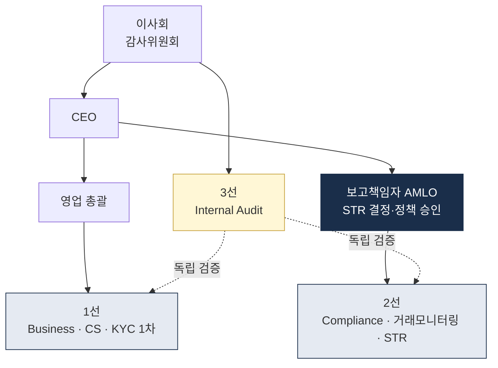
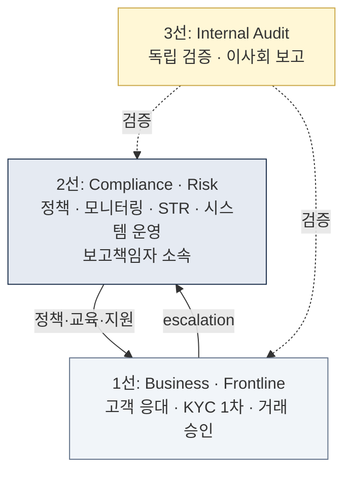
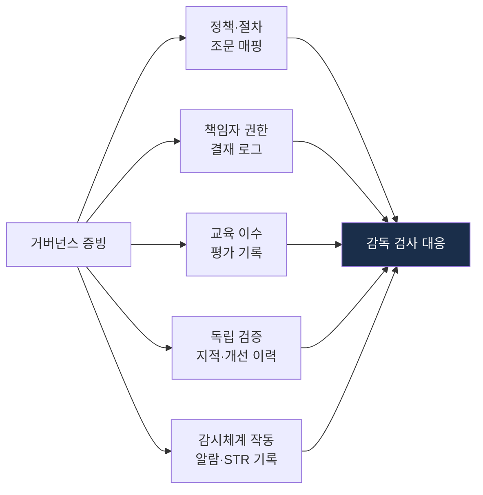
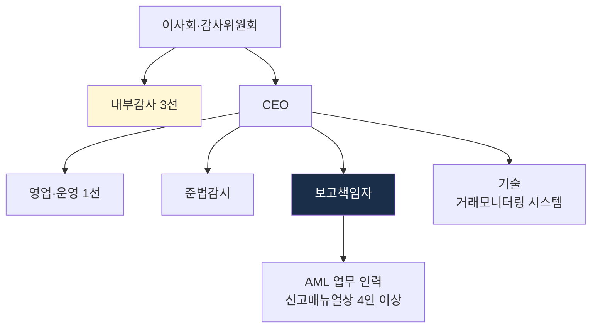

# Internal Controls — 내부통제 / AMLO / 거버넌스

> AML 프로그램의 **거버넌스 구조**. 사람·정책·감사. 이 글을 읽고 나면 "AML은 시스템보다 거버넌스가 본질"이라는 명제의 의미를 이해하고, 보고책임자(AMLO)가 단순 직책이 아니라 **실제 결정 권한을 가진 사람**이어야 하는 이유, 그리고 한국 신고 요건(2026-08-20 개정 법률 시행·2026-08-13 신고매뉴얼 개정)이 거버넌스에 무엇을 요구하는지 설명할 수 있게 됩니다. 마지막 업데이트: 2026-10-21.

> **근거 범위**: `research/2026-10-*.md` 도시에·정본 보고서와 정정된 노트([`../2-regulations/korea-fiu-act.md`](../2-regulations/korea-fiu-act.md), [`inspection-response.md`](inspection-response.md), [`../6-cases/korea-enforcement.md`](../6-cases/korea-enforcement.md))에서 확인된 사실만 쓴다. 이전 판의 거래소별 조직 인원·연봉·D&O 보험, 해외 거래소 조직 규모, Binance 모니터십, 검사 일수·검사관 수·샘플 수, "정기 검사 3년 주기", "사임 시 14일 내 교체", DAXA 공동 AMLO 포럼, 국정원 직접 접촉 SOP, 회계법인 아웃소싱 "표준"은 공개 근거가 확인되지 않아 삭제했다.

## TL;DR
- AML 컴플라이언스는 **시스템보다 거버넌스가 본질** — 흔히 "5 pillars"(정책·통제, 책임자, 교육, 독립 검증, CDD)로 정리
- **3중 방어선**: 영업(1선) → 컴플라이언스(2선) → 내부감사(3선)
- 한국: 보고책임자 지정, 내부통제 체계, **의심거래 감시체계 구축·운영**이 의무다. FIU의 두나무 제재(과태료 352억원 결정 2025-11-06) 사유에도 **의심거래 감시체계 구축 의무 위반**이 들어 있다(B)([FIU 보도자료 KDI 미러](https://eiec.kdi.re.kr/policy/materialView.do?num=273166))
- 2026-08-13 전면 개정 신고매뉴얼: **AML 업무 인력 4인 이상**(겸직 인정 가능), 전산설비 국내 소재, 대주주·법령준수체계 변경은 **변경 30일 전 사전신고**([금융위 2026-08-13](https://www.fsc.go.kr/no010101/87521))
- 정책 문서·교육 이수·독립 검증 기록이 검사의 기본 증빙. 2027-02-19 전환(트래블룰 전건화·해외 VASP 3등급·자기수탁 동일인·1천만원 감시체계)에 맞춘 정책 개정이 필요하다

---

## 1. AML 프로그램의 기둥



### 왜 "기둥"으로 나누는가

AML 프로그램은 흔히 다섯 요소로 정리됩니다. 미국 BSA 실무에서 유래한 표현이며, 조문 번호와 "5 pillars"의 정확한 법적 구성은 원문 확인 필요입니다. FATF 2021 RBA 가이던스는 VASP의 내부통제를 para 298~299에서 다룹니다([FATF 2021 RBA 가이던스](https://www.fatf-gafi.org/content/dam/fatf-gafi/guidance/Updated-Guidance-VA-VASP.pdf.coredownload.pdf)). 관할마다 표현은 달라도 다음 요소가 공통으로 요구됩니다.

### Pillar 1. 정책·절차·통제

- AML 정책 문서 (Policy)
- 절차 매뉴얼 (Procedure)
- 시스템 통제 (System Controls) — 한국은 「자금세탁방지 업무규정」(FIU 고시 제2025-2호, 2026-01-22 시행) 제76~81조 "거래모니터링체계"([법제처 DRF 업무규정](https://www.law.go.kr/DRF/lawService.do?OC=test&target=admrul&ID=2100000267264&type=XML))
- 위험평가 기준

### Pillar 2. 책임자 지정

- 임원급 책임자 지정 — 한국: "자금세탁방지 보고책임자"
- 충분한 권한과 자원
- 최고경영진·이사회 보고 채널
- 보고책임자 변경은 신고 대상. 2026-08-20 이후 법령준수체계 변경은 **30일 전 사전신고**(신고매뉴얼 2026-08-13)

### Pillar 3. 교육

- 신규 입사자 + 정기 교육
- 역할별 차별화 (영업·컴플라이언스·임원)
- 이수 기록 보관

### Pillar 4. 독립 검증

- 내부감사 또는 외부 검증
- 정기 수행, 독립성 확보, 결과 이사회 보고
- 주기는 법령·회사 정책으로 확인(이전 판 "연 1회 권장"의 근거는 원문 확인 필요)

### Pillar 5. CDD·실소유자

- CDD 4단계 + 실소유자 식별 — [`cdd-edd.md`](cdd-edd.md)
- 지속 모니터링

### 실무 포인트

기둥은 체크리스트처럼 보이지만 검사관은 "있다 없다"가 아니라 **"작동하는가"** 를 봅니다. 정책 문서가 있어도 직원들이 모르면 미작동, 책임자를 지정했어도 영업에 종속돼 있으면 미작동입니다. 문서와 실제 운영의 **일치 증거**(알람 처리 로그, STR 결재 기록)가 감독 대응의 핵심입니다.

---

## 2. 3중 방어선 (Three Lines of Defense)

### 구조



### 1선의 역할 (Business · Frontline)

- 신규 가입 시 KYC 정확히 수행
- 거래 의도 청취 + 비정상 행동 1차 인지
- 알람 발생 시 추가 정보 수집
- "이건 이상한데?"를 2선으로 escalation

### 2선의 역할 (Compliance · Risk)

- AML 정책 수립·갱신
- 거래모니터링 시스템 운영
- 알람 분석 + STR 결정(특금법 §4)
- 1선 교육·지원
- 규제 변화 추적

### 3선의 역할 (Internal Audit)

- 1선·2선이 제대로 작동하는가 **독립 검증**
- 발견사항을 **이사회·감사위원회**에 직접 보고
- 회사 전체 AML 효과성 평가

### 실무 포인트

신생 VASP에서 가장 먼저 무너지는 게 3선입니다. 인력이 부족해 2선이 1선을 겸하고 그것을 "3선"이라고 주장하는 구조는 본질적으로 **자기 감독**입니다. 인력이 부족하면 외부 전문기관에 독립 검증을 맡기는 방법이 있지만, 위탁 범위·독립성 요건은 관할 원문으로 확인합니다.

---

## 3. 보고책임자 (AMLO)

### 한국 체계에서의 위치

- 특금법상 보고책임자 지정과 신고 요건은 법령·신고매뉴얼 원문으로 확인(직위 요건 문언은 이 저장소 근거 자료에서 대조하지 않음)
- 2026-08-13 신고매뉴얼: **AML 업무 인력 4인 이상**(겸직 인정 가능)([금융위 2026-08-13](https://www.fsc.go.kr/no010101/87521))
- 법률 제21358호(2026-08-20 시행): FIU가 퇴직 임직원에 대한 제재 내용을 통보할 수 있게 됐고, 대통령령 제36592호는 임원 문책경고·주의적경고·주의와 직원 제재를 검사수탁기관(금감원 등)에 위탁했다([금융위 2026-08-11](https://www.fsc.go.kr/no010101/87499))

### 핵심 권한

- 모든 거래 정보 접근 권한
- **STR 결정권** (혼자 또는 위원회)
- 최고경영진 직접 보고 채널
- 외부 기관(FIU, 감독당국) 직접 소통

### 핵심 책임

- AML 프로그램 효과성 보장
- STR 적시 보고
- 임직원 교육
- 정책 갱신
- 검사·감사 대응

### 보고책임자의 함정

- **권한 부족**: 영업에 밀려 STR을 못 보냄
- **자원 부족**: 인력·시스템 부족
- **경영진 보호 부재**: 실적 압력에 굴복
- **개인 책임**: 2026-08-20부터 퇴직 후에도 제재 내용이 통보될 수 있다. 해외 거래소 경영진 형사 사건의 형량 등은 이 저장소에서 공개 근거 미확인으로 다루지 않는다([`../6-cases/major-enforcement.md`](../6-cases/major-enforcement.md))

### 실무 포인트

"책임자를 지정했다"는 것만으로는 부족합니다. **실제로 결정 권한을 가지고 있는가**를 증빙해야 합니다. 증빙 방법: (1) 내부 규정에 권한 명시, (2) STR 결재 로그, (3) 경영진·이사회 정기 보고 회의록, (4) 영업 요청을 거부한 기록. 이 증빙이 약하면 명목상 책임자로 보이기 쉽습니다.

---

## 4. AML 정책 문서 구조

표준적인 AML Manual 구조 예시입니다. 이 구조를 따르면 검사관이 **어디에 무엇이 있는지** 빠르게 찾을 수 있습니다.

```
1. Introduction & Scope
   - 회사 소개, AML 적용 범위, 책임 분담

2. Risk Assessment
   - Enterprise-wide Risk Assessment (ERA)
   - 고객·상품·거래·지역 위험 분석
   - 신규 상품·서비스 제공 전 위험평가

3. Customer Due Diligence (CDD·EDD)  — 특금법 §5의2
   - 신원확인 · 위험등급 · EDD 트리거 · 실소유자

4. Transaction Monitoring  — 업무규정 제76~81조
   - 룰 카탈로그 · 알람 처리 SOP · 임계값 근거
   - 2027-02-19~: 1천만원 이상 거래 자체 의심거래 감시체계 (감독규정 §28-2③)

5. Sanctions Screening
   - 사용 리스트 · 매칭 방식 · Disposition 절차

6. STR · CTR  — 특금법 §4 · §4의2
   - 보고 트리거 · 작성 SOP · 보관

7. Travel Rule  — 특금법 §5의3 · 시행령 §10의10
   - ~2027-02-18: 100만원 이상 / 2027-02-19~: 전건
   - 상대 VASP 3등급 평가 · 자기수탁 동일인 확인 (§10의20, 감독규정 §28-2)
   - Sunrise 대응

8. Recordkeeping
   - 무엇을 · 얼마나 · 어디에 (기간은 법령 원문 확인)

9. Training
10. Independent Audit
11. 보고책임자 Role & Reporting
12. Tipping-off 금지

부록: 양식, 체크리스트, 외부 데이터 소스, 조문 매핑표
```

### 실무 포인트

정책 문서를 쓸 때 흔한 실수는 **"법 조문 복사"** 입니다. "이렇게 해야 한다"만 있고 "우리 회사에서는 이렇게 한다"가 없으면 쓰이지 않습니다. 각 절차 옆에 **근거 조문**(예: "근거: 특금법 §4, 업무규정 제76조")과 **회사 고유의 책임자·시스템**을 적어 두면, 하위규범이 바뀔 때 영향받는 절차를 바로 찾을 수 있습니다([`../2-regulations/korea-fiu-act.md`](../2-regulations/korea-fiu-act.md) 4절).

---

## 5. Training (임직원 교육)

### 핵심 원칙

- **신규 입사자 교육** + **정기 교육** (주기는 정책으로 정하고 근거 기록)
- **역할별 차별화** — 임원·영업·컴플라이언스·IT
- **실제 사례** 활용 — 원문으로 확인되는 사례(두나무 제재 사유, Prince Group·Huione, FATF Red Flag 한국 사례 등)
- **이수 기록** 보관

### 커리큘럼 예시

1. AML·CFT 기초
2. 우리 회사가 받는 규제 (특금법 §4·§5의2·§5의3, 이용자보호법 §12, 통신사기피해환급법)
3. KYC·CDD 실무
4. 의심거래 사례 — "이상거래"가 FDS·시장감시·STR 중 무엇인지 구분
5. Tipping-off 금지
6. 제재 스크리닝
7. 평가 시험

### 실무 포인트

영상을 틀어두고 "이수"로 처리하면, 검사 인터뷰에서 이수자가 기본 질문("Tipping-off이 뭐죠?")에 답하지 못하는 일이 생깁니다. 최소한의 시험과 통과 기준을 두는 게 안전장치입니다.

---

## 6. Enterprise-wide Risk Assessment (ERA)

### 정체성

- 회사 전체의 ML·TF 위험을 정기적으로 평가하는 문서
- FATF R.1이 요구하는 위험기반접근의 출발점

### 평가 차원

| 차원 | 평가 항목 |
|---|---|
| 고객 | 개인·법인, 국적, 직업, PEP |
| 상품 | 가상자산 종류, 수탁 vs 매매 vs 이전 |
| 채널 | 비대면, OTC, B2B |
| 지역 | 한국·해외, 고위험국 비중 |
| 거래 | 금액·빈도·상대국·상대 VASP |

### 산출물

- 위험 등급 매트릭스
- 통제 강도 매핑
- **잔여 위험 (Residual Risk)**
- 개선 계획

용어:
- **Residual Risk (잔여 위험)** — 통제를 적용한 후에도 남아 있는 위험. "인식하지만 수용"하는 영역.

### 주기

- 정기 수행 + 사업 변경 시(신상품 출시 등) 추가
- 이전 판의 "연 1회 이상(한국 가이드라인)"은 원문 확인 필요

### 실무 포인트

ERA는 검사에서 **가장 먼저 요구되는 문서** 중 하나입니다. ERA가 형식적이거나 오래됐으면 그 위에 세운 다른 통제도 근거가 약해 보입니다. 2027-02-19 전환은 상품·채널·상대방 위험을 동시에 바꾸므로 그 전에 ERA를 갱신하는 편이 좋습니다.

---

## 7. Internal · External Audit · 감독 검사

### 내부감사

- 3선 방어선
- 1선·2선 효과성 검증
- 정책 vs 실제 운영 일치
- 결과를 이사회·감사위원회에 보고

### 외부 검증

- 법정 회계감사와 **별개**의 AML 특화 검증
- 독립성 확보 수단

### 감독 검사 — 외부

- FIU 검사와 검사수탁기관(금감원 등)의 검사. 대통령령 제36592호로 일부 제재 권한이 검사수탁기관에 위탁됐다
- 정기·수시 주기와 절차 세부는 원문 확인 필요(이전 판 "3년 주기"는 근거 미확인)
- 2025~2026 한국 VASP 제재 사유: 고객확인·거래제한·STR·의심거래 감시체계 의무 위반, 미신고 사업자와의 거래. **트래블룰(§5의3) 위반은 사유로 공표되지 않았다**([`../6-cases/korea-enforcement.md`](../6-cases/korea-enforcement.md))



### 실무 포인트

"외부 검증에서 이 이슈가 지적됐고 이렇게 개선했다"는 기록은 감독 검사에서 강한 방어 근거입니다. 반대로 검증 기록이 전혀 없으면 "자기 문제를 인지하지 못했다"는 인상을 줍니다. 검사 준비는 [`inspection-response.md`](inspection-response.md) 참조.

---

## 8. 거버넌스 구조 예시

```
이사회
  ├─ 감사위원회
  │     └─ 내부감사 (3선)
  ├─ 리스크 관리 위원회 (2선 정책 결정)
  │     └─ AML 위원회 (정기 개최)
  │            └─ 보고책임자 주재
  └─ CEO
        ├─ 영업·거래소 운영 (1선)
        ├─ 준법·컴플라이언스 (2선) ─ 보고책임자
        ├─ 기술 ─ 거래모니터링·시스템
        └─ 정보보호
```

### 실무 포인트

**AML 위원회의 위치**가 중요합니다. 1선·2선·IT·보안이 함께 참여하고 보고책임자가 주재해 결정합니다. 회의록이 "회사가 AML 이슈를 정기적으로 토의하고 결정한다"는 증거가 됩니다. 개최 주기는 정책으로 정합니다.

---

## 9. RBA 거버넌스 요약

- **보고책임자**: RBA 정책 전반 책임, 가중치·Factor 업데이트 승인
- **RBA 검토 회의**: 보고책임자 + 분석 리더 + 영업 + IT — 가중치 조정·Factor 추가 검토
- **이사회 보고**: 등급 분포·재평가 이행률·이상 패턴
- **독립 검증**: RBA 공식·기록 검증

주기는 모두 회사 정책값입니다. **상세 점수법**: [`cdd-edd.md`](cdd-edd.md) §8 참조.

---

## 10. 책임 매트릭스 (RACI 예시)

| 활동 | 보고책임자 | 준법 총괄 | 1선 | IT | 임원 |
|---|---|---|---|---|---|
| KYC 수집 | I | A | R | C | I |
| 알람 분석 | A | C | C | I | I |
| STR 결정 | **R** | A | I | I | I |
| 정책 갱신 | A | R | C | C | I |
| 임직원 교육 | A | R | C | C | I |
| 시스템 도입 | C | A | C | R | I |
| 검사 대응 | R | A | C | C | I |
| 이사회 보고 | R | A | I | I | I |

용어:
- **R**esponsible — 실행 책임
- **A**ccountable — 최종 책임
- **C**onsulted — 자문
- **I**nformed — 통보만

### 실무 포인트

RACI는 AML 정책의 부록으로 넣는 경우가 많습니다. "누가 어떤 결정을 내리는가"가 명확하지 않으면 위기 상황에서 결정이 지연되거나 책임 전가가 생깁니다.

---

## 11. 검사·감사 흔한 지적사항

원문으로 확인되는 한국 제재 사유와, 일반적으로 점검되는 항목입니다.

- **제재 사유로 확인됨**: 고객확인·거래제한 의무 위반, 영장 관련 고객 STR 의무 위반, 의심거래 감시체계 구축 의무 위반(두나무, B), 미신고 사업자와의 거래
- **일반 점검 항목**: ERA 미수행 또는 형식적, 책임자 권한·자원 부족, 정책 vs 실제 운영 괴리, 알람 통계 미작성, STR 보고 지연, 교육 이수 기록 누락, 고객확인 자료 보관 누락, Tipping-off 통제 약함, 실소유자 식별 미흡
- 이전 판의 "외부지갑 등록제 미운영"은 2027-02-18까지 법령 의무가 아니므로 삭제. 2027-02-19부터는 **자기수탁 주소 동일인 확인**이 고시 의무다(방법 미지정)

### 실무 포인트

내부 자체 점검(self-assessment) 때 위 항목을 체크리스트로 삼아 정기 점검합니다.

---

## 12. 체크리스트

```
□ 보고책임자 지정 + 신고 (변경 시 30일 전 사전신고, 2026-08-20~)
□ AML 업무 인력 4인 이상 (신고매뉴얼 2026-08-13, 겸직 인정 가능)
□ AML 정책 문서 + 조문 매핑 + 정기 갱신
□ 3중 방어선 구축
□ ERA 정기 수행 + 사업 변동 시
□ 신규 상품·서비스 제공 전 위험평가
□ 임직원 교육 + 이수 기록 + 평가
□ 독립 검증 (내부감사 또는 외부)
□ 거래모니터링 체계 (업무규정 제76~81조) + 룰 정기 검증
□ STR·CTR 통계 추적
□ 검사 대응 매뉴얼
□ 이사회 정기 보고
□ 2027-02-19 대비 정책 개정 (트래블룰 전건, 해외 VASP 3등급, 자기수탁 동일인, 1천만원 감시체계)
```

## 💼 실무 현장 (Industry Reality)

### 조직 구성 — 공개로 확인되는 범위



이전 판의 거래소별 조직 인원(분석팀 12~15명 등), 해외 거래소 컴플라이언스 인원, 연봉은 공개 근거가 없어 삭제했습니다. 확인되는 최소 요건은 신고매뉴얼의 **AML 업무 인력 4인 이상**입니다. 준법감시 기능과 보고책임자를 분리할지는 회사 구조와 관련 법령에 따라 정합니다.

### 책임자 실권 — 증빙 방법

1. **내부 규정에 권한 명시**: STR 결정 권한 조항
2. **STR 결재 로그**: 영업 결재선이 끼어들지 않았다는 기록
3. **이사회 보고**: 정기 보고 회의록
4. **예산권**: AML 인력·도구 계약 결재권
5. **거부권**: 영업 요청(예: VIP 고객 EDD 생략)을 거부할 수 있는 문서화된 권한

### 교육 커리큘럼 예시

| 대상 | 주제 |
|---|---|
| 전 임직원 | AML 기초 + Tipping-off + 제재 |
| 영업·CS (1선) | KYC·의심 신호 escalation + 실제 사례 |
| 컴플라이언스 (2선) | 거래모니터링·STR 작성·분석 도구 |
| 임원 | 책임 구조·2026-08-20 퇴직자 제재통보 |
| 신입 | 전체 커리큘럼 |

시간·주기는 회사 정책값입니다. 이수 확인은 시험 통과 기준을 두는 방식이 안전합니다.

### ERA 템플릿 구조

1. **회사 개요**: 상품·고객 세그먼트·지역
2. **위험 식별**: Likelihood x Impact 매트릭스
3. **Inherent Risk**: 통제 전 위험 수준
4. **통제 효과성**: 현재 통제가 얼마나 작동하는가
5. **Residual Risk**: 통제 후 남는 위험
6. **개선 액션**: 우선순위·담당자·기한

### 자주 나오는 오해

- **"보고책임자는 준법감시인과 같다"** — 역할이 다르다. 준법은 전체 법령 준수, 보고책임자는 AML·STR 특화.
- **"3선 내부감사는 2선이 겸해도 된다"** — 자기 감독이다. 독립성 확보 수단을 정한다.
- **"교육은 영상 한 번 틀면 끝"** — 검사 인터뷰에서 숙지 여부가 드러난다.
- **"ERA는 형식적 문서"** — 다른 통제의 근거 문서다.
- **"트래블룰 위반으로 거래소가 제재받았다"** — 2025~2026 한국 VASP 제재에서 트래블룰 위반은 사유로 공표되지 않았다. 지적의 중심은 기본 의무다.

### 한국 특수 현실

- **신고 요건 개정(2026-08-20 시행)**: 불수리 사유 확대·조건부 수리, 대주주·법령준수체계 변경 30일 전 사전신고, 전산설비 국내 소재(클라우드 국내 리전 인정)([`../2-regulations/korea-fiu-act.md`](../2-regulations/korea-fiu-act.md) 3절)
- **퇴직자 제재통보**: 법률 제21358호로 FIU가 퇴직 임직원 제재 내용을 통보할 수 있다
- 이전 판의 "DAXA 공동 AMLO 포럼", "국정원 직접 접촉 SOP", "사임 시 14일 내 교체"는 공개 근거가 확인되지 않아 삭제했습니다

---

## 더 읽을거리
- [`cdd-edd.md`](cdd-edd.md) — CDD·EDD 절차
- [`str-ctr.md`](str-ctr.md) — STR·CTR 보고
- [`sanctions-screening.md`](sanctions-screening.md) — 제재 스크리닝
- [`inspection-response.md`](inspection-response.md) — 검사 대응
- [`../2-regulations/korea-fiu-act.md`](../2-regulations/korea-fiu-act.md) — 특금법 신고·조문 매핑
- [`../3-crypto-aml/vasp-obligations.md`](../3-crypto-aml/vasp-obligations.md) — VASP 의무
- [금융위 2026-08-13 — 신고매뉴얼 전면 개정](https://www.fsc.go.kr/no010101/87521)
- [FATF 2021 RBA 가이던스](https://www.fatf-gafi.org/content/dam/fatf-gafi/guidance/Updated-Guidance-VA-VASP.pdf.coredownload.pdf)
