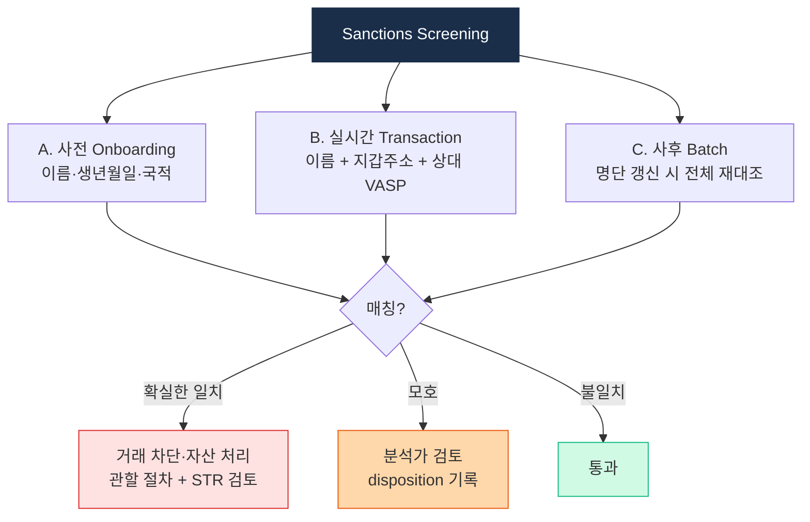
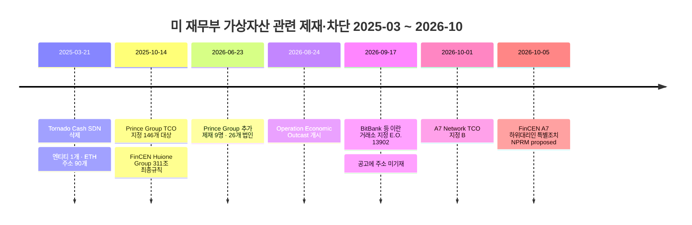
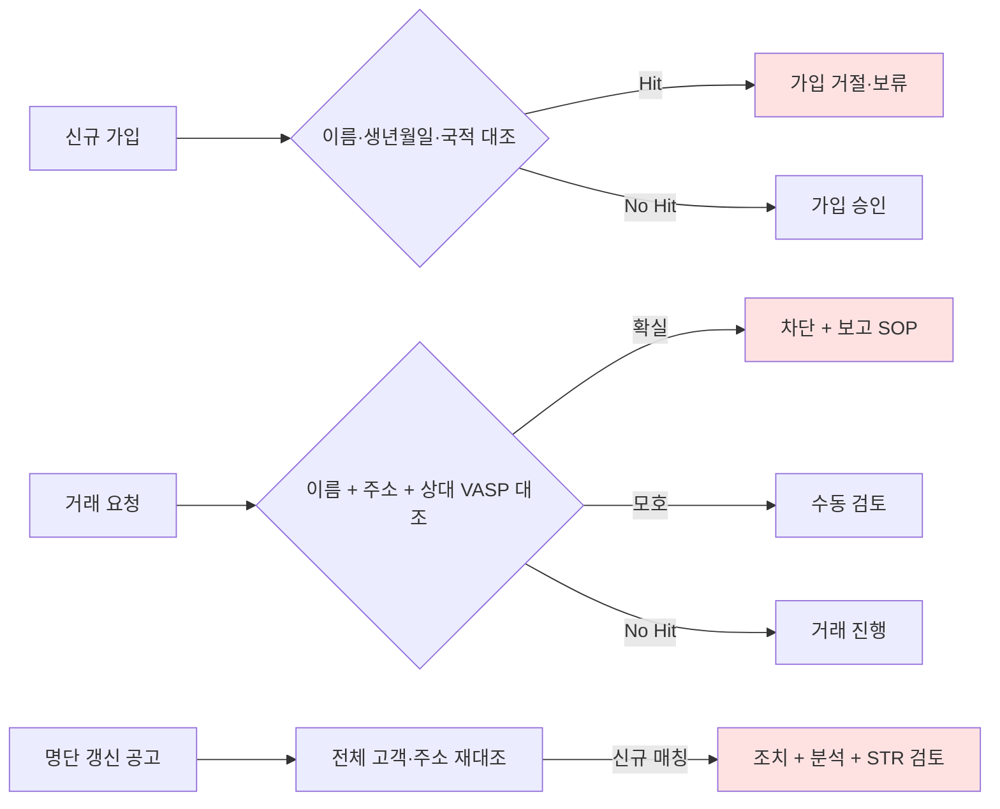

# Sanctions Screening — 제재 스크리닝

> 거래 **전·중·후** 모든 단계에서 제재 대상자 차단. 이 글을 읽고 나면 미국 제재 지정이 왜 한국 거래소 운영에도 실질적인 영향을 주는지, 그리고 2025~2026년 미국 제재가 "주소 목록"에서 **특정 조직·네트워크 지정**(Prince Group·Huione·BitBank·A7)으로 옮겨 가면서 주소 대조만으로는 왜 부족해졌는지 설명할 수 있게 됩니다. 마지막 업데이트: 2026-10-21.

> **근거 범위**: `research/2026-10-*.md` 도시에·정본 보고서와 정정된 노트([`../2-regulations/us-bsa-fincen.md`](../2-regulations/us-bsa-fincen.md), [`../6-cases/major-enforcement.md`](../6-cases/major-enforcement.md), [`../6-cases/tornado-cash.md`](../6-cases/tornado-cash.md))에서 확인된 사실만 쓴다. 이전 판의 Binance·Bittrex·BitGo 벌금액·형량·모니터십, OFAC 벌금 상한, 2018~2024 주소 등재 연표, 거래소별 동기화 주기, DAXA 공동 블랙리스트, 비공식 통보 경로, FP 감축률·임계값 성능표는 이 근거 자료로 확인되지 않아 삭제했다(공개 근거 미확인).

## TL;DR
- 핵심 리스트: **OFAC SDN(미국) · UN 안보리 · EU · 영국 · 한국 정부 지정 명단**. 각 명단의 등재 형식(가상자산 주소 기재 여부)은 원 공고로 확인
- **SDN에 가상자산 주소가 기재될 수 있다** — 그러면 거래 상대 주소 스크리닝 대상이 된다. 그러나 **2026-09-17 BitBank 지정 공고에는 디지털화폐 주소가 기재되지 않았다**([OFAC 2026-09-17](https://ofac.treasury.gov/recent-actions/20260917)) — 주소 대조만으로는 못 잡는다
- 2025~2026 미국 축: Tornado Cash **SDN 삭제(2025-03-21)**, Prince Group TCO 지정·Huione §311 최종규칙(2025-10-14), BitBank 등 이란 거래소 지정(2026-09-17), A7 네트워크 TCO 지정(2026-10-01, B)
- 매칭 방식: **이름(fuzzy) + 보조 식별자(생년월일·국적) + 지갑주소(정확매칭) + 상대 VASP 식별**
- 사전·실시간·사후 3중 체크. 트래블룰 수신 정보도 제재 스크리닝 입력이다(FATF 2021 가이던스 para 193~195)

---

## 1. 스크리닝의 구조



### 왜 제재가 AML의 별도 축인가

제재(Sanctions)는 AML과 자주 묶이지만 **방향이 다릅니다**. AML은 범죄수익의 세탁을 의심해 보고하는 통제라면, 제재는 지정된 대상과의 거래 자체를 막는 **사전** 차단입니다. 그래서 제재 스크리닝은 거래 발생 **이전**에 작동해야 의미가 있고, VASP가 **Pre-transaction screening** 인프라를 갖춰야 하는 이유입니다.

### 카테고리별 (예시)

| 카테고리 | 예시 |
|---|---|
| **국가·정권 프로그램** | 이란(E.O. 13902 — 2026-09-17 BitBank 지정 근거), 북한 |
| **러시아 연계** | A7 네트워크 — 2026-10-01 TCO 지정(B), FinCEN 하위대리인 자금이체 금지 특별조치 NPRM(proposed) |
| **초국가범죄조직(TCO)** | Prince Group — 2025-10-14 지정(146개 대상) |
| **사이버 범죄·확산금융** | DPRK 연계 탈취 자금 |
| **테러조직** | 관할별 지정 명단 |

### 제재 형태

- **자산 동결 (Blocking)** — 관할 내 자산 동결
- **거래 금지** — 관할 내 인·기업의 거래 금지
- **2차 제재 위험** — 외국인이라도 미국 금융시스템 접근 제한 위험
- **금융시스템 차단 조치** — FinCEN §311 최종규칙(Huione, 2025-10-14)이나 Combating Russian Money Laundering Act §9714 특별조치(A7, proposed)처럼 특정 기관·거래군과의 거래를 막는 조치. OFAC 지정과는 별개 수단이다([재무부 sb0278](https://home.treasury.gov/news/press-releases/sb0278); [Federal Register 2026-20371](https://public-inspection.federalregister.gov/2026-20371.pdf))

### 실무 포인트

한국 VASP가 미국 지정 대상과 거래하면 직접 형사 관할 여부와 별개로 **미국 달러 결제망·스테이블코인 발행자·해외 거래 상대와의 관계**에서 불이익을 받을 수 있습니다. 2차 제재의 구체 적용 범위는 프로그램별 E.O. 원문으로 확인합니다.

---

## 2. 핵심 리스트

### 이 표를 어떻게 읽어야 하나

명단은 관할별로 독립 발행되지만, 실무에서는 **통합 스크리닝 DB**로 관리합니다. 상용 통합 DB를 구독하는 경우가 많지만, 갱신 지연이 생길 수 있으므로 1차 공고(예: OFAC Recent Actions)와 대조할 수 있어야 합니다.

| 리스트 | 발행 | 가상자산 주소 | 비고 |
|---|---|---|---|
| **OFAC SDN List** | 미국 재무부 | 기재될 수 있음 | 기재 없는 지정도 있음(BitBank 2026-09-17) |
| **UN 안보리 통합 명단** | UN | 원문 확인 | 이름·식별정보 중심 |
| **EU 통합 금융제재 명단** | EU | 원문 확인 | |
| **영국 제재 명단** | 영국 | 원문 확인 | Prince Group은 FCDO가 미국과 공조 지정(2025-10-14) |
| **한국 정부 지정 명단** | 한국 | 원문 확인 | 지정 근거 법령·고시는 원문 확인 필요 |

### OFAC이 중심인 이유

가상자산 주소가 지정 공고에 직접 기재되는 대표 사례가 OFAC SDN입니다. 그래서 가상자산 제재 스크리닝은 OFAC SDN을 축으로 설계하는 경우가 많습니다. 다만 2026년 지정은 거래소·네트워크 단위가 많고 주소가 빠진 경우도 있어, **상대 VASP 식별·실사**가 주소 대조와 같은 무게로 필요합니다([`../2-regulations/us-bsa-fincen.md`](../2-regulations/us-bsa-fincen.md) §3).

---

## 3. 2025~2026 OFAC·재무부 가상자산 관련 조치



| 일자 | 조치 | 상태(2026-10-21) | 출처 |
|---|---|---|---|
| 2025-03-21 | **Tornado Cash SDN 삭제** — 엔티티 1개·ETH 주소 90개(주 1·대체 89) | 해제 완료 | [OFAC 2025-03-21](https://ofac.treasury.gov/recent-actions/20250321) |
| 2025-10-14 | Prince Group TCO 지정(146개 대상, 영국 FCDO 공조), FinCEN Huione §311 최종규칙 | in-force | [재무부 sb0278](https://home.treasury.gov/news/press-releases/sb0278) |
| 2026-06-23 | Prince Group 관련 9명·26개 법인 추가, Huione 규칙에 H-Pay 추가 개정안 | 지정 in-force / 개정안 proposed | [재무부 sb0538](https://home.treasury.gov/news/press-releases/sb0538) |
| 2026-09-17 | 이란 거래소 **BitBank**·개발사 Pishtaz Simorgh·개인 3인 지정(E.O. 13902) — "Operation Economic Outcast"(2026-08-24~)의 일부 | in-force | [OFAC 2026-09-17](https://ofac.treasury.gov/recent-actions/20260917); [재무부 sb0632](https://home.treasury.gov/news/press-releases/sb0632/) |
| 2026-10-01 | **A7 Network** TCO 지정(E.O. 13581, 개정 E.O. 13863) | in-force(B — FinCEN NPRM 각주로 확인, OFAC 원 공고 미열람) | [Federal Register 2026-20371](https://public-inspection.federalregister.gov/2026-20371.pdf) |

2022년 Tornado Cash 최초 지정과 그 소송 경과, 2018~2024년의 개별 주소 등재 이력은 이 저장소 근거 자료에서 원문으로 확인하지 않았습니다(공개 근거 미확인) — [`../6-cases/tornado-cash.md`](../6-cases/tornado-cash.md).

### 실무 포인트

OFAC 지정은 **예고 없이** 공고됩니다. 공고 시점부터 거래 차단 의무가 생기므로, 시스템은 1차 공고(Recent Actions)를 주기적으로 확인하고 **자동 반영**해야 합니다. 갱신 주기는 회사가 위험평가로 정하고 근거를 남깁니다 — 업계 표준 주기에 대한 공개 근거는 없습니다.

**삭제(해제)도 목록 변경입니다.** Tornado Cash는 SDN에서 빠졌지만, 학계 측정(WWW '26)은 제재 후 957일 동안 입금액이 71.03% 줄었는데도 Ethereum 보안사고의 78.33%가 여전히 Tornado Cash를 거쳤다고 보고합니다([arXiv 2507.11721](https://arxiv.org/abs/2507.11721)). 목록 대조(제재 출구)와 위험 평가(AML 출구)를 분리해 두어야 해제와 동시에 통제가 풀리지 않습니다.

---

## 4. 스크리닝 매칭 방식

### A. 이름 매칭 (Fuzzy Matching)

동음이의·음역 다양성을 처리해야 하는 문제입니다. "Mohammed"와 "Mohammad"는 같은 사람일 수도, 다른 사람일 수도 있습니다.

용어:
- **Fuzzy Matching** — 완전 일치가 아닌 유사도 기반 매칭.
- **Levenshtein Distance** — 한 문자열을 다른 문자열로 바꾸는 데 필요한 최소 편집 횟수.
- **Jaro-Winkler** — 문자열 유사도 알고리즘. 짧은 공통 접두사에 가중.
- **Soundex** — 음가 기반 매칭. 영어에 주로 사용.

**트레이드오프**:
- **너무 느슨**: False Positive 폭증 → 업무 마비
- **너무 빡빡**: False Negative → 진짜 제재 대상 통과

### B. 보조 식별자

이름 매칭의 False Positive를 줄이는 핵심:

- 생년월일
- 국적·거주지
- 신원확인번호(여권 등)
- 회사명·직책

### C. 가상자산 지갑주소 매칭

- **정확 매칭 (Exact Match)** — 공고에 기재된 동일 주소
- **클러스터 매칭** — 분석 도구가 같은 주체로 묶은 주소(귀속 추정이므로 근거 기록 필요)
- **간접 노출** — N hop 내 도달 주소. hop 수·비율 기준은 공개 표준이 없다

### D. 상대 VASP 매칭

주소가 공고에 없는 거래소 단위 지정(BitBank)에는 **상대 VASP 식별**이 필요합니다. 트래블룰 메시지의 수신 VASP 정보, 상대 VASP 실사 기록이 입력이 됩니다. FATF 2021 가이던스는 트래블룰 이행 단락 안에서 제재 스크리닝을 다룹니다(para 193~195)([FATF 2021 RBA 가이던스](https://www.fatf-gafi.org/content/dam/fatf-gafi/guidance/Updated-Guidance-VA-VASP.pdf.coredownload.pdf)).

### 실무 포인트

이름 매칭의 fuzzy 수준은 도구마다 기본 설정이 다릅니다. 기본값 그대로 쓰면 한국에서는 흔한 성씨에서 False Positive가 많이 생깁니다. 보조 식별자(생년월일·국적) 결합 규칙과 임계값을 **자사 데이터로 검증해** 정하고, 그 근거를 문서화합니다.

---

## 5. 스크리닝 시점 — 3단 체크

### A. 사전 (Onboarding) 스크리닝

- 신규 가입 시 KYC 정보로 매칭
- 매칭되면 가입 거절 또는 보류
- 가입 후 정보 변경 시 재스크리닝

### B. 실시간 (Transaction) 스크리닝

거래 발생 직전:
- 송신·수신 주소의 SDN 등 명단 매칭
- 상대 VASP의 지정 여부·소재 관할
- 거래 메타데이터(memo, tag) 매칭

매칭되면 **거래 차단 + 알람**.

### C. 사후 (Periodic) 스크리닝

- 명단이 갱신될 때마다 기존 고객·주소 전체 재대조
- 새로 지정된 항목과 과거 거래 이력 대조
- 잠재 노출 발견 시 STR 검토

### 실무 포인트

가장 자주 소홀해지는 게 **C 사후 스크리닝**입니다. 지정 공고가 나온 순간 기존 고객 중 그 주소·거래소와 거래한 사람이 드러날 수 있습니다. 명단 갱신 이벤트에 연동된 배치가 필수 운영 항목입니다.

---

## 6. 운영 흐름



---

## 7. False Positive 처리 (Disposition)

### 일반 시나리오

"Kim Min-soo"를 SDN에 매칭 → 다수 동명이인. 생년월일·국적이 다르면 → 명백한 False Positive → 통과. 모호하면 → 추가 자료 요청 → 분석가 판단.

### Disposition 코드 예시

| 코드 | 의미 |
|---|---|
| TP-Confirmed | 진짜 매칭 → 차단 + 보고 절차 |
| FP-Different DOB | 생년월일 다름, 통과 |
| FP-Different Nationality | 국적 다름, 통과 |
| FP-Different Address | 주소 다름, 통과 |
| Pending | 추가 정보 필요 |

모든 disposition은 **로그 기록 + 검사 시 증빙**.

### 실무 포인트

Disposition 이력은 **검사의 핵심 증빙**입니다. "왜 이 고객을 통과시켰나"에 대한 답이 없으면 지적받습니다. 시스템이 disposition 코드를 강제 입력받고 보존 정책에 따라 보관하는 구조를 초기에 만들어 둡니다.

---

## 8. 고난이도 케이스

### A. 동명이인 (Common Name)

"Kim", "Mohammed", "Wang" 같은 흔한 이름 — 보조 식별자가 핵심.

### B. 음역 (Transliteration)

한자·아랍어·러시아어 → 영문 음역 다양. "Kim" vs "Gim" vs "Kym".

### C. 회사명 변형

"ABC Corp" vs "ABC Corporation" vs "ABC Co., Ltd." — 약어·띄어쓰기·콤마 차이.

### D. 주소 없는 거래소·네트워크 지정

BitBank(2026-09-17)처럼 공고에 주소가 없거나, A7처럼 "네트워크가 통제하는 역외 기업" 전체가 대상이 되는 경우. 상대 VASP 식별과 거래 상대 실사로 대응합니다.

### E. 동결 저항 자산

FATF 7차 Targeted Update(2026-07-16)는 VASP가 "issuer-level asset freeze/burn mechanisms"를 준수 안전장치로 믿을 수 없을 수도 있다고 결론 내렸고(para 35), 학계는 **USDT 제재 주소의 7.3%, USDC의 18.7%가 동결 발효 전에 전액 인출**됐다고 측정했습니다([7차 TU PDF](https://www.fatf-gafi.org/content/dam/fatf-gafi/reports/7th-targeted-update-on-implementation-fatf-standards-vas-vasps-2026.pdf.coredownload.pdf); [arXiv 2603.27739](https://arxiv.org/abs/2603.27739)). 발행자 동결은 거래소 자체 스크리닝을 대체하지 못합니다.

### F. 익명성강화코인

추적이 어려워 제재 노출 판단이 어렵습니다. EU AMLR 제79조는 익명성강화코인 취급 금지를 담고 있고 **2027-07-10 적용 예정**(enacted-not-in-force)입니다([EUR-Lex OJ L 2024/1624](https://eur-lex.europa.eu/legal-content/EN/TXT/PDF/?uri=OJ:L_202401624)). 한국 거래소별 취급 현황과 그 사유는 공개 근거로 확인하지 않았습니다.

### 실무 포인트

E·F는 "스크리닝을 더 정교하게"가 아니라 **상품·상대방 정책**으로 다루는 위험입니다. 어떤 자산·상대를 취급하지 않을지의 판단 근거를 위험평가 문서에 남깁니다.

---

## 9. 한국 — 어디서 정보를 받나

| 출처 | 무엇 |
|---|---|
| 한국 정부 지정 명단 | 지정 근거 법령·고시와 공고 채널은 원문 확인 필요 |
| 해외 1차 공고 | OFAC Recent Actions, UN·EU·영국 명단 |
| 상용 통합 DB·블록체인 분석 도구 | 명단 통합·주소 라벨. 커버리지·갱신 지연은 자사 주장(T5)이라 검증 필요 |

---

## 10. 위반 시 처벌

### 미국

- 위반 시 민사·형사 제재 대상. **벌금 상한·형량은 해당 법령(IEEPA 등)·OFAC 집행 지침 원문으로 확인** — 이 저장소 근거 자료로는 재확인하지 않았습니다.
- 2025~2026 원문으로 확인되는 가상자산 집행은 개별 거래소 거액 합의보다 **조직·네트워크 지정**이 중심입니다([`../6-cases/major-enforcement.md`](../6-cases/major-enforcement.md)).

### 과거 대형 사건

Binance(2023)·Bittrex·BitGo 등의 제재 위반 합의 금액·형량·모니터십 기간은 **공개 근거 미확인**으로 이 저장소에서 수치를 삭제했습니다. 인용하려면 DOJ·FinCEN·OFAC 원 공고를 직접 확인합니다. Paxful에 대한 FinCEN $3.5M 민사벌금(2025-12-09)의 사유는 MSB 미등록·AML 프로그램 미비·SAR 미제출이며 제재 위반이 아닙니다([FinCEN](https://www.fincen.gov/news/news-releases/fincen-assesses-35-million-penalty-against-paxful-facilitating-suspicious)).

### 한국

- 국내 제재 위반의 처벌 근거 법령(외국환거래법 등)과 특금법 위반과의 관계는 원문 확인 필요

### 실무 포인트

2025~2026 집행 흐름이 남긴 교훈은 "지정 대상 **주소**"만이 아니라 "지정 **조직·네트워크**와의 직·간접 거래"를 차단해야 한다는 것입니다. 실무 우선순위는 ① 기본 의무의 작동 증거 ② 지정 네트워크와의 거래 차단입니다.

---

## 11. 체크리스트

```
□ OFAC · UN · EU · 영국 · 한국 명단 갱신 반영 (주기는 정책으로 정함)
□ 사전 스크리닝 (onboarding)
□ 실시간 스크리닝 (모든 거래)
□ 명단 갱신 이벤트 연동 사후 배치 (전체 고객·주소)
□ 지갑주소 정확 매칭 + 클러스터·간접 노출 기준 문서화
□ 상대 VASP 식별 — 주소 없는 거래소 지정 대응
□ 트래블룰 수신 정보 스크리닝 연동
□ False Positive disposition 로그
□ 매칭 시 차단 + 보고 SOP
□ 해제 공고 시 정책 변경 근거 기록 (목록 변경 vs 위험 평가)
□ 임직원 교육
```

## 💼 실무 현장 (Industry Reality)

### Fuzzy Matching False Positive 감축 기법

일반적으로 쓰는 방법(효과 수치는 데이터마다 다르며 공개 벤치마크 없음):

1. **다축 매칭**: 이름 단독 매칭은 HIT로 바로 처리하지 않고 **이름 + 생년월일** 또는 **이름 + 국적** 조합을 요구.
2. **임계값 튜닝**: 흔한 성씨에는 더 높은 유사도 임계값을 적용. 값은 자사 샘플로 검증.
3. **Whitelist 관리**: 반복 FP 고객-명단 항목 쌍은 승인 후 만료일 있는 화이트리스트로 관리하고 재검토.
4. **2차 검토**: 1차 HIT → 분석가 판단 + disposition 코드 강제 입력.

이전 판의 "FP ~90% → ~70%", "월 3,000 → 1,000건"은 공개 근거가 없어 삭제했습니다.

### 명단 자동 동기화 파이프라인 (의사코드)

```python
# 명단 갱신 동기화 예시 (의사코드) — 소스는 1차 공고·공식 배포 파일
def sync_sanctions_list(source):
    new_entries = fetch_and_parse(source)          # 이름·식별정보·주소
    current = db.get_entries(source)

    added = new_entries - current
    removed = current - new_entries

    if added:
        for entry in added:
            rescan_existing_customers(entry)       # 사후 스크리닝
        notify_compliance(f"신규 지정 {len(added)}건", added)
        screening_engine.add(added)
    if removed:
        # 해제는 자동 통과가 아니라 정책 검토 대상
        open_policy_review(removed)
    db.update(source, new_entries)
```

거래소별 동기화 주기에 대한 공개 근거는 없습니다.

### 자주 나오는 오해

- **"OFAC은 미국 회사만 해당"** — 직접 관할과 별개로 달러 결제망·스테이블코인 발행자·해외 상대방 관계에서 영향을 받는다. 구체 적용은 프로그램별 원문 확인.
- **"Tornado Cash 제재 해제됐으니 이제 안전"** — 해제는 목록 변경일 뿐이다. 위험 평가 쪽 근거(사고 자금 경유 비율 등)는 해제 전과 크게 다르지 않다.
- **"지갑 주소 SDN 매칭만 하면 됨"** — 이름 + 주소 + 상대 VASP. 주소 없는 지정이 2026년에 실제로 나왔다.
- **"발행자가 동결하니 스테이블코인은 안전"** — 동결 전 인출이 측정됐다(USDT 7.3%, USDC 18.7%).
- **"False Positive 줄이려 매칭을 느슨하게"** — 보조 식별자 강화가 정답. 매칭 자체를 느슨하게 하면 FN이 생긴다.

### 한국 특수 현실

- 이전 판의 "DAXA 주도 공동 블랙리스트", "국정원 비공식 통보 경로", "4대 거래소 OFAC 전담 신설"은 공개 근거가 확인되지 않아 삭제했습니다.
- 2027-02-19부터(enacted-not-in-force) 해외 VASP가 FATF 고위험국 소재이거나 무인허가이면 거래가 제한됩니다(감독규정 §28-2②, 2027-02 중 시행). 제재 스크리닝과 상대 VASP 3등급 평가를 같은 데이터로 운영하면 중복을 줄일 수 있습니다([`../2-regulations/korea-fiu-act.md`](../2-regulations/korea-fiu-act.md) 5절).

---

## 12. Fuzzy Matching — 한국 이름 대응 설계

### 12.1 문제 정의

한국은 소수 성씨 비중이 높아, 글로벌 기본 유사도 임계값을 그대로 쓰면 성씨만 같은 동명이인 HIT가 많이 생깁니다.

**예**: 고객 "Kim Min-soo 1990-01-01 KR" 대조 시
- 명단 항목 "Kim Min-su 1985-03-15 KP"와 이름 유사도는 매우 높게 나온다(가상 예시)
- 생년월일·국적이 다르므로 보조 식별자 규칙이 있으면 자동으로 FP 처리된다

### 12.2 한국 이름 대응 스크리닝 파이프라인 (설계 예시)

```python
from jellyfish import jaro_winkler_similarity

COMMON_KR_SURNAMES = {
    "Kim", "Lee", "Park", "Choi", "Jung", "Jang",
    "Yoon", "Cho", "Kang", "Lim", "Han", "Shin"
}

# 임계값은 예시 — 자사 샘플로 검증해 정하고 근거를 문서화한다
SURNAME_T = 0.95
COMMON_T = 0.92
DEFAULT_T = 0.88

def screen_korean_customer(customer, sdn_list):
    hits = []
    for sdn in sdn_list:
        # 1. 성씨 로마자 variant 매칭 (Kim/Gim/Ghim 등)
        surname_match = any(
            jaro_winkler_similarity(normalize_kr(customer.surname),
                                    normalize_kr(v)) >= SURNAME_T
            for v in sdn.surname_variants
        )
        if not surname_match:
            continue

        # 2. 흔한 성씨면 full name 임계값 상향
        threshold = COMMON_T if customer.surname in COMMON_KR_SURNAMES else DEFAULT_T
        name_score = jaro_winkler_similarity(normalize(customer.full_name),
                                             normalize(sdn.name))
        if name_score < threshold:
            continue

        # 3. 보조 식별자 (DOB OR Nationality)
        dob_match = customer.dob and customer.dob == sdn.dob
        nat_match = sdn.nationalities and customer.nationality in sdn.nationalities
        if not (dob_match or nat_match):
            continue

        # 4. 승인된 화이트리스트 (만료일 있음)
        if is_whitelisted(customer.id, sdn.id):
            continue

        hits.append((sdn, name_score, dob_match, nat_match))
    return hits
```

주의: 보조 식별자를 "필수"로 두면 명단 항목에 생년월일·국적이 비어 있는 경우를 놓칩니다. 식별자가 비어 있는 항목은 별도 수동 검토 큐로 보내는 규칙이 필요합니다.

### 12.3 이름 정규화

```python
import re

NORMALIZATIONS = [
    (r"-", ""), (r",\s*", " "),
    ("min-soo", "minsoo"), ("minsu", "minsoo"),
    # 로마자 표기법 차이 예시
    ("hoon", "hun"), ("seung", "sung"),
]

def normalize_kr(name: str) -> str:
    name = name.lower().strip()
    for pat, rep in NORMALIZATIONS:
        name = re.sub(pat, rep, name)
    return " ".join(name.split())
```

### 12.4 임계값 검증 방법

이전 판의 "Config별 FP/FN rate 표"와 "감독당국 기대 FN < 3%"는 공개 근거가 없어 삭제했습니다. 대신 다음 절차로 자사 수치를 만듭니다.

1. 과거 HIT와 disposition 결과로 라벨 샘플 구성
2. 임계값·규칙 조합별 FP·FN을 측정
3. 선택한 조합과 그 이유(놓칠 수 있는 유형 포함)를 문서화하고 승인
4. 명단 구조가 바뀌면 재검증

### 12.5 SQL 구현 예시

```sql
-- Jaro-Winkler + DOB/국적 필터 + 화이트리스트 제외 (함수명은 DB별로 다름)
WITH candidates AS (
  SELECT c.id AS cust_id, s.id AS sdn_id, c.surname,
         JARO_WINKLER(c.full_name, s.name) AS score,
         (c.dob = s.dob) AS dob_match,
         (c.nationality = ANY(s.nationalities)) AS nat_match
  FROM customers c
  CROSS JOIN sanctions_list s
  WHERE SOUNDEX(c.surname) = SOUNDEX(s.surname)  -- 1차 필터
)
SELECT * FROM candidates
WHERE score >= CASE
    WHEN surname IN ('Kim','Lee','Park','Choi','Jung','Jang','Yoon','Cho','Kang')
    THEN 0.92 ELSE 0.88 END                       -- 예시 임계값
  AND (dob_match OR nat_match)
  AND NOT EXISTS (
      SELECT 1 FROM fp_whitelist w
      WHERE w.cust_id = candidates.cust_id
        AND w.sdn_id = candidates.sdn_id
        AND w.expires_at > CURRENT_DATE
  );
```

### 12.6 Whitelist 운영

한 번 "FP 확인" disposition을 받은 쌍은 **만료일 있는 화이트리스트**에 올려 동일 쌍의 재알람을 막습니다. 만료 기간은 정책으로 정합니다.

```sql
CREATE TABLE fp_whitelist (
    cust_id BIGINT,
    sdn_id BIGINT,
    disposition_reason TEXT,
    created_at TIMESTAMP,
    expires_at TIMESTAMP,
    created_by UUID,
    PRIMARY KEY (cust_id, sdn_id)
);
-- 승인권자가 승인한 경우만 추가, 만료 시 재검증
-- 명단 항목이 갱신되면 관련 화이트리스트도 재검토
```

**주의**: 화이트리스트 자체가 검사 대상입니다. 승인 로그·만료 정책·재검증 주기를 문서화합니다.

---

## 더 읽을거리
- [`cdd-edd.md`](cdd-edd.md) — Onboarding 스크리닝 통합
- [`str-ctr.md`](str-ctr.md) — 매칭 시 STR
- [`../2-regulations/us-bsa-fincen.md`](../2-regulations/us-bsa-fincen.md) — OFAC 2026 축, FinCEN 조치
- [`../6-cases/tornado-cash.md`](../6-cases/tornado-cash.md) — 제재 해제와 위험 평가
- [`../6-cases/major-enforcement.md`](../6-cases/major-enforcement.md) — Prince Group·Huione·BitBank·A7
- [OFAC Recent Actions](https://ofac.treasury.gov/recent-actions)
