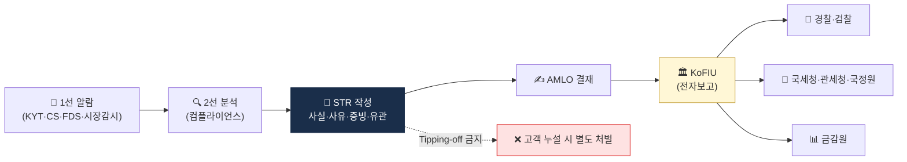
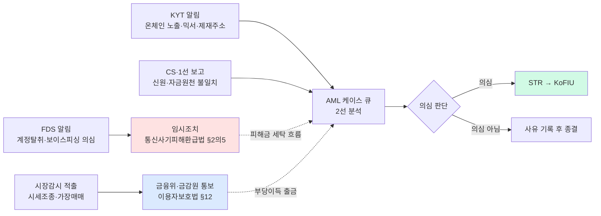
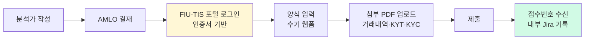

# STR / CTR — 의심거래·고액현금거래 보고

> FIU에 **무엇을 어떻게** 보고하는가. 이 글을 읽고 나면 "STR은 AML 시스템의 출구다"라는 말의 의미를 이해하고, 좋은 STR과 나쁜 STR의 차이를 기준으로 말할 수 있게 됩니다. 마지막 업데이트: 2026-10-21.

## TL;DR
- **STR (Suspicious Transaction Report, 의심거래보고)** — 의심되는 거래는 **금액 무관 지체 없이** 보고(특금법 §4). "이상거래보고"가 아니다 — "이상거래"는 가상자산이용자보호법 §12(시장감시)의 용어다.
- **CTR (Currency Transaction Report)** — **임계금액 이상 현금거래** 보고 (한국 1천만원, 가상자산엔 적용 모호)
- **Tipping-off 금지** — 고객에게 STR 사실을 알리면 별도 처벌 대상
- 가상자산은 STR이 압도적으로 중요 (CTR보다)
- STR 입력원은 KYT·CS만이 아니다. **FDS 알림**(사기 피해금 세탁 흐름)과 **시장감시 적출**(시세조종 부당이득 출금)도 STR 후보가 된다. 단 FDS의 임시조치, 시장감시의 금융위·금감원 통보는 STR과 **별개의 법적 산출물**이다.
- 2027-02-19부터 해외 VASP·자기수탁 지갑과의 1천만원 이상 이전에는 "자체 의심거래 감시체계" 구축·운영 의무가 생긴다(enacted-not-in-force). **자동 STR 의무가 아니다.**
- 보고 채널: **KoFIU 전자보고 시스템** (한국)

---

## 1. STR — AML 시스템의 출구




### 왜 STR이 그렇게 중요한가

STR은 AML 시스템이 만드는 **최종 산출물**입니다. KYC로 고객을 확인하고, KYT로 거래를 분석하고, 제재 스크리닝으로 차단을 하는 이 모든 과정이 결국 **"의심되는 거래를 FIU에게 알리기 위한"** 것입니다. STR이 없으면 수사기관은 범죄수익을 추적할 수 없고, AML 전체가 무용지물.

감독당국이 "STR 건수가 적은 회사"를 오히려 의심하는 이유가 여기 있습니다. 거래소 규모 대비 STR이 지나치게 적으면 "탐지가 실패하고 있거나, 분석가가 보고를 망설이고 있다"는 신호로 해석.

### 정의와 기본 속성

- "자금세탁 또는 공중협박자금조달의 **의심이 있는** 거래"를 FIU에 보고
- **금액 무관**: 1,000원짜리 거래여도 의심이 있으면 보고
- **지체 없이**: 일수로 정한 공개 기준은 이 저장소의 근거 자료에서 확인되지 않음 — "통상 30일" 같은 숫자를 사내 기준으로 쓰기 전에 FIU 지침 원문을 확인할 것
- **의심의 합리적 근거**만 있으면 충분 — 실제 범죄 확정 필요 없음
- **보호 원칙**: 정당 절차로 보고하면 민사·형사 면책

### 누가 보고하나

한국 특금법 §4에 따라 VASP를 포함한 모든 의무자. 보고 책임자는 **자금세탁방지 보고책임자(AMLO·MLRO)**. 탐지 쪽 근거는 FIU 고시 제2025-2호 「자금세탁방지 업무규정」(2025-10-22 발령, 2026-01-22 시행) 제76~81조 "거래모니터링체계"인데, 본문에 "가상자산"이라는 단어는 나오지 않는다 — 가상자산 전용 조문이 아니라 금융권 공통 규정이다([법제처 DRF](https://www.law.go.kr/DRF/lawService.do?OC=test&target=admrul&ID=2100000267264&type=XML)).

### 트리거 — 무엇을 의심으로 보나

| 카테고리 | 사례 |
|---|---|
| **신원·거래 불일치** | 신고 직업과 거래 금액 불일치, 가명 의심 |
| **거래 패턴 비정상** | 분할 입금(smurfing), 즉시 pass-through |
| **고위험 노출** | Mixer, OFAC SDN, 도난자금 노출 |
| **회피 행동** | 임계금액 바로 아래로 분할, KYC 회피 시도 |
| **정보 불일치** | 자료 거부, 자료 위조 의심 |
| **외부 정보** | 부정적 보도, 법집행 요청 |

### 보고 절차 (한국)

```
1. 1선 (영업·CS) 또는 시스템(KYT) → 알람 발생
2. 2선 (컴플라이언스) → 분석 + 자료 수집
3. AMLO → 보고 결정
4. KoFIU 전자보고 시스템으로 STR 전송
5. 사후: 추가 자료 요청 시 협조
```

### STR 입력원 — KYT·FDS·시장감시

한국에서 "이상거래"라는 말은 법적으로 다른 세 제도를 가리킨다. ① 전자금융 FDS·보이스피싱 임시조치(통신사기피해환급법 §2의5, 가상자산거래소 2026-10-01~), ② 가상자산이용자보호법 §12 시장감시, ③ 특금법 STR이다. ①·②는 **STR이 아니지만 STR의 입력원**이다([`../4-technology/fds.md`](../4-technology/fds.md)).



| 입력원 | 1차 산출물(STR과 별개) | STR로 넘어오는 경우 |
|---|---|---|
| KYT | — (AML 큐로 직행) | 믹서·제재주소 노출, 분할입출금, pass-through |
| FDS | 지연·일시정지(임시조치), 지급정지 | 사기 피해금이 가상자산으로 바뀌어 다계정·해외로 이전되는 흐름 |
| 시장감시 | 금융위·금감원 통보, 거래유의·거래중지 | 시세조종·가장매매 부당이득의 출금·세탁 |

**한 사건, 여러 보고.** FDS 임시조치나 §12 통보를 했다고 STR 판단이 끝나지 않는다. 반대로 STR을 했다고 §12 통보 의무가 사라지지도 않는다. 출구별로 기록을 남긴다. 미국은 FinCEN 주의보 FIN-2023-Alert005(2023-09-08)가 pig butchering 관련 SAR에 키워드 "FIN-2023-PIGBUTCHERING"을 기재하도록 요청해, 사기 탐지와 의심거래보고의 연결을 공식화했다([FinCEN Alert](https://www.fincen.gov/sites/default/files/shared/FinCEN_Alert_Pig_Butchering_FINAL_508c.pdf)).

### 2027-02-19 — "1천만원 이상 자체 의심거래 감시체계"

대통령령 제36592호(공포 2026-08-18)의 시행령 §10-20 ⑦나와 FIU 고시 제2026-2호 §28-2③은 해외 VASP·자기수탁 지갑과의 **1천만원 이상** 이전에 대해 "자체적인 의심거래 감시체계를 구축ㆍ운영"하도록 한다. 시행령 조항 시행일은 **2027-02-19**(enacted-not-in-force)이고, 고시 §28-2의 정확한 시행일은 기산점 문제로 확정되지 않았다. 입법예고안(2026-03-30)의 "1,000만원 이상은 위험도와 관계없이 의심거래로 보아 보고"는 최종본에서 바뀌었다 — **자동 STR 의무가 아니다**([감독규정 FIU 고시 제2026-2호](https://www.law.go.kr/DRF/lawService.do?OC=test&target=admrul&ID=2100000285986&type=XML); [금융위 2026-08-11](https://www.fsc.go.kr/no010101/87499); [금융위 2026-03-30](https://www.fsc.go.kr/no010101/86589)).

### 보고 양식 핵심 항목

- 보고기관·보고책임자
- 거래자 신원
- 거래 일시·금액·방법
- 의심 사유 (**사실 + 분석**)
- 첨부자료 (KYC, 거래내역, 시스템 알람)

### Tipping-off 금지

- **고객에게 STR 사실 알리면 별도 처벌 대상** (조문·형량은 특금법 원문으로 확인할 것 — 이 저장소의 2026-10 근거 자료에서는 재검증하지 않았다)
- 거래 거절·계좌폐쇄 사유로 "STR 보고했음"이라고 말하면 안 됨
- 대신 "내부 정책상" 같은 **일반적 사유**로 안내

### 실무 포인트

STR 결정은 "의심이 든다"는 1차 신호만으로 충분하므로, 분석가가 입증 책임에 부담을 느껴 **보고를 미루는 문화**가 AML 조직의 최악의 병입니다. 회사 정책에 "의심이 들면 문서화 후 STR, 아니라고 판단된 경우 사유 기록"을 기본값으로 명시해야 합니다. 이게 감독당국의 기대치이기도 합니다.

---

## 2. CTR — 한국에서의 위치

### 정의

**Currency Transaction Report** — 임계금액 초과 **현금거래** 자동 보고.

- 한국: **1천만원** (특금법 §4의2)
- 미국: $10,000

### 가상자산 적용이 모호한 이유

CTR은 본질적으로 **현금(currency)** 거래 보고 제도. 1970년대 미국 BSA에서 "현금 다발이 은행에 들어오는 순간을 잡자"는 설계로 출발. 그런데 가상자산은:

- 자체가 현금 아님
- 은행 실명계좌를 경유하므로 **입금·출금은 이미 계좌이체**
- 실제 현금 취급은 OTC desk의 극소수 사례 정도

그래서 법 문언상 VASP도 대상이지만 **실제 트리거는 거의 없음**.

### 예외: 현금 ↔ 가상자산 환전

- 현금 매매가 일어나는 OTC 시점에는 fiat 부분에 CTR 적용 가능
- 이건 VASP가 아니라 OTC desk의 문제로 포섭

### STR과의 관계

- **CTR**: 임계금액 만족하면 자동, **의심 여부 무관**
- **STR**: 의심 있으면 무조건, **금액 무관**
- **둘 다 트리거되면 둘 다 보고**

### 실무 포인트

"CTR 처리 프로세스"를 거래소에서 별도로 유지할 필요가 거의 없습니다. 영업 특성상 트리거될 가능성이 극히 낮고, 설령 발생해도 STR 프로세스로 포섭하는 게 보편적. 정책 문서에만 "CTR 대상 거래 발생 시 STR 프로세스 준용" 한 줄 있으면 규제상 충분합니다.

---

## 3. STR 품질 — 좋은 STR vs 나쁜 STR

### 좋은 STR의 4요소

- ✅ **명확한 fact pattern** — "이 시점에 이 금액이 이 패턴으로 발생"
- ✅ **분석 결론** — "왜 의심하는가"
- ✅ **첨부 증빙** — KYT 결과, KYC 자료, 시스템 로그
- ✅ **유관 거래 묶음** — 단건이 아니라 연관된 다수 거래

### 나쁜 STR의 징후

- ❌ "의심됨" 한 줄만
- ❌ 패턴 묘사 없이 금액만 나열
- ❌ 시스템 알람 **무비판 복사**
- ❌ 고위험 라벨만 보고 보고 (왜 의심인지 분석 없음)

### 실무 포인트

FIU 분석관이 한 회사의 STR을 수백 건 받으면, 품질이 낮은 STR은 실질적으로 **노이즈**가 됩니다. 노이즈가 많은 회사의 STR은 우선순위가 뒤로 밀리고, 정말 중요한 건이 묻히기 쉽습니다. 품질이 건수보다 중요하다는 인식을 회사에 심는 게 AMLO의 핵심 임무.

---

## 4. STR 운영 데이터 (한국)

- 연간 접수 건수·가상자산 부문 비중은 FIU 「KoFIU 연차보고서」 원문으로 확인할 것. 이 저장소의 2026-10 근거 자료에는 STR 건수 통계가 없어 수치를 적지 않는다.
- 가상자산 전용 alert-to-STR 전환율 공개 벤치마크는 존재하지 않는다(B). 공개된 것은 은행권 자료(EY 2018)뿐이다([EY 2018](https://ey.com/content/dam/ey-unified-site/ey-com/en-uk/industries/financial-services/documents/ey-anti-money-laundering-transaction-monitoring-2018-emeia-survey.pdf)).
- 참고로 FIU가 2025-11-06 두나무에 결정한 과태료 352억원의 사유에는 의심거래보고 위반이 포함됐다([FIU 보도자료 KDI 미러](https://eiec.kdi.re.kr/policy/materialView.do?num=273166)).

---

## 5. STR이 가는 곳 — 사후 흐름

```
VASP → KoFIU 전자보고
        ▼
KoFIU 분석 (STR + CTR + 외부 정보)
        ▼
정보 가치 있다고 판단 시
        ▼
경찰청 · 검찰 · 국세청 · 관세청 · 국정원 · 금감원에 정보 제공
        ▼
수사 · 조사 · 자산 동결 · 형사 처벌
```

### 실무 포인트

회사가 제출한 STR이 **어디까지 갔는지**는 보통 알 수 없습니다. 수사기관이 영장이나 자료제출 요청으로 다시 접촉할 때 비로소 "그 STR이 수사로 이어졌구나"를 짐작. 이 불투명성은 AML 실무자의 동기 부여를 떨어뜨리기도 하지만, **STR이 목적이 아니라 과정**이라는 것을 조직에 교육하는 게 중요합니다.

---

## 6. 자주 쓰는 STR 패턴 (가상자산)

### A. Mixer 사용

- 입금 wallet이 Tornado Cash·Wasabi 등에서 N hop 내 노출
- 출금 wallet이 mixer로 즉시 이전

### B. OFAC SDN 노출

- 거래 상대 wallet이 OFAC SDN 명단

### C. 분할 입출금 (Smurfing)

- 단기간 내 다수의 작은 금액 입금 → 한 번에 출금
- KYC 의도 회피

### D. Pass-through

- 입금 → 즉시 전액 출금 (몇 분 내)
- 거래 의도 불일치 (왜 굳이 거래소를 경유?)

### E. 신원 불일치

- 한 사람이 다수 계정 운영 의심
- 가족·지인 명의 도용 의심

### F. 도난자금 노출

- 알려진 해킹 사건의 자금 흐름과 매칭
- 예: Bybit hack, Lazarus 관련

### G. 사기 의심

- Pig Butchering·Romance scam 패턴
- 피해자 자금이 가상자산으로 이전
- 이 패턴의 1차 탐지는 대개 **FDS**(접속·기기·입출금 이상)에서 나온다. 2026-10-01부터 거래소는 통신사기피해환급법 §2의5에 따라 임시조치를 해야 하고, 그와 별개로 세탁 흐름이 보이면 STR을 판단한다([`../4-technology/fds.md`](../4-technology/fds.md)).

### 실무 포인트

A~F 패턴은 **KYT 룰과 1:1 매핑**이 가능하고, G는 FDS 신호와 KYT 신호가 함께 필요합니다. 각 패턴을 탐지하는 룰이 룰 엔진에 있다면, STR 작성 시 **"어느 룰이 트리거됐는지"** 를 첫 문장에 명시하면 자동으로 좋은 STR의 **fact pattern + 분석 결론**이 갖춰집니다. 템플릿 설계 시 이 구조를 내재화하는 게 팁.

---

## 7. 외부 협력 — 법집행 협조

### 한국 절차

- **압수수색영장** — 법원 발부. 거래 기록·계정 정보·KYC 자료 제공
- **금융거래정보 제공 요청서** (특금법 §10)
- **국제 사법공조** — 다른 나라 VASP 자금 흐름 추적

### 회사가 갖춰야 할 것

- **LE Request 처리 SOP** — Law Enforcement 요청 대응 표준 절차
- **영장 검증 절차** — 정당한 영장인지 법무 검토
- 보안·암호화된 전송 채널
- 기록보관 (어떤 자료를 누구에게 줬는지)

### 실무 포인트

수사기관 요청은 "영장이 왔으면 무조건 협조"로 끝나지 않습니다. 영장의 **범위**(특정 기간·특정 계정)를 넘는 자료를 요청하는 경우 법무 검토가 필요하고, 고객 개인정보 보호와의 균형도 고려해야 합니다. 요청이 많은 사업자는 **LE Request 전담 담당자**를 두는 것이 일반적인 설계입니다(건수 공개 자료 없음).

---

## 8. 체크리스트

```
□ KoFIU 전자보고 시스템 등록 + 인증서
□ STR 트리거 룰 정의 + 자동 큐
□ AMLO 결재 워크플로
□ Tipping-off 금지 임직원 교육
□ STR 작성 템플릿 (사실+분석+증빙)
□ STR 보고 자료 보관 (보존기간은 특금법 원문 확인 — 이용자보호법 시행령 §13의 15년은 §12 시장감시 기록 등 가상자산거래기록에 대한 것)
□ FDS·시장감시 케이스에서 넘어온 건의 STR 판단 기록
□ 외부지갑 등록제 운영
□ 내부 분석가 trained on 패턴
□ LE Request SOP
□ 분기·연간 STR 통계 모니터링
```

## 💼 실무 현장 (Industry Reality)

### 좋은 STR vs 나쁜 STR — 실제 문단 비교

**나쁜 STR (감점)**:
> "고객 A가 2026-04-10 1억원 상당 비트코인을 외부지갑으로 출금하였음. KYT 시스템에서 HIGH 알람 발생. 의심됨. STR 보고."

**좋은 STR (품질)**:
> "고객 A(계정 #12345)는 2026-04-10 14:32 KST에 1.85 BTC(당시 1.02억원 상당)를 외부지갑 bc1q...xyz로 출금하였음. 수신 주소는 Chainalysis KYT에서 Tornado Cash로부터 2-hop 상류에 위치하며, Risk Score 82점. 고객은 2025-11 가입 후 월 평균 입금 200만원에 그쳤으나 본건 출금 3일 전 8회에 걸쳐 총 1.01억원을 다수 은행 실명계좌에서 분할 입금(최대 1,490만원, 최소 980만원)하여 **CTR 회피 의심 smurfing 패턴**과 일치. 신고 직업은 '대학원생'이며 월 신고 소득 150만원 대비 거래 규모 60배 이상의 mismatch. 첨부: ①거래 타임라인 ②KYT Reactor 스크린샷 ③외부지갑 등록 기록 ④입금 원천 계좌 분석."

**차이**: fact pattern + 숫자 + 구체적 typology 명시 + 첨부 증빙.

(위 문단은 작성 연습용 가상 예시다. 금액·점수·고객 정보는 실제 사례가 아니다.)

### KoFIU 피드백 루프

- FIU가 회사별 STR 품질을 어떻게 평가하는지에 대한 공개 기준은 없다. "내부 점수화" 같은 업계 전언은 확인되지 않았다.
- 확인되는 것은 제재 사유다 — 2025-11-06 두나무 과태료 결정 사유에 의심거래보고 위반이 포함됐다([FIU 보도자료 KDI 미러](https://eiec.kdi.re.kr/policy/materialView.do?num=273166)).
- 품질 낮은 STR의 남발과 STR 부재 모두 검사에서 설명을 요구받을 수 있다는 전제로 판단 기록을 남긴다.

### FIU-TIS 제출 실무 — 한국



**실무 부담**: 건당 제출 시간·제출 방식(웹 입력 vs API)에 대한 공개 자료는 이 저장소의 근거 자료에 없다. 사내에서 실측해 인력 계획에 쓴다.

### STR 건수 벤치마크

거래소별 STR 제출 건수는 공표되지 않는다. 이전 판에 있던 거래소별 월간 건수 표는 근거가 없어 삭제했다.

### 한국 vs 미국 — 사기 연계 보고

| 항목 | 한국 | 미국 |
|---|---|---|
| 보고 명칭 | 의심거래보고(STR, 특금법 §4) | SAR |
| 사기 연계 | FDS 임시조치(통신사기피해환급법)와 STR은 별개 의무 | FinCEN 주의보가 SAR 키워드("FIN-2023-PIGBUTCHERING") 기재 요청 |
| 시장감시 연계 | §12 통보(금융위·금감원)와 STR은 별개 | — |

### 자주 나오는 오해

- **"STR 많이 내면 잘하는 것"** — 품질 > 수량. 나쁜 STR 100건 < 좋은 STR 10건.
- **"시스템 알람 = STR 자동 제출"** — 1선 알람은 **분석가 검토 대상**. 모두 STR로 가면 FIU 부담만 늘림.
- **"Tipping-off 위반 = CS 담당자만 조심"** — AMLO·영업·마케팅 누구라도 위반 시 처벌. 전사 교육 필수.
- **"CTR은 가상자산과 무관"** — 대부분 맞지만 OTC desk의 현금 환전은 여전히 대상.

### 한국 특수 현실

- **"이상거래보고"라는 말은 쓰지 않는다**: STR의 법률 용어는 "의심거래보고"다. "이상거래"는 이용자보호법 §12(시장감시), "이상금융거래"는 금감원 FDS 가이드라인의 용어다.
- **기록 보존 기간을 섞지 않는다**: 이용자보호법 시행령 §13의 15년은 상시감시·조치 결과, 통보·신고·보고 기록 등 가상자산거래기록에 대한 것이고, STR 자료의 보존기간은 특금법을 따른다.
- **보이스피싱 연계**: 2026-10-01부터 거래소에도 통신사기피해환급법 임시조치·지급정지 의무가 있다. FDS 팀과 AML 팀 사이의 이관 경로를 SOP에 적는다.
- **1천만원 감시체계(2027-02-19~)**: 해외 VASP·자기수탁 지갑 1천만원 이상 이전은 "자체 의심거래 감시체계" 대상이지 자동 STR 대상이 아니다.

### 주니어 Analyst STR 작성 — 공수

케이스 유형별 작성 시간에 대한 공개 자료는 없다. 경험적으로 단순 노출 건보다 사기 연계(FDS 이관)·다계정·조직형 건이 훨씬 오래 걸리므로, 케이스 유형별로 사내 실측값을 쌓아 두는 것이 좋다.

---

## 9. STR 실무 템플릿 — 작성 연습용 예시

> 아래 섹션 구성과 예시 값은 사내 작성 연습용이다. KoFIU 공식 양식의 항목·순서와 같다는 근거는 없으며, 금액·점수·주소·제재 대상명은 모두 가상이다.

### 9.1 권장 섹션 구성

실무에서 쓰기 좋은 7개 섹션:

1. **보고기관 정보** — 기관명, FIU 신고번호, AMLO 성명·연락처
2. **의심거래 개요** — 5W1H (Who/What/When/Where/Why/How)
3. **고객 정보** — KYC snapshot (실명확인 방법, KYC 등급, EDD 여부, 직업·자산·거래목적)
4. **거래 상세** — 거래번호, 금액, 통화, 송수신자, 관련 거래 7일 윈도우
5. **의심 근거** — KYT alert 점수, 제재 스크리닝 결과, Pattern 분석, Exposure 경로
6. **첨부자료** — KYT dashboard 캡처, OFAC 조회 결과, 증빙, 과거 기록
7. **보고자 의견** — 의심 수준, 추가 조사 권장, Tipping-off 통제 확인

### 9.2 Good STR vs Bad STR

**❌ Bad STR (FIU 반송 확률 ↑)**:

```
거래번호: T12345
의심 근거: 큰 금액 출금
```

---

**✅ Good STR (FIU가 원하는 수준)**:

```
거래번호: T12345
거래일시: 2026-04-19 14:23:17.432 KST
송금: 고객 A (CI: CI_HASH_abc123) → 외부 지갑 0xABC...def
금액: 5억원 (~$370K)
```

### 의심 근거

1. **KYT Exposure Score = 72 (HIGH)**
   - Direct: Tornado Cash 5% ($20K)
   - 2-hop: OFAC SDN 지정 주소(가상 예시) 8%

2. **Pattern: Structuring 의심**
   - 최근 7일간 5회 출금, 각 9,500만원 (동일 금액대 반복 — STR에는 금액 기준이 없으므로 "임계 직전"이 아니라 반복성 자체를 근거로 기술)
   - 시간 간격 4~7시간, 규칙적

3. **KYC 상태 Yellow (비대면 확인)**
   - 자금원천 "사업소득" 신고하나 사업자등록증 미제출 요청 후 무응답

4. **과거 유사 행위**
   - 2025-11 동일 패턴 1회 (당시 EDD로 통제 후 정상 판정)
   - 본 사안은 패턴 반복 + OFAC 노출 추가

### 첨부

- [첨부1] Chainalysis Reactor 스크린샷 (exposure 경로 3-hop)
- [첨부2] OFAC SDN 조회 결과 (sdn_check.pdf)
- [첨부3] 7일 거래 상세 (transactions_2026_04_12_19.csv)
- [첨부4] CS 문의 로그 (자금원천 요청 → 고객 미응답 3회)
- [첨부5] KYC 등급 이력 (Yellow 유지 사유)

### 보고자 의견

- **의심 수준**: HIGH
- **추가 조사 권장**:
  - 거래 상대방 카운터파티 (0xABC...) exposure 재분석
  - 고객 연관 계정 탐색 (동일 KYC email/phone)
- **Tipping-off 통제**:
  - [✓] 고객에게 미통지
  - [✓] 내부 Alert 시스템에만 기록
  - [✓] 본 STR 사실 외부 노출 금지 (Tipping-off 교육 완료)

### 9.3 품질 체크리스트 (반송 방지)

STR 제출 전 AMLO 승인 체크:

- [ ] 5W1H 모두 채워짐
- [ ] 금액·일시·주소 기록 정확
- [ ] KYT 점수 + 근거 데이터 첨부
- [ ] OFAC/제재 조회 결과 캡처
- [ ] 관련 거래 윈도우 포함
- [ ] 자금원천 증빙 시도 기록
- [ ] Tipping-off 통제 확인 (고객 미통지)
- [ ] 의심 수준 High/Medium/Low 명시
- [ ] 과거 유사 케이스 cross-reference
- [ ] 첨부자료 순번·파일명 규칙 준수

### 9.4 흔한 반송 사유

| 사유 | 조치 |
|---|---|
| 근거 빈약 ("큰 금액") | KYT 점수·pattern·exposure 정량 추가 |
| 금액·일시 오기 | ms 정밀도 기록, timezone 명시 |
| 첨부 누락 | 스크린샷·로그·증빙 체크리스트 적용 |
| Tipping-off 의심 | 내부 기록만 유지, 고객 연락 금지 |
| 중복 보고 | 거래번호 기반 dedup, 동일 pattern 요약 보고 |

### 9.5 처리 기간

- 특금법상 의무: **지체 없이 보고**. 단계별 소요일(작성→결재→제출)의 공개 벤치마크는 없다 — 사내 SLA는 실측으로 정하고, 지연 사유를 기록한다.
- FDS 임시조치가 걸린 건은 고객 통지·본인확인·해제 절차가 동시에 진행되므로, STR 판단 일정과 별도로 관리한다.

---

## 더 읽을거리
- [`cdd-edd.md`](cdd-edd.md) — CDD·EDD가 STR 트리거의 시작
- [`sanctions-screening.md`](sanctions-screening.md) — 제재 매칭 → STR
- [`../4-technology/kyc-kyt.md`](../4-technology/kyc-kyt.md) — KYT 알람이 STR로 연결
- [`../4-technology/fds.md`](../4-technology/fds.md) — FDS·시장감시·STR 세 제도의 경계
- [`../../reports/가상자산 AML KYT FDS 트래블룰 흐름.md`](../../reports/가상자산%20AML%20KYT%20FDS%20트래블룰%20흐름.md) — 정본 보고서
- [KoFIU 공식](https://www.kofiu.go.kr/)
- [FATF Recommendation 20 — STR](https://www.fatf-gafi.org/en/publications/Fatfrecommendations/Fatf-recommendations.html)
