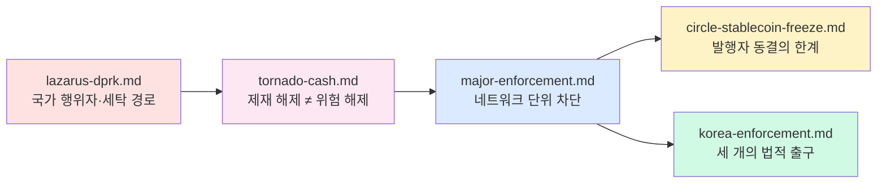

# 6️⃣ Cases — 실제 사건에서 배우기

> 이론은 배운 뒤, **실제로 무엇이 터졌는지**. 이 폴더는 업계 분기점이 된 사건 계열(글로벌 4개 + 한국 1개)을 서사로 정리합니다. 2026-10-21 판부터 모든 노트는 `research/2026-10-*.md` 도시에와 정본 보고서에서 원문으로 확인된 사실(confidence A, 일부 B)만 씁니다. 확인되지 않은 과거 사건의 금액·인명·세부는 삭제하거나 "공개 근거 미확인"으로 표시했습니다. 마지막 업데이트: 2026-10-21.

## 누가 먼저 읽어야 하나

- 🕵️ AML 담당자 — 남의 실패에서 자사 리스크 체크리스트를 뽑고 싶은 사람
- 📰 투자자·기자·학생 — "Bybit USD 14.6억", "Tornado 제재 해제", "두나무 과태료 352억원"을 맥락과 출처와 함께 이해
- ⚖️ 법무·정책 — 제재 해제와 형사 트랙의 분리, 거래 유형 규제에서 네트워크 차단으로의 이동을 보고 싶은 사람

## 읽는 순서

## 파일 인덱스

| # | 파일 | 대표 사건(원문 확인) | 왜 분기점인가 |
|---|---|---|---|
| 1 | [`lazarus-dprk.md`](lazarus-dprk.md) | Bybit USD 14.6억·회수 3.8%(FATF 6차 TU), 2025 DPRK 탈취 Chainalysis 20억 vs TRM 19.2억(B) | FATF 7차 TU가 **제3자 인프라 공격·동남아 세탁 노드**를 새 위험으로 지목 |
| 2 | [`tornado-cash.md`](tornado-cash.md) | 2025-03-21 SDN 삭제 → 2025-08-06 Storm 유죄 평결(B) → 2026-10-06 믹싱 NPRM 철회 | **목록 변경과 위험 판단의 분리** — 제재 후 입금 71.03% 감소에도 보안사고 78.33% 경유 |
| 3 | [`major-enforcement.md`](major-enforcement.md) | Prince Group·Huione(2025-10-14), Paxful $3.5M(2025-12-09), BitBank(2026-09-17), A7(2026-10) | 거래 **유형** 규제에서 특정 **네트워크** 차단으로. 트래블룰 독립 제재 사례 없음 |
| 4 | [`circle-stablecoin-freeze.md`](circle-stablecoin-freeze.md) | 동결 전 인출 USDC 18.7%·USDT 7.3%, FATF 7차 TU para 35 동결 저항형 토큰 | 발행자 동결은 **보완 수단**이지 1차 통제가 아니다 |
| 5 | [`korea-enforcement.md`](korea-enforcement.md) | 두나무 과태료 352억원(2025-11-06), 이용자보호법 첫 과징금(2025-09-03), 거래소 임시조치 의무(2026-10-01) | FDS·시장감시·STR **세 출구**로 갈라지는 한국 집행 |

## 핵심 출구

- DPRK 세탁 경로: 탈취(제3자 인프라 포함) → 다수 지갑 분산 → 브리지·비수탁 지갑·OTC → 세탁 노드(FATF 6·7차 TU)
- Tornado Cash: 제재 해제(목록) · 형사 평결(송금업) · 미국 믹싱 규칙 철회 · EU AMLR 2027-07-10을 각각 구분해 설명
- 2025~2026 집행 사유의 공통분모: 등록·AML 프로그램·SAR/STR·고객확인·지정 네트워크와의 거래
- "이 사건이 내 회사였다면 어느 법적 출구로 보냈어야 했나" 관점의 내부 체크리스트

## 이전 판에서 바뀐 것 (2026-10-21)

- Binance·OKX·BitMEX 등 과거 합의 금액, Ronin 등 과거 해킹 세부, Terra·Wemix 경과는 근거 자료 범위 밖이라 **"공개 근거 미확인"** 으로 격하
- 원문 근거가 없는 추정치 차트 이미지(`charts/output/*`)를 걷어내고, 원문 값만으로 그린 Mermaid 연대기·흐름도로 대체
- 2025-10~2026-10 사건(Prince·Huione, Paxful, FINTRAC Xeltox, BitBank, A7, FinCEN 철회, 한국 2026 제도 개편) 반영

## 다음 단계

- 온체인 자금세탁 **기술적 원리** → [`../3-crypto-aml/onchain-typology.md`](../3-crypto-aml/onchain-typology.md)
- 제재 스크리닝 구현 → [`../5-compliance/sanctions-screening.md`](../5-compliance/sanctions-screening.md)
- 2026-10-21 기준 전체 흐름 → [`../../reports/가상자산 AML KYT FDS 트래블룰 흐름.md`](../../reports/가상자산%20AML%20KYT%20FDS%20트래블룰%20흐름.md)
- 60일 커리큘럼 D50~D53에서 사건별 읽기
- 상위 인덱스 → [`../README.md`](../README.md)
