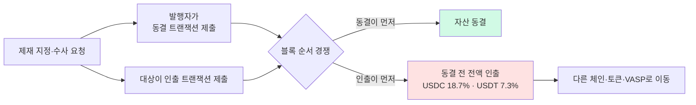
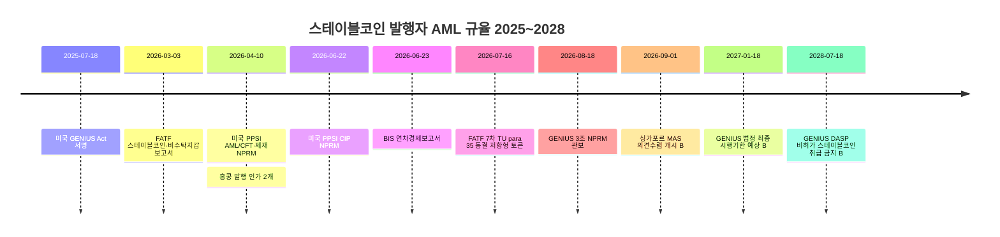
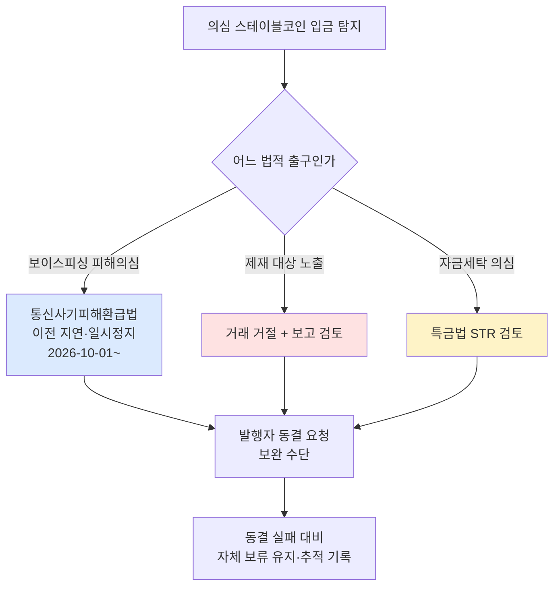

# Circle USDC 동결 — 스테이블코인 발행자의 AML 권한과 한계

> 발행자가 **제재·범죄 관련 자산을 직접 동결**할 수 있다는 것은 스테이블코인을 AML의 "집행 레이어"로 만든다. 그런데 2026년 FATF·BIS·학계는 같은 결론에 도달했다 — **발행자 동결에 기대서는 안 된다.** 이 글을 읽고 나면 동결이 왜 늦을 수 있는지(동결 전 인출: USDC 18.7%·USDT 7.3%), 범죄조직이 왜 "동결 면역" 스테이블코인을 직접 발행했는지(FATF 7차 TU para 35), 그리고 각 관할이 발행자 의무를 어떻게 법제화하고 있는지 설명할 수 있게 됩니다. 마지막 업데이트: 2026-10-21.

> **근거 범위**: `research/2026-10-*.md` 도시에와 정본 보고서에서 confidence A(일부 B, "(B)" 표시)로 확인된 사실만 쓴다. 이전 판의 Circle 누적 동결액·사례 수, 사건별 동결액(Tornado·Ronin·Bybit 등), 발행자별 연간 동결 주소 수, Circle 내부 처리 시간·환수율, 한국 거래소별 USDC 정책·보유 비중, DAXA 공동 가이드·30분 공유 규칙은 이 근거 자료로 확인되지 않아 삭제했다. Tether·T3 FCU 누적 동결액 보도는 C 등급이라 쓰지 않는다.

## TL;DR

- 중앙화 스테이블코인(USDC·USDT 등)은 **발행자가 컨트랙트 수준에서 특정 주소의 송수신을 막을 수 있는 구조**다. Circle 개별 동결 건수·금액은 이 저장소 근거 자료에서 확인되지 않았다(공개 근거 미확인)
- **동결은 늦을 수 있다**: Ethereum 2017-11~2025-08 데이터(동결 가치 15억 달러 초과)에서 **USDC 제재 주소의 18.7%, USDT의 7.3%가 동결 발효 전에 전액 인출**됐다("Sanction-Evasion MEV")
- **FATF 7차 TU(2026-07-16) para 35**: 제3자 발행자가 USD 2,900만 이상을 동결하자 범죄 복합체가 "immune to asset freezing"을 내세운 자체 스테이블코인을 발행 → VASP는 "issuer-level asset freeze/burn mechanisms"를 준수 안전장치로 믿을 수 없을 수 있다
- **FATF 2026-03-03 보고서**: 발행자에게 동결·소각·회수, 환매 시 CDD, allow/deny-listing 같은 통제를 요구하는 것을 모범사례로 제시. 다만 FATF 기준이 VASP 규율을 넘는 별도 스테이블코인 체계를 요구하지는 않는다
- **미국 GENIUS Act**: 2025-07-18 서명(enacted-not-in-force), 허가 발행자(PPSI)의 BSA 편입 NPRM 2026-04-10(proposed), 법 시행은 2027-01-18 예상(B)
- 한국: 7차 TU Annex A에서 "스테이블코인 발행자 등록·인가 요구"는 **No**

---

## 1. 발행자 동결 메커니즘

### 기술 구조 (개념)

중앙화 스테이블코인 컨트랙트에는 발행자가 지정한 권한 주소가 특정 주소를 **차단 목록**에 올리는 기능이 있다. 차단된 주소는 해당 토큰을 보내지도 받지도 못한다. 잔액이 사라지는 것은 아니고, 차단이 풀리면 다시 쓸 수 있다.

```solidity
// 개념 예시 — 실제 USDC 컨트랙트 코드가 아니다. 원문은 발행자 공개 코드로 확인할 것
modifier notBlocked(address a) { require(!blocked[a], "blocked"); _; }
function block(address a) external onlyComplianceRole { blocked[a] = true; }
function transfer(address to, uint256 v) external notBlocked(msg.sender) notBlocked(to) { /* ... */ }
```

권한 분리(동결 권한·발행 권한·업그레이드 권한)의 구체 구조와 Circle의 공식 동결 정책 문언은 이 근거 자료에서 확인하지 않았다 — **공개 근거 미확인**.

### 동결은 "일반 트랜잭션"이다

Wu 외(2026)의 핵심 관찰은 **동결도 블록에 들어가야 효력이 생기는 트랜잭션**이라는 점이다. 그래서 제재 대상의 인출 트랜잭션과 블록 순서를 놓고 경쟁한다([arXiv 2603.27739](https://arxiv.org/abs/2603.27739), 프리프린트).



| 측정 | 결과 |
|---|---|
| 데이터 | Ethereum USDT·USDC 집행·회피 종단 데이터 2017-11~2025-08, 동결 가치 15억 달러 초과 |
| 동결 발효 전 전액 인출 | **USDC 제재 주소의 18.7%, USDT의 7.3%** |
| 해석 | 회피는 MEV 전문 행위자에 집중. 준수하는 발행자도 순서 시장에 참여하는 것이 합리적이 된다 |
| 한계 | Ethereum 한정(Tron 등 미포함). 선행 인출이 모두 회피 의도인지는 식별 불가 |

### 실무 포인트

거래소가 "의심 자금이 USDC/USDT라 발행자가 동결해 줄 것"이라고 가정하면, 측정상 상당 비율이 그 전에 빠져나간다. **거래소 자체 입금 차단·출금 보류가 1차 통제**이고, 발행자 동결은 보완이다.

---

## 2. 2026년 공적 문서가 말하는 것

### FATF 7차 TU — 동결 저항형 스테이블코인 (2026-07-16)

7차 TU para 35는 이를 새 유형으로 기록했다: "the deliberate issuance of proprietary stablecoins specifically designed to circumvent law enforcement intervention". 캄보디아 소재 금융 복합체가 "immune to asset freezing"을 내세운 USD 연동 스테이블코인을 발행했는데, 그 계기는 **제3자 스테이블코인 발행자가 이 복합체 연계 지갑의 USD 2,900만 이상을 동결한 사건**이었다. FATF의 결론은 VASP를 포함한 의무주체가 "may be unable to rely on issuer-level asset freeze/burn mechanisms as a compliance safeguard"라는 것이다([7차 TU PDF](https://www.fatf-gafi.org/content/dam/fatf-gafi/reports/7th-targeted-update-on-implementation-fatf-standards-vas-vasps-2026.pdf.coredownload.pdf)).

같은 보고서 권고 5-ii는 VASP 통제 요소로 "KYC, wallet screening, blacklisting, and, where appropriate, whitelisting mechanisms as well as freezing and blocking capabilities"를 열거한다 — **동결·차단 역량을 VASP 자신이 갖추라는 것**이다.

### FATF 스테이블코인·비수탁지갑 보고서 (2026-03-03)

- 2025년 중반 기준 스테이블코인 250종 이상, 시총 USD 3,000억 초과. Chainalysis의 "2025년 불법 VA 거래량의 84%가 스테이블코인" 추정을 인용
- 모범사례: 발행자에게 "the ability to freeze, burn, or withdraw stablecoins in the secondary market, conduct customer due diligence at redemption, and, where appropriate, implement smart contract controls, such as allow-listing … and deny-listing"을 요구
- 선 긋기: "the FATF Standards do not require jurisdictions to adopt regulatory frameworks for stablecoin arrangements beyond those already applicable to VASPs"

출처: [FATF 2026-03-03](https://www.fatf-gafi.org/en/publications/Virtualassets/targeted-report-stablecoins-unhosted-wallets.html)

### BIS 연차경제보고서 (2026-06-23)

"stablecoins account for a significant share of illicit on-chain activity"라고 하며, 발행자 동결과 분석업체 지원이 "cannot replace routine, large-scale AML/CFT controls"라고 했다([BIS AER 2026](https://www.bis.org/publ/arpdf/ar2026e3.htm)).

### 업계 보고서 수치 (B)

- Chainalysis: 2025년 불법 거래량의 **84%** 가 스테이블코인(분모: 불법 거래량)([Chainalysis](https://www.chainalysis.com/blog/2026-crypto-crime-report-introduction/))
- TRM: 2025년 제재 주체·관할 유입의 **약 95%** 가 스테이블코인, 검증된 사기 유입의 **84%** 가 스테이블코인([TRM](https://www.trmlabs.com/reports-and-whitepapers/2026-crypto-crime-report))

두 회사의 "84%"는 분모가 다르다(불법 거래량 전체 vs 검증된 사기 유입). 같은 수치로 인용하지 않는다.

### 실무 포인트

FATF·BIS·학계가 2026년에 같은 방향을 가리킨다. 거래소의 스테이블코인 위험평가에는 ① 발행자가 동결 기능·정책을 갖췄는가 ② 동결 저항을 표방하는 토큰인가 ③ 자체 차단·보류로 동결 공백을 메울 수 있는가 — 세 항목이 들어가야 한다.

---

## 3. 법적·윤리적 논점

### A. 집행 레이어로서의 한계

- **시간**: 동결은 트랜잭션 경쟁이라 늦을 수 있다(§1).
- **범위**: 발행자가 동결할 수 있는 것은 자기 토큰뿐이다. 다른 토큰·체인으로 바뀐 뒤에는 닿지 않는다.
- **회피 설계**: 범죄조직이 동결 기능 없는 자체 토큰을 쓰면 발행자 동결이라는 수단 자체가 사라진다(7차 TU para 35).

### B. 검열 저항성과의 긴장

탈중앙 자산(BTC·ETH)은 특정 주체가 동결할 수 없다. 중앙화 스테이블코인은 발행자 정책에 따라 동결된다. 이 트레이드오프 자체는 구조적 사실이지만, 발행자별 동결 빈도 비교(이전 판의 "연 50+ vs 200+")는 근거가 확인되지 않아 삭제했다.

### C. 절차적 정당성

어떤 근거(공식 제재·수사기관 요청·발행자 자체 판단)로 동결하는지, 오동결 시 해제 절차가 무엇인지는 발행자 정책과 관할 법에 달려 있다. 각 관할이 이를 법제화하는 중이다(§6).

---

## 4. 한국 VASP 영향

- **한국은 발행자 인가 체계가 아직 없다**: 7차 TU Annex A의 한국 행에서 "스테이블코인 발행자 등록·인가 요구"는 **No**다(위험평가·입법·검사·집행·트래블룰은 Yes)([7차 TU PDF](https://www.fatf-gafi.org/content/dam/fatf-gafi/reports/7th-targeted-update-on-implementation-fatf-standards-vas-vasps-2026.pdf.coredownload.pdf)). 원화 스테이블코인 입법 논의는 C 등급 보도뿐이라 여기서 다루지 않는다.
- **법정 지연·정지 의무가 먼저 작동한다**: 2026-10-01부터 통신사기피해환급법상 "금융회사등"에 가상자산거래소가 포함돼, 피해의심거래계좌등으로 추정되면 **가상자산 이전을 지연·일시정지**해야 한다(제2조의5)([법제처 통신사기피해환급법](https://www.law.go.kr/LSW/lsInfoR.do?lsiSeq=290245&efYd=20261002&ancYnChk=0&chrClsCd=010202&urlMode=lsInfoR); [금융위 2026-03-13](https://www.fsc.go.kr/no010101/86446)). 보이스피싱 피해금이 스테이블코인이어도 거래소의 1차 의무는 발행자 요청이 아니라 이 법정 조치다.
- 한국 거래소별 USDC 지원·동결 대응 채널·보유 비중은 공개 근거가 확인되지 않았다.

### 실무 포인트

한국 거래소 내부 절차는 **"자체 조치(법정 지연·정지, 입금 차단) → 발행자 동결 요청"** 순서로 써야 한다. 발행자 동결이 성공하더라도 그 사이 거래소가 아무 조치를 하지 않았다면 법정 의무 이행 여부가 따로 문제된다.

---

## 5. 발행자 의무의 법제화 — 관할별 상태 (2026-10-21)

| 관할 | 문서 | 발행자 동결·추적 관련 | 상태 |
|---|---|---|---|
| FATF | 스테이블코인·비수탁지갑 보고서(2026-03-03) | 동결·소각·회수, 환매 시 CDD, allow/deny-listing을 모범사례로 | 발간(비구속) |
| 미국 | GENIUS Act(2025-07-18 서명) | PPSI를 BSA 금융기관으로 편입하는 AML/CFT·제재 NPRM(2026-04-10), CIP NPRM(2026-06-22) | 법 enacted-not-in-force(시행 2027-01-18 예상, B) / NPRM proposed |
| 미국 | GENIUS §3 NPRM(관보 2026-08-18) | 의견 2026-10-19 마감 | proposed |
| 싱가포르 | MAS PSA 개정 의견수렴(2026-09-01~10-16) | 발행자의 "technical capability to trace, freeze, and/or burn" | proposed(B) |
| 홍콩 | HKMA 발행 인가 | 인가 2개(2026-04-10) | in-force |
| 한국 | — | 발행자 등록·인가 요구 없음(7차 TU Annex A) | — |

출처: [FATF 2026-03-03](https://www.fatf-gafi.org/en/publications/Virtualassets/targeted-report-stablecoins-unhosted-wallets.html) · [재무부 2026-03 의회보고서](https://home.treasury.gov/system/files/246/GENIUS-Act-Illicit-Finance-Innovation-Congressional-Report-March-2026.pdf) · [Federal Register API](https://www.federalregister.gov/api/v1/documents.json?conditions%5Bterm%5D=%221010.410%22&conditions%5Bagencies%5D%5B%5D=financial-crimes-enforcement-network&order=newest&per_page=20) · [Federal Register 2026-16796](https://public-inspection.federalregister.gov/2026-16796.pdf) · [Jones Day](https://www.jonesday.com/en/insights/2026/08/us-treasury-proposes-genius-act-rules-for-stablecoin-issuance-offer-and-sale) · [Allen & Gledhill](https://www.allenandgledhill.com/sg/perspectives/articles/33474/sgkh-mas-consults-on-amendments-to-payment-services-act-2019-to-implement-stablecoin-regulatory-framework) · [HKMA](https://www.hkma.gov.hk/eng/regulatory-resources/registers/register-of-licensed-stablecoin-issuers/)



이전 판의 "MiCA 2026 완전 적용", "Circle Europe 라이선스", "발행자 트래블룰 편입 논의(FATF·FSB)", "금융위 2025 보고서"는 근거 자료에서 확인되지 않아 삭제했다.

---

## 6. 학습 포인트

```
- 발행자 동결은 트랜잭션 경쟁이다 — 동결 전 전액 인출 USDC 18.7%·USDT 7.3%
- FATF 7차 TU: 동결 면역 자체 스테이블코인 등장 → 발행자 동결에 의존 불가
- FATF가 VASP에 요구하는 것은 자체 동결·차단 역량(권고 5-ii)
- "84%"는 Chainalysis(불법 거래량)와 TRM(검증 사기 유입)의 분모가 다르다
- 한국은 발행자 인가 체계 없음(Annex A No), 거래소 법정 지연·정지 의무는 2026-10-01부터
```

## 💼 실무 현장 (Industry Reality)

### 의심 스테이블코인 유입 시 처리 순서 (한국 거래소)



이전 판의 "T+15분 DAXA 공유 → T+24시간 blacklist" 타임라인, Bybit USDC 사례 흐름도, 거래소별 스테이블코인 보유 비중 표는 근거가 없어 삭제했다. 발행자 응답 시간에 대한 공개 벤치마크는 없다.

### 위험평가 항목 — 토큰 단위

| 항목 | 질문 | 근거 |
|---|---|---|
| 발행자 통제 | 동결·소각·회수 기능과 공개 정책이 있는가 | FATF 2026-03-03 |
| 동결 저항 표방 | "동결 불가"를 마케팅하는 토큰인가 | 7차 TU para 35 |
| 발행자 규율 | 인가 관할(미국 PPSI·홍콩 인가 등) 발행인가 | §5 표 |
| 체인 | 동결 측정이 없는 체인(Tron 등)인가 | Wu 외 2026 한계 |

### 자주 나오는 오해

- **"동결되면 끝"** — 동결 발효 전 인출이 측정돼 있다(USDC 18.7%·USDT 7.3%).
- **"스테이블코인은 발행자가 막아 주니 거래소 통제는 덜 해도 된다"** — FATF 7차 TU와 BIS가 반대로 말한다.
- **"동결은 소각"** — 동결은 송수신 차단이다. 소각·회수는 별도 기능이며 FATF는 둘을 구분해 열거한다.
- **"84%는 같은 통계"** — Chainalysis와 TRM의 분모가 다르다.

### 한국 특수 현실

- 거래소의 1차 의무는 법정 지연·정지(2026-10-01~)다. 발행자 동결 요청은 그 위에 얹는 보완 수단이다.
- 발행자 등록·인가 체계가 없으므로(Annex A No), 한국 거래소가 취급 토큰의 발행자 통제 수준을 직접 평가해야 한다.

---

## 더 읽을거리

- [`tornado-cash.md`](tornado-cash.md) — 제재 목록과 위험 평가의 분리
- [`lazarus-dprk.md`](lazarus-dprk.md) — DPRK와 캄보디아 복합체
- [`major-enforcement.md`](major-enforcement.md) — Huione·Prince Group 조치
- [`../3-crypto-aml/vasp-obligations.md`](../3-crypto-aml/vasp-obligations.md) — VASP 의무
- [`../5-compliance/sanctions-screening.md`](../5-compliance/sanctions-screening.md) — OFAC SDN 스크리닝 절차
- [Wu 외 — Ordering Power is Sanctioning Power (arXiv 2603.27739)](https://arxiv.org/abs/2603.27739)
- [FATF — Targeted Report on Stablecoins and Unhosted Wallets (2026-03-03)](https://www.fatf-gafi.org/en/publications/Virtualassets/targeted-report-stablecoins-unhosted-wallets.html)
- [FATF 7차 Targeted Update (2026-07-16)](https://www.fatf-gafi.org/content/dam/fatf-gafi/reports/7th-targeted-update-on-implementation-fatf-standards-vas-vasps-2026.pdf.coredownload.pdf)
- [BIS Annual Economic Report 2026](https://www.bis.org/publ/arpdf/ar2026e3.htm)
