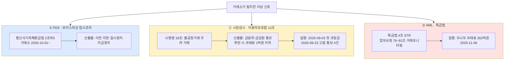
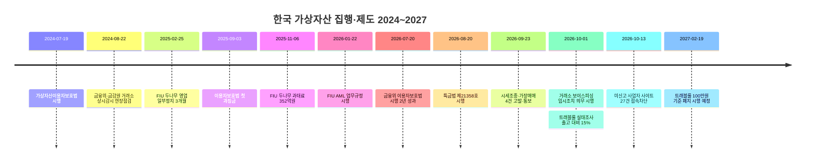
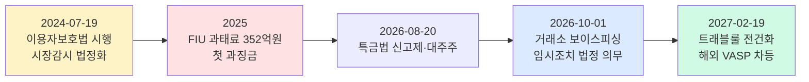

# 🇰🇷 한국 거래소·VASP 실제 사건·Enforcement 분석

> 2024~2026년 한국 가상자산 집행 기록. 한국은 2025년에 **FIU 과태료 352억원(두나무)** 과 **가상자산이용자보호법 첫 과징금**으로 "자율규제·행정지도" 단계를 넘어섰고, 2026-10-01부터는 거래소가 보이스피싱 피해의심 이전을 **법적으로** 지연·정지해야 한다. 이 글을 읽고 나면 한국 집행이 왜 세 개의 서로 다른 법적 출구(FDS·시장감시·STR)로 갈라지는지, 그리고 각 출구에서 실제로 어떤 처분이 나왔는지 설명할 수 있게 됩니다. 마지막 업데이트: 2026-10-21.

> **근거 범위**: `research/2026-10-*.md` 도시에와 정본 보고서에서 confidence A(일부 B, "(B)" 표시)로 확인된 사실만 쓴다. 두나무 영업정지 처분 취소소송 1심 결과, 빗썸·코인원·코빗 제재 세부, 기존 사업자 재신고 기한, 원화 스테이블코인 입법 경과는 C 등급(보도 단독)이라 쓰지 않는다. 이전 판의 2021 신고 대란 수치, Terra-Luna·Wemix·Bithumb 지배구조 사건 경과, DAXA 공동 블랙리스트 운영, 국세청 추징액 등은 이 근거 자료로 확인되지 않아 삭제하거나 "공개 근거 미확인"으로 격하했다.

---

## TL;DR

- **"이상거래"는 한국 법에서 세 제도다**: ① 전자금융 FDS·보이스피싱 임시조치(통신사기피해환급법, 거래소 **2026-10-01~** 법정 의무) ② 가상자산이용자보호법 §12 불공정거래 상시감시 ③ 특금법 의심거래보고(STR). 집행도 이 셋으로 갈라진다
- **AML(FIU)**: 두나무 영업 일부정지 3개월(2025-02-25, 미신고 VASP 거래 금지 위반), **과태료 352억원(2025-11-06)** — 고객확인·거래제한·의심거래보고 등 위반. **트래블룰(특금법 제5조의3)은 사유가 아니다**
- **시장감시(금융위)**: 2025-09-03 첫 과징금, 2026-07-20 시행 2년 성과(조사 완료 40여 건·고발/통보 30여 건·과징금 2건), 2026-09-23 고발·통보 4건
- **미신고 사업자**: 2026-10-13 FIU가 사이트 27건 접속차단 공표(수사기관 통보 누적 44개)
- **제도 개편**: 특금법 제21358호 2026-08-20 시행(신고제·대주주), 시행령 제36592호 2026-08-18 공포 — 트래블룰 100만원 기준 폐지 등은 **2027-02-19 시행(enacted-not-in-force)**

---

## 🗺️ 한국 enforcement 지도 — 세 개의 법적 출구

근거: [법제처 통신사기피해환급법](https://www.law.go.kr/LSW/lsInfoR.do?lsiSeq=290245&efYd=20261002&ancYnChk=0&chrClsCd=010202&urlMode=lsInfoR) · [가상자산이용자보호법](https://www.law.go.kr/LSW/lsInfoR.do?lsiSeq=290735&efYd=20261002&ancYnChk=0&chrClsCd=010202&urlMode=lsInfoR) · [시행령](https://www.law.go.kr/LSW/lsInfoR.do?lsiSeq=290171&efYd=20261002&ancYnChk=0&chrClsCd=010202&urlMode=lsInfoR) · [AML 업무규정](https://www.law.go.kr/DRF/lawService.do?OC=test&target=admrul&ID=2100000267264&type=XML)

### 연대기

---

## 1. AML(FIU) — 두나무 제재

### 무엇이 처분됐나

| 일자 | 처분 | 사유 | 등급 |
|---|---|---|---|
| 2025-02-25 | 영업 일부정지 3개월 | 미신고 VASP와의 거래 금지 위반 | A |
| 2025-11-06 | 과태료 총 **352억원** 결정(약 860만건) | 고객확인·거래제한·의심거래보고 의무 위반 등 | A |
| 2025-12-09 | FIU 제재공시: 과태료 **35,215,600,000원**, 제재대상사실 ①고객확인·거래제한 조치 의무 위반 ②영장 관련 고객 STR 의무 위반 ③의심거래 감시체계 구축 의무 위반 | — | B |

출처: [FIU 보도자료 KDI 미러](https://eiec.kdi.re.kr/policy/materialView.do?num=273166) · [FIU 제재공시](https://www.kofiu.go.kr/kor/notification/sanctions.do)(2026-10-21 직접 재확인 실패, 이전 확인 기록 기준 B)

### 읽는 법

- **트래블룰 위반은 사유가 아니다.** 2024-01-01~2026-10-21 어느 관할에서도 트래블룰 위반을 독립 제재 사유로 명시한 사건은 확인되지 않았다.
- 제재대상사실에 **"의심거래 감시체계 구축 의무 위반"** 이 들어 있다(B). 탐지 시스템을 "갖추는 것" 자체가 제재 대상이 된다는 뜻이다. 한국 거래모니터링의 법적 근거는 FIU 고시 「자금세탁방지 업무규정」 제76~81조(2025-10-22 발령, 2026-01-22 시행)이며, 본문에 "가상자산"이라는 단어는 나오지 않는다 — 금융권 공통 규정이다.
- 처분 이후의 행정소송 경과는 보도 단독(C)이라 이 노트에서 다루지 않는다.

### 실무 포인트

FIU 검사 대비의 핵심은 "STR을 몇 건 냈는가"보다 **감시체계가 설계대로 작동했다는 증거**(추출 기준, 점검 기록, 기준 변경 이력)다. 2021 FATF 가이던스 para 276의 "verify their integrity on a regular basis"와 같은 취지다.

---

## 2. 시장감시(금융위·금감원) — 이용자보호법 §12

| 일자 | 내용 | 출처 |
|---|---|---|
| 2024-07-08 | 조사체계 공표: 거래소 적출·심리 → 통보 → 조사 → 가상자산조사심의위원회 → 고발·통보·과징금·경고·주의 | [금융위 2024-07-08](https://www.fsc.go.kr/no010101/82625) |
| 2024-07-19 | 가상자산이용자보호법 시행. §12 "이상거래에 대한 감시", 위반 시 과태료 1억원 이하(§22①6·7호) | [법령](https://www.law.go.kr/LSW/lsInfoR.do?lsiSeq=290735&efYd=20261002&ancYnChk=0&chrClsCd=010202&urlMode=lsInfoR) |
| 2024-08-22 | 현장점검: 거래소 감시시스템은 가격상승률·거래량증가율 등이 임계값을 넘으면 적출하는 **룰 기반 자체 개발 시스템** | [금융위·금감원 2024-08-22](https://fsc.go.kr/po010101/82943) |
| 2025-09-03 | **첫 과징금** — 테더마켓 자전거래로 비트코인 가격을 올려 다른 코인의 원화환산가를 왜곡 | [금융위 2025-09-03](https://www.fsc.go.kr/po010101/85233) |
| 2026-07-20 | 시행 2년 성과: 조사 완료 40여 건, 고발·통보 30여 건, 평균 부당이득 14억원, 과징금 2건(부당이득의 125~165%) | [금융위 2026-07-20](https://fsc.go.kr/po010106/87357) |
| 2026-09-23 | API 초단기 시세조종, 90% 이상 가장매매 등 **4건 고발·통보** | [금융위 2026-09-23](https://www.fsc.go.kr/no010101/87783) |

### 읽는 법

§12의 "이상거래"는 시행령 제18조상 **불공정거래행위 등의 금지의무를 위반할 우려가 있는 거래**다. 보이스피싱·계정탈취는 이 조문 범위 밖이다. 산출물도 차단이 아니라 통보(혐의 충분 시 수사기관 신고)다.

이전 판의 "이용자보호법 시행 이후 대형 enforcement 미발생", "콜드월렛 80% 감사 4대 거래소 통과"는 위 집행 기록과 맞지 않거나 근거가 확인되지 않아 삭제했다.

---

## 3. FDS·보이스피싱 — 거래소가 법정 의무 주체가 됐다

| 일자 | 내용 | 상태 |
|---|---|---|
| 2025-05 | 거래소 출금지연제도 도입 | 운영 |
| 2025-10-29 | 금융보안원 ASAP 출범 — 약 130개 금융회사, 9개 유형·90개 항목 실시간 공유. 가상자산거래소는 참여기관으로 명시되지 않음 | 운영 |
| 2026-03-31 | 통신사기피해환급법 법률 제21503호 공포 — "금융회사등"에 가상자산거래소 포함, 법명 "피해자산 환급"으로 변경 | — |
| 2026-04-07 | 「강화된 출금지연제도」 표준 내규 시행. 근거 집계: 2025-06~09 거래소 사기이용계좌 2,526개 중 1,490개(59%)가 예외계좌, 피해금의 75.5%가 예외계좌에서 유출(B) | in-force |
| 2026-08-04 | 금융보안원 법정 정보공유분석기관 지정(법률 제21320호 시행) | in-force |
| **2026-10-01** | **거래소의 보이스피싱 임시조치 의무 시행** — 제2조의5: 자체점검 상시 실시, 피해의심거래계좌등 추정 시 이체·출금 또는 **가상자산 이전**을 지연·일시정지 | **in-force** |

출처: [금융위 2025-10-29](https://www.fsc.go.kr/no010101/85526) · [금융위 2026-03-13](https://www.fsc.go.kr/no010101/86446) · [금융위 2026-04](https://www.fsc.go.kr/po010102/86656) · [금융위 2026-08-04](https://www.fsc.go.kr/no010101/87474) · [법제처 통신사기피해환급법](https://www.law.go.kr/LSW/lsInfoR.do?lsiSeq=290245&efYd=20261002&ancYnChk=0&chrClsCd=010202&urlMode=lsInfoR)

### 실무 포인트

2026-10-01 이후 거래소 FDS의 법정 근거는 전자금융감독규정이 아니라 통신사기피해환급법이다. 보이스피싱 피해의심 신호를 STR로만 처리하고 지연·정지를 하지 않으면 **잘못된 출구**로 보낸 것이 된다.

---

## 4. 미신고 사업자 단속

- 2026-10-13 FIU는 미신고 가상자산 취급업자 사이트 **27건 접속차단**을 공표했다. 수사기관 통보 누적은 **44개**다([금융위 2026-10-13](https://www.fsc.go.kr/no010101/87916)).
- 두나무 영업 일부정지(2025-02-25)의 사유도 미신고 VASP와의 거래였다(§1).
- 2027-02-19부터 시행령 제10조의20 제7·8호와 FIU 고시 제2026-2호 제28조의2는 해외 VASP를 세 등급으로 나눠, FATF 고위험국 소재·무인허가 사업자와의 이전을 제한한다(enacted-not-in-force)([감독규정 FIU 고시 제2026-2호](https://www.law.go.kr/DRF/lawService.do?OC=test&target=admrul&ID=2100000285986&type=XML)).

---

## 5. 제도 개편 — 2026년에 확정된 것과 시행 전인 것

| 항목 | 상태 | 출처 |
|---|---|---|
| 특금법 법률 제21358호(2026-02-19 공포) 신고제·대주주·퇴직자 제재통보 | **in-force**(2026-08-20) | [금융위 2026-08-11](https://www.fsc.go.kr/no010101/87499) |
| 특금법 법률 제21857호(2026-08-04 공포, 타법개정) | 2026-10-02부터 현행본 | [법제처 DRF](https://www.law.go.kr/DRF/lawSearch.do?OC=test&target=law&type=JSON&query=특정금융거래정보의보고및이용등에관한법률) |
| 신고매뉴얼 전면 개정(2026-08-13): AML 인력 4인 이상, 전산설비 국내 소재(클라우드 국내 리전 인정), 대주주 변경 30일 전 사전신고 | in-force | [금융위 2026-08-13](https://www.fsc.go.kr/no010101/87521) |
| 시행령 대통령령 제36592호(2026-08-18 공포) — 트래블룰 "1백만원 이상" → 모든 VASP 간 이전, 해외 VASP 3등급, 자기수탁 지갑 동일인 요건 | **enacted-not-in-force**(2027-02-19) | [법제처 시행예정 판본](https://www.law.go.kr/DRF/lawService.do?OC=test&target=eflaw&MST=288765&efYd=20270219&type=XML) |
| 감독규정 §28-2③ — 1천만원 이상 "자체 의심거래 감시체계 구축·운영" (입법예고안의 "일률 STR"이 아님) | enacted-not-in-force, 정확한 시행일 미확정 | [FIU 고시 제2026-2호](https://www.law.go.kr/DRF/lawService.do?OC=test&target=admrul&ID=2100000285986&type=XML) |

2026-10-01 상반기 실태조사에서 **총 출고 62.8조원 중 트래블룰이 적용된 것은 9.5조원(약 15%)** 이었다([금융위 2026-10-01](https://www.fsc.go.kr/no010101/87835)). 2027-02-19 이후 비교할 기준선이다.

FIU는 2026-02-05 업무계획에 "체이널리시스(가상자산 분석도구) 도입", 심사분석 AI 도입, 트래블룰을 100만원 미만·수신거래소로 확대하는 방안을 넣었다([금융위 2026-02-05](https://fsc.go.kr/no010101/86209)).

---

## 6. 국제 기록 속의 한국

- **FATF Red Flag(2020-09-14) Case Study 2**: 피싱 피해금 약 4억원이 3종 가상자산으로 바뀐 뒤 국내 VASP 48개 계정을 거쳐 55회 이전되고 해외 지갑으로 빠져나간 사건([Red Flag PDF p.7](https://www.fatf-gafi.org/content/dam/fatf-gafi/reports/Virtual-Assets-Red-Flag-Indicators.pdf)).
- **FATF 한국 4차 상호평가(2020-04-16 공개)**: R.15 "C", R.16 "LC" — 2019-06 가상자산 개정 이전 기준([FATF 한국 MER 2020](https://www.fatf-gafi.org/en/publications/Mutualevaluations/Mer-korea-2020.html)).
- **FATF 7차 TU(2026-07-16) Annex A**: 위험평가·입법·검사·집행·트래블룰 Yes, 스테이블코인 발행자 등록·인가 요구 No, R.15 등급 N/A(개정 기준 미평가)([7차 TU PDF](https://www.fatf-gafi.org/content/dam/fatf-gafi/reports/7th-targeted-update-on-implementation-fatf-standards-vas-vasps-2026.pdf.coredownload.pdf)).

---

## 7. 이 저장소에서 검증하지 않은 과거 사건

| 사건(시기) | 이전 판 서술 | 2026-10-21 처리 |
|---|---|---|
| 특금법 시행·신고 마감(2021) | 신청·수리 거래소 수, 영업정지 수 | **공개 근거 미확인** — 수치 삭제 |
| Terra-Luna 붕괴(2022) | 피해 규모·피해자 수·송환 경과 | **공개 근거 미확인** |
| Wemix 공동 상장폐지(2022) | DAXA 결정·소송 경과 | **공개 근거 미확인** |
| Bithumb 지배구조 수사(2018~2023) | 인명·구속·선고 | **공개 근거 미확인** — 인명 삭제 |
| 거래소 폐업 연쇄·NFT 축소(2021~2024) | 폐업 수·사업 축소 | **공개 근거 미확인** |
| DAXA 공동 블랙리스트 | 운영 방식·차단 사례 | **공개 근거 미확인** |
| 국세청 조사(2022~) | 추징세액 | **공개 근거 미확인** |

이 사건들을 인용할 때는 검찰·법원·금융위 1차 발표를 직접 확인한다.

---

## 8. 2027년까지 날짜가 정해진 일정

- **2027-02-19** 트래블룰 100만원 기준 폐지, 해외 VASP 3등급·자기수탁 지갑 동일인 요건 시행(enacted-not-in-force)
- 감독규정 §28-2 시행일 — 고시의 "공포 후 6개월" 기산점에 따라 시행령과 이틀 차이가 날 수 있어 미확정

이전 판의 "스테이킹 가이드라인 발표 예정", "DAXA 2단계 입법 논의", "신규 VASP 라이선스 재개"는 근거가 확인되지 않아 삭제했다.

---

## 🌏 해외 사례와의 차이점

| 특징 | 한국 | 미국 |
|---|---|---|
| 2025~2026 AML 제재 사유 | 고객확인·거래제한·STR·미신고 VASP 거래(두나무) | MSB 미등록·AML 프로그램·SAR(Paxful) |
| 트래블룰 독립 제재 | 없음 | 없음 |
| 2026 집행의 새 축 | 보이스피싱 임시조치 법정화, 미신고 사업자 차단 | 특정 네트워크 차단(Huione·A7·BitBank) |
| 거래 유형 규제 | 2027-02-19 해외 VASP·자기수탁 차등 규율 시행 예정 | 믹싱·비수탁지갑 NPRM 철회(2026-10-06) |

이전 판의 "합의금 규모", "모니터십", "자율규제 실효성 높음/낮음" 비교는 근거가 없어 삭제했다. 미국 사례는 [`major-enforcement.md`](major-enforcement.md).

---

## 📊 한국 enforcement 강도 진화

**트렌드**: 시장감시 법정화 → AML 대형 과태료 → 신고제 강화 → FDS 법정화 → 거래 상대방 규율. 2026-07~10 금융위 보도자료에는 가상자산사업자 대상 신규 과태료·영업정지·기관경고 발표가 없다(발표 부재 기준, A).

---

## 💼 실무 현장 (Industry Reality)

### 출구 분류 실수가 가장 비싸다

| 신호 | 맞는 출구 | 흔한 오분류 |
|---|---|---|
| 신규 계정, 피해금 의심 입금 직후 출금 시도 | ① 임시조치(지연·정지) | STR만 내고 출금 허용 |
| 특정 코인 가격 급등 + 계정 집중 | ② 시장감시 통보 | FDS 차단 |
| 미신고 해외 VASP로의 반복 출금 | ③ 거래제한·STR 검토 | 시장감시로 분류 |

### 자주 나오는 오해

- **"한국은 대형 집행이 없다"** — 2025-11-06 두나무 과태료 352억원, 2025-09-03 첫 과징금, 2026-09-23 고발·통보 4건.
- **"트래블룰 위반으로 제재받는다"** — 두나무 제재 사유에 트래블룰은 없다.
- **"이상거래 = STR"** — 한국 법에서 이상거래는 세 제도다.
- **"1천만원 이상은 무조건 STR(2027)"** — 공포본은 "자체 의심거래 감시체계 구축·운영"이다.

### 한국 특수 현실

- 금융위 발표 기준 거래소 시장감시는 룰 기반 자체 개발 시스템이었다(2024-08-22).
- 트래블룰은 2026년 상반기 출고의 약 15%에만 적용됐다(2026-10-01 실태조사).

---

## 📚 1차 자료

- [FIU 보도자료 KDI 미러 — 두나무 과태료](https://eiec.kdi.re.kr/policy/materialView.do?num=273166)
- [금융위 2025-09-03 — 이용자보호법 첫 과징금](https://www.fsc.go.kr/po010101/85233)
- [금융위 2026-07-20 — 시행 2년 성과](https://fsc.go.kr/po010106/87357)
- [금융위 2026-10-01 — 트래블룰 실태조사](https://www.fsc.go.kr/no010101/87835)
- [금융위 2026-10-13 — 미신고 사업자 접속차단](https://www.fsc.go.kr/no010101/87916)
- [법제처 통신사기피해환급법](https://www.law.go.kr/LSW/lsInfoR.do?lsiSeq=290245&efYd=20261002&ancYnChk=0&chrClsCd=010202&urlMode=lsInfoR)

---

## 📖 더 읽을거리

- [`major-enforcement.md`](major-enforcement.md) — 글로벌 집행(Huione·Prince·Paxful·A7)
- [`lazarus-dprk.md`](lazarus-dprk.md) — DPRK
- [`tornado-cash.md`](tornado-cash.md) — Tornado Cash
- [`../7-vendors/korea-solutions.md`](../7-vendors/korea-solutions.md) — 한국 인프라
- [`../2-regulations/korea-fiu-act.md`](../2-regulations/korea-fiu-act.md) — 특금법 조항별
- [`../2-regulations/korea-user-protection.md`](../2-regulations/korea-user-protection.md) — 가상자산이용자보호법

---

> 🔙 상위: [`README.md`](README.md) · 전체 인덱스: [`../README.md`](../README.md)
