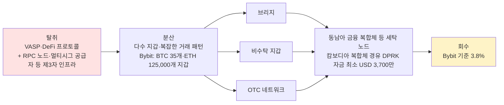
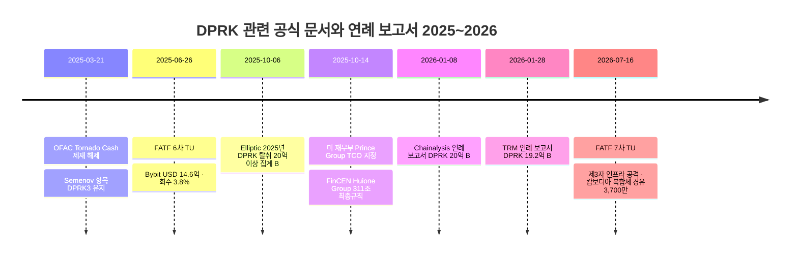

# Lazarus / DPRK — 북한 사이버 자금세탁

> 가상자산 업계 **1순위 위협 행위자**. FATF 6차 Targeted Update(2025-06-26)가 "2025년 최대 단일 탈취"로 기록한 Bybit USD 14.6억 사건의 주체. 이 글을 읽고 나면 왜 FATF·분석업체·미 재무부가 북한(DPRK)을 "해커 집단"이 아니라 **세탁 인프라 전체**로 다루는지, 그리고 2026년 FATF가 무엇을 새 위험으로 지목했는지(제3자 인프라 공격, 동남아 금융 복합체 경유) 설명할 수 있게 됩니다. 마지막 업데이트: 2026-10-21.

> **근거 범위**: 이 노트는 `research/2026-10-*.md` 도시에와 정본 보고서에서 confidence A(일부 B)로 확인된 사실만 쓴다. B 등급은 "(B)"로 표시했다. 이전 판에 있던 조직 계보(RGB·Bureau 121·하위 클러스터), Ronin·Harmony 등 과거 사건의 금액·단계별 세탁 시간표, "48시간 내 $160M layering", "2026-03 $400M 추적", 거래소별 대응·한국 채널 서술은 이 근거 자료로 확인되지 않아 삭제했다.

## TL;DR
- **FATF 6차 TU(2025-06-26)**: DPRK가 2025년 Bybit에서 **USD 14.6억** 탈취 — 2025년 최대 단일 탈취. **회수율 3.8%**, BTC 지갑 35개·ETH 지갑 125,000개 사용
- **2025년 북한 귀속 탈취액은 발행처마다 다르다**: Chainalysis **USD 20억**(Bybit 약 15억 포함, B) · TRM **USD 19.2억**(B) · Elliptic "2025-10-06 기준 이미 20억 이상"(B). 귀속 기준이 달라 병기만 하고 차이를 해석하지 않는다
- **FATF 7차 TU(2026-07-16)**: DPRK는 VASP·DeFi뿐 아니라 **RPC 노드·멀티시그 보안 공급자 같은 제3자 인프라**를 공격하고, **브리지·비수탁 지갑·OTC 네트워크**로 세탁한다(para 33)
- 같은 7차 TU: 캄보디아 소재 금융 복합체가 2021-08~2025-01 최소 USD 40억을 세탁했고 **그중 최소 USD 3,700만이 DPRK 사이버 탈취 자금**(para 29–30)
- 미 재무부는 2025-03-21 Tornado Cash 제재를 해제하면서도 "DPRK에 이익이 되는 거래를 계속 면밀히 감시"한다고 밝혔다

---

## 1. DPRK를 어떻게 부르고 세는가

### 명칭

FATF 문서는 행위자를 **"DPRK"** 로 쓴다. 업계 보고서는 "North Korea-linked actors"(TRM), "North Korea-linked hackers"(Elliptic)처럼 "연계"라는 단서를 붙인다. "Lazarus"는 업계 통칭이고, 그 하위 조직 구분(소속 기관, 하위 클러스터 명칭)은 이 저장소 근거 자료에서 확인하지 않았다 — **공개 근거 미확인**.

### 귀속(attribution)은 확률적이다

Elliptic은 스스로 "Attributing cyber thefts to North Korea is not an exact science"라고 적는다([Elliptic 2025-10-06](https://www.elliptic.co/blog/north-korea-linked-hackers-have-already-stolen-over-2-billion-in-2025), B). 그래서 같은 해 같은 행위자에 대해 업체마다 숫자가 다르다(§3).

### 실무 포인트

KYT 벤더의 "DPRK" 라벨은 **귀속 판단의 결과물**이지 원장 위의 사실이 아니다. 라벨 일치만으로 STR 판단을 끝내지 말고, 라벨의 출처(공식 지정·수사기관 공개·벤더 자체 귀속)를 케이스 기록에 남긴다.

---

## 2. Bybit 사건 — FATF가 기록한 것

FATF 6차 TU가 원문으로 남긴 사실은 다음이 전부다([6차 TU PDF](https://www.fatf-gafi.org/content/dam/fatf-gafi/recommendations/2025-Targeted-Upate-VA-VASPs.pdf.coredownload.pdf), para 28–29):

| 항목 | 6차 TU 원문 |
|---|---|
| 규모 | "stealing $1.46 bn worth of VAs from the VASP ByBit" — 2025년 최대 단일 탈취 |
| 세탁 구조 | "a large number of wallets in complex transaction pattens (35 bitcoin wallets and 125,000 Ethereum wallets)" |
| 회수 | "only 3.8 percent of the stolen funds had been recovered" |

정확한 사고 일시, 공격 경로(서명 인터페이스 변조 여부 등), 공식 귀속 발표일, 사고 후 추적·환전 경과는 이 저장소 근거 자료에서 확인되지 않았다 — **공개 근거 미확인**. 분석업체 수치로는 Chainalysis가 2025년 DPRK 탈취 USD 20억 중 Bybit을 약 15억으로(B)([Chainalysis](https://www.chainalysis.com/blog/2026-crypto-crime-report-introduction/)), TRM이 2025년 해킹·익스플로잇 약 150건 USD 28.7억 중 Bybit을 14.6억으로 적었다(B)([TRM](https://www.trmlabs.com/reports-and-whitepapers/2026-crypto-crime-report)).

7차 TU(2026-07-16) 본문에는 "Bybit"·"1.46" 문자열이 없다. FATF의 헤드라인이 2025년 Bybit에서 2026년 **제3자 인프라 공격·동남아 금융 복합체**로 옮겨 간 것이다(§4).

### 실무 포인트

"회수율 3.8%"가 이 사건의 실무 교훈이다. 탈취 후 회수에 기대는 대응은 통계적으로 실패한다. 방어의 무게는 **탈취 전(키·서명 통제)** 과 **입금 시점(거래소의 노출 스크리닝)** 에 있다.

---

## 2-B. 과거 DPRK 귀속 사건 — 이 저장소에서 검증하지 않은 것

이전 판은 Ronin Bridge(2022), Harmony Horizon(2022), Atomic Wallet(2023), DMM Bitcoin(2024), 한국·일본 거래소 사건 등의 금액·공격 단계·회수액·발견 지연 일수를 표로 실었다. 이 수치들은 `research/2026-10-*` 도시에 어디에도 원문으로 확인돼 있지 않아 **삭제했다(공개 근거 미확인)**. 개별 사건을 인용할 때는 수사기관·피해기관의 1차 발표를 직접 확인한다.

---

## 3. DPRK 탈취 통계 (2025) — 발행처·정의를 함께 적는다

| 발행처(발간일) | 2025년 DPRK 귀속 탈취 | 함께 보고된 맥락 | 등급 |
|---|---|---|---|
| Chainalysis(2026-01-08) | **USD 20억**(Bybit 약 15억 포함) | 2025 불법 주소 수취 최소 1,540억(하한 추정) | B |
| TRM Labs(2026-01-28) | **USD 19.2억** | 해킹·익스플로잇 약 150건 USD 28.7억 | B |
| Elliptic(2025-10-06, 연중) | **USD 20억 이상**(연말 확정치 아님) | 이전 연간 최고 2022년 13.5억, 누적 알려진 탈취 60억 이상 | B |

출처: [Chainalysis](https://www.chainalysis.com/blog/2026-crypto-crime-report-introduction/) · [TRM](https://www.trmlabs.com/reports-and-whitepapers/2026-crypto-crime-report) · [Elliptic](https://www.elliptic.co/blog/north-korea-linked-hackers-have-already-stolen-over-2-billion-in-2025)

읽는 법:
- 세 수치는 **귀속 기준·집계 시점이 다르다**. Chainalysis와 TRM 모두 자기 수치를 "하한(floor)"이고 상향 수정될 수 있다고 밝힌다. 차이(20억 vs 19.2억)를 오차나 우열로 해석하지 않는다.
- 이전 판의 "2025년 $2.02B(+51%)", "누적 $6.75B", "service compromises의 76%"는 위 원문과 일치하지 않거나 원문 확인이 안 돼 삭제했다. 2026년 연중 북한 비중·누적치 보도(TRM 인용 2차 보도)는 C 등급이라 쓰지 않는다.

### 실무 포인트

내부 보고서·이사회 자료에 DPRK 수치를 넣을 때는 **"발행처 · 발간일 · 정의"** 세 가지를 항상 같이 적는다. 숫자 하나만 옮기면 감사 시 출처 대조에서 막힌다.

---

## 4. 자금세탁 패턴 — FATF가 서술한 경로

FATF 6·7차 TU가 원문으로 서술한 DPRK 세탁 경로는 아래와 같다. 단계 사이의 시간·비율·수수료는 원문에 없으므로 그리지 않았다.



근거: 6차 TU para 28–29(지갑 수·회수율), 7차 TU para 29–30(캄보디아 복합체), para 33(제3자 인프라·브리지·비수탁 지갑·OTC)([7차 TU PDF](https://www.fatf-gafi.org/content/dam/fatf-gafi/reports/7th-targeted-update-on-implementation-fatf-standards-vas-vasps-2026.pdf.coredownload.pdf)).

### 단계별로 볼 신호

1. **분산** — 소수 지갑에서 다수 신규 지갑으로의 급속 팬아웃. 7차 TU 권고 6-ii는 VASP가 "detect rapid transfer of VAs using transactions monitoring and blockchain analytics tools"하라고 한다.
2. **브리지** — 체인이 바뀌면 단일 체인 추적이 끊긴다. 7차 TU 권고 6-iv는 브리지·믹서·크로스체인 노출 평가를 요구한다.
3. **비수탁 지갑·OTC** — 거래소 입장에서는 상대방이 VASP가 아닌 구간. 상대방 식별이 안 되는 이전에 대한 위험평가가 필요하다.
4. **세탁 노드** — 7차 TU의 캄보디아 복합체 사례는 사기·지하금융·가상자산 세탁 파이프라인을 잇는 "critical node"였다. 본문은 기업명을 쓰지 않고 각주가 "Huione" 관련 문서를 인용한다. 미국은 2025-10-14 Huione Group을 §311 최종규칙으로 미국 금융시스템에서 끊었다([재무부 sb0278](https://home.treasury.gov/news/press-releases/sb0278)).

이전 판의 6단계 "Lazarus Playbook"(특정 믹서·DEX·브리지 이름, OTC 수수료 5~15%, 평양 송금 경로)은 근거 자료에서 확인되지 않아 삭제했다.

### 실무 포인트

KYT 라벨은 **분산·브리지 단계까지는** 비교적 잘 따라오지만, 비수탁 지갑·OTC·세탁 노드 구간으로 넘어가면 귀속이 늦어진다. 그래서 "DPRK 라벨 직접 노출"만 보는 룰보다 **상대방이 어떤 유형의 노드인가**(브리지·OTC·고위험 결제 네트워크)를 함께 보는 룰이 필요하다. 캄보디아 복합체 사례처럼 세탁 노드 자체가 제재·특별조치 대상이 되면, 노드 단위 차단이 주소 단위 차단보다 넓게 걸린다.

---

## 5. 2026년 FATF가 새로 지목한 패턴

### 제3자 인프라 공격

7차 TU para 33: "The DPRK continues to exploit vulnerabilities not only in VASPs and DeFi protocols, but also in the wider third-party infrastructure on which these services rely, including RPC nodes and multi-signature security providers". 거래소 자체 시스템이 아니라 **거래소가 의존하는 외부 구성요소**가 공격면이라는 뜻이다.

### AI를 이용한 채용사기 (행위자 귀속 없음)

7차 TU para 34는 합성 프로필과 딥페이크 화상 면접으로 신뢰를 쌓은 뒤 악성코드 설치나 지갑 접근 권한을 유도해 **USD 100만 이상(주로 스테이블코인)** 을 탈취한 사례, AI 코딩 도구·에이전트가 스마트컨트랙트 취약점 분석과 익스플로잇 생성에 쓰일 수 있다는 위험을 든다. 이 단락은 **DPRK에 귀속하지 않는다** — 이전 판의 "북한 IT 노동자 원격 채용 급증", "Bitrefill Mirror Attack(2026-03)"은 근거 자료에서 확인되지 않아 삭제했다.

### 실무 포인트

HR·조달도 보안 통제의 일부다. 채용 단계의 신원 확인, 신규 입사자 단말의 권한 최소화, 외부 RPC·멀티시그 공급자에 대한 공급망 실사는 7차 TU가 서술한 공격면에 직접 대응한다. 구체적 방법(화상 면접 의무화, IP 탐지 등)의 업계 표준 여부는 공개 근거가 없다.

---

## 6. 방어 — 회사 차원

### 기술 (탈취 전)
- 키·서명 통제: 단일 서명 흐름에 권한이 몰리지 않게 한다. 서명자가 보는 내용과 실제 서명 데이터가 같은지 검증한다.
- 공급망: RPC 노드·멀티시그 공급자·지갑 SDK 같은 제3자 구성요소를 실사 대상에 넣는다(7차 TU para 33).

### KYT (입금 시점)
- 7차 TU 권고 5-ii가 열거한 통제 요소: "KYC, wallet screening, blacklisting, and, where appropriate, whitelisting mechanisms as well as freezing and blocking capabilities".
- 급속 이전 탐지(권고 6-ii), 브리지·믹서·크로스체인 노출 평가(권고 6-iv).
- 탐지 결과의 법적 출구는 하나가 아니다. 한국에서는 차단·지연(통신사기피해환급법), 통보(가상자산이용자보호법 §12), STR(특금법 §4)이 서로 다른 제도다 — 상세는 [`../../reports/가상자산 AML KYT FDS 트래블룰 흐름.md`](../../reports/가상자산%20AML%20KYT%20FDS%20트래블룰%20흐름.md).

### 협력
- 사고 시 수사기관·FIU·다른 VASP와의 정보 공유. 회수율 3.8%라는 6차 TU 수치는 사후 협력만으로는 부족하다는 근거로 읽는다.

이전 판의 "가상자산이용자보호법 콜드월렛 80% 요구"는 이 노트의 근거 자료로 확인하지 않았다 — 원문은 [`../2-regulations/korea-user-protection.md`](../2-regulations/korea-user-protection.md)에서 확인한다.

---

## 7. 정책적 의미

- 미 재무부는 2025-03-21 Tornado Cash를 SDN에서 삭제하면서(엔티티 1개·ETH 주소 90개) "continue to monitor closely any transactions that may benefit malicious cyber actors or the DPRK"라고 밝혔다. 같은 날 공동개발자 Roman Semenov 항목은 [CYBER2] 태그만 지워지고 **[DPRK3]로 유지**됐다([OFAC 2025-03-21](https://ofac.treasury.gov/recent-actions/20250321)). 상세는 [`tornado-cash.md`](tornado-cash.md).
- 7차 TU에서 한국 이름은 DPRK 언급 외에 본문에 나오지 않는다. 한국은 Annex A 표에만 등장한다.
- FATF 고위험국 명단의 구성은 이 저장소 근거 자료에서 단일 T4로만 확인돼 여기서 쓰지 않는다.

### 연대기 — 근거 자료로 확인되는 DPRK 관련 공식 발표



---

## 8. 학습 포인트

```
- DPRK 수치는 "발행처 · 발간일 · 정의"를 같이 적는다 (Chainalysis 20억 vs TRM 19.2억)
- Bybit 회수율 3.8%(FATF 6차) — 사후 회수에 기대는 대응은 실패한다
- 2026 FATF의 초점: 제3자 인프라(RPC·멀티시그) 공격, 동남아 세탁 노드
- 라벨 직접 노출만 보는 룰은 비수탁 지갑·OTC 구간에서 늦다 → 노드 유형 평가 병행
- 제재 해제(Tornado)가 DPRK 감시 해제는 아니다
```

## 💼 실무 현장 (Industry Reality)

### Bybit 이후 통제 점검표 — FATF 원문에 대응시키기

| 점검 항목 | 대응하는 FATF 원문 |
|---|---|
| 외부 RPC·멀티시그·지갑 SDK 공급자 실사 | 7차 TU para 33 |
| 급속 이전(팬아웃) 탐지 룰 | 7차 TU 권고 6-ii |
| 브리지·크로스체인 노출 평가 | 7차 TU 권고 6-iv |
| 지갑 스크리닝·블랙리스트·동결·차단 역량 | 7차 TU 권고 5-ii |
| 발행자 동결에만 의존하지 않는 자체 통제 | 7차 TU para 35 ([`circle-stablecoin-freeze.md`](circle-stablecoin-freeze.md)) |

이전 판의 "Bybit 내부 탐지 시각", "약 200개 주소 라벨링", "글로벌 거래소 broadcast → 약 $400M 추적" 흐름도와 "4대 거래소 공동 블랙리스트·국정원 비공식 경로", "금융위 2025-08 콜드월렛 가이드라인", 하드웨어 지갑·MPC 업체 동향은 근거 자료에서 확인되지 않아 삭제했다.

### DPRK 노출 탐지 룰 스케치 (의사코드)

임계값은 각 사가 정하는 것이며 공개 벤치마크는 없다. 아래는 구조만 보여 준다.

```python
def dprk_exposure_review(wallet, tx):
    # 1) 공식 지정 주소 직접 대조 (OFAC 등 공식 목록)
    if sanctions_list.contains(tx.counterparty):
        return "BLOCK_AND_ESCALATE"      # 제재 출구: 거래 거절 + 보고 검토
    # 2) 벤더 귀속 라벨 — 출처를 기록하고 사람 검토로 보낸다
    label = vendor.attribution(tx.counterparty)
    if label and label.actor == "DPRK":
        return "REVIEW", label.source     # 귀속은 확률적 (Elliptic)
    # 3) 노드 유형 — 브리지·OTC·고위험 결제 네트워크
    if tx.counterparty_type in {"bridge", "otc", "designated_network"}:
        return "EDD"                      # 7차 TU 권고 6-iv
    # 4) 급속 팬아웃 — 임계값은 자사 튜닝
    if fan_out_rate(wallet) > TUNED_THRESHOLD:
        return "REVIEW"                   # 7차 TU 권고 6-ii
    return None
```

### 자주 나오는 오해

- **"콜드월렛이면 안전"** — 6차 TU는 공격 경로를 서술하지 않지만, 7차 TU는 DPRK가 VASP가 의존하는 제3자 인프라를 공격한다고 적는다. 보관 방식보다 **서명·의존 구성요소**가 공격면이다.
- **"DPRK 라벨만 차단하면 됨"** — 귀속은 확률적이고 늦다. 노드 유형·급속 이전 신호를 병행한다.
- **"사고 후 회수 가능"** — 6차 TU 기준 Bybit 회수율 3.8%.
- **"2025년 북한 탈취액은 $2.02B"** — 어느 발행처 수치인지 확인되지 않는다. Chainalysis 20억, TRM 19.2억, Elliptic 연중 20억 이상(모두 B)으로 병기한다.

### 한국 특수 현실

- 7차 TU Annex A에서 한국은 위험평가·입법·검사·집행·트래블룰이 모두 "Yes", 스테이블코인 발행자 등록·인가 요구는 "No", R.15 등급은 "N/A"(개정 기준 미평가)다([7차 TU PDF](https://www.fatf-gafi.org/content/dam/fatf-gafi/reports/7th-targeted-update-on-implementation-fatf-standards-vas-vasps-2026.pdf.coredownload.pdf)).
- 한국 거래소의 DPRK 관련 공동 대응 채널·과거 피해 회수 경과는 공개 근거가 확인되지 않았다.

---

## 더 읽을거리
- [`tornado-cash.md`](tornado-cash.md) — 제재 해제와 DPRK 감시의 관계
- [`major-enforcement.md`](major-enforcement.md) — 네트워크 단위 제재(Huione·A7)
- [`circle-stablecoin-freeze.md`](circle-stablecoin-freeze.md) — 발행자 동결의 한계
- [`../3-crypto-aml/onchain-typology.md`](../3-crypto-aml/onchain-typology.md) — 자금세탁 패턴
- [`../5-compliance/sanctions-screening.md`](../5-compliance/sanctions-screening.md) — OFAC SDN
- [FATF 6차 Targeted Update (2025)](https://www.fatf-gafi.org/content/dam/fatf-gafi/recommendations/2025-Targeted-Upate-VA-VASPs.pdf.coredownload.pdf)
- [FATF 7차 Targeted Update (2026-07-16)](https://www.fatf-gafi.org/content/dam/fatf-gafi/reports/7th-targeted-update-on-implementation-fatf-standards-vas-vasps-2026.pdf.coredownload.pdf)
- [Chainalysis 2026 Crypto Crime Report 서론](https://www.chainalysis.com/blog/2026-crypto-crime-report-introduction/)
- [TRM Labs 2026 Crypto Crime Report](https://www.trmlabs.com/reports-and-whitepapers/2026-crypto-crime-report)
- [Elliptic — 2025년 북한 연계 탈취 20억 달러 돌파(2025-10-06)](https://www.elliptic.co/blog/north-korea-linked-hackers-have-already-stolen-over-2-billion-in-2025)
