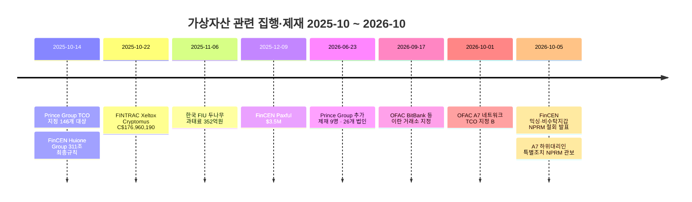
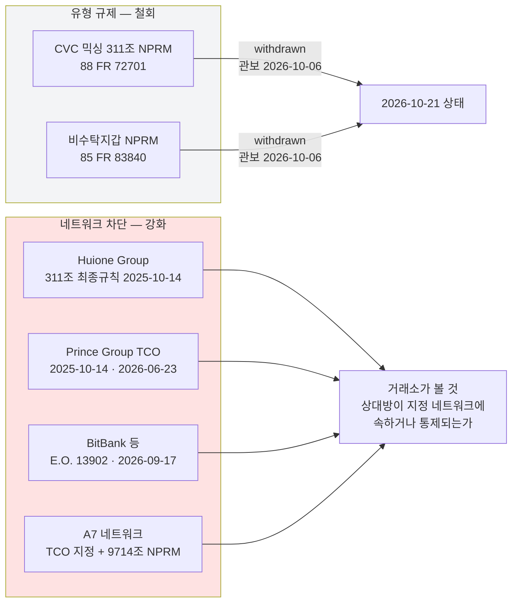

# 주요 Enforcement 사례 — 가상자산 AML 위반과 처벌

> 회사가 **실제로 제재받은 사례**에서 배우자. 이 글을 읽고 나면 2025~2026년 가상자산 집행이 "개별 거래소에 대한 거액 합의"에서 **특정 네트워크·조직 단위 차단**(Huione·Prince Group·A7·BitBank)으로 옮겨 간 흐름, 그리고 "트래블룰 위반만으로 제재된 사건은 2024-01-01~2026-10-21 어느 관할에서도 확인되지 않는다"는 사실을 설명할 수 있게 됩니다. 마지막 업데이트: 2026-10-21.

> **근거 범위**: `research/2026-10-*.md` 도시에와 정본 보고서에서 confidence A(일부 B, "(B)" 표시)로 확인된 사실만 쓴다. 이전 판의 Binance(2023)·OKX·Bittrex·BitMEX·BitGo 사건 금액·합의 조건·형량·모니터십 기간, Binance·OKX 심층분석(§9·§10), 벌금 궤적 차트는 이 근거 자료로 확인되지 않아 삭제했다. 해당 사건을 인용하려면 DOJ·FinCEN·OFAC 원 공고를 직접 확인한다.

## TL;DR
- **2025-10-14** 미 재무부·영국 FCDO: 캄보디아 **Prince Group을 초국가범죄조직(TCO)으로 지정(146개 대상)**, FinCEN은 같은 날 **Huione Group을 §311 최종규칙으로 미국 금융시스템에서 차단**. 2026-06-23 9명·26개 법인 추가 제재
- **2025-12-09** FinCEN: **Paxful $3.5M 민사벌금** — MSB 미등록·AML 프로그램 미비·SAR 미제출. 트래블룰 위반은 사유 아님
- **2025-10-22** 캐나다 FINTRAC: **Xeltox(Cryptomus) C$176,960,190** 행정벌 — "Travel rule"은 정책 결함 목록의 한 항목일 뿐 독립 위반이 아님
- **2026-09-17** OFAC: 이란 거래소 **BitBank** 등 E.O. 13902 지정("Operation Economic Outcast", 2026-08-24~). **2026-10-01** A7 네트워크 TCO 지정(B)
- **2026-10-05~06** FinCEN: 믹싱·비수탁지갑 제안규칙 **withdrawn**, A7 하위대리인 자금이체 금지 특별조치 NPRM **proposed** — 거래 "유형" 규제에서 "네트워크" 차단으로
- 한국: FIU **두나무 과태료 352억원(2025-11-06)** — 고객확인·거래제한·의심거래보고 위반, 트래블룰 사유 아님. 상세는 [`korea-enforcement.md`](korea-enforcement.md)

---

## 1. 글로벌 사례 — 원문으로 확인되는 것

### 연대기



### Prince Group · Huione — 스캠 복합체 단위 차단 (2025-10-14 / 2026-06-23)

- 미 재무부 OFAC는 2025-10-14 영국 FCDO와 공조해 캄보디아 Prince Group을 **TCO로 지정하고 146개 대상(관련 사업체 117개 포함)** 을 제재했다(E.O. 13581, 개정 E.O. 13863). 조직은 최소 10개 스캠 컴파운드 운영·강제노동과 연계됐다. FinCEN은 같은 날 **Huione Group을 미국 금융시스템에서 끊는 §311 최종규칙**을 발동했고, EDNY는 Chen Zhi를 기소했다([재무부 sb0278](https://home.treasury.gov/news/press-releases/sb0278)). 재무부 보도자료 제목은 "U.S. and U.K. Take Largest Action Ever Targeting Cybercriminal Networks in Southeast Asia"다.
- 같은 사건에서 DOJ가 약 150억 달러 상당 비트코인 몰수를 진행했다는 서술은 로펌 요약에만 있다(B)([Willkie 2025-10-15](https://complianceconcourse.willkie.com/articles/u-s-and-u-k-authorities-jointly-target-a-network-based-in-southeast-asia-that-runs-online-investment-scams/)). 비트코인 수량은 원문 미확인.
- 2026-06-23 OFAC는 Prince Group 관련 **9명·26개 법인**을 추가 제재하고 2인자 Hu Xiaowei의 실명을 공개했다. FinCEN은 Huione §311 규칙에 H-Pay Service PLC를 추가하는 개정안을 제안했다. 보도자료는 미국 정부 추정으로 **2024년 미국인이 동남아 스캠 조직에 최소 100억 달러(전년 대비 +66%)** 를 잃었다고 인용했다([재무부 sb0538](https://home.treasury.gov/news/press-releases/sb0538)).
- FATF 7차 TU(2026-07-16)는 캄보디아 소재 금융 복합체가 2021-08~2025-01 **최소 USD 40억**을 세탁했고 그중 **최소 USD 3,700만이 DPRK 사이버 탈취 자금**이라고 적었다. 본문은 기업명을 쓰지 않고 각주가 Huione 관련 FinCEN 특별조치(관보 2025-10-16)를 인용한다. 같은 복합체는 제3자 발행자가 USD 2,900만 이상을 동결한 뒤 "immune to asset freezing"을 내세운 자체 스테이블코인을 발행했다(para 29–30, 35)([7차 TU PDF](https://www.fatf-gafi.org/content/dam/fatf-gafi/reports/7th-targeted-update-on-implementation-fatf-standards-vas-vasps-2026.pdf.coredownload.pdf)).

### Paxful — FinCEN $3.5M (2025-12-09)

FinCEN은 2025-12-09 Paxful, Inc.·Paxful USA, Inc.에 **$3,500,000 민사벌금**을 부과했다. 사유는 **MSB 미등록·AML 프로그램 미비·SAR 미제출**이고, 보도자료에 트래블룰(31 CFR 1010.410(f)) 위반은 없다. 동의명령에서 Paxful은 "willfully violated the BSA"를 인정했다([FinCEN](https://www.fincen.gov/news/news-releases/fincen-assesses-35-million-penalty-against-paxful-facilitating-suspicious)). 이전 판의 "$500M 불법자금 처리", "창립자 유죄 인정"은 이 근거 자료에서 확인되지 않아 삭제했다.

### Xeltox(Cryptomus) — 캐나다 FINTRAC C$176,960,190 (2025-10-22)

FINTRAC은 2025-10-22 Xeltox Enterprises Ltd.(Cryptomus)에 **C$176,960,190** 행정벌(AMP)을 공표했다. 위반 3(PCMLTFR 156(1)(b) 서면 컴플라이언스 정책 미비)의 결함 영역 목록에 "Travel rule"이 들어 있다 — **독립 트래블룰 위반이나 별도 벌금은 아니다**([FINTRAC](https://fintrac-canafe.canada.ca/pen/amps/pen-2025-10-22-eng)). 2024~2026 조사 범위에서 트래블룰이 제재 문서에 명시된 유일한 사례다.

### BitBank · Operation Economic Outcast (2026-09-17)

OFAC는 2026-09-17 이란 디지털자산 거래소 **BitBank**, 개발사 Pishtaz Simorgh Electronic Trade Company, 개인 3인을 **E.O. 13902**로 SDN에 지정했다. 재무부는 기지정자 Babak Zanjani가 2026-06~07 BitBank를 통해 수억 달러 상당 비트코인을 IRGC로 옮겼다고 밝혔다. 이 조치는 2026-08-24 시작된 "Operation Economic Outcast"의 일부다. **OFAC 공고에 디지털화폐 주소는 기재되지 않았다**([OFAC 2026-09-17](https://ofac.treasury.gov/recent-actions/20260917); [재무부 sb0632](https://home.treasury.gov/news/press-releases/sb0632/)).

### A7 네트워크 — 지정 + 특별조치 NPRM (2026-10-01 / 2026-10-05)

- OFAC는 2026-10-01 **A7 Network를 TCO로 지정**했다(E.O. 13581, 개정 E.O. 13863). OFAC 원 공고는 미열람이고 FinCEN NPRM 각주로 확인한 사실이다(B).
- FinCEN은 A7 네트워크가 통제하는 역외 기업("Sub-Agents")과의 거래를 러시아 불법금융 관련 주요 자금세탁 우려 거래군으로 보고, 미국 금융기관의 관련 자금이체를 금지하는 **특별조치 NPRM**(RIN 1506-AB77, 도켓 FINCEN-2026-0265)을 냈다. 관보 2026-10-05, 의견 30일, 상태 **proposed**. 근거는 §311이 아니라 **Combating Russian Money Laundering Act §9714**다. 공고는 A7 네트워크가 Garantex·Grinex·A7A5(루블 스테이블코인)·InDeFi Bank 등과 연계되고 이란과 테러 대리세력도 이용했다고 적는다([Federal Register 2026-20371](https://public-inspection.federalregister.gov/2026-20371.pdf)).
- 분석업체 수치: Chainalysis는 A7A5가 1년 미만에 USD 933억 이상 거래됐다고(B), TRM은 2025년 제재 주체·관할 유입 USD 930억 중 A7A5가 약 720억이라고(B) 적었다. 정의가 달라 같은 값으로 읽지 않는다([Chainalysis](https://www.chainalysis.com/blog/2026-crypto-crime-report-introduction/); [TRM](https://www.trmlabs.com/reports-and-whitepapers/2026-crypto-crime-report)).

### 그 밖의 2026 집행 신호

- **인도** FIU-IND는 2026-09-09 역외 VDA 사업자 15곳에 PMLA 위반을 통지했다([News on AIR](https://newsonair.gov.in/fiu-ind-cracks-down-on-15-vda-service-providers-over-pmla-non-compliance/)).
- **영국** FCA의 2026 과징금 목록(2026-09-30까지 17건)에 MLR Part 7A(트래블룰) 위반 건은 없다([FCA 2026 fines](https://www.fca.org.uk/news/news-stories/2026-fines)).

### 이 저장소에서 검증하지 않은 과거 대형 사건

| 사건(연도) | 이전 판 서술 | 2026-10-21 처리 |
|---|---|---|
| Binance(2023) | 합의 총액·CEO 형량·모니터십 기간·위반 세부 | **공개 근거 미확인** — 근거 자료 범위 밖, 수치 삭제 |
| OKX(2025) | 합의 총액·위반 세부 | **공개 근거 미확인** |
| Bittrex(2022)·BitMEX(2020)·BitGo(2020~2021) | 벌금액·형사 처분 | **공개 근거 미확인** |

### 실무 포인트

2025~2026년 원문으로 확인되는 집행의 공통점은 **사유가 기본 의무**(등록·AML 프로그램·SAR·고객확인)이거나 **특정 조직·네트워크와의 거래 자체**라는 점이다. 트래블룰만으로 제재된 사건은 없다. 그래서 실무 우선순위는 ① 기본 의무의 작동 증거 ② 지정 네트워크와의 직·간접 거래 차단 순이고, 트래블룰은 제재 리스크보다 **상대방 실사·거래 허용 여부** 문제로 다룬다.

---

## 2. 트렌드 — 원문 사례에서 읽히는 방향

### A. 거래 "유형"에서 특정 "네트워크"로



FinCEN은 2026-10-05 믹싱 §311 NPRM과 비수탁지갑 NPRM을 철회하며 "chilling effect on legitimate activity"와 "deregulatory agenda"를 사유로 들었다([Federal Register 2026-20429](https://public-inspection.federalregister.gov/2026-20429.pdf); [Federal Register 2026-20430](https://public-inspection.federalregister.gov/2026-20430.pdf); [FinCEN](https://www.fincen.gov/news/news-releases/fincen-announces-withdrawals-proposed-digital-asset-related-rules)). 같은 주에 A7 특별조치가 나왔다.

### B. 트래블룰은 아직 독립 제재 사유가 아니다

2024-01-01~2026-10-21 어느 관할에서도 트래블룰 위반을 독립 제재 사유로 명시한 사건은 확인되지 않았다. 가장 가까운 사례가 FINTRAC Xeltox다. FATF 7차 TU에 따르면 트래블룰을 입법한 관할의 **60%(55/91)** 는 관련 감독·집행 조치가 한 건도 없었다([7차 TU PDF](https://www.fatf-gafi.org/content/dam/fatf-gafi/reports/7th-targeted-update-on-implementation-fatf-standards-vas-vasps-2026.pdf.coredownload.pdf), para 25).

### C. 스캠 복합체가 AML 집행의 중심 표적

Prince Group·Huione 조치와 7차 TU의 캄보디아 복합체 사례는 같은 방향을 가리킨다. FBI IC3 2025 연례보고서는 가상자산 관련 피해 **113.66억 달러(+22%)**, 가상자산 투자사기 **72.28억 달러**를 기록했다(신고 기반 통계)([FBI IC3 2025](https://www.ic3.gov/AnnualReport/Reports/2025_IC3Report.pdf)).

### D. 이란·러시아 연계 축

2026년 OFAC 가상자산 지정은 이란(BitBank 등)과 러시아 연계(A7) 네트워크에 몰렸다. 주소가 공고에 없는 지정(BitBank)도 있어 **주소 리스트 대조만으로는 부족**하다.

이전 판의 "CCO·CEO 개인 책임 표준화", "벌금 규모 $98K → $4.3B", "모니터십 5년"은 근거 자료로 확인되지 않아 삭제했다.

---

## 3. 한국 Enforcement 사례

상세는 [`korea-enforcement.md`](korea-enforcement.md). 요약:

| 일자 | 내용 | 근거 |
|---|---|---|
| 2025-02-25 | FIU, 두나무 영업 일부정지 3개월(미신고 VASP 거래 금지 위반) | [FIU 보도자료 KDI 미러](https://eiec.kdi.re.kr/policy/materialView.do?num=273166) |
| 2025-09-03 | 가상자산이용자보호법 첫 과징금 — 테더마켓 자전거래 | [금융위 2025-09-03](https://www.fsc.go.kr/po010101/85233) |
| 2025-11-06 | FIU, 두나무 과태료 **352억원** 결정 — 고객확인·거래제한·의심거래보고 등 위반(트래블룰 사유 아님) | [FIU 보도자료 KDI 미러](https://eiec.kdi.re.kr/policy/materialView.do?num=273166) |
| 2026-07-20 | 금융위, 이용자보호법 시행 2년: 조사 완료 40여 건·고발/통보 30여 건·과징금 2건 | [금융위 2026-07-20](https://fsc.go.kr/po010106/87357) |
| 2026-09-23 | API 초단기 시세조종·90% 이상 가장매매 등 4건 고발·통보 | [금융위 2026-09-23](https://www.fsc.go.kr/no010101/87783) |
| 2026-10-13 | FIU, 미신고 사업자 사이트 27건 접속차단(수사기관 통보 누적 44개) | [금융위 2026-10-13](https://www.fsc.go.kr/no010101/87916) |

이전 판의 "서울남부지방법원 2024고단89", "2025-12-02 FIU 보도자료"는 근거 자료에서 확인되지 않아 삭제했다.

### 실무 포인트

한국의 AML 집행 사유는 미국과 같은 축이다 — 고객확인·거래제한·STR·미신고 사업자 거래. 트래블룰(특금법 제5조의3)은 두나무 제재 사유에 없다. 시장감시(이용자보호법 §12) 쪽 집행은 고발·통보·과징금으로 따로 쌓이고 있다.

---

## 4. EU — 권한 이전과 직접 감독 준비

- 2026-01-01 EU AML/CFT 규칙제정·가이던스 권한이 EBA에서 **AMLA**로 넘어갔다. 기존 EBA 가이드라인은 AMLA가 대체할 때까지 유효하다([EBA](https://www.eba.europa.eu/regulation-and-policy/anti-money-laundering-and-countering-financing-terrorism)).
- 2026-10-01 AMLA가 AMLR 첫 RTS 3건 최종안을 집행위에 제출했다(채택 전)([AMLA](https://www.amla.europa.eu/press-release-amla-finalises-key-standards-private-sector_en)). 2026-10-07에는 MiCA 재검토 관련 AML 우선과제 5개를 냈다([AMLA](https://www.amla.europa.eu/amla-identifies-amlcft-priorities-review-mica_en)).
- AMLR은 **2027-07-10 적용 예정(enacted-not-in-force)** 이다([EUR-Lex](https://eur-lex.europa.eu/legal-content/EN/TXT/PDF/?uri=OJ:L_202401624)).
- ESMA 임시 CASP 등록부(2026-10-19)는 379행·고유 LEI 376개다([ESMA CASPS.csv](https://www.esma.europa.eu/sites/default/files/2024-12/CASPS.csv)).

EU 관할에서 CASP 대상 트래블룰·AML 집행 사례는 이 근거 자료에서 확인되지 않았다.

---

## 5. 위반 패턴 — 원문 사례에 나온 사유

| 사유 | 원문 사례 |
|---|---|
| 등록·신고 없이 영업 | Paxful(MSB 미등록), 한국 미신고 사업자 27건 접속차단 |
| AML 프로그램·서면 정책 미비 | Paxful, FINTRAC Xeltox(정책 결함 목록에 트래블룰 포함) |
| 의심거래보고 미제출 | Paxful(SAR), 두나무(의심거래보고 등) |
| 고객확인·거래제한 위반 | 두나무 |
| 미신고 VASP와의 거래 | 두나무 영업 일부정지 |
| 지정 조직·네트워크와의 거래 | Huione·Prince Group·BitBank·A7 |

### 실무 포인트

자체 점검은 이 여섯 줄을 기준으로 **"작동한다는 증거를 댈 수 있는가"** 를 묻는다. 정책 문서가 있는지가 아니라, 샘플 거래에서 그 통제가 실제로 걸렸는지를 보여 줄 수 있어야 한다.

---

## 6. 한국 사업자가 배워야 할 점

```
□ 기본 의무(고객확인·STR·거래제한)가 2025~2026 제재의 실제 사유다
□ 미신고·무인가 상대방과의 거래가 영업정지 사유가 된다 (두나무)
□ 지정 네트워크(Huione·A7 등)는 주소가 아니라 "통제 관계"로 걸린다
□ 주소가 공고되지 않는 지정(BitBank)도 있다 → 상대 VASP 식별·실사
□ 트래블룰은 제재보다 상대방 실사·거래 허용 문제 — 2027-02-19 한국 규율 강화 대비
```

---

## 7. 사고 발생 시 회사 행동 — 시간축 SOP

### 즉시
1. 사실관계 확인 + 증거 보존
2. AMLO + 법무 + 경영진 공유
3. 추가 확산 차단 — 한국에서는 차단·지연(통신사기피해환급법), 통보(이용자보호법 §12), STR(특금법 §4)의 **출구를 구분**한다
4. FIU·감독당국 보고 검토

### 단기
5. 외부 법무 자문
6. 내부 조사
7. 고객·시장 커뮤니케이션(필요 시)

### 중기·장기
8. 시정 계획 + 외부 점검
9. 재발방지책, 시스템·프로세스 개선
10. 임직원 교육

### 실무 포인트

초기 결정(어느 법적 출구로 보낼지, 계정 조치 범위)이 이후 감독 대응을 좌우한다. 평시에 시나리오별 SOP를 써 두고, 출구별 담당 부서(FDS·시장감시·AML)를 미리 정한다. 자진신고 감면 제도의 존재·요건은 이 근거 자료에서 확인하지 않았다.

---

## 8. 체크리스트 — 우리 회사가 이 사례들을 피하려면

```
□ AMLO의 경영진 직접 보고 채널
□ 고객확인 품질 정기 샘플 점검
□ STR 판단·제출 기록의 감사 추적
□ 미신고·무인가 상대방 식별 절차
□ 제재 목록 대조 + 지정 네트워크 통제 관계 확인
□ 사고 대응 SOP 문서화 + 모의훈련
□ 글로벌 집행 공고 월간 모니터링(OFAC·FinCEN·FINTRAC·FCA·FIU)
```

## 💼 실무 현장 (Industry Reality)

### 2025~2026 집행에서 거래소가 바꿔야 할 것

| 신호 | 거래소 조치 |
|---|---|
| Huione §311 최종규칙 | Huione 계열(2026-06-23 개정안의 H-Pay 포함 여부 추적)과의 직·간접 거래 식별 |
| Prince Group TCO | 146개 지정 대상 + 2026-06-23 추가분을 거래 상대·자금원 스크리닝에 반영 |
| BitBank 지정(주소 미기재) | 이란 거래소로의 출금 상대 VASP 식별 — 주소 대조만으로 못 잡는다 |
| A7 특별조치 NPRM | 최종화 전(proposed)이지만 A7A5·Garantex·Grinex 계열 노출 평가 |
| 믹싱 NPRM 철회 | 사내 믹서 정책 근거를 "미국 규칙"에서 "위험 평가"로 재기술 |

### 네트워크 단위 스크리닝 스케치 (의사코드)

```python
def network_screen(tx):
    cp = tx.counterparty
    # 1) 공식 목록 직접 대조
    if sanctions_list.contains(cp.address) or sanctions_list.contains(cp.entity):
        return "REJECT_AND_REPORT"
    # 2) 지정 네트워크의 통제 관계 — 주소가 공고되지 않은 지정 대비
    if cp.vasp and cp.vasp.controlled_by in DESIGNATED_NETWORKS:
        return "REJECT_AND_REVIEW"
    # 3) 분석업체 귀속 — 출처 기록 후 사람 검토
    if analytics.cluster(cp.address) in DESIGNATED_NETWORK_CLUSTERS:
        return "EDD"
    return None
```

이전 판의 "Binance 합의 후 운영 변화" 흐름도, "한국 VASP 변화", "자진신고 감면 실무", "대형 거래소 0~24시간 SOP" 세부는 근거 자료에서 확인되지 않아 삭제했다.

### 자주 나오는 오해

- **"트래블룰을 안 지키면 바로 제재"** — 2024-01-01~2026-10-21 독립 제재 사례 없음. 다만 FINTRAC처럼 정책 결함의 한 항목으로는 등장한다.
- **"미국이 믹서 규칙을 철회했으니 집행 완화"** — 같은 주 특정 네트워크 차단 조치가 나왔다.
- **"제재는 주소 목록 문제"** — BitBank 지정은 공고에 주소가 없다.
- **"소형 사업자는 안전"** — Paxful 동의명령은 고의적 BSA 위반을 인정했다.

### 한국 특수 현실

- 한국 FIU 제재 사유는 고객확인·거래제한·STR·미신고 사업자 거래다. 이 축은 미국 FinCEN 사례(Paxful)와 같다.
- 2026-07~10 금융위 보도자료에는 가상자산사업자 대상 신규 과태료·영업정지·기관경고 발표가 없다(aml-landscape F-041, 발표 부재 A).

---

## 더 읽을거리
- [`korea-enforcement.md`](korea-enforcement.md) — 한국 집행 상세
- [`tornado-cash.md`](tornado-cash.md) — 제재 해제와 형사 트랙
- [`lazarus-dprk.md`](lazarus-dprk.md) — DPRK와 캄보디아 복합체
- [`../2-regulations/us-bsa-fincen.md`](../2-regulations/us-bsa-fincen.md) — 미국 BSA·OFAC 체계
- [`../5-compliance/sanctions-screening.md`](../5-compliance/sanctions-screening.md) — 제재 스크리닝 구현
- [미 재무부 sb0278 — Prince Group·Huione (2025-10-14)](https://home.treasury.gov/news/press-releases/sb0278)
- [FinCEN — Paxful $3.5M (2025-12-09)](https://www.fincen.gov/news/news-releases/fincen-assesses-35-million-penalty-against-paxful-facilitating-suspicious)
- [FINTRAC — Xeltox(Cryptomus) AMP (2025-10-22)](https://fintrac-canafe.canada.ca/pen/amps/pen-2025-10-22-eng)
- [Federal Register 2026-20371 — A7 특별조치 NPRM](https://public-inspection.federalregister.gov/2026-20371.pdf)
